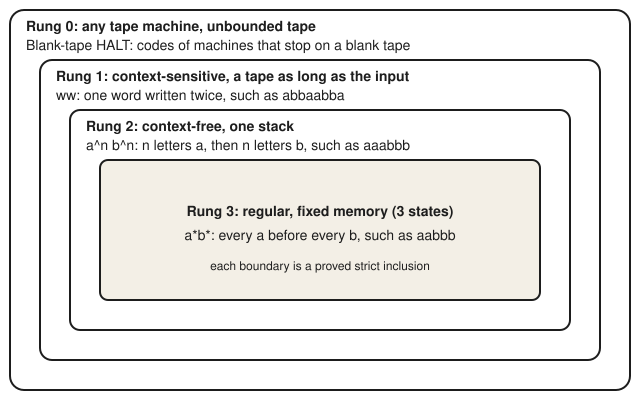

# The language ladder: more memory buys strictly more patterns

[Syllabus](../../../SYLLABUS.md) → [Computability and complexity](../README.md) → [Models of Computation](../README.md#s01) → The language ladder

---

## General Overview

A coffee machine takes coins, then a button press. Write a coin as the letter a and a button press as b. "Every a comes before every b" is a rule about strings of letters. A machine with 3 states checks it, however long the queue of coins.

A bracket checker has a harder job. Write an opening bracket as a and a closing one as b. This card uses **fully nested brackets**: all the openings, then the same number of closings. That is the nested-only part of the bracket language, which also allows abab, the string ()(). The string aaaaabbbbb nests five deep. To accept it, the checker must count the five openings, so its memory grows with the input. A stack (a pile you add to and take from at the top only) does it: the pile reaches height 5.

Two more patterns use the same letters. "One word written twice", such as abbaabba, needs the whole first half kept in order. "The code of a program that stops when started on a blank tape" needs memory with no limit at all. Each of the four needs strictly more memory than the one before.

A **language** is a set of strings, here strings of a and b. Noam Chomsky sorted languages in 1956 and 1959 by the grammars that produce them. His four classes match four machines, ordered by memory: fixed memory, one stack, a tape as long as the input, and an unlimited tape. This card places each pattern on its rung and proves it cannot go lower.

**Each step up the ladder adds memory, and each step buys patterns the step below cannot check, so the four classes of languages are nested and every inclusion is strict.**

**What kind of fact this is:** a theorem, proved on this card in Why it works; the step from the stack to the bounded tape uses the pumping lemma for context-free languages, stated with its key step and its 1961 source, while its use on ww is proved in full in a fold; the top step uses the undecidability of the halting problem, proved on the [Universal machines](09-universal-machines-and-the-halting-problem.md) card and carried to the blank tape in Step 4.

### The picture: four nested classes

<p align="center"></p>

Schematic: box sizes mean nothing. Each box holds every language inside it, and the pattern in each band shows its boundary is strict.

---

## The formula

Notation first, in words. The **alphabet** $`\Sigma`$ is the set of letters, here a and b. A **string** $`w`$ is a finite row of letters, $`\lvert w\rvert`$ is its length, and $`\varepsilon`$ is the empty string. The letters $`a^n`$ mean n copies of a, not a power. The star in $`a^* b^*`$ means "any number of copies, zero included".

The ladder is one chain of inclusions:

```math
\mathrm{REG} \subsetneq \mathrm{CFL} \subsetneq \mathrm{CSL} \subsetneq \mathrm{RE}
```

**Read it aloud:** every regular language is context-free, every context-free language is context-sensitive, every context-sensitive language is recursively enumerable, and at each step some language of the bigger class is missing from the smaller one.

The four patterns are the witnesses, one per step:

```math
a^* b^* \in \mathrm{REG}, \quad \{a^n b^n\} \in \mathrm{CFL} \setminus \mathrm{REG}, \quad \{ww\} \in \mathrm{CSL} \setminus \mathrm{CFL}, \quad \mathrm{HALT}_\varepsilon \in \mathrm{RE} \setminus \mathrm{CSL}
```

**Read it aloud:** "a's before b's" needs only fixed memory; "n a's, then exactly n b's" needs a stack and no less; "a word written twice" needs a tape the length of the input and no less; "programs that stop on a blank tape" needs an unlimited tape.

| Rung | Class, in Chomsky's numbering | Machine | Memory on an input of $`\lvert w\rvert`$ letters | Grammar rules allowed |
| --- | --- | --- | --- | --- |
| 3 | regular, REG, type 3 | finite automaton | a fixed number of states | A → aB or A → a |
| 2 | context-free, CFL, type 2 | stack machine (pushdown automaton) | a stack, up to about $`\lvert w\rvert`$ symbols | one variable becomes any string |
| 1 | context-sensitive, CSL, type 1 | linear bounded automaton: a tape machine kept inside the input's own cells | $`\lvert w\rvert`$ tape cells | no rule makes the string shorter |
| 0 | recursively enumerable, RE, type 0 | tape machine (Turing machine) | unlimited tape | any rule |

| Symbol | Plain meaning | In our example | Push it up and the answer… |
| --- | --- | --- | --- |
| $`\Sigma`$ | the alphabet, the letters allowed | a and b | more letters, same ladder |
| $`w`$, $`\lvert w\rvert`$ | a string and its length in letters | abbaabba, length 8 | longer inputs need more stack or tape |
| $`\varepsilon`$ | the empty string, no letters | in all four example languages except blank-tape HALT | — |
| $`L`$ | a language: a set of strings | the four patterns | — |
| $`a^n`$ | n copies of the letter a | $`a^5`$ is aaaaa | a stack of height n |
| $`ww`$ | a string $`w`$ followed by an exact copy | abba then abba | the whole first half must be stored |
| $`\in`$, $`\setminus`$, $`\subseteq`$, $`\subsetneq`$ | "is in"; "but not in"; "is inside"; "is inside and is smaller" | ww is in CSL but not in CFL; REG inside CFL | — |
| $`\langle M\rangle`$, $`\mathrm{HALT}_\varepsilon`$ | a tape machine $`M`$ written as a string of a and b; blank-tape HALT, the set of codes of machines that stop on a blank tape (the [Universal machines](09-universal-machines-and-the-halting-problem.md) card's HALT holds pairs of code and input instead) | the 20-letter code of the champion below | — |
| $`k`$ | how many letters have been read so far | 2 to 10 | ww needs $`2^k`$ memory states |
| $`p`$ | the pumping length of a context-free language | 1 to 4 in the code | a longer string to pump |
| $`s`$; $`u, v, x, y, z`$; $`t`$; $`m`$; $`i, j`$ | the string pumped; its five pieces; how many times $`v`$ and $`y`$ are repeated; the number of letters in $`vy`$; counts of letters, as in $`a^i`$ | $`s`$ = aabbaabb, cut 51 ways | — |
| $`q`$, $`g`$ | number of states; number of tape letters | 10 and 4 | more configurations, still finitely many |

### When it holds

- **A pattern must be infinite.** Every finite set of strings is regular: a machine can list them all. Cap the brackets at depth 3 and the bracket language drops to rung 3; keep only 2-state machines and blank-tape HALT drops to rung 3 too.
- **Rungs 2 and 1 allow guessing.** These machines may be nondeterministic: allowed every move at once, accepting if any run accepts. Without guessing, a stack machine accepts fewer languages; "a word then its reverse" needs a guess at the middle. Whether the bounded tape needs guessing is open as of 2026-11-19.
- **Rung 1 and the empty string.** A grammar that never shrinks the string cannot produce $`\varepsilon`$. The usual fix allows one rule, start symbol to $`\varepsilon`$, and nothing else changes.
- **Rung 0 accepts, it does not always answer.** A rung-0 machine stops and says yes on exactly the language's strings, and may run for ever on the others. Demand an answer every time and the class shrinks to the decidable languages, strictly between rungs 1 and 0.

---

## Why it works

### Step 0: count what a machine must tell apart

Two beginnings must be told apart when some ending completes one but not the other. The number of beginnings of k letters that must be told apart is the number of memory states the pattern needs at that point. For $`a^n b^n`$ the count grows without limit, so no fixed memory is enough. For ww the count only shows that the first half must be kept in order; Step 3 proves a stack cannot do that.

| Letters read, $`k`$ | a\*b\* | $`a^n b^n`$ | ww |
| ---: | ---: | ---: | ---: |
| 2 | 3 | 3 | 4 |
| 4 | 3 | 4 | 16 |
| 6 | 3 | 5 | 64 |
| 8 | 3 | 6 | 256 |
| 10 | 3 | 7 | 1,024 |

The code finds these by testing every beginning of length k against every ending of up to k letters. The counts match the closed forms 3, k/2 + 2 and $`2^k`$.

```
classes after 8 letters
a*b*      3  █
a^n b^n   6  █
ww      256  ████████████████████████████████████████
```

- **a\*b\*** never needs more than 3 states: "only a's so far", "b's have started", "dead".
- **$`a^n b^n`$** needs a count that grows with k, which a stack can hold.
- **ww** needs the first k letters stored in order. A stack stores them but hands them back reversed.

### Step 1: each machine is a special case of the next

The inclusions are the easy half.

1. A finite automaton is a stack machine that never touches its stack. So REG ⊆ CFL.
2. A context-free grammar can be rewritten so that no rule shrinks the string, apart from the start symbol becoming $`\varepsilon`$. Every stage of a derivation of $`w`$ then has at most $`\lvert w\rvert`$ symbols. A tape machine with $`\lvert w\rvert`$ cells can guess the derivation backwards inside the input's cells. So CFL ⊆ CSL.
3. A linear bounded automaton is a tape machine that stays inside its cells. So CSL ⊆ RE.

S.-Y. Kuroda proved in 1964 that "no rule shrinks the string" grammars and linear bounded automata describe the same languages. That is why the machine column and the grammar column of the table match.

### Step 2: rung 3 to rung 2, with $`a^n b^n`$

Upper bound: the grammar S → aSb | ε, applied n times, gives $`a^n b^n`$. The stack machine pushes a for each a and pops one for each b. On aaaaabbbbb its stack reaches height 5.

Lower bound: the strings $`a^i`$ and $`a^j`$ with i ≠ j must reach different states, since the ending $`b^i`$ completes one and not the other. A machine with $`q`$ states has two of $`a^0, \dots, a^q`$ in one state, and it is then wrong on one of them. The [Pumping and Myhill-Nerode](04-pumping-lemma-and-myhill-nerode.md) card proves this in full.

The code shows the failure on a real machine: an 8-state checker for fully nested brackets, built for depth 3, rejects aaaabbbb. Its states are a count of 0 to 3 a's, then 2, 1 or 0 b's still owed, then dead. The depth-3 checker for all brackets on [Pumping and Myhill-Nerode](04-pumping-lemma-and-myhill-nerode.md) needs only 5 states, and the code counts 5 too. The difference: here no opening may follow a closing, so "two open, still opening" and "two owed, now closing" must be different states. The full bracket language allows abab, so its checker only tracks the depth.

### Step 3: rung 2 to rung 1, with ww

Upper bound: a tape machine checks ww inside the input's own cells. Its rule table has 35 rows. It marks one letter at each end, working inward, to find the middle; an odd length leaves one letter over, and the machine stops with no. Then it carries each letter of the second half back to its partner in the first half. It may read the blank just past each end of the input, as an end marker, but never writes there or moves further; the simulator in the code stops the run if it tries. On abbaabba it writes in the 8 input cells only and takes 89 steps. Each round of marking walks the unmarked stretch there and back, and each carry walks about the whole word, so the count grows with the square of the length: on every string it accepts up to 12 letters, 127 in all, it is $`\lvert w\rvert^2 + 3\lvert w\rvert + 1`$.

Lower bound: the **pumping lemma for context-free languages** (Bar-Hillel, Perles and Shamir, 1961). Every context-free language $`L`$ has a length $`p`$. Every string in $`L`$ of at least $`p`$ letters splits as $`uvxyz`$, with the middle $`vxy`$ at most $`p`$ letters, $`vy`$ not empty, and

```math
u\,v^t\,x\,y^t\,z \in L \quad \text{for every } t = 0, 1, 2, \dots
```

**Read it aloud:** a long string from a context-free language has two short pieces, close together, that can be deleted or repeated together without leaving the language.

The reason is the parse tree, the tree of grammar rules that builds the string. A long string needs a tall tree. A tall path repeats some variable, and the part of the tree between the two copies can be cut out or stacked again.

Now take $`s = a^p b^p a^p b^p`$, which is $`ww`$ with $`w = a^p b^p`$. No split survives pumping, so ww is not context-free. The code checks every split for p = 1 to 4: for p = 2, aabbaabb has 51 splits and none survives.

<details>
<summary>Detailed proof: no split of a^p b^p a^p b^p survives pumping</summary>

Let $`m`$ be the number of letters in $`vy`$, with $`1 \le m \le p`$. The window $`vxy`$ has at most $`p`$ letters, so it meets at most two neighbouring blocks.

If $`m`$ is odd, pumping up to $`t = 2`$ gives an odd length, which is never ww. So take $`m`$ even.

Case 1, the window lies in the first half. Pump up to $`t = 2`$. The string has $`4p + m`$ letters, so its second half starts $`m/2`$ letters before the end of the grown first part. Those letters are b's, since that part still ends in at least $`p`$ b's. The second half starts with b, the first half with a: not ww.

Case 2, the window lies in the second half. Pump up again. The first half now ends $`m/2`$ letters into the grown second part, which starts with at least $`p`$ a's. The first half ends with a, the second half with b: not ww.

Case 3, the window crosses the middle. It lies inside the middle $`b^p a^p`$. Pump down to $`t = 0`$, giving $`a^p b^i a^j b^p`$ with $`i + j < 2p`$. Each half would have $`p + (i + j)/2`$ letters, fewer than $`2p`$. The first half starts with $`p`$ a's, so the second half must too. But the second half is the last $`(i + j)/2`$ letters before the final $`b^p`$, then $`b^p`$, and $`(i + j)/2 < p`$ letters cannot hold $`p`$ a's: not ww.

</details>

A stack fails here for the reason Step 0 gave: it returns the stored half in reverse order. It checks "w then w reversed", which is a different language.

### Step 4: rung 1 to rung 0, with blank-tape HALT

A tape machine can be written as a string of a and b, its code $`\langle M\rangle`$. This card's code starts with a header: $`a^k b`$ for $`k`$ states. Then come the rules in order (state 1 reading 0, state 1 reading 1, and so on). Each rule is a write letter (a for 0, b for 1), a move letter (a for left, b for right), then $`a^j b`$ for the next state $`j`$, with $`j = 0`$ meaning stop. **Blank-tape HALT**, written $`\mathrm{HALT}_\varepsilon`$, is the set of codes of machines that stop when started on a blank tape. The [Universal machines](09-universal-machines-and-the-halting-problem.md) card's HALT is a set of pairs instead: a code and an input.

Upper bound: run the coded machine. If it stops, say yes. That is a tape machine that accepts exactly blank-tape HALT, so it is on rung 0.

Lower bound: every rung-1 language can be decided, meaning a machine always stops with yes or no. A linear bounded automaton with $`q`$ states and $`g`$ tape letters has finitely many configurations (a state, a head position and the tape's contents):

```math
q \cdot \lvert w\rvert \cdot g^{\lvert w\rvert}
```

**Read it aloud:** the number of states, times the number of head positions, times the number of ways to fill the cells.

With $`q = 10`$, $`g = 4`$ and $`\lvert w\rvert = 20`$, that is 219,902,325,555,200. The machine may guess, so it may have many runs. But an accepting run never needs to repeat a configuration: cut out the stretch between the two visits and it still accepts. So if any run accepts, one accepts within that many steps. A simulator that tries every run up to that length always ends, with yes or no.

The [Universal machines](09-universal-machines-and-the-halting-problem.md) card proves that no machine decides HALT for pairs. Blank-tape HALT is no easier. From a machine $`M`$ and an input, build a machine that first writes that input on the blank tape and then runs $`M`$. It stops on a blank tape exactly when $`M`$ stops on that input, so a decider for blank-tape HALT would decide HALT. So blank-tape HALT cannot be decided, and it is not on rung 1.

### Step 5: placing a new pattern

1. Build a machine for it on the lowest rung that works. This gives the upper bound.
2. Prove that the rung below fails, with the tool for that step. Between rungs 3 and 2: count the beginnings that must be told apart. Between rungs 2 and 1: the pumping lemma for context-free languages. Between rungs 1 and 0: show the pattern cannot be decided.
3. The pattern sits on the rung of step 1.

---

## Worked numbers, by hand

| Step | Arithmetic | Value |
| --- | --- | --- |
| strings checked for each pattern | 1 + 2 + 4 + … + 4,096, lengths 0 to 12 | 8,191 |
| strings of length 12 in each pattern | of 4,096: a\*b\*, $`a^n b^n`$, ww | 13, 1, 64 |
| beginnings to tell apart after 8 letters | 3; 8/2 + 2; $`2^8`$ | 3, 6, 256 |
| stack height on aaaaabbbbb | one push per a | 5 |
| tape machine on abbaabba | $`\lvert w\rvert^2 + 3\lvert w\rvert + 1`$ with $`\lvert w\rvert = 8`$ | 89 steps, writing in 8 cells |
| pump aabbaabb (p = 2) | every split $`uvxyz`$ with $`vxy`$ at most 2 letters | 51 splits, 0 survive |
| configurations of a bounded tape | 10 × 20 × $`4^{20}`$ | 219,902,325,555,200 |
| 2-state machines | 12 choices per rule, $`12^4`$ | 20,736 |
| of those, stop within 100 steps | run each one | 9,784, longest 6 steps |
| **the ladder** | upper bound and lower bound for each | **a\*b\* on rung 3, $`a^n b^n`$ on rung 2, ww on rung 1, blank-tape HALT on rung 0** |

Each pattern has a machine on its rung and a proof that the rung below fails, so it sits exactly where the table says.

The 2-state count needs one more fact. Shen Lin and Tibor Radó proved in 1965 that no 2-state machine that stops takes more than 6 steps. So the other 10,952 are not only still running after 100 steps: they never stop. No such bound can be computed for every number of states.

### What breaks if you drop a piece

| Mistake | Comes out at | What went wrong |
| --- | --- | --- |
| Check $`a^n b^n`$ with fixed memory sized for depth 3 (8 states) | misses 3 strings up to 12 letters, first aaaabbbb | fixed memory cannot count past its states |
| Check ww with a stack: push the first half, pop against the second | wrong on 196 even strings up to 12 letters; rejects abab, accepts abba | the stack returns the half reversed, so it checks w then w reversed |
| Call a machine "never stops" after a 5-step cap | 40 stopping machines missed; the champion is "still running after 5 steps" but stops at step 6 | a cap is not a proof; only the 6-step bound for 2 states makes a cap safe |

The code prints all three.

---

## Code, from first principles, and it actually runs

The script builds one machine per rung: a 3-state automaton, a stack machine, a 35-row tape machine and a simulator for coded programs. The tape machine runs on the [Turing machines](07-turing-machines.md) card's simulator, cut down and made to stop the run if the head leaves the input's cells; the coded programs use this card's own small encoding. It takes four independent roads. Each machine is compared with the plain definition and with a generated list, on all 8,191 strings up to 12 letters, and the tape machine's step count with $`\lvert w\rvert^2 + 3\lvert w\rvert + 1`$ on every string it accepts. The beginnings to tell apart are counted and compared with the closed forms 3, k/2 + 2 and $`2^k`$. Every pumping split is tried. Every machine code is decoded back, and the longest stopping run is compared with the 6-step record of Lin and Radó.

### Python

```python
# The language ladder -- the check behind the card.  Standard library only.
# Four patterns over a and b, one per rung; each machine meets its definition and a generated list.
from itertools import product
def strings(n): return [''.join(p) for p in product('ab', repeat=n)]
# rung 3, fixed memory: A = only a's so far, B = b's have started, D = dead
DFA = {('A', 'a'): 'A', ('A', 'b'): 'B', ('B', 'a'): 'D', ('B', 'b'): 'B', ('D', 'a'): 'D', ('D', 'b'): 'D'}
def dfa(w):
    q = 'A'
    for c in w: q = DFA[(q, c)]
    return q != 'D'
# rung 2, one stack: push for each a, pop for each b, never an a after a b
def stack_run(w):
    st, seen_b, high = [], False, 0
    for c in w:
        if c == 'a' and seen_b: return False, high
        if c == 'a': st.append('a'); high = max(high, len(st))
        elif not st: return False, high
        else: seen_b = True; st.pop()
    return not st, high

# rung 1, a tape no longer than the input: the Turing machines card's simulator, cut down (no cap or trace; rows may
# share a line, split at ';'), with one rule added: the head may read the blank past each end but never write or go on.
def table(text): return {(s, r): (w, m, n) for s, r, w, m, n in (l.split() for l in text.replace('\n', ';').split(';') if l.strip())}
def run_tm(rules, word, state):
    tape, head, steps, used = dict(enumerate(word)), 0, 0, set()
    while (state, tape.get(head, '_')) in rules:
        write, move, state = rules[(state, tape.get(head, '_'))]
        assert (0 <= head < len(word) or write == '_') and -1 <= head + (1 if move == 'R' else -1) <= len(word)
        if write != '_': used.add(head)
        tape[head] = write; head += 1 if move == 'R' else -1; steps += 1
    return state == 'accept', steps, len(used)  # stopping in any state but accept means no
# Mark the ends inward to find the middle, then carry each second-half letter back to its partner (Y carried, X matched).
WW = table("""mark a A R right; mark b B R right; mark A Y L carrya; mark B Y L carryb; mark _ _ L accept
right a a R right; right b b R right; right A A L end; right B B L end; right _ _ L end
end a A L left; end b B L left; left a a L left; left b b L left; left A A R mark; left B B R mark
carrya Y Y L carrya; carrya A A L carrya; carrya B B L carrya; carrya X X R isa; carrya _ _ R isa
carryb Y Y L carryb; carryb A A L carryb; carryb B B L carryb; carryb X X R isb; carryb _ _ R isb
isa A X R fwd; isb B X R fwd; fwd A A R fwd; fwd B B R fwd; fwd Y Y R next; next Y Y R next; next A Y L carrya; next B Y L carryb; next _ _ L accept""")
# the plain definitions, and each language generated rather than tested
DEF = {'a*b*': lambda w: 'ba' not in w,
       'a^n b^n': lambda w: w == 'a' * (len(w) // 2) + 'b' * (len(w) // 2),
       'ww': lambda w: w[:len(w) // 2] == w[len(w) // 2:]}
def generate(name, n):
    if name == 'a*b*': return {'a' * i + 'b' * (n - i) for i in range(n + 1)}
    if name == 'a^n b^n':  # grammar S -> aSb | empty, applied n/2 times
        s = ''
        for _ in range(n // 2): s = 'a' + s + 'b'
        return {s} if n % 2 == 0 else set()
    return {u + u for u in strings(n // 2)} if n % 2 == 0 else set()
MACHINE = {'a*b*': dfa, 'a^n b^n': lambda w: stack_run(w)[0], 'ww': lambda w: run_tm(WW, w, 'mark')[0]}
for name in MACHINE:
    checked = 0
    for n in range(13):
        acc = {w for w in strings(n) if MACHINE[name](w)}
        assert acc == {w for w in strings(n) if DEF[name](w)} == generate(name, n), name
        checked += 2 ** n
    print(f"agree {name:<8} machine = definition = generated on {checked} strings, lengths 0 to 12")
print("of 4096 strings of length 12:", ", ".join(f"{k} {len(generate(k, 12))}" for k in MACHINE))
print("stack on aaaaabbbbb: accept", stack_run('aaaaabbbbb')[0], " highest stack", stack_run('aaaaabbbbb')[1])
yes = [w for n in range(13) for w in generate('ww', n)]; fit = sum(run_tm(WW, w, 'mark')[1] == len(w) ** 2 + 3 * len(w) + 1 for w in yes)
acc, k, cells = run_tm(WW, 'abbaabba', 'mark'); assert (acc, k, cells) == (True, 8 ** 2 + 3 * 8 + 1, len('abbaabba')) and fit == len(yes)
print(f"tape on abbaabba: accept {acc}  rows {len(WW)}, cells written {cells}, steps {k}; steps = |w|^2 + 3|w| + 1 on {fit} of {len(yes)} accepted")

# memory needed: how many length-k beginnings must be told apart (endings up to k letters)
def classes(name, k):
    ends = [e for m in range(k + 1) for e in strings(m)]
    return len({tuple(DEF[name](p + e) for e in ends) for p in strings(k)})
for k in (2, 4, 6, 8, 10):
    c = [classes(nm, k) for nm in MACHINE]
    assert c == [3, k // 2 + 2, 2 ** k], c
    print(f"classes after {k:>2} letters: a*b* {c[0]:>4}  a^n b^n {c[1]:>4}  ww {c[2]:>5}")

# ww is not context-free: pump s = a^p b^p a^p b^p at every split u v x y z
for p in range(1, 5):
    s, splits, survive = 'a' * p + 'b' * p + 'a' * p + 'b' * p, 0, 0
    for i in range(len(s)):
        for lv in range(p + 1):
            for lx in range(p + 1 - lv):
                for ly in range(p + 1 - lv - lx):
                    if lv + ly == 0 or i + lv + lx + ly > len(s): continue
                    u, v, x = s[:i], s[i:i + lv], s[i + lv:i + lv + lx]
                    y, z = s[i + lv + lx:i + lv + lx + ly], s[i + lv + lx + ly:]
                    splits += 1
                    survive += all(DEF['ww'](u + v * t + x + y * t + z) for t in range(4))
    assert survive == 0, p
    print(f"pump ww, p = {p}: {s} has {splits} splits, {survive} survive pumping")

# rung 0, this card's own small encoding: states 1 to k, 0 halts.  Header a^k b, then 2k rules in order
# (state 1 reads 0, state 1 reads 1, ...): write a/b = 0/1, move a/b = L/R, next a^j b (j = 0 halts)
def encode(M):
    return 'a' * (len(M) // 2) + 'b' + ''.join('ab'[w] + 'ab'[m == 'R'] + 'a' * nx + 'b' for w, m, nx in M)
def decode(c):
    k = c.index('b'); i, M = k + 1, []
    for _ in range(2 * k):
        j = c.index('b', i + 2)
        M.append(('ab'.index(c[i]), 'LR'['ab'.index(c[i + 1])], j - i - 2)); i = j + 1
    return M
def run(M, cap):
    tape, pos, q = {}, 0, 1
    for step in range(1, cap + 1):
        w, m, nx = M[2 * (q - 1) + tape.get(pos, 0)]
        tape[pos] = w; pos += 1 if m == 'R' else -1; q = nx
        if q == 0: return step, sum(tape.values())
    return None, None

RULES = [(w, m, nx) for w in (0, 1) for m in 'LR' for nx in (0, 1, 2)]
machines = [list(M) for M in product(RULES, repeat=4)]
assert all(decode(encode(M)) == M for M in machines)
res = {cap: [run(M, cap)[0] for M in machines] for cap in (5, 6, 100)}
halt = [s for s in res[100] if s is not None]
champ = [(1, 'R', 2), (1, 'L', 2), (1, 'L', 1), (1, 'R', 0)]
print(f"2-state machines {len(machines)} = {len(RULES)}^4: halt within 100 steps {len(halt)}, longest {max(halt)}, still running {len(machines) - len(halt)}")
print("champion", encode(champ), "halts at step", run(champ, 100)[0], "with ones", run(champ, 100)[1])
assert max(halt) == 6 and run(champ, 100) == (6, 4)
print("tape-bounded configurations q |w| g^|w|, q = 10, |w| = 20, g = 4:", 10 * 20 * 4 ** 20)

# what breaks
def depth3(w):  # fixed memory sized for nesting 3: a count of a's up to 3, then of b's, plus dead
    a = b = 0
    for c in w:
        if c == 'a' and (b or a == 3): return False
        if c == 'a': a += 1
        else: b += 1
    return a == b
def stack_ww(w):  # push the first half, pop against the second: tests w then w reversed
    h = len(w) // 2
    return len(w) % 2 == 0 and w[:h][::-1] == w[h:]
miss3 = [w for n in range(13) for w in strings(n) if depth3(w) != DEF['a^n b^n'](w)]
wrong = [w for n in range(0, 13, 2) for w in strings(n) if stack_ww(w) != DEF['ww'](w)]
assert miss3 == ['aaaabbbb', 'aaaaabbbbb', 'aaaaaabbbbbb'] and 'abab' in wrong and 'abba' in wrong
E8 = [e for m in range(9) for e in strings(m)]; st3 = len({tuple(depth3(p + e) for e in E8) for p in E8}); assert st3 == 4 + 3 + 1
def bal3(w): return all(0 <= w[:i].count('a') - w[:i].count('b') <= 3 for i in range(len(w) + 1)) and w.count('a') == w.count('b')
st5 = len({tuple(bal3(p + e) for e in E8) for p in E8}); assert st5 == 4 + 1  # all brackets to depth 3: depth 0..3, then dead
print(f"break: depth-3 checker ({st3} states; {st5} for all brackets to depth 3) misses", len(miss3), "strings up to 12 letters, first", miss3[0])
print("break: stack used for ww wrong on", len(wrong), "even strings up to 12; abab says", stack_ww('abab'), "abba says", stack_ww('abba'))
print("break: cap 5 misses", sum(1 for a, b in zip(res[5], res[100]) if a != b),
      "halting machines; champion at cap 5:", "still running after 5 steps" if run(champ, 5)[0] is None else "halts",
      "| try: cap 6 misses", sum(1 for a, b in zip(res[6], res[100]) if a != b))
print("figure, boxes x y w h:", "; ".join(f"{10 + 30 * i} {10 + 50 * i} {620 - 60 * i} {380 - 80 * i}" for i in range(4)))
print("ALL CHECKS PASS")
```

**Ran 2026-11-19 on macOS, Python 3.14.10, standard library only. All checks passed. Output, pasted from the run:**

```
agree a*b*     machine = definition = generated on 8191 strings, lengths 0 to 12
agree a^n b^n  machine = definition = generated on 8191 strings, lengths 0 to 12
agree ww       machine = definition = generated on 8191 strings, lengths 0 to 12
of 4096 strings of length 12: a*b* 13, a^n b^n 1, ww 64
stack on aaaaabbbbb: accept True  highest stack 5
tape on abbaabba: accept True  rows 35, cells written 8, steps 89; steps = |w|^2 + 3|w| + 1 on 127 of 127 accepted
classes after  2 letters: a*b*    3  a^n b^n    3  ww     4
classes after  4 letters: a*b*    3  a^n b^n    4  ww    16
classes after  6 letters: a*b*    3  a^n b^n    5  ww    64
classes after  8 letters: a*b*    3  a^n b^n    6  ww   256
classes after 10 letters: a*b*    3  a^n b^n    7  ww  1024
pump ww, p = 1: abab has 8 splits, 0 survive pumping
pump ww, p = 2: aabbaabb has 51 splits, 0 survive pumping
pump ww, p = 3: aaabbbaaabbb has 169 splits, 0 survive pumping
pump ww, p = 4: aaaabbbbaaaabbbb has 415 splits, 0 survive pumping
2-state machines 20736 = 12^4: halt within 100 steps 9784, longest 6, still running 10952
champion aabbbaabbaaabbaabbbb halts at step 6 with ones 4
tape-bounded configurations q |w| g^|w|, q = 10, |w| = 20, g = 4: 219902325555200
break: depth-3 checker (8 states; 5 for all brackets to depth 3) misses 3 strings up to 12 letters, first aaaabbbb
break: stack used for ww wrong on 196 even strings up to 12; abab says False abba says True
break: cap 5 misses 40 halting machines; champion at cap 5: still running after 5 steps | try: cap 6 misses 0
figure, boxes x y w h: 10 10 620 380; 40 60 560 300; 70 110 500 220; 100 160 440 140
ALL CHECKS PASS
```

### Rust

```rust
// The language ladder -- the check behind the card.  std only, no crates.
// Four patterns over a and b, one per rung; each machine meets its definition and a generated list.
use std::collections::{BTreeSet, HashMap, HashSet};
fn strings(n: usize) -> Vec<String> { (0..1usize << n).map(|m| (0..n).map(|i| if m >> (n - 1 - i) & 1 == 0 { 'a' } else { 'b' }).collect()).collect() }
fn py(b: bool) -> &'static str { if b { "True" } else { "False" } }
// rung 3, fixed memory: A = only a's so far, B = b's have started, D = dead
fn dfa(w: &str) -> bool { w.chars().fold('A', |q, c| match (q, c) { ('A', 'a') => 'A', ('A', 'b') => 'B', ('B', 'b') => 'B', _ => 'D' }) != 'D' }
// rung 2, one stack: push for each a, pop for each b, never an a after a b
fn stack_run(w: &str) -> (bool, usize) {
    let (mut st, mut seen_b, mut high) = (Vec::new(), false, 0);
    for c in w.chars() {
        if c == 'a' && seen_b { return (false, high); }
        if c == 'a' { st.push('a'); high = high.max(st.len()); }
        else if st.is_empty() { return (false, high); }
        else { seen_b = true; st.pop(); }
    }
    (st.is_empty(), high)
}
// rung 1, a tape no longer than the input: the Turing machines card's simulator, cut down (no cap or trace; rows may
// share a line, split at ';'), with one rule added: the head may read the blank past each end but never write or go on.
type Rules = HashMap<(String, char), (char, char, String)>;
fn table(text: &str) -> Rules {
    text.split([';', '\n']).filter(|l| !l.trim().is_empty()).map(|l| {
        let f: Vec<&str> = l.split_whitespace().collect(); let c = |i: usize| f[i].chars().next().unwrap();
        ((f[0].to_string(), c(1)), (c(2), c(3), f[4].to_string())) }).collect()
}
fn run_tm(rules: &Rules, word: &str, start: &str) -> (bool, usize, usize) {
    let (mut tape, n): (HashMap<i64, char>, i64) = (word.chars().enumerate().map(|(i, c)| (i as i64, c)).collect(), word.len() as i64);
    let (mut head, mut state, mut steps, mut used) = (0i64, start.to_string(), 0usize, HashSet::new());
    while let Some((write, mv, nxt)) = rules.get(&(state.clone(), *tape.get(&head).unwrap_or(&'_'))) {
        let to = head + if *mv == 'R' { 1 } else { -1 };
        assert!((0 <= head && head < n || *write == '_') && -1 <= to && to <= n);
        if *write != '_' { used.insert(head); }
        tape.insert(head, *write); head = to; steps += 1; state = nxt.clone();
    }
    (state == "accept", steps, used.len()) // stopping in any state but accept means no
}
// Mark the ends inward to find the middle, then carry each second-half letter back to its partner (Y carried, X matched).
const WW: &str = "mark a A R right; mark b B R right; mark A Y L carrya; mark B Y L carryb; mark _ _ L accept
right a a R right; right b b R right; right A A L end; right B B L end; right _ _ L end
end a A L left; end b B L left; left a a L left; left b b L left; left A A R mark; left B B R mark
carrya Y Y L carrya; carrya A A L carrya; carrya B B L carrya; carrya X X R isa; carrya _ _ R isa
carryb Y Y L carryb; carryb A A L carryb; carryb B B L carryb; carryb X X R isb; carryb _ _ R isb
isa A X R fwd; isb B X R fwd; fwd A A R fwd; fwd B B R fwd; fwd Y Y R next; next Y Y R next; next A Y L carrya; next B Y L carryb; next _ _ L accept";
const NAMES: [&str; 3] = ["a*b*", "a^n b^n", "ww"];
// the plain definitions, and each language generated rather than tested
fn def(name: &str, w: &str) -> bool {
    let h = w.len() / 2;
    match name { "a*b*" => !w.contains("ba"), "a^n b^n" => w == "a".repeat(h) + &"b".repeat(h), _ => w[..h] == w[h..] }
}
fn generate(name: &str, n: usize) -> BTreeSet<String> {
    match name {
        "a*b*" => (0..=n).map(|i| "a".repeat(i) + &"b".repeat(n - i)).collect(),
        "a^n b^n" => { // grammar S -> aSb | empty, applied n/2 times
            let mut s = String::new();
            for _ in 0..n / 2 { s = format!("a{}b", s); }
            if n % 2 == 0 { [s].into_iter().collect() } else { BTreeSet::new() }
        }
        _ => if n % 2 == 0 { strings(n / 2).iter().map(|u| format!("{}{}", u, u)).collect() } else { BTreeSet::new() },
    }
}
fn machine(name: &str, w: &str) -> bool { match name { "a*b*" => dfa(w), "a^n b^n" => stack_run(w).0, _ => run_tm(&table(WW), w, "mark").0 } }
// memory needed: how many length-k beginnings must be told apart (endings up to k letters)
fn classes(name: &str, k: usize) -> usize {
    let ends: Vec<String> = (0..=k).flat_map(strings).collect();
    strings(k).iter().map(|p| ends.iter().map(|e| def(name, &format!("{}{}", p, e))).collect()).collect::<HashSet<Vec<bool>>>().len()
}
// rung 0, this card's own small encoding: states 1 to k, 0 halts.  Header a^k b, then 2k rules in order
// (state 1 reads 0, state 1 reads 1, ...): write a/b = 0/1, move a/b = L/R, next a^j b (j = 0 halts)
type Rule = (usize, char, usize);
fn encode(m: &[Rule]) -> String {
    let rules: String = m.iter().map(|&(w, mv, nx)| format!("{}{}{}b", ["a", "b"][w], if mv == 'R' { "b" } else { "a" }, "a".repeat(nx))).collect();
    "a".repeat(m.len() / 2) + "b" + &rules
}
fn decode(c: &str) -> Vec<Rule> {
    let (c, mut m) = (c.as_bytes(), Vec::new());
    let (k, mut i) = (c.iter().position(|&x| x == b'b').unwrap(), c.iter().position(|&x| x == b'b').unwrap() + 1);
    for _ in 0..2 * k {
        let j = i + 2 + c[i + 2..].iter().position(|&x| x == b'b').unwrap();
        m.push(((c[i] == b'b') as usize, if c[i + 1] == b'b' { 'R' } else { 'L' }, j - i - 2)); i = j + 1;
    }
    m
}
fn run(m: &[Rule], cap: usize) -> Option<(usize, usize)> {
    let (mut tape, mut pos, mut q) = (std::collections::HashMap::new(), 0i64, 1usize);
    for step in 1..=cap {
        let (w, mv, nx) = m[2 * (q - 1) + *tape.get(&pos).unwrap_or(&0)];
        tape.insert(pos, w); pos += if mv == 'R' { 1 } else { -1 }; q = nx;
        if q == 0 { return Some((step, tape.values().sum())); }
    }
    None
}
// what breaks: fixed memory sized for nesting 3 (a count of a's up to 3, then of b's), and a stack used for ww
fn depth3(w: &str) -> bool {
    let (mut a, mut b) = (0, 0);
    for c in w.chars() { if c == 'a' && (b > 0 || a == 3) { return false; } if c == 'a' { a += 1 } else { b += 1 } }
    a == b
}
fn bal3(w: &str) -> bool { let mut d = 0i32; w.chars().all(|c| { d += if c == 'a' { 1 } else { -1 }; (0..=3).contains(&d) }) && d == 0 }
fn stack_ww(w: &str) -> bool { w.len() % 2 == 0 && w[..w.len() / 2].chars().rev().collect::<String>() == w[w.len() / 2..] }
fn main() {
    for name in NAMES {
        let mut checked = 0;
        for n in 0..13 {
            let (acc, by_def): (BTreeSet<String>, BTreeSet<String>) = (strings(n).into_iter().filter(|w| machine(name, w)).collect(), strings(n).into_iter().filter(|w| def(name, w)).collect());
            assert!(acc == by_def && by_def == generate(name, n), "{}", name);
            checked += 1 << n;
        }
        println!("agree {:<8} machine = definition = generated on {} strings, lengths 0 to 12", name, checked);
    }
    let counts: Vec<String> = NAMES.iter().map(|k| format!("{} {}", k, generate(k, 12).len())).collect();
    println!("of 4096 strings of length 12: {}", counts.join(", "));
    let ((sa, sh), (la, lk, lc), ww) = (stack_run("aaaaabbbbb"), run_tm(&table(WW), "abbaabba", "mark"), table(WW));
    println!("stack on aaaaabbbbb: accept {}  highest stack {}", py(sa), sh);
    let yes: Vec<String> = (0..13).flat_map(|n| generate("ww", n)).collect();
    let fit = yes.iter().filter(|w| run_tm(&ww, w, "mark").1 == w.len() * w.len() + 3 * w.len() + 1).count();
    assert!((la, lk, lc) == (true, 8 * 8 + 3 * 8 + 1, "abbaabba".len()) && fit == yes.len());
    println!("tape on abbaabba: accept {}  rows {}, cells written {}, steps {}; steps = |w|^2 + 3|w| + 1 on {} of {} accepted", py(la), ww.len(), lc, lk, fit, yes.len());
    for k in [2usize, 4, 6, 8, 10] {
        let c: Vec<usize> = NAMES.iter().map(|nm| classes(nm, k)).collect();
        assert!(c == vec![3, k / 2 + 2, 1 << k], "{:?}", c);
        println!("classes after {:>2} letters: a*b* {:>4}  a^n b^n {:>4}  ww {:>5}", k, c[0], c[1], c[2]);
    }
    // ww is not context-free: pump s = a^p b^p a^p b^p at every split u v x y z
    for p in 1..5usize {
        let s = "a".repeat(p) + &"b".repeat(p) + &"a".repeat(p) + &"b".repeat(p);
        let (mut splits, mut survive) = (0, 0);
        for i in 0..s.len() { for lv in 0..=p { for lx in 0..=p - lv { for ly in 0..=p - lv - lx {
            if lv + ly == 0 || i + lv + lx + ly > s.len() { continue; }
            let (u, v, x) = (&s[..i], &s[i..i + lv], &s[i + lv..i + lv + lx]);
            let (y, z) = (&s[i + lv + lx..i + lv + lx + ly], &s[i + lv + lx + ly..]);
            splits += 1;
            if (0..4).all(|t| def("ww", &format!("{}{}{}{}{}", u, v.repeat(t), x, y.repeat(t), z))) { survive += 1; }
        } } } }
        assert!(survive == 0, "{}", p);
        println!("pump ww, p = {}: {} has {} splits, {} survive pumping", p, s, splits, survive);
    }
    let mut rules = Vec::new();
    for w in 0..2 { for mv in ['L', 'R'] { for nx in 0..3 { rules.push((w, mv, nx)); } } }
    let mut machines: Vec<Vec<Rule>> = vec![vec![]];
    for _ in 0..4 { machines = machines.iter().flat_map(|m| rules.iter().map(move |r| { let mut v = m.clone(); v.push(*r); v })).collect(); }
    assert!(machines.iter().all(|m| decode(&encode(m)) == *m));
    let res = |cap: usize| -> Vec<Option<usize>> { machines.iter().map(|m| run(m, cap).map(|r| r.0)).collect() };
    let (r5, r6, r100) = (res(5), res(6), res(100));
    let halt: Vec<usize> = r100.iter().flatten().cloned().collect();
    let longest = *halt.iter().max().unwrap();
    let champ: Vec<Rule> = vec![(1, 'R', 2), (1, 'L', 2), (1, 'L', 1), (1, 'R', 0)];
    println!("2-state machines {} = {}^4: halt within 100 steps {}, longest {}, still running {}", machines.len(), rules.len(), halt.len(), longest, machines.len() - halt.len());
    let (cs, co) = run(&champ, 100).unwrap();
    assert!(longest == 6 && (cs, co) == (6, 4));
    println!("champion {} halts at step {} with ones {}", encode(&champ), cs, co);
    println!("tape-bounded configurations q |w| g^|w|, q = 10, |w| = 20, g = 4: {}", 10u64 * 20 * 4u64.pow(20));
    let miss3: Vec<String> = (0..13).flat_map(strings).filter(|w| depth3(w) != def("a^n b^n", w)).collect();
    let wrong: Vec<String> = (0..13).step_by(2).flat_map(strings).filter(|w| stack_ww(w) != def("ww", w)).collect();
    assert!(miss3 == vec!["aaaabbbb", "aaaaabbbbb", "aaaaaabbbbbb"] && wrong.contains(&"abab".to_string()) && wrong.contains(&"abba".to_string()));
    let e8: Vec<String> = (0..9).flat_map(strings).collect();
    let st3 = e8.iter().map(|p| e8.iter().map(|e| depth3(&format!("{}{}", p, e))).collect()).collect::<HashSet<Vec<bool>>>().len();
    assert!(st3 == 4 + 3 + 1); // a count 0..3, then 2, 1 or 0 b's still owed, then dead
    let st5 = e8.iter().map(|p| e8.iter().map(|e| bal3(&format!("{}{}", p, e))).collect()).collect::<HashSet<Vec<bool>>>().len();
    assert!(st5 == 4 + 1); // all brackets to depth 3: depth 0..3, then dead
    println!("break: depth-3 checker ({} states; {} for all brackets to depth 3) misses {} strings up to 12 letters, first {}", st3, st5, miss3.len(), miss3[0]);
    println!("break: stack used for ww wrong on {} even strings up to 12; abab says {} abba says {}", wrong.len(), py(stack_ww("abab")), py(stack_ww("abba")));
    let miss = |r: &Vec<Option<usize>>| r.iter().zip(&r100).filter(|(a, b)| a != b).count();
    let c5 = if run(&champ, 5).is_none() { "still running after 5 steps" } else { "halts" };
    println!("break: cap 5 misses {} halting machines; champion at cap 5: {} | try: cap 6 misses {}", miss(&r5), c5, miss(&r6));
    let boxes: Vec<String> = (0..4).map(|i| format!("{} {} {} {}", 10 + 30 * i, 10 + 50 * i, 620 - 60 * i, 380 - 80 * i)).collect();
    println!("figure, boxes x y w h: {}", boxes.join("; "));
    println!("ALL CHECKS PASS");
}
```

**Ran 2026-11-19 on macOS, rustc 1.98.1, no crates. All checks passed. Output, pasted from the run:**

```
agree a*b*     machine = definition = generated on 8191 strings, lengths 0 to 12
agree a^n b^n  machine = definition = generated on 8191 strings, lengths 0 to 12
agree ww       machine = definition = generated on 8191 strings, lengths 0 to 12
of 4096 strings of length 12: a*b* 13, a^n b^n 1, ww 64
stack on aaaaabbbbb: accept True  highest stack 5
tape on abbaabba: accept True  rows 35, cells written 8, steps 89; steps = |w|^2 + 3|w| + 1 on 127 of 127 accepted
classes after  2 letters: a*b*    3  a^n b^n    3  ww     4
classes after  4 letters: a*b*    3  a^n b^n    4  ww    16
classes after  6 letters: a*b*    3  a^n b^n    5  ww    64
classes after  8 letters: a*b*    3  a^n b^n    6  ww   256
classes after 10 letters: a*b*    3  a^n b^n    7  ww  1024
pump ww, p = 1: abab has 8 splits, 0 survive pumping
pump ww, p = 2: aabbaabb has 51 splits, 0 survive pumping
pump ww, p = 3: aaabbbaaabbb has 169 splits, 0 survive pumping
pump ww, p = 4: aaaabbbbaaaabbbb has 415 splits, 0 survive pumping
2-state machines 20736 = 12^4: halt within 100 steps 9784, longest 6, still running 10952
champion aabbbaabbaaabbaabbbb halts at step 6 with ones 4
tape-bounded configurations q |w| g^|w|, q = 10, |w| = 20, g = 4: 219902325555200
break: depth-3 checker (8 states; 5 for all brackets to depth 3) misses 3 strings up to 12 letters, first aaaabbbb
break: stack used for ww wrong on 196 even strings up to 12; abab says False abba says True
break: cap 5 misses 40 halting machines; champion at cap 5: still running after 5 steps | try: cap 6 misses 0
figure, boxes x y w h: 10 10 620 380; 40 60 560 300; 70 110 500 220; 100 160 440 140
ALL CHECKS PASS
```

### Lean

Lean proves the claims about rungs 3, 2 and 0 for the card's four patterns, and the finite-set rule for any alphabet.

- Every regular language over a and b is context-free.
- a\*b\* is regular.
- $`a^n b^n`$ is context-free but not regular, so rung 2 holds strictly more than rung 3.
- ww is not context-free.
- A machine stops and says yes on exactly the codes in blank-tape HALT, so it is on rung 0.
- No machine decides blank-tape HALT. Lean writes each program as its own kind of code, and starts it on input 0 in place of a blank tape.
- Every finite set of strings is regular, whatever the alphabet.
- Take any finite automaton that accepts exactly $`a^n b^n`$, and two counts $`i \ne j`$. Then $`a^i`$ and $`a^j`$ end in different states.
- abbaabba is in ww, aaaaabbbbb is in $`a^n b^n`$, and aabbb is in a\*b\*.
- The 8-state depth-3 checker accepts aaabbb and sends aaaabbbb to its dead state.
- The worked-number arithmetic checks, such as $`8^2 + 3 \cdot 8 + 1 = 89`$.

Rung 1, missing from Lean's library, is left to the Python and Rust checks and the proofs above, as are the runs and counts.

```lean
-- The language ladder: fixed memory checks a*b*, a stack checks a^n b^n but no DFA does, ww has no context-free grammar, and blank-tape HALT is semidecidable but not decidable.
import Mathlib.Computability.DFA
import Mathlib.Computability.ContextFreeGrammar
import Mathlib.Computability.Halting
import Mathlib.Computability.MyhillNerode
import Mathlib.Data.Set.Finite.Lattice

/-! Mathlib defines regular languages (`Language.IsRegular`, by a DFA), context-free languages
(`Language.IsContextFree`, by a grammar) and semidecidable and decidable predicates (`REPred`,
`ComputablePred`, by partial recursive functions). It has no context-sensitive languages or
linear bounded automata, so rung 1 itself is not stated here: the file states that ww is not
context-free (the lower half of the rung-1 step) and that blank-tape HALT is semidecidable but
not decidable (what the rung-0 step rests on, since every rung-1 language is decidable).
Programs are Mathlib's codes `Nat.Partrec.Code`, and the blank tape is the input 0. -/

/-- The card's two letters: a (a coin, an opening bracket) and b (a button, a closing one). -/
inductive Letter | a | b
  deriving DecidableEq

open Letter

/-- Rung 3's pattern a*b*: every a comes before every b. -/
def abStar : Language Letter := {w | ∃ i j : ℕ, w = List.replicate i a ++ List.replicate j b}

/-- Rung 2's pattern a^n b^n: fully nested brackets, n openings then n closings. -/
def anbn : Language Letter := {w | ∃ n : ℕ, w = List.replicate n a ++ List.replicate n b}

/-- Rung 1's pattern ww: one word written twice. -/
def ww : Language Letter := {w | ∃ u : List Letter, w = u ++ u}

/-- Rung 0's pattern, blank-tape HALT: the programs that stop when started on a blank tape
(input 0). -/
def haltBlank (c : Nat.Partrec.Code) : Prop := (c.eval 0).Dom


namespace LadderAux
open ContextFreeGrammar

/-- Parse forests: `Gen g l w` says the list of symbols `l` yields the terminal word `w`. -/
inductive Gen {T : Type} (g : ContextFreeGrammar T) : List (Symbol T g.NT) → List T → Prop
  | nil : Gen g [] []
  | term (t : T) {l : List (Symbol T g.NT)} {w : List T} :
      Gen g l w → Gen g (Symbol.terminal t :: l) (t :: w)
  | nt (r : ContextFreeRule T g.NT) (hr : r ∈ g.rules) {l : List (Symbol T g.NT)} {v w : List T} :
      Gen g r.output v → Gen g l w → Gen g (Symbol.nonterminal r.input :: l) (v ++ w)

variable {T : Type} {g : ContextFreeGrammar T}

lemma gen_derives {l : List (Symbol T g.NT)} {w : List T} (h : Gen g l w) :
    g.Derives l (w.map Symbol.terminal) := by
  induction h with
  | nil => exact Derives.refl _
  | term t _ ih => simpa using ih.append_left [Symbol.terminal t]
  | @nt r hr l' v w' _ _ ih1 ih2 =>
    have h1 : g.Produces (Symbol.nonterminal r.input :: l') (r.output ++ l') :=
      ⟨r, hr, ContextFreeRule.Rewrites.head l'⟩
    refine h1.single.trans ?_
    rw [List.map_append]
    exact (ih1.append_right _).trans (ih2.append_left _)
#print axioms gen_derives

lemma gen_append {l1 l2 : List (Symbol T g.NT)} {w1 w2 : List T} (h1 : Gen g l1 w1)
    (h2 : Gen g l2 w2) : Gen g (l1 ++ l2) (w1 ++ w2) := by
  induction h1 with
  | nil => simpa using h2
  | term t _ ih => simpa using Gen.term t ih
  | nt r hr _ _ _ ih2 => simpa using Gen.nt r hr ‹_› ih2
#print axioms gen_append

lemma gen_split {l1 l2 : List (Symbol T g.NT)} {w : List T} (h : Gen g (l1 ++ l2) w) :
    ∃ w1 w2, w = w1 ++ w2 ∧ Gen g l1 w1 ∧ Gen g l2 w2 := by
  induction l1 generalizing w with
  | nil => exact ⟨[], w, rfl, Gen.nil, h⟩
  | cons s l ih =>
    cases h with
    | term t h' =>
      obtain ⟨w1, w2, rfl, h1, h2⟩ := ih h'
      exact ⟨t :: w1, w2, rfl, Gen.term t h1, h2⟩
    | nt r hr hv h' =>
      obtain ⟨w1, w2, rfl, h1, h2⟩ := ih h'
      exact ⟨_ ++ w1, w2, by simp, Gen.nt r hr hv h1, h2⟩
#print axioms gen_split

lemma gen_map_terminal (w : List T) : Gen g (w.map Symbol.terminal) w := by
  induction w with
  | nil => exact Gen.nil
  | cons t w ih => exact Gen.term t ih
#print axioms gen_map_terminal

lemma derives_gen {l : List (Symbol T g.NT)} {w : List T}
    (h : g.Derives l (w.map Symbol.terminal)) : Gen g l w := by
  induction h using Relation.ReflTransGen.head_induction_on with
  | refl => exact gen_map_terminal w
  | head hp _ ih =>
    obtain ⟨r, hr, hrw⟩ := hp
    obtain ⟨p, q, rfl, rfl⟩ := hrw.exists_parts
    obtain ⟨w12, w3, rfl, h12, h3⟩ := gen_split ih
    obtain ⟨w1, w2, rfl, h1, h2⟩ := gen_split h12
    have := gen_append h1 (Gen.nt r hr h2 h3)
    simpa using this
#print axioms derives_gen


/-- Pumping down: removing `v` and `y` from `w = u v x y z` leaves a word `l` still yields. -/
def PumpL (g : ContextFreeGrammar T) (p : ℕ) (l : List (Symbol T g.NT)) (w : List T) : Prop :=
  ∃ u v x y z : List T, w = u ++ v ++ x ++ y ++ z ∧ v ++ y ≠ [] ∧ (v ++ x ++ y).length ≤ p ∧
    g.Derives l ((u ++ x ++ z).map Symbol.terminal)

/-- The invariant at one symbol. -/
def SymInv (g : ContextFreeGrammar T) (I : Finset g.NT) (b p : ℕ) (s : Symbol T g.NT)
    (w : List T) : Prop :=
  PumpL g p [s] w ∨ ∃ S ⊆ I, w.length ≤ b ^ S.card ∧
    ∀ Y ∈ S, ∃ u x y : List T, w = u ++ x ++ y ∧
      g.Derives [Symbol.nonterminal Y] (x.map Symbol.terminal)

/-- The invariant at a list of symbols. -/
def ListInv (g : ContextFreeGrammar T) (I : Finset g.NT) (b p : ℕ) (l : List (Symbol T g.NT))
    (w : List T) : Prop :=
  PumpL g p l w ∨ ∃ S ⊆ I, w.length ≤ l.length * b ^ S.card ∧
    ∀ Y ∈ S, ∃ u x y : List T, w = u ++ x ++ y ∧
      g.Derives [Symbol.nonterminal Y] (x.map Symbol.terminal) ∧
      (x.length < w.length ∨ w.length ≤ b ^ S.card)

lemma listInv_nil (I : Finset g.NT) (b p : ℕ) : ListInv g I b p [] [] :=
  Or.inr ⟨∅, Finset.empty_subset _, by simp, by simp⟩
#print axioms listInv_nil

lemma symInv_term (I : Finset g.NT) (b p : ℕ) (t : T) : SymInv g I b p (Symbol.terminal t) [t] :=
  Or.inr ⟨∅, Finset.empty_subset _, by simp, by simp⟩
#print axioms symInv_term

lemma listInv_cons {I : Finset g.NT} {b p : ℕ} (hb : 1 ≤ b) {s : Symbol T g.NT}
    {l : List (Symbol T g.NT)} {w1 w2 : List T}
    (hs : g.Derives [s] (w1.map Symbol.terminal)) (hl : g.Derives l (w2.map Symbol.terminal))
    (h1 : SymInv g I b p s w1) (h2 : ListInv g I b p l w2) :
    ListInv g I b p (s :: l) (w1 ++ w2) := by
  rcases h1 with ⟨u, v, x, y, z, rfl, hvy, hlen, hd⟩ | ⟨S1, hS1, hlen1, hc1⟩
  · left
    refine ⟨u, v, x, y, z ++ w2, by simp, hvy, hlen, ?_⟩
    have := (hd.append_right l).trans (hl.append_left _)
    simpa using this
  rcases h2 with ⟨u, v, x, y, z, rfl, hvy, hlen, hd⟩ | ⟨S2, hS2, hlen2, hc2⟩
  · left
    refine ⟨w1 ++ u, v, x, y, z, by simp, hvy, hlen, ?_⟩
    have := (hs.append_right l).trans (hd.append_left _)
    simpa using this
  right
  simp only [List.length_cons, List.length_append]
  rcases le_total S2.card S1.card with hc | hc
  · have hpow : b ^ S2.card ≤ b ^ S1.card := Nat.pow_le_pow_right hb hc
    refine ⟨S1, hS1, ?_, ?_⟩
    · have := Nat.mul_le_mul_left l.length hpow
      rw [Nat.add_mul, Nat.one_mul]; omega
    · intro Y hY
      obtain ⟨u, x, y, rfl, hd⟩ := hc1 Y hY
      refine ⟨u, x, y ++ w2, by simp, hd, ?_⟩
      simp only [List.length_append] at hlen1 ⊢
      omega
  · have hpow : b ^ S1.card ≤ b ^ S2.card := Nat.pow_le_pow_right hb hc
    refine ⟨S2, hS2, ?_, ?_⟩
    · rw [Nat.add_mul, Nat.one_mul]; omega
    · intro Y hY
      obtain ⟨u, x, y, rfl, hd, hor⟩ := hc2 Y hY
      refine ⟨w1 ++ u, x, y, by simp, hd, ?_⟩
      simp only [List.length_append] at hor ⊢
      omega
#print axioms listInv_cons

lemma symInv_node {I : Finset g.NT} {b p : ℕ} (hb : 1 ≤ b)
    (hbr : ∀ r ∈ g.rules, r.output.length ≤ b) (hI : ∀ r ∈ g.rules, r.input ∈ I)
    (hp : b ^ (I.card + 1) ≤ p) {r : ContextFreeRule T g.NT} (hr : r ∈ g.rules) {v : List T}
    (hv : g.Derives r.output (v.map Symbol.terminal)) (h : ListInv g I b p r.output v) :
    SymInv g I b p (Symbol.nonterminal r.input) v := by
  classical
  have hstep : g.Derives [Symbol.nonterminal r.input] r.output :=
    Produces.single ⟨r, hr, ContextFreeRule.Rewrites.input_output⟩
  rcases h with ⟨u, v', x, y, z, rfl, hvy, hlen, hd⟩ | ⟨S, hS, hlen, hc⟩
  · exact Or.inl ⟨u, v', x, y, z, rfl, hvy, hlen, hstep.trans hd⟩
  have hSI : S.card ≤ I.card := Finset.card_le_card hS
  have hv1 : v.length ≤ b ^ (S.card + 1) := by
    have := Nat.mul_le_mul_right (b ^ S.card) (hbr r hr)
    rw [pow_succ, Nat.mul_comm (b ^ S.card) b]; exact hlen.trans this
  have hvp : v.length ≤ p :=
    hv1.trans ((Nat.pow_le_pow_right hb (by omega)).trans hp)
  by_cases hX : r.input ∈ S
  · obtain ⟨u, x, y, rfl, hd, hor⟩ := hc _ hX
    rcases hor with hlt | hle
    · left
      refine ⟨[], u, x, y, [], by simp, ?_, by simpa using hvp, by simpa using hd⟩
      intro h0
      simp only [List.append_eq_nil_iff] at h0
      obtain ⟨rfl, rfl⟩ := h0
      simp at hlt
    · right
      refine ⟨S, hS, hle, fun Y hY => ?_⟩
      obtain ⟨u', x', y', he, hd', -⟩ := hc Y hY
      exact ⟨u', x', y', he, hd'⟩
  · right
    refine ⟨insert r.input S, Finset.insert_subset (hI r hr) hS, ?_, ?_⟩
    · rw [Finset.card_insert_of_notMem hX]; exact hv1
    · intro Y hY
      rcases Finset.mem_insert.mp hY with rfl | hY
      · exact ⟨[], v, [], by simp, hstep.trans hv⟩
      · obtain ⟨u', x', y', he, hd', -⟩ := hc Y hY
        exact ⟨u', x', y', he, hd'⟩
#print axioms symInv_node

lemma gen_listInv {I : Finset g.NT} {b p : ℕ} (hb : 1 ≤ b)
    (hbr : ∀ r ∈ g.rules, r.output.length ≤ b) (hI : ∀ r ∈ g.rules, r.input ∈ I)
    (hp : b ^ (I.card + 1) ≤ p) {l : List (Symbol T g.NT)} {w : List T} (h : Gen g l w) :
    ListInv g I b p l w := by
  induction h with
  | nil => exact listInv_nil I b p
  | term t hl ih =>
    exact listInv_cons (w1 := [t]) hb (Derives.refl _) (gen_derives hl) (symInv_term I b p t) ih
  | nt r hr hv hl ih1 ih2 =>
    have hd := gen_derives hv
    have hstep : g.Derives [Symbol.nonterminal r.input] r.output :=
      Produces.single ⟨r, hr, ContextFreeRule.Rewrites.input_output⟩
    exact listInv_cons hb (hstep.trans hd) (gen_derives hl)
      (symInv_node hb hbr hI hp hr hd ih1) ih2
#print axioms gen_listInv

/-- The pumping lemma for context-free languages, pumping down only. -/
theorem cf_pump_down (g : ContextFreeGrammar T) : ∃ p : ℕ, 1 ≤ p ∧ ∀ w ∈ g.language,
    p ≤ w.length → ∃ u v x y z : List T, w = u ++ v ++ x ++ y ++ z ∧ v ++ y ≠ [] ∧
      (v ++ x ++ y).length ≤ p ∧ u ++ x ++ z ∈ g.language := by
  classical
  set I := g.rules.image ContextFreeRule.input
  set b := 2 + g.rules.sup (fun r => r.output.length)
  have hb : 1 ≤ b := by omega
  have hb2 : 2 ≤ b := by omega
  have hbr : ∀ r ∈ g.rules, r.output.length ≤ b := fun r hr => by
    have := Finset.le_sup (f := fun r : ContextFreeRule T g.NT => r.output.length) hr
    omega
  have hI : ∀ r ∈ g.rules, r.input ∈ I := fun r hr => Finset.mem_image_of_mem _ hr
  refine ⟨b ^ (I.card + 1), Nat.one_le_pow _ _ (by omega), fun w hw hlen => ?_⟩
  have hg := derives_gen hw
  rcases gen_listInv hb hbr hI le_rfl hg with ⟨u, v, x, y, z, he, hvy, hl, hd⟩ | ⟨S, hS, hl, -⟩
  · exact ⟨u, v, x, y, z, he, hvy, hl, hd⟩
  · exfalso
    have h1 : b ^ S.card ≤ b ^ I.card := Nat.pow_le_pow_right hb (Finset.card_le_card hS)
    have h2 : b ^ I.card < b ^ (I.card + 1) := Nat.pow_lt_pow_right hb2 (by omega)
    simp at hl
    omega
#print axioms cf_pump_down

end LadderAux

namespace LadderAux

lemma W_get (p j : ℕ) :
    (List.replicate p a ++ List.replicate p b ++ (List.replicate p a ++ List.replicate p b))[j]? =
      if j < p then some a else if j < 2 * p then some b else if j < 3 * p then some a
      else if j < 4 * p then some b else none := by
  simp only [List.getElem?_append, List.getElem?_replicate, List.length_append,
    List.length_replicate]
  split_ifs <;> first | rfl | omega
#print axioms W_get

theorem ww_not_cf : ¬ ww.IsContextFree := by
  rintro ⟨g, hg⟩
  obtain ⟨p, hp1, hpump⟩ := cf_pump_down g
  set W := List.replicate p a ++ List.replicate p b ++ (List.replicate p a ++ List.replicate p b)
    with hWdef
  have hWmem : W ∈ g.language := by rw [hg]; exact ⟨_, rfl⟩
  have hWlen : W.length = 4 * p := by simp [hWdef]; omega
  obtain ⟨u, v, x, y, z, hW, hvy, hlen, hmem⟩ := hpump W hWmem (by omega)
  rw [hg] at hmem
  obtain ⟨t, ht⟩ := hmem
  have hvy' : 1 ≤ v.length + y.length := by
    have := List.length_pos_of_ne_nil hvy
    simp only [List.length_append] at this; omega
  have hl1 : u.length + v.length + x.length + y.length + z.length = 4 * p := by
    rw [← hWlen, hW]; simp; omega
  have hl2 : u.length + x.length + z.length = 2 * t.length := by
    have := congrArg List.length ht; simp at this; omega
  simp only [List.length_append] at hlen
  -- reading letters of `u x z`
  have L1 : ∀ i, i < u.length → (u ++ x ++ z)[i]? = W[i]? := by
    intro i hi
    rw [hW, List.append_assoc u x z, List.getElem?_append_left hi]
    simp only [List.append_assoc]
    rw [List.getElem?_append_left hi]
  have L2 : ∀ i, u.length + x.length ≤ i →
      (u ++ x ++ z)[i]? = W[i + v.length + y.length]? := by
    intro i hi
    have e : W = (u ++ v ++ x ++ y) ++ z := by rw [hW]
    rw [e, List.getElem?_append_right (by simpa using hi),
      List.getElem?_append_right (by simp; omega)]
    congr 1; simp; omega
  have L3 : ∀ i, i < t.length → (u ++ x ++ z)[i]? = (u ++ x ++ z)[i + t.length]? := by
    intro i hi
    rw [ht, List.getElem?_append_left hi, List.getElem?_append_right (by omega)]
    congr 1; omega
  have hab : (some a : Option Letter) ≠ some b := by simp
  by_cases hA : 2 * p ≤ u.length
  · have e1 := L3 0 (by omega)
    rw [Nat.zero_add] at e1
    rw [L1 0 (by omega), L1 t.length (by omega), W_get, W_get] at e1
    simp only [show 0 < p by omega, show ¬ t.length < p by omega,
      show t.length < 2 * p by omega, ↓reduceIte] at e1
    exact hab e1
  by_cases hB : u.length + v.length + x.length + y.length ≤ 2 * p
  · have e1 := L3 (t.length - 1) (by omega)
    rw [L2 (t.length - 1) (by omega), L2 (t.length - 1 + t.length) (by omega), W_get,
      W_get] at e1
    simp only [show ¬ t.length - 1 + v.length + y.length < p by omega,
      show ¬ t.length - 1 + v.length + y.length < 2 * p by omega,
      show t.length - 1 + v.length + y.length < 3 * p by omega,
      show ¬ t.length - 1 + t.length + v.length + y.length < p by omega,
      show ¬ t.length - 1 + t.length + v.length + y.length < 2 * p by omega,
      show ¬ t.length - 1 + t.length + v.length + y.length < 3 * p by omega,
      show t.length - 1 + t.length + v.length + y.length < 4 * p by omega,
      ↓reduceIte] at e1
    exact hab e1
  · have e1 := L3 (p - 1) (by omega)
    rw [L1 (p - 1) (by omega), L2 (p - 1 + t.length) (by omega), W_get, W_get] at e1
    simp only [show p - 1 < p by omega,
      show ¬ p - 1 + t.length + v.length + y.length < p by omega,
      show ¬ p - 1 + t.length + v.length + y.length < 2 * p by omega,
      show ¬ p - 1 + t.length + v.length + y.length < 3 * p by omega,
      show p - 1 + t.length + v.length + y.length < 4 * p by omega,
      ↓reduceIte] at e1
    exact hab e1
#print axioms ww_not_cf


/-! Rung 3 inside rung 2: a grammar that copies a DFA's moves. -/

open Classical in
/-- The rules of a DFA's grammar: state `s` rewrites to `c (step s c)`, and to nothing when
`s` accepts. -/
noncomputable def dfaRules {T : Type} [Fintype T] {σ : Type} [Fintype σ] (M : DFA T σ) :
    Finset (ContextFreeRule T σ) :=
  (Finset.univ : Finset (σ × T)).image
      (fun q => ⟨q.1, [Symbol.terminal q.2, Symbol.nonterminal (M.step q.1 q.2)]⟩) ∪
    (Finset.univ.filter (· ∈ M.accept)).image (fun s => ⟨s, []⟩)

/-- The right-linear grammar of a DFA. -/
noncomputable abbrev dfaGrammar {T : Type} [Fintype T] {σ : Type} [Fintype σ] (M : DFA T σ) :
    ContextFreeGrammar T where
  NT := σ
  initial := M.start
  rules := dfaRules M

lemma dfaGrammar_rules {T : Type} [Fintype T] {σ : Type} [Fintype σ] (M : DFA T σ)
    (r : ContextFreeRule T σ) :
    r ∈ (dfaGrammar M).rules ↔ (∃ s c, r = ⟨s, [Symbol.terminal c, Symbol.nonterminal (M.step s c)]⟩) ∨
      (∃ s ∈ M.accept, r = ⟨s, []⟩) := by
  classical
  show r ∈ dfaRules M ↔ _
  simp only [dfaRules, Finset.mem_union, Finset.mem_image, Finset.mem_univ, true_and,
    Finset.mem_filter, Prod.exists]
  constructor
  · rintro (⟨s, c, rfl⟩ | ⟨s, hs, rfl⟩)
    · exact Or.inl ⟨s, c, rfl⟩
    · exact Or.inr ⟨s, hs, rfl⟩
  · rintro (⟨s, c, rfl⟩ | ⟨s, hs, rfl⟩)
    · exact Or.inl ⟨s, c, rfl⟩
    · exact Or.inr ⟨s, hs, rfl⟩
#print axioms dfaGrammar_rules

lemma dfaGrammar_gen {T : Type} [Fintype T] {σ : Type} [Fintype σ] (M : DFA T σ)
    {l : List (Symbol T (dfaGrammar M).NT)} {w : List T} (h : Gen (dfaGrammar M) l w) :
    (l = [] → w = []) ∧ (∀ s, l = [Symbol.nonterminal s] → M.evalFrom s w ∈ M.accept) ∧
      (∀ c s, l = [Symbol.terminal c, Symbol.nonterminal s] →
        ∃ w', w = c :: w' ∧ M.evalFrom s w' ∈ M.accept) := by
  induction h with
  | nil => simp
  | term t _ ih =>
    refine ⟨by simp, by simp, ?_⟩
    intro c s hl
    simp only [List.cons.injEq, Symbol.terminal.injEq] at hl
    obtain ⟨rfl, rfl⟩ := hl
    exact ⟨_, rfl, ih.2.1 s rfl⟩
  | @nt r hr l v w _ _ ih1 ih2 =>
    refine ⟨by simp, ?_, by simp⟩
    intro s hl
    simp only [List.cons.injEq, Symbol.nonterminal.injEq] at hl
    obtain ⟨rfl, rfl⟩ := hl
    rw [ih2.1 rfl, List.append_nil]
    rcases (dfaGrammar_rules M r).mp hr with ⟨s, c, rfl⟩ | ⟨s, hs, rfl⟩
    · obtain ⟨w', rfl, hw'⟩ := ih1.2.2 c _ rfl
      simpa using hw'
    · rw [ih1.1 rfl]; simpa using hs
#print axioms dfaGrammar_gen

lemma dfaGrammar_derives {T : Type} [Fintype T] {σ : Type} [Fintype σ] (M : DFA T σ)
    (w : List T) (s : σ) (h : M.evalFrom s w ∈ M.accept) :
    (dfaGrammar M).Derives [Symbol.nonterminal s] (w.map Symbol.terminal) := by
  induction w generalizing s with
  | nil =>
    have hr : (⟨s, []⟩ : ContextFreeRule T σ) ∈ (dfaGrammar M).rules :=
      (dfaGrammar_rules M _).mpr (Or.inr ⟨s, h, rfl⟩)
    exact ContextFreeGrammar.Produces.single ⟨_, hr, ContextFreeRule.Rewrites.input_output⟩
  | cons c w ih =>
    have hr : (⟨s, [Symbol.terminal c, Symbol.nonterminal (M.step s c)]⟩ :
        ContextFreeRule T σ) ∈ (dfaGrammar M).rules :=
      (dfaGrammar_rules M _).mpr (Or.inl ⟨s, c, rfl⟩)
    have h1 := ContextFreeGrammar.Produces.single ⟨_, hr, ContextFreeRule.Rewrites.input_output⟩
    have h2 := (ih (M.step s c) (by simpa using h)).append_left [Symbol.terminal c]
    exact h1.trans (by simpa using h2)
#print axioms dfaGrammar_derives

lemma isContextFree_of_isRegular {T : Type} [Fintype T] {L : Language T} (hL : L.IsRegular) :
    L.IsContextFree := by
  obtain ⟨σ, _, M, rfl⟩ := hL
  refine ⟨dfaGrammar M, ?_⟩
  ext w
  rw [ContextFreeGrammar.mem_language_iff, DFA.mem_accepts]
  constructor
  · intro h
    exact (dfaGrammar_gen M (derives_gen h)).2.1 _ rfl
  · intro h
    exact dfaGrammar_derives M w M.start h
#print axioms isContextFree_of_isRegular

instance : Fintype Letter := ⟨{a, b}, fun x => by cases x <;> simp⟩

/-! Rung 3: a three-state machine for a*b*. -/

/-- States: 0 still reading a's, 1 reading b's, 2 dead. -/
def abDFA : DFA Letter (Fin 3) where
  step
    | 0, a => 0 | 0, b => 1 | 1, b => 1
    | _, _ => 2
  start := 0
  accept := {0, 1}

lemma abDFA_accept (s : Fin 3) : s ∈ abDFA.accept ↔ s ≠ 2 := by
  show s ∈ ({0, 1} : Set (Fin 3)) ↔ _
  simp only [Set.mem_insert_iff, Set.mem_singleton_iff]
  revert s; decide
#print axioms abDFA_accept

lemma abDFA_two (w : List Letter) : abDFA.evalFrom 2 w = 2 := by
  induction w with
  | nil => rfl
  | cons c w ih => cases c <;> exact ih
#print axioms abDFA_two

lemma abDFA_one (w : List Letter) :
    abDFA.evalFrom 1 w ∈ abDFA.accept ↔ ∃ j, w = List.replicate j b := by
  induction w with
  | nil => exact ⟨fun _ => ⟨0, rfl⟩, fun _ => (abDFA_accept 1).mpr (by decide)⟩
  | cons c w ih =>
    cases c
    · have : abDFA.evalFrom 1 (a :: w) = 2 := abDFA_two w
      rw [this]
      refine ⟨fun h => absurd ((abDFA_accept 2).mp h) (by decide), ?_⟩
      rintro ⟨j, hj⟩
      cases j <;> simp [List.replicate_succ] at hj
    · change abDFA.evalFrom 1 w ∈ abDFA.accept ↔ _
      rw [ih]
      constructor
      · rintro ⟨j, rfl⟩; exact ⟨j + 1, rfl⟩
      · rintro ⟨j, hj⟩
        cases j with
        | zero => simp at hj
        | succ j => simp [List.replicate_succ] at hj; exact ⟨j, hj⟩
#print axioms abDFA_one

lemma abDFA_zero (w : List Letter) :
    abDFA.evalFrom 0 w ∈ abDFA.accept ↔
      ∃ i j, w = List.replicate i a ++ List.replicate j b := by
  induction w with
  | nil => exact ⟨fun _ => ⟨0, 0, rfl⟩, fun _ => (abDFA_accept 0).mpr (by decide)⟩
  | cons c w ih =>
    cases c
    · change abDFA.evalFrom 0 w ∈ abDFA.accept ↔ _
      rw [ih]
      constructor
      · rintro ⟨i, j, rfl⟩; exact ⟨i + 1, j, rfl⟩
      · rintro ⟨i, j, hj⟩
        cases i with
        | zero => cases j <;> simp [List.replicate_succ] at hj
        | succ i => simp [List.replicate_succ] at hj; exact ⟨i, j, hj⟩
    · change abDFA.evalFrom 1 w ∈ abDFA.accept ↔ _
      rw [abDFA_one]
      constructor
      · rintro ⟨j, rfl⟩; exact ⟨0, j + 1, rfl⟩
      · rintro ⟨i, j, hj⟩
        cases i with
        | zero =>
          cases j with
          | zero => simp at hj
          | succ j => simp [List.replicate_succ] at hj; exact ⟨j, hj⟩
        | succ i => simp [List.replicate_succ] at hj
#print axioms abDFA_zero

lemma abStar_isRegular : abStar.IsRegular :=
  ⟨Fin 3, inferInstance, abDFA, by ext w; exact abDFA_zero w⟩
#print axioms abStar_isRegular

/-! Rung 2: the grammar S → a S b | ε. -/

/-- The bracket grammar: one nonterminal, S → a S b and S → ε. -/
abbrev anbnGrammar : ContextFreeGrammar Letter where
  NT := Unit
  initial := ()
  rules := {⟨(), [Symbol.terminal a, Symbol.nonterminal (), Symbol.terminal b]⟩, ⟨(), []⟩}

lemma anbnGrammar_gen {l : List (Symbol Letter anbnGrammar.NT)} {w : List Letter}
    (h : Gen anbnGrammar l w) :
    (l = [] → w = []) ∧ (l = [Symbol.terminal b] → w = [b]) ∧
      (l = [Symbol.nonterminal ()] → w ∈ anbn) ∧
      (l = [Symbol.nonterminal (), Symbol.terminal b] →
        ∃ n, w = List.replicate n a ++ List.replicate n b ++ [b]) ∧
      (l = [Symbol.terminal a, Symbol.nonterminal (), Symbol.terminal b] →
        ∃ n, w = a :: (List.replicate n a ++ List.replicate n b ++ [b])) := by
  induction h with
  | nil => simp
  | term t _ ih =>
    refine ⟨by simp, ?_, by simp, by simp, ?_⟩
    · intro hl
      simp only [List.cons.injEq, Symbol.terminal.injEq] at hl
      obtain ⟨rfl, rfl⟩ := hl
      rw [ih.1 rfl]
    · intro hl
      simp only [List.cons.injEq, Symbol.terminal.injEq] at hl
      obtain ⟨rfl, rfl⟩ := hl
      obtain ⟨n, rfl⟩ := ih.2.2.2.1 rfl
      exact ⟨n, rfl⟩
  | @nt r hr l v w _ _ ih1 ih2 =>
    have hv : v ∈ anbn := by
      have hr' : r = ⟨(), [Symbol.terminal a, Symbol.nonterminal (), Symbol.terminal b]⟩ ∨
          r = ⟨(), []⟩ := by
        rcases Finset.mem_insert.mp hr with h | h
        · exact Or.inl h
        · exact Or.inr (Finset.mem_singleton.mp h)
      rcases hr' with rfl | rfl
      · obtain ⟨n, rfl⟩ := ih1.2.2.2.2 rfl
        exact ⟨n + 1, by rw [List.replicate_succ, List.replicate_succ']; simp⟩
      · rw [ih1.1 rfl]; exact ⟨0, rfl⟩
    refine ⟨by simp, by simp, ?_, ?_, by simp⟩
    · intro hl
      simp only [List.cons.injEq] at hl
      rw [ih2.1 hl.2, List.append_nil]; exact hv
    · intro hl
      simp only [List.cons.injEq] at hl
      obtain ⟨n, rfl⟩ := hv
      refine ⟨n, ?_⟩
      rw [ih2.2.1 hl.2]
#print axioms anbnGrammar_gen

lemma anbnGrammar_derives (n : ℕ) : anbnGrammar.Derives [Symbol.nonterminal ()]
    ((List.replicate n a ++ List.replicate n b).map Symbol.terminal) := by
  induction n with
  | zero =>
    have hr : (⟨(), []⟩ : ContextFreeRule Letter Unit) ∈ anbnGrammar.rules :=
      Finset.mem_insert_of_mem (Finset.mem_singleton_self _)
    exact ContextFreeGrammar.Produces.single ⟨_, hr, ContextFreeRule.Rewrites.input_output⟩
  | succ n ih =>
    have hr : (⟨(), [Symbol.terminal a, Symbol.nonterminal (), Symbol.terminal b]⟩ :
        ContextFreeRule Letter Unit) ∈ anbnGrammar.rules :=
      Finset.mem_insert_self _ _
    have h1 := ContextFreeGrammar.Produces.single ⟨_, hr, ContextFreeRule.Rewrites.input_output⟩
    have h2 := (ih.append_right [Symbol.terminal b]).append_left [Symbol.terminal a]
    have e : List.replicate (n + 1) a ++ List.replicate (n + 1) b =
        [a] ++ (List.replicate n a ++ List.replicate n b) ++ [b] := by
      rw [List.replicate_succ, List.replicate_succ']; simp
    refine h1.trans ?_
    rw [e]
    simpa using h2
#print axioms anbnGrammar_derives

lemma anbn_isContextFree : anbn.IsContextFree := by
  refine ⟨anbnGrammar, ?_⟩
  ext w
  rw [ContextFreeGrammar.mem_language_iff]
  constructor
  · intro h
    exact (anbnGrammar_gen (derives_gen h)).2.2.1 rfl
  · rintro ⟨n, rfl⟩
    exact anbnGrammar_derives n
#print axioms anbn_isContextFree

/-! Rung 2 is above rung 3: no DFA counts the a's. -/

lemma anbn_separates {σ : Type} (M : DFA Letter σ) (hM : M.accepts = anbn) {i j : ℕ}
    (hij : i ≠ j) : M.eval (List.replicate i a) ≠ M.eval (List.replicate j a) := by
  intro he
  have h1 : List.replicate i a ++ List.replicate i b ∈ M.accepts := hM ▸ ⟨i, rfl⟩
  have h2 : List.replicate j a ++ List.replicate i b ∈ M.accepts := by
    rw [DFA.mem_accepts, DFA.eval, DFA.evalFrom_of_append] at h1 ⊢
    rw [← DFA.eval, ← he, DFA.eval]
    exact h1
  rw [hM] at h2
  obtain ⟨n, hn⟩ := h2
  have ha := congrArg (List.count a) hn
  have hb := congrArg (List.count b) hn
  simp [List.count_replicate] at ha hb
  omega
#print axioms anbn_separates

lemma anbn_not_isRegular : ¬ anbn.IsRegular := by
  rintro ⟨σ, _, M, hM⟩
  obtain ⟨i, j, hij, he⟩ :=
    Finite.exists_ne_map_eq_of_infinite (fun n : ℕ => M.eval (List.replicate n a))
  exact anbn_separates M hM hij he
#print axioms anbn_not_isRegular

/-! Finite languages. -/

lemma finite_isRegular {T : Type} (L : Language T) (h : Set.Finite (L : Set (List T))) :
    L.IsRegular := by
  apply Language.IsRegular.of_finite_range_leftQuotient
  have hP : Set.Finite {x : List T | ∃ w ∈ L, x <+: w} := by
    refine Set.Finite.subset (Set.Finite.biUnion h (fun w _ => w.inits.finite_toSet)) ?_
    rintro x ⟨w, hw, hx⟩
    exact Set.mem_biUnion hw (List.mem_inits _ _ |>.mpr hx)
  refine Set.Finite.subset (Set.Finite.insert 0 (Set.Finite.image L.leftQuotient hP)) ?_
  rintro _ ⟨x, rfl⟩
  by_cases hx : ∃ w ∈ L, x <+: w
  · exact Set.mem_insert_of_mem _ ⟨x, hx, rfl⟩
  · refine Set.mem_insert_iff.mpr (Or.inl ?_)
    ext y
    simp only [Language.mem_leftQuotient]
    constructor
    · intro hy; exact absurd ⟨x ++ y, hy, List.prefix_append x y⟩ hx
    · intro hy; exact absurd hy (Language.notMem_zero y)
#print axioms finite_isRegular

end LadderAux

/-- **The language ladder.** Every regular language is context-free; a*b* is regular;
a^n b^n is context-free but not regular, so that inclusion is strict; ww is not context-free;
and blank-tape HALT is semidecidable (a machine says yes on exactly its members) but not
decidable, so it lies above every context-sensitive language. -/
theorem language_ladder :
    (∀ L : Language Letter, L.IsRegular → L.IsContextFree) ∧
    abStar.IsRegular ∧
    (anbn.IsContextFree ∧ ¬ anbn.IsRegular) ∧
    ¬ ww.IsContextFree ∧
    (REPred haltBlank ∧ ¬ ComputablePred haltBlank) := by
  exact ⟨fun L hL => LadderAux.isContextFree_of_isRegular hL, LadderAux.abStar_isRegular,
    ⟨LadderAux.anbn_isContextFree, LadderAux.anbn_not_isRegular⟩, LadderAux.ww_not_cf,
    ComputablePred.halting_problem_re 0, ComputablePred.halting_problem 0⟩

/-- A pattern must be infinite to climb: every finite language is regular, whatever the
alphabet. -/
theorem finite_language_isRegular {T : Type} (L : Language T) (h : Set.Finite (L : Set (List T))) :
    L.IsRegular := by
  exact LadderAux.finite_isRegular L h

/-- Step 2's lower bound: in any DFA for a^n b^n, the beginnings a^i and a^j with i ≠ j end in
different states, since the ending b^i completes one and not the other. So no fixed number of
states is enough. -/
theorem anbn_dfa_separates {σ : Type} (M : DFA Letter σ) (hM : M.accepts = anbn) {i j : ℕ}
    (hij : i ≠ j) : M.eval (List.replicate i a) ≠ M.eval (List.replicate j a) := by
  exact LadderAux.anbn_separates M hM hij

/-! The card's whole-number examples. -/

-- abbaabba is abba written twice; aaaaabbbbb nests five deep; aabbb is in a*b*.
example : [a, b, b, a, a, b, b, a] ∈ ww := ⟨[a, b, b, a], by decide⟩
example : [a, a, a, a, a, b, b, b, b, b] ∈ anbn := ⟨5, by decide⟩
example : [a, a, b, b, b] ∈ abStar := ⟨2, 3, by decide⟩

/-- The card's 8-state checker for fully nested brackets built for depth 3: states 0 to 3 count
the a's, states 4, 5, 6 have 2, 1 or 0 b's still owed, and state 7 is dead. -/
def depth3 : DFA Letter (Fin 8) where
  step
    | 0, a => 1 | 1, a => 2 | 2, a => 3 | 3, a => 7
    | 1, b => 6 | 2, b => 5 | 3, b => 4 | 4, b => 5 | 5, b => 6
    | _, _ => 7
  start := 0
  accept := {0, 6}

-- It accepts aaabbb but sends aaaabbbb, which is in a^n b^n, to the dead state.
example : depth3.eval [a, a, a, b, b, b] = 6 := by decide
example : depth3.eval [a, a, a, a, b, b, b, b] = 7 := by decide
example : [a, a, a, a, b, b, b, b] ∈ anbn := ⟨4, by decide⟩

-- Strings checked for each pattern, lengths 0 to 12: 1 + 2 + 4 + ... + 4,096 = 8,191.
example : ((List.range 13).map (fun n => 2 ^ n)).sum = 8191 := by decide
-- Strings of length 12: 13 in a*b*, and 2^6 = 64 in ww.
example : 12 + 1 = 13 ∧ 2 ^ 6 = 64 := by norm_num
-- Beginnings to tell apart after 8 and 10 letters: 3; k/2 + 2; 2^k.
example : 8 / 2 + 2 = 6 ∧ 2 ^ 8 = 256 ∧ 10 / 2 + 2 = 7 ∧ 2 ^ 10 = 1024 := by norm_num
-- The tape machine on abbaabba: |w|^2 + 3|w| + 1 = 89 steps for |w| = 8.
example : 8 ^ 2 + 3 * 8 + 1 = 89 := by norm_num
-- Configurations of a bounded tape: q |w| g^|w| with q = 10, |w| = 20, g = 4.
example : 10 * 20 * 4 ^ 20 = 219902325555200 := by norm_num
-- 2-state machines: 12 choices per rule, 12^4 = 20,736; 20,736 - 9,784 = 10,952 still running.
example : 2 * 2 * 3 = 12 ∧ 12 ^ 4 = 20736 ∧ 20736 - 9784 = 10952 := by norm_num
-- The depth-3 checker has 4 + 3 + 1 = 8 states; the one for all brackets, 4 + 1 = 5.
example : 4 + 3 + 1 = 8 ∧ 4 + 1 = 5 := by norm_num

#print axioms language_ladder
#print axioms finite_language_isRegular
#print axioms anbn_dfa_separates
```

**Checked 2026-11-19 on macOS, Lean 4.36.0-rc2, Mathlib v4.36.0-rc2. Every proof is complete and uses only Lean's standard axioms. Output, pasted from the run:**

```
'LadderAux.gen_derives' depends on axioms: [propext, Classical.choice, Quot.sound]
'LadderAux.gen_append' depends on axioms: [propext, Classical.choice, Quot.sound]
'LadderAux.gen_split' depends on axioms: [propext, Classical.choice, Quot.sound]
'LadderAux.gen_map_terminal' depends on axioms: [propext, Classical.choice, Quot.sound]
'LadderAux.derives_gen' depends on axioms: [propext, Classical.choice, Quot.sound]
'LadderAux.listInv_nil' depends on axioms: [propext, Classical.choice, Quot.sound]
'LadderAux.symInv_term' depends on axioms: [propext, Classical.choice, Quot.sound]
'LadderAux.listInv_cons' depends on axioms: [propext, Classical.choice, Quot.sound]
'LadderAux.symInv_node' depends on axioms: [propext, Classical.choice, Quot.sound]
'LadderAux.gen_listInv' depends on axioms: [propext, Classical.choice, Quot.sound]
'LadderAux.cf_pump_down' depends on axioms: [propext, Classical.choice, Quot.sound]
'LadderAux.W_get' depends on axioms: [propext, Quot.sound]
'LadderAux.ww_not_cf' depends on axioms: [propext, Classical.choice, Quot.sound]
'LadderAux.dfaGrammar_rules' depends on axioms: [propext, Classical.choice, Quot.sound]
'LadderAux.dfaGrammar_gen' depends on axioms: [propext, Classical.choice, Quot.sound]
'LadderAux.dfaGrammar_derives' depends on axioms: [propext, Classical.choice, Quot.sound]
'LadderAux.isContextFree_of_isRegular' depends on axioms: [propext, Classical.choice, Quot.sound]
'LadderAux.abDFA_accept' depends on axioms: [propext]
'LadderAux.abDFA_two' depends on axioms: [propext]
'LadderAux.abDFA_one' depends on axioms: [propext]
'LadderAux.abDFA_zero' depends on axioms: [propext]
'LadderAux.abStar_isRegular' depends on axioms: [propext, Classical.choice, Quot.sound]
'LadderAux.anbnGrammar_gen' depends on axioms: [propext, Classical.choice, Quot.sound]
'LadderAux.anbnGrammar_derives' depends on axioms: [propext, Classical.choice, Quot.sound]
'LadderAux.anbn_isContextFree' depends on axioms: [propext, Classical.choice, Quot.sound]
'LadderAux.anbn_separates' depends on axioms: [propext, Quot.sound]
'LadderAux.anbn_not_isRegular' depends on axioms: [propext, Classical.choice, Quot.sound]
'LadderAux.finite_isRegular' depends on axioms: [propext, Classical.choice, Quot.sound]
'language_ladder' depends on axioms: [propext, Classical.choice, Quot.sound]
'finite_language_isRegular' depends on axioms: [propext, Classical.choice, Quot.sound]
'anbn_dfa_separates' depends on axioms: [propext, Quot.sound]
```

> [!TIP]
> **Try changing**
> - Guess first: how many stopping machines does a 6-step cap miss? Set the cap to 6 in place of 5; the script already runs it as "try: cap 6". The answer is **0**, because 6 steps is the 2-state record.
> - Guess first: after 10 letters, how many beginnings must each pattern tell apart? The output's last classes line gives **3, 7 and 1,024**. The first two barely move; ww doubles with every letter.
> - Guess first: does a longer pumping string give a split that survives? At p = 4, aaaabbbbaaaabbbb has **415** splits and **0** survive.
> - Guess first: how high does the stack go on aaaaabbbbb? It reaches **5**, one per a, and empties on the last b.

---

## The usual mistake

> [!warning]
> **Thinking a bigger fixed memory climbs a rung.** It never does. Any machine with a fixed number of states stays on rung 3, however many states it has. The 8-state checker for fully nested brackets handles depth 3 and still misses aaaabbbb. Climbing needs memory that grows with the input.
>
> Smaller traps:
> - **"A stack can store anything, so it can check ww."** It stores the letters but gives them back reversed. Used for ww, it is wrong on 196 even strings up to 12 letters.
> - **Reading rung 0 as "has an answer".** A rung-0 machine must say yes on every yes-string, but may run for ever on the others. A 5-step cap calls 40 stopping machines non-stopping.
> - **Forgetting that finite sets are regular.** The 9,784 codes of stopping 2-state machines form a finite list, so that list is on rung 3. Blank-tape HALT is on rung 0 only because it includes machines of every size.

---

## Where you meet it in real life

- **Compilers.** The tokenizer, which splits source code into names and numbers, is a rung-3 machine. The parser, which matches brackets and nested blocks, is a rung-2 stack machine. "Declare a name before you use it" is ww-like, so a later pass checks it.
- **Search patterns with back-references.** Many text-search tools allow "the same text again". The pattern "any text, then the same text again" is exactly ww, so these tools have left rung 3.
- **Swiss German.** Stuart Shieber showed in 1985 that Swiss German allows verbs and their objects to cross in a ww-like order. So the grammar of a human language can sit above rung 2.
- **RNA folding.** RNA bases pair up in nested loops, a rung-2 pattern. Crossing pairs, called pseudoknots, need more than a stack.
- **Program checkers.** "Does this program stop?" is HALT, on rung 0. Tools that hunt endless loops must give approximate answers or cap the steps they run.

> **Say it back**
> A language is a set of strings, and the ladder sorts languages by the memory a machine needs to check them. Fixed memory checks a\*b\*, a stack adds $`a^n b^n`$, a tape the length of the input adds ww, and an unlimited tape adds blank-tape HALT. Each machine is a special case of the next, so the classes are nested. Each step is strict: counting beginnings rules out fixed memory, the pumping lemma rules out a stack, and the finite count of configurations rules out a bounded tape for blank-tape HALT. To place a pattern, build the lowest machine that works and prove the rung below fails.

---

## What this builds on

- [Grammars and a stack](05-context-free-grammars-and-pushdown-automata.md): rung 2 itself. Grammar rules A → w, the stack machine, and why the two describe the same languages.
- [Finite automata](01-finite-automata-and-regular-languages.md): rung 3. States, a start state, accepting states and the rule that moves a machine from state to state on each letter.
- [Guessing machines](02-nondeterminism-and-the-subset-construction.md): what "allowed every move at once" means, and why it adds nothing on rung 3.
- [Pumping and Myhill-Nerode](04-pumping-lemma-and-myhill-nerode.md): the full proof that $`a^n b^n`$ is not regular, and the counting of beginnings used in Step 0.

## Where this goes next

- [Turing machines](07-turing-machines.md): rung 0 in full. The tape, the head, the rule table, and the simulator this card's rung-1 machine runs on.
- [Universal machines](09-universal-machines-and-the-halting-problem.md): the proof that HALT, for pairs of machine and input, cannot be decided; Step 4 carries it to the blank tape for the top step of this ladder.
- [Church-Turing thesis](08-church-turing-thesis.md): why rung 0 is taken as the limit of every reasonable machine, and why that is a thesis, not a theorem.
- [Decidable and semidecidable](../02-Computability%20and%20Logic/01-decidable-and-semidecidable-sets.md): the decidable languages, which sit strictly between rungs 1 and 0.
- [NL = coNL](../03-Time%20Complexity/11-immerman-szelepcsenyi-theorem.md): a guessing machine can certify that no path exists, by counting.

The question this card leaves open: can every pattern checked by a guessing tape machine in the input's own cells also be checked without guessing in the same cells? This is the LBA problem, asked by Kuroda in 1964 and unsolved as of 2026-11-19.

---

## Sources

Verified 2026-11-19: every link below resolves to the publisher's page.

- Chomsky, Noam. "On Certain Formal Properties of Grammars." *Information and Control* 2, no. 2 (1959): 137–167. [doi:10.1016/S0019-9958(59)90362-6](https://doi.org/10.1016/S0019-9958(59)90362-6). The numbered types 0 to 3 and their strict nesting.
- Bar-Hillel, Yehoshua, Micha Perles, and Eli Shamir. "On Formal Properties of Simple Phrase Structure Grammars." *Zeitschrift für Phonetik, Sprachwissenschaft und Kommunikationsforschung* (now *STUF – Language Typology and Universals*) 14 (1961): 143–172. [doi:10.1524/stuf.1961.14.14.143](https://doi.org/10.1524/stuf.1961.14.14.143). The pumping lemma for context-free languages, used in Step 3.
- Kuroda, S.-Y. "Classes of Languages and Linear-Bounded Automata." *Information and Control* 7, no. 2 (1964): 207–223. [doi:10.1016/S0019-9958(64)90120-2](https://doi.org/10.1016/S0019-9958(64)90120-2). Context-sensitive grammars equal guessing tape machines kept in the input's cells; the LBA problem.
- Lin, Shen, and Tibor Radó. "Computer Studies of Turing Machine Problems." *Journal of the ACM* 12, no. 2 (1965): 196–212. [doi:10.1145/321264.321270](https://doi.org/10.1145/321264.321270). The 6-step record for 2-state machines that the code checks.
- Shieber, Stuart M. "Evidence Against the Context-Freeness of Natural Language." *Linguistics and Philosophy* 8, no. 3 (1985): 333–343. [doi:10.1007/BF00630917](https://doi.org/10.1007/BF00630917). Swiss German's crossing order, a ww-like pattern in a human language.
