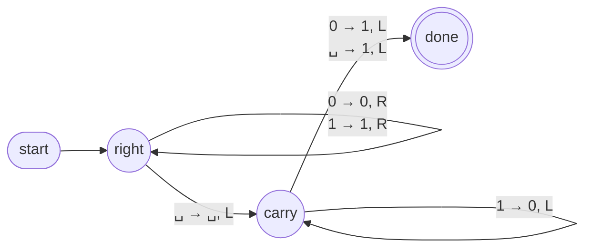

# Turing machines: a tape, a head and a table of rules

[Syllabus](../../../SYLLABUS.md) → [Computability and complexity](../README.md) → [Models of Computation](../README.md#s01) → Turing machines

---

## General Overview

Picture a car odometer whose wheels show only 0 and 1. It reads `10111`, which is 23 miles in binary. The car drives one more mile. The odometer must now read `11000`, which is 24.

A **Turing machine** does that job with three parts:

- a **tape**: a row of cells, each holding one symbol, that runs on without end in both directions. Empty cells hold the **blank**, written ␣.
- a **head**: a reader that sits on one cell, reads it, writes a symbol there and moves one cell left or right.
- a **rule table**: a short list of rows. Each row says "in this state, reading this symbol: write that, move this way, go to that state". A **state** is a name for what the machine is doing right now, such as "walking right" or "carrying".

The odometer machine walks right to the last digit, turns round, changes each trailing 1 (the run of 1s at the right end) to 0, and changes the first 0 it meets to 1. It takes 10 steps on `10111`. The rule table has six rows, and those six rows are the whole program.

**A Turing machine is a finite rule table driving one head over an unbounded tape; each step reads one symbol, writes one symbol, moves one cell and changes state, and that is believed to be enough to carry out any step-by-step procedure.**

**What kind of fact this is:** a definition (the model), plus two theorems proved on this card in Why it works: the odometer table adds one, in a step count given exactly, and the bracket table accepts exactly the balanced strings. The claim that this model captures every step-by-step procedure is the Church-Turing thesis, not a theorem: see [Church-Turing thesis](08-church-turing-thesis.md).

### The picture: the odometer's rule table as a state diagram



Each arrow is one row of the table. A label "1 → 0, L" means: reading 1, write 0 and move left. The double circle marks `done`, the state where the machine stops.

---

## The formula

A Turing machine's whole behaviour is one function, the **transition function** δ (the Greek letter delta). It takes the current state and the symbol under the head, and returns what to do:

```math
\delta(q, a) = (q', b, D), \qquad D \in \{L, R\}
```

**Read it aloud:** "In state q, reading a: write b, move one cell in direction D, and switch to state q-prime."

A full machine lists its set of states Q, its start state, its stopping states and the rows of δ. This card uses one convention throughout: **the machine halts when the table has no row for its current state and symbol.** The odometer table has no rows for `done`, so reaching `done` stops it.

For the odometer machine, the number of steps is a second formula, proved in Why it works:

```math
\text{steps} = n + t + 2
```

| Symbol | Plain meaning | In our example | Push it up and the answer… |
| --- | --- | --- | --- |
| $`\delta`$ | the transition function: the rule table read as a function | six rows | more rows: a longer program |
| $`q`$ | the current state | `right` at step 1 | not a number: a label |
| $`a`$ | the symbol under the head | 1 at step 1 | not a number: a symbol |
| $`q'`$ | the next state, read "q-prime" | `right` at step 1 | not a number: a label |
| $`b`$ | the symbol written over $`a`$ | 1 at step 1 | not a number: a symbol |
| $`D`$ | the move: L for one cell left, R for one cell right | R at step 1 | only two values |
| $`Q`$ | the set of all states | `right`, `carry`, `done` | more states: more distinct jobs the program can be doing |
| $`w`$ | the digits before the last 0 of the reading | `1` | — |
| $`1^t`$, $`0^t`$ | t copies of the digit 1 (or 0), not a power | `111` | — |
| ␣ | the blank: the symbol in every unused cell (printed `_` in the code) | the cell after the last digit | — |
| $`n`$ | the input length: how many digits the odometer has | 5 | steps rise by 1 per digit |
| $`t`$ | the number of trailing 1s: 1s at the right end, before the first 0 | 3 | steps rise by 1 per trailing 1 |

### When it holds

- **The tape is unbounded.** On `11111` the machine writes a sixth digit, `100000`. A real odometer with five fixed wheels cannot: it rolls over to `00000`. A machine whose tape is cut to a fixed length is only a finite automaton ([Finite automata](01-finite-automata-and-regular-languages.md)).
- **Each state and symbol has at most one row.** With two rows for one pair the machine has a choice, and it becomes a guessing machine ([Guessing machines](02-nondeterminism-and-the-subset-construction.md)).
- **The head starts on the leftmost digit, in state `right`.** Start it in `carry` on the leftmost digit and `10111` becomes `100111`, which is 39, not 24.
- **Every row the run needs is present.** Drop the row for `carry` reading ␣ and `11111` halts early with `00000`, which is 0, not 32.
- **The input is digits with no gaps.** A blank inside the input looks like the end of the number to state `right`.

---

## Why it works

### Step 0: the idea, a clerk with a pencil

In 1936 Alan Turing asked what a human clerk does when computing by rule. The clerk looks at a few symbols, keeps a small amount in mind, writes, and moves attention. Turing cut each part to its smallest form. Look at one cell. Keep one state in mind. Write one symbol. Move one cell.

Two kinds of memory result. The **state** is finite: the machine has only the few states in its table. The **tape** is unbounded: the machine may use as many cells as the job needs. The finite part is the program. The unbounded part is the working paper.

### Step 1: one step changes one cell, one position and one state

A **configuration** is a snapshot of a run: the tape's contents, the head's position and the current state. One step looks up the row for (state, symbol under the head) and applies it. Everything else on the tape stays as it was.

So a run is a list of configurations, each made from the one before by one row. The worked table below is exactly that list for `10111`.

### Step 2: why "flip trailing 1s, then the first 0" adds one

Write the reading as $`w\,0\,1^t`$: some digits $`w`$, then a 0, then $`t`$ ones. Here $`1^t`$ means t copies of the digit 1, not a power. For `10111`, $`w`$ is `1` and $`t = 3`$.

Write value(s) for the number a digit string s stands for. In binary, each digit added on the right doubles the value so far and then adds that digit. So the t + 1 digits after $`w`$ multiply its value by $`2^{t+1}`$, and the block `0` followed by t ones adds $`2^t - 1`$ (for `0111`, that is 7):

```math
\mathrm{value}(w\,0\,1^t) = 2^{t+1}\,\mathrm{value}(w) + 2^t - 1
```

Add one and the result is the value of $`w\,1\,0^t`$:

```math
\mathrm{value}(w\,0\,1^t) + 1 = 2^{t+1}\,\mathrm{value}(w) + 2^t = \mathrm{value}(w\,1\,0^t)
```

For `10111` the first line gives 23 and the second gives 24, which is `11000`. If every digit is 1, the reading $`1^n`$ has value $`2^n - 1`$; adding one gives $`2^n`$, which is `1` followed by n zeros.

### Step 3: the table does exactly that, in n + t + 2 steps

The run has three phases:

1. State `right` keeps each digit and moves right. After n steps the head sits on the blank after the last digit.
2. One more step reads that blank, moves back onto the last digit and switches to `carry`.
3. State `carry` changes each 1 to 0 and moves left: t steps. Then it reads the 0 before them (or a blank, if every digit was 1), writes 1 and switches to `done`: one step.

That is n + 1 + t + 1 = n + t + 2 steps. For `10111`: 5 + 3 + 2 = 10. The worst case is all 1s, where t = n and the run takes 2n + 2 steps.

<details>
<summary>Detailed proof: the odometer table adds one in n + t + 2 steps</summary>

Number the cells $`0, 1, \ldots, n-1`$ from the left. The input is $`w\,0\,1^t`$ with $`w`$ of length $`n - t - 1`$, or $`1^n`$ when $`t = n`$.

Phase 1. In state `right`, the rows for 0 and 1 write back the same digit and move right. So each of the first n steps moves the head one cell right and changes nothing. After n steps the head is on cell n, which holds ␣.

Phase 2. The row (`right`, ␣) writes ␣, moves left and switches to `carry`. After $`n + 1`$ steps the head is on cell $`n - 1`$.

Phase 3. Cells $`n - t`$ to $`n - 1`$ hold 1. Each of the next t steps writes 0 over one of them, working leftward, and stays in `carry`. After those t steps the head is on cell $`n - t - 1`$. That cell holds 0, or it is the blank at cell $`-1`$ when $`t = n`$. Either row writes 1 and switches to `done`, which has no rows, so the machine halts after

$`\displaystyle n + 1 + t + 1 = n + t + 2 \text{ steps.}`$

The tape now reads $`w\,1\,0^t`$, or $`1\,0^n`$, which by Step 2 is the old value plus one.

</details>

### Step 4: reading the rule table as a program

Each state is a loop or a line of an ordinary program. The six rows of the odometer table read like this:

```text
right:  while the head reads a digit: move right        (rows 1, 2)
        move left; go to carry                           (row 3)
carry:  while the head reads 1: write 0, move left       (row 4)
        write 1; stop                                    (rows 5, 6)
```

The table is the program. The simulator in the code below is the hardware: it takes any table, as plain text, and runs it. Change the table and the same simulator runs a different program. That is why the code stores each machine as text, one row per line.

### Step 5: the tape does a stack's job, and more

The stack machine of [Grammars and a stack](05-context-free-grammars-and-pushdown-automata.md), run on brackets, pushes each `(` and pops it at its `)`. A tape machine needs no stack: it uses the tape itself as working paper. Its ten-row table does this:

1. State `seek` walks right to the first `)` not yet crossed off, and writes `X` over it.
2. State `back` walks left over `X`s to the nearest `(`, and writes `X` over it. If it finds a blank first, the `)` has no partner: reject.
3. When `seek` reaches the blank at the end, state `check` walks left. Any `(` left over has no partner: reject. Otherwise accept.

On `(()())` it crosses off all six brackets and accepts after 28 steps. On `(()` a `(` is left over: reject after 9 steps. On `())(` the second `)` finds no partner: reject after 8 steps.

<details>
<summary>Detailed proof: the bracket table accepts exactly the balanced strings</summary>

A stack machine accepts a balanced string as follows: push on each `(`, pop on each `)`, reject a pop from an empty stack, and accept if the stack is empty at the end.

Claim: each time `back` crosses off a `(`, it is the `(` that the stack machine would pop for the same `)`. The `)`s are crossed off from left to right, because `seek` always stops at the leftmost uncrossed `)`. The stack's top at that `)` is the most recent `(` not yet popped. On the tape, every cell between that `(` and the `)` has already been crossed off, so `back` walks over `X`s only and stops on it.

So the two machines pair the same brackets. `back` reaching the blank on the left is exactly a pop from an empty stack: both reject. `check` finding an uncrossed `(` is exactly a non-empty stack at the end: both reject. Otherwise both accept. The code confirms this on all 8,191 strings of length 0 to 12.

</details>

The tape machine pays for having no stack. It walks back and forth, so its worst-case step count grows roughly with the square of n, against n + 1 moves for the stack machine: one per bracket, then one to pop the bottom marker. The worked numbers give the counts.

---

## Worked numbers, by hand

The odometer reads `10111` (23 miles). The head starts on the leftmost digit in state `right`. Each row shows one step: the row of the table used, then the tape after the step, with the head's cell in square brackets.

| Step | Arithmetic: state, read → write, move, next | Value: tape after the step |
| --- | --- | --- |
| 1 | `right`, 1 → 1, R, `right` | `1[0]111` |
| 2 | `right`, 0 → 0, R, `right` | `10[1]11` |
| 3 | `right`, 1 → 1, R, `right` | `101[1]1` |
| 4 | `right`, 1 → 1, R, `right` | `1011[1]` |
| 5 | `right`, 1 → 1, R, `right` | `10111[␣]` |
| 6 | `right`, ␣ → ␣, L, `carry` | `1011[1]␣` |
| 7 | `carry`, 1 → 0, L, `carry` | `101[1]0␣` |
| 8 | `carry`, 1 → 0, L, `carry` | `10[1]00␣` |
| 9 | `carry`, 1 → 0, L, `carry` | `1[0]000␣` |
| 10 | `carry`, 0 → 1, L, `done` | `[1]1000␣` |
| check | n + t + 2 = 5 + 3 + 2 | 10 steps |
| answer | `done` has no rows, so the machine halts | **`11000` = 24, after 10 steps** |

The odometer moved from 23 to 24 miles, and the step count matches n + t + 2 exactly.

Costs at other lengths, from the checks:

| Machine and input | Steps |
| --- | --- |
| odometer, `11111` (all ones, n = 5) | 12 |
| odometer, all ones, n = 10 | 22 |
| odometer, all ones, n = 20 | 42 |
| bracket checker, worst string of length 4 | 18 (stack machine: 5) |
| bracket checker, worst string of length 8 | 50 (stack machine: 9) |
| bracket checker, worst string of length 12 | 98 (stack machine: 13) |

The odometer grows by 2 steps per digit: 2n + 2. The bracket checker's worst case grows much faster than n, because each crossing walks back over the cells already crossed.

### What breaks if you drop a piece

Each row changes one thing in the odometer machine. The correct answers are `11000` = 24 for `10111`, and `100000` = 32 for `11111`.

| Mistake | Comes out at | What went wrong |
| --- | --- | --- |
| Drop the row (`carry`, ␣) | `11111` → `00000` = 0, halted in `carry` | No row applies at the left end, so the machine stops early. It behaves like a five-wheel odometer rolling over. |
| `carry` moves R instead of L | `10111` → `101101` = 45 | The carry walks off the right end and writes a new digit there |
| Start in `carry` on the leftmost digit | `10111` → `100111` = 39 | Binary carries run from the right; this adds at the wrong end |
| Stop the run after 11 steps | `11111`: still running after 11 steps | The machine halts at step 12. A cap shows only that a run has not halted yet. |

---

## Code, from first principles, and it actually runs

The code holds each machine as a plain-text rule table and runs it on a small simulator: a dictionary for the tape, an integer for the head, a string for the state. This simulator is the shelf's tape-machine kit; later cards copy it. Nothing imported knows the answer. The odometer takes **three independent roads**: the tape machine's run, binary place value computed by hand, and the step formula n + t + 2, compared on all 2,046 readings of 1 to 10 digits. The bracket checker takes two more: the tape machine against a stack machine on all 8,191 strings of length 0 to 12, and the count of balanced strings against the Catalan numbers (a known count of balanced bracket strings, computed here by its own recurrence). The odometer's trace is checked step by step against the worked table, and the stack machine's moves on the worst strings against n + 1.

### Python

```python
# Turing machines -- the check behind the card.  Standard library only.
# The tape machine below is the shelf's simulator kit; later cards copy it.
# A rule table is plain text, one row per line: state read write move next.
B = "_"  # the blank symbol; the card writes it as an open box

def table(text):
    return {(s, r): (w, m, n) for s, r, w, m, n in (l.split() for l in text.strip().splitlines())}
def show(tape, head):
    lo, hi = min(min(tape), head), max(max(tape), head)
    return "".join(f"[{tape.get(i, B)}]" if i == head else tape.get(i, B) for i in range(lo, hi + 1))

def run(rules, word, state, cap=100000, trace=None):
    # Halts when the table has no row for (state, symbol under the head).
    tape, head, steps = {i: c for i, c in enumerate(word)}, 0, 0
    while (state, tape.get(head, B)) in rules:
        if steps == cap: return None, state, steps
        read = tape.get(head, B)
        write, move, nxt = rules[(state, read)]
        tape[head] = write
        head += 1 if move == "R" else -1
        steps += 1
        if trace is not None:
            trace.append(f"{steps:>4}  {state:<6} {read}  {write} {move}  {nxt:<6} {show(tape, head)}")
        state = nxt
    return "".join(tape[i] for i in sorted(tape)).strip(B), state, steps

ADD_ONE = table("""
right 0 0 R right
right 1 1 R right
right _ _ L carry
carry 1 0 L carry
carry 0 1 L done
carry _ 1 L done""")

def value(s):  # road 2: binary place value, by hand
    v = 0
    for c in s: v = 2 * v + (c == "1")
    return v

def binary(v, width):
    s = ""
    while v > 0: s, v = str(v % 2) + s, v // 2
    return s.rjust(width, "0")
def trailing_ones(s):
    return len(s) - len(s.rstrip("1"))

# ---- the odometer: 10111 is 23 miles; one more mile ----
trace = []
out, state, steps = run(ADD_ONE, "10111", "right", trace=trace)
print(f"add one to 10111 = {value('10111')}; step  state  read  write move  next  tape after, head in [ ]")
print("\n".join(trace))
print(f"result {out} = {value(out)}, halted in {state} after {steps} steps")
assert out == binary(value("10111") + 1, 5) == "11000"
assert state == "done" and [l.split()[-1] for l in trace] == "1[0]111 10[1]11 101[1]1 1011[1] 10111[_] 1011[1]_ 101[1]0_ 10[1]00_ 1[0]000_ [1]1000_".split()
n, t = 5, trailing_ones("10111")
print(f"steps = n + t + 2 = {n} + {t} + 2 = {n + t + 2}")
assert steps == n + t + 2

# ---- every odometer reading of 1 to 10 digits: machine against arithmetic ----
count = good_value = good_steps = 0
for width in range(1, 11):
    for v in range(2 ** width):
        s = binary(v, width)
        o, q, k = run(ADD_ONE, s, "right")
        count += 1
        good_value += (q == "done" and value(o) == v + 1 and len(o) == max(width, len(binary(v + 1, 1))))
        good_steps += (k == width + trailing_ones(s) + 2)
print(f"readings checked {count}; value + 1 agrees {good_value}; steps = n + t + 2 {good_steps}")
assert count == good_value == good_steps == 2046
print("worst case, all ones: " + "  ".join(f"n={w}:{run(ADD_ONE, '1' * w, 'right')[2]}" for w in (5, 10, 20)))

# ---- what breaks ----
no_blank = dict(ADD_ONE); del no_blank[("carry", B)]
o, q, k = run(no_blank, "11111", "right")
print(f"wrong: no (carry, _) row, 11111 -> {o} = {value(o)}, halted in {q}")
assert value(o) != value("11111") + 1
moves_r = dict(ADD_ONE); moves_r[("carry", "1")] = ("0", "R", "carry")
o = run(moves_r, "10111", "right")[0]
print(f"wrong: carry moves R, 10111 -> {o} = {value(o)}")
o = run(ADD_ONE, "10111", "carry")[0]
print(f"wrong: carry starts at the left end, 10111 -> {o} = {value(o)}")
capped = run(ADD_ONE, "11111", "right", cap=11)
print(f"wrong: cap of 11 steps on 11111 -> still running after {capped[2]} steps (it halts at step 12)")
assert capped[0] is None and run(ADD_ONE, "11111", "right")[2] == 12

# ---- the bracket checker: cross off each ) with the nearest open ( to its left ----
BRACKETS = table("""
seek ( ( R seek
seek X X R seek
seek ) X L back
seek _ _ L check
back X X L back
back ( X R seek
back _ _ R reject
check X X L check
check ( ( R reject
check _ _ R accept""")

# The stack machine, copied from the Grammars and a stack card (path, cap and progress tracking cut); it returns
# its accepting run's move count, or None.  A move is (state, read, pop, push, next); '' means read or pop nothing.
def stack_machine(moves, w, start="up"):
    todo, seen = [(start, 0, "Z", 0)], set()  # Z marks the stack's bottom; the last number counts moves
    while todo:
        q, i, st, k = todo.pop()
        if q == "yes" and i == len(w): return k
        if (q, i, st) in seen: continue
        seen.add((q, i, st))
        for p, a, x, y, r in reversed(moves):
            if p != q or (a and w[i:i + 1] != a) or not st.endswith(x): continue
            s2, i2 = st[:len(st) - len(x)] + y[::-1], i + len(a)
            if len(s2) - 1 > len(w) - i2: continue
            todo.append((r, i2, s2, k + 1))
    return None
NEST = [("up", "(", "", "(", "up"), ("up", ")", "(", "", "up"), ("up", "", "Z", "", "yes")]
for w in ("(()())", "(()", "())("):
    o, q, k = run(BRACKETS, w, "seek")
    print(f"brackets {w:<7} -> {q} after {k} steps, tape {o}")
agree, balanced, worst = 0, [0] * 13, [(0, "")] * 13
for length in range(13):
    for code in range(2 ** length):
        w = "".join("()"[(code >> i) & 1] for i in range(length))
        o, q, k = run(BRACKETS, w, "seek")
        agree += ((q == "accept") == (stack_machine(NEST, w) is not None))
        balanced[length] += (q == "accept")
        if k > worst[length][0]: worst[length] = (k, w)  # the first string with the most steps
print(f"bracket strings of length 0 to 12: {2 ** 13 - 1}; tape machine agrees with stack machine on {agree}")
assert agree == 2 ** 13 - 1
catalan = [1]
for k in range(1, 7): catalan.append(catalan[-1] * 2 * (2 * k - 1) // (k + 1))
print("balanced strings of length 0,2,..,12:", " ".join(str(balanced[2 * k]) for k in range(7)), "| Catalan:", " ".join(map(str, catalan)))
assert [balanced[2 * k] for k in range(7)] == catalan
sm = {m: stack_machine(NEST, worst[m][1]) for m in (4, 8, 12)}  # stack moves on the same worst strings
print("worst-case steps, tape machine against stack machine: " + "  ".join(f"n={m}:{worst[m][0]}/{sm[m]}" for m in sm))
assert all(sm[m] == m + 1 for m in sm)  # one move per bracket, then one to pop the bottom marker

# ---- try changing ----
for w in ("11111", "0", "0111"):
    o, q, k = run(ADD_ONE, w, "right")
    print(f"try: {w} -> {o} = {value(o)} in {k} steps")
print("ALL CHECKS PASS")
```

**Ran 2026-11-19 on macOS, Python 3.14.10, standard library only. All checks passed. Output, pasted from the run:**

```text
add one to 10111 = 23; step  state  read  write move  next  tape after, head in [ ]
   1  right  1  1 R  right  1[0]111
   2  right  0  0 R  right  10[1]11
   3  right  1  1 R  right  101[1]1
   4  right  1  1 R  right  1011[1]
   5  right  1  1 R  right  10111[_]
   6  right  _  _ L  carry  1011[1]_
   7  carry  1  0 L  carry  101[1]0_
   8  carry  1  0 L  carry  10[1]00_
   9  carry  1  0 L  carry  1[0]000_
  10  carry  0  1 L  done   [1]1000_
result 11000 = 24, halted in done after 10 steps
steps = n + t + 2 = 5 + 3 + 2 = 10
readings checked 2046; value + 1 agrees 2046; steps = n + t + 2 2046
worst case, all ones: n=5:12  n=10:22  n=20:42
wrong: no (carry, _) row, 11111 -> 00000 = 0, halted in carry
wrong: carry moves R, 10111 -> 101101 = 45
wrong: carry starts at the left end, 10111 -> 100111 = 39
wrong: cap of 11 steps on 11111 -> still running after 11 steps (it halts at step 12)
brackets (()())  -> accept after 28 steps, tape XXXXXX
brackets (()     -> reject after 9 steps, tape (XX
brackets ())(    -> reject after 8 steps, tape XXX(
bracket strings of length 0 to 12: 8191; tape machine agrees with stack machine on 8191
balanced strings of length 0,2,..,12: 1 1 2 5 14 42 132 | Catalan: 1 1 2 5 14 42 132
worst-case steps, tape machine against stack machine: n=4:18/5  n=8:50/9  n=12:98/13
try: 11111 -> 100000 = 32 in 12 steps
try: 0 -> 1 = 1 in 3 steps
try: 0111 -> 1000 = 8 in 9 steps
ALL CHECKS PASS
```

### Rust

```rust
// Turing machines -- the check behind the card.  Rust std only, no crates.
// The tape machine below is the shelf's simulator kit; later cards copy it.
// A rule table is plain text, one row per line: state read write move next.
use std::collections::{BTreeMap, HashMap, HashSet};
const B: char = '_'; // the blank symbol; the card writes it as an open box
type Rules = HashMap<(String, char), (char, char, String)>;

fn table(text: &str) -> Rules {
    let mut r = Rules::new();
    for l in text.trim().lines() {
        let f: Vec<&str> = l.split_whitespace().collect();
        let c = |i: usize| f[i].chars().next().unwrap();
        r.insert((f[0].to_string(), c(1)), (c(2), c(3), f[4].to_string()));
    }
    r
}
fn show(tape: &BTreeMap<i64, char>, head: i64) -> String {
    let lo = (*tape.keys().next().unwrap()).min(head);
    let hi = (*tape.keys().last().unwrap()).max(head);
    (lo..=hi).map(|i| { let c = *tape.get(&i).unwrap_or(&B);
        if i == head { format!("[{}]", c) } else { c.to_string() } }).collect()
}

// Halts when the table has no row for (state, symbol under the head).
fn run(rules: &Rules, word: &str, start: &str, cap: usize, mut trace: Option<&mut Vec<String>>) -> (Option<String>, String, usize) {
    let mut tape: BTreeMap<i64, char> = word.chars().enumerate().map(|(i, c)| (i as i64, c)).collect();
    let (mut head, mut state, mut steps) = (0i64, start.to_string(), 0usize);
    loop {
        let read = *tape.get(&head).unwrap_or(&B);
        let Some((write, mv, nxt)) = rules.get(&(state.clone(), read)) else { break };
        if steps == cap { return (None, state, steps); }
        tape.insert(head, *write);
        head += if *mv == 'R' { 1 } else { -1 };
        steps += 1;
        if let Some(t) = trace.as_mut() {
            t.push(format!("{:>4}  {:<6} {}  {} {}  {:<6} {}", steps, state, read, write, mv, nxt, show(&tape, head)));
        }
        state = nxt.clone();
    }
    let s: String = tape.values().collect();
    (Some(s.trim_matches(B).to_string()), state, steps)
}

const ADD_ONE: &str = "
right 0 0 R right
right 1 1 R right
right _ _ L carry
carry 1 0 L carry
carry 0 1 L done
carry _ 1 L done";
fn value(s: &str) -> u64 { s.chars().fold(0, |v, c| 2 * v + (c == '1') as u64) } // road 2: place value
fn binary(mut v: u64, width: usize) -> String {
    let mut s = String::new();
    while v > 0 { s.insert(0, if v % 2 == 1 { '1' } else { '0' }); v /= 2; }
    format!("{:0>w$}", s, w = width)
}
fn trailing_ones(s: &str) -> usize { s.len() - s.trim_end_matches('1').len() }

const BRACKETS: &str = "
seek ( ( R seek
seek X X R seek
seek ) X L back
seek _ _ L check
back X X L back
back ( X R seek
back _ _ R reject
check X X L check
check ( ( R reject
check _ _ R accept";
// The stack machine, copied from the Grammars and a stack card (path, cap and progress tracking cut); it returns
// its accepting run's move count, or None.  A move is (state, read, pop, push, next); "" means read or pop nothing.
type Mv = (&'static str, &'static str, &'static str, &'static str, &'static str);
fn stack_machine(moves: &[Mv], w: &str, start: &str) -> Option<usize> {
    let (mut todo, mut seen) = (vec![(start.to_string(), 0usize, "Z".to_string(), 0usize)], HashSet::new()); // Z marks the stack's bottom; the last number counts moves
    while let Some((q, i, st, k)) = todo.pop() {
        if q == "yes" && i == w.len() { return Some(k); }
        if !seen.insert((q.clone(), i, st.clone())) { continue; }
        for &(p, a, x, y, r) in moves.iter().rev() {
            if p != q || (!a.is_empty() && w.get(i..i + 1) != Some(a)) || !st.ends_with(x) { continue; }
            let (s2, i2) = (format!("{}{}", &st[..st.len() - x.len()], y.chars().rev().collect::<String>()), i + a.len());
            if s2.len() > w.len() - i2 + 1 { continue; }
            todo.push((r.to_string(), i2, s2, k + 1));
        }
    }
    None
}
const NEST: [Mv; 3] = [("up", "(", "", "(", "up"), ("up", ")", "(", "", "up"), ("up", "", "Z", "", "yes")];
fn main() {
    const CAP: usize = 100000;
    let add = table(ADD_ONE);
    // ---- the odometer: 10111 is 23 miles; one more mile ----
    let mut trace = Vec::new();
    let (out, state, steps) = run(&add, "10111", "right", CAP, Some(&mut trace)); let out = out.unwrap();
    println!("add one to 10111 = {}; step  state  read  write move  next  tape after, head in [ ]", value("10111"));
    println!("{}", trace.join("\n"));
    println!("result {} = {}, halted in {} after {} steps", out, value(&out), state, steps);
    assert!(out == binary(value("10111") + 1, 5) && out == "11000");
    assert!(state == "done" && trace.iter().map(|l| l.split_whitespace().last().unwrap()).collect::<Vec<_>>() == "1[0]111 10[1]11 101[1]1 1011[1] 10111[_] 1011[1]_ 101[1]0_ 10[1]00_ 1[0]000_ [1]1000_".split(' ').collect::<Vec<_>>());
    let (n, t) = (5, trailing_ones("10111"));
    println!("steps = n + t + 2 = {} + {} + 2 = {}", n, t, n + t + 2);
    assert!(steps == n + t + 2);

    // ---- every odometer reading of 1 to 10 digits: machine against arithmetic ----
    let (mut count, mut good_value, mut good_steps) = (0, 0, 0);
    for width in 1..=10usize {
        for v in 0..(1u64 << width) {
            let s = binary(v, width);
            let (o, q, k) = run(&add, &s, "right", CAP, None); let o = o.unwrap();
            count += 1;
            if q == "done" && value(&o) == v + 1 && o.len() == width.max(binary(v + 1, 1).len()) { good_value += 1; }
            if k == width + trailing_ones(&s) + 2 { good_steps += 1; }
        }
    }
    println!("readings checked {}; value + 1 agrees {}; steps = n + t + 2 {}", count, good_value, good_steps);
    assert!(count == 2046 && good_value == 2046 && good_steps == 2046);
    let worst: Vec<String> = [5, 10, 20].iter().map(|&w| format!("n={}:{}", w, run(&add, &"1".repeat(w), "right", CAP, None).2)).collect();
    println!("worst case, all ones: {}", worst.join("  "));

    // ---- what breaks ----
    let mut no_blank = add.clone();
    no_blank.remove(&("carry".to_string(), B));
    let (o, q, _) = run(&no_blank, "11111", "right", CAP, None); let o = o.unwrap();
    println!("wrong: no (carry, _) row, 11111 -> {} = {}, halted in {}", o, value(&o), q);
    assert!(value(&o) != value("11111") + 1);
    let mut moves_r = add.clone();
    moves_r.insert(("carry".to_string(), '1'), ('0', 'R', "carry".to_string()));
    let o = run(&moves_r, "10111", "right", CAP, None).0.unwrap();
    println!("wrong: carry moves R, 10111 -> {} = {}", o, value(&o));
    let o = run(&add, "10111", "carry", CAP, None).0.unwrap();
    println!("wrong: carry starts at the left end, 10111 -> {} = {}", o, value(&o));
    let capped = run(&add, "11111", "right", 11, None);
    println!("wrong: cap of 11 steps on 11111 -> still running after {} steps (it halts at step 12)", capped.2);
    assert!(capped.0.is_none() && run(&add, "11111", "right", CAP, None).2 == 12);

    // ---- the bracket checker: cross off each ) with the nearest open ( to its left ----
    let br = table(BRACKETS);
    for w in ["(()())", "(()", "())("] {
        let (o, q, k) = run(&br, w, "seek", CAP, None);
        println!("brackets {:<7} -> {} after {} steps, tape {}", w, q, k, o.unwrap());
    }
    let (mut agree, mut balanced, mut worst) = (0, [0u64; 13], vec![(0usize, String::new()); 13]);
    for length in 0..13usize {
        for code in 0..(1u32 << length) {
            let w: String = (0..length).map(|i| if (code >> i) & 1 == 1 { ')' } else { '(' }).collect();
            let (_, q, k) = run(&br, &w, "seek", CAP, None);
            if (q == "accept") == stack_machine(&NEST, &w, "up").is_some() { agree += 1; }
            if q == "accept" { balanced[length] += 1; }
            if k > worst[length].0 { worst[length] = (k, w); } // the first string with the most steps
        }
    }
    println!("bracket strings of length 0 to 12: {}; tape machine agrees with stack machine on {}", (1 << 13) - 1, agree);
    assert!(agree == (1 << 13) - 1);
    let mut catalan = vec![1u64];
    for k in 1..7u64 { let c = catalan[catalan.len() - 1] * 2 * (2 * k - 1) / (k + 1); catalan.push(c); }
    let bal: Vec<String> = (0..7).map(|k| balanced[2 * k].to_string()).collect();
    let cat: Vec<String> = catalan.iter().map(|c| c.to_string()).collect();
    println!("balanced strings of length 0,2,..,12: {} | Catalan: {}", bal.join(" "), cat.join(" "));
    assert!((0..7).all(|k| balanced[2 * k] == catalan[k]));
    let sm: Vec<(usize, usize)> = [4, 8, 12].iter().map(|&m| (m, stack_machine(&NEST, &worst[m].1, "up").unwrap())).collect(); // stack moves on the same worst strings
    let ws: Vec<String> = sm.iter().map(|&(m, s)| format!("n={}:{}/{}", m, worst[m].0, s)).collect();
    println!("worst-case steps, tape machine against stack machine: {}", ws.join("  "));
    assert!(sm.iter().all(|&(m, s)| s == m + 1)); // one move per bracket, then one to pop the bottom marker

    // ---- try changing ----
    for w in ["11111", "0", "0111"] {
        let (o, _, k) = run(&add, w, "right", CAP, None); let o = o.unwrap();
        println!("try: {} -> {} = {} in {} steps", w, o, value(&o), k);
    }
    println!("ALL CHECKS PASS");
}
```

**Ran 2026-11-19 on macOS, rustc 1.98.1, no crates. All checks passed. Output, pasted from the run:**

```text
add one to 10111 = 23; step  state  read  write move  next  tape after, head in [ ]
   1  right  1  1 R  right  1[0]111
   2  right  0  0 R  right  10[1]11
   3  right  1  1 R  right  101[1]1
   4  right  1  1 R  right  1011[1]
   5  right  1  1 R  right  10111[_]
   6  right  _  _ L  carry  1011[1]_
   7  carry  1  0 L  carry  101[1]0_
   8  carry  1  0 L  carry  10[1]00_
   9  carry  1  0 L  carry  1[0]000_
  10  carry  0  1 L  done   [1]1000_
result 11000 = 24, halted in done after 10 steps
steps = n + t + 2 = 5 + 3 + 2 = 10
readings checked 2046; value + 1 agrees 2046; steps = n + t + 2 2046
worst case, all ones: n=5:12  n=10:22  n=20:42
wrong: no (carry, _) row, 11111 -> 00000 = 0, halted in carry
wrong: carry moves R, 10111 -> 101101 = 45
wrong: carry starts at the left end, 10111 -> 100111 = 39
wrong: cap of 11 steps on 11111 -> still running after 11 steps (it halts at step 12)
brackets (()())  -> accept after 28 steps, tape XXXXXX
brackets (()     -> reject after 9 steps, tape (XX
brackets ())(    -> reject after 8 steps, tape XXX(
bracket strings of length 0 to 12: 8191; tape machine agrees with stack machine on 8191
balanced strings of length 0,2,..,12: 1 1 2 5 14 42 132 | Catalan: 1 1 2 5 14 42 132
worst-case steps, tape machine against stack machine: n=4:18/5  n=8:50/9  n=12:98/13
try: 11111 -> 100000 = 32 in 12 steps
try: 0 -> 1 = 1 in 3 steps
try: 0111 -> 1000 = 8 in 9 steps
ALL CHECKS PASS
```

### Lean

Lean proves both theorems of Why it works, for every binary reading and every bracket string, and checks the worked runs exactly.

- Take any binary reading with n digits and t trailing 1s, the head on its leftmost digit in state `right`. Then the odometer table halts in `done` after exactly n + t + 2 steps.
- The tape then holds a reading one more in value, with blanks elsewhere. It is n digits long, or n + 1 when every digit was 1.
- Take any digits $`w`$ and any count t. Then $`\mathrm{value}(w\,0\,1^t) + 1 = \mathrm{value}(w\,1\,0^t)`$.
- Take n copies of the digit 1. Then $`\mathrm{value}(1^n) + 1 = \mathrm{value}(1\,0^n)`$.
- The bracket table halts on every bracket string, in `accept` or `reject`. It accepts exactly the balanced strings.
- Balanced means as many `(` as `)`, with no starting part holding more `)` than `(`.
- The worked runs are right: `10111` becomes `11000` in 10 steps, and `11111` becomes `100000` in 12.
- All ones halt after 22 steps at n = 10 and 42 at n = 20. A cap of 11 steps leaves `11111` still running.
- `0` becomes `1` in 3 steps, and `0111` becomes `1000` in 9.
- The bracket table accepts `(()())` after 28 steps, rejects `(()` after 9 with tape `(XX`, and rejects `())(` after 8.

The trace, the broken tables, the stack machine, the Catalan counts and the worst-case bracket costs are left to the Python and Rust checks.

```lean
-- Turing machines: the six-row odometer table adds one to every binary reading in exactly n + t + 2 steps, and the ten-row bracket table accepts exactly the balanced bracket strings.
import Mathlib.Computability.TuringMachine.Tape
import Mathlib.Combinatorics.Enumerative.DyckWord
import Mathlib.Data.Nat.Digits.Defs

open Turing

namespace TuringCard

/-! ## The model: a rule table, a tape (Mathlib's `Turing.Tape`) and a head -/

/-- A rule table: for each state `q` and symbol `a` under the head, at most one row
`δ q a = some (b, D, q')`: write `b`, move one cell in direction `D`, go to state `q'`.
`none` means there is no row, and the machine halts. -/
abbrev RuleTable (Q Γ : Type) := Q → Γ → Option (Γ × Dir × Q)

/-- A configuration: the current state and the tape, whose `head` field is the cell under the head. -/
structure Cfg (Q Γ : Type) [Inhabited Γ] where
  state : Q
  tape : Tape Γ

variable {Q Γ : Type} [Inhabited Γ]

/-- One step: look up the row for (state, symbol under the head), write, move, change state.
`none` when the table has no row, so the machine halts. -/
def step (δ : RuleTable Q Γ) (c : Cfg Q Γ) : Option (Cfg Q Γ) :=
  (δ c.state c.tape.head).map fun r => ⟨r.2.2, (c.tape.write r.1).move r.2.1⟩

/-- The configuration after `k` steps from `c`, or `none` if the machine halted before step `k`. -/
def runFor (δ : RuleTable Q Γ) (k : ℕ) (c : Cfg Q Γ) : Option (Cfg Q Γ) :=
  (fun o => o.bind (step δ))^[k] (some c)

/-- The run of `δ` from `c` halts after exactly `k` steps, in configuration `c'`. -/
def HaltsIn (δ : RuleTable Q Γ) (c : Cfg Q Γ) (k : ℕ) (c' : Cfg Q Γ) : Prop :=
  runFor δ k c = some c' ∧ step δ c' = none

/-- The tape holds exactly the string `s` in consecutive cells, and blanks everywhere else. -/
def Reads (T : Tape Γ) (s : List Γ) : Prop :=
  ∃ p : ℤ, ∀ i : ℤ, T.nth i = if 0 ≤ i - p then s.getD (i - p).toNat default else default

/-- The cells `lo, lo + 1, ..., lo + n - 1`, counted from the head (used only in the examples). -/
def cells (T : Tape Γ) (lo : ℤ) (n : ℕ) : List Γ :=
  (List.range n).map fun i => T.nth (lo + i)


/-! ## Helper lemmas about runs and tapes -/

/-- A tape given by two lists: the cells left of the head (nearest first) and the cells from the
head rightwards. -/
def tp (L R : List Γ) : Tape Γ := Tape.mk' (ListBlank.mk L) (ListBlank.mk R)

theorem iter_none (δ : RuleTable Q Γ) (k : ℕ) :
    (fun o : Option (Cfg Q Γ) => o.bind (step δ))^[k] none = none := by
  induction k with
  | zero => rfl
  | succ k ih => rw [Function.iterate_succ_apply]; exact ih

#print axioms iter_none

theorem runFor_succ (δ : RuleTable Q Γ) (k : ℕ) (c c1 : Cfg Q Γ) (h : step δ c = some c1) :
    runFor δ (k + 1) c = runFor δ k c1 := by
  unfold runFor
  rw [Function.iterate_succ_apply]
  change (fun o : Option (Cfg Q Γ) => o.bind (step δ))^[k] (step δ c) = _
  rw [h]

#print axioms runFor_succ

theorem runFor_one (δ : RuleTable Q Γ) (c c1 : Cfg Q Γ) (h : step δ c = some c1) :
    runFor δ 1 c = some c1 := by
  rw [runFor_succ δ 0 c c1 h]; rfl

#print axioms runFor_one

theorem runFor_trans (δ : RuleTable Q Γ) (a b : ℕ) (c c1 c2 : Cfg Q Γ)
    (h1 : runFor δ a c = some c1) (h2 : runFor δ b c1 = some c2) :
    runFor δ (a + b) c = some c2 := by
  unfold runFor at *
  rw [Nat.add_comm, Function.iterate_add_apply, h1]
  exact h2

#print axioms runFor_trans

theorem halts_step (δ : RuleTable Q Γ) (c c1 : Cfg Q Γ) (P : Cfg Q Γ → Prop)
    (h : step δ c = some c1) (H : ∃ k c', HaltsIn δ c1 k c' ∧ P c') :
    ∃ k c', HaltsIn δ c k c' ∧ P c' := by
  obtain ⟨k, c', ⟨h1, h2⟩, h3⟩ := H
  exact ⟨k + 1, c', ⟨by rw [runFor_succ δ k c c1 h]; exact h1, h2⟩, h3⟩

#print axioms halts_step

theorem halts_here (δ : RuleTable Q Γ) (c : Cfg Q Γ) (P : Cfg Q Γ → Prop)
    (h : step δ c = none) (H : P c) : ∃ k c', HaltsIn δ c k c' ∧ P c' :=
  ⟨0, c, ⟨rfl, h⟩, H⟩

#print axioms halts_here

theorem step_right (δ : RuleTable Q Γ) (q : Q) (L R : List Γ) (b : Γ) (q' : Q)
    (h : δ q R.headI = some (b, Dir.right, q')) :
    step δ ⟨q, tp L R⟩ = some ⟨q', tp (b :: L) R.tail⟩ := by
  show (δ q R.headI).map _ = _
  rw [h]; rfl

#print axioms step_right

theorem step_left (δ : RuleTable Q Γ) (q : Q) (L R : List Γ) (b : Γ) (q' : Q)
    (h : δ q R.headI = some (b, Dir.left, q')) :
    step δ ⟨q, tp L R⟩ = some ⟨q', tp L.tail (L.headI :: b :: R.tail)⟩ := by
  show (δ q R.headI).map _ = _
  rw [h]; rfl

#print axioms step_left

theorem move_left_tp (L R : List Γ) :
    (tp L R).move Dir.left = tp L.tail (L.headI :: R) := by
  simp [tp, Tape.move_left_mk']

#print axioms move_left_tp

theorem move_right_tp (L R : List Γ) (a : Γ) :
    (tp L (a :: R)).move Dir.right = tp (a :: L) R := by
  simp [tp, Tape.move_right_mk']

#print axioms move_right_tp

theorem tp_trim (L R : List Γ) : tp L (R ++ [default]) = tp L R := by
  unfold tp
  congr 1
  exact Quotient.sound' (Or.inr ⟨1, rfl⟩)

#print axioms tp_trim

theorem reads_move_right (T : Tape Γ) (s : List Γ) (h : Reads T s) :
    Reads (T.move Dir.right) s := by
  obtain ⟨p, hp⟩ := h
  refine ⟨p - 1, fun i => ?_⟩
  rw [Tape.move_right_nth, hp]
  have : i + 1 - p = i - (p - 1) := by ring
  rw [this]

#print axioms reads_move_right

theorem reads_move_left (T : Tape Γ) (s : List Γ) (h : Reads T s) :
    Reads (T.move Dir.left) s := by
  obtain ⟨p, hp⟩ := h
  refine ⟨p + 1, fun i => ?_⟩
  rw [Tape.move_left_nth, hp]
  have : i - 1 - p = i - (p + 1) := by ring
  rw [this]

#print axioms reads_move_left

theorem reads_tp (A B : List Γ) : Reads (tp A B) (A.reverse ++ B) := by
  induction A generalizing B with
  | nil =>
    refine ⟨0, fun i => ?_⟩
    rcases i with n | n
    · simp only [Int.ofNat_eq_natCast, tp, Tape.mk'_nth_nat, ListBlank.nth_mk]
      simp [List.getI_eq_getElem?_getD]
    · show (ListBlank.mk ([] : List Γ)).nth n = _
      simp
  | cons a A ih =>
    have h := reads_move_right _ _ (ih (a :: B))
    rw [move_right_tp] at h
    simpa using h

#print axioms reads_tp

/-! ## The odometer table -/

/-- Tape symbols for the odometer: the blank ␣, and the digits 0 and 1. -/
inductive Sym
  | blank
  | zero
  | one
  deriving DecidableEq, Repr

instance : Inhabited Sym := ⟨.blank⟩

/-- A binary digit as a tape symbol: `false` is 0, `true` is 1. -/
def digit : Bool → Sym
  | false => .zero
  | true => .one

/-- The odometer's states. -/
inductive OdoState
  | right
  | carry
  | done
  deriving DecidableEq, Repr

/-- The odometer's six-row table (state, read → write, move, next); `done` has no rows. -/
def addOne : RuleTable OdoState Sym
  | .right, .zero => some (.zero, Dir.right, .right)
  | .right, .one => some (.one, Dir.right, .right)
  | .right, .blank => some (.blank, Dir.left, .carry)
  | .carry, .one => some (.zero, Dir.left, .carry)
  | .carry, .zero => some (.one, Dir.left, .done)
  | .carry, .blank => some (.one, Dir.left, .done)
  | _, _ => none

/-- value(s): the number a digit string stands for, leftmost digit most significant. -/
def value (ds : List Bool) : ℕ :=
  Nat.ofDigits 2 (ds.reverse.map Bool.toNat)

/-- t: the number of trailing 1s, the 1s at the right end before the first 0. -/
def trailingOnes (ds : List Bool) : ℕ :=
  (ds.reverse.takeWhile id).length

/-- The start: the digits on the tape, the head on the leftmost digit, in state `right`. -/
def odoStart (ds : List Bool) : Cfg OdoState Sym :=
  ⟨.right, Tape.mk₁ (ds.map digit)⟩


/-! ## Helper lemmas for the odometer -/

theorem odo_right (ds : List Bool) (L : List Sym) :
    runFor addOne ds.length ⟨.right, tp L (ds.map digit)⟩ =
      some ⟨.right, tp ((ds.map digit).reverse ++ L) []⟩ := by
  induction ds generalizing L with
  | nil => rfl
  | cons a ds ih =>
    have hs : step addOne ⟨.right, tp L ((a :: ds).map digit)⟩ =
        some ⟨.right, tp (digit a :: L) (ds.map digit)⟩ :=
      step_right _ _ _ _ _ _ (by cases a <;> rfl)
    rw [List.length_cons, runFor_succ _ _ _ _ hs, ih]
    simp

#print axioms odo_right

theorem odo_turn (L : List Sym) :
    runFor addOne 1 ⟨.right, tp L []⟩ = some ⟨.carry, tp L.tail [L.headI]⟩ := by
  apply runFor_one
  rw [step_left _ _ _ _ Sym.blank OdoState.carry rfl]
  exact congrArg (fun T => some (⟨.carry, T⟩ : Cfg OdoState Sym)) (tp_trim L.tail [L.headI])

#print axioms odo_turn

theorem odo_carry (k : ℕ) (M R : List Sym) :
    runFor addOne k ⟨.carry, tp (List.replicate k Sym.one ++ M).tail
        ((List.replicate k Sym.one ++ M).headI :: R)⟩ =
      some ⟨.carry, tp M.tail (M.headI :: (List.replicate k Sym.zero ++ R))⟩ := by
  induction k generalizing R with
  | zero => rfl
  | succ k ih =>
    have hs : step addOne ⟨.carry, tp (List.replicate (k + 1) Sym.one ++ M).tail
        ((List.replicate (k + 1) Sym.one ++ M).headI :: R)⟩ =
        some ⟨.carry, tp (List.replicate k Sym.one ++ M).tail
          ((List.replicate k Sym.one ++ M).headI :: Sym.zero :: R)⟩ :=
      step_left _ _ _ _ _ _ rfl
    rw [runFor_succ _ _ _ _ hs, ih]
    simp [List.replicate_succ']

#print axioms odo_carry

theorem odo_done (T : Tape Sym) : step addOne ⟨.done, T⟩ = none := by
  show (addOne .done T.head).map _ = none
  generalize T.head = x
  cases x <;> rfl

#print axioms odo_done

theorem bool_list_cases (ds : List Bool) :
    (∃ n, ds = List.replicate n true) ∨ (∃ w t, ds = w ++ false :: List.replicate t true) := by
  induction ds using List.reverseRecOn with
  | nil => exact Or.inl ⟨0, rfl⟩
  | append_singleton l a ih =>
    cases a with
    | false => exact Or.inr ⟨l, 0, rfl⟩
    | true =>
      rcases ih with ⟨n, rfl⟩ | ⟨w, t, rfl⟩
      · exact Or.inl ⟨n + 1, by simp [List.replicate_succ']⟩
      · exact Or.inr ⟨w, t + 1, by simp [List.replicate_succ']⟩

#print axioms bool_list_cases

theorem takeWhile_rep (t : ℕ) (rest : List Bool) :
    (List.replicate t true ++ rest).takeWhile id = List.replicate t true ++ rest.takeWhile id := by
  induction t with
  | zero => rfl
  | succ t ih => simp [List.replicate_succ, ih]

#print axioms takeWhile_rep

theorem trailingOnes_rep (n : ℕ) : trailingOnes (List.replicate n true) = n := by
  have h := takeWhile_rep n []
  simp only [List.append_nil, List.takeWhile_nil] at h
  simp [trailingOnes, h]

#print axioms trailingOnes_rep

theorem trailingOnes_flip (w : List Bool) (t : ℕ) :
    trailingOnes (w ++ false :: List.replicate t true) = t := by
  have h := takeWhile_rep t (false :: w.reverse)
  simp only [List.takeWhile_cons, id, Bool.false_eq_true, ↓reduceIte, List.append_nil] at h
  simp [trailingOnes, h]

#print axioms trailingOnes_flip

theorem ofDigits_ones (t : ℕ) : Nat.ofDigits 2 (List.replicate t 1) + 1 = 2 ^ t := by
  induction t with
  | zero => rfl
  | succ t ih => rw [List.replicate_succ, Nat.ofDigits_cons, pow_succ]; omega

#print axioms ofDigits_ones

theorem ofDigits_zeros (t : ℕ) : Nat.ofDigits 2 (List.replicate t 0) = 0 := by
  induction t with
  | zero => rfl
  | succ t ih => rw [List.replicate_succ, Nat.ofDigits_cons, ih]

#print axioms ofDigits_zeros

theorem value_flip (w : List Bool) (t n : ℕ) :
    value (w ++ false :: List.replicate t true) + 1 = value (w ++ true :: List.replicate t false) ∧
      value (List.replicate n true) + 1 = value (true :: List.replicate n false) := by
  constructor
  · simp only [value, List.reverse_append, List.reverse_cons, List.reverse_replicate,
      List.map_append, List.map_replicate, List.map_cons, List.append_assoc, List.singleton_append,
      Nat.ofDigits_append, Nat.ofDigits_cons, List.length_replicate, Bool.toNat_true,
      Bool.toNat_false, ofDigits_zeros]
    have := ofDigits_ones t
    have h2 : (2:ℕ) ^ t > 0 := by positivity
    nlinarith
  · simp only [value, List.reverse_cons, List.reverse_replicate, List.map_append,
      List.map_replicate, List.map_cons, List.map_nil, Nat.ofDigits_append, Bool.toNat_true,
      Bool.toNat_false, ofDigits_zeros, List.length_replicate, Nat.ofDigits_singleton]
    have := ofDigits_ones n
    omega

#print axioms value_flip

/-- The odometer table adds one. Started in state `right` on the leftmost of the n digits of any
binary reading with t trailing 1s, it halts in `done` after exactly n + t + 2 steps, and the tape
then holds a binary reading whose value is one more: n digits long, or n + 1 when every digit was 1. -/
theorem odometer_adds_one_in_n_plus_t_plus_two_steps (ds : List Bool) :
    ∃ c', HaltsIn addOne (odoStart ds) (ds.length + trailingOnes ds + 2) c' ∧
      c'.state = .done ∧
      ∃ out : List Bool, Reads c'.tape (out.map digit) ∧ value out = value ds + 1 ∧
        out.length = if trailingOnes ds = ds.length then ds.length + 1 else ds.length := by
  rcases bool_list_cases ds with ⟨n, rfl⟩ | ⟨w, t, rfl⟩
  · rw [trailingOnes_rep]
    have h1 := odo_right (List.replicate n true) []
    have hL : ((List.replicate n true).map digit).reverse ++ [] =
        List.replicate n Sym.one ++ [] := by simp [digit]
    rw [hL] at h1
    have h2 := odo_turn (List.replicate n Sym.one ++ [])
    have h3 := odo_carry n [] []
    have h4 : runFor addOne 1 ⟨.carry, tp ([] : List Sym).tail
          (([] : List Sym).headI :: (List.replicate n Sym.zero ++ []))⟩ =
        some ⟨.done, tp ([] : List Sym).tail
          (([] : List Sym).headI :: Sym.one :: (List.replicate n Sym.zero ++ []))⟩ :=
      runFor_one _ _ _ (step_left _ _ _ _ _ _ rfl)
    have hrun := runFor_trans _ _ _ _ _ _
      (runFor_trans _ _ _ _ _ _ (runFor_trans _ _ _ _ _ _ h1 h2) h3) h4
    have e : (List.replicate n true).length + n + 2 = (List.replicate n true).length + 1 + n + 1 := by omega
    rw [e]
    refine ⟨_, ⟨hrun, odo_done _⟩, rfl, true :: List.replicate n false, ?_, ?_, ?_⟩
    · have h := reads_move_left _ _
        (reads_tp ([] : List Sym) (Sym.one :: (List.replicate n Sym.zero ++ [])))
      rw [move_left_tp] at h
      have e : (true :: List.replicate n false).map digit =
          ([] : List Sym).reverse ++ Sym.one :: (List.replicate n Sym.zero ++ []) := by
        simp [digit]
      rw [e]; exact h
    · exact (value_flip [] 0 n).2.symm
    · simp
  · rw [trailingOnes_flip]
    have h1 := odo_right (w ++ false :: List.replicate t true) []
    have hL : ((w ++ false :: List.replicate t true).map digit).reverse ++ [] =
        List.replicate t Sym.one ++ (Sym.zero :: (w.map digit).reverse) := by simp [digit]
    rw [hL] at h1
    have h2 := odo_turn (List.replicate t Sym.one ++ (Sym.zero :: (w.map digit).reverse))
    have h3 := odo_carry t (Sym.zero :: (w.map digit).reverse) []
    have h4 : runFor addOne 1 ⟨.carry, tp (Sym.zero :: (w.map digit).reverse).tail
          ((Sym.zero :: (w.map digit).reverse).headI :: (List.replicate t Sym.zero ++ []))⟩ =
        some ⟨.done, tp (w.map digit).reverse.tail
          ((w.map digit).reverse.headI :: Sym.one :: (List.replicate t Sym.zero ++ []))⟩ :=
      runFor_one _ _ _ (step_left _ _ _ _ _ _ rfl)
    have hrun := runFor_trans _ _ _ _ _ _
      (runFor_trans _ _ _ _ _ _ (runFor_trans _ _ _ _ _ _ h1 h2) h3) h4
    have e : (w ++ false :: List.replicate t true).length + t + 2 = (w ++ false :: List.replicate t true).length + 1 + t + 1 := by omega
    rw [e]
    refine ⟨_, ⟨hrun, odo_done _⟩, rfl, w ++ true :: List.replicate t false, ?_, ?_, ?_⟩
    · have h := reads_move_left _ _
        (reads_tp (w.map digit).reverse (Sym.one :: (List.replicate t Sym.zero ++ [])))
      rw [move_left_tp] at h
      have e : (w ++ true :: List.replicate t false).map digit =
          (w.map digit).reverse.reverse ++ Sym.one :: (List.replicate t Sym.zero ++ []) := by
        simp [digit]
      rw [e]; exact h
    · exact (value_flip w t 0).1.symm
    · split_ifs with h
      · simp at h; omega
      · simp

/-- Adding one in binary flips the trailing 1s and the 0 before them:
value(w 0 1^t) + 1 = value(w 1 0^t), and value(1^n) + 1 = value(1 0^n). -/
theorem value_add_one_flips_trailing_ones (w : List Bool) (t n : ℕ) :
    value (w ++ false :: List.replicate t true) + 1 = value (w ++ true :: List.replicate t false) ∧
      value (List.replicate n true) + 1 = value (true :: List.replicate n false) := by
  exact value_flip w t n

/-! ## The bracket table -/

/-- Tape symbols for the bracket checker: blank, `(`, `)` and the cross-off mark `X`. -/
inductive BSym
  | blank
  | op
  | cl
  | X
  deriving DecidableEq, Repr

instance : Inhabited BSym := ⟨.blank⟩

/-- The bracket checker's states; `accept` and `reject` have no rows. -/
inductive BState
  | seek
  | back
  | check
  | accept
  | reject
  deriving DecidableEq, Repr

/-- The bracket checker's ten-row table. -/
def brackets : RuleTable BState BSym
  | .seek, .op => some (.op, Dir.right, .seek)
  | .seek, .X => some (.X, Dir.right, .seek)
  | .seek, .cl => some (.X, Dir.left, .back)
  | .seek, .blank => some (.blank, Dir.left, .check)
  | .back, .X => some (.X, Dir.left, .back)
  | .back, .op => some (.X, Dir.right, .seek)
  | .back, .blank => some (.blank, Dir.right, .reject)
  | .check, .X => some (.X, Dir.left, .check)
  | .check, .op => some (.op, Dir.right, .reject)
  | .check, .blank => some (.blank, Dir.right, .accept)
  | _, _ => none

/-- A bracket as a tape symbol: Mathlib's `DyckStep.U` is `(` and `DyckStep.D` is `)`. -/
def bracketSym : DyckStep → BSym
  | .U => .op
  | .D => .cl

/-- The start: the brackets on the tape, the head on the leftmost one, in state `seek`. -/
def bracketStart (w : List DyckStep) : Cfg BState BSym :=
  ⟨.seek, Tape.mk₁ (w.map bracketSym)⟩

/-- Balanced: the string is a Dyck word (Mathlib's `DyckWord`): as many `(` as `)`, and no prefix
with more `)` than `(`. -/
def Balanced (w : List DyckStep) : Prop :=
  ∃ d : DyckWord, d.toList = w


/-! ## Helper definitions and lemmas for the bracket checker -/

/-- The brackets still on the tape, read left to right, with the crossed-off cells skipped. -/
def strip : List BSym → List DyckStep
  | [] => []
  | .op :: r => DyckStep.U :: strip r
  | .cl :: r => DyckStep.D :: strip r
  | _ :: r => strip r

/-- `okD n s`: starting with `n` unmatched `(`, the string `s` closes them all and never closes
more than are open. -/
def okD : ℕ → List DyckStep → Prop
  | n, [] => n = 0
  | n, DyckStep.U :: s => okD (n + 1) s
  | 0, DyckStep.D :: _ => False
  | n + 1, DyckStep.D :: s => okD n s

theorem okD_iff (s : List DyckStep) (n : ℕ) :
    okD n s ↔ (s.count DyckStep.D = n + s.count DyckStep.U ∧
      ∀ i, (s.take i).count DyckStep.D ≤ n + (s.take i).count DyckStep.U) := by
  induction s generalizing n with
  | nil =>
    simp only [okD, List.count_nil, List.take_nil]
    constructor
    · intro h; exact ⟨by omega, fun _ => by omega⟩
    · intro h; omega
  | cons x s ih =>
    cases x with
    | U =>
      rw [okD, ih]
      constructor
      · rintro ⟨h1, h2⟩
        refine ⟨by simp; omega, fun i => ?_⟩
        cases i with
        | zero => simp
        | succ i => have := h2 i; simp [List.take_succ_cons]; omega
      · rintro ⟨h1, h2⟩
        refine ⟨by simp at h1; omega, fun i => ?_⟩
        have := h2 (i + 1); simp [List.take_succ_cons] at this; omega
    | D =>
      cases n with
      | zero =>
        simp only [okD, false_iff]
        rintro ⟨h1, h2⟩
        have := h2 1
        simp at this
      | succ n =>
        rw [okD, ih]
        constructor
        · rintro ⟨h1, h2⟩
          refine ⟨by simp; omega, fun i => ?_⟩
          cases i with
          | zero => simp
          | succ i => have := h2 i; simp [List.take_succ_cons]; omega
        · rintro ⟨h1, h2⟩
          refine ⟨by simp at h1; omega, fun i => ?_⟩
          have := h2 (i + 1); simp [List.take_succ_cons] at this; omega

#print axioms okD_iff

theorem balanced_iff (w : List DyckStep) : Balanced w ↔ okD 0 w := by
  rw [okD_iff]
  constructor
  · rintro ⟨d, rfl⟩
    exact ⟨by simp [d.count_U_eq_count_D], fun i => by simpa using d.count_D_le_count_U i⟩
  · rintro ⟨h1, h2⟩
    exact ⟨⟨w, by omega, fun i => by simpa using h2 i⟩, rfl⟩

#print axioms balanced_iff

theorem strip_map (w : List DyckStep) : strip (w.map bracketSym) = w := by
  induction w with
  | nil => rfl
  | cons x w ih => cases x <;> simp [bracketSym, strip, ih]

#print axioms strip_map

/-- The run from `c` halts in `accept` or `reject`, and in `accept` exactly when `T` holds. -/
def BGood (c : Cfg BState BSym) (T : Prop) : Prop :=
  ∃ k c', HaltsIn brackets c k c' ∧
    ((c'.state = .accept ∨ c'.state = .reject) ∧ (c'.state = .accept ↔ T))

theorem bgood_congr (c : Cfg BState BSym) (T T' : Prop) (h : BGood c T) (e : T ↔ T') :
    BGood c T' := by
  obtain ⟨k, c', h1, h2, h3⟩ := h
  exact ⟨k, c', h1, h2, h3.trans e⟩

#print axioms bgood_congr

theorem bgood_step (c c1 : Cfg BState BSym) (T : Prop) (h : step brackets c = some c1)
    (H : BGood c1 T) : BGood c T :=
  halts_step brackets c c1 _ h H

#print axioms bgood_step

theorem brackets_accept (T : Tape BSym) (P : Prop) (hP : P) : BGood ⟨.accept, T⟩ P := by
  refine halts_here brackets _ _ ?_ ⟨Or.inl rfl, iff_of_true rfl hP⟩
  show (brackets .accept T.head).map _ = none
  generalize T.head = x
  cases x <;> rfl

#print axioms brackets_accept

theorem brackets_reject (T : Tape BSym) (P : Prop) (hP : ¬ P) : BGood ⟨.reject, T⟩ P := by
  refine halts_here brackets _ _ ?_ ⟨Or.inr rfl, iff_of_false (by simp) hP⟩
  show (brackets .reject T.head).map _ = none
  generalize T.head = x
  cases x <;> rfl

#print axioms brackets_reject

/-- The cells left of the head hold only `(` and `X`. -/
def LeftOK (L : List BSym) : Prop := ∀ y ∈ L, y = .op ∨ y = .X

/-- The cells from the head rightwards hold no blank. -/
def RightOK (R : List BSym) : Prop := ∀ y ∈ R, y ≠ .blank

theorem check_run (L R : List BSym) (hL : LeftOK L) :
    BGood ⟨.check, tp L.tail (L.headI :: R)⟩ (L.count .op = 0) := by
  induction L generalizing R with
  | nil =>
    exact bgood_step _ _ _ (step_right _ _ _ _ _ _ rfl) (brackets_accept _ _ (by simp))
  | cons y L ih =>
    rcases hL y (by simp) with rfl | rfl
    · exact bgood_step _ _ _ (step_right _ _ _ _ _ _ rfl) (brackets_reject _ _ (by simp))
    · refine bgood_step _ _ _ (step_left _ _ _ _ _ _ rfl) ?_
      refine bgood_congr _ _ _ (ih (.X :: R) (fun z hz => hL z (by simp [hz]))) ?_
      simp

#print axioms check_run

theorem back_run (M : ℕ)
    (hseek : ∀ L R, LeftOK L → RightOK R → R.count .cl = M →
      BGood ⟨.seek, tp L R⟩ (okD (L.count .op) (strip R))) :
    ∀ L R, LeftOK L → RightOK R → R.count .cl = M →
      BGood ⟨.back, tp L.tail (L.headI :: R)⟩ (okD (L.count .op) (DyckStep.D :: strip R)) := by
  intro L
  induction L with
  | nil =>
    intro R _ _ _
    exact bgood_step _ _ _ (step_right _ _ _ _ _ _ rfl) (brackets_reject _ _ (by simp [okD]))
  | cons y L ih =>
    intro R hL hR hM
    rcases hL y (by simp) with rfl | rfl
    · refine bgood_step _ _ _ (step_right _ _ _ _ _ _ rfl) ?_
      have hL' : LeftOK (.X :: L) := by
        intro z hz
        simp only [List.mem_cons] at hz
        rcases hz with rfl | hz
        · exact Or.inr rfl
        · exact hL z (by simp [hz])
      refine bgood_congr _ _ _ (hseek (.X :: L) R hL' hR hM) ?_
      simp [okD]
    · refine bgood_step _ _ _ (step_left _ _ _ _ _ _ rfl) ?_
      have hR' : RightOK (.X :: R) := by
        intro z hz
        simp only [List.mem_cons] at hz
        rcases hz with rfl | hz
        · simp
        · exact hR z hz
      refine bgood_congr _ _ _
        (ih (.X :: R) (fun z hz => hL z (by simp [hz])) hR' (by simp [hM])) ?_
      simp [strip]

#print axioms back_run

theorem seek_run (N : ℕ) :
    ∀ L R, LeftOK L → RightOK R → R.count .cl = N →
      BGood ⟨.seek, tp L R⟩ (okD (L.count .op) (strip R)) := by
  induction N using Nat.strong_induction_on with
  | _ N IH =>
  intro L R
  induction R generalizing L with
  | nil =>
    intro hL _ _
    refine bgood_step _ _ _ (step_left _ _ _ _ _ _ rfl) ?_
    refine bgood_congr _ _ _ (check_run L _ hL) ?_
    simp [okD, strip]
  | cons x R ih =>
    intro hL hR hN
    have hR' : RightOK R := fun z hz => hR z (by simp [hz])
    cases x with
    | blank => exact absurd rfl (hR _ (by simp))
    | op =>
      refine bgood_step _ _ _ (step_right _ _ _ _ _ _ rfl) ?_
      have hL' : LeftOK (.op :: L) := by
        intro z hz
        simp only [List.mem_cons] at hz
        rcases hz with rfl | hz
        · exact Or.inl rfl
        · exact hL z hz
      refine bgood_congr _ _ _ (ih (.op :: L) hL' hR' (by simpa using hN)) ?_
      simp [strip, okD]
    | X =>
      refine bgood_step _ _ _ (step_right _ _ _ _ _ _ rfl) ?_
      have hL' : LeftOK (.X :: L) := by
        intro z hz
        simp only [List.mem_cons] at hz
        rcases hz with rfl | hz
        · exact Or.inr rfl
        · exact hL z hz
      refine bgood_congr _ _ _ (ih (.X :: L) hL' hR' (by simpa using hN)) ?_
      simp [strip]
    | cl =>
      refine bgood_step _ _ _ (step_left _ _ _ _ _ _ rfl) ?_
      have hlt : (BSym.X :: R).count .cl < N := by simp at hN; simp; omega
      have hRX : RightOK (.X :: R) := by
        intro z hz
        simp only [List.mem_cons] at hz
        rcases hz with rfl | hz
        · simp
        · exact hR' z hz
      refine bgood_congr _ _ _
        (back_run _ (IH _ hlt) L (.X :: R) hL hRX rfl) ?_
      simp [strip]

#print axioms seek_run

/-- The bracket table accepts exactly the balanced strings: on every bracket string it halts,
in `accept` or `reject`, and it halts in `accept` exactly when the string is balanced. -/
theorem bracket_table_accepts_exactly_balanced (w : List DyckStep) :
    ∃ k c', HaltsIn brackets (bracketStart w) k c' ∧
      (c'.state = .accept ∨ c'.state = .reject) ∧ (c'.state = .accept ↔ Balanced w) := by
  have hR : RightOK (w.map bracketSym) := by
    intro z hz
    simp only [List.mem_map] at hz
    obtain ⟨a, _, rfl⟩ := hz
    cases a <;> simp [bracketSym]
  obtain ⟨k, c', h1, h2, h3⟩ :=
    seek_run _ [] (w.map bracketSym) (by simp [LeftOK]) hR rfl
  refine ⟨k, c', h1, h2, ?_⟩
  rw [h3, balanced_iff, strip_map]
  simp

/-! ## The card's worked examples, checked exactly -/

open DyckStep

-- 10111 is 23 and 11000 is 24.
example : value [true, false, true, true, true] = 23 ∧ value [true, true, false, false, false] = 24 := by
  decide

-- 10111: t = 3, so n + t + 2 = 5 + 3 + 2 = 10 steps; the tape reads 11000 and the machine is in `done`.
example : trailingOnes [true, false, true, true, true] = 3 := by decide

example : (runFor addOne 10 (odoStart [true, false, true, true, true])).map
      (fun c => (c.state, cells c.tape (-1) 7)) =
    some (.done, [.blank, .one, .one, .zero, .zero, .zero, .blank]) := by
  decide

example : ((runFor addOne 10 (odoStart [true, false, true, true, true])).bind (step addOne)).isNone := by
  decide

-- 11111 becomes 100000 in 12 steps, halting in `done`.
example : (runFor addOne 12 (odoStart [true, true, true, true, true])).map
      (fun c => (c.state, cells c.tape 0 8, (step addOne c).isNone)) =
    some (.done, [.blank, .one, .zero, .zero, .zero, .zero, .zero, .blank], true) := by
  decide

-- All ones: n = 10 halts in `done` after 22 steps, n = 20 after 42.
example : (runFor addOne 22 (odoStart (List.replicate 10 true))).map
      (fun c => (c.state, (step addOne c).isNone)) = some (.done, true) := by
  decide

example : (runFor addOne 42 (odoStart (List.replicate 20 true))).map
      (fun c => (c.state, (step addOne c).isNone)) = some (.done, true) := by
  decide

-- 0 becomes 1 in 3 steps; 0111 becomes 1000 in 9 steps.
example : (runFor addOne 3 (odoStart [false])).map
      (fun c => (c.state, cells c.tape 0 3, (step addOne c).isNone)) =
    some (.done, [.blank, .one, .blank], true) := by
  decide

example : (runFor addOne 9 (odoStart [false, true, true, true])).map
      (fun c => (c.state, cells c.tape 0 6, (step addOne c).isNone)) =
    some (.done, [.blank, .one, .zero, .zero, .zero, .blank], true) := by
  decide

-- What breaks: with a cap of 11 steps, 11111 is still running (a row still applies).
example : ((runFor addOne 11 (odoStart [true, true, true, true, true])).bind (step addOne)).isSome := by
  decide

-- The bracket checker: (()()) is accepted after 28 steps, with tape XXXXXX.
example : (runFor brackets 28 (bracketStart [U, U, D, U, D, D])).map
      (fun c => (c.state, cells c.tape (-1) 8, (step brackets c).isNone)) =
    some (.accept, [.blank, .X, .X, .X, .X, .X, .X, .blank], true) := by
  decide

-- (() is rejected after 9 steps, with tape (XX; ())( is rejected after 8 steps.
example : (runFor brackets 9 (bracketStart [U, U, D])).map
      (fun c => (c.state, cells c.tape (-1) 4, (step brackets c).isNone)) =
    some (.reject, [.op, .X, .X, .blank], true) := by
  decide

example : (runFor brackets 8 (bracketStart [U, D, D, U])).map
      (fun c => (c.state, (step brackets c).isNone)) = some (.reject, true) := by
  decide

#print axioms odometer_adds_one_in_n_plus_t_plus_two_steps
#print axioms value_add_one_flips_trailing_ones
#print axioms bracket_table_accepts_exactly_balanced

end TuringCard
```

**Checked 2026-11-19 on macOS, Lean 4.36.0-rc2, Mathlib v4.36.0-rc2. Every proof is complete and uses only Lean's standard axioms. Output, pasted from the run:**

```
'TuringCard.iter_none' depends on axioms: [propext, Classical.choice, Quot.sound]
'TuringCard.runFor_succ' depends on axioms: [propext, Classical.choice, Quot.sound]
'TuringCard.runFor_one' depends on axioms: [propext, Classical.choice, Quot.sound]
'TuringCard.runFor_trans' depends on axioms: [propext, Classical.choice, Quot.sound]
'TuringCard.halts_step' depends on axioms: [propext, Classical.choice, Quot.sound]
'TuringCard.halts_here' depends on axioms: [propext, Classical.choice, Quot.sound]
'TuringCard.step_right' depends on axioms: [propext, Classical.choice, Quot.sound]
'TuringCard.step_left' depends on axioms: [propext, Classical.choice, Quot.sound]
'TuringCard.move_left_tp' depends on axioms: [propext, Classical.choice, Quot.sound]
'TuringCard.move_right_tp' depends on axioms: [propext, Classical.choice, Quot.sound]
'TuringCard.tp_trim' depends on axioms: [propext, Classical.choice, Quot.sound]
'TuringCard.reads_move_right' depends on axioms: [propext, Classical.choice, Quot.sound]
'TuringCard.reads_move_left' depends on axioms: [propext, Classical.choice, Quot.sound]
'TuringCard.reads_tp' depends on axioms: [propext, Classical.choice, Quot.sound]
'TuringCard.odo_right' depends on axioms: [propext, Classical.choice, Quot.sound]
'TuringCard.odo_turn' depends on axioms: [propext, Classical.choice, Quot.sound]
'TuringCard.odo_carry' depends on axioms: [propext, Classical.choice, Quot.sound]
'TuringCard.odo_done' depends on axioms: [propext, Classical.choice, Quot.sound]
'TuringCard.bool_list_cases' depends on axioms: [propext]
'TuringCard.takeWhile_rep' depends on axioms: [propext]
'TuringCard.trailingOnes_rep' depends on axioms: [propext]
'TuringCard.trailingOnes_flip' depends on axioms: [propext]
'TuringCard.ofDigits_ones' depends on axioms: [propext, Quot.sound]
'TuringCard.ofDigits_zeros' depends on axioms: [propext]
'TuringCard.value_flip' depends on axioms: [propext, Classical.choice, Quot.sound]
'TuringCard.okD_iff' depends on axioms: [propext, Classical.choice, Quot.sound]
'TuringCard.balanced_iff' depends on axioms: [propext, Classical.choice, Quot.sound]
'TuringCard.strip_map' depends on axioms: [propext]
'TuringCard.bgood_congr' depends on axioms: [propext, Classical.choice, Quot.sound]
'TuringCard.bgood_step' depends on axioms: [propext, Classical.choice, Quot.sound]
'TuringCard.brackets_accept' depends on axioms: [propext, Classical.choice, Quot.sound]
'TuringCard.brackets_reject' depends on axioms: [propext, Classical.choice, Quot.sound]
'TuringCard.check_run' depends on axioms: [propext, Classical.choice, Quot.sound]
'TuringCard.back_run' depends on axioms: [propext, Classical.choice, Quot.sound]
'TuringCard.seek_run' depends on axioms: [propext, Classical.choice, Quot.sound]
'TuringCard.odometer_adds_one_in_n_plus_t_plus_two_steps' depends on axioms: [propext, Classical.choice, Quot.sound]
'TuringCard.value_add_one_flips_trailing_ones' depends on axioms: [propext, Classical.choice, Quot.sound]
'TuringCard.bracket_table_accepts_exactly_balanced' depends on axioms: [propext, Classical.choice, Quot.sound]
```

> [!TIP]
> **Try changing**
> - Guess first: how many steps does `11111` take, and what does it print? Change `"10111"` to `"11111"` in the first run. Answer: `100000` = 32 in 12 steps, the worst case 2n + 2.
> - Guess first: the one-digit odometer `0`. Answer: `1` in 3 steps (n = 1, t = 0).
> - Guess first: `0111`, a four-digit reading with three trailing 1s. Answer: `1000` = 8 in 9 steps, since 4 + 3 + 2 = 9.
> - Guess first: what the bracket table says about `(()`. Answer: reject after 9 steps, with tape `(XX`: the outer `(` was never crossed off.

---

## The usual mistake

> [!warning]
> **Reading "still running" as "runs forever".** A run stopped after 11 steps on `11111` has not halted, yet the machine halts at step 12. A step cap shows only that the run has not halted so far. No cap can show that a machine never halts, unless the run repeats a whole configuration. The general question has no program that answers it: see [Universal machines](09-universal-machines-and-the-halting-problem.md).
>
> Smaller traps, each with the wrong number it produces:
> - **Carrying from the left.** Binary digits carry from the right end. Start the carry on the leftmost digit and `10111` becomes `100111` = 39, not 24.
> - **Forgetting the row for the blank.** A missing row is not an error message: the machine halts quietly. Without (`carry`, ␣), `11111` halts with `00000` = 0, not 32.
> - **Moving the wrong way.** One letter in one row changes everything: `carry` moving R turns `10111` into `101101` = 45.
> - **Reading $`1^t`$ as a power.** It means t copies of the digit 1. For `10111`, $`1^3`$ is `111`, not the number 1.

---

## Where you meet it in real life

- **Binary counters in hardware.** A ripple counter in a chip adds one exactly as this table does: the carry flips trailing 1s and stops at the first 0.
- **Car odometers.** A mechanical odometer carries the same way in base ten. When every wheel shows 9, every wheel turns. Its fixed number of wheels is the bounded tape that rolls over.
- **Bracket matching in code editors.** Editors and compilers match brackets with a stack. The tape machine shows the same job needs no stack, only a tape and more steps.
- **Measuring the cost of algorithms.** Running time in complexity theory counts rows of a rule table applied: one step, one row. See [Time and space classes](../03-Time%20Complexity/01-time-and-space-classes.md).
- **Proofs that some problems have no program.** The halting problem and Rice's theorem are statements about rule tables like these: [Universal machines](09-universal-machines-and-the-halting-problem.md) and [Rice's theorem](10-rices-theorem-and-reductions.md).

> **Say it back**
> A Turing machine is a finite rule table, one head and an unbounded tape. Each step reads one cell, writes one symbol, moves one cell and changes state; it halts when no row applies. The odometer table adds one by walking right, flipping trailing 1s to 0s and writing a 1, in n + t + 2 steps. The bracket table checks nesting by crossing off pairs on the tape, with no stack, at the cost of more steps. The rule table is the program, and one simulator runs any table.

---

## What this builds on

- [The language ladder](06-chomsky-hierarchy-and-the-language-ladder.md): the ranking of machines by memory. A coffee machine's coin logic needs only fixed memory, a bracket checker needs a stack, and the tape machine sits on the top rung.
- [Finite automata](01-finite-automata-and-regular-languages.md): states, a start state, accepting states and a transition function δ. This card keeps all of them and adds a tape the machine can write on.
- [Grammars and a stack](05-context-free-grammars-and-pushdown-automata.md): the stack machine that the bracket checker is tested against.

## Where this goes next

- [Church-Turing thesis](08-church-turing-thesis.md): the claim that every reasonable model of step-by-step computation, from lambda calculus to real computers, computes exactly what these tables compute.
- [Time and space classes](../03-Time%20Complexity/01-time-and-space-classes.md): step counts like n + t + 2 become the measure of cost, and problems are sorted by how fast those counts grow.

The question this card leaves open: can one fixed rule table read any other table from its tape and run it? [Universal machines](09-universal-machines-and-the-halting-problem.md) answers yes, and shows what that costs.

---

## Sources

Verified 2026-11-19: every link below resolves to the publisher's page.

- Turing, Alan M. "On Computable Numbers, with an Application to the Entscheidungsproblem." *Proceedings of the London Mathematical Society* s2-42 (1937): 230–265. [doi:10.1112/plms/s2-42.1.230](https://doi.org/10.1112/plms/s2-42.1.230). The original machine, motivated by a human clerk computing by rule, as in Step 0.
- Post, Emil L. "Finite Combinatory Processes—Formulation 1." *Journal of Symbolic Logic* 1 (1936): 103–105. [doi:10.2307/2269031](https://doi.org/10.2307/2269031). An independent model of a worker moving along a row of boxes, published the same year.
- Sipser, Michael. *Introduction to the Theory of Computation*, 3rd ed. Cengage. [Publisher page](https://www.cengage.com/c/introduction-to-the-theory-of-computation-3e-sipser/9781133187790/). The standard modern definition of δ and configurations (chapter 3) and of step counts (chapter 7).
- Hopcroft, John E., Rajeev Motwani, and Jeffrey D. Ullman. *Introduction to Automata Theory, Languages, and Computation*, 3rd ed. Pearson. [Publisher page](https://www.pearson.com/en-us/subject-catalog/p/introduction-to-automata-theory-languages-and-computation/P200000003517). The halt-when-no-row-applies convention used on this card, and worked tape machines for arithmetic.
