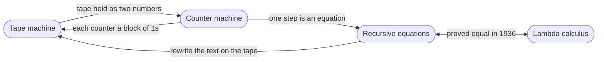
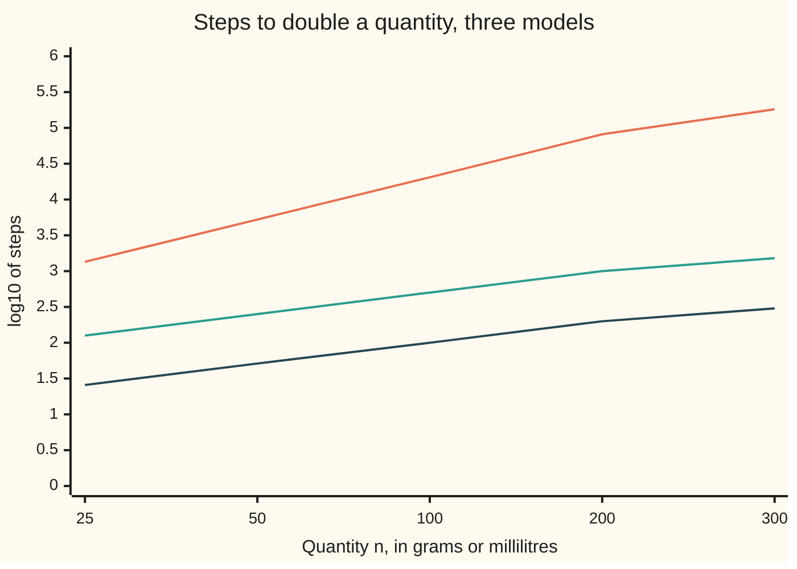

# Church-Turing thesis: every reasonable machine computes the same things

[Syllabus](../../../SYLLABUS.md) → [Computability and complexity](../README.md) → [Models of Computation](../README.md#s01) → Church-Turing thesis

---

## General Overview

A pancake recipe for four people asks for 200 g of flour, 300 ml of milk, 2 eggs and 25 g of sugar. Eight people are coming, so every quantity must double: 400 g, 600 ml, 4 eggs, 50 g.

The question is what a *machine* needs to do this, and whether some machine could do jobs no other machine can.

This card does the doubling on three very different machines:

- **A tape machine**: the machine from [Turing machines](07-turing-machines.md), with a tape, a head and a table of rules.
- **A counter machine**: a few boxes that each hold a whole number, and three instructions: add one, take one away, and jump if the box is empty.
- **Recursive equations**: two rules for rewriting text, applied until no rule applies.

All three print 400, 600, 4 and 50. They differ hugely in effort. For the 300 ml of milk, the tape machine takes 181,202 steps, the counter machine 1,501 and the equations 301 rewrites.

In the 1930s rival definitions of "computable" appeared: machines, equations, and a calculus of functions. All were proved to compute exactly the same functions, and so has every reasonable model proposed since.

**Any reasonable machine (finite rules, discrete steps, as much scratch memory as it needs) computes exactly what a Turing machine computes: machines differ in speed, never in what they can do.**

**What kind of fact this is:** a thesis, not a theorem. The equalities between named models are theorems, and the code runs the key step of one of them: a tape held as two numbers. The claim about *every reasonable machine* links a precise idea to an informal one, so it can be supported but never proved. A reasonable machine that computes more would refute it; none is known as of 2026-11-19.

### The picture: each model runs the others



An arrow from one model to another means the second can run any program of the first, step by step; the label says how. The arrows form a loop, so all four models compute the same functions. The diagram is schematic.

---

## The formula

```math
C_{\mathrm{TM}} = C_{\mathrm{CM}} = C_{\mathrm{REC}} = C_{\lambda} \quad \text{(theorems)}, \qquad \text{effectively calculable} = C_{\mathrm{TM}} \quad \text{(the thesis)}
```

**Read it aloud:** "The functions a tape machine computes, a counter machine computes, recursive equations define and the lambda calculus defines are one and the same set, and that set is exactly what a person or machine following fixed rules can work out."

Here a **function** means a rule that takes a whole number to a whole number, such as doubling. It may be undefined on some inputs: there the machine never stops. "Effectively calculable" is the informal idea: computable by a finite set of mechanical instructions, with no insight needed, given unlimited time and paper.

| Symbol | Plain meaning | In our example | Push it up and the answer… |
| --- | --- | --- | --- |
| $`n`$ | the input: one recipe quantity, as a whole number | 200 g of flour | the work grows; the answer stays $`2n`$ |
| $`d`$ | the doubling function, $`d(n) = 2n`$ | $`d(200) = 400`$ | a fixed rule: nothing to push |
| $`S`$ | "successor": $`S(x)`$ is the number after $`x`$, so $`S(S(0))`$ is 2 | the eggs, $`S(S(0))`$ | one more $`S`$ is one more unit |
| $`x`$ | any number written with $`S`$ and $`0`$, inside an equation | $`S(0)`$, in the first rewrite of the eggs | a longer $`x`$ needs more rewrites |
| $`C_{\mathrm{TM}}`$ | the set of functions some tape machine computes | contains $`d`$ | a fixed set: nothing to push |
| $`C_{\mathrm{CM}}`$ | the set of functions some counter machine computes | contains $`d`$ | the same set as $`C_{\mathrm{TM}}`$ |
| $`C_{\mathrm{REC}}`$ | the set of functions some recursive equations define | contains $`d`$ | the same set as $`C_{\mathrm{TM}}`$ |
| $`C_{\lambda}`$ | the set of functions the lambda calculus defines (here λ labels a model of computing, not an eigenvalue) | contains $`d`$ | the same set as $`C_{\mathrm{TM}}`$ |
| $`b`$ | the base for reading a tape as a number; it must exceed the number of tape symbols | 4, for 4 symbols | still works; 3 breaks at step 7 |
| $`\ell`$ | "left number": the cells left of the head, read in base $`b`$, nearest cell as the lowest digit | 0 at the start | grows by a factor $`b`$ per move right |
| $`r`$ | "right number": the head's cell and everything right of it, head cell as the lowest digit | 5 at the start, for tape `11` | grows by a factor $`b`$ per move left |
| $`w`$ | the symbol a rule writes, as a digit from 0 to 3 | X is 2 | must stay below $`b`$, or it carries |

### When it holds

- **The machine has finitely many rules.** An infinite rule table could simply list every answer, even ones no program can find. That is a lookup, not a computation.
- **Each step looks at and changes a bounded part of the memory.** A step that asks "is there a 1 anywhere on this infinite tape?" in one move answers questions no finite process can.
- **Each step takes at least some fixed time.** If the 1st step takes half a second, the 2nd a quarter, and so on, all infinitely many steps finish inside 1 second. Such a machine could wait out an endless search and report the result. The code prints the clock: 0.9990234375 s after 10 steps.
- **Memory holds symbols, not infinitely precise numbers.** One exact real number has infinitely many binary digits, so one register could hold the answers to infinitely many yes-or-no questions.
- **Scratch memory is unlimited.** Fail this one and the machine computes *less*. With a tape of 64 cells, the doubling machine handles quantities up to 31 and runs off the tape on the flour.

---

## Why it works

### Step 0: what can be proved, and what cannot

"Computed by a Turing machine" is precise. "Computed by any reasonable machine" is not, because "reasonable" has no mathematical definition. A proof needs both sides precise, so the thesis cannot be proved. It rests on two kinds of evidence:

1. **Theorems between models.** For every pair of precise models, prove that each can run the other's programs. This card runs one such proof in code.
2. **An analysis of mechanical work.** Show that anything a clerk or a machine does by fixed rules breaks into steps a Turing machine can copy. This is an argument, not a proof, because it starts from the informal idea.

### Step 1: one job, three models

**The tape machine** writes $`n`$ as $`n`$ copies of `1`. Blank cells are shown `_` here (␣ on the Turing machines card). In each round it changes one original `1` into an `X` ("done"), walks right to the end, adds a `Y` ("copy"), and walks back. When no `1` is left, it changes every `X` and `Y` back into `1`. State `halt` has no rows, so the machine stops there. The rule table, with columns state, read, write, move, next:

| state | read | write | move | next |
| --- | --- | --- | --- | --- |
| mark | `1` | `X` | R | end |
| mark | `Y` | `1` | R | fix |
| mark | `_` | `_` | R | halt |
| end | `1` | `1` | R | end |
| end | `Y` | `Y` | R | end |
| end | `_` | `Y` | L | back |
| back | `1` | `1` | L | back |
| back | `Y` | `Y` | L | back |
| back | `X` | `X` | R | mark |
| fix | `Y` | `1` | R | fix |
| fix | `_` | `_` | L | home |
| home | `1` | `1` | L | home |
| home | `X` | `1` | L | home |
| home | `_` | `_` | R | halt |

**The counter machine** starts with $`n`$ in box `a` and 0 in boxes `b` and `z`. Box `z` stays 0, so "jump if `z` is empty" is a plain jump.

```
0: if a is empty, jump to 5
1: take one from a
2: add one to b
3: add one to b
4: if z is empty, jump to 0
5: halt
```

**The recursive equations** define doubling on numbers written with $`S`$:

```math
d(0) = 0, \qquad d(S(x)) = S(S(d(x)))
```

The second equation says: the double of "one more than $`x`$" is "two more than the double of $`x`$". A mechanical evaluator rewrites the text until no $`d`$ is left. All three give $`2n`$ for every $`n`$ from 0 to 60, and on all four recipe lines.

### Step 2: the counter machine and the equations run inside a tape machine

A tape machine can hold each counter as a block of `1`s, with blanks between the blocks. "Add one" stretches a block, "take one" shrinks it, and "is it empty?" looks for a `1`. Each instruction becomes a small routine of tape rules. So $`C_{\mathrm{CM}}`$ is inside $`C_{\mathrm{TM}}`$.

The equations are rewrites of text. Finding `d(`, copying the text after it and writing `S(S(d(` in its place is ordinary tape work. So $`C_{\mathrm{REC}}`$ is inside $`C_{\mathrm{TM}}`$ too.

### Step 3: the tape machine runs inside a counter machine

This is the surprising direction, and the code runs its key step. A counter machine has no tape, only whole numbers. So it holds the tape as **two numbers**.

Give each symbol a digit: `_` is 0, `1` is 1, `X` is 2, `Y` is 3. Read the cells as digits in base $`b = 4`$:

- $`r`$, the right number, holds the head's cell and everything to its right. The head's cell is the lowest digit.
- $`\ell`$, the left number, holds everything left of the head. The nearest cell is the lowest digit.

At the start the tape is `11` with the head on the first `1`, so $`r = 1 + 1 \times 4 = 5`$ and $`\ell = 0`$.

Now every tape action is arithmetic:

- **Read** the head's symbol: $`r \bmod b`$, the remainder after dividing by $`b`$.
- **Write** $`w`$: replace the lowest digit, $`r \leftarrow r - (r \bmod b) + w`$.
- **Move right**: the written cell joins the left number, $`\ell \leftarrow b\ell + w`$ and $`r \leftarrow \lfloor r / b \rfloor`$ (whole-number division).
- **Move left**: the nearest left cell joins the right number, $`r \leftarrow br + (\ell \bmod b)`$ and $`\ell \leftarrow \lfloor \ell / b \rfloor`$.

Multiplying by 4, dividing by 4 and taking the remainder become loops of "add one" and "take one" on spare counters. That part is routine (the 1961 counter-machine paper in Sources gives it), and the code does not run it: it does the arithmetic with ordinary `*`, `//` and `%`. The code checks that the tape and the two numbers make the same read at every step, for every $`n`$ from 0 to 30. So $`C_{\mathrm{TM}}`$ is inside $`C_{\mathrm{CM}}`$.

The base matters. With 4 symbols, digits must run from 0 to 3, so $`b`$ must be at least 4. With $`b = 3`$, writing a `Y` (digit 3) carries into the next cell. On the eggs, the first wrong read comes at step 7: the numbers say `_` where the tape holds `Y`.

### Step 4: closing the loop

A counter machine's state is a few numbers: the instruction number and the boxes. One step changes them by a fixed formula, which recursive equations can state. "Repeat until the machine halts" is a search for the first step count at which it has halted, which the equations can also state. So $`C_{\mathrm{CM}}`$ is inside $`C_{\mathrm{REC}}`$.

Now the arrows form a loop: tape inside counters, counters inside equations, equations inside tape. All three sets are equal. The lambda calculus joins through a 1936 proof that its functions are exactly the recursive ones ([Lambda calculus](../02-Computability%20and%20Logic/07-lambda-calculus-in-outline.md) builds it).

### Step 5: why no reasonable machine does more

[Turing machines](07-turing-machines.md) sketches Turing's clerk with a pencil. Here is why that sketch covers every step-by-step procedure:

1. The clerk can tell apart only finitely many symbols.
2. At any moment the clerk looks at a bounded patch of paper.
3. The clerk is in one of finitely many states of mind.
4. One step changes a bounded patch and moves attention a bounded distance.

Each step is then a lookup in a finite table: (state of mind, patch seen) gives (patch written, move, new state of mind). That is a Turing machine whose symbols are whole patches. Later work extended the same analysis from clerks to machines working in parallel, with signals that travel at bounded speed. Any machine meeting those conditions can be run by a Turing machine.

The first two bullets of "When it holds" above are these four conditions, said for machines. The next two are physical: each step takes at least a fixed time, and memory holds symbols, not exact real numbers. The last is the clerk's unlimited supply of paper. Drop one of the first four bullets and the "machine" stops being a machine; drop the last and it computes less.

### Step 6: the same things, not the same speed

The thesis is about *what* can be computed, not the cost. The tape machine walks the whole tape twice per unit, so its steps grow like a square, $`2(n+1)^2`$. The counter machine spends 5 steps per unit, $`5n + 1`$. The equations need $`n + 1`$ rewrites, but one rewrite copies a stretch of text whose length grows with $`n`$, so a rewrite is not a unit of work like a tape step.



Top line: the tape machine. Middle line: the counter machine. Bottom line: rewrites of the equations. From 25 to 200, each tick doubles $`n`$. Over those ticks the top line climbs twice as fast as the other two: a square grows 4 times per doubling, a straight line 2 times. The last tick, 300, is only 1.5 times 200.

A stronger claim, the **extended Church-Turing thesis**, says any reasonable model runs any other with at most a polynomial slowdown (a slowdown like $`n^2`$ or $`n^3`$, never like $`2^n`$). One job cannot test this, because the extended thesis is about the cost of one model running another. Step 3's counter machine runs the tape exponentially slowly: multiplying by 4 with add-one loops takes about as many steps as the number itself, and the number has one base-4 digit for every tape cell. That is why the extended thesis is stated for models like tape machines and ordinary computers, not counter machines. Quantum computers leave the plain thesis alone: a classical machine can track every amplitude of a quantum computer (one number for each pattern of its qubits, or quantum bits), slowly. They put the extended thesis in doubt, because factoring has a fast quantum method and no known fast classical one. [BQP](../05-Algebraic%2C%20Interactive%20and%20Quantum/06-quantum-computation-and-bqp.md) takes this up.

<details>
<summary>Detailed proof: the tape machine takes exactly 2(n+1)² steps for n ≥ 1</summary>

Count one round. The head starts on the leftmost unprocessed `1`. The tape holds some `X`s, then the remaining `1`s, then the `Y`s made so far; the remaining `1`s and the `Y`s together fill $`n`$ cells.

- `mark` writes `X` and moves right: 1 step.
- `end` walks over the $`n - 1`$ cells to the right of the head, then writes a `Y` on the blank and turns: $`n`$ steps.
- `back` walks left over those $`n - 1`$ cells, then reads the `X` and moves right: $`n`$ steps.

So one round costs $`2n + 1`$ steps, and there are $`n`$ rounds.

Then `mark` reads the first `Y` (1 step). `fix` turns the remaining $`n - 1`$ `Y`s into `1`s and reads the blank ($`n`$ steps). `home` walks left over all $`2n`$ cells and reads the blank on the left ($`2n + 1`$ steps). In total:

$`\displaystyle n(2n + 1) + 1 + n + (2n + 1) = 2n^2 + 4n + 2 = 2(n + 1)^2.`$

For $`n = 0`$ the machine reads a blank and halts in 1 step, so the formula starts at $`n = 1`$. The code checks it for every $`n`$ from 1 to 60.

The counter machine runs the 5 instructions 0 to 4 once per unit of `a`, then instruction 0 once more: $`5n + 1`$. The equations apply the second rule $`n`$ times and the first rule once: $`n + 1`$.

</details>

---

## Worked numbers, by hand

The eggs, $`n = 2`$, then the flour, $`n = 200`$.

| Step | Arithmetic | Value |
| --- | --- | --- |
| Equations, eggs | $`d(S(S(0))) \to S(S(d(S(0)))) \to S(S(S(S(d(0))))) \to S(S(S(S(0))))`$ | 4 eggs, 3 rewrites |
| Counter machine, eggs | $`5 \times 2 + 1`$ | 4 eggs, 11 steps |
| Tape machine, eggs: two rounds | $`2 \times (2 \times 2 + 1)`$ | 10 steps |
| Tape machine, eggs: clean-up | $`1 + 2 + (2 \times 2 + 1)`$ | 8 steps |
| Tape machine, eggs: total | $`10 + 8 = 2 \times 3^2`$ | 4 eggs, 18 steps |
| Two numbers at the start | tape `11`: $`r = 1 + 1 \times 4`$, $`\ell = 0`$ | $`r = 5`$, $`\ell = 0`$ |
| Two numbers after step 1 | write `X` (2), move right: $`\ell = 4 \times 0 + 2`$, $`r = \lfloor (5 - 1 + 2)/4 \rfloor`$ | $`\ell = 2`$, $`r = 1`$ |
| Flour, three models | $`2 \times 201^2`$; $`5 \times 200 + 1`$; $`200 + 1`$ | 80,802; 1,001; 201 |
| **Doubled recipe** | every model, every line | **400 g flour, 600 ml milk, 4 eggs, 50 g sugar** |

Three machines built on different ideas give the same recipe; only the effort differs. The `run` lines of the code output trace all 18 eggs steps, as the tape and as the two numbers.

### What breaks if you drop a piece

| Mistake | Comes out at | What went wrong |
| --- | --- | --- |
| Read the tape in base 3, with 4 symbols | first wrong read at step 7 on the eggs: `_` where the tape holds `Y` | digit 3 does not fit in base 3, so writing `Y` carries into the next cell |
| Give the tape machine 64 cells of tape | doubles quantities up to 31; on the flour it runs off the tape at step 63 | with fixed memory it is only a finite automaton, which computes strictly less |
| Let each step take half as long as the last | 0.9990234375 s after 10 steps, 0.9999999991 s after 30 | infinitely many steps fit in 1 second, which no physical machine can do |
| Read "same things" as "same speed" | 181,202 tape steps against 1,501 counter steps for the milk | the thesis is about what is computed, not how fast |

---

## Code, from first principles, and it actually runs

The code builds the three models from scratch: a tape machine on a list, a counter machine, and a text rewriter for the equations. It takes **four independent roads** to the doubled recipe: the tape machine, the same machine run on two base-4 numbers, the counter machine and the equations, each checked against plain $`2n`$. Step counts are checked against the closed forms proved above, and the two-number run is compared read by read with the tape run: Step 3's two numbers, run for real, with ordinary arithmetic in place of add-one loops. The Rust version holds the two numbers in 128-bit integers. They fit for every $`n`$ the simulation check runs, 0 to 30, but not much further, which is why that check stops there while the others run to 60.

### Python

```python
# Church-Turing thesis: double a recipe in three models, then run one model inside another.
# Standard library only. The tape machine is explained on the Turing machines card.
from math import log10
SYM, RT, LT = '_1XY', 1, -1      # symbols 0..3: blank, one, done-mark X, copy-mark Y
TM = {('mark', 1): (2, RT, 'end'), ('mark', 3): (1, RT, 'fix'), ('mark', 0): (0, RT, 'halt'),
      ('end', 1): (1, RT, 'end'), ('end', 3): (3, RT, 'end'), ('end', 0): (3, LT, 'back'),
      ('back', 1): (1, LT, 'back'), ('back', 3): (3, LT, 'back'), ('back', 2): (2, RT, 'mark'),
      ('fix', 3): (1, RT, 'fix'), ('fix', 0): (0, LT, 'home'),
      ('home', 1): (1, LT, 'home'), ('home', 2): (1, LT, 'home'), ('home', 0): (0, RT, 'halt')}

def tape_run(n, cells=10**6, trace=None):
    """Model 1, a Turing machine on a list. Cell p sits at index p + 1. Returns reads, ones, steps."""
    tape, h, q, reads = [0] + [1] * n + [0] * (2 * n + 2), 1, 'mark', []
    while q != 'halt':
        if h >= cells:
            return reads, None, len(reads)           # ran off a tape of cells -1 to cells - 2
        s = tape[h]
        w, m, q2 = TM[(q, s)]
        reads.append((q, s))
        tape[h], h = w, h + m
        if trace is not None:
            trace.append((len(reads), q, SYM[s], SYM[w], 'R' if m == RT else 'L', q2, h - 1,
                          ''.join(SYM[c] for c in tape[1:6])))
        q = q2
    return reads, tape.count(1), len(reads)

def arith_start(n, b):
    return sum(b ** i for i in range(n))       # n ones, read as base-b digits

def arith_run(n, b, cap=10**5, trace=None):
    """Road 2: the same machine on two whole numbers, as a counter machine would hold it.
    rgt = the head's cell and everything right of it, in base b, head cell lowest digit.
    lft = everything left of the head, nearest cell lowest digit. Moves are *b, //b, %b."""
    lft, rgt, q, reads = 0, arith_start(n, b), 'mark', []
    while q != 'halt' and len(reads) < cap and (q, rgt % b) in TM:
        s = rgt % b
        w, m, q2 = TM[(q, s)]
        reads.append((q, s))
        rgt = rgt - s + w
        if m == RT:
            lft, rgt = lft * b + w, rgt // b
        else:
            lft, rgt = lft // b, rgt * b + lft % b
        if trace is not None:
            trace.append((lft, rgt))
        q = q2
    ones, x = 0, rgt
    while x > 0:
        ones, x = ones + (x % b == 1), x // b
    return reads, ones

DOUBLE = [('JZ', 'a', 5), ('DEC', 'a'), ('INC', 'b'), ('INC', 'b'), ('JZ', 'z', 0), ('HALT',)]
TRIPLE = [('JZ', 'a', 6), ('DEC', 'a'), ('INC', 'b'), ('INC', 'b'), ('INC', 'b'), ('JZ', 'z', 0), ('HALT',)]

def cm_run(prog, n):
    """Model 2, a counter machine: registers a, b and z (always 0), three instructions."""
    reg, pc, steps = {'a': n, 'b': 0, 'z': 0}, 0, 0
    while prog[pc][0] != 'HALT':
        op, steps = prog[pc], steps + 1
        if op[0] == 'INC':
            reg[op[1]], pc = reg[op[1]] + 1, pc + 1
        elif op[0] == 'DEC':
            reg[op[1]], pc = reg[op[1]] - 1, pc + 1
        else:
            pc = op[2] if reg[op[1]] == 0 else pc + 1
    return reg['b'], steps

def rec_run(n):
    """Model 3, recursive equations d(0) = 0 and d(S(x)) = S(S(d(x))), applied by rewriting text."""
    t, steps = 'd(' + 'S(' * n + '0' + ')' * n + ')', 0
    while 'd(' in t:
        i = t.index('d(')
        if t[i + 2] == '0':
            t = t[:i] + '0' + t[i + 4:]
        else:
            j, depth = i + 4, 1                      # find the ')' that closes the S( at i + 2
            while depth > 0:
                depth += {'(': 1, ')': -1}.get(t[j], 0)
                j += 1
            t = t[:i] + 'S(S(d(' + t[i + 4:j - 1] + ')))' + t[j + 1:]
        steps += 1
    return t.count('S'), steps

checks = 0
for n in range(61):                                  # three models, one answer, n = 0..60
    reads, ones, tms = tape_run(n)
    assert ones == 2 * n and cm_run(DOUBLE, n)[0] == 2 * n and rec_run(n)[0] == 2 * n
    assert cm_run(DOUBLE, n)[1] == 5 * n + 1 and rec_run(n)[1] == n + 1
    assert n == 0 or tms == 2 * (n + 1) ** 2         # closed form proved on the card
    if n <= 30:                                      # simulation: same reads at every step
        areads, aones = arith_run(n, 4)
        assert areads == reads and aones == 2 * n
    checks += 1
print('agree: tape, counters, equations all give 2n for n = 0..60;', checks, 'values')
print('closed forms: tape 2(n+1)^2 steps, counters 5n+1, equations n+1 rewrites')
print('simulation: tape and two base-4 numbers make the same reads at every step, n = 0..30')
print('recipe,n,doubled,tape_steps,counter_steps,rewrites')
for name, n in [('flour g', 200), ('milk ml', 300), ('eggs', 2), ('sugar g', 25)]:
    _, ones, tms = tape_run(n)
    print(f'{name},{n},{ones},{tms},{cm_run(DOUBLE, n)[1]},{rec_run(n)[1]}')
trace, nums = [], []
tape_run(2, trace=trace)
arith_run(2, 4, trace=nums)
print('run,step,state,read,write,move,next,head,cells 0-4,left,right')
print(f'run,0,mark,-,-,-,-,0,{SYM[1] * 2 + SYM[0] * 3},0,{arith_start(2, 4)}')
for row, (lf, rg) in zip(trace, nums):
    print('run,' + ','.join(str(v) for v in row) + f',{lf},{rg}')
for n in [25, 50, 100, 200, 300]:
    a, b, c = tape_run(n)[2], cm_run(DOUBLE, n)[1], rec_run(n)[1]
    print(f'chart,{n},{log10(a):.2f},{log10(b):.2f},{log10(c):.2f}')
reads, _ = arith_run(2, 4)
bad, _ = arith_run(2, 3, cap=200)
k = next(i for i in range(len(bad)) if bad[i] != reads[i])
assert (k + 1, SYM[bad[k][1]], SYM[reads[k][1]]) == (7, '_', 'Y')   # traced by hand on the card
print(f'break,base 3 for 4 symbols: first wrong read at step {k + 1}: '
      f'read {SYM[bad[k][1]]} where the tape holds {SYM[reads[k][1]]}')
big = max(n for n in range(100) if tape_run(n, cells=64)[1] == 2 * n)
off = tape_run(200, cells=64)
assert big == 31 and off[1] is None
print(f'break,tape of 64 cells: largest n doubled {big}; flour 200 runs off at step {off[2]}')
for steps in [10, 30]:
    print(f'break,zeno: step k takes 2^-k s; after {steps} steps {1 - 2.0 ** -steps:.10f} s')
print(f'try,triple program on flour: {cm_run(TRIPLE, 200)[0]} in {cm_run(TRIPLE, 200)[1]} steps')
print(f'try,base 5 agrees for n = 0..20: {all(arith_run(n, 5)[0] == tape_run(n)[0] for n in range(21))}')
print('ALL CHECKS PASS')
```

**Ran 2026-11-19 on macOS, Python 3.14.10, standard library only. All checks passed. Output, pasted from the run:**

```
agree: tape, counters, equations all give 2n for n = 0..60; 61 values
closed forms: tape 2(n+1)^2 steps, counters 5n+1, equations n+1 rewrites
simulation: tape and two base-4 numbers make the same reads at every step, n = 0..30
recipe,n,doubled,tape_steps,counter_steps,rewrites
flour g,200,400,80802,1001,201
milk ml,300,600,181202,1501,301
eggs,2,4,18,11,3
sugar g,25,50,1352,126,26
run,step,state,read,write,move,next,head,cells 0-4,left,right
run,0,mark,-,-,-,-,0,11___,0,5
run,1,mark,1,X,R,end,1,X1___,2,1
run,2,end,1,1,R,end,2,X1___,9,0
run,3,end,_,Y,L,back,1,X1Y__,2,13
run,4,back,1,1,L,back,0,X1Y__,0,54
run,5,back,X,X,R,mark,1,X1Y__,2,13
run,6,mark,1,X,R,end,2,XXY__,10,3
run,7,end,Y,Y,R,end,3,XXY__,43,0
run,8,end,_,Y,L,back,2,XXYY_,10,15
run,9,back,Y,Y,L,back,1,XXYY_,2,62
run,10,back,X,X,R,mark,2,XXYY_,10,15
run,11,mark,Y,1,R,fix,3,XX1Y_,41,3
run,12,fix,Y,1,R,fix,4,XX11_,165,0
run,13,fix,_,_,L,home,3,XX11_,41,1
run,14,home,1,1,L,home,2,XX11_,10,5
run,15,home,1,1,L,home,1,XX11_,2,22
run,16,home,X,1,L,home,0,X111_,0,86
run,17,home,X,1,L,home,-1,1111_,0,340
run,18,home,_,_,R,halt,0,1111_,0,85
chart,25,3.13,2.10,1.41
chart,50,3.72,2.40,1.71
chart,100,4.31,2.70,2.00
chart,200,4.91,3.00,2.30
chart,300,5.26,3.18,2.48
break,base 3 for 4 symbols: first wrong read at step 7: read _ where the tape holds Y
break,tape of 64 cells: largest n doubled 31; flour 200 runs off at step 63
break,zeno: step k takes 2^-k s; after 10 steps 0.9990234375 s
break,zeno: step k takes 2^-k s; after 30 steps 0.9999999991 s
try,triple program on flour: 600 in 1201 steps
try,base 5 agrees for n = 0..20: True
ALL CHECKS PASS
```

### Rust

```rust
// Church-Turing thesis: double a recipe in three models, then run one model inside another.
// std only. The tape machine is explained on the Turing machines card.
const SYM: [char; 4] = ['_', '1', 'X', 'Y']; // symbols 0..3: blank, one, done-mark X, copy-mark Y
type Rule = (usize, i64, &'static str);

fn tm(q: &str, s: usize) -> Option<Rule> {
    Some(match (q, s) {
        ("mark", 1) => (2, 1, "end"), ("mark", 3) => (1, 1, "fix"), ("mark", 0) => (0, 1, "halt"),
        ("end", 1) => (1, 1, "end"), ("end", 3) => (3, 1, "end"), ("end", 0) => (3, -1, "back"),
        ("back", 1) => (1, -1, "back"), ("back", 3) => (3, -1, "back"), ("back", 2) => (2, 1, "mark"),
        ("fix", 3) => (1, 1, "fix"), ("fix", 0) => (0, -1, "home"),
        ("home", 1) => (1, -1, "home"), ("home", 2) => (1, -1, "home"), ("home", 0) => (0, 1, "halt"),
        _ => return None,
    })
}

type Reads = Vec<(&'static str, usize)>;

// Model 1, a Turing machine on a vector. Cell p sits at index p + 1.
fn tape_run(n: usize, cells: i64, trace: &mut Vec<String>) -> (Reads, Option<usize>, usize) {
    let mut tape = vec![0usize; 3 * n + 3];
    for i in 1..=n { tape[i] = 1; }
    let (mut h, mut q, mut reads): (i64, &'static str, Reads) = (1, "mark", vec![]);
    while q != "halt" {
        if h >= cells { let k = reads.len(); return (reads, None, k); } // tape is cells -1 to cells - 2
        let s = tape[h as usize];
        let (w, m, q2) = tm(q, s).unwrap();
        reads.push((q, s));
        tape[h as usize] = w;
        h += m;
        let cs: String = tape[1..6.min(tape.len())].iter().map(|&c| SYM[c]).collect();
        trace.push(format!("{},{},{},{},{},{},{},{}", reads.len(), q, SYM[s], SYM[w],
                           if m == 1 { "R" } else { "L" }, q2, h - 1, cs));
        q = q2;
    }
    let ones = tape.iter().filter(|&&c| c == 1).count();
    let k = reads.len();
    (reads, Some(ones), k)
}

fn arith_start(n: usize, b: u128) -> u128 { (0..n).map(|i| b.pow(i as u32)).sum() }

// Road 2: the same machine on two whole numbers, moved by *b, /b and %b.
fn arith_run(n: usize, b: u128, cap: usize, trace: &mut Vec<(u128, u128)>) -> (Reads, usize) {
    let (mut lft, mut rgt, mut q, mut reads): (u128, u128, &'static str, Reads) =
        (0, arith_start(n, b), "mark", vec![]);
    while q != "halt" && reads.len() < cap {
        let s = (rgt % b) as usize;
        let Some((w, m, q2)) = tm(q, s) else { break };
        reads.push((q, s));
        rgt = rgt - s as u128 + w as u128;
        if m == 1 { lft = lft * b + w as u128; rgt /= b; }
        else { let d = lft % b; lft /= b; rgt = rgt * b + d; }
        trace.push((lft, rgt));
        q = q2;
    }
    let (mut ones, mut x) = (0, rgt);
    while x > 0 { if x % b == 1 { ones += 1; } x /= b; }
    (reads, ones)
}

#[derive(Clone, Copy)]
enum Op { Inc(usize), Dec(usize), Jz(usize, usize), Halt }
use Op::*;
// registers: 0 = a, 1 = b, 2 = z (always 0)
const DOUBLE: [Op; 6] = [Jz(0, 5), Dec(0), Inc(1), Inc(1), Jz(2, 0), Halt];
const TRIPLE: [Op; 7] = [Jz(0, 6), Dec(0), Inc(1), Inc(1), Inc(1), Jz(2, 0), Halt];

// Model 2, a counter machine.
fn cm_run(prog: &[Op], n: u64) -> (u64, u64) {
    let (mut reg, mut pc, mut steps) = ([n, 0, 0], 0usize, 0u64);
    loop {
        match prog[pc] {
            Halt => break,
            Inc(r) => { reg[r] += 1; pc += 1; }
            Dec(r) => { reg[r] -= 1; pc += 1; }
            Jz(r, t) => { pc = if reg[r] == 0 { t } else { pc + 1 }; }
        }
        steps += 1;
    }
    (reg[1], steps)
}

// Model 3, recursive equations d(0) = 0 and d(S(x)) = S(S(d(x))), applied by rewriting text.
fn rec_run(n: usize) -> (usize, usize) {
    let mut t: Vec<u8> = format!("d({}0{})", "S(".repeat(n), ")".repeat(n)).into_bytes();
    let mut steps = 0;
    while let Some(i) = t.windows(2).position(|w| w == b"d(") {
        if t[i + 2] == b'0' {
            t.splice(i..i + 4, b"0".iter().cloned());
        } else {
            let (mut j, mut depth) = (i + 4, 1i64);
            while depth > 0 {
                if t[j] == b'(' { depth += 1; } else if t[j] == b')' { depth -= 1; }
                j += 1;
            }
            let mut mid = b"S(S(d(".to_vec();
            mid.extend_from_slice(&t[i + 4..j - 1]);
            mid.extend_from_slice(b")))");
            t.splice(i..j + 1, mid);
        }
        steps += 1;
    }
    (t.iter().filter(|&&c| c == b'S').count(), steps)
}

fn main() {
    let (mut tr, mut nu) = (vec![], vec![]);
    let mut checks = 0;
    for n in 0..=60usize {
        let (reads, ones, tms) = tape_run(n, i64::MAX, &mut tr);
        let (n64, c, r) = (n as u64, cm_run(&DOUBLE, n as u64), rec_run(n));
        assert!(ones == Some(2 * n) && c.0 == 2 * n64 && r.0 == 2 * n);
        assert!(c.1 == 5 * n64 + 1 && r.1 == n + 1);
        assert!(n == 0 || tms == 2 * (n + 1) * (n + 1));
        if n <= 30 {
            let (areads, aones) = arith_run(n, 4, 100000, &mut nu);
            assert!(areads == reads && aones == 2 * n);
        }
        checks += 1;
    }
    println!("agree: tape, counters, equations all give 2n for n = 0..60; {} values", checks);
    println!("closed forms: tape 2(n+1)^2 steps, counters 5n+1, equations n+1 rewrites");
    println!("simulation: tape and two base-4 numbers make the same reads at every step, n = 0..30");
    println!("recipe,n,doubled,tape_steps,counter_steps,rewrites");
    for (name, n) in [("flour g", 200), ("milk ml", 300), ("eggs", 2), ("sugar g", 25)] {
        let (_, ones, tms) = tape_run(n, i64::MAX, &mut tr);
        println!("{},{},{},{},{},{}", name, n, ones.unwrap(), tms, cm_run(&DOUBLE, n as u64).1, rec_run(n).1);
    }
    let (mut trace, mut nums) = (vec![], vec![]);
    tape_run(2, i64::MAX, &mut trace);
    arith_run(2, 4, 100000, &mut nums);
    println!("run,step,state,read,write,move,next,head,cells 0-4,left,right");
    println!("run,0,mark,-,-,-,-,0,{}{}{}{}{},0,{}", SYM[1], SYM[1], SYM[0], SYM[0], SYM[0], arith_start(2, 4));
    for (row, (lf, rg)) in trace.iter().zip(nums.iter()) { println!("run,{},{},{}", row, lf, rg); }
    for n in [25usize, 50, 100, 200, 300] {
        let (a, b, c) = (tape_run(n, i64::MAX, &mut tr).2, cm_run(&DOUBLE, n as u64).1, rec_run(n).1);
        println!("chart,{},{:.2},{:.2},{:.2}", n, (a as f64).log10(), (b as f64).log10(), (c as f64).log10());
    }
    let (reads, _) = arith_run(2, 4, 100000, &mut nu);
    let (bad, _) = arith_run(2, 3, 200, &mut nu);
    let k = (0..bad.len()).find(|&i| bad[i] != reads[i]).unwrap();
    assert!((k + 1, SYM[bad[k].1], SYM[reads[k].1]) == (7, '_', 'Y')); // traced by hand on the card
    println!("break,base 3 for 4 symbols: first wrong read at step {}: read {} where the tape holds {}",
             k + 1, SYM[bad[k].1], SYM[reads[k].1]);
    let big = (0..100).filter(|&n| tape_run(n, 64, &mut tr).1 == Some(2 * n)).max().unwrap();
    let off = tape_run(200, 64, &mut tr);
    assert!(big == 31 && off.1.is_none());
    println!("break,tape of 64 cells: largest n doubled {}; flour 200 runs off at step {}", big, off.2);
    for steps in [10, 30] {
        println!("break,zeno: step k takes 2^-k s; after {} steps {:.10} s", steps, 1.0 - 2f64.powi(-steps));
    }
    let t = cm_run(&TRIPLE, 200);
    println!("try,triple program on flour: {} in {} steps", t.0, t.1);
    let ok = (0..=20).all(|n| arith_run(n, 5, 100000, &mut nu).0 == tape_run(n, i64::MAX, &mut tr).0);
    println!("try,base 5 agrees for n = 0..20: {}", if ok { "True" } else { "False" });
    println!("ALL CHECKS PASS");
}
```

**Ran 2026-11-19 on macOS, rustc 1.98.1, no crates. All checks passed. Output, pasted from the run:**

```
agree: tape, counters, equations all give 2n for n = 0..60; 61 values
closed forms: tape 2(n+1)^2 steps, counters 5n+1, equations n+1 rewrites
simulation: tape and two base-4 numbers make the same reads at every step, n = 0..30
recipe,n,doubled,tape_steps,counter_steps,rewrites
flour g,200,400,80802,1001,201
milk ml,300,600,181202,1501,301
eggs,2,4,18,11,3
sugar g,25,50,1352,126,26
run,step,state,read,write,move,next,head,cells 0-4,left,right
run,0,mark,-,-,-,-,0,11___,0,5
run,1,mark,1,X,R,end,1,X1___,2,1
run,2,end,1,1,R,end,2,X1___,9,0
run,3,end,_,Y,L,back,1,X1Y__,2,13
run,4,back,1,1,L,back,0,X1Y__,0,54
run,5,back,X,X,R,mark,1,X1Y__,2,13
run,6,mark,1,X,R,end,2,XXY__,10,3
run,7,end,Y,Y,R,end,3,XXY__,43,0
run,8,end,_,Y,L,back,2,XXYY_,10,15
run,9,back,Y,Y,L,back,1,XXYY_,2,62
run,10,back,X,X,R,mark,2,XXYY_,10,15
run,11,mark,Y,1,R,fix,3,XX1Y_,41,3
run,12,fix,Y,1,R,fix,4,XX11_,165,0
run,13,fix,_,_,L,home,3,XX11_,41,1
run,14,home,1,1,L,home,2,XX11_,10,5
run,15,home,1,1,L,home,1,XX11_,2,22
run,16,home,X,1,L,home,0,X111_,0,86
run,17,home,X,1,L,home,-1,1111_,0,340
run,18,home,_,_,R,halt,0,1111_,0,85
chart,25,3.13,2.10,1.41
chart,50,3.72,2.40,1.71
chart,100,4.31,2.70,2.00
chart,200,4.91,3.00,2.30
chart,300,5.26,3.18,2.48
break,base 3 for 4 symbols: first wrong read at step 7: read _ where the tape holds Y
break,tape of 64 cells: largest n doubled 31; flour 200 runs off at step 63
break,zeno: step k takes 2^-k s; after 10 steps 0.9990234375 s
break,zeno: step k takes 2^-k s; after 30 steps 0.9999999991 s
try,triple program on flour: 600 in 1201 steps
try,base 5 agrees for n = 0..20: True
ALL CHECKS PASS
```

### Lean

Lean proves the card's theorems, not the thesis: Step 3's two-number tape in any base, and both machines' step counts.

- Suppose every tape symbol and the written symbol $`w`$ are digits below $`b`$. Then the head's symbol is $`r \bmod b`$, and each write and move changes $`\ell`$ and $`r`$ exactly as Step 3 says.
- Take any $`n`$ of at least 1, written as $`n`$ copies of `1`. Then the tape machine halts after exactly $`2(n+1)^2`$ steps, holding $`2n`$ copies of `1` and nothing else. The head stops on the first of them.
- Take any $`n`$ in box `a`, with 0 in boxes `b` and `z`. Then the counter machine halts after exactly $`5n + 1`$ steps, with $`2n`$ in box `b`.
- The equations double 200, 300, 2 and 25 to 400, 600, 4 and 50.
- The eggs take 18 tape steps and 11 counter steps, and the other recipe lines' step counts are right.
- The two numbers start at $`r = 5`$ and $`\ell = 0`$, and step 1 makes them $`\ell = 2`$ and $`r = 1`$.

The rewrite counts, the full traces and the broken cases are left to the Python and Rust checks.

```lean
-- Church-Turing thesis: a tape held as two base-b numbers makes the same reads, writes and moves as the tape itself, and the card's tape machine and counter machine double n in exactly 2(n + 1)^2 and 5n + 1 steps.
import Mathlib.Data.Nat.Digits.Defs

/-! The thesis itself links a precise idea to an informal one ("every reasonable machine"),
so it is not a theorem and is not stated here. This file states the card's theorems:
Step 3's two-number tape, and the step counts of the tape machine and the counter machine. -/

namespace ChurchTuring

/-! ### Run a machine for k steps -/

/-- Take `k` steps of a machine whose one-step rule is `step` (`none` means it has stopped).
The result is `none` if the machine stopped before taking all `k` steps. -/
def iterStep {C : Type} (step : C → Option C) : ℕ → C → Option C
  | 0, c => some c
  | k + 1, c => (step c).bind (iterStep step k)

/-- Running `a + b` steps is running `a` steps, then `b` more. -/
theorem iterStep_add {C : Type} (step : C → Option C) (a b : ℕ) (c : C) :
    iterStep step (a + b) c = (iterStep step a c).bind (iterStep step b) := by
  induction a generalizing c with
  | zero => simp [iterStep]
  | succ a ih =>
    rw [show a + 1 + b = (a + b) + 1 by omega]
    simp only [iterStep, ih, Option.bind_assoc]

#print axioms iterStep_add

/-- One more step: take one step, then the rest. -/
theorem iterStep_succ {C : Type} (step : C → Option C) (k : ℕ) (c : C) :
    iterStep step (k + 1) c = (step c).bind (iterStep step k) := rfl

#print axioms iterStep_succ

/-- Zero steps change nothing. -/
theorem iterStep_zero {C : Type} (step : C → Option C) (c : C) :
    iterStep step 0 c = some c := rfl

#print axioms iterStep_zero

/-! ### A tape as two lists, and as two numbers -/

/-- A head move: one cell left or one cell right. -/
inductive Dir
  | L
  | R
  deriving DecidableEq

/-- Write `w` on the head's cell, then move. The tape is two lists of symbols (digits, blank = 0):
`left` holds the cells left of the head, nearest first; `right` holds the head's cell and
everything right of it, head cell first. Cells past the ends of the lists are blank. -/
def tapeWriteMove (left right : List ℕ) (w : ℕ) : Dir → List ℕ × List ℕ
  | .R => (w :: left, right.tail)
  | .L => (left.tail, left.headD 0 :: w :: right.tail)

/-- The same write and move done on two whole numbers, as on the card:
write `r ← r - (r mod b) + w`; move right `ℓ ← bℓ + w`, `r ← ⌊r / b⌋`;
move left `r ← b r + (ℓ mod b)`, `ℓ ← ⌊ℓ / b⌋`. -/
def numWriteMove (b ℓ r w : ℕ) : Dir → ℕ × ℕ
  | .R => (b * ℓ + w, (r - r % b + w) / b)
  | .L => (ℓ / b, b * (r - r % b + w) + ℓ % b)

/-- A list of digits below `b`: its number mod `b` is its first digit. -/
theorem ofDigits_mod_eq_headD (b : ℕ) (l : List ℕ) (hl : ∀ x ∈ l, x < b) :
    Nat.ofDigits b l % b = l.headD 0 := by
  cases l with
  | nil => simp [Nat.ofDigits]
  | cons x xs =>
    have hx : x < b := hl x (by simp)
    simp [Nat.ofDigits_cons, Nat.add_mul_mod_self_left, Nat.mod_eq_of_lt hx]

#print axioms ofDigits_mod_eq_headD

/-- A list of digits below `b`: its number divided by `b` is the number of its tail. -/
theorem ofDigits_div_eq_tail (b : ℕ) (l : List ℕ) (hl : ∀ x ∈ l, x < b) :
    Nat.ofDigits b l / b = Nat.ofDigits b l.tail := by
  cases l with
  | nil => simp [Nat.ofDigits]
  | cons x xs =>
    have hx : x < b := hl x (by simp)
    have hb : 0 < b := by omega
    simp only [Nat.ofDigits_cons, List.tail_cons]
    rw [Nat.add_mul_div_left _ _ hb, Nat.div_eq_of_lt hx, Nat.zero_add]

#print axioms ofDigits_div_eq_tail

/-- Every number `r` equals `r - r mod b` plus `r mod b`, and `r - r mod b = b ⌊r / b⌋`. -/
theorem sub_mod_eq_mul_div (b r : ℕ) : r - r % b = b * (r / b) := by
  have := Nat.div_add_mod r b
  omega

#print axioms sub_mod_eq_mul_div

/-- **Step 3, a tape held as two numbers.** Read each side of the tape as a number in base `b`,
nearest cell as the lowest digit (`Nat.ofDigits`). If every symbol is a digit below `b`, then
the head's symbol is `r mod b`, and writing `w` and moving left or right on the tape gives exactly
the two numbers the arithmetic gives. So a machine holding only whole numbers can follow every
step of a tape machine. -/
theorem two_number_tape_simulation (b : ℕ) (left right : List ℕ) (w : ℕ)
    (hleft : ∀ x ∈ left, x < b) (hright : ∀ x ∈ right, x < b) (hw : w < b) :
    Nat.ofDigits b right % b = right.headD 0 ∧
      ∀ m : Dir,
        (Nat.ofDigits b (tapeWriteMove left right w m).1,
            Nat.ofDigits b (tapeWriteMove left right w m).2) =
          numWriteMove b (Nat.ofDigits b left) (Nat.ofDigits b right) w m := by
  have hb : 0 < b := by omega
  refine ⟨ofDigits_mod_eq_headD b right hright, ?_⟩
  intro m
  have hr := sub_mod_eq_mul_div b (Nat.ofDigits b right)
  have hrd := ofDigits_div_eq_tail b right hright
  cases m with
  | R =>
    simp only [tapeWriteMove, numWriteMove, Nat.ofDigits_cons, Prod.mk.injEq]
    refine ⟨by ring, ?_⟩
    rw [hr, Nat.mul_comm, Nat.add_comm, Nat.add_mul_div_right _ _ hb, Nat.div_eq_of_lt hw,
      Nat.zero_add, hrd]
  | L =>
    simp only [tapeWriteMove, numWriteMove, Nat.ofDigits_cons, Prod.mk.injEq]
    refine ⟨(ofDigits_div_eq_tail b left hleft).symm, ?_⟩
    rw [hr, hrd, ofDigits_mod_eq_headD b left hleft]
    ring

/-! ### The card's tape machine (symbols: blank 0, `1` is 1, `X` is 2, `Y` is 3) -/

/-- The tape machine's states. `halt` has no rows, so the machine stops there. -/
inductive Q
  | mark
  | end_
  | back
  | fix
  | home
  | halt
  deriving DecidableEq

/-- The card's rule table: (state, read) gives (write, move, next); `none` means no row. -/
def rule : Q → ℕ → Option (ℕ × Dir × Q)
  | .mark, 1 => some (2, .R, .end_)
  | .mark, 3 => some (1, .R, .fix)
  | .mark, 0 => some (0, .R, .halt)
  | .end_, 1 => some (1, .R, .end_)
  | .end_, 3 => some (3, .R, .end_)
  | .end_, 0 => some (3, .L, .back)
  | .back, 1 => some (1, .L, .back)
  | .back, 3 => some (3, .L, .back)
  | .back, 2 => some (2, .R, .mark)
  | .fix, 3 => some (1, .R, .fix)
  | .fix, 0 => some (0, .L, .home)
  | .home, 1 => some (1, .L, .home)
  | .home, 2 => some (1, .L, .home)
  | .home, 0 => some (0, .R, .halt)
  | _, _ => none

/-- A tape machine's configuration: state, cells left of the head (nearest first), and the
head's cell with everything right of it. -/
structure TMConf where
  q : Q
  left : List ℕ
  right : List ℕ

/-- One step of the tape machine: read the head's cell, look up the row, write, move. -/
def tmStep (c : TMConf) : Option TMConf :=
  match rule c.q (c.right.headD 0) with
  | none => none
  | some (w, m, q') =>
      let t := tapeWriteMove c.left c.right w m
      some ⟨q', t.1, t.2⟩

/-- The start: state `mark`, head on the first of `n` ones, blanks everywhere else. -/
def tmStart (n : ℕ) : TMConf := ⟨.mark, [], List.replicate n 1⟩

/-- The state `halt` has no rows. -/
theorem rule_halt (x : ℕ) : rule .halt x = none := by
  rcases x with _ | _ | _ | _ | x <;> rfl

#print axioms rule_halt

/-- `end_` walks right over ones and `Y`s, leaving them as they are. -/
theorem end_run (xs : List ℕ) (hxs : ∀ x ∈ xs, x = 1 ∨ x = 3) (L R : List ℕ) :
    iterStep tmStep xs.length ⟨.end_, L, xs ++ R⟩ = some ⟨.end_, xs.reverse ++ L, R⟩ := by
  induction xs generalizing L with
  | nil => rfl
  | cons x xs ih =>
    have hx := hxs x (by simp)
    have hrest : ∀ y ∈ xs, y = 1 ∨ y = 3 := fun y hy => hxs y (by simp [hy])
    have hstep : tmStep ⟨.end_, L, x :: (xs ++ R)⟩ = some ⟨.end_, x :: L, xs ++ R⟩ := by
      rcases hx with rfl | rfl <;> rfl
    rw [List.length_cons, iterStep_succ, List.cons_append, hstep, Option.bind_some, ih hrest]
    simp

#print axioms end_run

/-- `back` walks left over ones and `Y`s to the nearest `X`, then steps right in state `mark`.
The head's cell and the cells left of it are read together as the list `xs ++ 2 :: L`. -/
theorem back_run (xs : List ℕ) (hxs : ∀ x ∈ xs, x = 1 ∨ x = 3) (L R : List ℕ) :
    iterStep tmStep (xs.length + 1)
        ⟨.back, (xs ++ 2 :: L).tail, (xs ++ 2 :: L).headD 0 :: R⟩ =
      some ⟨.mark, 2 :: L, xs.reverse ++ R⟩ := by
  induction xs generalizing R with
  | nil => rfl
  | cons x xs ih =>
    have hx := hxs x (by simp)
    have hrest : ∀ y ∈ xs, y = 1 ∨ y = 3 := fun y hy => hxs y (by simp [hy])
    have hstep : tmStep ⟨.back, xs ++ 2 :: L, x :: R⟩ =
        some ⟨.back, (xs ++ 2 :: L).tail, (xs ++ 2 :: L).headD 0 :: x :: R⟩ := by
      rcases hx with rfl | rfl <;> rfl
    rw [List.length_cons, iterStep_succ, List.cons_append, List.tail_cons, List.headD_cons, hstep,
      Option.bind_some, ih hrest]
    simp

#print axioms back_run

/-- `fix` walks right over `Y`s, turning each into a one. -/
theorem fix_run (k : ℕ) (L R : List ℕ) :
    iterStep tmStep k ⟨.fix, L, List.replicate k 3 ++ R⟩ =
      some ⟨.fix, List.replicate k 1 ++ L, R⟩ := by
  induction k generalizing L with
  | zero => rfl
  | succ k ih =>
    have hstep : tmStep ⟨.fix, L, 3 :: (List.replicate k 3 ++ R)⟩ =
        some ⟨.fix, 1 :: L, List.replicate k 3 ++ R⟩ := rfl
    rw [iterStep_succ, List.replicate_succ, List.cons_append, hstep, Option.bind_some, ih]
    simp [List.replicate_succ']

#print axioms fix_run

/-- `home` walks left over ones and `X`s, turning each into a one. -/
theorem home_run (xs : List ℕ) (hxs : ∀ x ∈ xs, x = 1 ∨ x = 2) (L R : List ℕ) :
    iterStep tmStep xs.length ⟨.home, (xs ++ L).tail, (xs ++ L).headD 0 :: R⟩ =
      some ⟨.home, L.tail, L.headD 0 :: (List.replicate xs.length 1 ++ R)⟩ := by
  induction xs generalizing R with
  | nil => rfl
  | cons x xs ih =>
    have hx := hxs x (by simp)
    have hrest : ∀ y ∈ xs, y = 1 ∨ y = 2 := fun y hy => hxs y (by simp [hy])
    have hstep : tmStep ⟨.home, xs ++ L, x :: R⟩ =
        some ⟨.home, (xs ++ L).tail, (xs ++ L).headD 0 :: 1 :: R⟩ := by
      rcases hx with rfl | rfl <;> rfl
    rw [List.length_cons, iterStep_succ, List.cons_append, List.tail_cons, List.headD_cons, hstep,
      Option.bind_some, ih hrest]
    simp [List.replicate_succ']

#print axioms home_run

/-- One round: from `X^k 1^(n-k) Y^k` in state `mark`, `2n + 1` steps mark one more one and
add one more `Y`. -/
theorem tm_round (n k : ℕ) (hk : k < n) :
    iterStep tmStep (2 * n + 1)
        ⟨.mark, List.replicate k 2, List.replicate (n - k) 1 ++ List.replicate k 3⟩ =
      some ⟨.mark, List.replicate (k + 1) 2,
        List.replicate (n - (k + 1)) 1 ++ List.replicate (k + 1) 3⟩ := by
  obtain ⟨j, rfl⟩ : ∃ j, n = k + j + 1 := ⟨n - k - 1, by omega⟩
  set M := List.replicate j 1 ++ List.replicate k 3 with hM
  have hMv : ∀ x ∈ M, x = 1 ∨ x = 3 := by
    intro x hx
    simp only [hM, List.mem_append, List.mem_replicate] at hx
    omega
  have hMr : ∀ x ∈ M.reverse, x = 1 ∨ x = 3 := fun x hx => hMv x (List.mem_reverse.mp hx)
  have hlen : M.length = j + k := by simp [hM]
  have hsteps : 2 * (k + j + 1) + 1 = 1 + (M.length + (1 + (M.reverse.length + 1))) := by
    simp only [List.length_reverse, hlen]; omega
  have h1 : tmStep ⟨.mark, List.replicate k 2, List.replicate (k + j + 1 - k) 1 ++ List.replicate k 3⟩ =
      some ⟨.end_, 2 :: List.replicate k 2, M ++ []⟩ := by
    rw [show k + j + 1 - k = j + 1 by omega, List.replicate_succ, List.append_nil]
    rfl
  have h2 := end_run M hMv (2 :: List.replicate k 2) []
  have h3 : tmStep ⟨.end_, M.reverse ++ 2 :: List.replicate k 2, []⟩ =
      some ⟨.back, (M.reverse ++ 2 :: List.replicate k 2).tail,
        (M.reverse ++ 2 :: List.replicate k 2).headD 0 :: [3]⟩ := rfl
  have h4 := back_run M.reverse hMr (List.replicate k 2) [3]
  rw [hsteps, iterStep_add, iterStep_succ, h1, Option.bind_some, iterStep_zero, Option.bind_some,
    iterStep_add, h2, Option.bind_some, iterStep_add, iterStep_succ, h3, Option.bind_some,
    iterStep_zero, Option.bind_some, h4]
  simp only [List.reverse_reverse, hM, Option.some.injEq, TMConf.mk.injEq, true_and]
  refine ⟨by simp [List.replicate_succ], ?_⟩
  rw [show k + j + 1 - (k + 1) = j by omega, List.replicate_succ', List.append_assoc]

#print axioms tm_round

/-- After `k` rounds, `k ≤ n`: `X^k 1^(n-k) Y^k`, head on the first one, state `mark`. -/
theorem tm_rounds (n k : ℕ) (hk : k ≤ n) :
    iterStep tmStep (k * (2 * n + 1)) (tmStart n) =
      some ⟨.mark, List.replicate k 2, List.replicate (n - k) 1 ++ List.replicate k 3⟩ := by
  induction k with
  | zero => simp [iterStep, tmStart]
  | succ k ih =>
    rw [Nat.succ_mul, iterStep_add, ih (by omega), Option.bind_some, tm_round n k (by omega)]

#print axioms tm_rounds

/-- **The tape machine doubles `n` in exactly `2(n + 1)^2` steps, for `n ≥ 1`.** After that many
steps it is in state `halt` and stops; the head sits on the first of `2n` ones, with only blanks
to their right and to the left of the head. -/
theorem tape_machine_doubles_in_two_n_plus_one_squared_steps (n : ℕ) (hn : 1 ≤ n) :
    ∃ c : TMConf, iterStep tmStep (2 * (n + 1) ^ 2) (tmStart n) = some c ∧
      tmStep c = none ∧ c.q = .halt ∧ (∀ x ∈ c.left, x = 0) ∧
      ∃ rest : List ℕ, c.right = List.replicate (2 * n) 1 ++ rest ∧ ∀ x ∈ rest, x = 0 := by
  obtain ⟨m, rfl⟩ : ∃ m, n = m + 1 := ⟨n - 1, by omega⟩
  set xs := List.replicate m 1 ++ 1 :: List.replicate (m + 1) 2 with hxs
  have hxv : ∀ x ∈ xs, x = 1 ∨ x = 2 := by
    intro x hx
    simp only [hxs, List.mem_append, List.mem_cons, List.mem_replicate] at hx
    omega
  have hlen : xs.length = 2 * (m + 1) := by simp [hxs]; omega
  have hsteps : 2 * (m + 1 + 1) ^ 2 =
      (m + 1) * (2 * (m + 1) + 1) + (1 + (m + (1 + (xs.length + 1)))) := by
    rw [hlen]; ring
  have h1 : tmStep ⟨.mark, List.replicate (m + 1) 2,
        List.replicate (m + 1 - (m + 1)) 1 ++ List.replicate (m + 1) 3⟩ =
      some ⟨.fix, 1 :: List.replicate (m + 1) 2, List.replicate m 3 ++ []⟩ := by
    rw [Nat.sub_self, List.replicate_succ, List.append_nil]
    rfl
  have h2 := fix_run m (1 :: List.replicate (m + 1) 2) []
  have h3 : tmStep ⟨.fix, List.replicate m 1 ++ 1 :: List.replicate (m + 1) 2, []⟩ =
      some ⟨.home, xs.tail, xs.headD 0 :: [0]⟩ := rfl
  have h4 := home_run xs hxv [] [0]
  simp only [List.append_nil] at h4
  refine ⟨⟨.halt, [0], List.replicate xs.length 1 ++ [0]⟩, ?_, ?_, rfl, ?_, ?_⟩
  · rw [hsteps, iterStep_add, tm_rounds _ _ le_rfl, Option.bind_some, iterStep_add, iterStep_succ,
      h1, Option.bind_some, iterStep_zero, Option.bind_some, iterStep_add, h2, Option.bind_some,
      iterStep_add, iterStep_succ, h3, Option.bind_some, iterStep_zero, Option.bind_some,
      iterStep_add, h4, Option.bind_some, iterStep_succ]
    rfl
  · simp only [tmStep, rule_halt]
  · simp
  · exact ⟨[0], by rw [hlen], by simp⟩

/-! ### The card's counter machine -/

/-- Counter-machine instructions: add one to a box, take one from a box, jump to line `t`
if a box is empty, and halt. -/
inductive Instr
  | inc (i : ℕ)
  | dec (i : ℕ)
  | jz (i t : ℕ)
  | halt

/-- A counter machine's configuration: the line number and the contents of the boxes. -/
structure CMConf where
  pc : ℕ
  reg : ℕ → ℕ

/-- One step of a counter-machine program. -/
def cmStep (prog : List Instr) (c : CMConf) : Option CMConf :=
  match prog[c.pc]? with
  | some (.inc i) => some ⟨c.pc + 1, Function.update c.reg i (c.reg i + 1)⟩
  | some (.dec i) => some ⟨c.pc + 1, Function.update c.reg i (c.reg i - 1)⟩
  | some (.jz i t) => some ⟨if c.reg i = 0 then t else c.pc + 1, c.reg⟩
  | some .halt => none
  | none => none

/-- The card's doubling program, with boxes `a` = 0, `b` = 1, `z` = 2:
0: if a is empty, jump to 5; 1: take one from a; 2: add one to b; 3: add one to b;
4: if z is empty, jump to 0; 5: halt. -/
def double : List Instr := [.jz 0 5, .dec 0, .inc 1, .inc 1, .jz 2 0, .halt]

/-- The start: line 0, `n` in box `a`, 0 in boxes `b` and `z`. -/
def cmStart (n : ℕ) : CMConf := ⟨0, fun i => if i = 0 then n else 0⟩

/-- **The counter machine doubles `n` in exactly `5n + 1` steps.** After that many steps it is on
the `halt` line and stops, with `2n` in box `b`. -/
theorem counter_machine_doubles_in_five_n_plus_one_steps (n : ℕ) :
    ∃ c : CMConf, iterStep (cmStep double) (5 * n + 1) (cmStart n) = some c ∧
      cmStep double c = none ∧ c.pc = 5 ∧ c.reg 1 = 2 * n := by
  have key : ∀ m (r : ℕ → ℕ), r 0 = m → r 2 = 0 →
      ∃ c : CMConf, iterStep (cmStep double) (5 * m + 1) ⟨0, r⟩ = some c ∧
        cmStep double c = none ∧ c.pc = 5 ∧ c.reg 1 = r 1 + 2 * m := by
    intro m
    induction m with
    | zero =>
      intro r h0 _
      refine ⟨⟨5, r⟩, ?_, rfl, rfl, by simp⟩
      simp [iterStep, cmStep, double, h0]
    | succ m ih =>
      intro r h0 h2
      set r' := Function.update (Function.update (Function.update r 0 (r 0 - 1)) 1
        (Function.update r 0 (r 0 - 1) 1 + 1)) 1
        (Function.update (Function.update r 0 (r 0 - 1)) 1
          (Function.update r 0 (r 0 - 1) 1 + 1) 1 + 1) with hr'
      have r0 : r' 0 = m := by simp [hr', h0]
      have r1 : r' 1 = r 1 + 2 := by simp [hr']
      have r2 : r' 2 = 0 := by simp [hr', h2]
      have h5 : iterStep (cmStep double) 5 ⟨0, r⟩ = some ⟨0, r'⟩ := by
        simp [iterStep, cmStep, double, h0, hr', h2]
      obtain ⟨c, hc, hstop, hpc, hreg⟩ := ih r' r0 r2
      refine ⟨c, ?_, hstop, hpc, ?_⟩
      · rw [show 5 * (m + 1) + 1 = 5 + (5 * m + 1) by ring, iterStep_add, h5, Option.bind_some, hc]
      · rw [hreg, r1]; ring
  obtain ⟨c, hc, hstop, hpc, hreg⟩ := key n (cmStart n).reg (by simp [cmStart]) (by simp [cmStart])
  exact ⟨c, hc, hstop, hpc, by rw [hreg]; simp [cmStart]⟩

/-! ### The recursive equations, and the card's worked numbers -/

/-- The card's recursive equations: `d(0) = 0` and `d(S(x)) = S(S(d(x)))`. -/
def d : ℕ → ℕ
  | 0 => 0
  | x + 1 => d x + 2

-- The doubled recipe from the equations: 400 g flour, 600 ml milk, 4 eggs, 50 g sugar.
example : d 200 = 400 ∧ d 300 = 600 ∧ d 2 = 4 ∧ d 25 = 50 := by decide +kernel

-- The eggs on the tape machine: it halts after exactly 18 steps.
example : ((iterStep tmStep 18 (tmStart 2)).map TMConf.q = some .halt) ∧
    ((iterStep tmStep 18 (tmStart 2)).bind tmStep).isNone = true := by decide

-- The eggs on the counter machine: 5 × 2 + 1 = 11 steps, ending with 4 in box b.
example : ((iterStep (cmStep double) 11 (cmStart 2)).map (fun c => (c.pc, c.reg 1)) = some (5, 4)) ∧
    ((iterStep (cmStep double) 11 (cmStart 2)).bind (cmStep double)).isNone = true := by decide

-- Tape-machine steps: 18 for the eggs, 80,802 for the flour, 181,202 for the milk, 1,352 for the sugar.
example : 2 * (2 + 1) ^ 2 = 18 ∧ 2 * (200 + 1) ^ 2 = 80802 ∧
    2 * (300 + 1) ^ 2 = 181202 ∧ 2 * (25 + 1) ^ 2 = 1352 := by norm_num

-- Counter-machine steps: 11, 1,001, 1,501 and 126.
example : 5 * 2 + 1 = 11 ∧ 5 * 200 + 1 = 1001 ∧ 5 * 300 + 1 = 1501 ∧ 5 * 25 + 1 = 126 := by norm_num

-- Two numbers at the start: tape `11` in base 4 is r = 1 + 1 × 4 = 5, and ℓ = 0.
example : Nat.ofDigits 4 [1, 1] = 5 ∧ Nat.ofDigits 4 ([] : List ℕ) = 0 := by norm_num [Nat.ofDigits]

-- Two numbers after step 1: write X (2) and move right gives ℓ = 2, r = 1.
example : numWriteMove 4 0 5 2 .R = (2, 1) := by decide

#print axioms two_number_tape_simulation
#print axioms tape_machine_doubles_in_two_n_plus_one_squared_steps
#print axioms counter_machine_doubles_in_five_n_plus_one_steps

end ChurchTuring
```

**Checked 2026-11-19 on macOS, Lean 4.36.0-rc2, Mathlib v4.36.0-rc2. Every proof is complete and uses only Lean's standard axioms. Output, pasted from the run:**

```
'ChurchTuring.iterStep_add' depends on axioms: [propext, Quot.sound]
'ChurchTuring.iterStep_succ' does not depend on any axioms
'ChurchTuring.iterStep_zero' does not depend on any axioms
'ChurchTuring.ofDigits_mod_eq_headD' depends on axioms: [propext]
'ChurchTuring.ofDigits_div_eq_tail' depends on axioms: [propext, Quot.sound]
'ChurchTuring.sub_mod_eq_mul_div' depends on axioms: [propext, Quot.sound]
'ChurchTuring.rule_halt' depends on axioms: [propext]
'ChurchTuring.end_run' depends on axioms: [propext]
'ChurchTuring.back_run' depends on axioms: [propext]
'ChurchTuring.fix_run' depends on axioms: [propext]
'ChurchTuring.home_run' depends on axioms: [propext]
'ChurchTuring.tm_round' depends on axioms: [propext, Quot.sound]
'ChurchTuring.tm_rounds' depends on axioms: [propext, Quot.sound]
'ChurchTuring.two_number_tape_simulation' depends on axioms: [propext, Quot.sound]
'ChurchTuring.tape_machine_doubles_in_two_n_plus_one_squared_steps' depends on axioms: [propext, Quot.sound]
'ChurchTuring.counter_machine_doubles_in_five_n_plus_one_steps' depends on axioms: [propext, Classical.choice, Quot.sound]
```

> [!TIP]
> **Try changing**
> - Guess first: does base 5 still work? Call `arith_run(n, 5)` in place of `arith_run(n, 4)`, as the last `try` line does. Yes: the reads agree for every $`n`$ from 0 to 20, because 5 digits leave room for 4 symbols.
> - Guess first: what does it cost to triple the flour? Add a third `INC` line to the counter program (`TRIPLE` in the code). It gives 600 in 1,201 steps: 6 steps per unit plus 1.
> - Guess first: what is the largest quantity a 64-cell tape doubles? Pass `cells=64` to `tape_run`. It is 31, because doubling $`n`$ needs cells $`-1`$ to $`2n`$, which is $`2n + 2`$ cells.

---

## The usual mistake

> [!warning]
> **Calling the Church-Turing thesis a theorem.** It cannot be one, because "every reasonable machine" is informal. What is proved is narrower: the named models (tape, counters, equations, lambda calculus) compute exactly the same functions. The thesis is the claim that no reasonable model ever does more.
>
> Smaller traps:
> - **Equal power read as equal speed.** For 300 ml of milk the tape machine takes 181,202 steps and the counter machine 1,501. The thesis says nothing about this gap. The extended thesis does, and it is in doubt.
> - **Calling a real computer a Turing machine.** A laptop has finite memory, so strictly it is a huge finite automaton. With 64 cells of tape the doubler handles only quantities up to 31. The Turing machine is the idealisation with unlimited memory.
> - **Thinking any encoding will do.** The base must exceed the number of symbols. Base 3 for 4 symbols breaks the simulation at step 7.
> - **Reading the thesis as a claim about physics or minds.** It concerns step-by-step rule following. Whether every physical process can be simulated by a Turing machine is a separate, stronger claim.

---

## Where you meet it in real life

- **Choosing a programming language.** Python, Rust, C and spreadsheet formulas that can call themselves are all **Turing complete**: given unlimited memory, each can run any Turing machine. So the choice between them is about speed and convenience, never about what is possible.
- **Emulators and virtual machines.** Running an old game console's software on a laptop is Step 3 done at scale: one machine holds another machine's memory in its own and copies its steps.
- **Proofs that something is impossible.** The halting problem is proved for Turing machines. By the thesis, it holds for every language: no program in any language can tell, for every program, whether it stops. See [Universal machines](09-universal-machines-and-the-halting-problem.md).
- **Smart contracts with fees per step.** Some blockchain contract languages are Turing complete, so a contract might never stop. They charge a fee per step and halt the run when the fee runs out: a capped run, as on this card.
- **Accidental universality.** The Game of Life, a grid of cells that live or die by counting neighbours, can run any Turing machine. Very simple rules keep reaching full power, and never more.

> **Say it back**
> Doubling a recipe works the same on a tape machine, a counter machine and a pair of recursive equations: 400, 600, 4 and 50 every time. Each of these models can run the others step by step; for example a counter machine holds a tape as two numbers in base 4. So the models compute exactly the same functions, and that is a theorem. The Church-Turing thesis goes further: any reasonable machine computes exactly these functions, and because "reasonable" is informal, that part is a thesis, supported by every model proposed since 1936. The models differ in speed, 181,202 steps against 1,501 for the milk, but never in what they can do.

---

## What this builds on

- [Turing machines](07-turing-machines.md): the tape, the head, the blank and the rule table with columns state, read, write, move, next. This card reuses that machine and runs it as one of three models.
- [The language ladder](06-chomsky-hierarchy-and-the-language-ladder.md): more memory buys strictly more. So a tape capped at 64 cells is really a finite automaton ([Finite automata](01-finite-automata-and-regular-languages.md)) and computes less than an unlimited one.

## Where this goes next

- [Universal machines](09-universal-machines-and-the-halting-problem.md): one machine that runs every other machine from its description, and the proof that no machine predicts whether another stops. The thesis carries that limit to every programming language.
- [Lambda calculus](../02-Computability%20and%20Logic/07-lambda-calculus-in-outline.md): Church's model, computing with nothing but functions. It is the fourth model in the formula, built and run there.
- [Rice's theorem](10-rices-theorem-and-reductions.md): because all models agree, "no program can decide this" is a statement about every language at once.

The question this card leaves open: the thesis fixes *what* is computable, so how much time and memory does each problem really need?

---

## Sources

Verified 2026-11-19: every link below resolves to the publisher's page.

- Turing, A. M. "On Computable Numbers, with an Application to the Entscheidungsproblem." *Proceedings of the London Mathematical Society* s2-42, no. 1 (1937): 230–265. [doi:10.1112/plms/s2-42.1.230](https://doi.org/10.1112/plms/s2-42.1.230). The tape machine, and the analysis of a human clerk behind Step 5.
- Church, Alonzo. "An Unsolvable Problem of Elementary Number Theory." *American Journal of Mathematics* 58, no. 2 (1936): 345–363. [doi:10.2307/2371045](https://doi.org/10.2307/2371045). The first proposal that "effectively calculable" means recursive, or definable in the lambda calculus.
- Kleene, S. C. "λ-definability and recursiveness." *Duke Mathematical Journal* 2, no. 2 (1936): 340–353. [doi:10.1215/S0012-7094-36-00227-2](https://doi.org/10.1215/S0012-7094-36-00227-2). The proof that the lambda calculus and recursive equations define the same functions.
- Minsky, Marvin L. "Recursive Unsolvability of Post's Problem of 'Tag' and Other Topics in Theory of Turing Machines." *Annals of Mathematics* 74, no. 3 (1961): 437–455. [doi:10.2307/1970290](https://doi.org/10.2307/1970290). Counter machines run Turing machines by holding the tape as numbers: Step 3's construction.
- Gandy, Robin. "Church's Thesis and Principles for Mechanisms." In *The Kleene Symposium*, Studies in Logic and the Foundations of Mathematics 101 (1980): 123–148. [doi:10.1016/S0049-237X(08)71257-6](https://doi.org/10.1016/S0049-237X(08)71257-6). Conditions for a reasonable machine, and the proof that any machine meeting them is simulated by a Turing machine.
