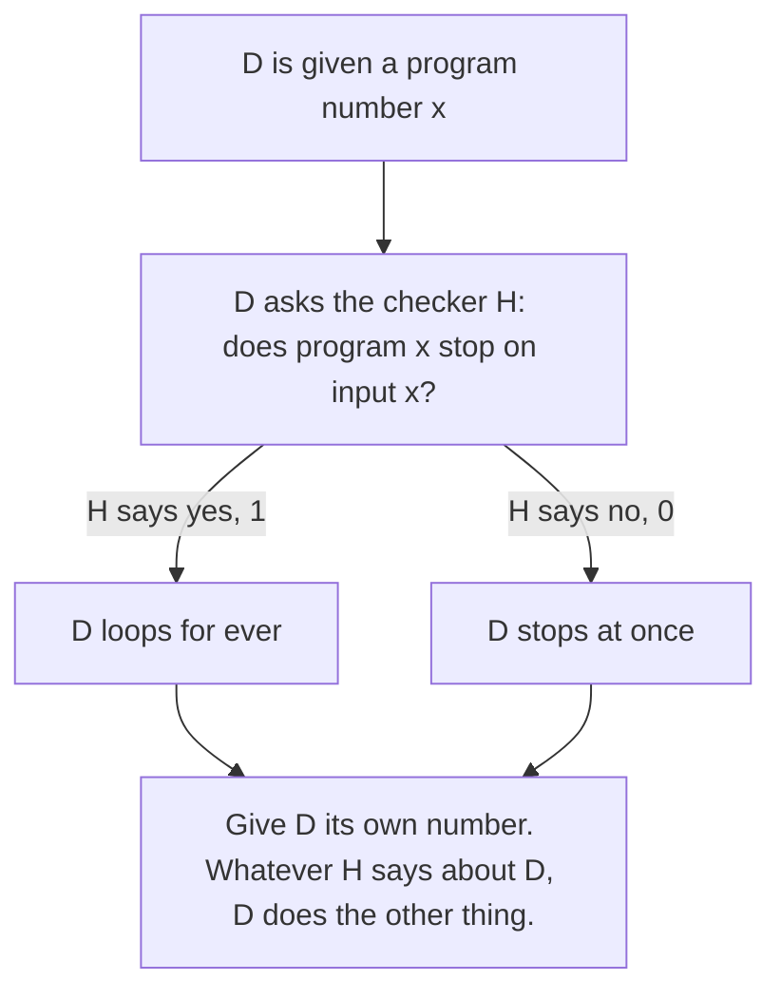

# Universal machines: one runs them all, and cannot predict them

[Syllabus](../../../SYLLABUS.md) → [Computability and complexity](../README.md) → [Models of Computation](../README.md#s01) → Universal machines

---

## General Overview

The program that runs Python code is itself a program. One well-known version, PyPy, is written in a restricted form of Python. It reads the text of any Python program and does what the text says. One reader, every program: that is a **universal machine**.

This card builds a small one. It is about 50 lines of Python that read the text of programs written in a small slice of Python: whole numbers, `+ - * // %`, `while` and `if`. Given the text of a countdown from 40, it reports "halts after 121 steps". Given the Collatz loop (halve an even number; triple an odd one and add 1) started at 27, it runs 820 steps and counts the loop's 111 moves. Whether that loop stops for every starting number from 1 up is the Collatz conjecture, unproved as of 2026-11-19.

A natural next wish is a checker that reads a program's text and says, without running it for ever, whether the program will ever stop. That checker would be worth a great deal. Point it at a program that searches the even numbers above 2 for one that is not a sum of two primes. The checker's answer would settle Goldbach's conjecture, also unproved as of 2026-11-19.

No such checker can exist. The proof builds one short program, called D, that asks the checker about itself and then does the opposite. The card runs that construction against four real checkers. Each one gives the wrong answer about D.

**One program can run every program from its text, but no program can read every program's text and say correctly whether it stops: a program that does the opposite of the prediction about itself defeats every checker.**

**What kind of fact this is:** two theorems. That a universal machine exists is proved by building one, here and in the code. That no halting checker exists is proved on this card in Why it works. Neither rests on the [Church-Turing thesis](08-church-turing-thesis.md). The thesis only lets the result speak about "any program" in every reasonable language.

### The picture: the program that does the opposite



---

## The formula

Three pieces of notation, each in words first.

- $`\langle M\rangle`$ is the **encoding** of a program $`M`$: its text, written as a string of characters, or as a number that stands for that string. It is not an inner product.
- $`U`$ is the **universal machine**: given $`\langle M\rangle`$ and an input $`x`$, it does what $`M`$ would do on $`x`$.
- $`\mathrm{HALT}`$ is the **halting problem**: the set of pairs $`(\langle M\rangle, x)`$ where $`M`$, started on input $`x`$, stops after some finite number of steps.

```math
U(\langle M\rangle, x) = M(x), \qquad \mathrm{HALT} = \{\, (\langle M\rangle, x) : M \text{ stops on input } x \,\}
```

**Read it aloud:** the universal machine, handed a program's text and an input, gives what the program gives; the halting problem is the list of program-and-input pairs that finish.

A **halting decider** would be a program $`H`$ that always stops and answers 1 when the pair is in $`\mathrm{HALT}`$, 0 when it is not. The proof feeds any candidate $`H`$ into this program:

```math
D(x) = \begin{cases} \text{loop for ever} & \text{if } H(x, x) = 1 \\ \text{stop} & \text{if } H(x, x) = 0 \end{cases}
```

**Read it aloud:** D asks whether program number $`x`$ stops when given its own number, and then does the opposite.

| Symbol | Plain meaning | In our example | Push it up and the answer… |
| --- | --- | --- | --- |
| $`M`$ | a program | countdown, collatz, even-stop, count-up, below-3 | — |
| $`x`$ | the input, a whole number given as the variable `n` | 0 to 5 | longer runs, for most programs here |
| $`\langle M\rangle`$ | the program's text, or the number that stands for it | countdown is program 0; D is program 5 | — |
| $`U`$ | the universal machine: runs any text | the `run` function in the code | — |
| $`\mathrm{HALT}`$ | the pairs (program, input) that stop | (countdown, 40) is in it; (count-up, 1) is not | — |
| $`H`$ | a candidate halting decider: always answers 1 or 0 | a table lookup, or "stops within 100 steps" | a bigger cap moves the error, never removes it |
| $`D`$ | the diagonal program: does the opposite of $`H(x, x)`$ | three lines of text, program 5 | — |
| $`N`$ | a step cap: give up after $`N`$ steps | 100 or 300 | D's run lasts $`N + 2`$ steps |
| $`i`$ | a row of the table: program number $`i`$ | 0 to 4 | — |
| $`d`$ | D's own number in the list of programs | 5 | — |
| $`k`$ | the countdown's starting value | 2 or 40 | $`3k + 1`$ steps |

### When it holds

- **The decider must always stop.** A checker that may run for ever is easy: run the program and wait. It answers "yes" for every program that stops and never answers for the rest. That is the *semidecidable* half of the story, the subject of [Decidable and semidecidable](../02-Computability%20and%20Logic/01-decidable-and-semidecidable-sets.md).
- **Memory must be unbounded.** If every variable is kept between 0 and 255, a program has finitely many states, so it either stops or repeats a state. Waiting for one of the two always ends. Count-up from 1 then stops after 766 steps, and halting becomes decidable. The theorem is about machines like [Turing machines](07-turing-machines.md), whose memory can grow without limit.
- **D must be a program in the same language.** The proof needs D to be one of the programs H is supposed to judge. If H is written in a stronger language than the programs it checks, D cannot be written, and nothing is proved.
- **The answer is for every program, not one.** For one fixed program, a person can often prove that it stops or that it does not. The theorem says no single program does this for all of them.

---

## Why it works

### Step 0: a program is just text, so programs can read programs

A program's text is a string of characters. So it can be the input to another program. That one fact gives both halves of the card. A program that *runs* text is the universal machine. A program that *judges* text would be a halting decider. The diagonal argument shows the second cannot exist.

### Step 1: build the universal machine

The interpreter $`U`$ works in two passes.

1. **Compile.** Read the text line by line. Turn each line into a numbered instruction. A `while` line becomes a test that jumps past its block when it fails. The end of a `while` block gets a jump back to the test. An `if` line becomes a test with no jump back.
2. **Run.** Keep a line pointer and a table of variables. Do the instruction at the pointer, move the pointer, and count one step. Stop when the pointer runs off the end.

The countdown, `while n != 0: n = n - 1`, compiles to three instructions:

| Number | Instruction | Meaning |
| --- | --- | --- |
| 0 | `while n != 0 3` | if n is 0, jump to 3, the end |
| 1 | `set n n - 1` | n becomes n − 1 |
| 2 | `goto 0` | back to the test |

Nothing in $`U`$ knows about countdowns or Collatz. It knows only how to carry out five kinds of instruction: set, while, if, goto and the `halts` question. So one fixed program runs every program written in the slice. The `halts` line is not part of the slice. It is a slot that calls whichever candidate decider H is plugged in; for the cap deciders of Step 6, H is U itself, run with a step cap. The paper that introduced tape machines (written 1936, printed 1937) built the same thing for them. That the slice and the tape machine compute the same things is a theorem, of the kind proved on the [Church-Turing thesis](08-church-turing-thesis.md) card; the thesis carries the result to every reasonable language.

### Step 2: when the code may say "loops"

A capped run that has not stopped proves nothing. It may stop on the next step. So $`U`$ says "loops" only with a proof. A **configuration** is the line pointer together with every variable's value. The machine is deterministic: the same configuration always leads to the same next one. So if a configuration comes round a second time, the run repeats that stretch for ever.

The even-stop program on input 1 shows this. It sets r to 1, then the loop `while r == 1: r = 1` returns to the same line with the same values after 4 steps. That is a proof that it never stops.

Some runs never stop *and* never repeat. Count-up from 1 visits 2, 3, 4 and onward. The code prints "running 10000" for it, not "loops". The proof that it never stops is in words: n starts above 0 and only grows, so the test `n != 0` never fails. Collatz from 0 is the same kind of run: 0 is even, so n halves to 0 for ever, while the move counter `steps` climbs and keeps every configuration new.

### Step 3: list the programs against the inputs

Every program text is a finite string, so the texts can be put in one list: shortest first, then alphabetical within each length. Each program gets a number, its place in the list. Inputs are whole numbers too. So one table holds every question: row $`i`$ is program $`i`$, column $`x`$ is input $`x`$, and the cell says whether that run stops.

This card uses five programs, numbered 0 to 4, and inputs 0 to 4. Each program reads its input from the variable `n`.

| Number | Name | Text | What it does |
| --- | --- | --- | --- |
| 0 | countdown | `while n != 0: n = n - 1` | takes 1 from n until n is 0 |
| 1 | collatz | the Collatz loop from the overview, counting its moves in `steps` | halves an even n, triples an odd n and adds 1, until n is 1 |
| 2 | even-stop | `r = n % 2`, then `while r == 1: r = 1` | stops on an even input; on an odd one it repeats for ever |
| 3 | count-up | `while n != 0: n = n + 1` | stops on 0; from 1 up, n only grows |
| 4 | below-3 | `while 2 < n: n = n` | stops on 0, 1 and 2; from 3 up it repeats for ever |

Running every program on every input fills the table. "halts 7" means the run stopped after 7 steps. "loops 4" means a configuration came round again after 4 steps, a proof that it never stops (Step 2). "running 10000" means it was still going at the 10,000-step cap; Step 2 proves in words that these runs never stop. The diagonal cells, program $`i`$ on input $`i`$, are in bold.

| Program | input 0 | input 1 | input 2 | input 3 | input 4 |
| --- | --- | --- | --- | --- | --- |
| 0 countdown | **halts 1** | halts 4 | halts 7 | halts 10 | halts 13 |
| 1 collatz | running 10000 | **halts 2** | halts 9 | halts 53 | halts 16 |
| 2 even-stop | halts 2 | loops 4 | **halts 2** | loops 4 | halts 2 |
| 3 count-up | halts 1 | running 10000 | running 10000 | **running 10000** | running 10000 |
| 4 below-3 | halts 1 | halts 1 | halts 1 | loops 3 | **loops 3** |

A full listing works the same way, with the rows going on for ever.

### Step 4: flip the diagonal

The diagonal cell of row $`i`$ is program $`i`$ run on its own number $`i`$. Write 1 for "halts" and 0 for "never stops". D's row is the diagonal with every answer flipped:

| | input 0 | input 1 | input 2 | input 3 | input 4 |
| --- | --- | --- | --- | --- | --- |
| diagonal: program $`x`$ on input $`x`$ | 1 | 1 | 1 | 0 | 0 |
| D's row: D on input $`x`$ | 0 | 0 | 0 | 1 | 1 |

Cell by cell: countdown stops on 0 and D does not; collatz stops on 1 and D does not; even-stop stops on 2 and D does not; count-up never stops on 3 and D does; below-3 never stops on 4 and D does. So D's row differs from row 0 in column 0, from row 1 in column 1, and so on. D is on no row of the table. The code runs D on inputs 0 to 4 and gets exactly this row.

This is the same move as [Cantor's diagonal](../../01-Foundations/09-Sizes%20of%20Infinity/03-cantors-diagonal-argument.md), which flips the digits down a list of decimals. Here it runs down a list of programs.

### Step 5: why that defeats every decider

If a halting decider $`H`$ existed, D could be written as a real program: ask $`H`$ one question, then loop or stop. Then D would be in the list, with some number $`d`$. Look at the cell $`(d, d)`$: D run on its own number.

- If $`H(d, d) = 1`$, H says D stops on $`d`$. But D then loops for ever. H is wrong.
- If $`H(d, d) = 0`$, H says D does not stop on $`d`$. But D then stops at once. H is wrong.

Both cases fail. So the assumption that H exists is false. That is [Proof by contradiction](../../01-Foundations/06-Proof/03-proof-by-contradiction.md).

<details>
<summary>Detailed proof: no program decides HALT</summary>

Suppose $`H`$ is a program that always stops, with $`H(\langle M\rangle, x) = 1`$ when $`M`$ stops on $`x`$ and $`H(\langle M\rangle, x) = 0`$ when it does not.

Write the program $`D`$: on input $`x`$, store $`H(x, x)`$ in the variable `r`; if it is 1, run `while r == 1: r = 1` for ever; otherwise stop. Because $`H`$ always stops, $`D`$ is a well-defined program, so it has a text $`\langle D\rangle`$.

Run $`D`$ on $`\langle D\rangle`$. Then:

$`\displaystyle D \text{ stops on } \langle D\rangle \iff H(\langle D\rangle, \langle D\rangle) = 0 \iff D \text{ does not stop on } \langle D\rangle.`$

The first equivalence is how $`D`$ is built. The second is what $`H`$ promises. A statement cannot be equivalent to its own negation, so no such $`H`$ exists.

</details>

### Step 6: watch real deciders fail

The code cannot run an impossible program. It can run the construction against real candidates. The `halts(n, n)` line in D is a slot: plug in any decider and run D on its own number, 5.

| Candidate H | H says about D on 5 | What D does on 5 |
| --- | --- | --- |
| table lookup, guessing 1 off the table | 1, stops | loops: repeat after 4 steps |
| table lookup, guessing 0 off the table | 0, does not stop | halts after 2 steps |
| "stops within 100 steps" | 0, does not stop | halts after 102 steps |
| "stops within 300 steps" | 0, does not stop | halts after 302 steps |

The table lookups are right on all 25 cells of the table. They still fail on D. The capped deciders fail in an instructive way. To answer about D, the cap-100 decider simulates D. D's first act is to ask the cap-100 decider the same question, which needs another 100-step simulation. That does not fit inside the first 100 steps. So the outer simulation runs out of steps and answers 0. D sees 0 and stops, at step 1 + 100 + 1 = 102.

---

## Worked numbers, by hand

First the universal machine on a countdown from 2, then D against the cap-100 decider.

| Step | Arithmetic | Value |
| --- | --- | --- |
| steps 1 to 3 | test n = 2 ≠ 0, n becomes 1, jump back | n = 1 |
| steps 4 to 6 | test n = 1 ≠ 0, n becomes 0, jump back | n = 0 |
| step 7 | test n = 0 fails, jump to instruction 3, past the end | halts |
| countdown from k | 3 steps a round, k rounds, 1 final test: 3k + 1 | 7 for k = 2, 121 for k = 40 |
| D, step 1 | ask the cap-100 decider about (5, 5) | it simulates D on 5 |
| inside that simulation | D asks the same question again, needing 100 more steps | the 100 run out |
| the decider's answer | no stop seen within 100 steps | H(5, 5) = 0 |
| D's steps so far | 1 for the question + 100 for the simulation | 101 |
| D, step 102 | test r = 0 against 1 fails, jump past the loop | **D halts after 102 steps, though H said 0** |

The decider predicted "does not stop", and D stopped 102 steps later. Raising the cap to 300 only moves the stop to step 302.

### What breaks if you drop a piece

| Mistake | Comes out at | What went wrong |
| --- | --- | --- |
| Treat a 100-step cap as a halting test | countdown from 40 is "running 100", but it halts after 121 | A cap that has not seen a stop proves nothing |
| D copies H's answer instead of flipping it | the lookup that guesses 1 says 1; the copier halts after 2 steps: H is right | The flip is the whole proof |
| Keep every number between 0 and 255 | count-up from 1 halts after 766 steps | Finite memory means finitely many configurations, so halting is decidable |

---

## Code, from first principles, and it actually runs

The code writes the interpreter out in full, with no `eval`, `exec` or `ast`. It runs the five programs on inputs 0 to 4 and builds D. It takes **three independent roads**:

1. The interpreter's step counts against a formula (3k + 1 for the countdown), and its Collatz move count against a direct loop.
2. The diagonal: D's row, produced by actually running D, is compared with every row of the table.
3. Four real deciders: each one's answer about D is compared with what D actually does.

### Python

```python
# Universal machines and the halting problem -- the check behind the card.
# Nothing is imported.  U is an interpreter, written out here, for a small slice
# of Python: whole-number variables, + - * // %, while and if.  It runs any
# program in that slice from its text alone.  No eval, exec or ast.  Then the
# diagonal program D is built and run against four would-be halting deciders.
OPS = {"+": lambda a, b: a + b, "-": lambda a, b: a - b, "*": lambda a, b: a * b,
       "//": lambda a, b: a // b, "%": lambda a, b: a % b}
TESTS = {"==": lambda a, b: a == b, "!=": lambda a, b: a != b, "<": lambda a, b: a < b}

def compile_text(text):           # program text -> numbered instructions with jumps
    code, open_blocks = [], []
    for line in [l for l in text.split("\n") if l.strip()] + [""]:
        depth = len(line) - len(line.lstrip())
        while open_blocks and (open_blocks[-1][0] >= depth or not line):
            head = open_blocks.pop()[1]
            if code[head][0] == "while":
                code.append(["goto", head])            # the loop jumps back to its test
            code[head][4] = len(code)                  # a failed test jumps past the block
        if not line:
            return code
        w = line.replace("(", " ").replace(")", " ").replace(",", " ").replace(":", " ").split()
        if w[0] in ("while", "if"):
            open_blocks.append((depth, len(code)))
            code.append([w[0], w[1], w[2], w[3], None])
        elif w[2] == "halts":
            code.append(["halts", w[0], w[3], w[4]])   # ask the plugged-in decider
        else:
            code.append(["set", w[0], w[2], "+", "0"] if len(w) == 3 else ["set"] + w[:1] + w[2:5])

def run(code, n, fuel, decider=None, wrap=None):
    # U: returns ("halts" | "loops" | "fuel", steps, variables).  "loops" only with proof:
    # the same line and the same variables came round twice, so it repeats forever.
    env, pc, steps, seen = {"n": n}, 0, 0, set()
    val = lambda a: int(a) if a.isdigit() else env.get(a, 0)
    while pc < len(code):
        config = (pc, tuple(sorted(env.items())))
        if config in seen:
            return "loops", steps, env
        seen.add(config)
        if steps >= fuel:
            return "fuel", steps, env
        ins, steps, pc = code[pc], steps + 1, pc + 1
        if ins[0] == "set":
            env[ins[1]] = OPS[ins[3]](val(ins[2]), val(ins[4]))
            if wrap:
                env[ins[1]] %= wrap
        elif ins[0] == "goto":
            pc = ins[1]
        elif ins[0] == "halts":
            answer, cost = decider(val(ins[2]), val(ins[3]), fuel - steps)
            if answer is None:
                return "fuel", fuel, env
            env[ins[1]], steps = answer, steps + cost
        elif not TESTS[ins[2]](val(ins[1]), val(ins[3])):
            pc = ins[4]
    return "halts", steps, env

NAMES = ["countdown", "collatz", "even-stop", "count-up", "below-3", "D"]
TEXTS = ["while n != 0:\n    n = n - 1",
         "steps = 0\nwhile n != 1:\n    r = n % 2\n    if r == 0:\n        n = n // 2\n"
         "    if r == 1:\n        n = 3 * n\n        n = n + 1\n    steps = steps + 1",
         "r = n % 2\nwhile r == 1:\n    r = 1",
         "while n != 0:\n    n = n + 1",
         "while 2 < n:\n    n = n",
         "r = halts(n, n)\nwhile r == 1:\n    r = 1"]       # D, program number 5
CODE = [compile_text(t) for t in TEXTS]
FUEL = 10000
show = lambda o: {"halts": "halts", "loops": "loops", "fuel": "running"}[o[0]] + f" {o[1]}"

print("U compiles countdown to", " | ".join(f"{k}: " + " ".join(str(p) for p in ins)
                                           for k, ins in enumerate(CODE[0])))
for k in (0, 2, 40):
    print(f"U runs countdown on {k}: {show(run(CODE[0], k, FUEL))} steps")
    assert run(CODE[0], k, FUEL)[:2] == ("halts", 3 * k + 1)  # one test, one subtract, one jump back
m, moves = 27, 0                                          # Collatz as a direct loop, a second road
while m != 1:
    m, moves = (m // 2 if m % 2 == 0 else 3 * m + 1), moves + 1
c27 = run(CODE[1], 27, FUEL)
print(f"U runs collatz on 27: {show(c27)} steps, {c27[2]['steps']} moves; a direct loop counts {moves}")
assert c27[0] == "halts" and c27[2]["steps"] == moves

# Left running: the card proves these never stop.  Collatz on 0 halves 0 to 0 for
# ever, while its move counter climbs; count-up from 1 or more only grows.
RUNNING = {(1, 0), (3, 1), (3, 2), (3, 3), (3, 4)}
TRUTH = []
print("program   " + "".join(f"{'input ' + str(x):>14}" for x in range(5)))
for i in range(5):                                       # the program-against-input table
    row = [run(CODE[i], x, FUEL) for x in range(5)]
    assert all((o[0] == "fuel") == ((i, x) in RUNNING) for x, o in enumerate(row))
    TRUTH.append([1 if o[0] == "halts" else 0 for o in row])
    print(f"{NAMES[i]:10}" + "".join(f"{show(o):>14}" for o in row))
diag = [TRUTH[i][i] for i in range(5)]
flip = [1 - b for b in diag]
print("diagonal, 1 = halts:", diag, " flipped:", flip)

def table_decider(default):        # right on all 25 table entries, guesses elsewhere
    return lambda a, b, budget: ((TRUTH[a][b] if a < 5 and b < 5 else default), 0)

def cap_decider(cap):              # says 1 if the run halts within cap steps
    def h(a, b, budget):
        out, used, _ = run(CODE[a], b, min(cap, budget), h)
        if out == "fuel" and budget < cap:
            return None, 0                               # the caller ran out of fuel first
        return (1 if out == "halts" else 0), used
    return h

d_row = [1 if run(CODE[5], x, FUEL, table_decider(1))[0] == "halts" else 0 for x in range(5)]
print("D on inputs 0 to 4, 1 = halts:", d_row)
assert d_row == flip and all(d_row[i] != TRUTH[i][i] for i in range(5))
for label, h in [("table, guess 1", table_decider(1)), ("table, guess 0", table_decider(0)),
                 ("cap 100", cap_decider(100)), ("cap 300", cap_decider(300))]:
    said = h(5, 5, FUEL)[0]
    did = run(CODE[5], 5, FUEL, h)
    print(f"H = {label}: says H(5, 5) = {said}; D on 5 {show(did)} steps")
    assert did[0] != "fuel"                              # D's run ended, or provably repeats
    assert said != (1 if did[0] == "halts" else 0)       # every decider is wrong on D
    assert not label.startswith("cap") or did[:2] == ("halts", int(label[4:]) + 2)  # N + 2

copier = compile_text("r = halts(n, n)\nwhile r == 0:\n    r = 0")
print(f"copier, no flip, H = table, guess 1: says 1; copier on 5 {show(run(copier, 5, FUEL, table_decider(1)))} steps")
assert run(copier, 5, FUEL, table_decider(1))[0] == "halts"   # no contradiction without the flip
print(f"cap 100 on countdown 40: {show(run(CODE[0], 40, 100))} steps; uncapped: {show(run(CODE[0], 40, FUEL))} steps")
up8 = run(CODE[3], 1, FUEL, wrap=256)
print(f"count-up on 1 with numbers kept 0 to 255: {show(up8)} steps")
assert up8[:2] == ("halts", 3 * 255 + 1)
print("ALL CHECKS PASS")
```

**Ran 2026-11-19 on macOS, Python 3.14.10, standard library only. All checks passed. Output, pasted from the run:**

```
U compiles countdown to 0: while n != 0 3 | 1: set n n - 1 | 2: goto 0
U runs countdown on 0: halts 1 steps
U runs countdown on 2: halts 7 steps
U runs countdown on 40: halts 121 steps
U runs collatz on 27: halts 820 steps, 111 moves; a direct loop counts 111
program          input 0       input 1       input 2       input 3       input 4
countdown        halts 1       halts 4       halts 7      halts 10      halts 13
collatz    running 10000       halts 2       halts 9      halts 53      halts 16
even-stop        halts 2       loops 4       halts 2       loops 4       halts 2
count-up         halts 1 running 10000 running 10000 running 10000 running 10000
below-3          halts 1       halts 1       halts 1       loops 3       loops 3
diagonal, 1 = halts: [1, 1, 1, 0, 0]  flipped: [0, 0, 0, 1, 1]
D on inputs 0 to 4, 1 = halts: [0, 0, 0, 1, 1]
H = table, guess 1: says H(5, 5) = 1; D on 5 loops 4 steps
H = table, guess 0: says H(5, 5) = 0; D on 5 halts 2 steps
H = cap 100: says H(5, 5) = 0; D on 5 halts 102 steps
H = cap 300: says H(5, 5) = 0; D on 5 halts 302 steps
copier, no flip, H = table, guess 1: says 1; copier on 5 halts 2 steps
cap 100 on countdown 40: running 100 steps; uncapped: halts 121 steps
count-up on 1 with numbers kept 0 to 255: halts 766 steps
ALL CHECKS PASS
```

### Rust

Built with `rustc --edition 2021 -O`.

```rust
// Universal machines and the halting problem -- the same check as the Python twin, in Rust.
// No crates.  U is an interpreter, written out here, for a small slice of Python:
// whole-number variables, + - * // %, while and if.  It runs any program in that
// slice from its text alone.  Then the diagonal program D is built and run against
// four would-be halting deciders.
use std::collections::{BTreeMap, HashSet};

type Code = Vec<Vec<String>>;
type Env = BTreeMap<String, i64>;
#[derive(Clone, Copy)] enum Decider { Table(i64), Cap(usize) }

fn compile_text(text: &str) -> Code {      // program text -> numbered instructions with jumps
    let mut code: Code = Vec::new();
    let mut open: Vec<(usize, usize)> = Vec::new();
    let mut lines: Vec<&str> = text.split('\n').filter(|l| !l.trim().is_empty()).collect();
    lines.push("");
    for line in lines {
        let depth = line.len() - line.trim_start().len();
        while !open.is_empty() && (open[open.len() - 1].0 >= depth || line.is_empty()) {
            let head = open.pop().unwrap().1;
            if code[head][0] == "while" {
                code.push(vec!["goto".to_string(), head.to_string()]); // jump back to the test
            }
            code[head][4] = code.len().to_string();                // a failed test skips the block
        }
        if line.is_empty() { return code; }
        let w: Vec<String> = line.replace('(', " ").replace(')', " ").replace(',', " ")
            .replace(':', " ").split_whitespace().map(|s| s.to_string()).collect();
        let s = |v: &[&str]| v.iter().map(|x| x.to_string()).collect::<Vec<String>>();
        if w[0] == "while" || w[0] == "if" {
            open.push((depth, code.len()));
            code.push(s(&[&w[0], &w[1], &w[2], &w[3], "none"]));
        } else if w[2] == "halts" {
            code.push(s(&["halts", &w[0], &w[3], &w[4]]));          // ask the plugged-in decider
        } else if w.len() == 3 {
            code.push(s(&["set", &w[0], &w[2], "+", "0"]));
        } else {
            code.push(s(&["set", &w[0], &w[2], &w[3], &w[4]]));
        }
    }
    code
}

struct World { code: Vec<Code>, truth: Vec<Vec<i64>> }

// U: returns ("halts" | "loops" | "fuel", steps, variables).  "loops" only with proof:
// the same line and the same variables came round twice, so it repeats forever.
fn run(w: &World, code: &Code, n: i64, fuel: usize, h: Option<Decider>, wrap: i64)
    -> (&'static str, usize, Env) {
    let mut env: Env = BTreeMap::from([("n".to_string(), n)]);
    let (mut pc, mut steps) = (0usize, 0usize);
    let mut seen: HashSet<(usize, Vec<(String, i64)>)> = HashSet::new();
    while pc < code.len() {
        let config = (pc, env.iter().map(|(k, v)| (k.clone(), *v)).collect::<Vec<_>>());
        if seen.contains(&config) { return ("loops", steps, env); }
        seen.insert(config);
        if steps >= fuel { return ("fuel", steps, env); }
        let ins = &code[pc];
        (steps, pc) = (steps + 1, pc + 1);
        let val = |a: &str, e: &Env| -> i64 {
            if a.chars().all(|c| c.is_ascii_digit()) { a.parse().unwrap() } else { *e.get(a).unwrap_or(&0) }
        };
        match ins[0].as_str() {
            "set" => {
                let (a, b) = (val(&ins[2], &env), val(&ins[4], &env));
                let mut v = match ins[3].as_str() {
                    "+" => a + b, "-" => a - b, "*" => a * b,
                    "//" => a.div_euclid(b), _ => a.rem_euclid(b),
                };
                if wrap > 0 { v = v.rem_euclid(wrap); }
                env.insert(ins[1].clone(), v);
            }
            "goto" => pc = ins[1].parse().unwrap(),
            "halts" => {
                let (a, b) = (val(&ins[2], &env), val(&ins[3], &env));
                match decide(w, h.unwrap(), a as usize, b, fuel - steps) {
                    None => return ("fuel", fuel, env),
                    Some((answer, cost)) => { env.insert(ins[1].clone(), answer); steps += cost; }
                }
            }
            _ => {
                let (a, b) = (val(&ins[1], &env), val(&ins[3], &env));
                let ok = match ins[2].as_str() { "==" => a == b, "!=" => a != b, _ => a < b };
                if !ok { pc = ins[4].parse().unwrap(); }
            }
        }
    }
    ("halts", steps, env)
}

fn decide(w: &World, h: Decider, a: usize, b: i64, budget: usize) -> Option<(i64, usize)> {
    match h {   // Table: right on all 25 table entries, guesses elsewhere.  Cap: 1 if it halts within cap.
        Decider::Table(guess) => Some((if a < 5 && b < 5 { w.truth[a][b as usize] } else { guess }, 0)),
        Decider::Cap(cap) => {
            let (out, used, _) = run(w, &w.code[a], b, cap.min(budget), Some(h), 0);
            if out == "fuel" && budget < cap { return None; }   // the caller ran out of fuel first
            Some((if out == "halts" { 1 } else { 0 }, used))
        }
    }
}

fn show(o: &(&str, usize, Env)) -> String {
    format!("{} {}", if o.0 == "fuel" { "running" } else { o.0 }, o.1)
}

fn main() {
    let names = ["countdown", "collatz", "even-stop", "count-up", "below-3", "D"];
    let texts = ["while n != 0:\n    n = n - 1",
        concat!("steps = 0\nwhile n != 1:\n    r = n % 2\n    if r == 0:\n        n = n // 2\n",
                "    if r == 1:\n        n = 3 * n\n        n = n + 1\n    steps = steps + 1"),
        "r = n % 2\nwhile r == 1:\n    r = 1",
        "while n != 0:\n    n = n + 1",
        "while 2 < n:\n    n = n",
        "r = halts(n, n)\nwhile r == 1:\n    r = 1"];        // D, program number 5
    let mut w = World { code: texts.iter().map(|t| compile_text(t)).collect(), truth: Vec::new() };
    let fuel = 10000;
    let listing: Vec<String> = w.code[0].iter().enumerate()
        .map(|(k, ins)| format!("{}: {}", k, ins.join(" "))).collect();
    println!("U compiles countdown to {}", listing.join(" | "));
    for k in [0i64, 2, 40] {
        let o = run(&w, &w.code[0], k, fuel, None, 0);
        println!("U runs countdown on {}: {} steps", k, show(&o));
        assert!(o.0 == "halts" && o.1 == 3 * k as usize + 1);  // one test, one subtract, one jump back
    }
    let (mut m, mut moves) = (27i64, 0i64);                 // Collatz as a direct loop, a second road
    while m != 1 { m = if m % 2 == 0 { m / 2 } else { 3 * m + 1 }; moves += 1; }
    let c27 = run(&w, &w.code[1], 27, fuel, None, 0);
    println!("U runs collatz on 27: {} steps, {} moves; a direct loop counts {}",
             show(&c27), c27.2["steps"], moves);
    assert!(c27.0 == "halts" && c27.2["steps"] == moves);
    // Left running: the card proves these never stop.  Collatz on 0 halves 0 to 0 for
    // ever, while its move counter climbs; count-up from 1 or more only grows.
    let running = [(1usize, 0usize), (3, 1), (3, 2), (3, 3), (3, 4)];
    let header: String = (0..5).map(|x| format!("{:>14}", format!("input {}", x))).collect();
    println!("program   {}", header);
    for i in 0..5 {                                         // the program-against-input table
        let row: Vec<_> = (0..5).map(|x| run(&w, &w.code[i], x, fuel, None, 0)).collect();
        assert!(row.iter().enumerate().all(|(x, o)| (o.0 == "fuel") == running.contains(&(i, x))));
        w.truth.push(row.iter().map(|o| if o.0 == "halts" { 1 } else { 0 }).collect());
        let cells: String = row.iter().map(|o| format!("{:>14}", show(o))).collect();
        println!("{:10}{}", names[i], cells);
    }
    let diag: Vec<i64> = (0..5).map(|i| w.truth[i][i]).collect();
    let flip: Vec<i64> = diag.iter().map(|b| 1 - b).collect();
    println!("diagonal, 1 = halts: {:?}  flipped: {:?}", diag, flip);
    let d_row: Vec<i64> = (0..5).map(|x| {
        if run(&w, &w.code[5], x, fuel, Some(Decider::Table(1)), 0).0 == "halts" { 1 } else { 0 }
    }).collect();
    println!("D on inputs 0 to 4, 1 = halts: {:?}", d_row);
    assert!(d_row == flip && (0..5).all(|i| d_row[i] != w.truth[i][i]));
    for (label, h) in [("table, guess 1", Decider::Table(1)), ("table, guess 0", Decider::Table(0)),
                       ("cap 100", Decider::Cap(100)), ("cap 300", Decider::Cap(300))] {
        let said = decide(&w, h, 5, 5, fuel).unwrap().0;
        let did = run(&w, &w.code[5], 5, fuel, Some(h), 0);
        println!("H = {}: says H(5, 5) = {}; D on 5 {} steps", label, said, show(&did));
        assert!(did.0 != "fuel");                            // D's run ended, or provably repeats
        assert!(said != if did.0 == "halts" { 1 } else { 0 });  // every decider is wrong on D
        if let Decider::Cap(c) = h { assert!(did.0 == "halts" && did.1 == c + 2); }  // N + 2
    }
    let copier = compile_text("r = halts(n, n)\nwhile r == 0:\n    r = 0");
    let cp = run(&w, &copier, 5, fuel, Some(Decider::Table(1)), 0);
    println!("copier, no flip, H = table, guess 1: says 1; copier on 5 {} steps", show(&cp));
    assert!(cp.0 == "halts");                                // no contradiction without the flip
    println!("cap 100 on countdown 40: {} steps; uncapped: {} steps",
             show(&run(&w, &w.code[0], 40, 100, None, 0)), show(&run(&w, &w.code[0], 40, fuel, None, 0)));
    let up8 = run(&w, &w.code[3], 1, fuel, None, 256);
    println!("count-up on 1 with numbers kept 0 to 255: {} steps", show(&up8));
    assert!(up8.0 == "halts" && up8.1 == 3 * 255 + 1);
    println!("ALL CHECKS PASS");
}
```

**Ran 2026-11-19 on macOS, rustc 1.98.1, no crates. All checks passed. Output, pasted from the run:**

```
U compiles countdown to 0: while n != 0 3 | 1: set n n - 1 | 2: goto 0
U runs countdown on 0: halts 1 steps
U runs countdown on 2: halts 7 steps
U runs countdown on 40: halts 121 steps
U runs collatz on 27: halts 820 steps, 111 moves; a direct loop counts 111
program          input 0       input 1       input 2       input 3       input 4
countdown        halts 1       halts 4       halts 7      halts 10      halts 13
collatz    running 10000       halts 2       halts 9      halts 53      halts 16
even-stop        halts 2       loops 4       halts 2       loops 4       halts 2
count-up         halts 1 running 10000 running 10000 running 10000 running 10000
below-3          halts 1       halts 1       halts 1       loops 3       loops 3
diagonal, 1 = halts: [1, 1, 1, 0, 0]  flipped: [0, 0, 0, 1, 1]
D on inputs 0 to 4, 1 = halts: [0, 0, 0, 1, 1]
H = table, guess 1: says H(5, 5) = 1; D on 5 loops 4 steps
H = table, guess 0: says H(5, 5) = 0; D on 5 halts 2 steps
H = cap 100: says H(5, 5) = 0; D on 5 halts 102 steps
H = cap 300: says H(5, 5) = 0; D on 5 halts 302 steps
copier, no flip, H = table, guess 1: says 1; copier on 5 halts 2 steps
cap 100 on countdown 40: running 100 steps; uncapped: halts 121 steps
count-up on 1 with numbers kept 0 to 255: halts 766 steps
ALL CHECKS PASS
```

The outputs match line for line. The program-against-input table is the one read in Step 3.

### Lean

Lean proves both halves of the theorem for every program in its library's own small language, and checks the worked numbers.

- There is one program $`U`$ that runs any program from its code. Take any program $`M`$. Then $`U(\langle M\rangle, x) = M(x)`$ for every input $`x`$.
- Take any program $`H`$ that always stops and answers 1 or 0. Then $`H`$ is wrong about some program $`M`$ on some input $`x`$.
- Take any table of 1s and 0s, programs against inputs. Then the flipped diagonal differs from every row.
- Take the halting table from Step 3. Then its flipped diagonal is 0, 0, 0, 1, 1, and it is on no row.
- The step counts in Worked numbers add up: 7 and 121 for the countdown, 766 for count-up, 102 and 302 for D.
- The Collatz loop from 27 reaches 1 after exactly 111 moves, and not before.

Lean does not run the interpreter, so the table's cells, D's runs and the deciders' answers are left to the Python and Rust checks.

```lean
-- Universal machines: one partial recursive program runs every program from its code, and no total computable program decides, for every program and input, whether the run stops.
import Mathlib.Computability.Halting
import Mathlib.Data.Fin.VecNotation
import Mathlib.Data.Fintype.Pi
import Mathlib.Tactic.NormNum.Basic

open Nat.Partrec

/-- The universal machine: there is one program `U`, itself partial recursive, that is handed a
program's code `⟨M⟩` and an input `x` and gives what `M` gives on `x`; every partial recursive
function `f` is run this way by some code `c`. -/
theorem universal_machine_runs_every_program :
    ∃ U : Code × ℕ →. ℕ, Partrec U ∧
      ∀ f : ℕ →. ℕ, Nat.Partrec f → ∃ c : Code, ∀ x, U (c, x) = f x := by
  refine ⟨fun p => p.1.eval p.2, Nat.Partrec.Code.eval_part, ?_⟩
  intro f hf
  obtain ⟨c, hc⟩ := Nat.Partrec.Code.exists_code.1 hf
  exact ⟨c, fun x => by simp [hc]⟩

/-- The halting problem: no program `H` that always stops can answer, for every program code `c`
and every input `x`, `true` exactly when program `c` stops on input `x`. -/
theorem no_program_decides_halting :
    ¬ ∃ H : Code × ℕ → Bool, Computable H ∧
      ∀ c : Code, ∀ x : ℕ, H (c, x) = true ↔ (c.eval x).Dom := by
  rintro ⟨H, hH, hspec⟩
  apply ComputablePred.halting_problem 0
  refine ComputablePred.computable_iff.2 ⟨fun c => H (c, 0), ?_, ?_⟩
  · exact hH.comp (Computable.pair Computable.id (Computable.const 0))
  · funext c
    exact propext (hspec c 0).symm

/-- Flip the diagonal: in any table of yes-or-no answers, rows `i` against columns `x`, the row
made by flipping each diagonal cell `(x, x)` differs from every row of the table. -/
theorem flipped_diagonal_is_on_no_row (T : ℕ → ℕ → Bool) :
    ∀ i : ℕ, (fun x => !T x x) ≠ T i := by
  intro i h
  have := congrFun h i
  cases hT : T i i <;> simp [hT] at this

/-! The card's own worked numbers. -/

-- The card's halting table: five programs (rows) on inputs 0 to 4 (columns), `true` = stops.
-- Its flipped diagonal is `false, false, false, true, true`, and it is on no row.
example :
    let T : Fin 5 → Fin 5 → Bool :=
      ![![true, true, true, true, true],      -- 0 countdown
        ![false, true, true, true, true],     -- 1 collatz
        ![true, false, true, false, true],    -- 2 even-stop
        ![true, false, false, false, false],  -- 3 count-up
        ![true, true, true, false, false]]    -- 4 below-3
    (fun x => !T x x) = ![false, false, false, true, true] ∧
      ∀ i : Fin 5, (fun x => !T x x) ≠ T i := by
  decide

-- Countdown from k takes 3k + 1 steps: 7 from 2, 121 from 40.
example : 3 * 2 + 1 = 7 ∧ 3 * 40 + 1 = 121 := by norm_num

-- Count-up from 1 with numbers kept 0 to 255: 255 rounds of 3 steps, then the final test.
example : 3 * 255 + 1 = 766 := by norm_num

-- D against the cap-N decider: 1 step to ask, N steps of simulation, 1 step to stop.
example : 1 + 100 + 1 = 102 ∧ 1 + 300 + 1 = 302 := by norm_num

-- The Collatz loop from 27 reaches 1 after exactly 111 moves.
set_option maxRecDepth 100000 in
example :
    let step : ℕ → ℕ := fun n => if n % 2 = 0 then n / 2 else 3 * n + 1
    step^[111] 27 = 1 ∧ ∀ k < 111, step^[k] 27 ≠ 1 := by
  decide

#print axioms universal_machine_runs_every_program
#print axioms no_program_decides_halting
#print axioms flipped_diagonal_is_on_no_row
```

**Checked 2026-11-19 on macOS, Lean 4.36.0-rc2, Mathlib v4.36.0-rc2. Every proof is complete and uses only Lean's standard axioms. Output, pasted from the run:**

```
'universal_machine_runs_every_program' depends on axioms: [propext, Classical.choice, Quot.sound]
'no_program_decides_halting' depends on axioms: [propext, Classical.choice, Quot.sound]
'flipped_diagonal_is_on_no_row' depends on axioms: [propext]
```

> [!TIP]
> **Try changing**
> - Guess first: with `("cap 50", cap_decider(50))` in place of `("cap 300", cap_decider(300))`, when does D stop? Change the label too, because the N + 2 assert reads the cap from it. Answer: after 52 steps, and H still says 0. The cap moves; the error stays.
> - Guess first: change D's last two lines to `while r == 0:` and `    r = 0`. Answer: D becomes the copier, and its row now copies the diagonal, 1, 1, 1, 0, 0. The assert that D's row is the flipped diagonal fires.
> - Guess first: run count-up on 1 with `wrap=16`. Answer: it halts after 3 × 15 + 1 = 46 steps, and the assert pinned to 766 fires.
> - Guess first: run countdown on 40 with a cap of 130 instead of 100. Answer: it halts after 121 steps, so this cap is right here. D still beats every cap.

---

## The usual mistake

> [!warning]
> **Reading the theorem as "you can never tell whether a program stops".** For one given program you often can: the countdown visibly stops, and count-up visibly never does. The theorem says something narrower and stronger. No single program gives the right answer for every program and input.
>
> - **"A big enough cap would work."** Every cap N is a real decider, so D beats it: D halts after N + 2 steps while the cap says 0. The cap-100 decider gets countdown from 40 wrong too: "running 100" for a run that halts after 121.
> - **"A repeated configuration catches every loop."** It catches loops that cycle, like even-stop on 1, after 4 steps. Count-up from 1 never repeats, so the detector waits for ever.
> - **"Real computers have finite memory, so it doesn't apply."** In principle halting is then decidable, as the 0-to-255 count-up shows. But the number of states is about 2 to the power of the memory size in bits, so waiting for a repeat is hopeless in practice.
> - **"The universal machine is the impossible part."** No. U exists and is about 50 lines. It is the *predictor* that cannot exist.

---

## Where you meet it in real life

- **Python itself.** CPython and PyPy are universal machines for Python: each runs any Python text it is given. PyPy is written in a restricted subset of Python.
- **Compilers and code checkers.** Tools that warn "this loop may never end" or "this line is never reached" must sometimes be wrong or silent. They answer safely: they give false alarms, or they say "unknown".
- **Virus scanners.** A 1987 paper used this argument to show that no program can detect every virus exactly. Scanners match known patterns and watch behaviour instead.
- **Timeouts.** Servers, test systems and build tools kill a job after a fixed time. That is a step cap: a practical choice, not a decision about halting.
- **Proof assistants.** Lean and similar systems accept a function for use in proofs only once a proof shows it stops. Because no program can find that proof for every function, the author must sometimes supply it.

> **Say it back**
> A program's text is data, so one program can read and run every other: the universal machine U, about 50 lines here. List every program against every input, and D is the program whose row flips the diagonal. If a halting decider H existed, D could be written with it, and on its own number D would do the opposite of what H predicts. So no program decides whether every program stops. The code shows four real deciders, including step caps of 100 and 300, each wrong about D.

---

## What this builds on

- [Church-Turing thesis](08-church-turing-thesis.md): every reasonable machine computes the same things, so a result about this slice of Python is a result about all programs.
- [Cantor's diagonal](../../01-Foundations/09-Sizes%20of%20Infinity/03-cantors-diagonal-argument.md): flipping the diagonal of a list builds something on no row; this card runs it down a list of programs.
- [Proof by contradiction](../../01-Foundations/06-Proof/03-proof-by-contradiction.md): assume a halting decider exists, build D, and reach a statement equal to its own negation.

## Where this goes next

- [Rice's theorem](10-rices-theorem-and-reductions.md): every question about what a program does, beyond the trivial ones, is as hard as halting, proved by turning HALT into that question.

Left open: if halting cannot be decided, how much more is undecidable, and how can one impossible problem be shown to be at least as hard as another?

---

## Sources

Verified 2026-11-19: every link below resolves to the publisher's page.

- Turing, A. M. "On Computable Numbers, with an Application to the Entscheidungsproblem." *Proceedings of the London Mathematical Society* s2-42 (1937): 230–265. [doi:10.1112/plms/s2-42.1.230](https://doi.org/10.1112/plms/s2-42.1.230). The universal machine and the first undecidability proof.
- Cutland, Nigel. *Computability: An Introduction to Recursive Function Theory*. Cambridge University Press, 1980. [doi:10.1017/CBO9781139171496](https://doi.org/10.1017/CBO9781139171496). Program numbering, the universal program and the halting problem, in textbook form.
- Cohen, Fred. "Computer viruses: Theory and experiments." *Computers & Security* 6 (1987): 22–35. [doi:10.1016/0167-4048(87)90122-2](https://doi.org/10.1016/0167-4048(87)90122-2). The diagonal argument applied to virus detection.
- Rigo, Armin, and Samuele Pedroni. "PyPy's approach to virtual machine construction." *OOPSLA Companion*, ACM, 2006. [doi:10.1145/1176617.1176753](https://doi.org/10.1145/1176617.1176753). A Python interpreter written in Python.
- Lagarias, Jeffrey C. "The 3x + 1 Problem and Its Generalizations." *The American Mathematical Monthly* 92 (1985): 3–23. [doi:10.2307/2322189](https://doi.org/10.2307/2322189). The Collatz problem behind the card's second program, and why it is still open.
