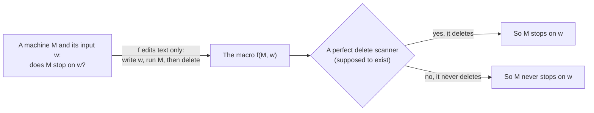

# Rice's theorem: no interesting property of a program is decidable

[Syllabus](../../../SYLLABUS.md) → [Computability and complexity](../README.md) → [Models of Computation](../README.md#s01) → Rice's theorem

---

## General Overview

An office IT team wants a scanner for spreadsheet macros (small programs saved inside a document). Before a macro runs, the scanner must answer one question: **does this macro ever delete a file?**

The question is about what the macro *does*, not what its text says. A macro can hold a delete command that never runs, or build the command while it runs. So the scanner cannot only read the text. It must predict the run.

This card proves that no scanner answers the question correctly for every macro. The proof is short. Take any machine M and input w from the stopping question (does M stop on w?). Build, by editing text only, a macro that runs M on w and deletes one file at the moment M stops. A perfect delete scanner would then answer the stopping question. [Universal machines](09-universal-machines-and-the-halting-problem.md) proved that nothing answers the stopping question for every machine. So the perfect scanner cannot exist.

The method is a **reduction** (a mechanical conversion of one question into another). It is the main tool for proving a new question undecidable. Rice's theorem is the same reduction done once for every question about behaviour.

**To prove a question undecidable, convert the stopping question into it; Rice's theorem does this once for every property of what programs do, so every such property, if some programs have it and others do not, is undecidable.**

**What kind of fact this is:** a theorem, proved on this card in Why it works. The proof rests on the theorem that the stopping question is undecidable, proved on [Universal machines](09-universal-machines-and-the-halting-problem.md).

### The picture: a perfect scanner would answer the stopping question



The left arrow always finishes, because it only edits a rule table. If the diamond also always finished, the chain would answer the stopping question for every machine. That is impossible, so the diamond cannot exist.

---

## The formula

First, the words.

- A **decision question** is a set of yes-inputs: the strings for which the answer is yes.
- A set is **decidable** when one program, given any string, always stops and answers correctly whether the string is in the set. [Decidable and semidecidable](../02-Computability%20and%20Logic/01-decidable-and-semidecidable-sets.md) treats this fully.
- From [Universal machines](09-universal-machines-and-the-halting-problem.md): $`\langle M\rangle`$ is the text that encodes machine M, an encoding and not an inner product. $`\mathrm{HALT}`$ is the set of pairs $`(\langle M\rangle, w)`$ where M stops on input w, written here as $`\langle M, w\rangle`$: one text holding both.

This card introduces one notation. $`A \le_m B`$, read "A reduces to B", says that a program can convert every question about A into a question about B with the same answer:

```math
A \le_m B \iff \text{some computable } f \text{ has } \big( x \in A \iff f(x) \in B \big) \text{ for every string } x
```

**Read it aloud:** A reduces to B when an always-stopping program f turns each string x into a string f(x), so that x is a yes for A exactly when f(x) is a yes for B.

The m stands for "mapping": f maps one input to one input. The reduction carries hardness from left to right:

```math
A \le_m B \;\text{ and }\; B \text{ decidable} \implies A \text{ decidable}
```

**Read it aloud:** if A converts into B, and B has a decider, then A has a decider too: convert, then ask B's decider.

Read backwards, this is the tool. If A is undecidable, B is undecidable. This card takes A to be HALT and B to be $`\mathrm{DELETES}`$, the set of macros that delete a file at some point in their run. The conversion f is checked on seven machines below:

```math
\langle M, w\rangle \in \mathrm{HALT} \iff f(\langle M, w\rangle) \in \mathrm{DELETES}
```

**Read it aloud:** M stops on w exactly when the macro built from M and w deletes a file.

The seven machines are rule tables on the symbols 0, 1 and blank:

- **flip** swaps each 0 and 1, left to right, and enters the halt state H at the first blank.
- **flip-norow** is flip without its row for the blank, so it stops there because no row applies, the rule on [Turing machines](07-turing-machines.md).
- **bb2** and **bb4** are busy beavers: among machines with two (or four) states, the one that runs longest from a blank tape before it stops.
- **pingpong** steps right, then left, for ever.
- **rightward** moves right for ever.
- **delete-loop** deletes a file on its first step, then steps left and right for ever.

Rice's theorem is the general form. Let $`L(M)`$ be the language of M: the set of inputs it accepts. Let $`\mathcal{P}`$ be a property of languages, written in script because P is a complexity class on this wing. Rice's theorem says:

```math
\text{some } L(M) \in \mathcal{P} \;\text{ and }\; \text{some } L(M) \notin \mathcal{P} \implies \{\, \langle M\rangle : L(M) \in \mathcal{P} \,\} \text{ is undecidable}
```

**Read it aloud:** if some machines have the behaviour property and some do not, then no program sorts all machines by it.

| Symbol | Plain meaning | In our example | Push it up and the answer… |
| --- | --- | --- | --- |
| $`A`$, $`B`$ | two decision questions, each a set of yes-inputs | HALT and DELETES | — |
| $`\mathrm{HALT}`$, $`\mathrm{DELETES}`$ | the stopping question; the set of macros that ever delete a file | (flip, 10) is in HALT | — |
| $`x`$, $`y`$ | input strings: x to a question, y to a machine | x is the text of (flip, 10) | — |
| $`f`$ | the reduction: an always-stopping text conversion | write w, run M, then delete | — |
| $`A \le_m B`$ | A converts into B by f, answers kept | HALT converts into DELETES | — |
| $`M`$, $`T`$, $`R`$, $`S`$ | machines: the given one, one with the property, the one f builds, a supposed decider (for DELETES, the scanner) | M is flip, bb4 or pingpong | — |
| $`H`$, DEL | the halt state, where a run stops (not the decider H of [Universal machines](09-universal-machines-and-the-halting-problem.md)); the macro's state that deletes a file and enters H | flip enters H at the first blank | — |
| $`w`$, $`n`$ | the input written on M's tape at the start; its length in symbols | w = 10, n = 2 | each symbol adds 2 steps before the delete: one to write it, one to walk back |
| $`\langle M\rangle`$, $`\langle M, w\rangle`$ | the text encoding M, or M and w together | flip's rule table and 10 | — |
| $`k`$ | the step at which M stops, when it stops | 3 for flip, 107 for bb4 | the delete comes later, at $`2n + k + 1`$ |
| $`L(M)`$, $`\emptyset`$ | the set of inputs M accepts; the empty set | a machine that never stops has $`L(M) = \emptyset`$ | — |
| $`\mathcal{P}`$ | a property of languages, such as "is empty" | — | — |

### When it holds

- **The property is about behaviour, not text.** Two programs that behave the same must get the same answer. "Contains a delete command" breaks this rule and is decidable by reading the text, but it gives the wrong answer for a delete command that never runs.
- **The property is non-trivial.** Some programs have it and some do not. A property that every program has, such as "stops or does not stop", is decided by a checker that always answers yes.
- **The run is unbounded.** The property says "ever". "Deletes within 100 steps" is decidable: run 100 steps and look. That checker misses bb4's macro, which deletes at step 108.
- **The language can run any tape machine.** A macro language with loops and unbounded variables can. With a fixed memory size, every run either stops or repeats a configuration (the state, head position and whole tape at one moment), so the question becomes decidable in principle. In practice, the number of configurations is far too large to search.
- **The reduction goes from the known-hard question to the new one.** Converting DELETES into HALT shows only that DELETES is no harder than HALT.

---

## Why it works

### Step 0: borrow impossibility instead of proving it again

Proving from scratch that no program decides a question needs a diagonal argument, like the one on [Universal machines](09-universal-machines-and-the-halting-problem.md). That argument is done once. After it, a new question needs only a conversion.

If every stopping question converts into a delete question, then a delete scanner is at least as strong as a stopping decider. No stopping decider exists, so no delete scanner exists.

### Step 1: reductions carry decidability backwards

Suppose $`A \le_m B`$ through f, and a program S decides B. Build a decider for A: on input x, compute f(x), then return S's answer on f(x).

- It always stops, because f always stops and S always stops.
- It is right, because x is in A exactly when f(x) is in B.

So a decider for B gives a decider for A. Turned around: if A has no decider, B has none.

### Step 2: build the macro without running M

The conversion f takes the rule table of M and the input w. It writes a new rule table, the macro, in four parts.

1. **Write w.** States w0, w1, … write one symbol of w each and move right: n steps.
2. **Walk back.** States b0, b1, … move left once each, to the first cell: n steps.
3. **Run M, disarmed.** Copy M's rules with each state renamed m.A, m.B, and so on. Switch off any delete action M's own rules carry. Send every rule that would enter M's halt state H into a new state DEL instead. M also stops wherever its table has no row, the rule on [Turing machines](07-turing-machines.md), so give each such (state, symbol) pair a new row that deletes a file and enters H, as DEL does.
4. **Delete, then stop.** DEL performs one delete action and enters the halt state H: one step.

f never runs M. It only edits text, so it always stops, even when M runs forever. This is the point most often missed.

### Step 3: check that answers are kept

- **M stops on w at step k.** If M's last step enters H, the macro enters DEL instead, and DEL deletes on the next step. If M stops after k steps on a missing row, that pair's new row deletes. Either way the delete comes at step $`2n + k + 1`$. Yes goes to yes.
- **M never stops on w.** The macro never reaches DEL or a new row, because M would stop at either. Part 3 switched off M's own deletes, so nothing else deletes. No goes to no.

So $`\mathrm{HALT} \le_m \mathrm{DELETES}`$. By Step 1, DELETES is undecidable.

The check runs both sides on seven machines. Road one runs M on w directly. Road two runs the macro and watches for the delete. On all seven, the macro deletes exactly when M stops, at the predicted step. That is evidence for the construction, not a proof; the proof is the two bullets above.

### Step 4: one reduction covers every behaviour property

Rice's theorem repeats Step 2 with "delete a file" replaced by "behave like a fixed machine T". Pick T with the property. The new machine first runs M on w, then behaves like T. If M stops, it has T's behaviour, so it has the property. If not, it behaves like a machine that never stops, which lacks the property.

<details>
<summary>Detailed proof: Rice's theorem</summary>

Let $`\mathcal{P}`$ be a property of languages with some $`L(M) \in \mathcal{P}`$ and some $`L(M) \notin \mathcal{P}`$.

Case 1: the empty language $`\emptyset`$ is not in $`\mathcal{P}`$. Pick a machine T with $`L(T) \in \mathcal{P}`$. Define f to map $`\langle M, w\rangle`$ to the text of a machine R that does this on input y: run M on w, ignoring y; if that stops, run T on y and answer as T does. Writing R's table is a text edit, so f always stops.

If M stops on w, R accepts exactly what T accepts:

$`\displaystyle L(R) = L(T) \in \mathcal{P}`$

If M never stops on w, R never accepts anything:

$`\displaystyle L(R) = \emptyset \notin \mathcal{P}`$

So $`\langle M, w\rangle \in \mathrm{HALT}`$ exactly when $`\langle R\rangle`$ has the property. That is $`\mathrm{HALT} \le_m \{\langle M\rangle : L(M) \in \mathcal{P}\}`$, and by Step 1 the right-hand set is undecidable.

Case 2: $`\emptyset`$ is in $`\mathcal{P}`$. Apply Case 1 to the opposite property, "not in $`\mathcal{P}`$", which is also non-trivial and excludes $`\emptyset`$. A decider for a set gives a decider for its complement by swapping yes and no. So the set for $`\mathcal{P}`$ is undecidable too.

The delete question fits the same pattern with "behaviour" read as the list of actions a run performs. The machine that never stops never deletes, which is Case 1.

</details>

### Step 5: what the theorem does not say

Rice's theorem says no *single* program answers correctly for *every* program. It does not say a given macro is a mystery. For one fixed macro, one of the two programs "always say yes" and "always say no" is right. The difficulty is having one checker for all macros.

It also says nothing about properties of the text. "Has fewer than five states" and "contains a delete command" are decidable by reading.

---

## Worked numbers, by hand

The macro f(flip, 10). The machine flip reads the tape left to right, swaps each 0 and 1, and stops at the first blank cell. On w = 10, it swaps two symbols and reads one blank, so it stops at step k = 3.

| Step | Arithmetic | Value |
| --- | --- | --- |
| write w = 10 | n = 2 symbols, one step each | 2 steps |
| walk back to the first cell | n = 2 moves left | 2 steps |
| run flip | swap 1, swap 0, read the blank and stop | k = 3 steps |
| delete, then stop | one step in DEL | 1 step |
| step of the delete | 2 + 2 + 3 + 1 | **step 8** |

The scanner question for this macro has the answer yes, at step 8, exactly because flip stops on 10. Without its blank row, flip-norow stops after k = 2 steps, so its macro deletes at step 2 + 2 + 2 + 1 = 7. For the two-state busy beaver bb2, n = 0 and k = 6, so its macro deletes at step 7. For the four-state busy beaver bb4, k = 107, so its macro deletes at step 108.

### What breaks if you drop a piece

| Mistake | Comes out at | What went wrong |
| --- | --- | --- |
| Run the macro in a sandbox capped at 100 steps | f(bb4): still running after 100 steps, 0 deletes seen | The cap drops "ever": uncapped, it deletes at step 108 |
| Scan the text of the macro for a delete rule | f(pingpong): yes | A text property, not behaviour: the run loops (configuration repeats at step 2) and never deletes |
| Build f without switching off M's own deletes | f(delete-loop): deletes at step 1 | M loops (configuration repeats at step 3), so a no became a yes |

The code prints all three.

---

## Code, from first principles, and it actually runs

The code builds the reduction f and checks it on seven machines. It never tries to decide DELETES, which no program can do. It reports each run as one of three results: stopped at a step; a proved loop, because the whole configuration (state, head position and tape) repeated; or "still running after N steps", which proves nothing. The two independent roads are running M on w directly and running the macro f(M, w) while watching for a delete. A third check compares the delete step with $`2n + k + 1`$. Two published records anchor the simulator: bb2 stops at step 6 with 4 ones, and bb4 stops at step 107 with 13 ones (Brady, 1983).

### Python

```python
# Rice's theorem and reductions -- the check behind the card.  Nothing is
# imported.  The tape machine is the one explained on the Turing-machines card;
# here a rule may also carry one side effect: delete a file.  The code never
# decides the undecidable.  It runs the reduction f, which turns a machine M and
# an input w into a macro, and checks on seven machines that the macro deletes a
# file exactly when M stops on w.  Road one runs M; road two runs the macro.
B, SYMS, CAP = "_", "_01", 1000

def table(text):                        # "A_:1RB" means: in A reading _, write 1, go R, enter B
    out = {}                            # a trailing "!" makes that rule delete a file
    for t in text.split():
        out[(t[0], t[1])] = (t[3], t[4], t[5:].rstrip("!"), t.endswith("!"))
    return out

def run(rules, start, w, cap):
    """Run until the machine stops (it enters the halt state H, or no row applies),
    a repeated configuration (a proof of looping), or the cap."""
    tape, head, state, deletes = dict(enumerate(w)), 0, start, []
    seen = {(state, head, tuple(sorted(tape.items())))}
    for step in range(1, cap + 1):
        if (state, tape.get(head, B)) not in rules:      # no row: stopped after step - 1 steps
            return "halts", step - 1, deletes, sum(v == "1" for v in tape.values())
        write, move, state, act = rules[(state, tape.get(head, B))]
        tape[head] = write
        head += 1 if move == "R" else -1
        if act:
            deletes.append(step)
        if state == "H":
            return "halts", step, deletes, sum(v == "1" for v in tape.values())
        config = (state, head, tuple(sorted((k, v) for k, v in tape.items() if v != B)))
        if config in seen:
            return "repeats", step, deletes, None
        seen.add(config)
    return "running", cap, deletes, None

def reduce_to_macro(m, w, disarm=True):
    """The reduction f: a macro that writes w, walks back, runs M with its own deletes
    switched off, and deletes one file only if M stops: enters H, or meets a missing row."""
    n, out = len(w), {}
    for i, ch in enumerate(w):          # writing phase: n steps
        for s in SYMS:
            out[(f"w{i}", s)] = (ch, "R", f"w{i + 1}" if i + 1 < n else "b0", False)
    for j in range(n):                  # walking back: n steps
        for s in SYMS:
            out[(f"b{j}", s)] = (s, "L", f"b{j + 1}" if j + 1 < n else "m.A", False)
    for (q, s), (wr, mv, nx, act) in m.items():
        out[("m." + q, s)] = (wr, mv, "DEL" if nx == "H" else "m." + nx, act and not disarm)
    for q in ({"A"} | {q for q, _ in m} | {r[2] for r in m.values()}) - {"H"}:
        for s in SYMS:                  # M has no row here, so it stops: delete, then stop
            out.setdefault(("m." + q, s), (s, "R", "H", True))
    for s in SYMS:                      # M has stopped: delete the file, then stop
        out[("DEL", s)] = (s, "R", "H", True)
    return out, ("w0" if n else "m.A")

MACHINES = [
    ("flip", "A0:1RA A1:0RA A_:_RH", "10"),
    ("bb2", "A_:1RB A1:1LB B_:1LA B1:1RH", ""),
    ("bb4", "A_:1RB A1:1LB B_:1LA B1:_LC C_:1RH C1:1LD D_:1RD D1:_RA", ""),
    ("pingpong", "A_:_RB A1:1RB B_:_LA B1:1LA", ""),
    ("rightward", "A_:_RA A0:0RA A1:1RA", ""),
    ("delete-loop", "A_:_RB! B_:_LC C_:_RB", ""),
    ("flip-norow", "A0:1RA A1:0RA", "10"),   # flip with no blank row: stops where no row applies
]

def say(v, k):                          # never "loops" without a repeated configuration
    if v == "halts":
        return f"halts at step {k}"
    if v == "repeats":
        return f"loops: configuration repeats at step {k}"
    return f"still running after {k} steps"

print(f"{'machine':<12} | {'input':<5} | {'road one: M on w':<40} | road two: the macro f(M, w)")
results, agree = {}, 0
for name, text, w in MACHINES:
    m = table(text)
    v1, k1, d1, ones = run(m, "A", w, CAP)
    macro, start = reduce_to_macro(m, w)
    v2, k2, d2, _ = run(macro, start, "", CAP + 2 * len(w) + 1)
    results[name] = (v1, k1, d1, ones, v2, k2, d2, macro, start)
    one = say(v1, k1) + (f", {ones} ones on the tape" if name.startswith("bb") and v1 == "halts" else "")
    two = f"deletes a file at step {d2[0]}, then halts" if d2 else say(v2, k2) + ", no delete"
    print(f"{name:<12} | {w or '-':<5} | {one:<40} | {two}")
    if v1 == "halts":                   # yes goes to yes, at the predicted step 2n + k + 1
        assert d2 == [2 * len(w) + k1 + 1] and v2 == "halts"
        agree += 1
    elif v1 == "repeats":               # a proved loop goes to a proved loop with no delete
        assert d2 == [] and v2 == "repeats" and k2 == 2 * len(w) + k1
        agree += 1
    else:                               # unknown stays unknown, and no delete within the cap
        assert d2 == [] and v2 == "running"
        agree += 1
print(f"machines checked: {len(MACHINES)}; macro deletes exactly when M stops: {agree} of {len(MACHINES)}")
n_flip = len(MACHINES[0][2])
print(f"flip on {MACHINES[0][2]}: write {n_flip} + walk back {n_flip} + run {results['flip'][1]} + delete 1"
      f" = step {2 * n_flip + results['flip'][1] + 1}")
assert results["bb2"][1] == 6 and results["bb2"][3] == 4        # the published 2-state record
assert results["bb4"][1] == 107 and results["bb4"][3] == 13     # Brady's 1983 4-state record
assert results["rightward"][0] == "running"

print("what breaks:")
bb4_macro, bb4_start = results["bb4"][7], results["bb4"][8]
v, k, d, _ = run(bb4_macro, bb4_start, "", 100)
print(f"  sandbox capped at 100 steps on f(bb4): {say(v, k)}, {len(d)} deletes seen;"
      f" uncapped, it deletes at step {results['bb4'][6][0]}")
assert v == "running" and d == [] and results["bb4"][6] == [108]
ping_macro = results["pingpong"][7]
says = any(r[3] for r in ping_macro.values())
print(f"  text scan of f(pingpong) for a delete rule: {'yes' if says else 'no'};"
      f" the run {say(results['pingpong'][4], results['pingpong'][5])}, no delete")
assert says and results["pingpong"][6] == []
evil = table(MACHINES[5][1])
naive, s0 = reduce_to_macro(evil, "", disarm=False)
v, k, d, _ = run(naive, s0, "", CAP)
print(f"  f without switching off M's deletes, on delete-loop: deletes at step {d[0]},"
      f" though M {say(results['delete-loop'][0], results['delete-loop'][1])}")
assert d == [1] and v == "repeats" and results["delete-loop"][6] == []
print("ALL CHECKS PASS")
```

**Ran 2026-11-19 on macOS, Python 3.14.10, standard library only. All checks passed. Output, pasted from the run:**

```
machine      | input | road one: M on w                         | road two: the macro f(M, w)
flip         | 10    | halts at step 3                          | deletes a file at step 8, then halts
bb2          | -     | halts at step 6, 4 ones on the tape      | deletes a file at step 7, then halts
bb4          | -     | halts at step 107, 13 ones on the tape   | deletes a file at step 108, then halts
pingpong     | -     | loops: configuration repeats at step 2   | loops: configuration repeats at step 2, no delete
rightward    | -     | still running after 1000 steps           | still running after 1001 steps, no delete
delete-loop  | -     | loops: configuration repeats at step 3   | loops: configuration repeats at step 3, no delete
flip-norow   | 10    | halts at step 2                          | deletes a file at step 7, then halts
machines checked: 7; macro deletes exactly when M stops: 7 of 7
flip on 10: write 2 + walk back 2 + run 3 + delete 1 = step 8
what breaks:
  sandbox capped at 100 steps on f(bb4): still running after 100 steps, 0 deletes seen; uncapped, it deletes at step 108
  text scan of f(pingpong) for a delete rule: yes; the run loops: configuration repeats at step 2, no delete
  f without switching off M's deletes, on delete-loop: deletes at step 1, though M loops: configuration repeats at step 3
ALL CHECKS PASS
```

### Rust

Same numbers, same labels, built with `rustc --edition 2021 -O`.

```rust
// Rice's theorem and reductions -- the same check as the Python, in Rust.  No
// crates.  The tape machine is the one explained on the Turing-machines card;
// here a rule may also carry one side effect: delete a file.  The code never
// decides the undecidable.  It runs the reduction f, which turns a machine M and
// an input w into a macro, and checks on seven machines that the macro deletes a
// file exactly when M stops on w.  Road one runs M; road two runs the macro.
use std::collections::{BTreeMap, HashMap, HashSet};

const B: char = '_';
const SYMS: [char; 3] = ['_', '0', '1'];
const CAP: usize = 1000;
type Rules = HashMap<(String, char), (char, char, String, bool)>;

// "A_:1RB" means: in A reading _, write 1, go R, enter B; a trailing "!" deletes a file
fn table(text: &str) -> Rules {
    let mut out = Rules::new();
    for t in text.split_whitespace() {
        let c: Vec<char> = t.chars().collect();
        let next: String = c[5..].iter().filter(|&&x| x != '!').collect();
        out.insert((c[0].to_string(), c[1]), (c[3], c[4], next, t.ends_with('!')));
    }
    out
}

struct Run { verdict: &'static str, step: usize, deletes: Vec<usize>, ones: usize }

// Run until the machine stops (it enters the halt state H, or no row applies),
// a repeated configuration (a proof of looping), or the cap.
fn run(rules: &Rules, start: &str, w: &str, cap: usize) -> Run {
    let mut tape: BTreeMap<i64, char> = w.chars().enumerate().map(|(i, c)| (i as i64, c)).collect();
    let (mut head, mut state, mut deletes) = (0i64, start.to_string(), Vec::new());
    let snap = |t: &BTreeMap<i64, char>| -> Vec<(i64, char)> {
        t.iter().filter(|(_, &v)| v != B).map(|(&k, &v)| (k, v)).collect()
    };
    let mut seen: HashSet<(String, i64, Vec<(i64, char)>)> = HashSet::new();
    seen.insert((state.clone(), head, tape.iter().map(|(&k, &v)| (k, v)).collect()));
    for step in 1..=cap {
        let read = *tape.get(&head).unwrap_or(&B);
        let Some(rule) = rules.get(&(state.clone(), read)) else {   // no row: stopped after step - 1 steps
            let ones = tape.values().filter(|&&v| v == '1').count();
            return Run { verdict: "halts", step: step - 1, deletes, ones };
        };
        let (write, mv, next, act) = rule.clone();
        tape.insert(head, write);
        head += if mv == 'R' { 1 } else { -1 };
        state = next;
        if act { deletes.push(step) }
        if state == "H" {
            let ones = tape.values().filter(|&&v| v == '1').count();
            return Run { verdict: "halts", step, deletes, ones };
        }
        let config = (state.clone(), head, snap(&tape));
        if seen.contains(&config) { return Run { verdict: "repeats", step, deletes, ones: 0 } }
        seen.insert(config);
    }
    Run { verdict: "running", step: cap, deletes, ones: 0 }
}

// The reduction f: a macro that writes w, walks back, runs M with its own deletes
// switched off, and deletes one file only if M stops: enters H, or meets a missing row.
fn reduce_to_macro(m: &Rules, w: &str, disarm: bool) -> (Rules, String) {
    let (wc, mut out): (Vec<char>, Rules) = (w.chars().collect(), Rules::new());
    let n = wc.len();
    for (i, &ch) in wc.iter().enumerate() {                 // writing phase: n steps
        let next = if i + 1 < n { format!("w{}", i + 1) } else { "b0".to_string() };
        for &s in &SYMS { out.insert((format!("w{}", i), s), (ch, 'R', next.clone(), false)); }
    }
    for j in 0..n {                                         // walking back: n steps
        let next = if j + 1 < n { format!("b{}", j + 1) } else { "m.A".to_string() };
        for &s in &SYMS { out.insert((format!("b{}", j), s), (s, 'L', next.clone(), false)); }
    }
    for ((q, s), (wr, mv, nx, act)) in m.iter() {
        let next = if nx == "H" { "DEL".to_string() } else { format!("m.{}", nx) };
        out.insert((format!("m.{}", q), *s), (*wr, *mv, next, *act && !disarm));
    }
    let mut states: HashSet<String> = m.iter().flat_map(|((q, _), r)| [q.clone(), r.2.clone()]).collect();
    states.insert("A".to_string());
    states.remove("H");
    for q in states {                                       // M has no row here, so it stops: delete, then stop
        for &s in &SYMS { out.entry((format!("m.{}", q), s)).or_insert((s, 'R', "H".to_string(), true)); }
    }
    for &s in &SYMS { out.insert(("DEL".to_string(), s), (s, 'R', "H".to_string(), true)); }
    (out, if n > 0 { "w0".to_string() } else { "m.A".to_string() })
}

// never "loops" without a repeated configuration
fn say(v: &str, k: usize) -> String {
    match v {
        "halts" => format!("halts at step {}", k),
        "repeats" => format!("loops: configuration repeats at step {}", k),
        _ => format!("still running after {} steps", k),
    }
}

fn main() {
    let machines = [
        ("flip", "A0:1RA A1:0RA A_:_RH", "10"),
        ("bb2", "A_:1RB A1:1LB B_:1LA B1:1RH", ""),
        ("bb4", "A_:1RB A1:1LB B_:1LA B1:_LC C_:1RH C1:1LD D_:1RD D1:_RA", ""),
        ("pingpong", "A_:_RB A1:1RB B_:_LA B1:1LA", ""),
        ("rightward", "A_:_RA A0:0RA A1:1RA", ""),
        ("delete-loop", "A_:_RB! B_:_LC C_:_RB", ""),
        ("flip-norow", "A0:1RA A1:0RA", "10"),   // flip with no blank row: stops where no row applies
    ];
    println!("{:<12} | {:<5} | {:<40} | road two: the macro f(M, w)", "machine", "input", "road one: M on w");
    let mut results: HashMap<&str, (Run, Run, Rules, String)> = HashMap::new();
    let mut agree = 0;
    for &(name, text, w) in machines.iter() {
        let m = table(text);
        let r1 = run(&m, "A", w, CAP);
        let (macro_rules, start) = reduce_to_macro(&m, w, true);
        let r2 = run(&macro_rules, &start, "", CAP + 2 * w.len() + 1);
        let mut one = say(r1.verdict, r1.step);
        if name.starts_with("bb") && r1.verdict == "halts" { one += &format!(", {} ones on the tape", r1.ones) }
        let two = if !r2.deletes.is_empty() {
            format!("deletes a file at step {}, then halts", r2.deletes[0])
        } else { say(r2.verdict, r2.step) + ", no delete" };
        println!("{:<12} | {:<5} | {:<40} | {}", name, if w.is_empty() { "-" } else { w }, one, two);
        if r1.verdict == "halts" {          // yes goes to yes, at the predicted step 2n + k + 1
            assert!(r2.deletes == vec![2 * w.len() + r1.step + 1] && r2.verdict == "halts");
            agree += 1;
        } else if r1.verdict == "repeats" { // a proved loop goes to a proved loop with no delete
            assert!(r2.deletes.is_empty() && r2.verdict == "repeats" && r2.step == 2 * w.len() + r1.step);
            agree += 1;
        } else {                            // unknown stays unknown, and no delete within the cap
            assert!(r2.deletes.is_empty() && r2.verdict == "running");
            agree += 1;
        }
        results.insert(name, (r1, r2, macro_rules, start));
    }
    println!("machines checked: {}; macro deletes exactly when M stops: {} of {}", machines.len(), agree, machines.len());
    let n_flip = machines[0].2.len();
    let flip_k = results["flip"].0.step;
    println!("flip on {}: write {} + walk back {} + run {} + delete 1 = step {}", machines[0].2, n_flip, n_flip, flip_k, 2 * n_flip + flip_k + 1);
    assert!(results["bb2"].0.step == 6 && results["bb2"].0.ones == 4);      // the published 2-state record
    assert!(results["bb4"].0.step == 107 && results["bb4"].0.ones == 13);   // Brady's 1983 4-state record
    assert!(results["rightward"].0.verdict == "running");

    println!("what breaks:");
    let (_, bb4_two, bb4_macro, bb4_start) = &results["bb4"];
    let capped = run(bb4_macro, bb4_start, "", 100);
    println!("  sandbox capped at 100 steps on f(bb4): {}, {} deletes seen; uncapped, it deletes at step {}",
             say(capped.verdict, capped.step), capped.deletes.len(), bb4_two.deletes[0]);
    assert!(capped.verdict == "running" && capped.deletes.is_empty() && bb4_two.deletes == vec![108]);
    let (_, ping_two, ping_macro, _) = &results["pingpong"];
    let says = ping_macro.values().any(|r| r.3);
    println!("  text scan of f(pingpong) for a delete rule: {}; the run {}, no delete",
             if says { "yes" } else { "no" }, say(ping_two.verdict, ping_two.step));
    assert!(says && ping_two.deletes.is_empty());
    let evil = table(machines[5].1);
    let (naive, s0) = reduce_to_macro(&evil, "", false);
    let r = run(&naive, &s0, "", CAP);
    let (evil_one, evil_two, _, _) = &results["delete-loop"];
    println!("  f without switching off M's deletes, on delete-loop: deletes at step {}, though M {}",
             r.deletes[0], say(evil_one.verdict, evil_one.step));
    assert!(r.deletes == vec![1] && r.verdict == "repeats" && evil_two.deletes.is_empty());
    println!("ALL CHECKS PASS");
}
```

**Ran 2026-11-19 on macOS, rustc 1.98.1, no crates. All checks passed. Output, pasted from the run:**

```
machine      | input | road one: M on w                         | road two: the macro f(M, w)
flip         | 10    | halts at step 3                          | deletes a file at step 8, then halts
bb2          | -     | halts at step 6, 4 ones on the tape      | deletes a file at step 7, then halts
bb4          | -     | halts at step 107, 13 ones on the tape   | deletes a file at step 108, then halts
pingpong     | -     | loops: configuration repeats at step 2   | loops: configuration repeats at step 2, no delete
rightward    | -     | still running after 1000 steps           | still running after 1001 steps, no delete
delete-loop  | -     | loops: configuration repeats at step 3   | loops: configuration repeats at step 3, no delete
flip-norow   | 10    | halts at step 2                          | deletes a file at step 7, then halts
machines checked: 7; macro deletes exactly when M stops: 7 of 7
flip on 10: write 2 + walk back 2 + run 3 + delete 1 = step 8
what breaks:
  sandbox capped at 100 steps on f(bb4): still running after 100 steps, 0 deletes seen; uncapped, it deletes at step 108
  text scan of f(pingpong) for a delete rule: yes; the run loops: configuration repeats at step 2, no delete
  f without switching off M's deletes, on delete-loop: deletes at step 1, though M loops: configuration repeats at step 3
ALL CHECKS PASS
```

The two outputs match line for line. The rightward machine moves right forever, but its configuration never repeats, so the code reports only "still running". Its macro gets one more step of budget, 1001, to make room for the delete step.

### Lean

Lean proves Rice's theorem and both proof steps for programs in Lean's own small programming language, and checks the worked numbers.

- Take a property $`\mathcal{P}`$ that some programs' languages have and some do not, a language being the inputs where the program stops. Then no always-stopping program sorts all programs by it.
- Suppose $`A \le_m B`$ and B is decidable. Then A is decidable.
- Suppose the empty language $`\emptyset`$ is not in $`\mathcal{P}`$, and some program's language is. Then $`\mathrm{HALT} \le_m \{\langle M\rangle : L(M) \in \mathcal{P}\}`$.
- The delete step $`2n + k + 1`$ comes out as 8 for flip, 7 for flip-norow and bb2, and 108 for bb4.

Lean does not run tape machines, so the delete macro, the seven runs and the busy-beaver records are left to the Python and Rust checks.

```lean
-- Rice's theorem: no program decides a non-trivial property of what programs accept, reductions carry decidability backwards, and the stopping question reduces to every such property that the empty language lacks.
import Mathlib.Computability.Halting
import Mathlib.Computability.Reduce
import Mathlib.Tactic.NormNum

open Nat.Partrec (Code)
open Nat.Partrec.Code

/-- The domain of the program "run `M` on `w`, then run `T` on the input" is the domain of `T`
when `M` stops on `w`, and empty otherwise. -/
theorem pair_comp_const_dom (M T : Code) (w x : ℕ) :
    (eval (Code.pair (Code.comp M (Code.const w)) T) x).Dom ↔
      (eval M w).Dom ∧ (eval T x).Dom := by
  simp only [eval, Code.eval_const]
  have e1 : (Part.some w >>= (eval M : ℕ → Part ℕ)) = eval M w := Part.bind_some w _
  rw [e1]
  constructor
  · rintro ⟨h1, h3⟩
    exact ⟨h1, h3⟩
  · rintro ⟨h1, h2⟩
    exact ⟨h1, h2⟩

/-- **Rice's theorem.** Let `P` be a property of languages, where the language of a program `c`
is the set of inputs on which it stops, `(eval c).Dom`. If some program's language has the
property and some program's language does not, then no always-stopping program sorts all
programs by it: the set `{⟨c⟩ : L(c) ∈ P}` is undecidable. -/
theorem rice_nontrivial_language_property_undecidable (P : Set (Set ℕ))
    (hyes : ∃ c : Code, (eval c).Dom ∈ P) (hno : ∃ c : Code, (eval c).Dom ∉ P) :
    ¬ ComputablePred (fun c : Code => (eval c).Dom ∈ P) := by
  intro h
  obtain ⟨c1, hc1⟩ := hyes
  obtain ⟨c2, hc2⟩ := hno
  have key := (ComputablePred.rice₂ {c : Code | (eval c).Dom ∈ P}
    (fun cf cg e => by show (eval cf).Dom ∈ P ↔ (eval cg).Dom ∈ P; rw [e])).1 h
  rcases key with h0 | h1
  · have : c1 ∈ ({c : Code | (eval c).Dom ∈ P} : Set Code) := hc1
    rw [h0] at this
    exact this
  · have : c2 ∈ ({c : Code | (eval c).Dom ∈ P} : Set Code) := by rw [h1]; trivial
    exact hc2 this

/-- **Reductions carry decidability backwards.** If `A ≤_m B`, that is, some computable `f`
has `x ∈ A ↔ f x ∈ B` for every `x`, and `B` is decidable, then `A` is decidable:
convert, then ask `B`'s decider. -/
theorem decidable_of_reduces_to_decidable {α β : Type*} [Primcodable α] [Primcodable β]
    (A : α → Prop) (B : β → Prop)
    (hred : ∃ f : α → β, Computable f ∧ ∀ x, A x ↔ B (f x))
    (hB : ComputablePred B) : ComputablePred A := by
  obtain ⟨f, hf, hAB⟩ := hred
  exact ComputablePred.computable_of_manyOneReducible ⟨f, hf, hAB⟩ hB

/-- **The reduction behind Rice's theorem (Case 1).** If the empty language lacks the property
`P` and some machine `T` has a language with the property, then the stopping question
`HALT = {⟨M, w⟩ : M stops on w}` reduces to the property: `HALT ≤_m {⟨c⟩ : L(c) ∈ P}`. -/
theorem halt_reduces_to_language_property (P : Set (Set ℕ)) (hempty : (∅ : Set ℕ) ∉ P)
    (hT : ∃ T : Code, (eval T).Dom ∈ P) :
    ManyOneReducible (fun p : Code × ℕ => (eval p.1 p.2).Dom)
      (fun c : Code => (eval c).Dom ∈ P) := by
  obtain ⟨T, hTP⟩ := hT
  refine ⟨fun p : Code × ℕ => Code.pair (Code.comp p.1 (Code.const p.2)) T, ?_, ?_⟩
  · exact (Code.primrec₂_pair.comp
      (Code.primrec₂_comp.comp Primrec.fst (Code.primrec_const.comp Primrec.snd))
      (Primrec.const T)).to_comp
  · rintro ⟨M, w⟩
    by_cases hM : (eval M w).Dom
    · have hset : (eval (Code.pair (Code.comp M (Code.const w)) T)).Dom = (eval T).Dom := by
        ext x
        exact (pair_comp_const_dom M T w x).trans (and_iff_right hM)
      show (eval M w).Dom ↔ (eval (Code.pair (Code.comp M (Code.const w)) T)).Dom ∈ P
      rw [hset]
      exact iff_of_true hM hTP
    · have hset : (eval (Code.pair (Code.comp M (Code.const w)) T)).Dom = ∅ := by
        ext x
        exact (pair_comp_const_dom M T w x).trans (iff_of_false (fun h => hM h.1) id)
      show (eval M w).Dom ↔ (eval (Code.pair (Code.comp M (Code.const w)) T)).Dom ∈ P
      rw [hset]
      exact iff_of_false hM hempty

-- The card's worked numbers: the macro f(M, w) deletes at step 2n + k + 1.
-- flip on w = 10: n = 2, k = 3, delete at step 8.
example : 2 * 2 + 3 + 1 = 8 := by norm_num
-- flip-norow on w = 10: n = 2, k = 2, delete at step 7.
example : 2 * 2 + 2 + 1 = 7 := by norm_num
-- bb2 on the blank tape: n = 0, k = 6, delete at step 7.
example : 2 * 0 + 6 + 1 = 7 := by norm_num
-- bb4 on the blank tape: n = 0, k = 107, delete at step 108.
example : 2 * 0 + 107 + 1 = 108 := by norm_num

#print axioms pair_comp_const_dom
#print axioms rice_nontrivial_language_property_undecidable
#print axioms decidable_of_reduces_to_decidable
#print axioms halt_reduces_to_language_property
```

**Checked 2026-11-19 on macOS, Lean 4.36.0-rc2, Mathlib v4.36.0-rc2. Every proof is complete and uses only Lean's standard axioms. Output, pasted from the run:**

```
'pair_comp_const_dom' depends on axioms: [propext, Quot.sound]
'rice_nontrivial_language_property_undecidable' depends on axioms: [propext, Classical.choice, Quot.sound]
'decidable_of_reduces_to_decidable' depends on axioms: [propext, Classical.choice, Quot.sound]
'halt_reduces_to_language_property' depends on axioms: [propext, Classical.choice, Quot.sound]
```

> [!TIP]
> **Try changing**
> - **Guess first:** set flip's input to `"1011"`. When does its macro delete? It deletes at step 14: write 4, walk back 4, run 5, delete 1.
> - **Guess first:** raise the sandbox cap from `100` to `108`. Does the sandbox now see the delete? Yes, at step 108, and the what-breaks assert stops the program, because the sandbox is no longer fooled.
> - **Guess first:** lower `CAP` to `50`. What does bb4 report? Still running after 50 steps, and the record assert stops the program. A short cap turns a stopping machine into an unknown.
> - **Guess first:** change `disarm=True` to `disarm=False` in the definition of `reduce_to_macro`. Which assert fails? The proved-loop assert in the main loop: delete-loop's macro now deletes at step 1 while delete-loop loops.

---

## The usual mistake

> [!warning]
> **Reducing in the wrong direction.** To prove DELETES undecidable, convert HALT into DELETES. Converting DELETES into HALT (run the macro, stop when it deletes) is easy, and it only shows that DELETES is no harder than HALT. Many easy questions also convert into HALT.
>
> - **Letting f run M.** If f had to know whether M stops, f would not always stop, and it would not be a reduction. f only edits text.
> - **Forgetting M's own deletes.** A machine that deletes and then loops maps a no to a yes: delete-loop's macro deletes at step 1 though delete-loop never stops.
> - **Trusting a capped sandbox.** "No delete in 100 steps" is not "never deletes": bb4's macro deletes at step 108.
> - **Applying Rice to text.** "Contains a delete rule" is decidable by reading, and says yes for pingpong's macro, which never deletes.

---

## Where you meet it in real life

- **Malware and macro scanners.** No scanner decides "ever deletes a file" for every program. Real scanners mix text signatures with time-capped sandbox runs, and both can be fooled, as the what-breaks table shows.
- **Compilers.** Whether a line of code ever runs is a behaviour property, so it is undecidable. Compilers remove only code they can prove unreachable, and keep the rest.
- **Static analysis and type checkers.** A checker that never misses a bug must sometimes reject a correct program. Rice's theorem is why every such tool trades false alarms against missed bugs.
- **Grammar tools.** Whether a grammar ([Grammars and a stack](05-context-free-grammars-and-pushdown-automata.md)) is ambiguous is undecidable. The proof is a reduction from Post's correspondence problem, a domino-matching puzzle that HALT itself reduces to.

> **Say it back**
> A reduction converts every question about one set into a question about another, by a text edit that always stops and keeps every answer. If the first set has no decider, the second has none either. Turning any machine M and input w into a macro that deletes a file exactly when M stops on w proves that no scanner decides "ever deletes a file". Rice's theorem does the same for every property of behaviour that some programs have and others do not. Properties of the text, and properties with a step limit, are still decidable.

---

## What this builds on

- [Universal machines](09-universal-machines-and-the-halting-problem.md): the encoding $`\langle M\rangle`$ and the proof that HALT is undecidable, which every reduction on this card borrows.
- [Turing machines](07-turing-machines.md): the rule tables that f edits, and the tape machine the code runs.
- [Church-Turing thesis](08-church-turing-thesis.md): why a result about tape machines applies to every precise language that can run a tape machine (a theorem), and by the thesis to any reasonable one.

## Where this goes next

- [Decidable and semidecidable](../02-Computability%20and%20Logic/01-decidable-and-semidecidable-sets.md): the sets with programs that answer yes when the answer is yes, and the complement trick used in Case 2.
- [Hilbert's tenth problem](../02-Computability%20and%20Logic/04-hilberts-tenth-problem.md): a reduction from HALT into whole-number equations.
- [Reductions](../03-Time%20Complexity/03-polynomial-reductions-and-np-completeness.md): the same conversion, made fast, to compare problems by time instead of possibility.
- [Kleene's recursion theorem](../02-Computability%20and%20Logic/09-kleene-recursion-theorem.md): every program can get hold of its own code.
- [Turing degrees and the arithmetical hierarchy](../02-Computability%20and%20Logic/10-turing-degrees-and-the-arithmetical-hierarchy.md): ranking unsolvable problems by oracles and by quantifiers.

DELETES is undecidable, but a program can still confirm a yes by running the macro until it deletes; which undecidable sets still allow that one-sided answer?

---

## Sources

Verified 2026-11-19: every link below resolves to the publisher's page.

- Rice, H. G. "Classes of recursively enumerable sets and their decision problems." *Transactions of the American Mathematical Society* 74 (1953), 358–366. [doi:10.1090/S0002-9947-1953-0053041-6](https://doi.org/10.1090/S0002-9947-1953-0053041-6). The original theorem.
- Post, Emil L. "A variant of a recursively unsolvable problem." *Bulletin of the American Mathematical Society* 52 (1946), 264–268. [doi:10.1090/S0002-9904-1946-08555-9](https://doi.org/10.1090/S0002-9904-1946-08555-9). The correspondence problem, proved undecidable by reduction.
- Brady, Allen H. "The determination of the value of Rado's noncomputable function Σ(k) for four-state Turing machines." *Mathematics of Computation* 40 (1983), 647–665. [doi:10.1090/S0025-5718-1983-0689479-6](https://doi.org/10.1090/S0025-5718-1983-0689479-6). The four-state record: 107 steps, 13 ones.
- Sipser, Michael. *Introduction to the Theory of Computation*, 3rd ed. Cengage, 2013. [Publisher page](https://www.cengage.com/c/introduction-to-the-theory-of-computation-3e-sipser/9781133187790/). Chapter 5: mapping reductions, Rice's theorem as an exercise, and Post's correspondence problem.
