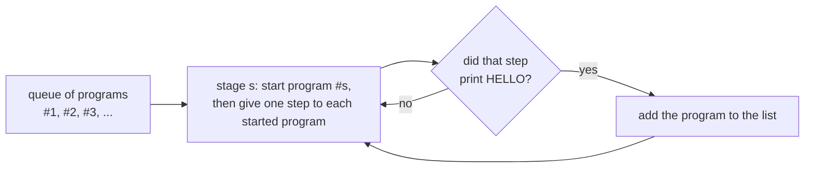

# Decidable and semidecidable: always an answer, or only when the answer is yes

[Syllabus](../../../SYLLABUS.md) → [Computability and complexity](../README.md) → [Computability and Logic](../README.md#s02) → Decidable and semidecidable

---

## General Overview

Picture a program that reads programs. It takes the text of another program and answers one question: will this program ever print HELLO?

The programs here are written in a tiny language of seven symbols. The other six work on a row of number cells: `+` and `-` add or take away one in the current cell, `<` and `>` move to the next cell left or right, and `[` and `]` repeat the part between them while the current cell is not zero. The seventh, `!`, prints HELLO. The program `-[-]!` prints HELLO at its step 513. The program `+[]!` never does: it spins in place before it reaches the `!`.

A reading program can answer this question in two ways. It can always stop with yes or no. Or it can stop with yes when the answer is yes, and keep running when the answer is no. The first kind is a **decider**. The second kind only confirms.

A confirmer is enough to build a **lister**: a program that prints, one by one, every program that ever prints HELLO. It runs all programs side by side, a step of each in turn, so no endless run can block it. Over the 5,373 programs of up to five symbols, it lists 3,022.

What the lister cannot do is say no. Eight short programs, such as `+[>+]`, run on with no sign of stopping. The lister stays silent about them forever. And no other program can fix this: there is no decider for the HELLO question at all.

**A set is decidable when one program always answers yes or no about membership; it is semidecidable when a program can list its members, so every yes shows up in time but a no may never come; the programs that ever print HELLO form a set of the second kind and not the first.**

**What kind of fact this is:** "decidable" and "semidecidable" are definitions. That a set is decidable exactly when it and its complement are both semidecidable is a theorem, proved on this card in Why it works. That the HELLO set is not decidable is a theorem, proved here by reduction from the halting problem, whose own proof is on the [Universal machines](../01-Models%20of%20Computation/09-universal-machines-and-the-halting-problem.md) card; it also uses, without re-proving it, that this small language can imitate any Turing machine (Step 5).

### The picture: the lister at work



The loop never ends. A program enters the list the moment its run prints HELLO. A program that never prints is never listed, and nothing on the list says so.

---

## The formula

Notation from shelf 01, in one line each. A language $`L`$ is a set of strings; here the strings are program texts. The complement $`L^c`$ is every program text not in $`L`$. A string being tested is written $`w`$.

Two definitions:

- $`L`$ is **decidable** when some program, given any $`w`$, halts and answers correctly whether $`w`$ is in $`L`$.
- $`L`$ is **semidecidable** when some program halts with yes exactly on the members of $`L`$, and on every other $`w`$ runs forever or halts with no. Equivalently, a lister prints exactly the members of $`L`$. Older books say "recursively enumerable" or "listable".

The theorem joining them:

```math
L \text{ is decidable} \iff L \text{ is semidecidable and } L^c \text{ is semidecidable}
```

**Read it aloud:** a set can be decided exactly when its members can be listed and its non-members can be listed too.

The lister's schedule, which makes the first half work:

```math
s = i + t - 1, \qquad W(i, t) = \frac{(s - 1)\,s}{2} + i
```

**Read it aloud:** program number $`i`$ takes its step number $`t`$ at stage $`s`$, and that is the $`W`$-th step slot the lister has walked through.

For `-[-]!`, program 2,304, printing at step 513: $`s = 2816`$ and $`W = 3{,}965{,}824`$.

| Symbol | Plain meaning | In our example | Push it up and the answer… |
| --- | --- | --- | --- |
| HELLO | the set of programs that ever print HELLO | 3,022 of the 5,373 short programs | — |
| $`L`$ | a language: a set of program texts | HELLO | — |
| $`L^c`$ | its complement: every text not in $`L`$ | programs that never print HELLO | — |
| $`w`$ | one program text being tested | `-[-]!` | — |
| $`i`$ | a program's number in the queue: by length, then alphabet | 2,304 | it is listed later |
| $`t`$ | the step at which that program first prints HELLO | 513 | it is listed later |
| $`s`$ | the stage at which the lister reaches step $`t`$ of program $`i`$ | 2,816 | — |
| $`W(i, t)`$ | step slots walked through by then, idle ones included | 3,965,824 | grows like $`s^2/2`$ |

### When it holds

- **Each program runs one step at a time, the same way every time.** The lister depends on pausing a run and resuming it. A step that could take forever by itself would block the stage.
- **The programs can be put in one queue.** Every program is a finite string over seven symbols, so a numbering by length, then alphabet, reaches each one. Without a queue, some program never gets started.
- **The runs are interleaved, not taken one after another.** Run program after program to the end, and the lister sticks forever on program 52, `+[]`, having listed only 14 of the 3,022.
- **The decider needs both listers to be right.** A lister for the complement must list every non-member and nothing else. For HELLO no such lister exists, so the theorem gives no decider.
- **The language must be able to run any program.** In a language with fixed memory, a repeated state would prove every endless run, and the HELLO question would become decidable.

---

## Why it works

### Step 0: a yes leaves evidence, a no may not

If a program prints HELLO, it does so at some finite step $`t`$. The run up to step $`t`$ is finite evidence: anyone can replay it and see the print.

If a program never prints HELLO, there may be no finite evidence at all. Watching 2,000 steps proves nothing about step 2,001. This asymmetry is the whole difference between the two kinds of set.

### Step 1: put every program in a queue

The [Countable sets](../../01-Foundations/09-Sizes%20of%20Infinity/02-countable-sets.md) card lines up every finite string by length, then alphabet, and walks a grid one diagonal at a time. Here the strings are programs with matching brackets, in the symbol order `+ - < > [ ] !`.

There are 5, 26, 140, 777 and 4,425 programs of lengths 1 to 5: 5,373 in all. `!` is program 5, `+[]` is program 52, and `-[-]!` is program 2,304.

### Step 2: dovetail the runs

**Dovetailing** means running many programs at once by giving each a step in turn. Picture a grid. Row $`i`$ is program $`i`$; column $`t`$ is its step $`t`$. The lister walks the grid one diagonal at a time, where a diagonal holds every cell with the same $`i + t`$.

| program $`i`$ \ step $`t`$ | 1 | 2 | 3 | 4 |
| --- | ---: | ---: | ---: | ---: |
| 1 | 1 | 2 | 4 | 7 |
| 2 | 3 | 5 | 8 | · |
| 3 | 6 | 9 | · | · |
| 4 | 10 | · | · | · |

Each number is the order in which the lister visits that cell. Stage $`s`$ is the diagonal $`i + t = s + 1`$: it starts program $`s`$ and gives one more step to programs 1 to $`s`$. A program that has already halted keeps its cell but does nothing in it.

Every diagonal is finite, so every cell is reached. Before stage $`s`$, the lister has walked $`1 + 2 + \dots + (s - 1) = (s-1)s/2`$ cells. Inside stage $`s`$, program $`i`$ is the $`i`$-th cell. That gives $`W(i, t)`$.

### Step 3: the HELLO set is semidecidable

Put Steps 1 and 2 together. If program $`i`$ prints HELLO at step $`t`$, the lister reaches cell $`(i, t)`$ at stage $`i + t - 1`$ and lists it. If it never prints, the lister never lists it. So the lister prints exactly the HELLO set.

A confirmer for one program $`w`$ follows at once: run the lister and stop with yes when $`w`$ appears. The reverse also works: a confirmer for every $`w`$ can be dovetailed into a lister. So "a confirmer exists" and "a lister exists" are one condition.

### Step 4: decidable exactly when both sides can be listed

The proof is two short constructions.

- **Decider to two listers.** Run the decider on program 1, 2, 3, and so on. Print the yes answers on one list and the no answers on another. Each answer arrives, because a decider always halts.
- **Two listers to a decider.** Given $`w`$, run the lister for $`L`$ and the lister for $`L^c`$ side by side, a step of each in turn. $`w`$ is in exactly one of the two sets, so it appears on exactly one list, after finitely many steps. Answer yes or no by which list it was.

<details>
<summary>Detailed proof: decidable if and only if the set and its complement are both semidecidable</summary>

Suppose $`D`$ decides $`L`$. A lister for $`L`$ runs $`D`$ on the program texts $`w_1, w_2, w_3, \dots`$ in queue order and prints $`w_k`$ when $`D`$ says yes. Each run halts, so the lister reaches every $`w_k`$, and it prints exactly the members of $`L`$. A lister for $`L^c`$ prints $`w_k`$ when $`D`$ says no.

Now suppose $`A`$ lists $`L`$ and $`B`$ lists $`L^c`$. Given $`w`$, alternate: one step of $`A`$, one step of $`B`$, repeated. Every text is in $`L`$ or in $`L^c`$ and not both. So $`w`$ is printed by exactly one of $`A`$ and $`B`$, at some finite step $`n`$. The alternation halts within $`2n`$ steps. It answers yes if $`A`$ printed $`w`$ and no if $`B`$ did, and both answers are correct.

$`\displaystyle L \text{ decidable} \iff L \text{ and } L^c \text{ both semidecidable}`$

This is the theorem in Post (1944); Kleene (1943) reached the same class of sets as those defined by "there is a step at which...".

</details>

The code runs the second construction on a decidable cousin of HELLO: "prints HELLO within its first 100 steps". One lister collects the programs that print by step 100. The other collects the programs that halt, or reach step 100, without printing. All 5,373 programs get an answer, 3,020 yes and 2,353 no, and every answer agrees with a direct 100-step run.

### Step 5: the HELLO set is not decidable

The halting problem, HALT, asks whether a program ever stops. No program decides it: the [Universal machines](../01-Models%20of%20Computation/09-universal-machines-and-the-halting-problem.md) card proves this by feeding a supposed decider its own text. Here HALT is reduced to HELLO. A **reduction** turns each question of one kind into a question of another kind with the same answer.

Given any program $`P`$, build $`P'`$: delete every `!` from $`P`$, then add one `!` at the end. The deletion makes $`P'`$ silent while it imitates $`P`$. The final `!` prints HELLO exactly when the imitation stops. So:

- $`P`$ halts exactly when $`P'`$ prints HELLO.
- A decider for HELLO, run on $`P'`$, would decide HALT.
- No decider for HALT exists, so none exists for HELLO.

The code checks the first bullet on all 948 programs of up to four symbols: 924 halt, and the same 924 have a $`P'`$ that prints. `+[-]` halts, and `+[-]!` prints at step 5. `+[]` spins, and `+[]!` repeats its state at steps 2 and 3.

[Rice's theorem](../01-Models%20of%20Computation/10-rices-theorem-and-reductions.md) gives the same verdict in one line: "ever prints HELLO" is a property of what a program does, true of some programs and false of others, so no program decides it.

This step needs the seven-symbol language to be as strong as a Turing machine (the tape-and-rules machine of shelf 01). Languages of this shape, with one repeat-while loop and an endless row of cells, can imitate any Turing machine; Böhm and Jacopini showed this in 1966 for a close relative. The card uses that fact and does not re-prove it.

### Step 6: so the never-prints set cannot be listed

Steps 3, 4 and 5 now close the case. HELLO is semidecidable (Step 3) and not decidable (Step 5). If its complement were also semidecidable, Step 4 would make HELLO decidable. So no program lists exactly the programs that never print HELLO.

Partial proofs of "never" still exist. A **configuration** is the full state of a run: the symbol being read, the head's position and every cell. If a run repeats a configuration, it will repeat forever, because each step depends only on the configuration. Of the 156 short programs still running after 2,000 steps, a repeat proves 148 endless. The other 8, such as `+[>+]`, walk along an endless row and never repeat: after 2,000 steps `+[>+]` has used 667 cells. These 8 hold no `!` at all, so a glance at their text settles them. Each extra test settles more programs, but no single test settles every program.

---

## Worked numbers, by hand

The question: when does the lister list `-[-]!`?

| Step | Arithmetic | Value |
| --- | --- | --- |
| programs shorter than 5 symbols | 5 + 26 + 140 + 777 | 948 |
| place of `-[-]!` among the 4,425 of length 5 | counted in alphabet order | 1,356 |
| its number $`i`$ | 948 + 1,356 | 2,304 |
| `-` turns cell 0 into 255, and `[` sees a nonzero cell | 2 steps | 2 |
| the loop `-]` runs until the cell is 0 | 2 × 255 | 510 |
| the `!` prints | 2 + 510 + 1 | $`t = 513`$ |
| stage | $`s = 2304 + 513 - 1`$ | 2,816 |
| cells before stage 2,816 | 2,815 × 2,816 / 2 | 3,963,520 |
| plus its place inside the stage | 3,963,520 + 2,304 | **3,965,824** |

The lister walks 3,965,824 step slots before it lists `-[-]!`; the code counts them one by one and gets the same number. The lister makes its last new listing at stage 5,373, program `!!!!!`, and stages 5,374 to 7,372 add nothing. The lister cannot know that, so it never stops.

### What breaks if you drop a piece

| Mistake | Comes out at | What went wrong |
| --- | --- | --- |
| A 100-step cap used as the answer | `+[+]!` and `-[-]!` called never, though both print at step 513 | a cap is a budget, not a proof of "never" |
| Running programs one at a time | stuck on program 52, `+[]`; lists 14 of 3,022 | one endless run blocks the whole queue |
| Waiting on the lister for a no | still silent about `+[>+]` after 7,372 stages | a lister only ever confirms |
| A repeat test taken as the full answer | 8 of 156 unsettled, `+[>+]` among them | a run can be endless without repeating |

Each row is printed by the code.

---

## Code, from first principles, and it actually runs

The code writes out an interpreter for the seven-symbol language: cells hold 0 to 255 and wrap round, `[` and `]` loop while the cell is nonzero. It numbers every program of up to five symbols, and counts them twice: by filtering all strings, and by tracking bracket depth. It then takes two independent roads to the HELLO set: each program run alone for 2,000 steps, and the dovetailing lister. The two give the same 3,022 programs at the same steps. The lister's cell count is checked against $`W(i, t)`$. The decidable cousin is decided twice, by two listers side by side and by a direct run. The reduction is checked on every program up to four symbols.

### Python

```python
# Decidable and semidecidable sets -- the check behind the card.  Nothing is imported.
# The programs are strings over seven symbols:  + - < > [ ] !  (! prints HELLO).
# Each program gets a number by length, then alphabet.  A lister runs them all by
# dovetailing: at stage s, program i takes its step t = s - i + 1, for i = 1 to s.
SYM = "+-<>[]!"
def well_formed(p):                     # brackets match: depth never below 0, ends at 0
    d = 0
    for c in p:
        d += (c == "[") - (c == "]")
        if d < 0: return False
    return d == 0
def all_programs(n):                    # by length, then alphabet in the order of SYM
    out, layer = [], [""]
    for _ in range(n):
        layer = [p + c for p in layer for c in SYM]
        out += [p for p in layer if well_formed(p)]
    return out
def count_by_depth(n):                  # second road: count strings by open-bracket depth
    ways, counts = {0: 1}, []
    for _ in range(n):
        new = {}
        for d, w in ways.items():
            for d2, k in ((d, 5), (d + 1, 1), (d - 1, 1)):
                if d2 >= 0: new[d2] = new.get(d2, 0) + w * k
        ways = new; counts.append(ways.get(0, 0))
    return counts
class Run:                              # one program, run one step at a time
    def __init__(self, p):
        self.p, self.pc, self.ptr, self.tape, self.steps, self.hello = p, 0, 0, {}, 0, None
        self.jump, stack = {}, []
        for i, c in enumerate(p):
            if c == "[": stack.append(i)
            elif c == "]": j = stack.pop(); self.jump[i], self.jump[j] = j, i
    def halted(self): return self.pc >= len(self.p)
    def config(self): return (self.pc, self.ptr, tuple(sorted((k, v) for k, v in self.tape.items() if v)))
    def step(self):                     # cells hold 0 to 255 and wrap round
        c, v = self.p[self.pc], self.tape.get(self.ptr, 0)
        self.steps += 1
        if c == "+": self.tape[self.ptr] = (v + 1) % 256
        elif c == "-": self.tape[self.ptr] = (v - 1) % 256
        elif c == ">": self.ptr += 1
        elif c == "<": self.ptr -= 1
        elif (c == "[" and v == 0) or (c == "]" and v != 0): self.pc = self.jump[self.pc]
        elif c == "!" and self.hello is None: self.hello = self.steps
        self.pc += 1
def run_alone(p, cap):                  # first road: one program on its own, up to cap steps
    r = Run(p)
    while not r.halted() and r.steps < cap: r.step()
    return r
def repeat_proof(p, cap):               # a repeated configuration proves the run never ends
    r, seen = Run(p), {}
    while not r.halted() and r.steps < cap:
        if r.config() in seen: return seen[r.config()], r.steps
        seen[r.config()] = r.steps; r.step()
    return None
def dovetail(progs, cap, stages):       # second road: the lister, one diagonal per stage
    runs, listed, cells = [], [], 0
    for s in range(1, stages + 1):
        if s <= len(progs): runs.append(Run(progs[s - 1]))
        for i, r in enumerate(runs, 1):
            cells += 1                  # grid cell (i, t = s - i + 1), visited or idle
            if r.halted() or r.steps >= cap: continue
            r.step()
            if r.hello == r.steps: listed.append((i, r.steps, s, cells))
    return listed
def W(i, t):                            # the cell's place in the diagonal walk
    s = i + t - 1
    return (s - 1) * s // 2 + i
CAP, N = 2000, 5
progs = all_programs(N)
num = {p: i for i, p in enumerate(progs, 1)}
by_len = [sum(1 for p in progs if len(p) == k) for k in range(1, N + 1)]
print("programs of length 1 to 5    " + " ".join(str(c) for c in by_len) + f", total {len(progs)}")
print("same counts by bracket depth " + " ".join(str(c) for c in count_by_depth(N)))
alone = [run_alone(p, CAP) for p in progs]
yes = {num[r.p]: r.hello for r in alone if r.hello}
silent = sum(1 for r in alone if r.halted() and not r.hello)
running = [r.p for r in alone if not r.halted() and not r.hello]
proved = sum(1 for p in running if repeat_proof(p, CAP))
print(f"run alone, {CAP} steps each:  {len(yes)} print HELLO, {silent} halt silent, {len(running)} still running")
print(f"of the {len(running)} still running: {proved} proved endless by a repeat, {len(running) - proved} unknown")
print("the unknown ones: " + " ".join(p for p in running if not repeat_proof(p, CAP)))
listed = dovetail(progs, CAP, len(progs) + CAP - 1)
print(f"the lister, {len(progs) + CAP - 1} stages: {len(listed)} programs listed")
print("first six listed (number, program, step, stage):")
for i, t, s, c in listed[:6]: print(f"  #{i} {progs[i - 1]}  step {t}  stage {s}")
for p in ("!", "+[]", "+[-]!", "-[-]!", "+[>+]"): print(f"program {p:6} is number {num[p]}")
i, t, s, c = next(x for x in listed if progs[x[0] - 1] == "-[-]!")
print(f"-[-]! prints at step {t}, listed at stage {s} = {i} + {t} - 1")
print(f"grid cells walked by then: counted {c:,}, by formula {W(i, t):,}")
s0 = sum(by_len[:4])
print(f"worked: {s0} shorter + {i - s0} = #{i}; steps 2 + 2 x {(t - 3) // 2} + 1 = {t}; "
      f"cells {s - 1} x {s} / 2 = {(s - 1) * s // 2:,}, plus {i}")
walk = [(k, st - k + 1) for st in range(1, 5) for k in range(1, st + 1)]
print("diagonal walk, cells 1 to 10: " + " ".join(f"({k},{u})={W(k, u)}" for k, u in walk))
last = max(s for i, t, s, c in listed)
print(f"last new listing at stage {last}; stages {last + 1} to {len(progs) + CAP - 1} add nothing")
a, b = repeat_proof("+[]", 50)
print(f"+[] repeats its configuration at steps {a} and {b}: proved never to print")
assert repeat_proof("+[>+]", CAP) is None
print(f"+[>+] after {CAP} steps: no repeat found, tape cells used {len(run_alone('+[>+]', CAP).tape)}")
# what breaks
late = sorted((t, progs[i - 1]) for i, t in yes.items() if t > 100)
print("printers a 100-step cap calls never: " + ", ".join(f"{p} (step {t})" for t, p in late))
stuck = num[running[0]]
print(f"one at a time: stuck on #{stuck} {running[0]}, lists {sum(1 for i in yes if i < stuck)} of {len(yes)}")
print(f"asked about +[>+], the lister is still silent after {len(progs) + CAP - 1} stages")
# the decidable cousin: prints HELLO within 100 steps; decided by two listers side by side
def two_listers(progs, cap):            # lister A: yes by step cap; lister B: settled no
    runs, answer = [], {}
    for s in range(1, len(progs) + cap):
        if s <= len(progs): runs.append(Run(progs[s - 1]))
        for i, r in enumerate(runs, 1):
            if i in answer: continue
            if r.halted() or r.steps >= cap: answer[i] = "no"; continue
            r.step()
            if r.hello: answer[i] = "yes"
    return answer
ans = two_listers(progs, 100)
direct = {i: "yes" if (r.hello or 0) and r.hello <= 100 else "no" for i, r in enumerate(alone, 1)}
print(f"within 100 steps: {sum(1 for v in ans.values() if v == 'yes')} yes, "
      f"{sum(1 for v in ans.values() if v == 'no')} no, every one answered, agreeing with a direct run")
# the reduction: P halts exactly when P' = (P with ! deleted) + ! prints HELLO
short = [p for p in progs if len(p) <= 4]
pairs = [(run_alone(p, CAP), run_alone(p.replace("!", "") + "!", CAP + 1)) for p in short]
print(f"reduction on {len(short)} programs up to length 4: {sum(1 for r, q in pairs if r.halted())} halt, "
      f"{sum(1 for r, q in pairs if q.hello)} of their P' print HELLO")
for p in ("+[]", "+[-]"):
    q = run_alone(p + "!", CAP)
    print(f"  {p:5} -> {p + '!':6} " + (f"prints at step {q.hello}" if q.hello else "repeat at steps %d and %d" % repeat_proof(p + "!", CAP)))
assert by_len == count_by_depth(N) and len(progs) == 5373
assert sorted((i, t) for i, t, s, c in listed) == sorted(yes.items())
assert num["+[>+]"] not in {i for i, t, s, c in listed}     # the lister stays silent on +[>+]
assert all(c == W(i, t) for i, t, s, c in listed)
assert all(ans[i] == direct[i] for i in direct) and len(ans) == len(progs)
assert all(r.halted() == (q.hello is not None) for r, q in pairs)
assert [p for t, p in late] == ["+[+]!", "-[-]!"] and len(yes) - len(late) == sum(1 for v in ans.values() if v == "yes")
print("ALL CHECKS PASS")
```

**Ran 2026-11-19 on macOS, Python 3.14.10, standard library only. All checks passed. Output, pasted from the run:**

```
programs of length 1 to 5    5 26 140 777 4425, total 5373
same counts by bracket depth 5 26 140 777 4425
run alone, 2000 steps each:  3022 print HELLO, 2195 halt silent, 156 still running
of the 156 still running: 148 proved endless by a repeat, 8 unknown
the unknown ones: +[<+] +[<-] +[>+] +[>-] -[<+] -[<-] -[>+] -[>-]
the lister, 7372 stages: 3022 programs listed
first six listed (number, program, step, stage):
  #5 !  step 1  stage 5
  #10 +!  step 2  stage 11
  #15 -!  step 2  stage 16
  #20 <!  step 2  stage 21
  #25 >!  step 2  stage 26
  #27 !+  step 1  stage 27
program !      is number 5
program +[]    is number 52
program +[-]!  is number 1527
program -[-]!  is number 2304
program +[>+]  is number 1539
-[-]! prints at step 513, listed at stage 2816 = 2304 + 513 - 1
grid cells walked by then: counted 3,965,824, by formula 3,965,824
worked: 948 shorter + 1356 = #2304; steps 2 + 2 x 255 + 1 = 513; cells 2815 x 2816 / 2 = 3,963,520, plus 2304
diagonal walk, cells 1 to 10: (1,1)=1 (1,2)=2 (2,1)=3 (1,3)=4 (2,2)=5 (3,1)=6 (1,4)=7 (2,3)=8 (3,2)=9 (4,1)=10
last new listing at stage 5373; stages 5374 to 7372 add nothing
+[] repeats its configuration at steps 2 and 3: proved never to print
+[>+] after 2000 steps: no repeat found, tape cells used 667
printers a 100-step cap calls never: +[+]! (step 513), -[-]! (step 513)
one at a time: stuck on #52 +[], lists 14 of 3022
asked about +[>+], the lister is still silent after 7372 stages
within 100 steps: 3020 yes, 2353 no, every one answered, agreeing with a direct run
reduction on 948 programs up to length 4: 924 halt, 924 of their P' print HELLO
  +[]   -> +[]!   repeat at steps 2 and 3
  +[-]  -> +[-]!  prints at step 5
ALL CHECKS PASS
```

### Rust

Same rows, same labels, built with `rustc --edition 2021 -O`.

```rust
// Decidable and semidecidable sets -- the same check as decidable_and_semidecidable_sets_check.py,
// in Rust.  No crates.  Programs are strings over  + - < > [ ] !  (! prints HELLO), numbered by
// length then alphabet.  The lister dovetails: at stage s, program i takes its step t = s - i + 1.
use std::collections::{BTreeMap, HashMap};
const SYM: [char; 7] = ['+', '-', '<', '>', '[', ']', '!'];
fn well_formed(p: &str) -> bool {           // brackets match: depth never below 0, ends at 0
    let mut d = 0i32;
    for c in p.chars() { d += (c == '[') as i32 - (c == ']') as i32; if d < 0 { return false; } }
    d == 0
}
fn all_programs(n: usize) -> Vec<String> { // by length, then alphabet in the order of SYM
    let (mut out, mut layer) = (vec![], vec![String::new()]);
    for _ in 0..n {
        layer = layer.iter().flat_map(|p| SYM.iter().map(move |c| format!("{}{}", p, c))).collect();
        out.extend(layer.iter().filter(|p| well_formed(p)).cloned());
    }
    out
}
fn count_by_depth(n: usize) -> Vec<u64> {  // second road: count strings by open-bracket depth
    let (mut ways, mut counts) = (vec![1u64], vec![]);
    for _ in 0..n {
        let mut new = vec![0u64; ways.len() + 1];
        for (d, &w) in ways.iter().enumerate() {
            new[d] += 5 * w; new[d + 1] += w; if d > 0 { new[d - 1] += w; }
        }
        ways = new; counts.push(ways[0]);
    }
    counts
}
struct Run { p: Vec<char>, pc: usize, ptr: i64, tape: BTreeMap<i64, u8>, steps: usize, hello: Option<usize>, jump: HashMap<usize, usize> }
type Config = (usize, i64, Vec<(i64, u8)>);
impl Run {
    fn new(s: &str) -> Run {
        let p: Vec<char> = s.chars().collect();
        let (mut jump, mut stack) = (HashMap::new(), vec![]);
        for (i, &c) in p.iter().enumerate() {
            if c == '[' { stack.push(i); } else if c == ']' { let j = stack.pop().unwrap(); jump.insert(i, j); jump.insert(j, i); }
        }
        Run { p, pc: 0, ptr: 0, tape: BTreeMap::new(), steps: 0, hello: None, jump }
    }
    fn halted(&self) -> bool { self.pc >= self.p.len() }
    fn config(&self) -> Config { (self.pc, self.ptr, self.tape.iter().filter(|(_, &v)| v != 0).map(|(&k, &v)| (k, v)).collect()) }
    fn step(&mut self) {                    // cells hold 0 to 255 and wrap round
        let (c, v) = (self.p[self.pc], *self.tape.get(&self.ptr).unwrap_or(&0));
        self.steps += 1;
        match c {
            '+' => { self.tape.insert(self.ptr, v.wrapping_add(1)); }
            '-' => { self.tape.insert(self.ptr, v.wrapping_sub(1)); }
            '>' => self.ptr += 1,
            '<' => self.ptr -= 1,
            '[' if v == 0 => self.pc = self.jump[&self.pc],
            ']' if v != 0 => self.pc = self.jump[&self.pc],
            '!' if self.hello.is_none() => self.hello = Some(self.steps),
            _ => {}
        }
        self.pc += 1;
    }
}
fn run_alone(p: &str, cap: usize) -> Run { // first road: one program on its own, up to cap steps
    let mut r = Run::new(p);
    while !r.halted() && r.steps < cap { r.step(); }
    r
}
fn repeat_proof(p: &str, cap: usize) -> Option<(usize, usize)> { // a repeat proves the run never ends
    let (mut r, mut seen) = (Run::new(p), HashMap::new());
    while !r.halted() && r.steps < cap {
        if let Some(&a) = seen.get(&r.config()) { return Some((a, r.steps)); }
        seen.insert(r.config(), r.steps); r.step();
    }
    None
}
fn dovetail(progs: &[String], cap: usize, stages: usize) -> Vec<(usize, usize, usize, u64)> {
    let (mut runs, mut listed, mut cells) = (vec![], vec![], 0u64);
    for s in 1..=stages {
        if s <= progs.len() { runs.push(Run::new(&progs[s - 1])); }
        for (k, r) in runs.iter_mut().enumerate() {
            cells += 1;                     // grid cell (i, t = s - i + 1), visited or idle
            if r.halted() || r.steps >= cap { continue; }
            r.step();
            if r.hello == Some(r.steps) { listed.push((k + 1, r.steps, s, cells)); }
        }
    }
    listed
}
fn w(i: usize, t: usize) -> u64 { let s = (i + t - 1) as u64; (s - 1) * s / 2 + i as u64 }
fn commas(n: u64) -> String {
    let s = n.to_string(); let mut out = String::new();
    for (k, c) in s.chars().enumerate() { if k > 0 && (s.len() - k) % 3 == 0 { out.push(','); } out.push(c); }
    out
}
fn two_listers(progs: &[String], cap: usize) -> HashMap<usize, &'static str> {
    let (mut runs, mut answer) = (vec![], HashMap::new());
    for s in 1..progs.len() + cap {         // lister A: yes by step cap; lister B: settled no
        if s <= progs.len() { runs.push(Run::new(&progs[s - 1])); }
        for (k, r) in runs.iter_mut().enumerate() {
            if answer.contains_key(&(k + 1)) { continue; }
            if r.halted() || r.steps >= cap { answer.insert(k + 1, "no"); continue; }
            r.step();
            if r.hello.is_some() { answer.insert(k + 1, "yes"); }
        }
    }
    answer
}
fn main() {
    let (cap, n) = (2000usize, 5usize);
    let progs = all_programs(n);
    let num: HashMap<&str, usize> = progs.iter().enumerate().map(|(i, p)| (p.as_str(), i + 1)).collect();
    let by_len: Vec<u64> = (1..=n).map(|k| progs.iter().filter(|p| p.len() == k).count() as u64).collect();
    let join = |v: &[u64]| v.iter().map(|x| x.to_string()).collect::<Vec<_>>().join(" ");
    println!("programs of length 1 to 5    {}, total {}", join(&by_len), progs.len());
    println!("same counts by bracket depth {}", join(&count_by_depth(n)));
    let alone: Vec<Run> = progs.iter().map(|p| run_alone(p, cap)).collect();
    let mut yes: Vec<(usize, usize)> = alone.iter().enumerate().filter_map(|(i, r)| r.hello.map(|t| (i + 1, t))).collect();
    let silent = alone.iter().filter(|r| r.halted() && r.hello.is_none()).count();
    let running: Vec<String> = alone.iter().filter(|r| !r.halted() && r.hello.is_none()).map(|r| r.p.iter().collect()).collect();
    let proved = running.iter().filter(|p| repeat_proof(p, cap).is_some()).count();
    println!("run alone, {} steps each:  {} print HELLO, {} halt silent, {} still running", cap, yes.len(), silent, running.len());
    println!("of the {} still running: {} proved endless by a repeat, {} unknown", running.len(), proved, running.len() - proved);
    let unknown: Vec<&str> = running.iter().filter(|p| repeat_proof(p, cap).is_none()).map(|p| p.as_str()).collect();
    println!("the unknown ones: {}", unknown.join(" "));
    let stages = progs.len() + cap - 1;
    let listed = dovetail(&progs, cap, stages);
    println!("the lister, {} stages: {} programs listed", stages, listed.len());
    println!("first six listed (number, program, step, stage):");
    for &(i, t, s, _) in &listed[..6] { println!("  #{} {}  step {}  stage {}", i, progs[i - 1], t, s); }
    for p in ["!", "+[]", "+[-]!", "-[-]!", "+[>+]"] { println!("program {:6} is number {}", p, num[p]); }
    let &(i, t, s, c) = listed.iter().find(|x| progs[x.0 - 1] == "-[-]!").unwrap();
    println!("-[-]! prints at step {}, listed at stage {} = {} + {} - 1", t, s, i, t);
    println!("grid cells walked by then: counted {}, by formula {}", commas(c), commas(w(i, t)));
    let s0: u64 = by_len[..4].iter().sum();
    println!("worked: {} shorter + {} = #{}; steps 2 + 2 x {} + 1 = {}; cells {} x {} / 2 = {}, plus {}",
        s0, i as u64 - s0, i, (t - 3) / 2, t, s - 1, s, commas(((s - 1) * s / 2) as u64), i);
    let walk: Vec<String> = (1..5).flat_map(|st| (1..=st).map(move |k| (k, st - k + 1))).map(|(k, u)| format!("({},{})={}", k, u, w(k, u))).collect();
    println!("diagonal walk, cells 1 to 10: {}", walk.join(" "));
    let last = listed.iter().map(|x| x.2).max().unwrap();
    println!("last new listing at stage {}; stages {} to {} add nothing", last, last + 1, stages);
    let (a, b) = repeat_proof("+[]", 50).unwrap();
    println!("+[] repeats its configuration at steps {} and {}: proved never to print", a, b);
    assert!(repeat_proof("+[>+]", cap).is_none());
    println!("+[>+] after {} steps: no repeat found, tape cells used {}", cap, run_alone("+[>+]", cap).tape.len());
    let mut late: Vec<(usize, String)> = yes.iter().filter(|x| x.1 > 100).map(|&(i, t)| (t, progs[i - 1].clone())).collect();
    late.sort();
    println!("printers a 100-step cap calls never: {}", late.iter().map(|(t, p)| format!("{} (step {})", p, t)).collect::<Vec<_>>().join(", "));
    let stuck = num[running[0].as_str()];
    println!("one at a time: stuck on #{} {}, lists {} of {}", stuck, running[0], yes.iter().filter(|x| x.0 < stuck).count(), yes.len());
    println!("asked about +[>+], the lister is still silent after {} stages", stages);
    let ans = two_listers(&progs, 100);
    let count = |v: &str| ans.values().filter(|x| **x == v).count();
    println!("within 100 steps: {} yes, {} no, every one answered, agreeing with a direct run", count("yes"), count("no"));
    let short: Vec<&String> = progs.iter().filter(|p| p.len() <= 4).collect();
    let pairs: Vec<(Run, Run)> = short.iter().map(|p| (run_alone(p, cap), run_alone(&format!("{}!", p.replace('!', "")), cap + 1))).collect();
    println!("reduction on {} programs up to length 4: {} halt, {} of their P' print HELLO", short.len(),
        pairs.iter().filter(|x| x.0.halted()).count(), pairs.iter().filter(|x| x.1.hello.is_some()).count());
    for p in ["+[]", "+[-]"] {
        let q = format!("{}!", p); let r = run_alone(&q, cap);
        let tail = match r.hello { Some(h) => format!("prints at step {}", h),
            None => { let (a, b) = repeat_proof(&q, cap).unwrap(); format!("repeat at steps {} and {}", a, b) } };
        println!("  {:5} -> {:6} {}", p, q, tail);
    }
    let mut got: Vec<(usize, usize)> = listed.iter().map(|x| (x.0, x.1)).collect(); got.sort(); yes.sort();
    assert!(by_len == count_by_depth(n) && progs.len() == 5373);
    assert!(got == yes);
    assert!(listed.iter().all(|x| x.0 != num["+[>+]"]));    // the lister stays silent on +[>+]
    assert!(listed.iter().all(|&(i, t, _, c)| c == w(i, t)));
    assert!(ans.len() == progs.len() && alone.iter().enumerate().all(|(k, r)|
        ans[&(k + 1)] == if r.hello.map_or(false, |h| h <= 100) { "yes" } else { "no" }));
    assert!(pairs.iter().all(|(r, q)| r.halted() == q.hello.is_some()));
    assert!(late.iter().map(|x| x.1.as_str()).collect::<Vec<_>>() == ["+[+]!", "-[-]!"] && yes.len() - late.len() == count("yes"));
    println!("ALL CHECKS PASS");
}
```

**Ran 2026-11-19 on macOS, rustc 1.98.1, no crates. All checks passed. Output, pasted from the run:**

```
programs of length 1 to 5    5 26 140 777 4425, total 5373
same counts by bracket depth 5 26 140 777 4425
run alone, 2000 steps each:  3022 print HELLO, 2195 halt silent, 156 still running
of the 156 still running: 148 proved endless by a repeat, 8 unknown
the unknown ones: +[<+] +[<-] +[>+] +[>-] -[<+] -[<-] -[>+] -[>-]
the lister, 7372 stages: 3022 programs listed
first six listed (number, program, step, stage):
  #5 !  step 1  stage 5
  #10 +!  step 2  stage 11
  #15 -!  step 2  stage 16
  #20 <!  step 2  stage 21
  #25 >!  step 2  stage 26
  #27 !+  step 1  stage 27
program !      is number 5
program +[]    is number 52
program +[-]!  is number 1527
program -[-]!  is number 2304
program +[>+]  is number 1539
-[-]! prints at step 513, listed at stage 2816 = 2304 + 513 - 1
grid cells walked by then: counted 3,965,824, by formula 3,965,824
worked: 948 shorter + 1356 = #2304; steps 2 + 2 x 255 + 1 = 513; cells 2815 x 2816 / 2 = 3,963,520, plus 2304
diagonal walk, cells 1 to 10: (1,1)=1 (1,2)=2 (2,1)=3 (1,3)=4 (2,2)=5 (3,1)=6 (1,4)=7 (2,3)=8 (3,2)=9 (4,1)=10
last new listing at stage 5373; stages 5374 to 7372 add nothing
+[] repeats its configuration at steps 2 and 3: proved never to print
+[>+] after 2000 steps: no repeat found, tape cells used 667
printers a 100-step cap calls never: +[+]! (step 513), -[-]! (step 513)
one at a time: stuck on #52 +[], lists 14 of 3022
asked about +[>+], the lister is still silent after 7372 stages
within 100 steps: 3020 yes, 2353 no, every one answered, agreeing with a direct run
reduction on 948 programs up to length 4: 924 halt, 924 of their P' print HELLO
  +[]   -> +[]!   repeat at steps 2 and 3
  +[-]  -> +[-]!  prints at step 5
ALL CHECKS PASS
```

The two outputs match line for line.

### Lean

Lean proves the two-sided theorem for every set, the halting verdict for Lean's own programs, and the dovetailing schedule in general.

- Take any set $`L`$ of texts that can be put in one queue. Then $`L`$ is decidable exactly when $`L`$ and $`L^c`$ are both semidecidable.
- Take the programs of Lean's library, each run on one fixed input. Then the set that halts is semidecidable but not decidable, and its complement is not semidecidable.
- Take any step slot $`w \ge 1`$. Then exactly one cell, program $`i \ge 1`$ at step $`t \ge 1`$, has $`W(i, t) = w`$.
- So the lister reaches every cell of the grid, and never the same cell twice.
- The worked numbers also check: the first ten cells of the grid, and stage 2,816 and slot 3,965,824 for `-[-]!`.
- So do the 5, 26, 140, 777 and 4,425 programs of each length, and the numbers 5, 52 and 2,304.

The interpreter, the HELLO set, the reduction from HALT and the repeat tests are left to the Python and Rust checks.

```lean
-- Decidable and semidecidable: a set is decidable exactly when it and its complement are both semidecidable, the halting set is semidecidable but not decidable and its complement cannot be listed, and the dovetailing schedule visits every step slot exactly once.
import Mathlib.Computability.Halting
import Mathlib.Tactic.NormNum
import Mathlib.Tactic.Ring
import Mathlib.Tactic.Linarith

open Nat.Partrec (Code)

/-- **Post's theorem.** A set `L` of program texts (any type with a computable numbering) is
decidable, meaning one program always halts and answers whether `w ∈ L`, exactly when `L` is
semidecidable and its complement `Lᶜ` is semidecidable too. -/
theorem decidable_iff_semidecidable_and_compl_semidecidable {α : Type*} [Primcodable α]
    (L : Set α) :
    ComputablePred (fun w => w ∈ L) ↔
      REPred (fun w => w ∈ L) ∧ REPred (fun w => w ∈ Lᶜ) := by
  exact ComputablePred.computable_iff_re_compl_re'

/-- **A listable set that is not decidable, whose complement cannot be listed.** For programs
(Mathlib's codes for partial recursive functions) on a fixed input `n`, the set of programs that
halt is semidecidable, it is not decidable, and so the set of programs that never halt is not
semidecidable. This is the card's verdict on its HELLO set, carried by the halting problem that
the card's reduction starts from. -/
theorem halting_set_semidecidable_not_decidable_compl_not_semidecidable (n : ℕ) :
    REPred (fun c : Code => (c.eval n).Dom) ∧
      ¬ ComputablePred (fun c : Code => (c.eval n).Dom) ∧
      ¬ REPred (fun c : Code => ¬ (c.eval n).Dom) := by
  exact ⟨ComputablePred.halting_problem_re n, ComputablePred.halting_problem n,
    ComputablePred.halting_problem_not_re n⟩

/-- The dovetailing schedule: program `i` takes its step `t` at stage `s = i + t - 1`, in step
slot `W(i, t) = (s - 1) s / 2 + i`. -/
def slot (i t : ℕ) : ℕ := (i + t - 2) * (i + t - 1) / 2 + i

theorem slot_tri_succ (n : ℕ) : (n + 1) * (n + 1 + 1) / 2 = n * (n + 1) / 2 + (n + 1) := by
  have h : (n + 1) * (n + 1 + 1) = n * (n + 1) + (n + 1) * 2 := by ring
  rw [h, Nat.add_mul_div_right _ _ (by norm_num)]

theorem slot_tri_mono {m n : ℕ} (h : m ≤ n) : m * (m + 1) / 2 ≤ n * (n + 1) / 2 :=
  Nat.div_le_div_right (Nat.mul_le_mul h (Nat.add_le_add_right h 1))

theorem slot_succ_succ (a b : ℕ) :
    slot (a + 1) (b + 1) = (a + b) * (a + b + 1) / 2 + (a + 1) := by
  unfold slot
  have h1 : a + 1 + (b + 1) - 2 = a + b := by omega
  have h2 : a + 1 + (b + 1) - 1 = a + b + 1 := by omega
  rw [h1, h2]

theorem slot_diag_lt {k k' a : ℕ} (hk : k < k') (ha : a ≤ k) :
    k * (k + 1) / 2 + (a + 1) ≤ k' * (k' + 1) / 2 := by
  have h := slot_tri_mono (Nat.succ_le_of_lt hk)
  rw [Nat.succ_eq_add_one, slot_tri_succ] at h
  omega

#print axioms slot_tri_succ
#print axioms slot_tri_mono
#print axioms slot_succ_succ
#print axioms slot_diag_lt

/-- **Dovetailing reaches every cell, once.** Every step slot `w ≥ 1` is the slot `W(i, t)` of
exactly one cell, program `i ≥ 1` at its step `t ≥ 1`; so walking the grid one diagonal at a
time reaches every (program, step) pair after finitely many slots, and never visits one twice. -/
theorem dovetail_slot_bijective (w : ℕ) (hw : 1 ≤ w) :
    ∃! p : ℕ × ℕ, 1 ≤ p.1 ∧ 1 ≤ p.2 ∧ slot p.1 p.2 = w := by
  have hex : ∃ k, w ≤ (k + 1) * (k + 1 + 1) / 2 := by
    refine ⟨w, ?_⟩
    rw [Nat.le_div_iff_mul_le (by norm_num)]
    nlinarith
  classical
  let k := Nat.find hex
  have hk : w ≤ (k + 1) * (k + 1 + 1) / 2 := Nat.find_spec hex
  have hlow : k * (k + 1) / 2 < w := by
    rcases Nat.eq_zero_or_eq_succ_pred k with h0 | hs
    · rw [h0]; simp; omega
    · have hmin := Nat.find_min hex (show k.pred < k by omega)
      have e : k.pred + 1 = k := by omega
      rw [e] at hmin
      omega
  rw [slot_tri_succ] at hk
  refine ⟨(w - k * (k + 1) / 2 - 1 + 1, k - (w - k * (k + 1) / 2 - 1) + 1), ⟨by simp, by simp, ?_⟩, ?_⟩
  · simp only
    rw [slot_succ_succ]
    have e : w - k * (k + 1) / 2 - 1 + (k - (w - k * (k + 1) / 2 - 1)) = k := by omega
    rw [e]
    omega
  · rintro ⟨i, t⟩ ⟨hi, ht, hs⟩
    simp only at hi ht hs
    obtain ⟨a, rfl⟩ : ∃ a, i = a + 1 := ⟨i - 1, by omega⟩
    obtain ⟨b, rfl⟩ : ∃ b, t = b + 1 := ⟨t - 1, by omega⟩
    rw [slot_succ_succ] at hs
    have hkk : a + b = k := by
      rcases lt_trichotomy (a + b) k with h | h | h
      · have := slot_diag_lt h (Nat.le_add_right a b)
        omega
      · exact h
      · have := slot_diag_lt h (show w - k * (k + 1) / 2 - 1 ≤ k by omega)
        omega
    rw [hkk] at hs
    ext <;> simp only <;> omega

/-! ### The card's worked numbers -/

-- The grid table in Step 2: the order in which the lister visits each cell.
example : [slot 1 1, slot 1 2, slot 2 1, slot 1 3, slot 2 2, slot 3 1,
    slot 1 4, slot 2 3, slot 3 2, slot 4 1] = [1, 2, 3, 4, 5, 6, 7, 8, 9, 10] := by decide

-- `-[-]!` is program 2,304, prints at step 513, at stage 2,816 and step slot 3,965,824.
example : 2 + 2 * 255 + 1 = 513 := by norm_num
example : 2304 + 513 - 1 = 2816 := by norm_num
example : 2815 * 2816 / 2 = 3963520 := by norm_num
example : 3963520 + 2304 = 3965824 := by norm_num
example : slot 2304 513 = 3965824 := by decide

-- Program numbers: 948 programs shorter than 5 symbols, and 948 + 1,356 = 2,304.
example : 5 + 26 + 140 + 777 = 948 := by norm_num
example : 948 + 1356 = 2304 := by norm_num
example : 5 + 26 + 140 + 777 + 4425 = 5373 := by norm_num

/-- Symbols in the card's order `+ - < > [ ] !`, as `0` to `6`: `[` is `4`, `]` is `5`. -/
def depthStep : Option ℕ → Fin 7 → Option ℕ
  | none, _ => none
  | some d, c =>
    if c = 4 then some (d + 1) else if c = 5 then (if d = 0 then none else some (d - 1)) else some d

/-- A program is a string whose brackets match: depth never below 0, ends at 0. -/
def wellFormed (p : List (Fin 7)) : Bool := p.foldl depthStep (some 0) == some 0

/-- All strings of length `n`, in alphabet order. -/
def strings : ℕ → List (List (Fin 7))
  | 0 => [[]]
  | n + 1 => (strings n).flatMap fun p => (List.finRange 7).map fun c => p ++ [c]

/-- The queue: programs of lengths 1 to `n`, by length, then alphabet. -/
def queue (n : ℕ) : List (List (Fin 7)) :=
  (List.range n).flatMap fun k => (strings (k + 1)).filter wellFormed

-- There are 5, 26, 140, 777 and 4,425 programs of lengths 1 to 5: 5,373 in all.
example : ((List.range 5).map fun k => ((strings (k + 1)).filter wellFormed).length) =
    [5, 26, 140, 777, 4425] := by decide +kernel
example : (queue 5).length = 5373 := by decide +kernel

-- `!` is program 5, `+[]` is program 52, and `-[-]!` is program 2,304.
example : (queue 5).idxOf [6] + 1 = 5 := by decide +kernel
example : (queue 5).idxOf [0, 4, 5] + 1 = 52 := by decide +kernel
example : (queue 5).idxOf [1, 4, 1, 5, 6] + 1 = 2304 := by decide +kernel

#print axioms decidable_iff_semidecidable_and_compl_semidecidable
#print axioms halting_set_semidecidable_not_decidable_compl_not_semidecidable
#print axioms dovetail_slot_bijective
```

**Checked 2026-11-19 on macOS, Lean 4.36.0-rc2, Mathlib v4.36.0-rc2. Every proof is complete and uses only Lean's standard axioms. Output, pasted from the run:**

```
'slot_tri_succ' depends on axioms: [propext, Classical.choice, Quot.sound]
'slot_tri_mono' depends on axioms: [propext]
'slot_succ_succ' depends on axioms: [propext, Quot.sound]
'slot_diag_lt' depends on axioms: [propext, Classical.choice, Quot.sound]
'decidable_iff_semidecidable_and_compl_semidecidable' depends on axioms: [propext, Classical.choice, Quot.sound]
'halting_set_semidecidable_not_decidable_compl_not_semidecidable' depends on axioms: [propext, Classical.choice, Quot.sound]
'dovetail_slot_bijective' depends on axioms: [propext, Classical.choice, Quot.sound]
```

> [!TIP]
> **Try changing**
> Guess first, then run it. The asserts are pinned to the card's numbers, so expect one to stop the program.
> - **Guess first: a smaller budget.** Set `CAP` to 500. The lister now finds 3,020, not 3,022: `+[+]!` and `-[-]!` need 513 steps. The unknown runs grow from 8 to 26, and the program stops at the `-[-]!` line, because that program was never listed.
> - **Guess first: smaller cells.** Change both `% 256` to `% 16`. `-[-]!` now prints at step 33, inside the 100-step cap, so the cap misses nothing and the last assert fires.
> - **Guess first: a longer cap for the cousin.** Change `two_listers(progs, 100)` to `two_listers(progs, 600)`. It answers 3,022 yes and 2,351 no, which disagrees with the 100-step direct run, and the assert comparing the two fires.

---

## The usual mistake

> [!warning]
> **Reading "still running" as "never".** A run that has not printed HELLO after many steps may print it on the next one. `-[-]!` is silent for 512 steps and prints at step 513. A no needs a proof, such as a repeated configuration; a long wait is not one.
>
> - **Taking the complement of a semidecidable set to be semidecidable.** HELLO can be listed; the never-prints set cannot, or HELLO would be decidable.
> - **Thinking undecidable means unanswerable case by case.** Here 3,022 programs are confirmed, 2,195 halt silent and 148 are proved endless. Undecidable means no single program answers every case.
> - **Expecting a lister to list in queue order.** It lists in order of discovery. A slow printer such as `-[-]!`, program 2,304, arrives at stage 2,816, hundreds of stages after its neighbours in the queue that print at once.
> - **Treating a repeat test as a decider.** It settles 148 of the 156 long runs and stays silent on 8.

---

## Where you meet it in real life

- **Code-checking tools.** A tool that warns "this line can never run" must sometimes guess, because "can this line ever run?" is a HELLO question. Good tools say when they are unsure.
- **Virus scanners.** "Will this program ever delete files?" is undecidable. Scanners match known patterns and run suspect files for a capped time in a sealed box, so a clean report is a budget, not a proof.
- **Testing and fuzzing.** A crash found by a fuzzer (a tool that feeds a program random inputs) is a confirmed yes. A million runs with no crash is still running, not no.
- **Proof search.** The theorems of a formal system can be listed by trying every proof in turn, so a true theorem with a proof is confirmed in time. [Godel's theorems](03-godels-incompleteness-in-outline.md) take this further.
- **Whole-number equations.** Searching every whole-number triple finds a solution if one exists. [Hilbert's tenth problem](04-hilberts-tenth-problem.md) shows that no search can also say "none".

> **Say it back**
> A decider always halts with the right yes or no. A semidecider halts with yes on every member and may run forever otherwise, which is the same as being able to list the members. Dovetailing lists the programs that print HELLO: program $`i`$ takes its step $`t`$ at stage $`i + t - 1`$, so `-[-]!` is listed at stage 2,816. A set is decidable exactly when it and its complement can both be listed. HELLO cannot be decided, because deleting the prints and adding one at the end turns any halting question into a HELLO question.

---

## What this builds on

- [Rice's theorem](../01-Models%20of%20Computation/10-rices-theorem-and-reductions.md): reductions, and the fact that no non-trivial property of what a program does (true of some programs, false of others) can be decided; HELLO is one such property.
- [Countable sets](../../01-Foundations/09-Sizes%20of%20Infinity/02-countable-sets.md): every program fits in one queue, and a grid can be walked one diagonal at a time, the walk the lister uses.

## Where this goes next

- [Busy beaver](02-the-busy-beaver-function.md): the longest any halting program of a given size runs. Knowing that number would turn "still running after N steps" into a proof of "never".

The lister confirms every yes in time but cannot say how long a yes may take; the open question is how fast that waiting time grows with program size.

---

## Sources

Verified 2026-11-19: every link below resolves to the publisher's page.

- Turing, A. M. "On Computable Numbers, with an Application to the Entscheidungsproblem." *Proceedings of the London Mathematical Society* s2-42 (1937): 230–265. [doi:10.1112/plms/s2-42.1.230](https://doi.org/10.1112/plms/s2-42.1.230). Programs as finite texts, and the first undecidable question about them.
- Kleene, S. C. "Recursive Predicates and Quantifiers." *Transactions of the American Mathematical Society* 53 (1943): 41–73. [doi:10.1090/S0002-9947-1943-0007371-8](https://doi.org/10.1090/S0002-9947-1943-0007371-8). Semidecidable sets as "there is a step at which..." sets.
- Post, Emil L. "Recursively Enumerable Sets of Positive Integers and Their Decision Problems." *Bulletin of the American Mathematical Society* 50 (1944): 284–316. [doi:10.1090/S0002-9904-1944-08111-1](https://doi.org/10.1090/S0002-9904-1944-08111-1). Listable sets, and decidable as listable on both sides.
- Böhm, Corrado, and Giuseppe Jacopini. "Flow Diagrams, Turing Machines and Languages with Only Two Formation Rules." *Communications of the ACM* 9 (1966): 366–371. [doi:10.1145/355592.365646](https://doi.org/10.1145/355592.365646). Joining steps in sequence and one repeat-while loop are enough to imitate Turing machines.
- Sipser, Michael. *Introduction to the Theory of Computation*, 3rd ed. Cengage, 2013. [Publisher page](https://www.cengage.com/c/introduction-to-the-theory-of-computation-3e-sipser/9781133187790/). Chapter 4: decidable and recognizable languages, and the two-sided theorem.
