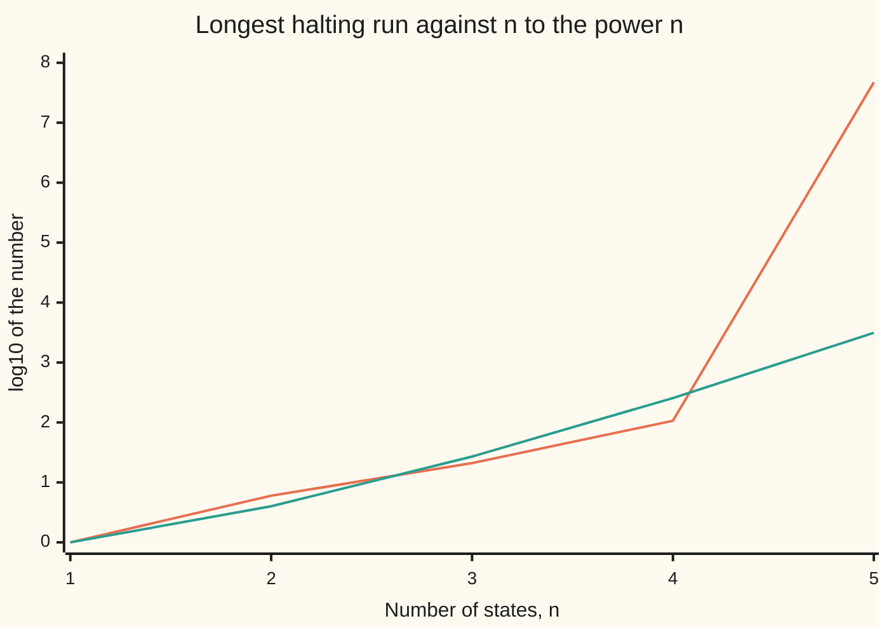

# Busy beaver: a function that outgrows everything computable

[Syllabus](../../../SYLLABUS.md) → [Computability and complexity](../README.md) → [Computability and Logic](../README.md#s02) → Busy beaver

---

## General Overview

A tape machine is a rule table with a head that moves along a tape of cells. Each cell holds 0 or 1. At each step the machine reads the cell under its head and writes 0 or 1 there. It moves one cell left or right. Then it goes to its next state (a row of rules) or halts. It starts in state A on a blank tape: every cell 0.

There are 63,403,380,965,376 such machines with five states. One of them, found in 1989, runs for 47,176,870 steps, leaves 4,098 ones on the tape, and halts. In 2024 the bbchallenge collaboration proved that no five-state machine that halts runs longer. Their proof was checked line by line in the Coq proof assistant (a program that checks every step of a proof).

That longest run has a name. **BB(n)**, the busy beaver number, is the most steps any n-state machine takes from a blank tape before it halts. The known values are 1, 6, 21, 107 and 47,176,870 for n = 1 to 5.

The number does real work. Think of a program that reads programs: give it the rule table of any five-state machine, and it must say whether the machine ever halts. With BB(5) in hand, that program is easy to write. It runs the machine for 47,176,870 steps. If the machine has not halted by then, it never will.

So BB(n) packs every halting question about n-state machines into one number. That is also why no program can compute BB(n) for every n: such a program would answer every halting question, and no program can ([Decidable and semidecidable](01-decidable-and-semidecidable-sets.md)).

**BB(n) is the longest run of any halting n-state machine on a blank tape; knowing it decides halting for those machines, so no program computes it, and it outgrows every computable function.**

**What kind of fact this is:** BB(n) is a definition, a whole number for each n. That no program computes it is a theorem (Radó, 1962), proved on this card in Why it works. The values for n = 1 to 4 are theorems proved by search plus proofs of non-halting (1965 and 1983). BB(5) = 47,176,870 was settled in 2024 by the bbchallenge collaboration in Coq.

### The picture: slow, then not



The orange line is log10 BB(n), the number of digits, roughly. The green line is log10 of n^n: 1, 4, 27, 256 and 3,125. For three and four states the busy beaver is the smaller of the two: BB(4) = 107 against 256. At five states it jumps to 47,176,870. BB(6) is not known; the best lower bound in the bbchallenge paper (2025) is a tower of powers of 2 too tall to write out.

---

## The formula

```math
\mathrm{BB}(n) = \max\{\, s(M) : M \text{ has } n \text{ states and halts when started on a blank tape} \,\}
```

**Read it aloud:** look at every n-state machine that halts from a blank tape, count each one's steps, and take the largest count.

The theorem the card is named for is a statement about growth:

```math
\text{for every computable } f \text{ there is an } N_0 \text{ such that } \mathrm{BB}(N) > f(N) \text{ for every } N \ge N_0
```

**Read it aloud:** pick any function a program can compute; from some size on, the busy beaver is bigger.

Rules are written as on [Turing machines](../01-Models%20of%20Computation/07-turing-machines.md). $`\delta(q, a) = (q', b, \text{L or R})`$ means: in state $`q`$, reading $`a`$, write $`b`$, move one cell, go to state $`q'`$. Here a whole machine is written as one line of text, such as `1RB1LB_1LA1RZ`. Each group between underscores is one state, A then B. Each group holds two rules, for reading 0 and then reading 1. Each rule is three characters: the symbol written, the move, and the next state. Z means halt, and `---` marks a rule the machine never uses.

| Symbol | Plain meaning | In our example | Push it up and the answer… |
| --- | --- | --- | --- |
| $`n`$ | the number of states, the rows of the rule table | 5 | far more machines, and far longer runs |
| $`M`$ | one machine: its rule table | `1RB1LC_1RC1RB_1RD0LE_1LA1LD_1RZ0LA` | — |
| $`s(M)`$ | the steps $`M`$ takes before it halts, the halting step included | 47,176,870 | — |
| $`\mathrm{BB}(n)`$ | the busy beaver number: the largest $`s(M)`$ among halting $`n`$-state machines | 47,176,870 | grows faster than any program can track |
| $`\delta(q, a)`$ | the rule for state $`q`$ reading symbol $`a`$ | $`\delta(\text{A}, 0) = (\text{B}, 1, \text{R})`$ | — |
| $`f`$ | any function some program computes | $`f(n) = n^n`$ | a faster $`f`$ only moves $`N_0`$ later |
| $`N`$ | a number of states, used as the input to both BB and $`f`$ | 5 | BB(N) pulls further ahead of $`f(N)`$ |
| $`N_0`$ | the size from which BB stays above $`f`$ | at least 5 for $`n^n`$, since BB(4) = 107 is below 256; at 5 it is 47,176,870 against 3,125 | — |

### When it holds

- **The tape starts blank.** Start a machine on a tape that already holds 1s and its run length depends on what was written. No single "longest run" exists then.
- **Only machines that halt count.** Let in one that never halts, such as `1RA1RA`, and "most steps" is just the cap: 100 at a 100-step cap.
- **The halting step counts.** This is Radó's convention. Drop it and BB(2) reads 5, not 6.
- **Two symbols and one move per step.** More symbols, or a "stay put" move, give a different function. It has different values but is uncomputable for the same reason.
- **Steps, not 1s.** Radó's other busy beaver counts the 1s left on the tape: 13 for the four-state champion, 4,098 for the five-state one. It is a different function, also uncomputable.

---

## Why it works

### Step 0: one number answers every halting question at its size

Suppose you know BB(n). Take any n-state machine and run it for BB(n) steps. If it halts, you have seen it. If it is still running, it never halts: had it halted later, its run would beat BB(n), the longest halting run.

So the number BB(n) is a halting test for every n-state machine. The whole card follows from that one observation.

### Step 1: BB(n) is a definite whole number

Each of the 2n rules has 2 × 2 × (n + 1) choices: the symbol written, the move, and the next state or halt. So there are $`(4(n+1))^{2n}`$ machines: 64 for one state, 20,736 for two, 16,777,216 for three, 25,600,000,000 for four and 63,403,380,965,376 for five.

There are finitely many machines, and each halting one stops at a definite step. The largest of finitely many whole numbers exists. So BB(n) is defined.

The definition gives no method, though. To find the maximum you must know which machines halt.

### Step 2: no program computes BB

Halting from a blank tape is undecidable. Any program P with input x can be turned into a machine that first writes x on the tape and then runs P. That machine halts from a blank tape exactly when P halts on x. So a blank-tape halting test would decide HALT, the set of program–input pairs that halt. HALT is semidecidable (run the program and wait) but not decidable: [Universal machines](../01-Models%20of%20Computation/09-universal-machines-and-the-halting-problem.md) proves it, and [Decidable and semidecidable](01-decidable-and-semidecidable-sets.md) puts it to work.

Now suppose some program computed BB. Step 0 turns it into a blank-tape halting test, which cannot exist. So no program computes BB.

<details>
<summary>Detailed proof: a program for BB would decide halting</summary>

Let B be a program that, given n, prints BB(n). Build the test T: given a machine M with n states, run B to get the number BB(n), then run M from a blank tape for BB(n) steps.

If M halts within those steps, T answers "halts". Otherwise T answers "never halts". The second answer is correct: if M halted at some step $`s > \mathrm{BB}(n)`$, then $`s(M) = s`$ would exceed the maximum that defines BB(n).

T always stops, because both parts are finite. So T decides blank-tape halting, which contradicts Step 2's reduction from HALT. Hence B does not exist.

</details>

### Step 3: BB ends up above every computable function

Uncomputable is not the strongest claim. BB beats every computable function, eventually. The idea: a machine of fixed size can compute any given $`f`$. Add a few states that write a long input for it. The combined machine is a halting machine with only a few more states, and it runs longer than $`f`$ of its size.

<details>
<summary>Detailed proof: BB(N) > f(N) for every large N</summary>

Let $`f`$ be computable. Then so is $`g(m) = f(2m) + f(2m + 1)`$. So some machine G, with c states, started with its head just right of a block of m 1s, writes $`g(m)`$ more 1s and halts. Writing $`g(m)`$ ones takes at least $`g(m)`$ steps.

A chain of m states writes m 1s on a blank tape: state number i writes 1, moves right and goes to state i + 1. Let the last one go to G's first state. The combined machine has $`m + c`$ states and halts after more than $`g(m)`$ steps, so

$`\displaystyle \mathrm{BB}(m + c) > g(m) \ge f(2m) \text{ and } \mathrm{BB}(m + c) > f(2m + 1).`$

BB never decreases as n grows. Take the champion for n states and change its halting rule to go to a new state whose rules both halt: one more state, one more step. So $`\mathrm{BB}(n + 1) > \mathrm{BB}(n)`$.

For $`m \ge c`$ this gives $`\mathrm{BB}(2m) \ge \mathrm{BB}(m + c) > f(2m)`$ and $`\mathrm{BB}(2m + 1) > \mathrm{BB}(2m) > f(2m + 1)`$. So $`\mathrm{BB}(N) > f(N)`$ for every $`N \ge 2c`$: take $`N_0 = 2c`$.

</details>

### Step 4: small values by search, and why search runs out

The search is straightforward to write. Run every machine. The hard part is the machines that are still running: each needs a proof that it never halts. The code uses three proofs.

- **Repeats.** The state, head position and whole tape come back exactly as they were. The run is a loop.
- **Repeats shifted.** Twice, the head reaches a new edge of the used tape in the same state. The cells it read in between match the cells now within the same reach, and beyond the edge the tape is blank. So the run repeats, one shift further on, forever.
- **No exit.** From the current state, no chain of rules ever leads to a halting rule or a missing one.

For two states these three proofs settle every machine: 9,784 halt, and 10,952 are proved never to halt. So BB(2) = 6 is proved by the code. Each proof is also tested: a plain run twice as long never contradicts one. For three states, 110 partial rule tables, each standing for many machines, are still running after 300 steps with no proof here. They sweep back and forth across a growing block, and none of the three patterns catches that. Lin and Radó settled three states in 1965: BB(3) = 21. By Step 0, that also proves that none of the machines behind the 110 ever halts.

Each larger n needs new proof methods. The five-state proof needed many of them, and a machine check. Step 2 says this never ends: a fixed list of proof methods that settled every machine would be a halting test. If the usual axioms for mathematics are consistent, some BB(n) values cannot be proved in them at all. That limit belongs to [Godel's theorems](03-godels-incompleteness-in-outline.md).

---

## Worked numbers, by hand

The two-state champion, `1RB1LB_1LA1RZ`, as a rule table:

| State | Read | Write | Move | Next |
| --- | --- | --- | --- | --- |
| A | 0 | 1 | R | B |
| A | 1 | 1 | L | B |
| B | 0 | 1 | L | A |
| B | 1 | 1 | R | halt |

Its run from a blank tape, cells −2 to 1, the head's cell in brackets:

| Step | State | Read | Write | Move | Next | Tape after |
| --- | --- | --- | --- | --- | --- | --- |
| 1 | A | 0 | 1 | R | B | 0 0 1 [0] |
| 2 | B | 0 | 1 | L | A | 0 0 [1] 1 |
| 3 | A | 1 | 1 | L | B | 0 [0] 1 1 |
| 4 | B | 0 | 1 | L | A | [0] 1 1 1 |
| 5 | A | 0 | 1 | R | B | 1 [1] 1 1 |
| 6 | B | 1 | 1 | R | halt | 1 1 [1] 1 |

Six steps, four 1s. Now the count that proves nothing beats it:

| Step | Arithmetic | Value |
| --- | --- | --- |
| choices for one rule | 2 symbols × 2 moves × 3 next (A, B, halt) | 12 |
| two-state machines | 12 × 12 × 12 × 12 | 20,736 |
| halt within 100 steps | run each one | 9,784, every one by step 6 |
| proved never to halt | 430 repeat + 10,510 repeat shifted + 12 no exit | 10,952 |
| every machine settled | 9,784 + 10,952 | 20,736 |
| BB(2) | the longest of the 9,784 halting runs | **6** |
| five-state machines | ten 24s multiplied together | 63,403,380,965,376 |
| BB(5) | the champion, run to its halt | **47,176,870** |

The two-state count settles every machine, so 6 is a proof. The five-state count shows why the same work took a collaboration and a proof checker.

### What breaks if you drop a piece

| Mistake | Comes out at | What went wrong |
| --- | --- | --- |
| A 100-step cap on the four-state champion | "still running after 100 steps" | It halts at step 107. A cap is not a proof of looping. |
| Counting 1s instead of steps | 13 for four states, 4,098 for five | That is Radó's other function, not BB(n) |
| Leaving out the halting step | 5 for two states | An off-by-one against the published values |
| Letting in a machine that never halts | 100 at a 100-step cap | The "maximum" is the cap, and grows with it |

The code prints all four.

---

## Code, from first principles, and it actually runs

The script writes its own tape machine and its own three non-halting proofs; nothing imported knows the answer. It takes four roads. Road 1 runs every complete rule table for one and two states. Road 2 is a tree search: it fills in a rule only when a run first needs it, and branches there. So it covers three states without running all 16,777,216 tables. Roads 1 and 2 agree on BB(1) = 1 and BB(2) = 6, and road 2 finds 21 for three states. Road 3 is the halting test built on BB(2) = 6, run on all 20,736 two-state machines: it agrees with the proofs on every one. Every proof of non-halting is tested on the side: a plain run, twice as long and with no proofs, must not halt or reach a missing rule. Road 4 runs the five-state champion twice. The first run goes one step at a time. The second lets a rule that keeps its state and its 1 cross a whole run of 1s at once. Both give 47,176,870 steps; the second needs 67,346 passes of its loop instead of 47,176,870.

The asserts compare against the published values: BB(1) to BB(4), the most 1s for n up to 3, and BB(5) = 47,176,870 with 4,098 ones. One more assert checks that no plain run contradicts a proof, one checks that road 1 runs all $`(4(n+1))^{2n}`$ tables, and one pins the tallies quoted on the card.

### Python

```python
# Busy beaver -- the check behind the card.  Standard library only.  A tape
# machine has n states, A, B, C, ..., and the symbols 0 and 1.  It starts in
# state A on a blank tape (all 0).  BB(n) is the most steps any n-state machine
# takes before it halts; the halting step counts.  Code never decides halting in
# general: a run either halts, or prints a proof that it never will, or prints
# 'still running' at its cap.  The tape machine is explained on the Turing card.
import itertools, math
KINDS = ['halt', 'repeats', 'repeats shifted', 'no exit', 'running']

def parse(text):                      # "1RB1LB_1LA1RZ": per state, the rule for 0, then for 1
    tab = []
    for part in text.split('_'):
        for c in (part[0:3], part[3:6]):
            tab.append(None if c == '---' else (int(c[0]), 1 if c[1] == 'R' else -1, -1 if c[2] == 'Z' else ord(c[2]) - 65))
    return tab

def show(tab):                        # the same text form back; Z is halt, --- a rule never needed
    cells = ['---' if x is None else str(x[0]) + 'LR'[x[1] > 0] + ('Z' if x[2] < 0 else chr(65 + x[2])) for x in tab]
    return '_'.join(cells[i] + cells[i + 1] for i in range(0, len(cells), 2))

def no_exit(tab, q):                  # proof 3: from state q no halting or missing rule can be reached
    reach, todo = {q}, [q]
    while todo:
        s = todo.pop()
        for x in tab[2 * s: 2 * s + 2]:
            if x is None or x[2] < 0: return False
            if x[2] not in reach: reach.add(x[2]); todo.append(x[2])
    return True

def run(tab, cap, prove=False):       # at most cap steps: (verdict, steps, ones, rule index or state)
    tape = bytearray(2 * cap + 3); h = lo = hi = cap + 1; q = t = 0
    seen, records, path = set(), {}, [h]
    while t < cap:
        k = 2 * q + tape[h]
        if tab[k] is None: return 'undefined', t, sum(tape), k
        w, m, q2 = tab[k]; tape[h] = w; h += m; t += 1; path.append(h)
        if q2 < 0: return 'halt', t, sum(tape), k
        q = q2
        if not prove: continue
        if lo <= h <= hi:             # proof 1: the whole configuration comes back
            key = (q, h, lo, bytes(tape[lo:hi + 1]))
            if key in seen: return 'repeats', t, 0, q
            seen.add(key); continue
        side = 1 if h > hi else -1; lo, hi = min(lo, h), max(hi, h)
        for t1, p1, old in records.get((side, q), []):   # proof 2: same state at two new edges,
            d = p1 - min(path[t1:]) if side == 1 else max(path[t1:]) - p1   # same cells within reach
            a, b = (p1 - d, h - d) if side == 1 else (p1, h)
            if old[a:a + d + 1] == tape[b:b + d + 1]: return 'repeats shifted', t, 0, q
        records.setdefault((side, q), []).append((t, h, bytes(tape)))
    return ('no exit' if prove and no_exit(tab, q) else 'running'), t, sum(tape), q

def tree(n, cap):                     # road 2: rules are chosen only when a run first needs one
    tally, most, todo, broken = dict.fromkeys(KINDS, 0), [(0, ''), (0, '')], [[None] * (2 * n)], 0
    while todo:
        tab = todo.pop(); verdict, t, ones, k = run(tab, cap, True)
        if verdict != 'undefined':    # each proof is tested by a plain run twice as long
            tally[verdict] += 1; broken += verdict != 'running' and run(tab, 2 * cap)[0] != 'running'; continue
        tally['halt'] += 1            # choice 1: the missing rule writes 1, moves R and halts
        done = tab[:]; done[k] = (1, 1, -1)
        if t + 1 > most[0][0]: most[0] = (t + 1, show(done))
        if ones + 1 - k % 2 > most[1][0]: most[1] = (ones + 1 - k % 2, show(done))
        used = 1 + max([x[2] for x in tab if x] + [0])
        for q2 in range(min(used + 1, n)):    # choice 2: any rule, states named in order of use
            for w in (0, 1):
                for m in (-1, 1):
                    child = tab[:]; child[k] = (w, m, q2); todo.append(child)
    return tally, most, broken

def brute(n, cap):                    # road 1: every complete rule table, one by one
    rules = [(w, m, q) for w in (0, 1) for m in (1, -1) for q in range(-1, n)]
    tally, most, early, broken = dict.fromkeys(KINDS, 0), [0, 0], 0, 0
    for tab in itertools.product(rules, repeat=2 * n):
        verdict, t, ones, _ = run(list(tab), cap, True); tally[verdict] += 1
        if verdict == 'halt': most = [max(most[0], t), max(most[1], ones)]; early += t <= 6
        else: broken += run(list(tab), 2 * cap)[0] != 'running'
    return tally, most, early, broken

def long_run(tab, skip):              # a fixed tape of 40,000 cells, head starting in the middle
    tape = bytearray(40000); h = 20000; q = t = passes = 0
    while q >= 0:
        passes += 1; r = tape[h]; w, m, q2 = tab[2 * q + r]
        if skip and r == w == 1 and q2 == q:   # road 4: a rule that keeps its state and its 1
            j = tape.find(0, h) if m == 1 else tape.rfind(0, 0, h)   # crosses the run of 1s at once
            t += abs(j - h); h = j; continue
        tape[h] = w; h += m; q = q2; t += 1
    return t, sum(tape), passes

def tally_text(c): return ', '.join(f'{k} {c[k]}' for k in KINDS)
print('choices for one rule, 1 to 5 states:', ', '.join(str(4 * (n + 1)) for n in range(1, 6)))
print('machines with 1 to 5 states:', ', '.join(str((4 * (n + 1)) ** (2 * n)) for n in range(1, 6)))
b1, b2 = brute(1, 100), brute(2, 100)
for n, (c, most, _, broken) in ((1, b1), (2, b2)):
    print(f'every {n}-state machine, cap 100: {tally_text(c)}; most steps {most[0]}, most ones {most[1]}')
    print(f'  proofs that a plain run to step 200 contradicts: {broken}')
print(f'halting test built on BB(2) = 6: halted by step 6 {b2[2]}, halted later {b2[0]["halt"] - b2[2]}, proved never to halt {sum(b2[0][k] for k in KINDS[1:4])}')
found = {}
for n, cap in ((1, 100), (2, 100), (3, 300)):
    c, most, broken = found[n] = tree(n, cap)
    print(f'tree search, {n} state{"s" * (n > 1)}, cap {cap}: {tally_text(c)}')
    print(f'  proofs that a plain run to step {2 * cap} contradicts: {broken}')
    print(f'  most steps {most[0][0]} by {most[0][1]}; most ones {most[1][0]} by {most[1][1]}')
two = parse('1RB1LB_1LA1RZ'); tape, h, q = {}, 0, 0
for step in range(1, 7):              # the two-state champion, step by step, cells -2 to 1
    r = tape.get(h, 0); w, m, q2 = two[2 * q + r]; tape[h] = w; h += m
    cells = ' '.join(f'[{tape.get(i, 0)}]' if i == h else str(tape.get(i, 0)) for i in range(-2, 2))
    print(f'step {step}: state {"AB"[q]} reads {r}, writes {w}, moves {"LR"[m > 0]}, next {"ABZ"[q2]}; tape {cells}')
    q = q2
four = parse('1RB1LB_1LA0LC_1RZ1LD_1RD0RA'); five = parse('1RB1LC_1RC1RB_1RD0LE_1LA1LD_1RZ0LA')
v100, v4 = run(four, 100), run(four, 1000)
print(f'four-state champion, cap 100: {"still running after 100 steps" if v100[0] == "running" else v100[0]}')
print(f'four-state champion, cap 1000: {"halts" if v4[0] == "halt" else v4[0]} after {v4[1]} steps, {v4[2]} ones')
p5, s5 = long_run(five, False), long_run(five, True)
print(f'five-state champion, one step at a time: halts after {p5[0]} steps, {p5[2]} loop passes, {p5[1]} ones')
print(f'five-state champion, runs of 1s crossed at once: halts after {s5[0]} steps, {s5[2]} loop passes, {s5[1]} ones')
print(f'mistakes: cap 100 on the four-state champion says {v100[0]}; ones instead of steps {v4[2]} and {p5[1]};'
      f' halting step not counted {found[2][1][0][0] - 1}; never-halting 1RA1RA let in at cap 100: {run(parse("1RA1RA"), 100)[1]}')
print('chart, log10 BB(n):', ', '.join(f'{math.log10(x):.3f}' for x in [found[n][1][0][0] for n in (1, 2, 3)] + [v4[1], p5[0]]))
print('n^n for n = 1 to 5:', ', '.join(str(n ** n) for n in range(1, 6)))
print('chart, log10 n^n:  ', ', '.join(f'{math.log10(n ** n):.3f}' for n in range(1, 6)))
assert b1[1] == [1, 1] and b2[1] == [6, 4] and b2[0]['running'] == 0 and b2[2] == b2[0]['halt']
assert b1[3] == b2[3] == 0 and [found[n][2] for n in (1, 2, 3)] == [0, 0, 0]   # proofs against plain runs
assert [found[n][1][0][0] for n in (1, 2, 3)] == [1, 6, 21] and [found[n][1][1][0] for n in (1, 2, 3)] == [1, 4, 6]
assert found[2][0]['running'] == 0 and v100[0] == 'running' and v4[:3] == ('halt', 107, 13)
assert p5[:2] == s5[:2] == (47176870, 4098) and s5[2] < p5[2]     # published 2024 value, two roads
assert [sum(b[0].values()) for b in (b1, b2)] == [(4 * (n + 1)) ** (2 * n) for n in (1, 2)]   # every table run
assert [b2[0][k] for k in KINDS] == [9784, 430, 10510, 12, 0] and found[3][0]['running'] == 110   # card's tallies
print('ALL CHECKS PASS')
```

**Ran 2026-11-19 on macOS, Python 3.14.10, standard library only. All checks passed. Output, pasted from the run:**

```
choices for one rule, 1 to 5 states: 8, 12, 16, 20, 24
machines with 1 to 5 states: 64, 20736, 16777216, 25600000000, 63403380965376
every 1-state machine, cap 100: halt 32, repeats 0, repeats shifted 32, no exit 0, running 0; most steps 1, most ones 1
  proofs that a plain run to step 200 contradicts: 0
every 2-state machine, cap 100: halt 9784, repeats 430, repeats shifted 10510, no exit 12, running 0; most steps 6, most ones 4
  proofs that a plain run to step 200 contradicts: 0
halting test built on BB(2) = 6: halted by step 6 9784, halted later 0, proved never to halt 10952
tree search, 1 state, cap 100: halt 1, repeats 0, repeats shifted 4, no exit 0, running 0
  proofs that a plain run to step 200 contradicts: 0
  most steps 1 by 1RZ---; most ones 1 by 1RZ---
tree search, 2 states, cap 100: halt 37, repeats 34, repeats shifted 214, no exit 12, running 0
  proofs that a plain run to step 200 contradicts: 0
  most steps 6 by 1RB1RZ_1LB1LA; most ones 4 by 1RB1LB_1LA1RZ
tree search, 3 states, cap 300: halt 3543, repeats 5470, repeats shifted 31630, no exit 1760, running 110
  proofs that a plain run to step 600 contradicts: 0
  most steps 21 by 1RB1RZ_1LB0RC_1LC1LA; most ones 6 by 1RB1LC_1RC1RZ_1LA0LB
step 1: state A reads 0, writes 1, moves R, next B; tape 0 0 1 [0]
step 2: state B reads 0, writes 1, moves L, next A; tape 0 0 [1] 1
step 3: state A reads 1, writes 1, moves L, next B; tape 0 [0] 1 1
step 4: state B reads 0, writes 1, moves L, next A; tape [0] 1 1 1
step 5: state A reads 0, writes 1, moves R, next B; tape 1 [1] 1 1
step 6: state B reads 1, writes 1, moves R, next Z; tape 1 1 [1] 1
four-state champion, cap 100: still running after 100 steps
four-state champion, cap 1000: halts after 107 steps, 13 ones
five-state champion, one step at a time: halts after 47176870 steps, 47176870 loop passes, 4098 ones
five-state champion, runs of 1s crossed at once: halts after 47176870 steps, 67346 loop passes, 4098 ones
mistakes: cap 100 on the four-state champion says running; ones instead of steps 13 and 4098; halting step not counted 5; never-halting 1RA1RA let in at cap 100: 100
chart, log10 BB(n): 0.000, 0.778, 1.322, 2.029, 7.674
n^n for n = 1 to 5: 1, 4, 27, 256, 3125
chart, log10 n^n:   0.000, 0.602, 1.431, 2.408, 3.495
ALL CHECKS PASS
```

### Rust

Same numbers, same labels, built with `rustc --edition 2021 -O`.

```rust
// Busy beaver -- the same check as the Python, in Rust.  No crates.  A tape
// machine has n states, A, B, C, ..., and the symbols 0 and 1.  It starts in
// state A on a blank tape (all 0).  BB(n) is the most steps any n-state machine
// takes before it halts; the halting step counts.  Code never decides halting in
// general: a run either halts, or prints a proof that it never will, or prints
// 'still running' at its cap.  The tape machine is explained on the Turing card.
use std::collections::{HashMap, HashSet};
type Rule = Option<(u8, i64, i64)>;        // write, move (+1 is R), next state (-1 is halt)
const KINDS: [&str; 5] = ["halt", "repeats", "repeats shifted", "no exit", "running"];
fn parse(text: &str) -> Vec<Rule> {         // "1RB1LB_1LA1RZ": per state, the rule for 0, then for 1
    let mut tab = Vec::new();
    for part in text.split('_') {
        for c in [&part.as_bytes()[0..3], &part.as_bytes()[3..6]] {
            tab.push(if c[0] == b'-' { None } else {
                Some((c[0] - b'0', if c[1] == b'R' { 1 } else { -1 }, if c[2] == b'Z' { -1 } else { (c[2] - b'A') as i64 }))
            });
        }
    }
    tab
}
fn show(tab: &[Rule]) -> String {           // the same text form back; Z is halt, --- a rule never needed
    let cells: Vec<String> = tab.iter().map(|x| match x {
        None => "---".to_string(),
        Some((w, m, q)) => format!("{}{}{}", w, if *m > 0 { 'R' } else { 'L' }, if *q < 0 { 'Z' } else { (b'A' + *q as u8) as char }),
    }).collect();
    cells.chunks(2).map(|c| c.concat()).collect::<Vec<_>>().join("_")
}
fn no_exit(tab: &[Rule], q: usize) -> bool { // proof 3: from state q no halting or missing rule can be reached
    let (mut reach, mut todo) = (vec![q], vec![q]);
    while let Some(s) = todo.pop() {
        for x in &tab[2 * s..2 * s + 2] {
            match x {
                Some((_, _, q2)) if *q2 >= 0 => { let q2 = *q2 as usize; if !reach.contains(&q2) { reach.push(q2); todo.push(q2); } }
                _ => return false,
            }
        }
    }
    true
}
fn run(tab: &[Rule], cap: usize, prove: bool) -> (&'static str, usize, usize, usize) {
    let mut tape = vec![0u8; 2 * cap + 3];
    let (mut h, mut lo, mut hi, mut q, mut t) = (cap + 1, cap + 1, cap + 1, 0usize, 0usize);
    let mut seen: HashSet<(usize, usize, usize, Vec<u8>)> = HashSet::new();
    let mut records: HashMap<(i64, usize), Vec<(usize, usize, Vec<u8>)>> = HashMap::new();
    let mut path = vec![h];
    let ones = |tape: &Vec<u8>| tape.iter().map(|&c| c as usize).sum::<usize>();
    while t < cap {
        let k = 2 * q + tape[h] as usize;
        let (w, m, q2) = match tab[k] { None => return ("undefined", t, ones(&tape), k), Some(r) => r };
        tape[h] = w; h = (h as i64 + m) as usize; t += 1; path.push(h);
        if q2 < 0 { return ("halt", t, ones(&tape), k); }
        q = q2 as usize;
        if !prove { continue; }
        if lo <= h && h <= hi {                 // proof 1: the whole configuration comes back
            if !seen.insert((q, h, lo, tape[lo..=hi].to_vec())) { return ("repeats", t, 0, q); }
            continue;
        }
        let side: i64 = if h > hi { 1 } else { -1 };
        lo = lo.min(h); hi = hi.max(h);
        for (t1, p1, old) in records.get(&(side, q)).map(|v| v.as_slice()).unwrap_or(&[]) {
            let d = if side == 1 { p1 - path[*t1..].iter().min().unwrap() } else { path[*t1..].iter().max().unwrap() - p1 };
            let (a, b) = if side == 1 { (p1 - d, h - d) } else { (*p1, h) };   // proof 2: same state at
            if old[a..=a + d] == tape[b..=b + d] { return ("repeats shifted", t, 0, q); } // two new edges
        }
        records.entry((side, q)).or_default().push((t, h, tape.clone()));
    }
    (if prove && no_exit(tab, q) { "no exit" } else { "running" }, t, ones(&tape), q)
}
fn idx(kind: &str) -> usize { KINDS.iter().position(|k| *k == kind).unwrap() }
fn tree(n: usize, cap: usize) -> ([usize; 5], [(usize, String); 2], usize) { // road 2: rules chosen when first needed
    let (mut tally, mut most) = ([0usize; 5], [(0usize, String::new()), (0usize, String::new())]);
    let (mut todo, mut broken): (Vec<Vec<Rule>>, usize) = (vec![vec![None; 2 * n]], 0);
    while let Some(tab) = todo.pop() {
        let (verdict, t, ones, k) = run(&tab, cap, true);
        if verdict != "undefined" {           // each proof is tested by a plain run twice as long
            tally[idx(verdict)] += 1; broken += (verdict != "running" && run(&tab, 2 * cap, false).0 != "running") as usize; continue;
        }
        tally[0] += 1;                          // choice 1: the missing rule writes 1, moves R and halts
        let mut done = tab.clone(); done[k] = Some((1, 1, -1));
        if t + 1 > most[0].0 { most[0] = (t + 1, show(&done)); }
        if ones + 1 - k % 2 > most[1].0 { most[1] = (ones + 1 - k % 2, show(&done)); }
        let used = 1 + tab.iter().flatten().map(|x| x.2).max().unwrap_or(0).max(0) as usize;
        for q2 in 0..(used + 1).min(n) {        // choice 2: any rule, states named in order of use
            for w in [0u8, 1] {
                for m in [-1i64, 1] { let mut child = tab.clone(); child[k] = Some((w, m, q2 as i64)); todo.push(child); }
            }
        }
    }
    (tally, most, broken)
}
fn brute(n: usize, cap: usize) -> ([usize; 5], [usize; 2], usize, usize) { // road 1: every complete rule table
    let mut rules = Vec::new();
    for w in [0u8, 1] { for m in [1i64, -1] { for q in -1..n as i64 { rules.push((w, m, q)); } } }
    let (mut tally, mut most, mut early, mut broken) = ([0usize; 5], [0usize; 2], 0usize, 0usize);
    for code in 0..rules.len().pow(2 * n as u32) {
        let mut c = code;
        let tab: Vec<Rule> = (0..2 * n).map(|_| { let r = rules[c % rules.len()]; c /= rules.len(); Some(r) }).collect();
        let (verdict, t, ones, _) = run(&tab, cap, true);
        tally[idx(verdict)] += 1;
        if verdict == "halt" { most = [most[0].max(t), most[1].max(ones)]; early += (t <= 6) as usize; }
        else if run(&tab, 2 * cap, false).0 != "running" { broken += 1; }
    }
    (tally, most, early, broken)
}
fn long_run(tab: &[Rule], skip: bool) -> (usize, usize, usize) { // 40,000 cells, head in the middle
    let mut tape = vec![0u8; 40000];
    let (mut h, mut q, mut t, mut passes) = (20000usize, 0i64, 0usize, 0usize);
    while q >= 0 {
        passes += 1; let r = tape[h];
        let (w, m, q2) = tab[2 * q as usize + r as usize].unwrap();
        if skip && r == 1 && w == 1 && q2 == q { // road 4: a rule that keeps its state and its 1
            let mut j = h;                      // crosses the run of 1s at once
            while tape[j] != 0 { j = (j as i64 + m) as usize; }
            t += j.abs_diff(h); h = j; continue;
        }
        tape[h] = w; h = (h as i64 + m) as usize; q = q2; t += 1;
    }
    (t, tape.iter().map(|&c| c as usize).sum(), passes)
}
fn tally_text(c: &[usize; 5]) -> String { (0..5).map(|i| format!("{} {}", KINDS[i], c[i])).collect::<Vec<_>>().join(", ") }
fn main() {
    println!("choices for one rule, 1 to 5 states: {}", (1..6u64).map(|n| (4 * (n + 1)).to_string()).collect::<Vec<_>>().join(", "));
    println!("machines with 1 to 5 states: {}", (1..6u64).map(|n| (4 * (n + 1)).pow(2 * n as u32).to_string()).collect::<Vec<_>>().join(", "));
    let (b1, b2) = (brute(1, 100), brute(2, 100));
    for (n, b) in [(1, &b1), (2, &b2)] {
        println!("every {}-state machine, cap 100: {}; most steps {}, most ones {}", n, tally_text(&b.0), b.1[0], b.1[1]);
        println!("  proofs that a plain run to step 200 contradicts: {}", b.3);
    }
    println!("halting test built on BB(2) = 6: halted by step 6 {}, halted later {}, proved never to halt {}",
             b2.2, b2.0[0] - b2.2, b2.0[1] + b2.0[2] + b2.0[3]);
    let mut found = Vec::new();
    for (n, cap) in [(1usize, 100usize), (2, 100), (3, 300)] {
        let (c, most, broken) = tree(n, cap);
        println!("tree search, {} state{}, cap {}: {}", n, if n > 1 { "s" } else { "" }, cap, tally_text(&c));
        println!("  proofs that a plain run to step {} contradicts: {}", 2 * cap, broken);
        println!("  most steps {} by {}; most ones {} by {}", most[0].0, most[0].1, most[1].0, most[1].1);
        found.push((c, most, broken));
    }
    let (two, mut tape, mut h, mut q) = (parse("1RB1LB_1LA1RZ"), HashMap::new(), 0i64, 0i64);
    for step in 1..7 {                          // the two-state champion, step by step, cells -2 to 1
        let r = *tape.get(&h).unwrap_or(&0u8);
        let (w, m, q2) = two[(2 * q) as usize + r as usize].unwrap();
        tape.insert(h, w); h += m;
        let cells: Vec<String> = (-2..2).map(|i| { let v = *tape.get(&i).unwrap_or(&0); if i == h { format!("[{}]", v) } else { v.to_string() } }).collect();
        println!("step {}: state {} reads {}, writes {}, moves {}, next {}; tape {}", step, ["A", "B"][q as usize], r, w,
                 if m > 0 { "R" } else { "L" }, if q2 < 0 { "Z" } else { ["A", "B"][q2 as usize] }, cells.join(" "));
        q = q2;
    }
    let (four, five) = (parse("1RB1LB_1LA0LC_1RZ1LD_1RD0RA"), parse("1RB1LC_1RC1RB_1RD0LE_1LA1LD_1RZ0LA"));
    let (v100, v4) = (run(&four, 100, false), run(&four, 1000, false));
    println!("four-state champion, cap 100: {}", if v100.0 == "running" { "still running after 100 steps" } else { v100.0 });
    println!("four-state champion, cap 1000: {} after {} steps, {} ones", if v4.0 == "halt" { "halts" } else { v4.0 }, v4.1, v4.2);
    let (p5, s5) = (long_run(&five, false), long_run(&five, true));
    println!("five-state champion, one step at a time: halts after {} steps, {} loop passes, {} ones", p5.0, p5.2, p5.1);
    println!("five-state champion, runs of 1s crossed at once: halts after {} steps, {} loop passes, {} ones", s5.0, s5.2, s5.1);
    println!("mistakes: cap 100 on the four-state champion says {}; ones instead of steps {} and {}; halting step not counted {}; never-halting 1RA1RA let in at cap 100: {}",
             v100.0, v4.2, p5.1, found[1].1[0].0 - 1, run(&parse("1RA1RA"), 100, false).1);
    let bb: Vec<usize> = vec![found[0].1[0].0, found[1].1[0].0, found[2].1[0].0, v4.1, p5.0];
    println!("chart, log10 BB(n): {}", bb.iter().map(|&x| format!("{:.3}", (x as f64).log10())).collect::<Vec<_>>().join(", "));
    println!("n^n for n = 1 to 5: {}", (1..6u32).map(|n| n.pow(n).to_string()).collect::<Vec<_>>().join(", "));
    println!("chart, log10 n^n:   {}", (1..6u32).map(|n| format!("{:.3}", (n.pow(n) as f64).log10())).collect::<Vec<_>>().join(", "));
    assert!(b1.1 == [1, 1] && b2.1 == [6, 4] && b2.0[4] == 0 && b2.2 == b2.0[0]);
    assert!(b1.3 == 0 && b2.3 == 0 && found.iter().all(|f| f.2 == 0)); // proofs against plain runs
    assert!(bb[..3] == [1, 6, 21] && found.iter().map(|f| f.1[1].0).collect::<Vec<_>>() == [1, 4, 6]);
    assert!(found[1].0[4] == 0 && v100.0 == "running" && (v4.0, v4.1, v4.2) == ("halt", 107, 13));
    assert!((p5.0, p5.1) == (47176870, 4098) && (s5.0, s5.1) == (47176870, 4098) && s5.2 < p5.2); // published 2024 value
    assert!(vec![b1.0.iter().sum::<usize>(), b2.0.iter().sum()] == (1..3usize).map(|n| (4 * (n + 1)).pow(2 * n as u32)).collect::<Vec<_>>()); // every table run
    assert!(b2.0 == [9784, 430, 10510, 12, 0] && found[2].0[4] == 110); // the tallies on the card
    println!("ALL CHECKS PASS");
}
```

**Ran 2026-11-19 on macOS, rustc 1.98.1, no crates. All checks passed. Output, pasted from the run:**

```
choices for one rule, 1 to 5 states: 8, 12, 16, 20, 24
machines with 1 to 5 states: 64, 20736, 16777216, 25600000000, 63403380965376
every 1-state machine, cap 100: halt 32, repeats 0, repeats shifted 32, no exit 0, running 0; most steps 1, most ones 1
  proofs that a plain run to step 200 contradicts: 0
every 2-state machine, cap 100: halt 9784, repeats 430, repeats shifted 10510, no exit 12, running 0; most steps 6, most ones 4
  proofs that a plain run to step 200 contradicts: 0
halting test built on BB(2) = 6: halted by step 6 9784, halted later 0, proved never to halt 10952
tree search, 1 state, cap 100: halt 1, repeats 0, repeats shifted 4, no exit 0, running 0
  proofs that a plain run to step 200 contradicts: 0
  most steps 1 by 1RZ---; most ones 1 by 1RZ---
tree search, 2 states, cap 100: halt 37, repeats 34, repeats shifted 214, no exit 12, running 0
  proofs that a plain run to step 200 contradicts: 0
  most steps 6 by 1RB1RZ_1LB1LA; most ones 4 by 1RB1LB_1LA1RZ
tree search, 3 states, cap 300: halt 3543, repeats 5470, repeats shifted 31630, no exit 1760, running 110
  proofs that a plain run to step 600 contradicts: 0
  most steps 21 by 1RB1RZ_1LB0RC_1LC1LA; most ones 6 by 1RB1LC_1RC1RZ_1LA0LB
step 1: state A reads 0, writes 1, moves R, next B; tape 0 0 1 [0]
step 2: state B reads 0, writes 1, moves L, next A; tape 0 0 [1] 1
step 3: state A reads 1, writes 1, moves L, next B; tape 0 [0] 1 1
step 4: state B reads 0, writes 1, moves L, next A; tape [0] 1 1 1
step 5: state A reads 0, writes 1, moves R, next B; tape 1 [1] 1 1
step 6: state B reads 1, writes 1, moves R, next Z; tape 1 1 [1] 1
four-state champion, cap 100: still running after 100 steps
four-state champion, cap 1000: halts after 107 steps, 13 ones
five-state champion, one step at a time: halts after 47176870 steps, 47176870 loop passes, 4098 ones
five-state champion, runs of 1s crossed at once: halts after 47176870 steps, 67346 loop passes, 4098 ones
mistakes: cap 100 on the four-state champion says running; ones instead of steps 13 and 4098; halting step not counted 5; never-halting 1RA1RA let in at cap 100: 100
chart, log10 BB(n): 0.000, 0.778, 1.322, 2.029, 7.674
n^n for n = 1 to 5: 1, 4, 27, 256, 3125
chart, log10 n^n:   0.000, 0.602, 1.431, 2.408, 3.495
ALL CHECKS PASS
```

The two outputs match line for line.

### Lean

Lean proves the halting test, uncomputability and the growth theorem for every $`n`$, and runs the champions for one to four states.

- Take any $`n`$-state machine started on a blank tape. Then it ever halts exactly when it has halted within $`\mathrm{BB}(n)`$ steps.
- No program computes $`\mathrm{BB}(n)`$ for every $`n`$.
- Take any function $`f`$ that a program computes. Then some $`N_0`$ has $`\mathrm{BB}(N) > f(N)`$ for every $`N \ge N_0`$.
- The definition has exactly 64 one-state and 20,736 two-state rule tables, matching the count in Step 1.
- The champions halt at steps 1, 6, 21 and 107, the halting step counted. So BB is at least these values.
- The one-state, two-state and four-state champions leave one, four and thirteen 1s.
- The two-state champion has not halted after 5 steps, so leaving out the halting step gives 5.
- The four-state champion is still running after 100 steps, and so is `1RA1RA`.

The two-state search behind BB(2) = 6 and the five-state run are left to the Python and Rust checks.

```lean
-- Busy beaver: BB(n), the longest run of any halting n-state, two-symbol tape machine started on a blank tape, decides halting for n-state machines, is computed by no program, and ends up above every computable function.
import Mathlib.Computability.Partrec
import Mathlib.Computability.TuringMachine.ToPartrec
import Mathlib.Data.Fin.VecNotation
import Mathlib.Data.Fintype.BigOperators
import Mathlib.Data.Fintype.Sigma
import Mathlib.Data.Fintype.Option
import Mathlib.Data.Int.Interval
import Mathlib.Order.Lattice.Nat
import Mathlib.Tactic.DeriveFintype
import Mathlib.Tactic.NormNum

namespace BusyBeaver

/-- A head move: one cell left or one cell right. There is no "stay put" move. -/
inductive Move
  | L
  | R
  deriving DecidableEq

instance : Fintype Move := ⟨{.L, .R}, fun m => by cases m <;> simp⟩

/-- One rule of an `n`-state machine: the symbol written (`false` is 0, `true` is 1), the move,
and the next state, where `none` is the halt state Z. -/
structure Rule (n : ℕ) where
  write : Bool
  move : Move
  next : Option (Fin n)
  deriving DecidableEq, Fintype

/-- An `n`-state machine: a rule for each state `q` and each symbol read. States are `Fin n`,
state A being `0`. -/
abbrev Machine (n : ℕ) := Fin n → Bool → Rule n

/-- A configuration: the state (`none` once the machine has halted), the head's cell, and the
tape, one symbol per cell. -/
structure Config (n : ℕ) where
  state : Option (Fin n)
  head : ℤ
  tape : ℤ → Bool

/-- One step: read the head's cell, write, move one cell, go to the next state. A halted machine
stays as it is. -/
def step {n : ℕ} (M : Machine n) (c : Config n) : Config n :=
  match c.state with
  | none => c
  | some q =>
      let r := M q (c.tape c.head)
      { state := r.next
        head := c.head + (match r.move with | .L => -1 | .R => 1)
        tape := Function.update c.tape c.head r.write }

/-- The start: state A on a blank tape (every cell 0), head at cell 0. With no states at all,
the machine counts as halted from the start. -/
def start (n : ℕ) : Config n :=
  { state := if h : 0 < n then some ⟨0, h⟩ else none
    head := 0
    tape := fun _ => false }

/-- The configuration after `k` steps from the blank start. -/
def run {n : ℕ} (M : Machine n) (k : ℕ) : Config n := (step M)^[k] (start n)

/-- `M` halts at step `s`, the halting step counted: it has halted after `s` steps and had not
halted after any fewer. This `s` is the card's `s(M)`. -/
def HaltsAt {n : ℕ} (M : Machine n) (s : ℕ) : Prop :=
  (run M s).state = none ∧ ∀ k < s, (run M k).state ≠ none

/-- Whether `M` halts at step `s` can be checked by running it `s` steps. -/
instance {n : ℕ} (M : Machine n) (s : ℕ) : Decidable (HaltsAt M s) := by
  unfold HaltsAt; infer_instance

/-- The busy beaver number: the most steps any `n`-state machine takes from a blank tape before
it halts, `BB(n) = max {s(M) : M has n states and halts}`. -/
noncomputable def BB (n : ℕ) : ℕ := sSup {s | ∃ M : Machine n, HaltsAt M s}

lemma run_zero' {n : ℕ} (M : Machine n) : run M 0 = start n := rfl

lemma run_succ' {n : ℕ} (M : Machine n) (k : ℕ) : run M (k + 1) = step M (run M k) :=
  Function.iterate_succ_apply' _ _ _

lemma step_of_none {n : ℕ} (M : Machine n) (c : Config n) (h : c.state = none) :
    step M c = c := by
  unfold step; rw [h]

lemma run_stays {n : ℕ} (M : Machine n) {k : ℕ} (h : (run M k).state = none) :
    ∀ j, k ≤ j → run M j = run M k := by
  intro j hj
  induction j, hj using Nat.le_induction with
  | base => rfl
  | succ j _ ih => rw [run_succ', ih, step_of_none _ _ h]

lemma exists_haltsAt_le {n : ℕ} (M : Machine n) {k : ℕ} (h : (run M k).state = none) :
    ∃ s ≤ k, HaltsAt M s := by
  classical
  have hex : ∃ s, (run M s).state = none := ⟨k, h⟩
  refine ⟨Nat.find hex, Nat.find_min' hex h, Nat.find_spec hex, fun j hj => Nat.find_min hex hj⟩

lemma haltsAt_unique {n : ℕ} (M : Machine n) {s t : ℕ} (hs : HaltsAt M s) (ht : HaltsAt M t) :
    s = t := by
  rcases lt_trichotomy s t with h | h | h
  · exact absurd hs.1 (ht.2 s h)
  · exact h
  · exact absurd ht.1 (hs.2 t h)

lemma bb_bddAbove (n : ℕ) : BddAbove {s | ∃ M : Machine n, HaltsAt M s} := by
  classical
  refine (Set.Finite.subset (Set.finite_range
    (fun M : Machine n => if h : ∃ s, HaltsAt M s then Nat.find h else 0)) ?_).bddAbove
  rintro s ⟨M, hM⟩
  have hex : ∃ s, HaltsAt M s := ⟨s, hM⟩
  refine ⟨M, ?_⟩
  simp only [dif_pos hex]
  exact haltsAt_unique M (Nat.find_spec hex) hM

lemma le_bb {n : ℕ} (M : Machine n) {s : ℕ} (h : HaltsAt M s) : s ≤ BB n :=
  le_csSup (bb_bddAbove n) ⟨M, h⟩

lemma run_support {n : ℕ} (M : Machine n) (k : ℕ) :
    ∃ F : Finset ℤ, F.card ≤ k ∧ ∀ i ∉ F, (run M k).tape i = false := by
  classical
  induction k with
  | zero => exact ⟨∅, by simp, fun i _ => rfl⟩
  | succ k ih =>
    obtain ⟨F, hF, hF'⟩ := ih
    refine ⟨insert (run M k).head F, (Finset.card_insert_le _ _).trans (by omega), ?_⟩
    intro i hi
    rw [Finset.mem_insert, not_or] at hi
    rw [run_succ']
    unfold step
    cases hs : (run M k).state with
    | none => exact hF' i hi.2
    | some q =>
      simp only [Function.update_of_ne hi.1]
      exact hF' i hi.2

lemma card_le_bb {n : ℕ} (M : Machine n) {s : ℕ} (h : (run M s).state = none) (F : Finset ℤ)
    (hF : ∀ i ∈ F, (run M s).tape i = true) : F.card ≤ BB n := by
  obtain ⟨s', hs', hH⟩ := exists_haltsAt_le M h
  have he := run_stays M hH.1 s hs'
  obtain ⟨G, hG, hG'⟩ := run_support M s'
  have hsub : F ⊆ G := by
    intro i hi
    by_contra hni
    have := hF i hi
    rw [he, hG' i hni] at this
    exact Bool.false_ne_true this
  exact (Finset.card_le_card hsub).trans (hG.trans (le_bb M hH))


/-! Simulating a Mathlib `TM0` machine over `Bool` by a machine of this file. -/

/-- The state with number `k`, if there is one. -/
noncomputable def fidx {N : ℕ} (k : ℕ) : Option (Fin N) := if h : k < N then some ⟨k, h⟩ else none

lemma fidx_of_lt {N k : ℕ} (h : k < N) : (fidx k : Option (Fin N)) = some ⟨k, h⟩ := by
  simp [fidx, h]

open Classical in
/-- The position of a state in a finite set of states. -/
noncomputable def qIdx {Λ₀ : Type} (S₀ : Finset Λ₀) (q : Λ₀) : ℕ :=
  if h : q ∈ S₀ then (S₀.equivFin ⟨q, h⟩ : ℕ) else 0

/-- The state at a position of a finite set of states. -/
noncomputable def qDec {Λ₀ : Type} (S₀ : Finset Λ₀) (q₀ : Λ₀) (k : ℕ) : Λ₀ :=
  if h : k < S₀.card then (S₀.equivFin.symm ⟨k, h⟩).1 else q₀

lemma qIdx_lt {Λ₀ : Type} {S₀ : Finset Λ₀} {q : Λ₀} (hq : q ∈ S₀) : qIdx S₀ q < S₀.card := by
  simp only [qIdx, hq, dite_true]
  exact (S₀.equivFin ⟨q, hq⟩).2

lemma qDec_qIdx {Λ₀ : Type} {S₀ : Finset Λ₀} (q₀ : Λ₀) {q : Λ₀} (hq : q ∈ S₀) :
    qDec S₀ q₀ (qIdx S₀ q) = q := by
  have h := qIdx_lt hq
  simp only [qDec, h, dite_true]
  simp only [qIdx, hq, dite_true, Fin.eta, Equiv.symm_apply_apply]

/-- The simulating machine: `l.length + 1` states write the list `l` and return, then two
states for each state of the `TM0` machine. -/
noncomputable def simM {Λ₀ : Type} [Inhabited Λ₀] (M₀ : Turing.TM0.Machine Bool Λ₀)
    (S₀ : Finset Λ₀) (q₀ : Λ₀) (l : List Bool) (N : ℕ) : Machine N :=
  fun i b =>
    if i.1 < l.length then ⟨l.getI (l.length - 1 - i.1), .L, fidx (i.1 + 1)⟩
    else if i.1 = l.length then ⟨b, .R, fidx (l.length + 1 + 2 * qIdx S₀ q₀)⟩
    else
      if (i.1 - (l.length + 1)) % 2 = 1 then
        ⟨b, .L, fidx (l.length + 1 + 2 * qIdx S₀ (qDec S₀ q₀ ((i.1 - (l.length + 1)) / 2)))⟩
      else match M₀ (qDec S₀ q₀ ((i.1 - (l.length + 1)) / 2)) b with
        | none => ⟨b, .R, none⟩
        | some (q', .move .left) => ⟨b, .L, fidx (l.length + 1 + 2 * qIdx S₀ q')⟩
        | some (q', .move .right) => ⟨b, .R, fidx (l.length + 1 + 2 * qIdx S₀ q')⟩
        | some (q', .write a) => ⟨a, .R, fidx (l.length + 1 + 2 * qIdx S₀ q' + 1)⟩

/-- The move of a rule as a change of head position. -/
def Move.delta : Move → ℤ
  | .L => -1
  | .R => 1

lemma step_some {n : ℕ} (M : Machine n) (c : Config n) {q : Fin n} (h : c.state = some q) :
    step M c = ⟨(M q (c.tape c.head)).next, c.head + (M q (c.tape c.head)).move.delta,
      Function.update c.tape c.head (M q (c.tape c.head)).write⟩ := by
  unfold step; rw [h]
  simp only
  cases (M q (c.tape c.head)).move <;> rfl

/-- How a configuration matches a `TM0` configuration. -/
def SimRel {Λ₀ : Type} [Inhabited Λ₀] {N : ℕ} (S₀ : Finset Λ₀) (W : ℕ) (c : Config N)
    (d : Turing.TM0.Cfg Bool Λ₀) : Prop :=
  d.q ∈ S₀ ∧ c.state = fidx (W + 2 * qIdx S₀ d.q) ∧ ∀ j : ℤ, c.tape (c.head + j) = d.Tape.nth j


section Sim

variable {Λ₀ : Type} [Inhabited Λ₀] (M₀ : Turing.TM0.Machine Bool Λ₀) (S₀ : Finset Λ₀) (q₀ : Λ₀)
  (l : List Bool) (N : ℕ)

lemma simM_writer {i : ℕ} (hi : i < l.length) (hiN : i < N) (b : Bool) :
    simM M₀ S₀ q₀ l N ⟨i, hiN⟩ b = ⟨l.getI (l.length - 1 - i), .L, fidx (i + 1)⟩ := by
  simp [simM, hi]

lemma simM_ret (hiN : l.length < N) (b : Bool) :
    simM M₀ S₀ q₀ l N ⟨l.length, hiN⟩ b = ⟨b, .R, fidx (l.length + 1 + 2 * qIdx S₀ q₀)⟩ := by
  simp [simM]

lemma simM_aux {q : Λ₀} (hq : q ∈ S₀) (hiN : l.length + 1 + 2 * qIdx S₀ q + 1 < N) (b : Bool) :
    simM M₀ S₀ q₀ l N ⟨l.length + 1 + 2 * qIdx S₀ q + 1, hiN⟩ b =
      ⟨b, .L, fidx (l.length + 1 + 2 * qIdx S₀ q)⟩ := by
  have h1 : ¬ (l.length + 1 + 2 * qIdx S₀ q + 1 < l.length) := by omega
  have h2 : ¬ (l.length + 1 + 2 * qIdx S₀ q + 1 = l.length) := by omega
  have h3 : (l.length + 1 + 2 * qIdx S₀ q + 1 - (l.length + 1)) = 2 * qIdx S₀ q + 1 := by omega
  have h4 : (2 * qIdx S₀ q + 1) % 2 = 1 := by omega
  have h5 : (2 * qIdx S₀ q + 1) / 2 = qIdx S₀ q := by omega
  simp only [simM, h1, h2, h3, h4, h5, if_false, if_true, qDec_qIdx q₀ hq]

lemma simM_main {q : Λ₀} (hq : q ∈ S₀) (hiN : l.length + 1 + 2 * qIdx S₀ q < N) (b : Bool) :
    simM M₀ S₀ q₀ l N ⟨l.length + 1 + 2 * qIdx S₀ q, hiN⟩ b =
      match M₀ q b with
        | none => ⟨b, .R, none⟩
        | some (q', .move .left) => ⟨b, .L, fidx (l.length + 1 + 2 * qIdx S₀ q')⟩
        | some (q', .move .right) => ⟨b, .R, fidx (l.length + 1 + 2 * qIdx S₀ q')⟩
        | some (q', .write a) => ⟨a, .R, fidx (l.length + 1 + 2 * qIdx S₀ q' + 1)⟩ := by
  have h1 : ¬ (l.length + 1 + 2 * qIdx S₀ q < l.length) := by omega
  have h2 : ¬ (l.length + 1 + 2 * qIdx S₀ q = l.length) := by omega
  have h3 : (l.length + 1 + 2 * qIdx S₀ q - (l.length + 1)) = 2 * qIdx S₀ q := by omega
  have h4 : ¬ ((2 * qIdx S₀ q) % 2 = 1) := by omega
  have h5 : (2 * qIdx S₀ q) / 2 = qIdx S₀ q := by omega
  simp only [simM, h1, h2, h3, h4, h5, if_false, qDec_qIdx q₀ hq]

/-- The tape while the list is being written. -/
def writerTape (l : List Bool) (i : ℕ) (x : ℤ) : Bool :=
  if -(i : ℤ) < x ∧ x ≤ 0 then l.getI (l.length - 1 - (-x).toNat) else false

lemma writer_run (hN : l.length < N) :
    ∀ i ≤ l.length, (run (simM M₀ S₀ q₀ l N) i).state = fidx i ∧
      (run (simM M₀ S₀ q₀ l N) i).head = -(i : ℤ) ∧
      ∀ x, (run (simM M₀ S₀ q₀ l N) i).tape x = writerTape l i x := by
  intro i hi
  induction i with
  | zero =>
    refine ⟨?_, rfl, fun x => ?_⟩
    · show (start N).state = _
      have : 0 < N := by omega
      simp [start, this, fidx]
    · show false = _
      simp only [writerTape]
      split_ifs with h
      · omega
      · rfl
  | succ i ih =>
    obtain ⟨hs, hh, ht⟩ := ih (by omega)
    have hiN : i < N := by omega
    rw [fidx_of_lt hiN] at hs
    rw [run_succ', step_some _ _ hs, simM_writer M₀ S₀ q₀ l N (by omega) hiN]
    refine ⟨rfl, ?_, fun x => ?_⟩
    · simp only [hh, Move.delta]; push_cast; omega
    · simp only
      rw [hh]
      by_cases hx : x = -(i : ℤ)
      · subst hx
        simp only [Function.update_self, writerTape]
        rw [if_pos (by constructor <;> push_cast <;> omega)]
        congr 2
        simp
      · rw [Function.update_of_ne hx, ht, writerTape, writerTape]
        have : (-(i : ℤ) < x ∧ x ≤ 0) ↔ (-((i + 1 : ℕ) : ℤ) < x ∧ x ≤ 0) := by
          constructor <;> intro h <;> constructor <;> push_cast at * <;> omega
        simp only [this]

lemma writer_done (hN : l.length + 1 + 2 * S₀.card ≤ N) (hq₀ : q₀ ∈ S₀) (T₀ : Turing.Tape Bool)
    (hT₀ : ∀ j : ℤ, T₀.nth j = if 0 ≤ j then l.getI j.toNat else false) :
    SimRel S₀ (l.length + 1) (run (simM M₀ S₀ q₀ l N) (l.length + 1)) ⟨q₀, T₀⟩ := by
  obtain ⟨hs, hh, ht⟩ := writer_run M₀ S₀ q₀ l N (by omega) l.length le_rfl
  have hiN : l.length < N := by omega
  rw [fidx_of_lt hiN] at hs
  rw [run_succ', step_some _ _ hs, simM_ret M₀ S₀ q₀ l N hiN]
  refine ⟨hq₀, rfl, fun j => ?_⟩
  simp only [Function.update_eq_self]
  simp only [Move.delta]
  rw [hh, ht, hT₀, writerTape]
  by_cases hj : 0 ≤ j
  · by_cases hj2 : j < l.length
    · rw [if_pos (show _ ∧ _ by omega), if_pos hj]; congr 1; omega
    · rw [if_neg (show ¬ (_ ∧ _) by omega), if_pos hj, List.getI_eq_default _ (by omega)]; rfl
  · rw [if_neg (show ¬ (_ ∧ _) by omega), if_neg hj]

lemma sim_step (hN : l.length + 1 + 2 * S₀.card ≤ N)
    (hcl : ∀ {q a q' s}, (q', s) ∈ M₀ q a → q ∈ S₀ → q' ∈ S₀)
    {c : Config N} {d d' : Turing.TM0.Cfg Bool Λ₀} (hr : SimRel S₀ (l.length + 1) c d)
    (hd : d' ∈ Turing.TM0.step M₀ d) :
    ∃ k, SimRel S₀ (l.length + 1) ((step (simM M₀ S₀ q₀ l N))^[k] c) d' := by
  obtain ⟨hq, hs, ht⟩ := hr
  have hlt := qIdx_lt hq
  have hiN : l.length + 1 + 2 * qIdx S₀ d.q < N := by omega
  rw [fidx_of_lt hiN] at hs
  have hhead : c.tape c.head = d.Tape.head := by simpa using ht 0
  obtain ⟨q, T⟩ := d
  simp only [Turing.TM0.step] at hd
  simp only at hq hs ht hhead hiN hlt
  rcases e : M₀ q T.head with _ | ⟨q', s⟩
  · rw [e] at hd; simp at hd
  rw [e] at hd
  simp only [Option.map_some, Option.mem_def, Option.some.injEq] at hd
  subst hd
  have hq' : q' ∈ S₀ := hcl (by rw [e]; rfl) hq
  have hlt' := qIdx_lt hq'
  have hiN' : l.length + 1 + 2 * qIdx S₀ q' < N := by omega
  rcases s with (_ | _) | a
  · refine ⟨1, hq', ?_, ?_⟩
    · simp only [Function.iterate_one, step_some _ _ hs, simM_main M₀ S₀ q₀ l N hq hiN, hhead, e]
    · intro j
      simp only [Function.iterate_one, step_some _ _ hs, simM_main M₀ S₀ q₀ l N hq hiN, hhead, e,
        Move.delta, Turing.Tape.move_left_nth]
      rw [← hhead, Function.update_eq_self, ← ht]
      congr 1; omega
  · refine ⟨1, hq', ?_, ?_⟩
    · simp only [Function.iterate_one, step_some _ _ hs, simM_main M₀ S₀ q₀ l N hq hiN, hhead, e]
    · intro j
      simp only [Function.iterate_one, step_some _ _ hs, simM_main M₀ S₀ q₀ l N hq hiN, hhead, e,
        Move.delta, Turing.Tape.move_right_nth]
      rw [← hhead, Function.update_eq_self, ← ht]
      congr 1; omega
  · have hiA : l.length + 1 + 2 * qIdx S₀ q' + 1 < N := by omega
    have h1 : step (simM M₀ S₀ q₀ l N) c =
        ⟨some ⟨_, hiA⟩, c.head + 1, Function.update c.tape c.head a⟩ := by
      rw [step_some _ _ hs, simM_main M₀ S₀ q₀ l N hq hiN, hhead, e]
      simp [fidx_of_lt hiA, Move.delta]
    have h2 := step_some (simM M₀ S₀ q₀ l N)
      ⟨some ⟨_, hiA⟩, c.head + 1, Function.update c.tape c.head a⟩ (q := ⟨_, hiA⟩) rfl
    rw [simM_aux M₀ S₀ q₀ l N hq' hiA] at h2
    have h12 : (step (simM M₀ S₀ q₀ l N))^[2] c = step (simM M₀ S₀ q₀ l N)
        ⟨some ⟨_, hiA⟩, c.head + 1, Function.update c.tape c.head a⟩ := by
      rw [Function.iterate_succ_apply', Function.iterate_one, h1]
    refine ⟨2, hq', ?_, ?_⟩
    · rw [h12, h2]
    · intro j
      rw [h12, h2]
      simp only [Function.update_eq_self, Move.delta, Turing.Tape.write_nth]
      have : c.head + 1 + -1 + j = c.head + j := by omega
      rw [this]
      by_cases hj : j = 0
      · subst hj; simp
      · rw [if_neg hj, Function.update_of_ne (by omega), ht]

lemma sim_halt (hN : l.length + 1 + 2 * S₀.card ≤ N)
    {c : Config N} {d : Turing.TM0.Cfg Bool Λ₀} (hr : SimRel S₀ (l.length + 1) c d)
    (hd : Turing.TM0.step M₀ d = none) :
    (step (simM M₀ S₀ q₀ l N) c).state = none ∧
      ∀ j : ℤ, (step (simM M₀ S₀ q₀ l N) c).tape (c.head + j) = d.Tape.nth j := by
  obtain ⟨hq, hs, ht⟩ := hr
  have hlt := qIdx_lt hq
  have hiN : l.length + 1 + 2 * qIdx S₀ d.q < N := by omega
  rw [fidx_of_lt hiN] at hs
  have hhead : c.tape c.head = d.Tape.head := by simpa using ht 0
  obtain ⟨q, T⟩ := d
  simp only [Turing.TM0.step] at hd
  simp only at hq hs ht hhead hiN hlt
  have e : M₀ q T.head = none := by
    rcases e : M₀ q T.head with _ | _
    · rfl
    · rw [e] at hd; simp at hd
  rw [step_some _ _ hs, simM_main M₀ S₀ q₀ l N hq hiN, hhead, e]
  refine ⟨rfl, fun j => ?_⟩
  simp only
  rw [← hhead, Function.update_eq_self, ht]

lemma sim_reaches (hN : l.length + 1 + 2 * S₀.card ≤ N)
    (hcl : ∀ {q a q' s}, (q', s) ∈ M₀ q a → q ∈ S₀ → q' ∈ S₀)
    {d₀ d : Turing.TM0.Cfg Bool Λ₀}
    (hR : Relation.ReflTransGen (fun a b => b ∈ Turing.TM0.step M₀ a) d₀ d)
    {k₀ : ℕ} (h₀ : SimRel S₀ (l.length + 1) (run (simM M₀ S₀ q₀ l N) k₀) d₀) :
    ∃ k, SimRel S₀ (l.length + 1) (run (simM M₀ S₀ q₀ l N) k) d := by
  induction hR with
  | refl => exact ⟨k₀, h₀⟩
  | tail _ hbc ih =>
    obtain ⟨k, hk⟩ := ih
    obtain ⟨j, hj⟩ := sim_step M₀ S₀ q₀ l N hN hcl hk hbc
    refine ⟨j + k, ?_⟩
    rw [run, Function.iterate_add_apply]
    exact hj

end Sim

/-! Facts about Mathlib's machine translations. -/

instance instFintypeK' : Fintype Turing.PartrecToTM2.K' :=
  ⟨{.main, .rev, .aux, .stack}, fun k => by cases k <;> simp⟩

lemma length_trPosNum (p : PosNum) : (Turing.PartrecToTM2.trPosNum p).length = p.natSize := by
  induction p with
  | one => rfl
  | bit0 p ih => simp [Turing.PartrecToTM2.trPosNum, PosNum.natSize, ih]
  | bit1 p ih => simp [Turing.PartrecToTM2.trPosNum, PosNum.natSize, ih]

lemma length_trNat (m : ℕ) : (Turing.PartrecToTM2.trNat m).length = Nat.size m := by
  have h : ∀ k : Num, (Turing.PartrecToTM2.trNum k).length = k.natSize := by
    intro k
    cases k with
    | zero => rfl
    | pos p => exact length_trPosNum p
  rw [Turing.PartrecToTM2.trNat, h, Num.natSize_to_nat, Num.to_of_nat]

lemma getI_flatMap {α : Type} [Inhabited α] {n : ℕ} (g : α → List Bool)
    (hg : ∀ a, (g a).length = n) (hd : g default = List.replicate n false) :
    ∀ (ys : List α) (i r : ℕ), r < n →
      (ys.flatMap g).getI (n * i + r) = (g (ys.getI i)).getI r := by
  intro ys
  induction ys with
  | nil =>
    intro i r _
    simp only [List.flatMap_nil, List.getI_nil, hd]
    rw [List.getI_eq_getElem _ (by simpa)]
    simp
  | cons y ys ih =>
    intro i r hr
    rw [List.flatMap_cons]
    cases i with
    | zero =>
      simp only [Nat.mul_zero, Nat.zero_add, List.getI_cons_zero]
      rw [List.getI_append _ _ _ (by rw [hg]; exact hr)]
    | succ i =>
      rw [List.getI_cons_succ, List.getI_append_right _ _ _ (by rw [hg, Nat.mul_succ]; omega), hg]
      rw [show n * (i + 1) + r - n = n * i + r by rw [Nat.mul_succ]; omega]
      exact ih i r hr

lemma listBlank_nth_flatMap {α : Type} [Inhabited α] {n : ℕ} (g : α → List Bool)
    (hg : ∀ a, (g a).length = n) (hd : g default = List.replicate n false) (hf)
    (A : Turing.ListBlank α) (i r : ℕ) (hr : r < n) :
    (A.flatMap g hf).nth (n * i + r) = (g (A.nth i)).getI r := by
  induction A using Turing.ListBlank.induction_on with
  | _ ys =>
    rw [Turing.ListBlank.flatMap_mk, Turing.ListBlank.nth_mk, Turing.ListBlank.nth_mk]
    exact getI_flatMap g hg hd ys i r hr

lemma exists_true_of_ne {G : Type} [Inhabited G] {n : ℕ} (enc : G → List.Vector Bool n)
    (dec : List.Vector Bool n → G) (enc0 : enc default = List.Vector.replicate n false)
    (encdec : ∀ a, dec (enc a) = a) (a : G) (ha : a ≠ default) :
    ∃ r < n, (enc a).toList.getI r = true := by
  by_contra hne0
  have hne : ∀ r < n, (enc a).toList.getI r ≠ true := fun r hr h => hne0 ⟨r, hr, h⟩
  apply ha
  have : enc a = enc default := by
    rw [enc0]
    apply List.Vector.toList_injective
    show _ = List.replicate n false
    apply List.ext_getElem
    · simp
    · intro r h1 h2
      have h1' : r < n := by simpa using h1
      have := hne r h1'
      rw [List.getI_eq_getElem _ h1] at this
      simpa using this
  rw [← encdec a, this, encdec]

lemma length_flatMap_const {α : Type} {n : ℕ} (g : α → List Bool) (hg : ∀ a, (g a).length = n)
    (ys : List α) : (ys.flatMap g).length = ys.length * n := by
  induction ys with
  | nil => simp
  | cons y ys ih => rw [List.flatMap_cons, List.length_append, ih, hg, List.length_cons, Nat.add_mul, Nat.one_mul,
    Nat.add_comm]

lemma tape_nth_mk (lst : List Bool) (j : ℤ) :
    (Turing.Tape.mk' (Turing.ListBlank.mk []) (Turing.ListBlank.mk lst)).nth j =
      if 0 ≤ j then lst.getI j.toNat else false := by
  rcases j with p | p
  · have : (Int.ofNat p) = (p : ℤ) := rfl
    rw [this, Turing.Tape.mk'_nth_nat, Turing.ListBlank.nth_mk, if_pos (by omega)]
    simp
  · rw [if_neg (by omega)]
    show (Turing.ListBlank.mk []).nth p = false
    rw [Turing.ListBlank.nth_mk]
    rfl

lemma stack_proj (xs : List Turing.PartrecToTM2.Γ') (k : Turing.PartrecToTM2.K') :
    (Turing.ListBlank.mk (xs.reverse.map fun a =>
        (Function.update (fun _ => none) Turing.PartrecToTM2.K'.main (some a) :
          Turing.PartrecToTM2.K' → Option Turing.PartrecToTM2.Γ'))).map (Turing.proj k) =
      Turing.ListBlank.mk ((Turing.PartrecToTM2.K'.elim xs [] [] [] k).map some).reverse := by
  apply Turing.ListBlank.ext
  intro i
  rw [Turing.ListBlank.nth_map, Turing.ListBlank.nth_mk, Turing.ListBlank.nth_mk]
  rw [List.getI_eq_getElem?_getD, List.getI_eq_getElem?_getD, List.getElem?_map, ← List.map_reverse,
    List.getElem?_map]
  cases k <;> simp only [Turing.PartrecToTM2.K'.elim] <;> cases xs.reverse[i]? <;> rfl


open Turing in
/-- Every program of Mathlib's `ToPartrec` language becomes, input by input, one of this file's
machines; a machine with `N` states, `N` large against the input's binary length, halts after
writing at least as many 1s as the output has binary digits. -/
lemma chain (c : ToPartrec.Code) : ∃ a b : ℕ, ∀ m x : ℕ, c.eval [m] = pure [x] →
    ∀ N, a * Nat.size m + b ≤ N → Nat.size x + 1 ≤ BB N := by
  classical
  letI : Inhabited PartrecToTM2.Λ' := ⟨PartrecToTM2.trNormal c PartrecToTM2.Cont'.halt⟩
  obtain ⟨n, enc, dec, enc0, encdec⟩ :=
    TM1to1.exists_enc_dec (Γ := TM2to1.Γ' PartrecToTM2.K' (fun _ => PartrecToTM2.Γ'))
  let M1 := TM2to1.tr (K := PartrecToTM2.K') (Γ := fun _ => PartrecToTM2.Γ') PartrecToTM2.tr
  let M2 := TM1to1.tr enc dec M1
  let M0 := TM1to0.tr M2
  let S0 := TM1to0.trStmts M2
    (TM1to1.trSupp M1 (TM2to1.trSupp PartrecToTM2.tr (PartrecToTM2.codeSupp c .halt)))
  have hs0 : TM0.Supports M0 ↑S0 := TM1to0.tr_supports M2 (TM1to1.tr_supports enc dec M1
    (TM2to1.tr_supports PartrecToTM2.tr (PartrecToTM2.tr_supports c .halt)))
  refine ⟨n, n + 1 + 2 * S0.card, ?_⟩
  intro m x hx N hN
  have h2 : PartrecToTM2.halt [x] ∈
      StateTransition.eval (TM2.step PartrecToTM2.tr) (PartrecToTM2.init c [m]) := by
    rw [PartrecToTM2.tr_eval, hx]
    exact Part.mem_map _ (Part.mem_some _)
  let xsL := (PartrecToTM2.trList [m]).reverse.map fun a =>
    (Function.update (fun _ => none) PartrecToTM2.K'.main (some a) :
      PartrecToTM2.K' → Option PartrecToTM2.Γ')
  let b1 : TM1.Cfg (TM2to1.Γ' PartrecToTM2.K' (fun _ => PartrecToTM2.Γ'))
      (TM2to1.Λ' PartrecToTM2.K' (fun _ => PartrecToTM2.Γ') PartrecToTM2.Λ'
        (Option PartrecToTM2.Γ')) (Option PartrecToTM2.Γ') :=
    ⟨some (TM2to1.Λ'.normal (PartrecToTM2.trNormal c .halt)), none,
      Tape.mk' ∅ (TM2to1.addBottom (ListBlank.mk xsL))⟩
  have hTr : TM2to1.TrCfg (PartrecToTM2.init c [m]) b1 :=
    TM2to1.TrCfg.mk _ (stack_proj _)
  obtain ⟨b2, hb2, hb2e⟩ := StateTransition.tr_eval (TM2to1.tr_respects PartrecToTM2.tr) hTr h2
  obtain ⟨L', rfl, hL'⟩ : ∃ L', b2 = ⟨none, none, Tape.mk' ∅ (TM2to1.addBottom L')⟩ ∧
      ∀ k, L'.map (proj k) =
        ListBlank.mk ((PartrecToTM2.K'.elim (PartrecToTM2.trList [x]) [] [] [] k).map some).reverse := by
    unfold PartrecToTM2.halt at hb2
    cases hb2 with
    | mk L hL => exact ⟨L, rfl, hL⟩
  obtain ⟨b3, hb3, hb3e⟩ :=
    StateTransition.tr_eval (TM1to1.tr_respects dec M1 (enc0 := enc0) encdec) rfl hb2e
  obtain ⟨b4, hb4, hb4e⟩ := StateTransition.tr_eval (TM1to0.tr_respects M2) rfl hb3e
  rw [StateTransition.mem_eval] at hb4e
  obtain ⟨hreach, hhalt⟩ := hb4e
  subst hb3 hb4
  -- the starting tape, as a list
  let ys : List (TM2to1.Γ' PartrecToTM2.K' (fun _ => PartrecToTM2.Γ')) :=
    (true, xsL.headI) :: xsL.tail.map (Prod.mk false)
  have hAB : TM2to1.addBottom (ListBlank.mk xsL) = ListBlank.mk ys := by
    simp only [TM2to1.addBottom, ListBlank.head_mk, ListBlank.tail_mk, ListBlank.map_mk, ys]
    rfl
  let g := fun a : TM2to1.Γ' PartrecToTM2.K' (fun _ => PartrecToTM2.Γ') => (enc a).toList
  have hg : ∀ a, (g a).length = n := fun a => (enc a).2
  let lst := ys.flatMap g
  let d0 := TM1to0.trCfg M2 (TM1to1.trCfg enc enc0 b1)
  have hd0T : d0.Tape = Tape.mk' (ListBlank.mk []) (ListBlank.mk lst) := by
    show TM1to1.trTape enc0 (Tape.mk' ∅ (TM2to1.addBottom (ListBlank.mk xsL))) = _
    rw [TM1to1.trTape_mk', hAB]
    rfl
  have hT0 : ∀ j : ℤ, d0.Tape.nth j = if 0 ≤ j then lst.getI j.toNat else false := by
    intro j; rw [hd0T]; exact tape_nth_mk lst j
  have hq0 : d0.q ∈ S0 := hs0.1
  have hxsL : xsL.length = Nat.size m + 1 := by
    simp [xsL, length_trNat]
  have hys : ys.length = Nat.size m + 1 := by
    show ((true, xsL.headI) :: xsL.tail.map (Prod.mk false)).length = _
    rw [List.length_cons, List.length_map, List.length_tail, hxsL]
    omega
  have hlst : lst.length = n * Nat.size m + n := by
    rw [length_flatMap_const g hg, hys, Nat.add_mul, Nat.one_mul, Nat.mul_comm]
  have hN' : lst.length + 1 + 2 * S0.card ≤ N := by omega
  have hwd := writer_done M0 S0 d0.q lst N hN' hq0 d0.Tape hT0
  obtain ⟨k, hk⟩ := sim_reaches M0 S0 d0.q lst N hN' (fun h hq => hs0.2 h hq) hreach hwd
  obtain ⟨hst, htape⟩ := sim_halt M0 S0 d0.q lst N hN' hk hhalt
  -- the final tape holds a 1 in each block of the output
  have hd : g default = List.replicate n false := by
    show (enc default).toList = _
    rw [enc0]; rfl
  have hT4 : ∀ i r, r < n →
      (TM1to0.trCfg M2 (TM1to1.trCfg enc enc0
        ⟨none, none, Tape.mk' ∅ (TM2to1.addBottom L')⟩)).Tape.nth ((n * i + r : ℕ) : ℤ) =
        (g ((TM2to1.addBottom L').nth i)).getI r := by
    intro i r hr
    show (TM1to1.trTape enc0 (Tape.mk' ∅ (TM2to1.addBottom L'))).nth _ = _
    rw [TM1to1.trTape_mk', TM1to1.trTape', Tape.mk'_nth_nat]
    exact listBlank_nth_flatMap g hg hd _ _ i r hr
  let len := (PartrecToTM2.trList [x]).length
  have hlen : len = Nat.size x + 1 := by simp [len, length_trNat]
  have hcell : ∀ i < len, (TM2to1.addBottom L').nth i ≠ default := by
    intro i hi he
    have h1 := TM2to1.addBottom_nth_snd L' i
    rw [he] at h1
    have hm : L'.map (proj PartrecToTM2.K'.main) =
        ListBlank.mk ((PartrecToTM2.trList [x]).map some).reverse := hL' .main
    have h2 := TM2to1.stk_nth_val (K := PartrecToTM2.K') (Γ := fun _ => PartrecToTM2.Γ') i hm
    have h3 : (PartrecToTM2.trList [x]).reverse[i]? ≠ none := by
      rw [ne_eq, List.getElem?_eq_none_iff, List.length_reverse]
      omega
    apply h3
    rw [← h2, ← h1]
    rfl
  have hex : ∀ i, i < len → ∃ r < n, (g ((TM2to1.addBottom L').nth i)).getI r = true :=
    fun i hi => exists_true_of_ne enc dec enc0 encdec _ (hcell i hi)
  let rr : ℕ → ℕ := fun i => if h : i < len then Classical.choose (hex i h) else 0
  have hrr : ∀ i < len, rr i < n ∧ (g ((TM2to1.addBottom L').nth i)).getI (rr i) = true := by
    intro i hi
    simp only [rr, hi, dite_true]
    exact Classical.choose_spec (hex i hi)
  let h0 := (run (simM M0 S0 d0.q lst N) k).head
  let F : Finset ℤ := (Finset.range len).image (fun i => h0 + ((n * i + rr i : ℕ) : ℤ))
  have hinj : Set.InjOn (fun i => h0 + ((n * i + rr i : ℕ) : ℤ)) ↑(Finset.range len) := by
    intro i hi i' hi' he
    simp only [Finset.coe_range, Set.mem_Iio] at hi hi'
    have he1 : ((n * i + rr i : ℕ) : ℤ) = ((n * i' + rr i' : ℕ) : ℤ) := add_left_cancel he
    have he' : n * i + rr i = n * i' + rr i' := by exact_mod_cast he1
    have hn : 0 < n := by have := (hrr i hi).1; omega
    have := congrArg (· / n) he'
    simp only [Nat.mul_add_div hn, Nat.div_eq_of_lt (hrr i hi).1,
      Nat.div_eq_of_lt (hrr i' hi').1] at this
    simpa using this
  have hFcard : F.card = len := by rw [Finset.card_image_of_injOn hinj, Finset.card_range]
  have hFtrue : ∀ z ∈ F, (run (simM M0 S0 d0.q lst N) (k + 1)).tape z = true := by
    intro z hz
    obtain ⟨i, hi, rfl⟩ := Finset.mem_image.1 hz
    rw [Finset.mem_range] at hi
    rw [run_succ', htape, hT4 i (rr i) (hrr i hi).1]
    exact (hrr i hi).2
  have hle := card_le_bb (simM M0 S0 d0.q lst N) (s := k + 1) (by rw [run_succ']; exact hst) F
    hFtrue
  omega


lemma sq_le_two_pow {k : ℕ} (hk : 4 ≤ k) : k * k ≤ 2 ^ k := by
  induction k, hk using Nat.le_induction with
  | base => decide
  | succ k hk ih =>
    have h1 : 4 * k ≤ k * k := Nat.mul_le_mul_right k hk
    have h2 : (k + 1) * (k + 1) = k * k + 2 * k + 1 := by
      rw [Nat.add_mul, Nat.mul_add, Nat.mul_add, Nat.one_mul, Nat.mul_one, Nat.one_mul]
      omega
    rw [h2, Nat.pow_succ]
    omega

lemma eventually_le (a b : ℕ) : ∃ N₀, ∀ N ≥ N₀, a * Nat.size N + b ≤ N := by
  refine ⟨2 ^ (2 * a + 2 * b + 4), fun N hN => ?_⟩
  have hs : 2 * a + 2 * b + 4 < Nat.size N := Nat.lt_size.2 hN
  obtain ⟨t, ht⟩ : ∃ t, Nat.size N = t + 1 := ⟨Nat.size N - 1, by omega⟩
  have hpow : 2 ^ t ≤ N := Nat.lt_size.1 (by omega)
  have htt : t * t ≤ 2 ^ t := sq_le_two_pow (by omega)
  have hK : (2 * a + 2 * b + 4) * t ≤ t * t := Nat.mul_le_mul_right t (by omega)
  have hexp : (2 * a + 2 * b + 4) * t = 2 * (a * t) + 2 * (b * t) + 4 * t := by
    rw [Nat.add_mul, Nat.add_mul, Nat.mul_assoc, Nat.mul_assoc]
  have ha : a ≤ a * t := Nat.le_mul_of_pos_right a (by omega)
  have hb : b ≤ b * t := Nat.le_mul_of_pos_right b (by omega)
  rw [ht, Nat.mul_add, Nat.mul_one]
  omega

#print axioms run_zero'
#print axioms run_succ'
#print axioms step_of_none
#print axioms run_stays
#print axioms exists_haltsAt_le
#print axioms haltsAt_unique
#print axioms bb_bddAbove
#print axioms le_bb
#print axioms run_support
#print axioms card_le_bb
#print axioms fidx_of_lt
#print axioms qIdx_lt
#print axioms qDec_qIdx
#print axioms step_some
#print axioms simM_writer
#print axioms simM_ret
#print axioms simM_aux
#print axioms simM_main
#print axioms writer_run
#print axioms writer_done
#print axioms sim_step
#print axioms sim_halt
#print axioms sim_reaches
#print axioms length_trPosNum
#print axioms length_trNat
#print axioms getI_flatMap
#print axioms listBlank_nth_flatMap
#print axioms exists_true_of_ne
#print axioms length_flatMap_const
#print axioms tape_nth_mk
#print axioms stack_proj
#print axioms chain
#print axioms sq_le_two_pow
#print axioms eventually_le

/-- **BB outgrows every computable function** (Radó, 1962). For every function `f` that a program
computes, there is an `N₀` with `BB(N) > f(N)` for every `N ≥ N₀`. -/
theorem busy_beaver_eventually_exceeds_every_computable_function (f : ℕ → ℕ)
    (hf : Computable f) : ∃ N₀, ∀ N ≥ N₀, f N < BB N := by
  have hpow : Computable (fun m => 2 ^ f m) :=
    ((Primrec.nat_iff.2 Nat.Primrec.pow).to_comp.comp
      (Primrec₂.natPair.to_comp.comp (Computable.const 2) hf)).of_eq
      (fun m => by simp [Nat.unpaired, Nat.unpair_pair])
  have hp : Nat.Partrec' (fun v : List.Vector ℕ 1 =>
      ((fun m => Part.some (2 ^ f m)) : ℕ →. ℕ) v.head) :=
    Nat.Partrec'.part_iff₁.2 hpow.partrec
  obtain ⟨c, hc⟩ := Turing.ToPartrec.Code.exists_code hp
  obtain ⟨a, b, hab⟩ := chain c
  obtain ⟨N₀, hN₀⟩ := eventually_le a b
  refine ⟨N₀, fun N hN => ?_⟩
  have hev : c.eval [N] = pure [2 ^ f N] := by
    have h1 := hc ⟨[N], rfl⟩
    have h2 : List.Vector.head (⟨[N], rfl⟩ : List.Vector ℕ 1) = N := rfl
    rw [h2] at h1
    simpa using h1
  have := hab N (2 ^ f N) hev N (hN₀ N hN)
  rw [Nat.size_pow] at this
  omega

/-- **No program computes BB.** There is no computable function giving `BB(n)` for every `n`. -/
theorem busy_beaver_not_computable : ¬ Computable BB := by
  intro h
  obtain ⟨N₀, hN₀⟩ := busy_beaver_eventually_exceeds_every_computable_function BB h
  exact lt_irrefl _ (hN₀ N₀ le_rfl)

/-- **One number answers every halting question at its size.** An `n`-state machine started on
a blank tape halts at some step if and only if it has halted within `BB(n)` steps. So `BB(n)` is
the largest halting run, and running a machine for `BB(n)` steps is a halting test. -/
theorem halts_iff_halted_within_busy_beaver {n : ℕ} (M : Machine n) :
    (∃ s, HaltsAt M s) ↔ (run M (BB n)).state = none := by
  constructor
  · rintro ⟨s, hs⟩
    rw [run_stays M hs.1 _ (le_bb M hs)]
    exact hs.1
  · intro h
    obtain ⟨s, _, hs⟩ := exists_haltsAt_le M h
    exact ⟨s, hs⟩

/-! The card's own whole-number worked examples. -/

/-- A rule written as on the card, such as `1RB`: symbol written, move, next state. -/
def r {n : ℕ} (w : ℕ) (m : Move) (q : Option (Fin n)) : Rule n := ⟨w = 1, m, q⟩

/-- The number of 1s on the cells `-k` to `k`. After `k` steps from cell 0 the head has visited
no cell outside them, so this is every 1 on the tape. -/
def onesWithin {n : ℕ} (c : Config n) (k : ℕ) : ℕ :=
  ((Finset.Icc (-(k : ℤ)) k).filter (fun i => c.tape i = true)).card

/-- The one-state champion `1RZ1RZ`: it halts at once. -/
def bb1 : Machine 1 := fun _ _ => r 1 .R none

/-- The two-state champion `1RB1LB_1LA1RZ`. -/
def bb2 : Machine 2 := ![fun b : Bool => if b then r 1 .L (some 1) else r 1 .R (some 1),
                         fun b : Bool => if b then r 1 .R none else r 1 .L (some 0)]

/-- The three-state champion `1RB1RZ_1LB0RC_1LC1LA`. -/
def bb3 : Machine 3 := ![fun b : Bool => if b then r 1 .R none else r 1 .R (some 1),
                         fun b : Bool => if b then r 0 .R (some 2) else r 1 .L (some 1),
                         fun b : Bool => if b then r 1 .L (some 0) else r 1 .L (some 2)]

/-- The four-state champion `1RB1LB_1LA0LC_1RZ1LD_1RD0RA`. -/
def bb4 : Machine 4 := ![fun b : Bool => if b then r 1 .L (some 1) else r 1 .R (some 1),
                         fun b : Bool => if b then r 0 .L (some 2) else r 1 .L (some 0),
                         fun b : Bool => if b then r 1 .L (some 3) else r 1 .R none,
                         fun b : Bool => if b then r 0 .R (some 0) else r 1 .R (some 3)]

/-- The never-halting `1RA1RA`. -/
def loop1 : Machine 1 := fun _ _ => r 1 .R (some 0)

-- Choices for one rule, 1 to 5 states: 2 × 2 × (n + 1) = 8, 12, 16, 20, 24.
example : [1, 2, 3, 4, 5].map (fun n => 2 * 2 * (n + 1)) = [8, 12, 16, 20, 24] := by decide

-- Machines with 1 to 5 states, (4(n + 1))^(2n): 64, 20,736, 16,777,216, 25,600,000,000 and
-- 63,403,380,965,376.
example : [1, 2, 3, 4, 5].map (fun n => (4 * (n + 1)) ^ (2 * n)) =
    [64, 20736, 16777216, 25600000000, 63403380965376] := by norm_num

-- The count is exactly the number of rule tables in the definition, for one and two states.
example : Fintype.card (Rule 1) = 8 ∧ Fintype.card (Rule 2) = 12 := by decide
example : Fintype.card (Machine 1) = 64 ∧ Fintype.card (Machine 2) = 20736 := by
  simp only [Fintype.card_fun, Fintype.card_fin, Fintype.card_bool]; decide

-- Two-state tallies: 430 + 10,510 + 12 = 10,952 proved never to halt, and with the 9,784 that halt
-- every one of the 20,736 machines is settled.
example : 430 + 10510 + 12 = 10952 ∧ 9784 + 10952 = 20736 := by norm_num

-- BB(1) = 1: the one-state champion halts at step 1, leaving one 1.
example : HaltsAt bb1 1 ∧ onesWithin (run bb1 1) 1 = 1 := by decide

-- BB(2) = 6: the two-state champion halts at step 6, the halting step counted, leaving four 1s.
example : HaltsAt bb2 6 ∧ onesWithin (run bb2 6) 6 = 4 := by decide

-- Leaving out the halting step: it had not halted after 5 steps.
example : (run bb2 5).state ≠ none := by decide

-- BB(3) = 21: the three-state champion halts at step 21.
example : HaltsAt bb3 21 := by decide +kernel

-- BB(4) = 107: the four-state champion halts at step 107, leaving thirteen 1s.
example : HaltsAt bb4 107 ∧ onesWithin (run bb4 107) 107 = 13 := by decide +kernel

-- What breaks: a 100-step cap finds the four-state champion still running after 100 steps.
example : (run bb4 100).state ≠ none := by decide +kernel

-- What breaks: `1RA1RA` is still running at a 100-step cap, so letting it in makes "most steps"
-- the cap, 100.
example : (run loop1 100).state ≠ none := by decide +kernel

-- BB(4) = 107 is below 4^4 = 256; BB(5) = 47,176,870 is above 5^5 = 3,125.
example : 107 < 4 ^ 4 ∧ 3125 < 47176870 ∧ 5 ^ 5 = 3125 := by norm_num

#print axioms busy_beaver_eventually_exceeds_every_computable_function
#print axioms busy_beaver_not_computable
#print axioms halts_iff_halted_within_busy_beaver

end BusyBeaver
```

**Checked 2026-11-19 on macOS, Lean 4.36.0-rc2, Mathlib v4.36.0-rc2. Every proof is complete and uses only Lean's standard axioms. Output, pasted from the run:**

```
'BusyBeaver.run_zero'' does not depend on any axioms
'BusyBeaver.run_succ'' depends on axioms: [propext, Quot.sound]
'BusyBeaver.step_of_none' does not depend on any axioms
'BusyBeaver.run_stays' depends on axioms: [propext, Quot.sound]
'BusyBeaver.exists_haltsAt_le' does not depend on any axioms
'BusyBeaver.haltsAt_unique' does not depend on any axioms
'BusyBeaver.bb_bddAbove' depends on axioms: [propext, Classical.choice, Quot.sound]
'BusyBeaver.le_bb' depends on axioms: [propext, Classical.choice, Quot.sound]
'BusyBeaver.run_support' depends on axioms: [propext, Classical.choice, Quot.sound]
'BusyBeaver.card_le_bb' depends on axioms: [propext, Classical.choice, Quot.sound]
'BusyBeaver.fidx_of_lt' depends on axioms: [propext]
'BusyBeaver.qIdx_lt' depends on axioms: [propext, Classical.choice, Quot.sound]
'BusyBeaver.qDec_qIdx' depends on axioms: [propext, Classical.choice, Quot.sound]
'BusyBeaver.step_some' does not depend on any axioms
'BusyBeaver.simM_writer' depends on axioms: [propext, Classical.choice, Quot.sound]
'BusyBeaver.simM_ret' depends on axioms: [propext, Classical.choice, Quot.sound]
'BusyBeaver.simM_aux' depends on axioms: [propext, Classical.choice, Quot.sound]
'BusyBeaver.simM_main' depends on axioms: [propext, Classical.choice, Quot.sound]
'BusyBeaver.writer_run' depends on axioms: [propext, Classical.choice, Quot.sound]
'BusyBeaver.writer_done' depends on axioms: [propext, Classical.choice, Quot.sound]
'BusyBeaver.sim_step' depends on axioms: [propext, Classical.choice, Quot.sound]
'BusyBeaver.sim_halt' depends on axioms: [propext, Classical.choice, Quot.sound]
'BusyBeaver.sim_reaches' depends on axioms: [propext, Classical.choice, Quot.sound]
'BusyBeaver.length_trPosNum' depends on axioms: [propext]
'BusyBeaver.length_trNat' depends on axioms: [propext, Classical.choice, Quot.sound]
'BusyBeaver.getI_flatMap' depends on axioms: [propext, Classical.choice, Quot.sound]
'BusyBeaver.listBlank_nth_flatMap' depends on axioms: [propext, Classical.choice, Quot.sound]
'BusyBeaver.exists_true_of_ne' depends on axioms: [propext, Classical.choice, Quot.sound]
'BusyBeaver.length_flatMap_const' depends on axioms: [propext]
'BusyBeaver.tape_nth_mk' depends on axioms: [propext, Classical.choice, Quot.sound]
'BusyBeaver.stack_proj' depends on axioms: [propext, Classical.choice, Quot.sound]
'BusyBeaver.chain' depends on axioms: [propext, Classical.choice, Quot.sound]
'BusyBeaver.sq_le_two_pow' depends on axioms: [propext, Quot.sound]
'BusyBeaver.eventually_le' depends on axioms: [propext, Classical.choice, Quot.sound]
'BusyBeaver.busy_beaver_eventually_exceeds_every_computable_function' depends on axioms: [propext, Classical.choice, Quot.sound]
'BusyBeaver.busy_beaver_not_computable' depends on axioms: [propext, Classical.choice, Quot.sound]
'BusyBeaver.halts_iff_halted_within_busy_beaver' depends on axioms: [propext, Classical.choice, Quot.sound]
```

> [!TIP]
> **Try changing**
> Guess first, then run it. An assert is a line that stops the program if a number comes out wrong.
> - **Give the three-state search more time.** Guess first: does a cap of 1,000 instead of 300 shrink the 110 unproved partial tables? Change `(3, 300)` to `(3, 1000)`. No: 110 are still running, because they never repeat, they only grow.
> - **Run the four-state champion to step 107.** Guess first: change `run(four, 100)` to `run(four, 107)`. What prints? It halts at the last allowed step, the line reads "halt", and the assert that expects "still running" stops the program.
> - **Use BB(2) = 5 in the halting test.** Guess first: change `t <= 6` to `t <= 5`. The line reads 9,744 halted by step 6 and 40 halted later: 40 two-state machines halt at exactly step 6, and the assert stops it.
> - **Forget the halting step.** Guess first: in `run`, return `t - 1` on a halt. The brute-force values drop by one, to 0 and 5, and the four-state run to 106. The tree search adds its own halting step, so its 1, 6 and 21 stay. The first assert stops it.

---

## The usual mistake

> [!warning]
> **Reading a long search as a proof.** A search that finds nothing longer than 21 steps among three-state machines has not shown BB(3) = 21. In this run 110 partial rule tables, each standing for many machines, were still running after 300 steps, and the search cannot tell whether one of them halts at some later step. The four-state champion looks like a looper at 100 steps and halts at 107. Each value of BB needs a proof for every machine that has not halted.
>
> - **Uncomputable is not unknown.** BB(5) is known exactly: 47,176,870. Uncomputable means no single program prints every value.
> - **BB is not fast from the start.** BB(4) = 107 is smaller than 4^4 = 256. The growth shows from five states on: 47,176,870 against 3,125.
> - **Steps and 1s are different counts.** The four-state champion takes 107 steps but leaves 13 ones.
> - **The halting step counts.** Leave it out and two states give 5, not the published 6.

---

## Where you meet it in real life

- **Loop detection in testing tools.** The "repeats" proof is how checkers find infinite loops in programs with finitely many states: a configuration seen twice is a loop. Busy beavers show where that stops working: a growing tape never repeats.
- **Proof checkers.** BB(5) is one of the largest results checked end to end by a proof assistant: a computer checked every machine's verdict ([Proof assistants](08-proof-assistants-and-formal-verification.md)).
- **Open problems as machines.** Researchers have built small machines that halt exactly when a famous conjecture is false, such as Goldbach's. Knowing BB for that number of states would settle the conjecture by running the machine. This is why BB(n) is out of reach for even a few dozen states.
- **Limits on run-time bounds.** No compiler or analyser can bound the running time of every program that halts. BB is the reason in one line: any computable bound f is eventually beaten.

> **Say it back**
> BB(n) is the longest run of any n-state tape machine that halts after starting on a blank tape. The values 1, 6, 21, 107 and 47,176,870 come from searching every machine and proving that each non-halter never halts. Knowing BB(n) decides halting for n-state machines: run for BB(n) steps and stop. Since no program decides halting, no program computes BB. In fact BB ends up larger than every function any program can compute.

---

## What this builds on

- [Decidable and semidecidable](01-decidable-and-semidecidable-sets.md): the difference between a set with a decider and a set with only a yes-lister, with HALT as the standard set of the second kind. Step 2 turns a BB program into the forbidden decider.
- [Turing machines](../01-Models%20of%20Computation/07-turing-machines.md): the tape, the head and the rule table that this card counts and runs.
- [Universal machines](../01-Models%20of%20Computation/09-universal-machines-and-the-halting-problem.md): one machine that runs any other from its rule table, which is the program that reads programs.

## Where this goes next

- [Godel's theorems](03-godels-incompleteness-in-outline.md): the next card. Arithmetic cannot prove everything true about itself, and some busy beaver values are statements of exactly that kind.
- [Kolmogorov complexity](05-kolmogorov-complexity.md): the shortest program that prints a string. A short machine with a huge output, like the five-state champion's 4,098 ones, is the extreme case, and the same halting barrier makes it uncomputable.
- [Proof assistants](08-proof-assistants-and-formal-verification.md): how a machine checks a proof step by step, as it did for BB(5).

Left open: BB(6) is unknown, and some six-state machines behave like unsolved questions about whole numbers. Will any proof method ever reach it?

---

## Sources

Verified 2026-11-19: every link below resolves to the publisher's page.

- Radó, Tibor. "On Non-Computable Functions." *Bell System Technical Journal* 41, no. 3 (1962): 877–884. [doi:10.1002/j.1538-7305.1962.tb00480.x](https://doi.org/10.1002/j.1538-7305.1962.tb00480.x). Defines the busy beaver game, counts machines, and proves both functions uncomputable.
- Lin, Shen, and Tibor Radó. "Computer Studies of Turing Machine Problems." *Journal of the ACM* 12, no. 2 (1965): 196–212. [doi:10.1145/321264.321270](https://doi.org/10.1145/321264.321270). The search that settled three states, with proofs for the machines that never halt.
- Brady, Allen H. "The Determination of the Value of Rado's Noncomputable Function Σ(k) for Four-State Turing Machines." *Mathematics of Computation* 40, no. 162 (1983): 647–665. [doi:10.1090/S0025-5718-1983-0689479-6](https://doi.org/10.1090/S0025-5718-1983-0689479-6). The four-state values, 107 steps and 13 ones.
- The bbchallenge Collaboration. "Determination of the Fifth Busy Beaver Value." arXiv:2509.12337 (2025). [arXiv page](https://arxiv.org/abs/2509.12337). The Coq proof that BB(5) = 47,176,870, announced in 2024, and the best six-state lower bound.
- Aaronson, Scott. "The Busy Beaver Frontier." *ACM SIGACT News* 51, no. 3 (2020): 32–54. [doi:10.1145/3427361.3427369](https://doi.org/10.1145/3427361.3427369). A survey: growth, conventions, machines that encode open problems, and why some values cannot be proved.
