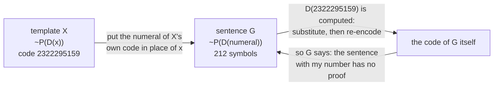

# Godel's theorems: arithmetic cannot settle everything true about itself

[Syllabus](../../../SYLLABUS.md) → [Computability and complexity](../README.md) → [Computability and Logic](../README.md#s02) → Godel's theorems

---

## General Overview

A proof checker is a program that reads proofs. Feed it a list of lines, and it says "valid" or "not valid". It never needs insight: it checks that each line follows from the rules.

Now write this sentence of arithmetic: **"This sentence has no proof."** Suppose the checker ever accepts a proof of it. Then the sentence is false, and the system has proved a false thing. So if the system proves only true things, no proof exists. And then the sentence is true, because no proof is exactly what it says.

In 1931 Kurt Godel showed that this sentence can be written in arithmetic, with only 0, next, plus, times and logic. The trick is to turn sentences into numbers. On this card the sentence, called G, has 212 symbols and a 256-digit code number, with the letters P and D standing for long formulas (Step 3).

**Any consistent system of axioms that a program can list, and that includes the rules for plus and times, leaves some sentence of arithmetic unsettled; and if it also proves basic induction, it cannot prove its own consistency.**

**What kind of fact this is:** two theorems. The first is Godel's 1931 theorem in Rosser's 1936 form, proved here in outline: every step is given, and the long routine part (writing the proof checker as a formula) is named and sourced. The second is Godel's second theorem, stated with its key step and a named source.

### The picture: how G gets its own number



G never contains its own number. It contains a recipe, D, whose output is that number.

---

## The formula

A **formal system** $`F`$ is a list of axioms (starting sentences, never proved) and rules for getting new lines from old ones. Write $`F \vdash \varphi`$ for "$`F`$ proves the sentence $`\varphi`$", and $`F \nvdash \varphi`$ for "$`F`$ does not prove $`\varphi`$". The corner brackets $`\ulcorner \varphi \urcorner`$ mean "the code number of $`\varphi`$".

The heart of the proof is one sentence $`G`$ that $`F`$ itself proves is equivalent to "my number is not the number of a provable sentence":

```math
F \vdash \; G \leftrightarrow \neg\,\mathrm{Prov}_F(\ulcorner G \urcorner)
```

**Read it aloud:** $`F`$ proves that $`G`$ holds exactly when the sentence numbered $`\ulcorner G \urcorner`$ has no proof in $`F`$.

The two theorems, for any system $`F`$ whose axioms a program can list and which contains the rules for 0, next, plus and times:

```math
\text{First: } F \text{ consistent} \;\Rightarrow\; F \nvdash G_R \text{ and } F \nvdash \neg G_R \qquad \text{Second: } F \text{ consistent and } F \supseteq \mathrm{PA} \;\Rightarrow\; F \nvdash \mathrm{Con}(F)
```

Here $`G_R`$ is Rosser's version of $`G`$ (Step 4 below), and $`\mathrm{Con}(F)`$ is the sentence $`\neg\,\mathrm{Prov}_F(\ulcorner 0 = S0 \urcorner)`$: "$`F`$ never proves $`0 = 1`$". **PA** is Peano arithmetic: Peano's rules, plus and times, and induction for every formula.

| Symbol | Plain meaning | In our example | Push it up and the answer… |
| --- | --- | --- | --- |
| $`F`$ | the formal system: axioms plus rules | Peano's rules with plus and times | add axioms and $`F`$ proves more, but a new $`G`$ appears |
| $`\varphi`$ | any sentence of arithmetic | S0+S0=SS0, that is 1 + 1 = 2 | — |
| $`F \vdash \varphi`$ | $`F`$ proves $`\varphi`$: a checked list of lines ends in it | 2 × 2 = 4 in 9 rule uses | longer sentences need longer proofs |
| $`\ulcorner \varphi \urcorner`$ | the code number of $`\varphi`$ | ⌜S0+S0=SS0⌝ = 8,910,885,409 | each extra symbol multiplies it by about 16 |
| $`0, S, +, \times`$ | zero, next, plus, times: the only symbols for numbers | written `0 S + *` in the code | — |
| numeral | a term whose value is $`n`$, built in binary from $`SS0`$ and times | the numeral of 2,322,295,159 has 205 symbols | each doubling of $`n`$ adds 6 or 7 symbols |
| $`\mathrm{Proof}_F(p, y)`$, $`\mathrm{Prov}_F(y)`$ | "$`p`$ codes a proof in $`F`$ of the sentence numbered $`y`$"; "some such $`p`$ exists", written P in the code | P in ~P(D(x)) | — |
| $`D(n)`$; X; x | the diagonal map: put the numeral of $`n`$ into the template numbered $`n`$, return the new code; X is the template, and x is its gap | $`D(2{,}322{,}295{,}159) = \ulcorner G \urcorner`$; X = ~P(D(x)), code 2,322,295,159 | — |
| $`G`$, $`G_R`$ | $`G`$: "the sentence numbered $`D(\ulcorner X \urcorner)`$ has no proof"; $`G_R`$: Rosser's version, "any proof of me is beaten by a smaller-numbered proof of my negation" | $`G`$: 212 symbols, a 256-digit code | — |
| PA | Peano arithmetic: Peano's rules, plus and times, and induction for every formula | the $`F`$ of the second theorem | — |
| $`\neg, \leftrightarrow`$ | "not"; "exactly when" | written ~ in the code | — |
| $`\mathrm{Con}(F)`$ | "$`F`$ is consistent": it never proves $`0 = 1`$ | $`F`$ with 0 = S0 added fails it | — |

### When it holds

- **A program can list the axioms.** Take every true sentence of arithmetic as an axiom and the system is complete, but no program can list those axioms. The first theorem says exactly that this set is not listable.
- **Times is in the system.** With 0, next and plus only, arithmetic is complete and decidable (Presburger, 1929; see [Decidable theories](14-decidable-theories-presburger-and-tarski.md)). Without times, no formula can pick out digit $`k`$ of a number, so sentences and proofs cannot be described.
- **The system is consistent.** An inconsistent system proves every sentence, $`G`$ included. The code adds the axiom 0 = S0, and its checker accepts a proof that 2 × 2 = 5.
- **Plain consistency is enough only for Rosser's sentence.** Godel's own $`G`$ needs a stronger condition (ω-consistency, below) to rule out a proof of $`\neg G`$.
- **The usual proof of the second theorem needs induction.** $`F`$ must prove the first theorem's argument about itself. PA can; Robinson's Q (plus and times, no induction) cannot.

---

## Why it works

### Step 0: proofs are strings, and strings are numbers

A proof is a finite list of lines, and checking it is mechanical. Give each symbol a code and read a string as a number, and "line $`k`$ follows from lines $`i`$ and $`j`$" becomes a fact about numbers.

So arithmetic can talk about its own proofs. Self-reference does the rest.

### Step 1: number every sentence

The code uses 11 symbols with codes 1 to 11: `0 S + * = ( ) ~ x P D`. A sentence is read as a number in base 16, one digit per symbol.

- S0+S0=SS0 (1 + 1 = 2, from [Peano's three rules](../../01-Foundations/06-Proof/07-peano-and-one-plus-one.md)) has digits 2 1 3 2 1 5 2 2 1, so its code is 8,910,885,409.
- Divide by 16 again and again; the remainders spell the sentence back. No two sentences share a code.

Godel used powers of primes. Any coding works if a program can encode and decode it.

### Step 2: checking a proof is arithmetic too

[Peano's three rules](../../01-Foundations/06-Proof/07-peano-and-one-plus-one.md) give zero, next and two rules for plus: $`a + 0 = a`$ and $`a + Sb = S(a + b)`$. Times is defined the same way, by two more rules: $`a \times 0 = 0`$ and $`a \times Sb = a \times b + a`$.

The code proves 2 × 2 = 4 with these four rules. It writes `(SS0*SS0)` and rewrites one piece per line, by one rule, until `SSSS0` is left: 9 rule uses. A separate checker accepts each line only if it is one rule-use away from the line before.

The checker always halts. So the relation "$`p`$ codes a valid proof of the sentence numbered $`y`$" is decidable. Godel showed it is written by a formula of arithmetic, $`\mathrm{Proof}_F(p, y)`$. Then

```math
\mathrm{Prov}_F(y) \;=\; \exists p \; \mathrm{Proof}_F(p, y)
```

"Provable" means "some proof exists". That is semidecidable: a search finds a proof when one exists and may run forever when none does ([Decidable and semidecidable](01-decidable-and-semidecidable-sets.md)). For a consistent $`F`$ it is not decidable either: no program sorts every sentence into provable and not provable. This goes back to Church and Rosser in 1936; Smith proves it in chapter 40.

Times is what makes the formula possible. With it, arithmetic can say "digit $`k`$ of $`n`$ in base 16 is $`d`$", so it can describe strings, lists and runs of a checker.

### Step 3: the diagonal trick builds G

The naive way fails. A sentence cannot contain its own numeral: the code checks every length from 1 to 400 symbols, and the numeral of the code is always longer than the sentence. The smallest 8-symbol code already needs a 177-symbol numeral.

So the code uses a template with a gap, x, and a recipe, D.

1. Take the template X = `~P(D(x))`: "the sentence numbered D(x) has no proof". Its code is 2,322,295,159.
2. Define D(n): decode n, put the numeral of n in place of x, re-encode. D is computable, so a formula of arithmetic expresses it.
3. Put the numeral of X's own code into X. The result is G, 212 symbols.
4. D(2,322,295,159) substitutes that same numeral into that same template, so it returns the code of G.

G says "the sentence numbered D(2,322,295,159) has no proof", and that sentence is G. The code checks it three ways: building G on symbols, computing D on numbers only, and evaluating the numeral inside G.

In general this is the **diagonal lemma**: for every formula $`\psi(x)`$ there is a sentence $`\sigma`$ with $`F \vdash \sigma \leftrightarrow \psi(\ulcorner \sigma \urcorner)`$. It is the move in [Russell's paradox](../../01-Foundations/07-Sets/06-russells-paradox.md), aimed at proof instead of membership.

On the card, P and D are one letter each. In real arithmetic each is a long formula in 0, S, +, × and logic, so the real G is far longer. The construction is the same.

### Step 4: the first theorem

**$`F`$ does not prove $`G`$.** Suppose it does, by a proof numbered $`p`$. Then $`\mathrm{Proof}_F(p, \ulcorner G \urcorner)`$ is a true, checkable fact. Arithmetic with plus and times proves every true checkable fact, so $`F \vdash \mathrm{Prov}_F(\ulcorner G \urcorner)`$. But $`G`$ is equivalent in $`F`$ to the negation of that, so $`F`$ also proves $`\neg\,\mathrm{Prov}_F(\ulcorner G \urcorner)`$. That is a contradiction. So a consistent $`F`$ does not prove $`G`$.

**So G is true.** No proof of $`G`$ exists, and that is what $`G`$ says. "True" here means true of the actual numbers 0, 1, 2, and so on. It does not mean provable.

**$`F`$ does not prove $`\neg G`$ either, with one more assumption.** For each number $`p`$, $`F`$ proves "$`p`$ is not a proof of $`G`$". Proving $`\neg G`$ would mean proving "some $`p`$ is a proof of $`G`$" while refuting each $`p`$. A system that never does this is **ω-consistent**.

Rosser removed that assumption in 1936. His sentence $`G_R`$ says "for any proof of me, there is a smaller-numbered proof of my negation". The same reasoning, with "smaller-numbered" checked number by number, shows a merely consistent $`F`$ proves neither $`G_R`$ nor $`\neg G_R`$.

<details>
<summary>Detailed proof: the two halves of the first theorem, line by line</summary>

Write $`\Pr(y)`$ for $`\mathrm{Prov}_F(y)`$. The diagonal lemma gives $`G`$ with

$`\displaystyle F \vdash G \leftrightarrow \neg \Pr(\ulcorner G \urcorner)`$

(1) Every true sentence of the form "a checkable relation holds of these numbers, or some number makes it hold" is provable in Robinson's Q, so in $`F`$. This is called Σ1-completeness; Smith proves it.

(2) If $`F \vdash \neg G`$, then by the lemma $`F \vdash \Pr(\ulcorner G \urcorner)`$. If $`F`$ is consistent, Step 4 shows no $`p`$ proves $`G`$, so by (1) $`F \vdash \neg\mathrm{Proof}_F(\bar p, \ulcorner G \urcorner)`$ for every $`p`$, where $`\bar p`$ is the numeral of $`p`$. Together these make $`F`$ ω-inconsistent.

(3) Rosser: apply the lemma to "every proof of $`x`$ has a smaller-numbered proof of the negation of $`x`$". If $`F \vdash G_R`$ by proof $`p`$, $`F`$ checks the numbers below $`p`$, finds no proof of $`\neg G_R`$, and so refutes $`G_R`$. If $`F \vdash \neg G_R`$ by proof $`q`$, $`F`$ checks the numbers up to $`q`$, finds no proof of $`G_R`$, and so proves $`G_R`$. Either way $`F`$ is inconsistent.

</details>

### Step 5: the second theorem

Step 4's first half is a finite argument about checkable facts. A system with enough induction, PA for example, can run that argument about itself. It proves

```math
F \vdash \mathrm{Con}(F) \rightarrow G
```

If $`F`$ proved $`\mathrm{Con}(F)`$, it would then prove $`G`$, which Step 4 rules out. So a consistent $`F`$ cannot prove its own consistency. The full proof needs three facts about $`\mathrm{Prov}_F`$, the derivability conditions, proved in Smith's book.

### Step 6: what the theorems do not say

- **Not that some truth is unknowable.** Add $`\mathrm{Con}(F)`$ as an axiom and the new system proves $`G`$, then has a new unsettled sentence of its own.
- **Not that consistency is unprovable.** Another system can prove $`\mathrm{Con}(\mathrm{PA})`$: set theory does, and so did Gentzen in 1936 with a different kind of induction. No consistent system of this kind proves its own.
- **The same limit from machines.** A complete system that proves only true sentences would decide halting: search for a proof of "M halts" or of "M never halts". No program decides halting ([Universal machines](../01-Models%20of%20Computation/09-universal-machines-and-the-halting-problem.md)). Turing's 1937 paper on unsolvable problems opened this road.

---

## Worked numbers, by hand

The code's numbering and its sentence G.

| Step | Arithmetic | Value |
| --- | --- | --- |
| code of S0+S0=SS0 | digits 2 1 3 2 1 5 2 2 1, read in base 16 | 8,910,885,409 |
| decode it | divide by 16, read the remainders | S0+S0=SS0 |
| code of the template X = ~P(D(x)) | digits 8 10 6 11 6 9 7 7, read in base 16 | 2,322,295,159 |
| numeral of that code | one `(SS0*…)` per binary digit, an S on each 1 | 205 symbols |
| G: the numeral in place of x | 8 − 1 + 205 | 212 symbols |
| code of G | 212 base-16 digits | 256 decimal digits, starting 101483056656 |
| value of the numeral inside G | evaluate it with plus and times | 2,322,295,159 |
| D(2,322,295,159) | substitute that numeral into X, re-encode | **the code of G itself** |
| 2 × 2 = 4 in arithmetic | four rules, one rewrite per line | 9 rule uses |

G names its own 256-digit code through a 205-symbol recipe; the sentence never contains its own number, only a way to compute it.

### What breaks if you drop a piece

| Mistake | Comes out at | What went wrong |
| --- | --- | --- |
| Add the axiom 0 = S0 (an inconsistent system) | a proof of 2 × 2 = 5 is accepted | An inconsistent system proves everything, so "unprovable" means nothing |
| Cap the proof search at 8 rule uses | none up to the cap, though a 9-step proof of 2 × 2 = 4 exists | "No proof found yet" is not "no proof exists" |
| Fill ~P(x) with its own code, without D, and call the result H | H points at 566,935; its own code has 156 digits | H talks about the template, not about itself |
| Write the sentence's own numeral into it | no fit for any length from 1 to 400; 8 symbols need 177 | A numeral of a code is always longer than the sentence |

The code prints all four.

---

## Code, from first principles, and it actually runs

The code runs the construction behind the proof, never an impossible program. It takes three roads to the fixed point: G built on symbols, D computed with numbers only, and the numeral inside G evaluated. It takes two roads to the proof of 2 × 2 = 4, first-rule rewriting and a shortest-proof search; a separate checker and machine arithmetic confirm them.

### Python

```python
# Godel's theorems -- the check behind the card.  Standard library only.  It
# runs the construction behind the proof, never an impossible program: it
# numbers sentences, builds the sentence G that speaks about its own number,
# and checks a proof in arithmetic step by step.  Nothing is imported.
CODES = {'0': 1, 'S': 2, '+': 3, '*': 4, '=': 5, '(': 6, ')': 7, '~': 8, 'x': 9, 'P': 10, 'D': 11}
SYMS = {v: k for k, v in CODES.items()}

def godel(s):                                # the code number: s read as base-16 digits
    n = 0
    for c in s: n = n * 16 + CODES[c]
    return n
def decode(n):                               # back again, by division only
    out = ""
    while n > 0: n, d = divmod(n, 16); out = SYMS[d] + out
    return out
def num(n):                                  # the numeral: a term whose value is n, in binary
    if n == 0: return "0"
    t = "S0"                                 # the leading 1; then double, adding S on a 1 bit
    for bit in bin(n)[3:]: t = ("S" if bit == "1" else "") + "(SS0*" + t + ")"
    return t
def value(t, i=0):                           # read a term's value off its symbols
    if t[i] == '0': return 0, i + 1
    if t[i] == 'S': v, j = value(t, i + 1); return v + 1, j
    a, j = value(t, i + 1); b, k = value(t, j + 1)       # '(' a op b ')'
    return (a + b if t[j] == '+' else a * b), k + 1
def diag(s): return s.replace('x', num(godel(s)))       # road A: on symbols
def diag_arith(n):                           # road B: the same map on numbers only
    lo, k, m = 0, 0, n
    while m and m % 16 != CODES['x']: lo += (m % 16) * 16 ** k; m //= 16; k += 1
    t = num(n)                                # m // 16: the digits left of x
    return ((m // 16) * 16 ** len(t) + godel(t)) * 16 ** k + lo

def row(name, v): print(f"{name:<44}{v}")
print("-- numbering --")
ONE = "S0+S0=SS0"
row("code of the sentence S0+S0=SS0 (1 + 1 = 2)", godel(ONE))
row("decoded back by division", decode(godel(ONE)))
X = "~P(D(x))"
gx = godel(X)
row("code of the template X = ~P(D(x))", gx)
row("numeral of that code, in symbols", len(num(gx)))
row("value read back off the numeral", value(num(gx))[0])
print("-- the sentence G = X with its own code put in --")
G = diag(X)
gg = godel(G)
row("length of G, in symbols", len(G))
row("digits in the code of G", len(str(gg)))
row("code of G begins", str(gg)[:12])
row("code of G ends", str(gg)[-12:])
inner = value(G[5:-2])[0]                    # road C: the term D is applied to inside G
row("D's argument inside G evaluates to", inner)
row("road A and road B agree on the code of G", godel(diag(X)) == diag_arith(gx))
row("D(argument) is the code of G itself", diag_arith(inner) == gg)

def term(s, i=0):                            # parse "SS0*SS0" style terms into trees
    if s[i] == '0': return ('0',), i + 1
    if s[i] == 'S': t, j = term(s, i + 1); return ('S', t), j
    a, j = term(s, i + 1); b, k = term(s, j + 1); return (s[j], a, b), k + 1
def show(t):                                 # a tree back to symbols
    if t[0] == '0': return '0'
    return 'S' + show(t[1]) if t[0] == 'S' else '(' + show(t[1]) + t[0] + show(t[2]) + ')'
def root(t, extra):                          # every rule that fits at the top of t
    out = []
    if t[0] == '+' and t[2] == ('0',): out.append(t[1])                          # a+0 = a
    if t[0] == '+' and t[2][0] == 'S': out.append(('S', ('+', t[1], t[2][1])))    # a+Sb = S(a+b)
    if t[0] == '*' and t[2] == ('0',): out.append(('0',))                        # a*0 = 0
    if t[0] == '*' and t[2][0] == 'S': out.append(('+', ('*', t[1], t[2][1]), t[1]))  # a*Sb = a*b+a
    if extra and t == ('0',): out.append(('S', ('0',)))                          # the bad axiom 0 = S0
    return out
def steps(t, extra=False):                   # every term one rule-use away from t
    out = root(t, extra)
    for k in range(1, len(t)):
        out += [t[:k] + (u,) + t[k + 1:] for u in steps(t[k], extra)]
    return out
def checker(chain, extra=False): return all(b in steps(a, extra) for a, b in zip(chain, chain[1:]))
def shortest(start, goal, cap):              # breadth-first proof search, capped
    level, seen = [start], {start}
    for d in range(cap + 1):
        if goal in level: return d
        level = [u for t in level for u in steps(t) if u not in seen and not seen.add(u)]
    return None

print("-- a proof in arithmetic: 2 x 2 = 4, one rule per line --")
chain = [term("(SS0*SS0)")[0]]
while steps(chain[-1]): chain.append(steps(chain[-1])[0])
for i, t in enumerate(chain): print(f"line {i:<3}{show(t)}")
four = ('S', ('S', ('S', ('S', ('0',)))))
best = shortest(chain[0], four, 20)
row("lines the checker accepts", checker(chain))
row("rule uses, first rule each time", len(chain) - 1)
row("rule uses, shortest proof by search", best)
row("2 x 2 by machine arithmetic", 2 * 2)
print("-- what breaks --")
bad = chain + [('S', four)]
row("2 x 2 = 5, checked with the true rules", checker(bad))
row("2 x 2 = 5, checked with 0 = S0 added", checker(bad, extra=True))
r = shortest(chain[0], four, best - 1)
row(f"search capped at {best - 1} rule uses", "none up to the cap" if r is None else r)
H = "~P(" + num(godel("~P(x)")) + ")"
pointed = value(H[3:-1])[0]                  # the number H's numeral stands for
row("H = ~P(x) filled without D points at", pointed)
row("digits in the code of H itself", len(str(godel(H))))
fits = [L for L in range(1, 401) if len(num(godel('0' * L))) <= L]
row("sentence holding its own numeral, 1 to 400", "none up to 400" if not fits else fits)
row("numeral of the smallest 8-symbol code", len(num(godel('0' * 8))))

assert decode(godel(ONE)) == ONE and godel(ONE) == 0x213215221
assert value(num(gx))[0] == gx == 0x8A6B6977          # numeral and code agree
assert godel(diag(X)) == diag_arith(gx)               # road A against road B
assert inner == gx and diag_arith(inner) == gg        # road C: G names itself
assert checker(chain) and value(show(chain[-1]))[0] == 2 * 2 and chain[-1] == four
assert best is not None and best <= len(chain) - 1 and r is None
assert not checker(bad) and checker(bad, extra=True)
assert decode(pointed) == "~P(x)"                     # H points at the template, not at itself
assert len(str(godel(H))) == len(str(CODES[H[0]] * 16 ** (len(H) - 1))) == len(str(16 ** len(H) - 1))  # from H's length
assert not fits
print("ALL CHECKS PASS")
```

**Ran 2026-11-19 on macOS, Python 3.14.10, standard library only. All checks passed. Output, pasted from the run:**

```
-- numbering --
code of the sentence S0+S0=SS0 (1 + 1 = 2)  8910885409
decoded back by division                    S0+S0=SS0
code of the template X = ~P(D(x))           2322295159
numeral of that code, in symbols            205
value read back off the numeral             2322295159
-- the sentence G = X with its own code put in --
length of G, in symbols                     212
digits in the code of G                     256
code of G begins                            101483056656
code of G ends                              506750437239
D's argument inside G evaluates to          2322295159
road A and road B agree on the code of G    True
D(argument) is the code of G itself         True
-- a proof in arithmetic: 2 x 2 = 4, one rule per line --
line 0  (SS0*SS0)
line 1  ((SS0*S0)+SS0)
line 2  S((SS0*S0)+S0)
line 3  SS((SS0*S0)+0)
line 4  SS(SS0*S0)
line 5  SS((SS0*0)+SS0)
line 6  SSS((SS0*0)+S0)
line 7  SSSS((SS0*0)+0)
line 8  SSSS(SS0*0)
line 9  SSSS0
lines the checker accepts                   True
rule uses, first rule each time             9
rule uses, shortest proof by search         9
2 x 2 by machine arithmetic                 4
-- what breaks --
2 x 2 = 5, checked with the true rules      False
2 x 2 = 5, checked with 0 = S0 added        True
search capped at 8 rule uses                none up to the cap
H = ~P(x) filled without D points at        566935
digits in the code of H itself              156
sentence holding its own numeral, 1 to 400  none up to 400
numeral of the smallest 8-symbol code       177
ALL CHECKS PASS
```

### Rust

Same numbers and labels, built with `rustc --edition 2021 -O`. Code numbers are kept as lists of base-16 digits, and a small big-number routine prints them in decimal.

```rust
// Godel's theorems -- the same check as godels_incompleteness_in_outline_check.py,
// in Rust.  No crates.  It numbers sentences, builds the sentence G that speaks
// about its own number, and checks a proof in arithmetic step by step.  A code
// number is kept as its base-16 digits; a small big-number routine prints it.
use std::collections::HashSet;
const SYMS: &[u8] = b"?0S+*=()~xPD";        // a symbol's code is its place in this list
fn code(c: u8) -> u8 { SYMS.iter().position(|&s| s == c).unwrap() as u8 }
fn godel(s: &str) -> Vec<u8> { s.bytes().map(code).collect() }   // base-16 digits
fn small(d: &[u8]) -> u64 { d.iter().fold(0, |n, &x| n * 16 + x as u64) }
fn decimal(d: &[u8]) -> String {             // big number: limbs of nine decimal digits
    let mut limbs: Vec<u64> = vec![0];
    for &x in d {
        let mut carry = x as u64;
        for l in limbs.iter_mut() { let v = *l * 16 + carry; *l = v % 1_000_000_000; carry = v / 1_000_000_000; }
        if carry > 0 { limbs.push(carry); }
    }
    let mut s = limbs.last().unwrap().to_string();
    for l in limbs.iter().rev().skip(1) { s.push_str(&format!("{:09}", l)); }
    s
}
fn decode(mut n: u64) -> String {            // back again, by division only
    let mut out = Vec::new();
    while n > 0 { out.insert(0, SYMS[(n % 16) as usize]); n /= 16; }
    String::from_utf8(out).unwrap()
}
fn num_bits(bits: &[bool]) -> String {       // the numeral, from the bits of n
    let start = match bits.iter().position(|&b| b) { Some(p) => p, None => return "0".into() };
    let mut t = String::from("S0");          // the leading 1; then double, adding S on a 1 bit
    for &b in &bits[start + 1..] { t = format!("{}(SS0*{})", if b { "S" } else { "" }, t); }
    t
}
fn bits_of(d: &[u8]) -> Vec<bool> { d.iter().flat_map(|&x| (0..4).rev().map(move |k| x >> k & 1 == 1)).collect() }
fn num(n: u64) -> String { num_bits(&(0..64).rev().map(|k| n >> k & 1 == 1).collect::<Vec<_>>()) }
fn value(t: &[u8], i: usize) -> (u64, usize) {  // read a term's value off its symbols
    if t[i] == b'0' { return (0, i + 1); }
    if t[i] == b'S' { let (v, j) = value(t, i + 1); return (v + 1, j); }
    let (a, j) = value(t, i + 1); let (b, k) = value(t, j + 1);  // '(' a op b ')'
    (if t[j] == b'+' { a + b } else { a * b }, k + 1)
}
fn diag(s: &str) -> String { s.replace('x', &num(small(&godel(s)))) }   // road A: on symbols
fn diag_arith(n: u64) -> Vec<u8> {           // road B: the same map on numbers only
    let (mut lo, mut m) = (Vec::new(), n);
    while m > 0 && m % 16 != code(b'x') as u64 { lo.insert(0, (m % 16) as u8); m /= 16; }
    let mut out: Vec<u8> = godel(&decode(m / 16)); // the digits left of x
    out.extend(godel(&num(n))); out.extend(lo); out
}
fn row(name: &str, v: String) { println!("{:<44}{}", name, v); }

#[derive(Clone, PartialEq, Eq, Hash)]
enum T { Z, S(Box<T>), Op(u8, Box<T>, Box<T>) }
fn term(s: &[u8], i: usize) -> (T, usize) {  // parse "SS0*SS0" style terms into trees
    if s[i] == b'0' { return (T::Z, i + 1); }
    if s[i] == b'S' { let (t, j) = term(s, i + 1); return (T::S(Box::new(t)), j); }
    let (a, j) = term(s, i + 1); let (b, k) = term(s, j + 1);
    (T::Op(s[j], Box::new(a), Box::new(b)), k + 1)
}
fn show(t: &T) -> String { match t { T::Z => "0".into(), T::S(a) => format!("S{}", show(a)),
    T::Op(o, a, b) => format!("({}{}{})", show(a), *o as char, show(b)) } }
fn sc(t: T) -> T { T::S(Box::new(t)) }
fn op(o: u8, a: T, b: T) -> T { T::Op(o, Box::new(a), Box::new(b)) }
fn root(t: &T, extra: bool) -> Vec<T> {      // every rule that fits at the top of t
    let mut out = Vec::new();
    if let T::Op(o, a, b) = t {
        match (o, &**b) {
            (b'+', T::Z) => out.push((**a).clone()),                                  // a+0 = a
            (b'+', T::S(c)) => out.push(sc(op(b'+', (**a).clone(), (**c).clone()))),   // a+Sb = S(a+b)
            (b'*', T::Z) => out.push(T::Z),                                           // a*0 = 0
            (b'*', T::S(c)) => out.push(op(b'+', op(b'*', (**a).clone(), (**c).clone()), (**a).clone())),
            _ => {}
        }
    }
    if extra && *t == T::Z { out.push(sc(T::Z)); }                                   // the bad axiom 0 = S0
    out
}
fn steps(t: &T, extra: bool) -> Vec<T> {     // every term one rule-use away from t
    let mut out = root(t, extra);
    match t {
        T::Z => {}
        T::S(a) => out.extend(steps(a, extra).into_iter().map(sc)),
        T::Op(o, a, b) => {
            out.extend(steps(a, extra).into_iter().map(|u| op(*o, u, (**b).clone())));
            out.extend(steps(b, extra).into_iter().map(|u| op(*o, (**a).clone(), u)));
        }
    }
    out
}
fn checker(chain: &[T], extra: bool) -> bool { chain.windows(2).all(|w| steps(&w[0], extra).contains(&w[1])) }
fn shortest(start: &T, goal: &T, cap: usize) -> Option<usize> {  // breadth-first proof search, capped
    let (mut level, mut seen) = (vec![start.clone()], HashSet::from([start.clone()]));
    for d in 0..=cap {
        if level.contains(goal) { return Some(d); }
        let mut next = Vec::new();
        for t in &level { for u in steps(t, false) { if seen.insert(u.clone()) { next.push(u); } } }
        level = next;
    }
    None
}

fn main() {
    println!("-- numbering --");
    let one = "S0+S0=SS0";
    row("code of the sentence S0+S0=SS0 (1 + 1 = 2)", small(&godel(one)).to_string());
    row("decoded back by division", decode(small(&godel(one))));
    let x = "~P(D(x))";
    let gx = small(&godel(x));
    row("code of the template X = ~P(D(x))", gx.to_string());
    row("numeral of that code, in symbols", num(gx).len().to_string());
    row("value read back off the numeral", value(num(gx).as_bytes(), 0).0.to_string());
    println!("-- the sentence G = X with its own code put in --");
    let g = diag(x);
    let gg = godel(&g);
    let gd = decimal(&gg);
    row("length of G, in symbols", g.len().to_string());
    row("digits in the code of G", gd.len().to_string());
    row("code of G begins", gd[..12].to_string());
    row("code of G ends", gd[gd.len() - 12..].to_string());
    let inner = value(&g.as_bytes()[5..g.len() - 2], 0).0;   // road C: the term D is applied to
    row("D's argument inside G evaluates to", inner.to_string());
    row("road A and road B agree on the code of G", cap(godel(&diag(x)) == diag_arith(gx)));
    row("D(argument) is the code of G itself", cap(diag_arith(inner) == gg));

    println!("-- a proof in arithmetic: 2 x 2 = 4, one rule per line --");
    let mut chain = vec![term(b"(SS0*SS0)", 0).0];
    loop { let s = steps(chain.last().unwrap(), false); if s.is_empty() { break; } chain.push(s[0].clone()); }
    for (i, t) in chain.iter().enumerate() { println!("line {:<3}{}", i, show(t)); }
    let four = sc(sc(sc(sc(T::Z))));
    let best = shortest(&chain[0], &four, 20);
    row("lines the checker accepts", cap(checker(&chain, false)));
    row("rule uses, first rule each time", (chain.len() - 1).to_string());
    row("rule uses, shortest proof by search", best.unwrap().to_string());
    row("2 x 2 by machine arithmetic", (2 * 2).to_string());
    println!("-- what breaks --");
    let mut bad = chain.clone(); bad.push(sc(four.clone()));
    row("2 x 2 = 5, checked with the true rules", cap(checker(&bad, false)));
    row("2 x 2 = 5, checked with 0 = S0 added", cap(checker(&bad, true)));
    let r = shortest(&chain[0], &four, best.unwrap() - 1);
    row(&format!("search capped at {} rule uses", best.unwrap() - 1), r.map_or("none up to the cap".into(), |v| v.to_string()));
    let h = format!("~P({})", num(small(&godel("~P(x)"))));
    let pointed = value(&h.as_bytes()[3..h.len() - 1], 0).0;   // the number H's numeral stands for
    row("H = ~P(x) filled without D points at", pointed.to_string());
    row("digits in the code of H itself", decimal(&godel(&h)).len().to_string());
    let fits: Vec<usize> = (1..=400).filter(|&l| num_bits(&bits_of(&godel(&"0".repeat(l)))).len() <= l).collect();
    row("sentence holding its own numeral, 1 to 400", if fits.is_empty() { "none up to 400".into() } else { format!("{:?}", fits) });
    row("numeral of the smallest 8-symbol code", num_bits(&bits_of(&godel("00000000"))).len().to_string());

    assert!(decode(small(&godel(one))) == one && small(&godel(one)) == 0x213215221);
    assert!(value(num(gx).as_bytes(), 0).0 == gx && gx == 0x8A6B6977);   // numeral and code agree
    assert!(godel(&diag(x)) == diag_arith(gx));                          // road A against road B
    assert!(inner == gx && diag_arith(inner) == gg);                     // road C: G names itself
    assert!(checker(&chain, false) && value(show(chain.last().unwrap()).as_bytes(), 0).0 == 2 * 2 && *chain.last().unwrap() == four);
    assert!(best.unwrap() <= chain.len() - 1 && r.is_none());
    assert!(!checker(&bad, false) && checker(&bad, true));
    assert!(decode(pointed) == "~P(x)");                                // H points at the template, not at itself
    let (lo_h, hi_h) = ([vec![code(h.as_bytes()[0])], vec![0u8; h.len() - 1]].concat(), vec![15u8; h.len()]);
    assert!(decimal(&godel(&h)).len() == decimal(&lo_h).len() && decimal(&lo_h).len() == decimal(&hi_h).len()); // from H's length
    assert!(fits.is_empty());
    println!("ALL CHECKS PASS");
}
fn cap(b: bool) -> String { if b { "True".into() } else { "False".into() } }
```

**Ran 2026-11-19 on macOS, rustc 1.98.1, no crates. All checks passed. Output, pasted from the run:**

```
-- numbering --
code of the sentence S0+S0=SS0 (1 + 1 = 2)  8910885409
decoded back by division                    S0+S0=SS0
code of the template X = ~P(D(x))           2322295159
numeral of that code, in symbols            205
value read back off the numeral             2322295159
-- the sentence G = X with its own code put in --
length of G, in symbols                     212
digits in the code of G                     256
code of G begins                            101483056656
code of G ends                              506750437239
D's argument inside G evaluates to          2322295159
road A and road B agree on the code of G    True
D(argument) is the code of G itself         True
-- a proof in arithmetic: 2 x 2 = 4, one rule per line --
line 0  (SS0*SS0)
line 1  ((SS0*S0)+SS0)
line 2  S((SS0*S0)+S0)
line 3  SS((SS0*S0)+0)
line 4  SS(SS0*S0)
line 5  SS((SS0*0)+SS0)
line 6  SSS((SS0*0)+S0)
line 7  SSSS((SS0*0)+0)
line 8  SSSS(SS0*0)
line 9  SSSS0
lines the checker accepts                   True
rule uses, first rule each time             9
rule uses, shortest proof by search         9
2 x 2 by machine arithmetic                 4
-- what breaks --
2 x 2 = 5, checked with the true rules      False
2 x 2 = 5, checked with 0 = S0 added        True
search capped at 8 rule uses                none up to the cap
H = ~P(x) filled without D points at        566935
digits in the code of H itself              156
sentence holding its own numeral, 1 to 400  none up to 400
numeral of the smallest 8-symbol code       177
ALL CHECKS PASS
```

The two outputs match line for line.

### Lean

Lean proves the first theorem in Rosser's form for a system described by a program, and checks the card's numbering and worked numbers.

- Take a consistent system whose theorems a program can list. Suppose each program has a sentence the system proves when the program, run on its own code, answers 0, and refutes when it answers 1. Then some sentence is left unsettled: the system proves neither it nor its negation.
- Take a string of the card's 11 symbols. Then dividing its code by 16, again and again, spells the string back, so no two strings share a code.
- Take any nonempty string of the card's symbols. Then the numeral of its code is longer than the string, so the string never contains it.
- The code of S0+S0=SS0 is 8,910,885,409, and X's code is 2,322,295,159, whose numeral has 205 symbols.
- G has 212 symbols and a 256-digit code starting 101483056656, and D sends X's code to the code of G itself.
- H, filled without D, has a 156-digit code, not 566,935, and the smallest 8-symbol code needs a 177-symbol numeral.

The 2 × 2 = 4 proof, its checker and the capped search stay with Python and Rust; the second theorem rests on Smith's book.

```lean
-- Godel's theorems: a consistent system whose theorems a program can list, and which proves the checkable facts about programs, leaves some sentence unsettled; and the card's base-16 numbering, numerals and self-naming sentence G work as stated.
import Mathlib.Computability.Halting
import Mathlib.Data.Nat.Digits.Lemmas

open Nat.Partrec

namespace GodelCard

/-! ## The card's numbering

Eleven symbols `0 S + * = ( ) ~ x P D` get the codes 1 to 11, and a string is read as a number in
base 16, first symbol first (most significant). -/

/-- The card's eleven symbols. -/
def alphabet : List Char := ['0', 'S', '+', '*', '=', '(', ')', '~', 'x', 'P', 'D']

/-- The code of one symbol: 1 to 11 in the order of `alphabet`, and 0 for anything else. -/
def symCode : Char → ℕ
  | '0' => 1 | 'S' => 2 | '+' => 3 | '*' => 4 | '=' => 5 | '(' => 6
  | ')' => 7 | '~' => 8 | 'x' => 9 | 'P' => 10 | 'D' => 11 | _ => 0

/-- The symbol with a given code (a filler `'?'` for codes that name no symbol). -/
def symOf : ℕ → Char
  | 1 => '0' | 2 => 'S' | 3 => '+' | 4 => '*' | 5 => '=' | 6 => '('
  | 7 => ')' | 8 => '~' | 9 => 'x' | 10 => 'P' | 11 => 'D' | _ => '?'

/-- The code number `⌜s⌝` of a string: its symbol codes read as base-16 digits, first symbol
most significant. -/
def godelCode (s : List Char) : ℕ := Nat.ofDigits 16 (s.reverse.map symCode)

/-- Decoding by division: the base-16 digits of `n`, most significant first, read as symbols. -/
def decode (n : ℕ) : List Char := (Nat.digits 16 n).reverse.map symOf

/-- Terms built from zero, next, plus and times. -/
inductive Tm
  | zero
  | succ (t : Tm)
  | add (a b : Tm)
  | mul (a b : Tm)

/-- The number a term stands for. -/
def Tm.val : Tm → ℕ
  | .zero => 0
  | .succ t => t.val + 1
  | .add a b => a.val + b.val
  | .mul a b => a.val * b.val

/-- A term written out in the card's symbols: `0`, `St`, `(a+b)`, `(a*b)`. -/
def Tm.toChars : Tm → List Char
  | .zero => ['0']
  | .succ t => 'S' :: t.toChars
  | .add a b => ['('] ++ a.toChars ++ ['+'] ++ b.toChars ++ [')']
  | .mul a b => ['('] ++ a.toChars ++ ['*'] ++ b.toChars ++ [')']

/-- The card's numeral of `n`, built from the binary digits of `n`: `S0` for the leading 1, then
for each later digit `(SS0*t)`, with an extra `S` in front on a 1 digit. -/
def numeralTm (n : ℕ) : Tm :=
  match (Nat.digits 2 n).reverse with
  | [] => .zero
  | _ :: rest =>
      rest.foldl
        (fun t b => if b = 1 then .succ (.mul (.succ (.succ .zero)) t)
          else .mul (.succ (.succ .zero)) t)
        (.succ .zero)

/-- The numeral of `n` as a string of symbols. -/
def numeral (n : ℕ) : List Char := (numeralTm n).toChars

/-- Put the term `t` into every gap `x` of the string `s`. -/
def subst (s t : List Char) : List Char := s.flatMap fun c => if c = 'x' then t else [c]

/-- The diagonal map `D(n)`: decode `n`, put the numeral of `n` in place of `x`, re-encode. -/
def diag (n : ℕ) : ℕ := godelCode (subst (decode n) (numeral n))

/-- The template X = `~P(D(x))`: "the sentence numbered D(x) has no proof". -/
def X : List Char := "~P(D(x))".toList

/-- The sentence G: the numeral of X's own code put in place of `x`. -/
def G : List Char := subst X (numeral (godelCode X))

/-- The broken attempt H: `~P(x)` filled with its own code, without D. -/
def H : List Char := subst "~P(x)".toList (numeral (godelCode "~P(x)".toList))

/-! ## Helper lemmas -/

theorem symOf_symCode (c : Char) (hc : c ∈ alphabet) : symOf (symCode c) = c := by
  simp only [alphabet, List.mem_cons, List.not_mem_nil, or_false] at hc
  rcases hc with h|h|h|h|h|h|h|h|h|h|h <;> subst h <;> rfl

#print axioms symOf_symCode

theorem symCode_pos (c : Char) (hc : c ∈ alphabet) : 0 < symCode c ∧ symCode c < 16 := by
  simp only [alphabet, List.mem_cons, List.not_mem_nil, or_false] at hc
  rcases hc with h|h|h|h|h|h|h|h|h|h|h <;> subst h <;> decide

#print axioms symCode_pos

theorem digits_godelCode (s : List Char) (hs : ∀ c ∈ s, c ∈ alphabet) :
    Nat.digits 16 (godelCode s) = s.reverse.map symCode := by
  unfold godelCode
  apply Nat.digits_ofDigits 16 (by norm_num)
  · intro l hl
    obtain ⟨c, hc, rfl⟩ := List.mem_map.mp hl
    exact (symCode_pos c (hs c (List.mem_reverse.mp hc))).2
  · intro h
    obtain ⟨c, hc, he⟩ := List.mem_map.mp (List.getLast_mem h)
    rw [← he]
    exact (symCode_pos c (hs c (List.mem_reverse.mp hc))).1.ne'

#print axioms digits_godelCode

theorem foldl_length (rest : List ℕ) (t : Tm) :
    t.toChars.length + 6 * rest.length ≤
      (rest.foldl
        (fun t b => if b = 1 then Tm.succ (.mul (.succ (.succ .zero)) t)
          else Tm.mul (.succ (.succ .zero)) t) t).toChars.length := by
  induction rest generalizing t with
  | nil => simp
  | cons b rest ih =>
    rw [List.foldl_cons]
    refine le_trans ?_ (ih _)
    split_ifs <;> simp [Tm.toChars] <;> omega

#print axioms foldl_length

theorem numeral_length_ge (n k : ℕ) (hk : 2 ^ k ≤ n) : 2 + 6 * k ≤ (numeral n).length := by
  have hlen : k < (Nat.digits 2 n).length := (Nat.lt_digits_length_iff (by norm_num) n).2 hk
  unfold numeral numeralTm
  split
  · next heq =>
    rw [List.reverse_eq_nil_iff] at heq
    rw [heq] at hlen
    simp at hlen
  · next d rest heq =>
    have := congrArg List.length heq
    simp only [List.length_reverse, List.length_cons] at this
    have h2 := foldl_length rest (.succ .zero)
    simp only [Tm.toChars, List.length_cons, List.length_nil] at h2
    omega

#print axioms numeral_length_ge

/-! ## The theorems -/

/-- **Godel's first theorem, in Rosser's form, for a system described by a program.**
Sentences are coded by numbers, `neg` turns a sentence into its negation, and `Prov φ` says the
system proves `φ`. Suppose a program can list the theorems (`Prov` is semidecidable), the system is
consistent (it never proves a sentence and its negation), and it proves the checkable facts that
plus and times let it state: for each program `c` there is a sentence `σ c` that the system proves
when `c`, run on its own code, stops with answer 0, and refutes when that run stops with answer 1.
Then some sentence is left unsettled: the system proves neither it nor its negation. -/
theorem consistent_listable_system_leaves_a_sentence_unsettled
    (Prov : ℕ → Prop) (listable : REPred Prov)
    (neg : ℕ → ℕ) (hneg : Computable neg)
    (σ : Code → ℕ) (hσ : Computable σ)
    (consistent : ∀ φ, ¬ (Prov φ ∧ Prov (neg φ)))
    (proves_zero : ∀ c : Code, c.eval (Encodable.encode c) = Part.some 0 → Prov (σ c))
    (refutes_one : ∀ c : Code, c.eval (Encodable.encode c) = Part.some 1 → Prov (neg (σ c))) :
    ∃ φ, ¬ Prov φ ∧ ¬ Prov (neg φ) := by
  by_contra hcon
  push Not at hcon
  have h1 : REPred fun c => Prov (σ c) := Partrec.comp listable hσ
  have h2' : REPred fun c => Prov (neg (σ c)) := Partrec.comp listable (hneg.comp hσ)
  have h2 : REPred fun c => ¬ Prov (σ c) := by
    refine h2'.of_eq ?_
    intro c
    exact ⟨fun h hp => consistent _ ⟨hp, h⟩, fun h => hcon _ h⟩
  obtain ⟨D, hd⟩ : ComputablePred fun c => Prov (σ c) :=
    ComputablePred.computable_iff_re_compl_re'.2 ⟨h1, h2⟩
  let g : ℕ → ℕ := fun n => cond (decide (Prov (σ (Denumerable.ofNat Code n)))) 1 0
  have hg : Computable g :=
    Computable.cond (hd.comp (Computable.ofNat Code)) (Computable.const 1) (Computable.const 0)
  obtain ⟨c0, hc0⟩ := Nat.Partrec.Code.exists_code.1 (Partrec.nat_iff.1 hg)
  have hev : c0.eval (Encodable.encode c0) = Part.some (cond (decide (Prov (σ c0))) 1 0) := by
    rw [hc0]
    simp [g, Denumerable.ofNat_encode]
  by_cases hp : Prov (σ c0)
  · rw [decide_eq_true hp] at hev
    exact consistent _ ⟨hp, refutes_one c0 hev⟩
  · rw [decide_eq_false hp] at hev
    exact hp (proves_zero c0 hev)

/-- **Numbering is reversible.** Dividing the code of a string of the card's symbols by 16 again
and again spells the string back, so no two such strings share a code. -/
theorem decode_godelCode (s : List Char) (hs : ∀ c ∈ s, c ∈ alphabet) :
    decode (godelCode s) = s := by
  unfold decode
  rw [digits_godelCode s hs, ← List.map_reverse, List.reverse_reverse, List.map_map]
  conv_rhs => rw [← List.map_id s]
  apply List.map_congr_left
  intro c hc
  exact symOf_symCode c (hs c hc)

/-- **A sentence cannot contain its own numeral.** For every nonempty string of the card's
symbols, the numeral of its code is longer than the string itself, so it never fits inside it. -/
theorem numeral_longer_than_sentence (s : List Char) (hs : ∀ c ∈ s, c ∈ alphabet)
    (hne : s ≠ []) :
    s.length < (numeral (godelCode s)).length ∧ ¬ numeral (godelCode s) <:+: s := by
  have hk : 0 < s.length := List.length_pos_iff.mpr hne
  have hd : (Nat.digits 16 (godelCode s)).length = s.length := by
    rw [digits_godelCode s hs]; simp
  have h16 : 16 ^ (s.length - 1) ≤ godelCode s :=
    (Nat.lt_digits_length_iff (by norm_num) _).1 (by omega)
  have h2 : 2 ^ (4 * (s.length - 1)) ≤ godelCode s := by
    rw [pow_mul]; norm_num; exact h16
  have hl := numeral_length_ge _ _ h2
  have hlt : s.length < (numeral (godelCode s)).length := by omega
  refine ⟨hlt, fun hinf => ?_⟩
  have := hinf.length_le
  omega

/-! ## The card's worked numbers -/

set_option maxRecDepth 100000

-- The code of S0+S0=SS0 (1 + 1 = 2) is 8,910,885,409, and dividing by 16 spells it back.
example : godelCode "S0+S0=SS0".toList = 8910885409 := by decide
example : decode 8910885409 = "S0+S0=SS0".toList := by decide

-- The template X = ~P(D(x)) has code 2,322,295,159; its numeral has 205 symbols and the value
-- 2,322,295,159.
example : godelCode X = 2322295159 := by decide
example : (numeral 2322295159).length = 205 := by decide
example : (numeralTm 2322295159).val = 2322295159 := by decide

-- G has 8 − 1 + 205 = 212 symbols, and its code has 256 decimal digits, starting 101483056656.
example : G.length = 212 := by decide
example : (Nat.digits 10 (godelCode G)).length = 256 := by decide
example : godelCode G / 10 ^ 244 = 101483056656 := by decide

-- The diagonal map sends X's code to the code of G itself.
example : diag 2322295159 = godelCode G := by decide

-- What breaks: ~P(x) has code 566,935, and H, filled with that code without D, has a 156-digit
-- code, so H points at the template, not at itself.
example : godelCode "~P(x)".toList = 566935 := by decide
example : (Nat.digits 10 (godelCode H)).length = 156 := by decide
example : godelCode H ≠ 566935 := by decide

-- The smallest 8-symbol code, 0000 0000 in symbols, already needs a 177-symbol numeral.
example : godelCode (List.replicate 8 '0') = 286331153 := by decide
example : (numeral 286331153).length = 177 := by decide

#print axioms consistent_listable_system_leaves_a_sentence_unsettled
#print axioms decode_godelCode
#print axioms numeral_longer_than_sentence

end GodelCard
```

**Checked 2026-11-19 on macOS, Lean 4.36.0-rc2, Mathlib v4.36.0-rc2. Every proof is complete and uses only Lean's standard axioms. Output, pasted from the run:**

```
'GodelCard.symOf_symCode' depends on axioms: [propext]
'GodelCard.symCode_pos' depends on axioms: [propext]
'GodelCard.digits_godelCode' depends on axioms: [propext, Classical.choice, Quot.sound]
'GodelCard.foldl_length' depends on axioms: [propext, Quot.sound]
'GodelCard.numeral_length_ge' depends on axioms: [propext, Classical.choice, Quot.sound]
'GodelCard.consistent_listable_system_leaves_a_sentence_unsettled' depends on axioms: [propext, Classical.choice, Quot.sound]
'GodelCard.decode_godelCode' depends on axioms: [propext, Classical.choice, Quot.sound]
'GodelCard.numeral_longer_than_sentence' depends on axioms: [propext, Classical.choice, Quot.sound]
```

> [!TIP]
> **Try changing**
> The asserts are pinned to the card's numbers, so expect one to stop the script.
> - Guess first: how long is G if it claims it *is* provable? Set `X = "P(D(x))"` and read the term from `G[4:-2]`. The fixed point still closes: a 186-symbol sentence with a 224-digit code. The first assert on the code of X stops it. This sentence is in fact provable, by Löb's theorem (in PA, a sentence that says "I am provable" is provable).
> - Guess first: how many rule uses does 2 × 3 take? Start from `"(SS0*SSS0)"`. The proof runs to 13 rule uses and ends at `SSSSSS0`, six. The search for four then fails, and the script stops.
> - Guess first: what happens if the cap is 9? Change `best - 1` to `best` in the capped search. It finds the 9-step proof, and the assert that the capped search finds nothing stops the script.

---

## The usual mistake

> [!warning]
> **Reading "true but unprovable" as "true but unknowable".** G is unprovable in one fixed system $`F`$. Add $`\mathrm{Con}(F)`$ as an axiom and the bigger system proves G at once. What no single listable system can do is settle every sentence.
>
> - **Forgetting the conditions.** Arithmetic with plus only is complete (Presburger). The theorem needs times, listable axioms and consistency.
> - **Treating a failed search as unprovability.** A search capped at 8 rule uses finds no proof of 2 × 2 = 4; one exists at 9.
> - **Thinking G quotes itself.** No sentence of 1 to 400 symbols holds its own numeral. G holds a recipe instead.
> - **Applying it to an inconsistent system.** That system proves 2 × 2 = 5 and everything else.

---

## Where you meet it in real life

- **Proof assistants.** A program that checks proofs is a listable system. Godel's theorems say it can never prove its own soundness, so its trusted core is kept small and checked by other means.
- **Busy beaver values.** Yedidia and Aaronson described a 7,910-state machine in 2016 that set theory (ZFC, the standard axioms for sets) cannot prove runs forever, if ZFC is consistent. So ZFC cannot prove the value of BB(7,910) ([Busy beaver](02-the-busy-beaver-function.md)).
- **Self-printing programs.** A program that reads programs can print its own source by Step 3's trick: a template plus a recipe that fills in its own description.

> **Say it back**
> Give every sentence a code number, and checking a proof becomes arithmetic with plus and times. The diagonal trick builds a sentence G that says "the sentence with my number has no proof", using a recipe for its number rather than the number itself. If the system is consistent, it cannot prove G, so G is true; with Rosser's version, it cannot refute it either. A system that also has induction cannot prove its own consistency. Each stronger system has a new unsettled sentence of its own.

---

## What this builds on

- [Busy beaver](02-the-busy-beaver-function.md): a function no program computes, whose values the usual axioms eventually cannot prove; this card says why.
- [Peano's three rules](../../01-Foundations/06-Proof/07-peano-and-one-plus-one.md): zero, next, induction, and plus defined by two rules; this card adds times the same way.
- [Russell's paradox](../../01-Foundations/07-Sets/06-russells-paradox.md): the self-applied rule that flips its own answer; here it is aimed at proof, not membership.

## Where this goes next

- [Hilbert's tenth problem](04-hilberts-tenth-problem.md): the unsettled sentences can be whole-number equations, and no program can test whether one has a solution.
- [Proof assistants](08-proof-assistants-and-formal-verification.md): proof checkers in practice, and what they can and cannot certify.
- [The continuum hypothesis](../../25-Frontier/06-Algebra%2C%20Logic%20and%20Computation/02-continuum-hypothesis-and-independence.md): a natural question that the standard axioms for sets do not settle.
- [Kleene's recursion theorem](09-kleene-recursion-theorem.md): every program can get hold of its own code.
- [Turing degrees and the arithmetical hierarchy](10-turing-degrees-and-the-arithmetical-hierarchy.md): ranking unsolvable problems by oracles and by quantifiers.
- [Formal proofs and soundness](11-formal-deduction-and-soundness.md): rules a machine can check, and why they never prove a falsehood.
- [Compactness and Lowenheim-Skolem](13-compactness-and-lowenheim-skolem.md): finite checks decide everything, and no first-order theory can fix an infinite size.
- [Decidable theories](14-decidable-theories-presburger-and-tarski.md): Presburger's arithmetic without times, and Tarski's real numbers.

The question this card leaves open: which concrete, natural questions of ordinary mathematics are unprovable, and not only sentences built to talk about themselves?

---

## Sources

Verified 2026-11-19: every link below resolves to the publisher's page.

- Godel, Kurt. "Über formal unentscheidbare Sätze der Principia Mathematica und verwandter Systeme I." *Monatshefte für Mathematik und Physik* 38 (1931): 173–198. [doi:10.1007/BF01700692](https://doi.org/10.1007/BF01700692). The original: the numbering, the sentence G, and both theorems.
- Rosser, Barkley. "Extensions of Some Theorems of Gödel and Church." *Journal of Symbolic Logic* 1, no. 3 (1936): 87–91. [doi:10.2307/2269028](https://doi.org/10.2307/2269028). The sentence that needs only plain consistency.
- Turing, Alan M. "On Computable Numbers, with an Application to the Entscheidungsproblem." *Proceedings of the London Mathematical Society* s2-42 (1937): 230–265. [doi:10.1112/plms/s2-42.1.230](https://doi.org/10.1112/plms/s2-42.1.230). Unsolvable problems for machines, the start of the road from halting to incompleteness.
- Yedidia, Adam, and Scott Aaronson. "A Relatively Small Turing Machine Whose Behavior Is Independent of Set Theory." *Complex Systems* 25, no. 4 (2016): 297–328. [doi:10.25088/ComplexSystems.25.4.297](https://doi.org/10.25088/ComplexSystems.25.4.297). The 7,910-state machine, and the first known bound on which busy beaver values ZFC can prove.
- Smith, Peter. *An Introduction to Gödel's Theorems*, 2nd ed. Cambridge University Press, 2013. [doi:10.1017/CBO9781139149105](https://doi.org/10.1017/CBO9781139149105). Full proofs of every step stated here, including Σ1-completeness and the derivability conditions.
