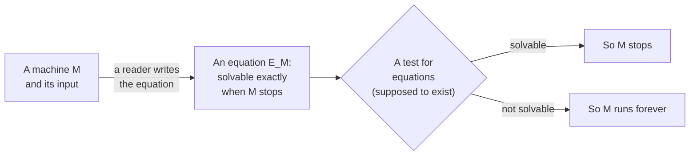

# Hilbert's tenth problem: no test for whole-number solutions

[Syllabus](../../../SYLLABUS.md) → [Computability and complexity](../README.md) → [Computability and Logic](../README.md#s02) → Hilbert's tenth problem

---

## General Overview

Take one equation in three unknowns: $`x^3 + y^3 + z^3 = k`$, for a fixed whole number k. A **whole number** here is an integer: 0, 1, 2, … and the negatives −1, −2, ….

For some k the answer comes fast. For k = 29 there is 3³ + 1³ + 1³ = 27 + 1 + 1. For k = 4 no answer exists. Every cube leaves remainder 0, 1 or 8 on division by 9, so a sum of three cubes never leaves 4 or 5, and 4 leaves 4. For k = 33, nobody found an answer until 2019. The one found then has 16-digit numbers in it.

In 1900 David Hilbert listed 23 problems for the new century. His tenth asked for a **process**: one fixed method that takes any polynomial equation with whole-number coefficients and decides, in finitely many steps, whether it has a whole-number solution.

The answer, completed in 1970, is no. The reason is surprising. Equations are strong enough to describe programs. For every machine there is an equation that has a solution exactly when the machine stops. A test for equations would be a program that reads programs and answers the stopping question, and no such program exists.

**No method decides, for every polynomial equation, whether it has whole-number solutions, because every machine's run can be packed into the unknowns of an equation that is solvable exactly when the machine stops.**

**What kind of fact this is:** a theorem, the Matiyasevich–Robinson–Davis–Putnam theorem (MRDP for short). This card proves the outer argument and the Pell congruence in full. It gives the other steps, including the extra Pell conditions that pin down which solution is meant, with their key ideas and named sources. Whether a test exists for equations in three unknowns, such as the cube equation, is unknown as of 2026-11-19.

### The picture: a test for equations would answer the stopping question



The left arrow always finishes: it reads M's rule list and writes conditions, and it never runs M. If the diamond also always finished, the chain would decide the stopping question for every machine. That is impossible, so the diamond cannot exist.

---

## The formula

Some words first.

- A **polynomial** is a sum of terms, each a whole number times a product of unknowns, such as $`x^3 + y^3 + z^3 - 33`$.
- A **Diophantine equation** (after Diophantus of Alexandria) is a polynomial set equal to 0, with only whole-number solutions wanted.
- From [Decidable and semidecidable](01-decidable-and-semidecidable-sets.md): a set is **semidecidable** when some program halts with yes exactly on its members, and on everything else runs forever or halts with no.
- $`\langle M\rangle`$ is the text that encodes machine M, and $`\mathrm{HALT}`$ is the set of pairs, a machine M and an input, where M stops on that input. Both come from the shelf before this one; [Rice's theorem](../01-Models%20of%20Computation/10-rices-theorem-and-reductions.md) recaps them. This card uses the blank-start version: the codes of machines that stop when started empty, each code written as one number v. [Busy beaver](02-the-busy-beaver-function.md), Step 2, shows that a test for this version would decide HALT.

The theorem says that the stopping question is an equation question:

```math
v \in \mathrm{HALT} \iff \text{some whole numbers } x_1, \ldots, x_m \ge 0 \text{ have } D(v, x_1, \ldots, x_m) = 0
```

**Read it aloud:** the machine with code v stops exactly when the fixed polynomial D, with v put in, has a solution in whole numbers.

The same holds for every semidecidable set, not only HALT. The step that makes it possible is this congruence, about Pell's equation $`x^2 - (a^2 - 1)\,y^2 = 1`$:

```math
x_j - (a - b)\, y_j \equiv b^j \pmod{2ab - b^2 - 1}
```

**Read it aloud:** take the j-th solution of the Pell equation for a; subtract a − b times its y from its x; the remainder on division by 2ab − b² − 1 is b to the power j.

With a = 300, b = 2 and j = 10, the remainder on division by 1195 is 1,024, which is 2¹⁰. A polynomial condition has produced a power.

| Symbol | Plain meaning | In our example | Push it up and the answer… |
| --- | --- | --- | --- |
| $`k`$; $`x, y, z`$ | the target of the cube equation; its three unknowns, whole numbers | k = 29 with 3, 1, 1 | a wider search finds more triples |
| $`D`$; $`E_M`$ | one fixed polynomial with whole-number coefficients; the equation the reader writes for machine M | the machine's conditions, turned into one equation | — |
| $`M`$; $`v`$; $`T`$ | a machine; the number that codes it, put into D; a supposed test for equations | the machine double and its code; T cannot exist | — |
| $`x_1, \ldots, x_m`$ | D's unknowns; m is how many | the packed run: Q, s, L0 to L3, R0, R1 | nine unknowns are known to be enough |
| $`Q`$ | the base for packing a run into numbers, a power of 2 | 16 | more room per step; Q = 8 is too small |
| $`s`$ | the number of configurations, one more than the steps | 11 | longer runs need more digits |
| $`L_i`$ | line number i's packed record: digit t is 1 when step t is on line i | L0 = 68,736,258,049 | — |
| $`R_0, R_1`$; $`f_1`$ | register r0's and r1's packed records: digit t is the value at step t; r1's final value | R1 = 7,032,005,599,488; $`f_1`$ = 6 | — |
| $`I`$ | the number with s digits, each 1, in base Q | $`(Q^s - 1)/(Q - 1)`$ | — |
| $`a`$ | the Pell parameter: the equation is $`x^2 - (a^2 - 1)y^2 = 1`$ | 300 | above $`(b^j + b^2 + 1)/(2b)`$ the remainder is exact |
| $`b, j, (x_j, y_j)`$ | the base, the power, and the j-th Pell solution | 2, 10, $`y_{10}`$ has 26 digits | — |
| $`d`$; $`N`$; $`w`$ | $`a^2 - 1`$; the modulus $`2ab - b^2 - 1`$; the remainder that should equal $`b^j`$ | 89,999; 1195; 1,024 | a bigger N leaves room for bigger powers |

### When it holds

- **The equation may have many unknowns.** The theorem builds D with many unknowns. Nine unknowns are known to be enough over the numbers 0, 1, 2, …. For one unknown a test exists: a nonzero whole-number root must divide the lowest nonzero coefficient. For two or three unknowns, nobody knows.
- **Solutions must be whole numbers.** Over the real numbers the cube equation always has a solution: pick x and y, then take a cube root for z. Real solvability of polynomial equations is decidable, a 1951 result of Alfred Tarski.
- **Integers or 0, 1, 2, … give the same answer.** An integer solution exists exactly when the equation with each unknown replaced by p − q, a difference of two new unknowns, has a solution in 0, 1, 2, …. The other direction replaces each unknown by a sum of four squares, by Lagrange's theorem: every number 0, 1, 2, … is a sum of four squares.
- **The theorem is about one method for every equation.** It does not say any particular equation is unsettled. Each equation has solutions or has none. Special tricks, such as the mod 9 argument, settle many families.
- **The machine model is general.** A counter machine (below) runs every program a tape machine runs, so HALT for counter machines is as hard as HALT for [Turing machines](../01-Models%20of%20Computation/07-turing-machines.md).

---

## Why it works

### Step 0: a test for equations would read programs

This is the shelf's house example, a program that reads programs. Suppose a test T reads any equation and always stops with "solvable" or "not solvable".

A second program, the reader, takes a machine M and writes an equation $`E_M`$ that is solvable exactly when M stops. Run the reader, then T. The pair decides HALT. [Universal machines](../01-Models%20of%20Computation/09-universal-machines-and-the-halting-problem.md), on the shelf before this one, proved that nothing decides HALT. So T cannot exist.

Everything else on this card builds the reader.

### Step 1: a single equation can say "and", "or" and "there is"

- **And.** For any polynomials A and B, $`A = 0`$ and $`B = 0`$ holds exactly when $`A^2 + B^2 = 0`$.
- **Or.** $`A = 0`$ or $`B = 0`$ holds exactly when $`AB = 0`$.
- **There is.** An extra unknown says "some number exists". The test x < y becomes "some z has x + z + 1 = y".
- **Remainders.** "w is the remainder of a number u on division by N" becomes "some quotient q has u = qN + w, and w < N".

So any list of polynomial conditions joined by "and" and "there is" folds into one equation. The remaining work is to write the conditions.

### Step 2: a whole run fits in a few numbers

The machine on this card is a **counter machine**: a few registers holding numbers 0, 1, 2, … and a numbered list of lines. A line either adds 1 to a register and moves on, or subtracts 1 when the register is above 0 (else it jumps elsewhere), or stops.

The machine double, with r0 = 3 and r1 = 0 at the start:

| Line | Rule |
| --- | --- |
| 0 | if r0 > 0, subtract 1 and go to line 1; else go to line 3 |
| 1 | add 1 to r1, go to line 2 |
| 2 | add 1 to r1, go to line 0 |
| 3 | stop |

It stops at step 10 with r1 = 6. Its run, one column per step t:

| Step t | 0 | 1 | 2 | 3 | 4 | 5 | 6 | 7 | 8 | 9 | 10 |
| --- | --- | --- | --- | --- | --- | --- | --- | --- | --- | --- | --- |
| line | 0 | 1 | 2 | 0 | 1 | 2 | 0 | 1 | 2 | 0 | 3 |
| r0 | 3 | 2 | 2 | 2 | 1 | 1 | 1 | 0 | 0 | 0 | 0 |
| r1 | 0 | 0 | 1 | 2 | 2 | 3 | 4 | 4 | 5 | 6 | 6 |

Now write each row as one number in base Q = 16, step t in digit t. Row r1 becomes R1 = 7,032,005,599,488. Line 0's row of ones and zeros becomes L0 = 68,736,258,049. The whole run is now six numbers, L0 to L3, R0 and R1, plus the base Q, the length s and the final values.

The trick is that the length of the run no longer matters. A run of a million steps is still the same few numbers, only with more digits.

### Step 3: checking a run is arithmetic on those numbers

The reader turns each line of the program into conditions on the packed numbers. For double it writes 15. Three of them:

- **One line per step:** $`L_0 + L_1 + L_2 + L_3 = I`$, the number whose s digits are all 1.
- **Stops at the end only:** $`L_3 = Q^{s-1}`$, a 1 in the last digit and nowhere else.
- **r1 steps forward:** $`R_1 + Q^s f_1 = 0 + Q\,(R_1 + L_1 + L_2)`$, where $`f_1`$ is r1's final value. Multiplying by Q shifts every digit up one step. So digit t + 1 of $`R_1`$ must equal digit t, plus 1 on the steps at lines 1 and 2.

A true run passes all 15. A false claim fails: say r1 ends at 7, and "r1 steps forward" breaks. Jones and Matiyasevich prove that numbers passing such a list spell out a run that ends at the stop line, so M stops. If M stops, its run supplies numbers that pass. So M stops exactly when the conditions have a solution.

Two ingredients are not polynomials yet:

1. **A power:** $`Q^s`$, with the unknown s up in the exponent.
2. **Digit masks:** "the base-2 digits of u sit inside those of w", used to say "every digit of $`L_i`$ is 0 or 1" and "this register is 0 on that step".

### Step 4: masks reduce to powers

A mask turns into a power by a fact from 1878, Lucas's theorem: the base-2 digits of u sit inside those of w exactly when the binomial coefficient "w choose u" is odd.

A binomial coefficient is in turn a digit of a power: "w choose u" is digit u of $`(1 + B)^w`$ written in base B, once B is above $`2^w`$. So masks need only powers, remainders and "less than".

Martin Davis, Hilary Putnam and Julia Robinson first reached this stage in 1961, by a different route. Their result: every semidecidable set is described by an equation that allows powers with unknown exponents. James Jones and Yuri Matiyasevich later gave the register-machine version used on this card. The full list of conditions is in their 1984 paper.

### Step 5: Pell's equation turns a power into a polynomial

The last gap is a polynomial condition that forces "w is $`b^j`$". Julia Robinson showed in 1952 that any equation whose solutions grow like powers, but not faster, would close the gap. Matiyasevich found one in 1970, using Fibonacci numbers. Davis's 1973 survey, followed here, uses Pell's equation instead.

[Pell's equation](../../03-Algebra/10-For%20the%20Curious/04-pell-equation-and-root-two.md) shows that every solution of $`x^2 - 2y^2 = 1`$ is a power of $`3 + 2\sqrt{2}`$, so the solutions grow like powers of that number. The same proof gives the solutions of $`x^2 - (a^2 - 1)y^2 = 1`$ as the powers $`(a + \sqrt{a^2 - 1})^j`$.

Three facts about the j-th solution $`(x_j, y_j)`$ do the work:

- **It grows like a power:** about $`(2a)^{j-1}`$. With a = 300, $`y_{10}`$ has 26 digits.
- **It remembers j:** $`y_j`$ leaves remainder j on division by a − 1. With a = 300, $`y_{10}`$ leaves 10 on division by 299.
- **It hides every power:** the congruence on The formula. With a = 300 and b = 2, it hands back 1,024.

So "w = $`b^j`$" starts from these conditions: some x, y and a satisfy the Pell equation, y leaves j on division by a − 1, and w is the remainder of x − (a − b)y on division by 2ab − b² − 1. These alone are not enough. The remainders of y on division by a − 1 repeat every a − 1 solutions, so the solution numbered j + a − 1 passes the same test, and its remainder comes from b to the power j + a − 1 instead. Martin Davis's 1973 survey adds the conditions that make a large enough and pin j exactly. Every piece is polynomial.

<details>
<summary>Detailed proof: why the Pell solution hides the power b^j</summary>

Write d for $`a^2 - 1`$ and N for $`2ab - b^2 - 1`$. The j-th solution comes from

$`\displaystyle x_j + y_j \sqrt{d} = \left(a + \sqrt{d}\right)^j`$

Work with remainders on division by N. The number b − a behaves like $`\sqrt{d}`$ there, because its square is d plus a multiple of N:

$`\displaystyle (b - a)^2 - d = b^2 - 2ab + a^2 - a^2 + 1 = -N`$

Expanding both sides of the first line uses only adding, multiplying and the rule that $`\sqrt{d}`$ squared is d. Every step stays true when $`\sqrt{d}`$ is replaced by b − a and both sides are read as remainders. That replacement turns $`a + \sqrt{d}`$ into b:

$`\displaystyle x_j + y_j\,(b - a) \equiv \left(a + (b - a)\right)^j = b^j \pmod{N}`$

That is the congruence on The formula. When N is bigger than $`b^j`$, the remainder is $`b^j`$ itself, not just something equal to it on division by N.

The solutions follow the rule $`y_{j+1} = 2a\,y_j - y_{j-1}`$, starting at 0 and 1. On division by a − 1, the number a leaves 1, so the rule becomes $`y_{j+1} \equiv 2y_j - y_{j-1}`$. That rule makes the remainders 0, 1, 2, 3, …, so $`y_j`$ leaves remainder j.

</details>

### Step 6: put the pieces together

1. Step 3 turns "M stops" into arithmetic conditions with powers and masks.
2. Step 4 turns masks into powers.
3. Step 5 turns powers into polynomial conditions.
4. Step 1 folds the conditions into one equation $`E_M`$.

The reader never runs M. It only writes conditions, so it always stops. By Step 0, no test for equations exists.

The same argument gives a little more. Search can confirm a yes: try every tuple of unknowns in order of size, and stop at a solution. So "this equation is solvable" is semidecidable, like HALT, and by the theorem it is not decidable.

---

## Worked numbers, by hand

The Pell step on a = 300, b = 2, j = 10, the step that forces a power.

| Step | Arithmetic | Value |
| --- | --- | --- |
| the Pell equation | $`x^2 - (300^2 - 1)\,y^2 = 1`$ | $`x^2 - 89999\,y^2 = 1`$ |
| the modulus | 2 × 300 × 2 − 2² − 1 = 1200 − 5 | 1195 |
| big enough? | 1195 is above 2¹⁰ = 1024 | yes |
| $`y_{10}`$ | the recurrence $`y_{j+1} = 600\,y_j - y_{j-1}`$, ten times | 10,077,472,052,832,955,680,003,000 |
| j remembered | $`y_{10}`$ on division by 299 | 10 |
| the power | $`x_{10} - 298\,y_{10}`$ on division by 1195 | **1,024** |

The remainder is 2¹⁰, computed with no power anywhere in the condition. A polynomial with a large enough a can pin any power, so it can pin $`Q^s`$, and with it a whole machine run.

### What breaks if you drop a piece

| Mistake | Comes out at | What went wrong |
| --- | --- | --- |
| Search the cube equation for k = 33 with every unknown at most 1,000 | none up to 1000 | A search can confirm yes, never no. A solution with 16-digit numbers exists. |
| Pell with a = 100, so the modulus 395 is below 1,024 | 234 | The remainder equals 1,024 only up to multiples of 395. |
| Pack double's run in base Q = 8 | fails "r1 digits below Q/2" | r1 reaches 6, above Q/2 = 4. Digits must stay below Q/2, so that the zero test's added Q/2 − 1 never carries into the next digit. |
| Claim double ends with r1 = 7 | fails "r1 steps forward" | The conditions catch a false run. |

The code prints all four.

---

## Code, from first principles, and it actually runs

The code never tries to decide which equations have solutions; no program can. It runs the three pieces of the proof instead.

1. **The cube equation**, by three roads. A mod 9 table proves some k impossible. A search agrees on every k it tries. The published solutions for 33 and 42 are checked exactly, and again by remainders on division by three numbers that share no factor, whose product is larger than any size the difference could have, so remainders 0, 0, 0 prove it is 0.
2. **The reader.** It reads a counter machine's rule list and writes the conditions of Step 3. Road one runs the machine. Road two packs the run into numbers and tests the 15 conditions. A false claim, a base too small, and a machine that never stops all fail. The never-stopping machine is reported as "still running", never as "loops".
3. **Pell.** Road one finds the solutions of $`x^2 - 8y^2 = 1`$ by brute force; road two by the recurrence. Then 2¹⁰ comes out of the a = 300 solution and is compared with 2¹⁰ by repeated doubling. The congruence is checked for every j up to 11 and every b up to 5.

### Python

```python
# Hilbert's tenth problem -- the check behind the card.  Standard library only.
# It never tries to decide which equations have whole-number solutions: no
# program can.  It runs the three pieces of the proof that no program can.
# Part 1: x^3 + y^3 + z^3 = k, by a mod 9 proof, by search, and by checking
#         published record solutions in two independent ways.
# Part 2: a program that reads a machine and writes arithmetic conditions that
#         a few whole numbers pass exactly when they pack a halting run.
# Part 3: Pell's equation forcing an exponential: 2^10 read off a solution.
B = 1000
cube = {c * c * c: c for c in range(-B, B + 1)}

def search(k):                      # every x <= y <= z with |x|, |y|, |z| <= B
    found = []
    for x in range(-B, B + 1):
        for y in range(x, B + 1):
            z = cube.get(k - x * x * x - y * y * y)
            if z is not None and z >= y:
                found.append((x, y, z))
    return found

print("part 1: x^3 + y^3 + z^3 = k")
res9 = sorted({a * a * a % 9 for a in range(9)})
miss = [r for r in range(9) if r not in {(p + q + w) % 9 for p in res9 for q in res9 for w in res9}]
print("cubes mod 9 are only:", *res9, "  sums of three cubes mod 9 miss:", *miss)
assert miss == [4, 5], "the mod 9 table must rule out exactly 4 and 5"
for k in (3, 4, 6, 29, 33, 42):
    f = search(k)
    tag = "ruled out by mod 9" if k % 9 in miss else "allowed by mod 9"
    best = " ".join(map(str, min(f, key=lambda t: max(map(abs, t))))) if f else f"none up to {B}"
    print(f"k = {k:>2}  {tag:<18}  triples found: {len(f)}  smallest: {best}")
    assert not (k % 9 in miss and f), "search contradicts the mod 9 proof"
    if k == 33: none33 = not f
RECORD = {33: (8866128975287528, -8778405442862239, -2736111468807040),
          42: (-80538738812075974, 80435758145817515, 12602123297335631)}
MODS = (2 ** 62, 2 ** 62 - 1, 2 ** 62 - 3)  # pairwise coprime; product above 9 x 10^55
for k, (x, y, z) in RECORD.items():
    r = [((x % m) ** 3 % m + (y % m) ** 3 % m + (z % m) ** 3 % m - k) % m for m in MODS]
    print(f"{k} = ({x})^3 + ({y})^3 + ({z})^3   remainders of the difference:", *r)
    assert r == [0, 0, 0] and x ** 3 + y ** 3 + z ** 3 == k, "record solution fails"

print("part 2: a machine run packed into whole numbers")
DOUBLE = [("DEC", 0, 1, 3), ("INC", 1, 2), ("INC", 1, 0), ("HALT",)]
FOREVER = [("INC", 0, 0), ("HALT",)]

def run(prog, regs, cap):           # (line, registers) at each step, and halted?
    line, regs, trace = 0, list(regs), []
    for _ in range(cap + 1):
        trace.append((line, list(regs)))
        ins = prog[line]
        if ins[0] == "HALT": return trace, True
        if ins[0] == "INC": regs[ins[1]] += 1; line = ins[2]
        elif regs[ins[1]] > 0: regs[ins[1]] -= 1; line = ins[2]
        else: line = ins[3]
    return trace, False

def pack(prog, trace, Q):           # one number per line, one per register
    L = [sum(Q ** t for t, (ln, _) in enumerate(trace) if ln == i) for i in range(len(prog))]
    R = [sum(rg[r] * Q ** t for t, (_, rg) in enumerate(trace)) for r in range(2)]
    return len(trace), L, R

def conditions(prog, start, s, Q, L, R, final):   # reads the program, writes the checks
    I, h = (Q ** s - 1) // (Q - 1), Q // 2
    out = [("one line per step", sum(L) == I), ("starts at line 0", L[0] % Q == 1),
           ("halts at the last step only", L[-1] == Q ** (s - 1))]
    out += [(f"L{i} digits are 0 or 1", L[i] & I == L[i]) for i in range(len(prog))]
    inc, dec = [0, 0], [0, 0]
    for i, ins in enumerate(prog):
        if ins[0] == "INC":
            out.append((f"line {i} leads to {ins[2]}", Q * L[i] & L[ins[2]] == Q * L[i]))
            inc[ins[1]] += L[i]
        elif ins[0] == "DEC":
            nz = L[i] & (L[ins[2]] // Q)            # steps that took the nonzero branch
            out.append((f"line {i} leads to {ins[2]} or {ins[3]}", Q * L[i] & (L[ins[2]] + L[ins[3]]) == Q * L[i]))
            out.append((f"line {i} tests r{ins[1]} for zero", (R[ins[1]] + (h - 1) * L[i]) & h * L[i] == h * nz))
            dec[ins[1]] += nz
    for r in range(2):
        out.append((f"r{r} digits below Q/2", R[r] & (h - 1) * I == R[r]))
        out.append((f"r{r} steps forward", R[r] + Q ** s * final[r] == start[r] + Q * (R[r] + inc[r] - dec[r])))
    return out

START = (3, 0)                      # r0 = 3 in, r1 = 0
tr, halted = run(DOUBLE, START, 100)
s, L, R = pack(DOUBLE, tr, 16)
fin = tr[-1][1]
print(f"double, r0 = {START[0]}: halts at step {s - 1} with r0 = {fin[0]}, r1 = {fin[1]}")
print("lines by step:", *[ln for ln, _ in tr])
print("r0 by step:   ", *[rg[0] for _, rg in tr])
print("r1 by step:   ", *[rg[1] for _, rg in tr])
print(f"base Q = 16, s = {s} digits: L0 = {L[0]}, L3 = {L[3]}, R0 = {R[0]}, R1 = {R[1]}")
good = conditions(DOUBLE, START, s, 16, L, R, fin)
print(f"conditions written from the program: {len(good)}, holding: {sum(ok for _, ok in good)}")
for j in range(0, len(good), 4): print("  " + "; ".join(n for n, _ in good[j:j + 4]))
assert all(ok for _, ok in good), "the true run must pass every condition"
bad = [n for n, ok in conditions(DOUBLE, START, s, 16, L, R, [0, 7]) if not ok]
print("claim r1 ends at 7, fails:", ", ".join(bad))
s8, L8, R8 = pack(DOUBLE, tr, 8)
bad8 = [n for n, ok in conditions(DOUBLE, START, s8, 8, L8, R8, fin) if not ok]
print("base Q = 8, fails:", ", ".join(bad8))
assert bad == ["r1 steps forward"] and bad8 == ["r1 digits below Q/2"], "tampering must be caught"
tf, hf = run(FOREVER, (0, 0), 20)
fails = 0
for n in range(1, 21):              # forever's first n steps, packed and tested
    sn, Ln, Rn = pack(FOREVER, tf[:n], 64)
    fails += not all(ok for _, ok in conditions(FOREVER, (0, 0), sn, 64, Ln, Rn, tf[n - 1][1]))
print(f"forever: {'halts' if hf else 'still running after 20 steps'}; packed runs of 1 to 20 steps that fail: {fails}")

print("part 3: Pell's equation x^2 - (a^2 - 1) y^2 = 1 forces powers")
def pell(a, n):                     # x_n + y_n root(a^2 - 1) = (a + root(a^2 - 1))^n
    x0, y0, x1, y1 = 1, 0, a, 1
    for _ in range(n): x0, y0, x1, y1 = x1, y1, 2 * a * x1 - x0, 2 * a * y1 - y0
    return x0, y0
ys, x = [], 1
for y in range(10001):              # brute force on a = 3: x^2 - 8y^2 = 1
    while x * x < 1 + 8 * y * y: x += 1
    if x * x == 1 + 8 * y * y: ys.append((x, y))
print("a = 3, search y <= 10000:", *ys)
assert ys == [pell(3, n) for n in range(len(ys))], "recurrence and search disagree"
for a, label in ((300, "a = 300"), (100, "wrong: a = 100")):
    x10, y10 = pell(a, 10); m = 4 * a - 5
    print(f"{label}: d = {a * a - 1}, y_10 = {y10}, y_10 mod {a - 1} = {y10 % (a - 1)}, (x_10 - {a - 2} y_10) mod {m} = {(x10 - (a - 2) * y10) % m}")
p = 1
for _ in range(10): p *= 2
print("2^10 by repeated doubling:", p)
assert (pell(300, 10)[0] - 298 * pell(300, 10)[1]) % 1195 == p, "Pell remainder must equal 2^10"
assert all((pell(300, n)[0] - (300 - k) * pell(300, n)[1] - k ** n) % (600 * k - k * k - 1) == 0
           for n in range(12) for k in range(1, 6)), "the Pell power congruence"
assert all(pell(300, n)[1] % 299 == n for n in range(12)), "y_n remembers n"
assert halted and not hf and none33 and fails == 20, "33 below 1000 and the capped forever machine"
print("ALL CHECKS PASS")
```

**Ran 2026-11-19 on macOS, Python 3.14.10, standard library only. All checks passed. Output, pasted from the run:**

```
part 1: x^3 + y^3 + z^3 = k
cubes mod 9 are only: 0 1 8   sums of three cubes mod 9 miss: 4 5
k =  3  allowed by mod 9    triples found: 2  smallest: 1 1 1
k =  4  ruled out by mod 9  triples found: 0  smallest: none up to 1000
k =  6  allowed by mod 9    triples found: 4  smallest: -1 -1 2
k = 29  allowed by mod 9    triples found: 4  smallest: 1 1 3
k = 33  allowed by mod 9    triples found: 0  smallest: none up to 1000
k = 42  allowed by mod 9    triples found: 0  smallest: none up to 1000
33 = (8866128975287528)^3 + (-8778405442862239)^3 + (-2736111468807040)^3   remainders of the difference: 0 0 0
42 = (-80538738812075974)^3 + (80435758145817515)^3 + (12602123297335631)^3   remainders of the difference: 0 0 0
part 2: a machine run packed into whole numbers
double, r0 = 3: halts at step 10 with r0 = 0, r1 = 6
lines by step: 0 1 2 0 1 2 0 1 2 0 3
r0 by step:    3 2 2 2 1 1 1 0 0 0 0
r1 by step:    0 0 1 2 2 3 4 4 5 6 6
base Q = 16, s = 11 digits: L0 = 68736258049, L3 = 1099511627776, R0 = 17900067, R1 = 7032005599488
conditions written from the program: 15, holding: 15
  one line per step; starts at line 0; halts at the last step only; L0 digits are 0 or 1
  L1 digits are 0 or 1; L2 digits are 0 or 1; L3 digits are 0 or 1; line 0 leads to 1 or 3
  line 0 tests r0 for zero; line 1 leads to 2; line 2 leads to 0; r0 digits below Q/2
  r0 steps forward; r1 digits below Q/2; r1 steps forward
claim r1 ends at 7, fails: r1 steps forward
base Q = 8, fails: r1 digits below Q/2
forever: still running after 20 steps; packed runs of 1 to 20 steps that fail: 20
part 3: Pell's equation x^2 - (a^2 - 1) y^2 = 1 forces powers
a = 3, search y <= 10000: (1, 0) (3, 1) (17, 6) (99, 35) (577, 204) (3363, 1189) (19601, 6930)
a = 300: d = 89999, y_10 = 10077472052832955680003000, y_10 mod 299 = 10, (x_10 - 298 y_10) mod 1195 = 1024
wrong: a = 100: d = 9999, y_10 = 511897606719840001000, y_10 mod 99 = 10, (x_10 - 98 y_10) mod 395 = 234
2^10 by repeated doubling: 1024
ALL CHECKS PASS
```

### Rust

```rust
// Hilbert's tenth problem -- the check behind the card.  std only, no crates.
// It never tries to decide which equations have whole-number solutions: no
// program can.  It runs the three pieces of the proof that no program can.
// Part 1: x^3 + y^3 + z^3 = k, by a mod 9 proof, by search, and by checking
//         published record solutions by remainders.
// Part 2: a program that reads a machine and writes arithmetic conditions that
//         a few whole numbers pass exactly when they pack a halting run.
// Part 3: Pell's equation forcing an exponential: 2^10 read off a solution.
use std::collections::HashMap;
const B: i64 = 1000;

fn search(k: i64, cube: &HashMap<i64, i64>) -> Vec<(i64, i64, i64)> {
    let mut found = Vec::new(); // every x <= y <= z with |x|, |y|, |z| <= B
    for x in -B..=B {
        for y in x..=B {
            if let Some(&z) = cube.get(&(k - x * x * x - y * y * y)) { if z >= y { found.push((x, y, z)); } }
        }
    }
    found
}

#[derive(Clone, Copy)]
enum Ins { Inc(usize, usize), Dec(usize, usize, usize), Halt }
type Trace = Vec<(usize, [i128; 2])>;

fn run(prog: &[Ins], regs: [i128; 2], cap: usize) -> (Trace, bool) {
    let (mut line, mut regs, mut trace) = (0, regs, Vec::new());
    for _ in 0..=cap {
        trace.push((line, regs));
        match prog[line] {
            Ins::Halt => return (trace, true),
            Ins::Inc(r, j) => { regs[r] += 1; line = j; }
            Ins::Dec(r, j, k) => if regs[r] > 0 { regs[r] -= 1; line = j; } else { line = k; },
        }
    }
    (trace, false)
}

fn pack(prog: &[Ins], trace: &[(usize, [i128; 2])], q: i128) -> (u32, Vec<i128>, [i128; 2]) {
    let mut l = vec![0i128; prog.len()];
    let mut r = [0i128; 2];
    for (t, (ln, rg)) in trace.iter().enumerate() {
        let p = q.pow(t as u32);
        l[*ln] += p; r[0] += rg[0] * p; r[1] += rg[1] * p;
    }
    (trace.len() as u32, l, r)
}

fn conditions(prog: &[Ins], start: [i128; 2], s: u32, q: i128, l: &[i128], r: [i128; 2], fin: [i128; 2]) -> Vec<(String, bool)> {
    let (i_all, h) = ((q.pow(s) - 1) / (q - 1), q / 2);
    let mut out = vec![("one line per step".to_string(), l.iter().sum::<i128>() == i_all),
        ("starts at line 0".to_string(), l[0] % q == 1),
        ("halts at the last step only".to_string(), l[l.len() - 1] == q.pow(s - 1))];
    for i in 0..prog.len() { out.push((format!("L{} digits are 0 or 1", i), l[i] & i_all == l[i])); }
    let (mut inc, mut dec) = ([0i128; 2], [0i128; 2]);
    for (i, ins) in prog.iter().enumerate() {
        match *ins {
            Ins::Inc(rr, j) => {
                out.push((format!("line {} leads to {}", i, j), (q * l[i]) & l[j] == q * l[i]));
                inc[rr] += l[i];
            }
            Ins::Dec(rr, j, k) => {
                let nz = l[i] & (l[j] / q); // steps that took the nonzero branch
                out.push((format!("line {} leads to {} or {}", i, j, k), (q * l[i]) & (l[j] + l[k]) == q * l[i]));
                out.push((format!("line {} tests r{} for zero", i, rr), (r[rr] + (h - 1) * l[i]) & (h * l[i]) == h * nz));
                dec[rr] += nz;
            }
            Ins::Halt => {}
        }
    }
    for rr in 0..2 {
        out.push((format!("r{} digits below Q/2", rr), r[rr] & ((h - 1) * i_all) == r[rr]));
        out.push((format!("r{} steps forward", rr), r[rr] + q.pow(s) * fin[rr] == start[rr] + q * (r[rr] + inc[rr] - dec[rr])));
    }
    out
}

fn failing(c: &[(String, bool)]) -> Vec<String> { c.iter().filter(|x| !x.1).map(|x| x.0.clone()).collect() }

fn pell(a: i128, n: usize) -> (i128, i128) { // x_n + y_n root(a^2 - 1) = (a + root(a^2 - 1))^n
    let (mut x0, mut y0, mut x1, mut y1) = (1i128, 0i128, a, 1i128);
    for _ in 0..n { let (nx, ny) = (2 * a * x1 - x0, 2 * a * y1 - y0); x0 = x1; y0 = y1; x1 = nx; y1 = ny; }
    (x0, y0)
}

fn main() {
    println!("part 1: x^3 + y^3 + z^3 = k");
    let cube: HashMap<i64, i64> = (-B..=B).map(|c| (c * c * c, c)).collect();
    let mut res9: Vec<i64> = (0..9).map(|a| a * a * a % 9).collect();
    res9.sort(); res9.dedup(); let mut hit = [false; 9];
    for p in &res9 { for q in &res9 { for w in &res9 { hit[((p + q + w) % 9) as usize] = true; } } }
    let miss: Vec<i64> = (0..9).filter(|&r| !hit[r as usize]).collect(); assert!(miss == [4, 5], "the mod 9 table must rule out exactly 4 and 5");
    let j = |v: &[i64]| v.iter().map(|x| x.to_string()).collect::<Vec<_>>().join(" ");
    println!("cubes mod 9 are only: {}   sums of three cubes mod 9 miss: {}", j(&res9), j(&miss));
    let mut none33 = false;
    for k in [3i64, 4, 6, 29, 33, 42] {
        let f = search(k, &cube);
        let out9 = miss.contains(&(k % 9));
        let tag = if out9 { "ruled out by mod 9" } else { "allowed by mod 9" };
        let best = match f.iter().min_by_key(|t| t.0.abs().max(t.1.abs()).max(t.2.abs())) {
            Some(t) => format!("{} {} {}", t.0, t.1, t.2), None => format!("none up to {}", B) };
        println!("k = {:>2}  {:<18}  triples found: {}  smallest: {}", k, tag, f.len(), best);
        assert!(!(out9 && !f.is_empty()), "search contradicts the mod 9 proof");
        if k == 33 { none33 = f.is_empty(); }
    }
    let record: [(i128, [i128; 3]); 2] = [(33, [8866128975287528, -8778405442862239, -2736111468807040]),
        (42, [-80538738812075974, 80435758145817515, 12602123297335631])];
    let mods: [i128; 3] = [1 << 62, (1 << 62) - 1, (1 << 62) - 3]; // pairwise coprime; product above 9 x 10^55
    for (k, v) in record.iter() {
        let r: Vec<i128> = mods.iter().map(|&m| {
            let c = |x: i128| { let (u, mu) = (x.rem_euclid(m) as u128, m as u128); (u * u % mu * u % mu) as i128 };
            (c(v[0]) + c(v[1]) + c(v[2]) - k).rem_euclid(m) }).collect();
        println!("{} = ({})^3 + ({})^3 + ({})^3   remainders of the difference: {} {} {}", k, v[0], v[1], v[2], r[0], r[1], r[2]);
        assert!(r == vec![0, 0, 0] && v.iter().all(|x| x.abs() < 100_000_000_000_000_000), "record solution fails");
    }

    println!("part 2: a machine run packed into whole numbers");
    let double = [Ins::Dec(0, 1, 3), Ins::Inc(1, 2), Ins::Inc(1, 0), Ins::Halt];
    let forever = [Ins::Inc(0, 0), Ins::Halt];
    let start = [3i128, 0]; // r0 = 3 in, r1 = 0
    let (tr, halted) = run(&double, start, 100);
    let (s, l, r) = pack(&double, &tr, 16);
    let fin = tr[tr.len() - 1].1;
    println!("double, r0 = {}: halts at step {} with r0 = {}, r1 = {}", start[0], s - 1, fin[0], fin[1]);
    let js = |v: Vec<String>| v.join(" ");
    println!("lines by step: {}", js(tr.iter().map(|t| t.0.to_string()).collect()));
    println!("r0 by step:    {}", js(tr.iter().map(|t| t.1[0].to_string()).collect()));
    println!("r1 by step:    {}", js(tr.iter().map(|t| t.1[1].to_string()).collect()));
    println!("base Q = 16, s = {} digits: L0 = {}, L3 = {}, R0 = {}, R1 = {}", s, l[0], l[3], r[0], r[1]);
    let good = conditions(&double, start, s, 16, &l, r, fin);
    println!("conditions written from the program: {}, holding: {}", good.len(), good.iter().filter(|x| x.1).count());
    for c in good.chunks(4) { println!("  {}", c.iter().map(|x| x.0.clone()).collect::<Vec<_>>().join("; ")); }
    assert!(good.iter().all(|x| x.1), "the true run must pass every condition");
    let bad = failing(&conditions(&double, start, s, 16, &l, r, [0, 7]));
    println!("claim r1 ends at 7, fails: {}", bad.join(", "));
    let (s8, l8, r8) = pack(&double, &tr, 8);
    let bad8 = failing(&conditions(&double, start, s8, 8, &l8, r8, fin));
    println!("base Q = 8, fails: {}", bad8.join(", "));
    assert!(bad == vec!["r1 steps forward"] && bad8 == vec!["r1 digits below Q/2"], "tampering must be caught");
    let (tf, hf) = run(&forever, [0, 0], 20);
    let mut fails = 0;
    for n in 1..=20 { // forever's first n steps, packed and tested
        let (sn, ln, rn) = pack(&forever, &tf[..n], 64);
        if !conditions(&forever, [0, 0], sn, 64, &ln, rn, tf[n - 1].1).iter().all(|x| x.1) { fails += 1; }
    }
    println!("forever: {}; packed runs of 1 to 20 steps that fail: {}", if hf { "halts" } else { "still running after 20 steps" }, fails);

    println!("part 3: Pell's equation x^2 - (a^2 - 1) y^2 = 1 forces powers");
    let (mut ys, mut x) = (Vec::new(), 1i128);
    for y in 0..=10000i128 { // brute force on a = 3: x^2 - 8y^2 = 1
        while x * x < 1 + 8 * y * y { x += 1; }
        if x * x == 1 + 8 * y * y { ys.push((x, y)); }
    }
    println!("a = 3, search y <= 10000: {}", js(ys.iter().map(|p| format!("({}, {})", p.0, p.1)).collect()));
    assert!(ys.iter().enumerate().all(|(n, p)| *p == pell(3, n)), "recurrence and search disagree");
    for (a, label) in [(300i128, "a = 300"), (100, "wrong: a = 100")] {
        let (x10, y10) = pell(a, 10); let m = 4 * a - 5;
        println!("{}: d = {}, y_10 = {}, y_10 mod {} = {}, (x_10 - {} y_10) mod {} = {}", label, a * a - 1, y10, a - 1, y10 % (a - 1), a - 2, m, (x10 - (a - 2) * y10).rem_euclid(m));
    }
    let mut p = 1i128; for _ in 0..10 { p *= 2; }
    println!("2^10 by repeated doubling: {}", p);
    let (x10, y10) = pell(300, 10);
    assert!((x10 - 298 * y10).rem_euclid(1195) == p, "Pell remainder must equal 2^10");
    for n in 0..12usize { for k in 1..6i128 {
        let (xn, yn) = pell(300, n);
        assert!((xn - (300 - k) * yn - k.pow(n as u32)).rem_euclid(600 * k - k * k - 1) == 0, "the Pell power congruence");
    } assert!(pell(300, n).1 % 299 == n as i128, "y_n remembers n"); }
    assert!(halted && !hf && none33 && fails == 20, "33 below 1000 and the capped forever machine");
    println!("ALL CHECKS PASS");
}
```

**Ran 2026-11-19 on macOS, rustc 1.98.1, no crates. All checks passed. Output, pasted from the run:**

```
part 1: x^3 + y^3 + z^3 = k
cubes mod 9 are only: 0 1 8   sums of three cubes mod 9 miss: 4 5
k =  3  allowed by mod 9    triples found: 2  smallest: 1 1 1
k =  4  ruled out by mod 9  triples found: 0  smallest: none up to 1000
k =  6  allowed by mod 9    triples found: 4  smallest: -1 -1 2
k = 29  allowed by mod 9    triples found: 4  smallest: 1 1 3
k = 33  allowed by mod 9    triples found: 0  smallest: none up to 1000
k = 42  allowed by mod 9    triples found: 0  smallest: none up to 1000
33 = (8866128975287528)^3 + (-8778405442862239)^3 + (-2736111468807040)^3   remainders of the difference: 0 0 0
42 = (-80538738812075974)^3 + (80435758145817515)^3 + (12602123297335631)^3   remainders of the difference: 0 0 0
part 2: a machine run packed into whole numbers
double, r0 = 3: halts at step 10 with r0 = 0, r1 = 6
lines by step: 0 1 2 0 1 2 0 1 2 0 3
r0 by step:    3 2 2 2 1 1 1 0 0 0 0
r1 by step:    0 0 1 2 2 3 4 4 5 6 6
base Q = 16, s = 11 digits: L0 = 68736258049, L3 = 1099511627776, R0 = 17900067, R1 = 7032005599488
conditions written from the program: 15, holding: 15
  one line per step; starts at line 0; halts at the last step only; L0 digits are 0 or 1
  L1 digits are 0 or 1; L2 digits are 0 or 1; L3 digits are 0 or 1; line 0 leads to 1 or 3
  line 0 tests r0 for zero; line 1 leads to 2; line 2 leads to 0; r0 digits below Q/2
  r0 steps forward; r1 digits below Q/2; r1 steps forward
claim r1 ends at 7, fails: r1 steps forward
base Q = 8, fails: r1 digits below Q/2
forever: still running after 20 steps; packed runs of 1 to 20 steps that fail: 20
part 3: Pell's equation x^2 - (a^2 - 1) y^2 = 1 forces powers
a = 3, search y <= 10000: (1, 0) (3, 1) (17, 6) (99, 35) (577, 204) (3363, 1189) (19601, 6930)
a = 300: d = 89999, y_10 = 10077472052832955680003000, y_10 mod 299 = 10, (x_10 - 298 y_10) mod 1195 = 1024
wrong: a = 100: d = 9999, y_10 = 511897606719840001000, y_10 mod 99 = 10, (x_10 - 98 y_10) mod 395 = 234
2^10 by repeated doubling: 1024
ALL CHECKS PASS
```

The two outputs match line for line. Rust has no big integers, so it checks the record solutions by remainders only. Python also checks them with exact whole-number arithmetic.

> [!TIP]
> **Try changing**
> - **Guess first:** replace the k list with `(30,)`. Does the search find a triple? None up to 1000, though mod 9 allows 30. A search this size settles nothing. The script then stops at its last assert, because k = 33 is no longer searched.
> - **Guess first:** start double with r0 = 5 (`START = (5, 0)`). It stops at step 16 with r1 = 10, and the true-run assert fails, because 10 is not below Q/2 = 8. A longer run needs a bigger base.
> - **Guess first:** change Pell's a from 300 to 257. The modulus becomes 1023, one below 1,024, and the remainder comes out at 1.
> - **Guess first:** change the false claim `[0, 7]` to `[0, 6]`. Which conditions fail? None, because 6 is the true final value, and the "tampering must be caught" assert stops the program.

---

## The usual mistake

> [!warning]
> **Reading the theorem as "this equation is undecidable".** The theorem says that no single method works for every equation. It says nothing against any one equation: $`x^3 + y^3 + z^3 = 33`$ was settled in 2019, and k = 4 is settled by mod 9. Whether a test exists even for all three-unknown equations is open.
>
> - **Trusting an empty search.** "None up to 1000" for k = 33 is not "none". The 2019 solution has 16-digit numbers.
> - **Forgetting that a must be large.** With a = 100 the Pell remainder is 234, not 1,024, because the modulus 395 is too small.
> - **Packing in too small a base.** With Q = 8, r1's 6 sits above Q/2 = 4, and the condition "r1 digits below Q/2" fails.
> - **Confusing real and whole-number solutions.** Over the real numbers every k works, and the question is decidable.

---

## Where you meet it in real life

- **Number theory research.** The cube searches for 33 and 42 ran on large networks of computers. Search can only confirm a yes, which is the semidecidable half the theorem allows.
- **Integer optimization.** Integer linear programming, with linear constraints on whole numbers, is decidable. With polynomial constraints there can be no general solver, by this theorem.
- **Program verification.** Checking that loop arithmetic never hits a bad state can encode a polynomial equation. Tools therefore restrict the arithmetic they accept, or give up on some inputs.
- **Logic.** For any consistent set of axioms that can do arithmetic and that a program can list, some explicit equation has no solutions, but the axioms cannot prove it. This is [Godel's theorems](03-godels-incompleteness-in-outline.md) in equation form.
- **Universal equations.** One fixed polynomial, with v as a parameter, describes every semidecidable set. In that sense one equation is a programmable computer.

> **Say it back**
> Hilbert asked for one method that decides whether any polynomial equation has whole-number solutions. No such method exists. A machine's run packs into a few numbers, and checking the run becomes arithmetic on them, with powers and digit masks. Masks reduce to powers, and Pell's equation turns powers into polynomial conditions, because its solutions grow like powers and hide every power in a remainder. So a test for equations would decide whether machines stop, which is impossible.

---

## What this builds on

- [Godel's theorems](03-godels-incompleteness-in-outline.md): the coding of statements and proofs as numbers, which this card applies to machine runs.
- [Pythagorean triples](../../02-Number%20theory/07-For%20the%20Curious/01-pythagorean-triples.md): an equation family solved completely by a formula, the kind of answer the theorem rules out in general.
- [Pell's equation](../../03-Algebra/10-For%20the%20Curious/04-pell-equation-and-root-two.md): the solutions as powers of $`3 + 2\sqrt{2}`$, and so their power-like growth, which Step 5 turns into a polynomial condition.

## Where this goes next

- [Kolmogorov complexity](05-kolmogorov-complexity.md): the next card measures a string by its shortest program, another quantity no program can compute.
- [Hilbert's and Smale's lists](../../25-Frontier/06-Algebra%2C%20Logic%20and%20Computation/05-hilbert-and-smale-problems-selected.md): Hilbert's other problems, and the later list from 1998, with what each answer needed.

The theorem needs many unknowns; is there a test for equations in two or three unknowns, such as $`x^3 + y^3 + z^3 = k`$?

---

## Sources

Verified 2026-11-19: every link below resolves to the publisher's page.

- Davis, Martin. "Hilbert's Tenth Problem is Unsolvable." *The American Mathematical Monthly* 80 (1973), 233–269. [doi:10.1080/00029890.1973.11993265](https://doi.org/10.1080/00029890.1973.11993265). The whole proof for a general reader, including the Pell conditions of Step 5.
- Jones, J. P., and Matijasevič, Y. V. "Register machine proof of the theorem on exponential diophantine representation of enumerable sets." *Journal of Symbolic Logic* 49 (1984), 818–829. [doi:10.2307/2274135](https://doi.org/10.2307/2274135). The packed-run conditions of Steps 2 to 4, with masks.
- Jones, James P. "Universal diophantine equation." *Journal of Symbolic Logic* 47 (1982), 549–571. [doi:10.2307/2273588](https://doi.org/10.2307/2273588). One equation for every semidecidable set, and nine unknowns over 0, 1, 2, ….
- Booker, Andrew R. "Cracking the problem with 33." *Research in Number Theory* 5 (2019), article 26. [doi:10.1007/s40993-019-0162-1](https://doi.org/10.1007/s40993-019-0162-1). The solution for k = 33 checked by the code.
- Booker, Andrew R., and Sutherland, Andrew V. "On a question of Mordell." *Proceedings of the National Academy of Sciences* 118 (2021), e2022377118. [doi:10.1073/pnas.2022377118](https://doi.org/10.1073/pnas.2022377118). The solution for k = 42 checked by the code.
