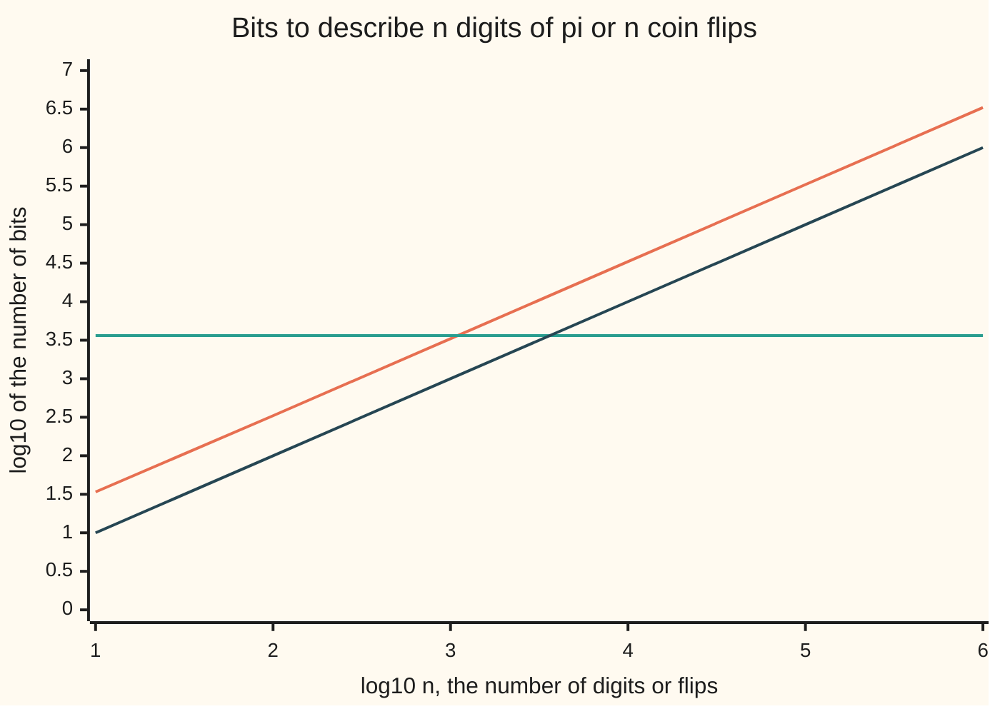
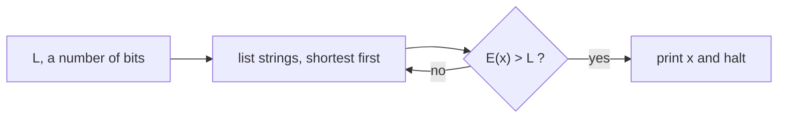

# Kolmogorov complexity: the length of the shortest program that prints it

[Syllabus](../../../SYLLABUS.md) → [Computability and complexity](../README.md) → [Computability and Logic](../README.md#s02) → Kolmogorov complexity

---

## General Overview

Take two files. The first holds the first million digits of pi, 3141592653… The second holds a million coin flips, written as 0s and 1s. Both look like noise. Every digit of pi shows up about as often as every other, and so does every flip.

Yet they are very different. A short program prints the first file: the 429-byte function on this card, plus one line that asks for a million digits. That is 3,640 bits in all, for a file that takes 3,321,929 bits even when packed tightly. No short program prints the second file. For all but about one flip sequence in a million, the shortest program that prints it is at least 999,980 bits long.

That is the idea of this card. To measure how much information one string holds, ask for the length of the shortest program that prints it and then stops. That length is the string's **Kolmogorov complexity**. A **program** here is a text that a fixed computer runs; a **string** is a finite row of symbols, such as bits or digits.

The measure has a catch. No program can compute it. Every number on this card is therefore an upper bound, set by a named program whose length is measured. The card proves why no better is possible.

**The Kolmogorov complexity of a string is the length of the shortest program that prints it and halts; it measures the information in that one string, is the same up to a fixed constant on every universal computer, and no program can compute it.**

**What kind of fact this is:** a definition, plus three theorems. The counting bound and the uncomputability theorem are proved on this card in Why it works. The invariance theorem is stated with its proof in outline and a named source.

### The picture: bits needed against file length

The chart counts bits on a log scale: 3 means 1,000 bits, 6 means a million.



The orange line is pi's digits packed at 3.32 bits each. The flat green line is the named pi program: its length hardly moves, because only the digits of n change. The dark line is n true coin flips, which need about n bits. Below about 1,000 digits the packed list is shorter than the program; past that the program wins, and the gap grows without end.

---

## The formula

Notation first, in words. A string $`x`$ is a row of bits, and $`|x|`$ is its length (from [Turing machines](../01-Models%20of%20Computation/07-turing-machines.md) and its shelf). $`U`$ is a **universal machine**: one fixed machine that reads a program $`p`$ and runs it ([Universal machines](../01-Models%20of%20Computation/09-universal-machines-and-the-halting-problem.md)). $`U(p) = x`$ means "run $`p`$ on $`U`$; it halts with output $`x`$". $`K_U(x)`$ is the new symbol: the Kolmogorov complexity of $`x`$ on $`U`$, in bits.

```math
K_U(x) = \min\{\, |p| \;:\; U(p) = x \,\}
```

**Read it aloud:** the complexity of $`x`$ is the length of the shortest program that makes $`U`$ print $`x`$ and stop.

Three facts carry the card. The first says the choice of machine barely matters:

```math
|K_U(x) - K_V(x)| \le c_{UV} \quad \text{for every string } x
```

The second says a string never needs much more than itself:

```math
K_U(x) \le |x| + c
```

The third says most strings cannot be squeezed. Out of the $`2^n`$ strings of length $`n`$, fewer than $`2^{n-k}`$ have a program shorter than $`n - k`$:

```math
\#\{\, x : |x| = n,\ K_U(x) < n - k \,\} < 2^{n-k}
```

Here $`\#`$ counts the members of a set, and $`\log_2`$ (used below) is the logarithm to base 2, so $`\log_2 10 = 3.3219`$ bits name one decimal digit.

| Symbol | Plain meaning | In our example | Push it up and the answer… |
| --- | --- | --- | --- |
| $`x`$ | the string to describe | a million digits of pi; a million flips | — |
| $`\lvert x\rvert`$ | its length in symbols | 1,000,000 | the plain-copy bound $`\lvert x\rvert + c`$ rises |
| $`U`$, $`V`$ | two fixed universal machines, the reference computers | here, Python 3 text at 8 bits a byte | — |
| $`p`$ | a program for $`U`$ | the 429-byte `pi_digits` plus a call line | — |
| $`\lvert p\rvert`$ | its length in bits | 3,640 bits | a weaker bound |
| $`K_U(x)`$ | the shortest $`\lvert p\rvert`$ with $`U(p) = x`$; written $`K(x)`$ once $`U`$ is fixed | at most 3,640 bits for pi | more information in $`x`$ |
| $`c_{UV}`$ | the fixed cost of switching machines: an interpreter for one written for the other | does not depend on $`x`$ | all bounds shift by it |
| $`c`$ | a fixed cost that does not depend on $`x`$: the `print("…")` wrapper, or the Berry search loop with its estimator | a few bytes; 807 bytes for the search on $`E`$ | every bound shifts by it |
| $`n`$ | the length of the strings being counted | 16 in the code, 1,000,000 for the flips | $`2^n`$ strings, $`2^n - 1`$ shorter programs |
| $`k`$ | how many bits of squeezing are asked for | 20 for the flips | the fraction allowed falls as $`2^{-k}`$ |
| $`E(x)`$ | a computable estimator of $`K`$: this card's run-length code, which records the first bit and then the length of each run of equal bits, each length in the Elias gamma code (`gamma`): one 0 for each binary digit after the first, then the length in binary, so 3 is written 011 | 1,500,001 bits for `0011` repeated | — |
| $`L`$, $`B_L`$ | a bit threshold, and the Berry program that prints the first string an estimator rates above $`L`$ | $`L`$ = 4 to 20, and 1,000,000 | $`B_L`$ grows only by the digits of $`L`$ |

### When it holds

- **The machine is fixed before the string.** Build a machine that prints pi's million digits on the empty program, and $`K`$ of that file is 0 bits on it. The invariance theorem charges this trick to the constant $`c_{UV}`$, which only helps a fixed, finite set of strings.
- **The machine is universal.** For a weak description method, such as the run-length code $`E`$, the shortest description is computable. It is also badly wrong: $`E`$ rates `0011` repeated 250,000 times at 1,500,001 bits, more than the raw million.
- **The program must halt.** A program still running after a billion steps might halt later and print $`x`$. A search with a step cap can only report "the best program found so far", never the true $`K(x)`$.
- **One string, not a source.** $`K`$ is about this file. A statement about "random files in general" needs [Entropy](../../14-Applied%20and%20computational/03-Information%20Theory/01-entropy.md) instead.
- **Constants matter only for short strings.** At 10 digits the named pi program costs 3,600 bits while the packed digits cost 34. $`K`$ says something sharp only when $`x`$ is much longer than the constants.

---

## Why it works

### Step 0: a program is a description, and descriptions can be counted

A program that prints $`x`$ is a complete description of $`x`$. Anyone holding the program and the machine can rebuild $`x`$ exactly. So the shortest program is the shortest complete description.

Two plain facts then do all the work. Programs are themselves bit strings, so they can be counted. And a program can run other programs, so a description can say "search for the first string such that…". The counting gives the lower bounds. The searching gives the uncomputability.

### Step 1: pi is short, because a short program prints it

The function `pi_digits(n)` in the code is 429 bytes. It is a spigot: a loop that drips out pi's digits one at a time, using whole numbers only (the Gibbons source below proves it correct for every n). Add the line `print(pi_digits(1000000))` and the whole program is 3,640 bits.

So $`K_{\text{Python}}(\text{first million digits of pi}) \le 3{,}640`$ bits. The bound is a named program with its length included. The true $`K`$ may be smaller; nobody can prove by how much (Step 5).

The bound grows only with the digits of n. From 10 digits to a million, the program grows from 3,600 to 3,640 bits, all of it in the call line.

### Step 2: the machine changes the answer by at most a constant

Measure in a different language, $`V`$. Write, once, an interpreter for Python in $`V`$: a $`V`$-program of fixed length $`c`$ that runs any Python text placed after it. Then every Python program $`p`$ becomes a $`V`$-program of length $`|p| + c`$. So $`K_V(x) \le K_{\text{Python}}(x) + c`$, and the reverse holds with another constant.

That is the invariance theorem. It is why $`K`$ is a property of the string, not of the language, once strings are long. It is stated here with its key step; the full proof is in Li and Vitányi, below.

### Step 3: no string needs much more than its own length

Give $`U`$ a fixed instruction, "copy the bits that follow to the output", and put $`x`$ after it. That program prints $`x`$. Its length is $`|x|`$ plus the fixed instruction. So $`K(x) \le |x| + c`$. Every string is compressible to itself, plus a constant.

In Python text the same program is `print("…")` with $`x`$ inside the quotes. There each bit, written as the character `0` or `1`, costs a whole 8-bit byte, so the Python copy is $`8|x| + c`$ bits. The factor 8 is a cost of the text format, not of the string; a machine that reads bits pays $`|x| + c`$.

### Step 4: most strings cannot be compressed at all

Count. There are $`2^n`$ strings of length $`n`$. The programs shorter than $`n - k`$ bits are the bit strings of length 0, 1, …, $`n - k - 1`$:

```math
1 + 2 + 4 + \dots + 2^{n-k-1} = 2^{n-k} - 1
```

Each program prints at most one string. So at most $`2^{n-k} - 1`$ strings of length $`n`$ have $`K < n - k`$, a fraction below $`2^{-k}`$.

For the million flips, take $`k = 20`$. Fewer than one sequence in 1,048,576 has a program shorter than 999,980 bits. Fair flips make every sequence equally likely, so the chance that yours is one of them is below 1 in 1,048,576. With $`k = 0`$ the count says at least one string of every length has $`K \ge n`$: it has no shorter description at all. The [Incompressibility](06-incompressibility-and-randomness.md) card builds on this count.

The code checks the count on a real description method. Of the 65,536 strings of 16 bits, the run-length code $`E`$ describes 1,150 in fewer than 16 bits and only 28 in fewer than 12. The bound allows up to 4,095.

### Step 5: no program computes K

Suppose some program `K_calc` returned $`K(x)`$ for every $`x`$. Build the **Berry program** $`B_L`$: list all strings, shortest first, and print the first one with `K_calc(x) > L`. Step 4 guarantees such a string exists, so $`B_L`$ halts.

Now count $`B_L`$'s length. It is `K_calc`, plus a fixed search loop, plus the number $`L`$ written in about $`\log_2 L`$ bits. For large $`L`$ that total is far below $`L`$. So $`B_L`$ is a program shorter than $`L`$ bits that prints a string whose complexity is above $`L`$ bits. That is impossible, so `K_calc` cannot exist.

The name comes from Berry's paradox: "the smallest number not nameable in under sixty letters" names one in under sixty letters.

<details>
<summary>Detailed proof: Kolmogorov complexity is not computable</summary>

Fix a universal machine $`U`$. Suppose a program `K_calc` computes $`K_U(x)`$ for every string $`x`$ and always halts.

For a whole number $`L`$, let $`B_L`$ be this program: "for $`n = 0, 1, 2, \dots`$ and each string $`x`$ of length $`n`$ in order, run `K_calc` on $`x`$; output the first $`x`$ with `K_calc`$`(x) > L`$ and halt." Everything except $`L`$, the search loop with `K_calc` inside it, has a fixed length $`c`$. The number $`L`$ takes at most $`2\log_2 L + 2`$ bits in a self-delimiting form (one that marks its own end, so the loop knows where $`L`$ stops). So

$`\displaystyle |B_L| \le c + 2\log_2 L + 2.`$

$`B_L`$ halts. By the counting of Step 4 with $`n = L + 1`$ and $`k = 0`$, some string of length $`L + 1`$ has $`K_U \ge L + 1 > L`$, and `K_calc` always halts, so the search reaches a string it rates above $`L`$.

Call the output $`x_L`$. Then $`K_U(x_L) > L`$, because `K_calc` is correct. Also $`U(B_L) = x_L`$, so $`K_U(x_L) \le |B_L|`$. Together:

$`\displaystyle L < c + 2\log_2 L + 2.`$

The right side grows like $`\log_2 L`$ and the left like $`L`$, so the inequality fails for every large enough $`L`$. That contradiction shows no such `K_calc` exists. The same argument shows something stronger: no program can even list infinitely many strings together with true lower bounds on their complexity beyond a fixed level.

</details>

### Step 6: what the construction does to a real estimator

Any real compressor is a computable estimator $`E`$ with $`K(x) \le E(x) + c`$. Run the Berry search on it and it does not fail. It finds a string that $`E`$ rates above $`L`$:



The code runs it. With $`L = 20`$ it prints `00001100110011`, which $`E`$ rates at 21 bits. The whole search program, with $`E`$ inside it and $`L = 1{,}000{,}000`$, is 807 bytes. So the string it prints has $`K`$ at most 807 bytes, while $`E`$ rates it above a million bits. Step 5's argument, run on a real estimator, does not produce a contradiction. It produces proof that the estimator is wrong somewhere, by a margin that grows with $`L`$. Every computable estimator has such strings.

What is possible is approach from above. Run all programs side by side, a few steps each, and keep the shortest that has printed $`x`$ so far. The bound only falls, and it reaches $`K(x)`$ eventually. But no step ever announces "this is the final value", because a shorter program may still be running. That is the halting problem again, as on [Busy beaver](02-the-busy-beaver-function.md).

### Step 7: how this differs from entropy

[Entropy](../../14-Applied%20and%20computational/03-Information%20Theory/01-entropy.md) measures a random source: the average bits per outcome over all the outcomes the source might produce. $`K`$ measures one string, with no chances in sight.

- **Pi's digits.** In the first 1,000 digits each digit appears 93 to 116 times. Read as a source, they give 3.3186 bits per digit, close to the ceiling 3.3219. An entropy coder (one built from symbol frequencies, such as [Huffman coding](../../14-Applied%20and%20computational/03-Information%20Theory/05-source-coding-and-huffman.md)) cannot beat that. $`K`$ sees the program: at most 3,640 bits for a million digits, by the named program.
- **True coin flips.** A fair coin has entropy 1 bit per flip, and Step 4 gives $`K`$ near $`n`$ for almost every outcome. Here the two measures agree.

The link between them is a theorem: for strings of length $`n`$ drawn from a computable source, the average of $`K`$ is within a small extra term of $`n`$ times the entropy (stated; see Li and Vitányi). Entropy is the average; $`K`$ is the single case.

---

## Worked numbers, by hand

| Step | Arithmetic | Value |
| --- | --- | --- |
| pi, a million digits as text | 1,000,000 × 8 bits | 8,000,000 bits |
| pi, packed at log2 10 bits a digit | 1,000,000 × 3.3219, rounded up | 3,321,929 bits |
| pi, the named program | (429-byte function + call line) × 8 | **3,640 bits** |
| flips, plain copy | 1,000,000 bits + wrapper | about 1,000,000 bits |
| programs shorter than 999,980 bits | 2^999,980 − 1 | fewer than 2^999,980 |
| share of flip sequences that short | 2^999,980 / 2^1,000,000 = 2^−20 | below 1 in 1,048,576 |
| flips, the bound for almost all | 1,000,000 − 20 | **at least 999,980 bits** |

The million digits of pi hold at most 3,640 bits of information, though, packed, its file is the larger one. A million fair flips hold close to a million bits, almost surely.

### What breaks if you drop a piece

| Mistake | Comes out at | What went wrong |
| --- | --- | --- |
| Take a computable compressor $`E`$ as $`K`$ | `0011` × 250,000: $`E`$ = 1,500,001 bits; the program `print('0011' * 250000)` is 184 bits | $`E`$ sees only runs; Step 6 says every computable estimator fails somewhere |
| Take digit-frequency entropy as $`K`$ of pi | 3.3186 bits a digit on the first 1,000 digits; at that rate, millions of bits for a million, against a 3,640-bit program | entropy describes a source, not this one string |
| Call seeded pseudo-random flips incompressible | $`E`$ = 1,132,640 bits; the 214-byte generator program is 1,712 bits | a seed plus a short formula is a short description |
| Trust the bound for short strings | 10 digits: the named program costs 3,600 bits, the packed digits 34 | $`K`$ is the minimum over all programs; constants swamp short strings |
| Read the Berry search on $`E`$ as a contradiction | $`L = 20`$: prints `00001100110011`, $`E`$ = 21 | $`E`$ is not $`K`$; the search shows $`E`$ is wrong, not that maths is |

---

## Code, from first principles, and it actually runs

The code never computes $`K`$. It sets upper bounds with named programs and measures their length in bytes. Python reads its own file to measure the two named programs, `pi_digits` and the Berry search, between the `>>>` and `<<<` markers; Rust holds the same texts and measures them. Pi's digits come by two independent roads in each language: a spigot (Gibbons' in Python, a base-10000 one in Rust) and Machin's formula, $`\pi = 16\arctan\frac15 - 4\arctan\frac1{239}`$ ($`\arctan`$ is the inverse tangent), in whole numbers. The counting bound is checked on all 65,536 strings of 16 bits, each decoded back to prove the descriptions are distinct. The coin flips come from SplitMix64, a small pseudo-random generator, with seed 2026, written out in both languages.

### Python

```python
# Kolmogorov complexity -- the check behind the card.  Standard library only.
# K(x) is never computed: no program can.  It is only bounded above, by named
# programs whose length in bytes is measured and printed.  Pi's digits come two
# independent ways (Gibbons' spigot, Machin's formula in whole numbers), the coin
# flips come from SplitMix64, and the Berry construction runs on a real estimator E.
from math import log2, log10

# >>> named program: the first n digits of pi
def pi_digits(n):
    q, r, t, k, m, x = 1, 0, 1, 1, 3, 3
    out = []
    while len(out) < n:
        if 4 * q + r - t < m * t:
            out.append(m)
            q, r, m = 10 * q, 10 * (r - m * t), 10 * (3 * q + r) // t - 10 * m
        else:
            q, r, t, k, m, x = (q * k, (2 * q + r) * x, t * x, k + 1,
                                (q * (7 * k + 2) + r * x) // (t * x), x + 2)
    return "".join(map(str, out))
# <<< named program

def machin(n):                    # road 2: pi = 16 atan(1/5) - 4 atan(1/239), whole numbers only
    one = 10 ** (n + 10)
    def atan_inv(x):
        total, term, k, sign = 0, one // x, 1, 1
        while term:
            total += sign * (term // k)
            term //= x * x; k += 2; sign = -sign
        return total
    return str(16 * atan_inv(5) - 4 * atan_inv(239))[:n]

def flips(seed, n):               # SplitMix64, top bit of each output: pseudo-random coin flips
    x, out = seed, []
    for _ in range(n):
        x = (x + 0x9E3779B97F4A7C15) % 2**64
        z = (x ^ x >> 30) * 0xBF58476D1CE4E5B9 % 2**64
        z = (z ^ z >> 27) * 0x94D049BB133111EB % 2**64
        out.append(str((z ^ z >> 31) >> 63))
    return "".join(out)

# >>> named program: the Berry search
def gamma(r):                     # Elias gamma code of r >= 1: (length - 1) zeros, then r in binary
    b = ""
    while r: b, r = str(r % 2) + b, r // 2
    return "0" * (len(b) - 1) + b
def describe(x):                  # estimator E's description: first bit, then each run length in gamma
    out, i = [x[0]], 0
    while i < len(x):
        j = i
        while j < len(x) and x[j] == x[i]: j += 1
        out.append(gamma(j - i)); i = j
    return "".join(out)
def E(x): return len(describe(x))
def berry(L):                     # the construction: the first string, shortest first, that E rates above L
    m = 1
    while True:
        for v in range(2 ** m):
            x = "".join(str(v >> (m - 1 - i) & 1) for i in range(m))
            if E(x) > L: return x
        m += 1
# <<< named program

def decode(d):                    # E's decoder: the description alone gives back x
    bit, i, out = d[0], 1, []
    while i < len(d):
        z = 0
        while d[i] == "0": z, i = z + 1, i + 1
        r = 0
        for c in d[i:i + z + 1]: r = 2 * r + int(c)
        i += z + 1
        out.append(bit * r); bit = "1" if bit == "0" else "0"
    return "".join(out)

src = open(__file__).read()
pi_prog = src.split("# >>> named program: the first n digits of pi\n")[1].split("# <<< named program")[0]
def pi_prog_bytes(n): return len(pi_prog) + len(f"print(pi_digits({n}))\n")

N = 1000
pi_a, pi_b = pi_digits(N), machin(N)
counts = [pi_a.count(str(d)) for d in range(10)]
h_emp = sum(c / N * log2(N / c) for c in counts)
print("pi, spigot road, first 30 digits ", pi_a[:30])
print("pi, Machin road, first 30 digits ", pi_b[:30])
print("pi, roads agree on digits        ", sum(1 for a, b in zip(pi_a, pi_b) if a == b), "of", N)
print("pi, six 9s start at place        ", pi_a.find("999999"))
print("pi, digit counts 0..9            ", " ".join(str(c) for c in counts))
print(f"pi, digit-frequency entropy      {h_emp:.4f} bits per digit (log2 10 = {log2(10):.4f})")
print("named pi program, bytes          ", len(pi_prog), "+ call line")
for n in (10, 1000, 1000000):
    print(f"n = {n:>7}: pi as text {8 * n:>7} bits, packed {int(n * log2(10)) + 1:>7} bits,"
          f" named program {8 * pi_prog_bytes(n):>5} bits")

F = 1000000
coins = flips(2026, F)
ones = coins.count("1")
print("flips, seed 2026, first 32       ", coins[:32])
print("flips, ones out of 1000000       ", ones)
print("flips, E in bits                 ", E(coins))
fl_prog = 'x = 2026\nfor i in range(10**6):\n    x = (x + 0x9E3779B97F4A7C15) % 2**64\n' \
          '    z = (x ^ x >> 30) * 0xBF58476D1CE4E5B9 % 2**64\n' \
          '    z = (z ^ z >> 27) * 0x94D049BB133111EB % 2**64\n    print((z ^ z >> 31) >> 63, end="")\n'
print("flips, named generator program   ", len(fl_prog), "bytes =", 8 * len(fl_prog), "bits")

patt = "0011" * 250000
print("0011 x 250000: E", E(patt), "bits; program print('0011' * 250000) is", 8 * len("print('0011' * 250000)\n"), "bits")
alt = "01" * 500000
print("01 x 500000:   E", E(alt), "bits; program print('01' * 500000) is", 8 * len("print('01' * 500000)\n"), "bits")

n, total, small = 16, 0, [0] * 5
for v in range(2 ** n):
    x = "".join(str(v >> (n - 1 - i) & 1) for i in range(n))
    assert decode(describe(x)) == x, "E's descriptions must decode back"
    for k in range(5):
        small[k] += E(x) < n - k
for k in range(5):
    print(f"16-bit strings with E < {n - k}: {small[k]:>5} of 65536; any method: at most {2 ** (n - k) - 1:>5}")
print("chance K < 999980 for 1000000 true flips: below 1 in", 2 ** 20)

for L in (4, 8, 12, 16, 20):
    x = berry(L)
    print(f"berry({L:>2}) prints {x:<14} E = {E(x):>2}, length {len(x):>2}")
b_prog = src.split("# >>> named program: the Berry search\n")[1].split("# <<< named program")[0]
print("berry program bytes, L = 1000000 ", len(b_prog) + len("print(berry(1000000))\n"))
print("chart, log10 n               ", " ".join(f"{e:>5}" for e in range(1, 7)))
print("chart, log10 bits, pi packed ", " ".join(f"{log10(int(10**e * log2(10)) + 1):5.2f}" for e in range(1, 7)))
print("chart, log10 bits, pi program", " ".join(f"{log10(8 * pi_prog_bytes(10**e)):5.2f}" for e in range(1, 7)))
print("chart, log10 bits, true flips", " ".join(f"{float(e):5.2f}" for e in range(1, 7)))

assert pi_a == pi_b, "spigot and Machin roads must agree on every digit"
assert pi_a.startswith("31415926535897932384626433832795"), "published opening digits"
assert pi_a.find("999999") == 762, "the six 9s start at decimal place 762"
assert all(small[k] <= 2 ** (n - k) - 1 for k in range(5)), "counting bound"
assert E(patt) == 1 + 3 * 500000 and E(alt) == 1 + 1000000, "E by runs against E by formula"
assert abs(ones - F / 2) < 3 * (F ** 0.5) / 2, "flips within 3 standard errors of half"
print("ALL CHECKS PASS")
```

**Ran 2026-11-19 on macOS, Python 3.14.10, standard library only. All checks passed. Output, pasted from the run:**

```
pi, spigot road, first 30 digits  314159265358979323846264338327
pi, Machin road, first 30 digits  314159265358979323846264338327
pi, roads agree on digits         1000 of 1000
pi, six 9s start at place         762
pi, digit counts 0..9             93 116 103 103 93 97 94 95 101 105
pi, digit-frequency entropy      3.3186 bits per digit (log2 10 = 3.3219)
named pi program, bytes           429 + call line
n =      10: pi as text      80 bits, packed      34 bits, named program  3600 bits
n =    1000: pi as text    8000 bits, packed    3322 bits, named program  3616 bits
n = 1000000: pi as text 8000000 bits, packed 3321929 bits, named program  3640 bits
flips, seed 2026, first 32        10101111000100100011111000111100
flips, ones out of 1000000        500015
flips, E in bits                  1132640
flips, named generator program    214 bytes = 1712 bits
0011 x 250000: E 1500001 bits; program print('0011' * 250000) is 184 bits
01 x 500000:   E 1000001 bits; program print('01' * 500000) is 168 bits
16-bit strings with E < 16:  1150 of 65536; any method: at most 65535
16-bit strings with E < 15:   374 of 65536; any method: at most 32767
16-bit strings with E < 14:   150 of 65536; any method: at most 16383
16-bit strings with E < 13:    62 of 65536; any method: at most  8191
16-bit strings with E < 12:    28 of 65536; any method: at most  4095
chance K < 999980 for 1000000 true flips: below 1 in 1048576
berry( 4) prints 001            E =  5, length  3
berry( 8) prints 000011         E =  9, length  6
berry(12) prints 00110011       E = 13, length  8
berry(16) prints 00100110011    E = 17, length 11
berry(20) prints 00001100110011 E = 21, length 14
berry program bytes, L = 1000000  807
chart, log10 n                    1     2     3     4     5     6
chart, log10 bits, pi packed   1.53  2.52  3.52  4.52  5.52  6.52
chart, log10 bits, pi program  3.56  3.56  3.56  3.56  3.56  3.56
chart, log10 bits, true flips  1.00  2.00  3.00  4.00  5.00  6.00
ALL CHECKS PASS
```

### Rust

The Rust check takes different roads to pi: a spigot that uses only small numbers, and Machin's formula on a hand-made big whole number in base $`10^9`$.

```rust
// Kolmogorov complexity -- the same check as kolmogorov_complexity_check.py, in Rust, std only.
// K(x) is only bounded above, by the named programs held below as text and measured.  Pi comes
// from a small-number spigot and from Machin's formula on a hand-made big whole number.

const PI_PROG: &str = r#"def pi_digits(n):
    q, r, t, k, m, x = 1, 0, 1, 1, 3, 3
    out = []
    while len(out) < n:
        if 4 * q + r - t < m * t:
            out.append(m)
            q, r, m = 10 * q, 10 * (r - m * t), 10 * (3 * q + r) // t - 10 * m
        else:
            q, r, t, k, m, x = (q * k, (2 * q + r) * x, t * x, k + 1,
                                (q * (7 * k + 2) + r * x) // (t * x), x + 2)
    return "".join(map(str, out))
"#;
const BERRY_PROG: &str = r#"def gamma(r):                     # Elias gamma code of r >= 1: (length - 1) zeros, then r in binary
    b = ""
    while r: b, r = str(r % 2) + b, r // 2
    return "0" * (len(b) - 1) + b
def describe(x):                  # estimator E's description: first bit, then each run length in gamma
    out, i = [x[0]], 0
    while i < len(x):
        j = i
        while j < len(x) and x[j] == x[i]: j += 1
        out.append(gamma(j - i)); i = j
    return "".join(out)
def E(x): return len(describe(x))
def berry(L):                     # the construction: the first string, shortest first, that E rates above L
    m = 1
    while True:
        for v in range(2 ** m):
            x = "".join(str(v >> (m - 1 - i) & 1) for i in range(m))
            if E(x) > L: return x
        m += 1
"#;
const FL_PROG: &str = "x = 2026\nfor i in range(10**6):\n    x = (x + 0x9E3779B97F4A7C15) % 2**64\n    z = (x ^ x >> 30) * 0xBF58476D1CE4E5B9 % 2**64\n    z = (z ^ z >> 27) * 0x94D049BB133111EB % 2**64\n    print((z ^ z >> 31) >> 63, end=\"\")\n";
fn spigot(ndig: usize) -> String {               // road 1: a base-10000 spigot on small numbers
    let (a, mut c, mut e, mut s) = (10000u64, ndig / 4 * 14, 0u64, String::new());
    let mut f = vec![a / 5; c + 1]; f[c] = 0;
    while c > 0 {
        let (mut d, mut g, mut b) = (0u64, 2 * c as u64, c);
        loop {
            d += f[b] * a; g -= 1; f[b] = d % g; d /= g; g -= 1; b -= 1;
            if b == 0 { break; }
            d *= b as u64;
        }
        s += &format!("{:04}", e + d / a); e = d % a; c -= 14;
    }
    s
}
// Big whole numbers: base 10^9 limbs, least significant first, signed until the end.
const BASE: i64 = 1_000_000_000;
fn div_small(a: &[i64], d: i64) -> Vec<i64> {
    let (mut out, mut rem) = (vec![0; a.len()], 0);
    for i in (0..a.len()).rev() { let cur = rem * BASE + a[i]; out[i] = cur / d; rem = cur % d; }
    out
}
fn machin(n: usize) -> String {                  // road 2: pi = 16 atan(1/5) - 4 atan(1/239)
    let len = (n + 10) / 9 + 2;
    let (mut one, mut acc) = (vec![0i64; len], vec![0i64; len]);
    one[(n + 10) / 9] = 10i64.pow(((n + 10) % 9) as u32);
    for (x, coef) in [(5i64, 16i64), (239, -4)] {
        let (mut term, mut k, mut sign) = (div_small(&one, x), 1, coef);
        while term.iter().any(|&v| v != 0) {
            let t = div_small(&term, k);
            for i in 0..len { acc[i] += sign * t[i]; }
            term = div_small(&term, x * x); k += 2; sign = -sign;
        }
    }
    let mut carry = 0;
    for v in acc.iter_mut() { let s = *v + carry; *v = s.rem_euclid(BASE); carry = s.div_euclid(BASE); }
    let mut i = len - 1; while acc[i] == 0 { i -= 1; }
    let mut s = acc[i].to_string();
    for j in (0..i).rev() { s += &format!("{:09}", acc[j]); }
    s[..n].to_string()
}
fn flips(seed: u64, n: usize) -> String {        // SplitMix64, top bit of each output
    let mut x = seed; let mut out = String::with_capacity(n);
    for _ in 0..n {
        x = x.wrapping_add(0x9E3779B97F4A7C15);
        let mut z = (x ^ (x >> 30)).wrapping_mul(0xBF58476D1CE4E5B9);
        z = (z ^ (z >> 27)).wrapping_mul(0x94D049BB133111EB);
        out.push(if (z ^ (z >> 31)) >> 63 == 1 { '1' } else { '0' });
    }
    out
}
fn gamma(r: usize) -> String { let b = format!("{:b}", r); "0".repeat(b.len() - 1) + &b }
fn describe(x: &[u8]) -> String {                // estimator E: first bit, then run lengths in gamma
    let mut out = String::new(); out.push(x[0] as char); let mut i = 0;
    while i < x.len() { let mut j = i; while j < x.len() && x[j] == x[i] { j += 1; } out += &gamma(j - i); i = j; }
    out
}
fn e_len(x: &[u8]) -> usize { describe(x).len() }
fn decode(d: &[u8]) -> Vec<u8> {
    let (mut bit, mut i, mut out) = (d[0], 1, Vec::new());
    while i < d.len() {
        let mut z = 0; while d[i] == b'0' { z += 1; i += 1; }
        let mut r = 0; for &c in &d[i..i + z + 1] { r = 2 * r + (c - b'0') as usize; }
        i += z + 1;
        for _ in 0..r { out.push(bit); }
        bit = if bit == b'0' { b'1' } else { b'0' };
    }
    out
}
fn bits(v: u64, m: usize) -> Vec<u8> { (0..m).map(|i| if v >> (m - 1 - i) & 1 == 1 { b'1' } else { b'0' }).collect() }
fn berry(l: usize) -> Vec<u8> {
    let mut m = 1;
    loop { for v in 0..(1u64 << m) { let x = bits(v, m); if e_len(&x) > l { return x; } } m += 1; }
}

fn main() {
    let pi_bytes = |n: u64| PI_PROG.len() + format!("print(pi_digits({}))\n", n).len();
    let n = 1000;
    let (pi_a, pi_b) = (spigot(n), machin(n));
    let counts: Vec<usize> = (0..10).map(|d| pi_a.matches(&d.to_string()).count()).collect();
    let h_emp: f64 = counts.iter().map(|&c| c as f64 / n as f64 * (n as f64 / c as f64).log2()).sum();
    let six = pi_a.find("999999").unwrap();
    println!("pi, spigot road, first 30 digits  {}", &pi_a[..30]);
    println!("pi, Machin road, first 30 digits  {}", &pi_b[..30]);
    println!("pi, roads agree on digits         {} of {}", pi_a.bytes().zip(pi_b.bytes()).filter(|(a, b)| a == b).count(), n);
    println!("pi, six 9s start at place         {}", six);
    println!("pi, digit counts 0..9             {}", counts.iter().map(|c| c.to_string()).collect::<Vec<_>>().join(" "));
    println!("pi, digit-frequency entropy      {:.4} bits per digit (log2 10 = {:.4})", h_emp, 10f64.log2());
    println!("named pi program, bytes           {} + call line", PI_PROG.len());
    for nn in [10u64, 1000, 1000000] {
        println!("n = {:>7}: pi as text {:>7} bits, packed {:>7} bits, named program {:>5} bits",
                 nn, 8 * nn, (nn as f64 * 10f64.log2()) as u64 + 1, 8 * pi_bytes(nn));
    }
    let big = 1000000;
    let coins = flips(2026, big);
    let ones = coins.matches('1').count();
    println!("flips, seed 2026, first 32        {}", &coins[..32]);
    println!("flips, ones out of 1000000        {}", ones);
    println!("flips, E in bits                  {}", e_len(coins.as_bytes()));
    println!("flips, named generator program    {} bytes = {} bits", FL_PROG.len(), 8 * FL_PROG.len());
    let patt = "0011".repeat(250000);
    let alt = "01".repeat(500000);
    println!("0011 x 250000: E {} bits; program print('0011' * 250000) is {} bits", e_len(patt.as_bytes()), 8 * "print('0011' * 250000)\n".len());
    println!("01 x 500000:   E {} bits; program print('01' * 500000) is {} bits", e_len(alt.as_bytes()), 8 * "print('01' * 500000)\n".len());
    let m = 16;
    let mut small = [0usize; 5];
    for v in 0..(1u64 << m) {
        let x = bits(v, m);
        assert!(decode(describe(&x).as_bytes()) == x, "E's descriptions must decode back");
        let e = e_len(&x);
        for k in 0..5 { if e < m - k { small[k] += 1; } }
    }
    for k in 0..5 {
        println!("16-bit strings with E < {}: {:>5} of 65536; any method: at most {:>5}", m - k, small[k], (1usize << (m - k)) - 1);
    }
    println!("chance K < 999980 for 1000000 true flips: below 1 in {}", 1u64 << 20);
    for l in [4usize, 8, 12, 16, 20] {
        let x = berry(l);
        println!("berry({:>2}) prints {:<14} E = {:>2}, length {:>2}", l, std::str::from_utf8(&x).unwrap(), e_len(&x), x.len());
    }
    println!("berry program bytes, L = 1000000  {}", BERRY_PROG.len() + "print(berry(1000000))\n".len());
    println!("chart, log10 n                {}", (1..7).map(|e| format!("{:>5}", e)).collect::<Vec<_>>().join(" "));
    println!("chart, log10 bits, pi packed  {}", (1..7).map(|e| format!("{:5.2}", (((10f64.powi(e) * 10f64.log2()) as u64 + 1) as f64).log10())).collect::<Vec<_>>().join(" "));
    println!("chart, log10 bits, pi program {}", (1..7).map(|e| format!("{:5.2}", ((8 * pi_bytes(10u64.pow(e as u32))) as f64).log10())).collect::<Vec<_>>().join(" "));
    println!("chart, log10 bits, true flips {}", (1..7).map(|e| format!("{:5.2}", e as f64)).collect::<Vec<_>>().join(" "));

    assert!(pi_a == pi_b, "spigot and Machin roads must agree on every digit");
    assert!(pi_a.starts_with("31415926535897932384626433832795"), "published opening digits");
    assert!(six == 762, "the six 9s start at decimal place 762");
    assert!((0..5).all(|k| small[k] <= (1 << (m - k)) - 1), "counting bound");
    assert!(e_len(patt.as_bytes()) == 1 + 3 * 500000 && e_len(alt.as_bytes()) == 1 + 1000000, "E by runs against E by formula");
    assert!(((ones as f64) - big as f64 / 2.0).abs() < 3.0 * (big as f64).sqrt() / 2.0, "flips within 3 standard errors of half");
    println!("ALL CHECKS PASS");
}
```

**Ran 2026-11-19 on macOS, rustc 1.98.1, no crates. All checks passed. Output, pasted from the run:**

```
pi, spigot road, first 30 digits  314159265358979323846264338327
pi, Machin road, first 30 digits  314159265358979323846264338327
pi, roads agree on digits         1000 of 1000
pi, six 9s start at place         762
pi, digit counts 0..9             93 116 103 103 93 97 94 95 101 105
pi, digit-frequency entropy      3.3186 bits per digit (log2 10 = 3.3219)
named pi program, bytes           429 + call line
n =      10: pi as text      80 bits, packed      34 bits, named program  3600 bits
n =    1000: pi as text    8000 bits, packed    3322 bits, named program  3616 bits
n = 1000000: pi as text 8000000 bits, packed 3321929 bits, named program  3640 bits
flips, seed 2026, first 32        10101111000100100011111000111100
flips, ones out of 1000000        500015
flips, E in bits                  1132640
flips, named generator program    214 bytes = 1712 bits
0011 x 250000: E 1500001 bits; program print('0011' * 250000) is 184 bits
01 x 500000:   E 1000001 bits; program print('01' * 500000) is 168 bits
16-bit strings with E < 16:  1150 of 65536; any method: at most 65535
16-bit strings with E < 15:   374 of 65536; any method: at most 32767
16-bit strings with E < 14:   150 of 65536; any method: at most 16383
16-bit strings with E < 13:    62 of 65536; any method: at most  8191
16-bit strings with E < 12:    28 of 65536; any method: at most  4095
chance K < 999980 for 1000000 true flips: below 1 in 1048576
berry( 4) prints 001            E =  5, length  3
berry( 8) prints 000011         E =  9, length  6
berry(12) prints 00110011       E = 13, length  8
berry(16) prints 00100110011    E = 17, length 11
berry(20) prints 00001100110011 E = 21, length 14
berry program bytes, L = 1000000  807
chart, log10 n                    1     2     3     4     5     6
chart, log10 bits, pi packed   1.53  2.52  3.52  4.52  5.52  6.52
chart, log10 bits, pi program  3.56  3.56  3.56  3.56  3.56  3.56
chart, log10 bits, true flips  1.00  2.00  3.00  4.00  5.00  6.00
ALL CHECKS PASS
```

The two outputs are identical line for line. Four roads to pi's first 1,000 digits agree on every digit and place the six 9s at decimal place 762.

### Lean

Lean proves the card's three theorems for every universal machine, with strings and programs as rows of bits, and checks the hand numbers.

- A machine $`U`$ counts as universal when it is computable and runs any computable machine's programs after a fixed prefix.
- Take two universal machines $`U`$ and $`V`$. Then one constant $`c_{UV}`$ gives $`|K_U(x) - K_V(x)| \le c_{UV}`$ for every string $`x`$.
- Take a universal machine $`U`$ and whole numbers $`n`$ and $`k`$. Then fewer than $`2^{n-k}`$ strings of length $`n`$ have $`K_U(x) < n - k`$.
- Take a universal machine $`U`$. Then no program that always halts returns $`K_U(x)`$ for every string $`x`$.
- The counts are right: 4,095 programs shorter than 12 bits, 65,536 strings of 16 bits, and $`2^{20}`$ = 1,048,576 for the flips at $`k = 20`$.
- The program lengths are right: 3,640 bits for a million pi digits, 3,600 for ten, 184 for `0011` repeated, and 1,712 for the flips.
- Packed digits need 34 bits for 10 digits and 3,322 bits for 1,000, and $`E`$ rates the $`L = 20`$ Berry string at 21 bits.

The named programs themselves, pi's digits, the flips, the estimator $`E`$ and the Berry runs are left to the Python and Rust checks.

```lean
-- Kolmogorov complexity: on a fixed universal machine, the length of the shortest program that prints a string changes by at most a constant between machines, fewer than 2^(n-k) strings of length n have it below n - k, and no program computes it.
import Mathlib.Computability.Partrec
import Mathlib.Data.Set.Card
import Mathlib.Data.Set.Finite.List
import Mathlib.Data.Fintype.BigOperators
import Mathlib.Order.Lattice.Nat
import Mathlib.Algebra.BigOperators.Group.Finset.Basic
import Mathlib.Tactic.NormNum

namespace KolmogorovComplexity

/-- A machine reads a program `p`, a string of bits, and may halt with an output string.
`x ∈ U p` means "run `p` on `U`; it halts with output `x`". A run that never halts gives no
output. -/
abbrev Machine := List Bool →. List Bool

/-- `U` is a universal machine: it is itself a program (partial computable), and for every
partial computable machine `V` there is a fixed interpreter text `e` such that `U` run on `e`
followed by any program `p` does exactly what `V` does on `p`. -/
def IsUniversal (U : Machine) : Prop :=
  Partrec U ∧ ∀ V : Machine, Partrec V → ∃ e : List Bool, ∀ p : List Bool, U (e ++ p) = V p

/-- The Kolmogorov complexity of `x` on `U`, in bits:
`K_U(x) = min {|p| : U(p) = x}`, the length of the shortest program that makes `U` print `x`
and halt. -/
noncomputable def K (U : Machine) (x : List Bool) : ℕ :=
  sInf {n | ∃ p : List Bool, p.length = n ∧ x ∈ U p}

theorem cnt_eq (m : ℕ) : {p : List Bool | p.length = m}.ncard = 2 ^ m := by
  rw [← _root_.Nat.card_coe_set_eq]
  change Nat.card (List.Vector Bool m) = 2 ^ m
  rw [Nat.card_eq_fintype_card, card_vector, Fintype.card_bool]

#print axioms cnt_eq

theorem cnt_lt (m : ℕ) : {p : List Bool | p.length < m}.ncard + 1 = 2 ^ m := by
  induction m with
  | zero => simp
  | succ m ih =>
    have hs : {p : List Bool | p.length < m + 1} =
        {p : List Bool | p.length < m} ∪ {p : List Bool | p.length = m} := by
      ext p; simp; omega
    rw [hs, Set.ncard_union_eq _ (List.finite_length_lt Bool m) (List.finite_length_eq Bool m),
      cnt_eq, pow_succ]
    · omega
    · rw [Set.disjoint_left]; intro p h1 h2; simp at h1 h2; omega

#print axioms cnt_lt

theorem exists_prog (U : Machine) (hU : IsUniversal U) (x : List Bool) :
    ∃ p : List Bool, x ∈ U p := by
  obtain ⟨e, he⟩ := hU.2 (fun _ => Part.some x) (Partrec.const' _)
  exact ⟨e ++ [], by rw [he]; exact Part.mem_some x⟩

#print axioms exists_prog

theorem K_spec (U : Machine) (hU : IsUniversal U) (x : List Bool) :
    ∃ p : List Bool, p.length = K U x ∧ x ∈ U p := by
  obtain ⟨p, hp⟩ := exists_prog U hU x
  exact Nat.sInf_mem (s := {n | ∃ p : List Bool, p.length = n ∧ x ∈ U p}) ⟨_, p, rfl, hp⟩

#print axioms K_spec

theorem K_le (U : Machine) {x p : List Bool} (h : x ∈ U p) : K U x ≤ p.length :=
  Nat.sInf_le ⟨p, rfl, h⟩

#print axioms K_le

theorem K_le_add (U V : Machine) (hU : IsUniversal U) (hV : IsUniversal V) :
    ∃ c : ℕ, ∀ x, K U x ≤ K V x + c := by
  obtain ⟨e, he⟩ := hU.2 V hV.1
  refine ⟨e.length, fun x => ?_⟩
  obtain ⟨p, hp, hx⟩ := K_spec V hV x
  have := K_le U (x := x) (p := e ++ p) (by rw [he]; exact hx)
  simp at this; omega

#print axioms K_le_add

def fam (n : ℕ) : List Bool := (List.range n).map (fun _ => true)

#print axioms fam

theorem fam_inj : Function.Injective fam := by
  intro a b h
  have := congrArg List.length h
  simpa [fam] using this

#print axioms fam_inj

theorem exists_big (U : Machine) (hU : IsUniversal U) (N : ℕ) : ∃ n, N ≤ K U (fam n) := by
  by_contra hc
  push Not at hc
  have hF : {x : List Bool | ∃ p ∈ {p : List Bool | p.length < N}, x ∈ U p}.Finite := by
    have : {x : List Bool | ∃ p ∈ {p : List Bool | p.length < N}, x ∈ U p} =
        ⋃ p ∈ {p : List Bool | p.length < N}, {x | x ∈ U p} := by ext; simp
    rw [this]
    refine (List.finite_length_lt Bool N).biUnion fun p _ => ?_
    exact Set.Subsingleton.finite fun a ha b hb => Part.mem_unique ha hb
  apply Set.infinite_range_of_injective fam_inj
  refine hF.subset ?_
  rintro _ ⟨n, rfl⟩
  obtain ⟨p, hp, hx⟩ := K_spec U hU (fam n)
  exact ⟨p, by simp only [Set.mem_ofPred_eq]; rw [hp]; exact hc n, hx⟩

#print axioms exists_big

/-- No program computes Kolmogorov complexity: on a universal machine `U`, no program that
always halts returns `K_U(x)` for every string `x`. -/
theorem kolmogorov_complexity_not_computable (U : Machine) (hU : IsUniversal U) :
    ¬ Computable (K U) := by
  intro hK
  let V : Machine := fun p =>
    (Nat.rfind fun n => Part.some (decide (2 * p.length + 1 ≤ K U (fam n)))).map fam
  have hfam : Computable fam :=
    (Primrec.list_map Primrec.list_range (Primrec.const true).to₂).to_comp
  have hV : Partrec V := by
    refine Partrec.map (Partrec.rfind ?_) (hfam.comp Computable.snd).to₂
    refine Computable₂.partrec₂ ?_
    refine Computable₂.comp₂ (Primrec.nat_le.decide.to_comp) ?_ ?_
    · exact (Primrec.succ.comp (Primrec.nat_mul.comp (Primrec.const 2)
        (Primrec.list_length.comp Primrec.fst))).to_comp
    · exact (hK.comp (hfam.comp Computable.snd))
  obtain ⟨e, he⟩ := hU.2 V hV
  obtain ⟨n0, hn0⟩ := exists_big U hU (2 * e.length + 1)
  let p := List.replicate e.length false
  have hdom : (Nat.rfind fun n => Part.some (decide (2 * p.length + 1 ≤ K U (fam n)))).Dom := by
    refine Nat.rfind_dom'.2 ⟨n0, ?_, fun _ => trivial⟩
    simpa [p] using hn0
  have hmem := Part.get_mem hdom
  have hspec := Nat.rfind_spec hmem
  simp only [Part.mem_some_iff] at hspec
  have hx : fam (Part.get _ hdom) ∈ U (e ++ p) := by
    rw [he]; exact Part.mem_map fam hmem
  have := K_le U hx
  simp [p] at this hspec
  omega

/-- The invariance theorem: for two universal machines `U` and `V` there is a constant `c`,
the cost of switching machines, with `|K_U(x) - K_V(x)| ≤ c` for every string `x`. -/
theorem kolmogorov_complexity_invariance (U V : Machine) (hU : IsUniversal U)
    (hV : IsUniversal V) :
    ∃ c : ℕ, ∀ x : List Bool, |(K U x : ℤ) - (K V x : ℤ)| ≤ c := by
  obtain ⟨c1, h1⟩ := K_le_add U V hU hV
  obtain ⟨c2, h2⟩ := K_le_add V U hV hU
  refine ⟨c1 + c2, fun x => ?_⟩
  have a := h1 x; have b := h2 x
  rw [abs_le]; constructor <;> push_cast <;> omega

/-- The counting bound: out of the `2^n` strings of length `n`, fewer than `2^(n-k)` have
`K_U(x) < n - k`, because there are only `2^(n-k) - 1` programs shorter than `n - k` bits and
each prints at most one string. -/
theorem few_strings_are_compressible (U : Machine) (hU : IsUniversal U) (n k : ℕ) :
    {x : List Bool | x.length = n ∧ K U x < n - k}.ncard < 2 ^ (n - k) := by
  choose g hg1 hg2 using K_spec U hU
  have hle := Set.ncard_le_ncard_of_injOn (s := {x : List Bool | x.length = n ∧ K U x < n - k}) (t := {p : List Bool | p.length < n - k}) g
    (fun x hx => by simp only [Set.mem_ofPred_eq] at hx ⊢; rw [hg1]; exact hx.2)
    (fun x _ y _ hxy => Part.mem_unique (hg2 x) (hxy ▸ hg2 y))
    (List.finite_length_lt Bool _)
  have := cnt_lt (n - k)
  omega

/-! The card's own whole-number worked examples. -/

-- Programs shorter than n - k bits: 1 + 2 + 4 + ... + 2^(n-k-1) = 2^(n-k) - 1.
-- For n = 16, k = 4 that is 4,095 programs, out of 65,536 strings of 16 bits.
example : (Finset.range 12).sum (fun i => 2 ^ i) = 2 ^ 12 - 1 ∧ 2 ^ 12 - 1 = 4095 ∧
    2 ^ 16 = 65536 := by
  decide

-- The run-length code describes 1,150 of the 16-bit strings in fewer than 16 bits and 28 in
-- fewer than 12; the counting bound allows up to 2^16 - 1 and 2^12 - 1.
example : 1150 ≤ 2 ^ 16 - 1 ∧ 28 ≤ 2 ^ 12 - 1 := by norm_num

-- A million flips with k = 20: fewer than one sequence in 2^20 = 1,048,576 has a program
-- shorter than 1,000,000 - 20 = 999,980 bits.
example : (2 : ℕ) ^ 20 = 1048576 ∧ 1000000 - 20 = 999980 := by norm_num
example : (2 : ℕ) ^ 999980 * 2 ^ 20 = 2 ^ 1000000 := by rw [← pow_add]

-- The named pi program: the 429-byte function plus the call line `print(pi_digits(1000000))`
-- and a newline (26 bytes) is 3,640 bits; with `print(pi_digits(10))` (21 bytes) it is 3,600.
example : (429 + 26) * 8 = 3640 ∧ (429 + 21) * 8 = 3600 := by norm_num

-- Packed digits: 10 decimal digits need 34 bits (2^33 < 10^10 ≤ 2^34), and 1,000 digits need
-- 3,322 bits (2^3321 < 10^1000 ≤ 2^3322).
example : (2 : ℕ) ^ 33 < 10 ^ 10 ∧ (10 : ℕ) ^ 10 ≤ 2 ^ 34 := by norm_num
set_option exponentiation.threshold 4000 in
example : (2 : ℕ) ^ 3321 < 10 ^ 1000 ∧ (10 : ℕ) ^ 1000 ≤ 2 ^ 3322 := by norm_num

-- `0011` repeated 250,000 times: the run-length code spends 1 bit, then 3 bits on each of its
-- 500,000 runs of two, 1,500,001 bits; `print('0011' * 250000)` with a newline is 23 bytes,
-- 184 bits. The 214-byte flip generator is 1,712 bits.
example : 1 + 3 * 500000 = 1500001 ∧ 23 * 8 = 184 ∧ 214 * 8 = 1712 := by norm_num

-- The Berry search with L = 20 prints `00001100110011`: runs 4, 2, 2, 2, 2, 2, coded as
-- 1 bit, then 5 bits for the run of 4 and 3 bits for each run of 2, 21 bits, just above 20.
example : 1 + 5 + 5 * 3 = 21 ∧ 20 < 21 ∧ 4 + 5 * 2 = 14 := by norm_num

#print axioms kolmogorov_complexity_not_computable
#print axioms kolmogorov_complexity_invariance
#print axioms few_strings_are_compressible

end KolmogorovComplexity
```

**Checked 2026-11-19 on macOS, Lean 4.36.0-rc2, Mathlib v4.36.0-rc2. Every proof is complete and uses only Lean's standard axioms. Output, pasted from the run:**

```
'KolmogorovComplexity.cnt_eq' depends on axioms: [propext, Classical.choice, Quot.sound]
'KolmogorovComplexity.cnt_lt' depends on axioms: [propext, Classical.choice, Quot.sound]
'KolmogorovComplexity.exists_prog' depends on axioms: [propext, Classical.choice, Quot.sound]
'KolmogorovComplexity.K_spec' depends on axioms: [propext, Classical.choice, Quot.sound]
'KolmogorovComplexity.K_le' depends on axioms: [propext, Classical.choice, Quot.sound]
'KolmogorovComplexity.K_le_add' depends on axioms: [propext, Classical.choice, Quot.sound]
'KolmogorovComplexity.fam' does not depend on any axioms
'KolmogorovComplexity.fam_inj' depends on axioms: [propext, Quot.sound]
'KolmogorovComplexity.exists_big' depends on axioms: [propext, Classical.choice, Quot.sound]
'KolmogorovComplexity.kolmogorov_complexity_not_computable' depends on axioms: [propext, Classical.choice, Quot.sound]
'KolmogorovComplexity.kolmogorov_complexity_invariance' depends on axioms: [propext, Classical.choice, Quot.sound]
'KolmogorovComplexity.few_strings_are_compressible' depends on axioms: [propext, Classical.choice, Quot.sound]
```

> [!TIP]
> **Try changing**
> - **Guess first:** at how many digits does the named pi program beat the packed list? The output shows 10 digits (3,600 against 34 bits) and 1,000 digits (3,616 against 3,322 bits). The crossover is just above 1,000, and from there the gap only grows.
> - **Guess first:** what does the Berry search print for $`L = 24`$? Change `(4, 8, 12, 16, 20)` to `(4, 8, 12, 16, 20, 24)`. The new line prints `0011001100110011`, 16 bits long, which $`E`$ rates at 25: 2 bits longer than for $`L = 20`$. Each step of 4 in $`L`$ makes the string 2 or 3 bits longer, since a run of two costs $`E`$ 3 bits for 2 symbols.
> - **Guess first:** what happens if `gamma` drops one leading zero? Change `len(b) - 1` to `len(b) - 2`. The decoder can no longer find where each run length ends. It runs off the end of a description, and the check stops with an error in the 16-bit round trip.
> - **Guess first:** change `239` to `238` in `machin`. Machin's road then leaves pi at the sixth digit, printing 314152…, and the first assert stops the run: two independent roads catch one wrong constant.

---

## The usual mistake

> [!warning]
> **Quoting a compressor's output as the Kolmogorov complexity.** A zip file, or this card's $`E`$, gives an upper bound and nothing more. $`E`$ rates `0011` repeated 250,000 times at 1,500,001 bits, while a 184-bit program prints it. Step 5 proves no program closes that gap for every string, so "the complexity of this file is 3,640 bits" is never a measured fact. "At most 3,640 bits, by this named program" is.
>
> - **Looks random, so it is complex.** The SplitMix64 flips have 500,015 ones in a million and defeat $`E`$, which needs 1,132,640 bits. A 1,712-bit program prints them.
> - **Entropy and complexity are the same number.** Pi's digit frequencies give 3.3186 bits a digit, millions of bits in all; its complexity is at most 3,640 bits.
> - **Leaving out the machine.** "K = 0" is true for a machine built for one file. Without a fixed universal machine, and the constant $`c_{UV}`$, the number means nothing.
> - **Ignoring the call line and the decoder.** A bound must count the whole program: the 429-byte function alone prints nothing. The named program is 3,640 bits only with its call line included.

---

## Where you meet it in real life

- **File compression.** Every compressor, from zip to the [Arithmetic and Lempel-Ziv coding](../../14-Applied%20and%20computational/03-Information%20Theory/06-arithmetic-and-lempel-ziv-coding.md) methods, prints an upper bound on $`K`$ for each file. Step 4 is why no compressor shrinks every file: most files have no shorter description.
- **Randomness testing.** A sequence that some short program prints is not random, however well it passes frequency tests. That is the difference between real coin flips and a generator, taken up on [Pseudorandomness](../04-Beyond%20Worst%20Case/04-derandomisation-and-pseudorandomness.md).
- **Similarity of files.** Two texts that compress much better together than apart share structure. Measures built on this have grouped languages, genomes and pieces of music, with a compressor standing in for $`K`$.
- **Model choice.** The minimum description length principle picks the model that gives the shortest total: the model, plus the data described with its help. It is Occam's razor made into bits.
- **Proofs.** "Most strings are incompressible" lets a proof pick a string with no structure and argue about it. That method is the job of [Incompressibility](06-incompressibility-and-randomness.md).

> **Say it back**
> The Kolmogorov complexity of a string is the length of the shortest program that prints it and halts on a fixed universal machine. Changing the machine moves it by at most a constant. A million digits of pi have a 3,640-bit program, while almost every million coin flips needs about a million bits, because there are too few short programs to go round. Unlike entropy, it measures one string, not a source. No program can compute it: a program that could would let a short search print a string it rates as complex, so every number is an upper bound from a named program.

---

## What this builds on

- [Hilbert's tenth problem](04-hilberts-tenth-problem.md): another "no program can" answer, reached by turning programs into equations. This card reaches its own by counting plus a self-referring search.
- [Entropy](../../14-Applied%20and%20computational/03-Information%20Theory/01-entropy.md): bits as the average cost of an outcome from a random source. This card moves the measure to one string.
- [Turing machines](../01-Models%20of%20Computation/07-turing-machines.md): the machine model that "program" and "halts" refer to.
- [Rice's theorem](../01-Models%20of%20Computation/10-rices-theorem-and-reductions.md): no interesting property of what a program does is decidable. The Berry search of Step 5 is a second, different route to the same kind of wall.

## Where this goes next

- [Incompressibility](06-incompressibility-and-randomness.md): Step 4's count turned into a definition of a random string, and into a proof method.
- [Lambda calculus](07-lambda-calculus-in-outline.md): another universal machine, on which the same $`K`$ lives up to a constant.

Related on this shelf: [Busy beaver](02-the-busy-beaver-function.md) (knowing how long short programs can run would let a search compute $`K`$, so the busy beaver function is uncomputable too) and [Godel's theorems](03-godels-incompleteness-in-outline.md) (formal systems and proofs). Made to search through proofs, the Berry construction gives Chaitin's theorem, stated here with its source (Li and Vitányi): a consistent formal system that proves basic arithmetic, with axioms a program can list, proves $`K(x) > L`$ for no string $`x`$ once $`L`$ passes a fixed level that depends on the system.

The question this card leaves open: if no one can certify that a given string is complex, what can be said about random strings as a whole, and how can they still be used in proofs?

---

## Sources

Verified 2026-11-19: every link below resolves to the publisher's page.

- Kolmogorov, A. N. "Three approaches to the quantitative definition of information." *International Journal of Computer Mathematics* 2 (1968): 157–168. [doi:10.1080/00207166808803030](https://doi.org/10.1080/00207166808803030). The definition, and the contrast with the probabilistic measure of information.
- Chaitin, Gregory J. "On the Length of Programs for Computing Finite Binary Sequences." *Journal of the ACM* 13, no. 4 (1966): 547–569. [doi:10.1145/321356.321363](https://doi.org/10.1145/321356.321363). Program-length complexity found independently, with the counting of Step 4.
- Li, Ming, and Paul Vitányi. *An Introduction to Kolmogorov Complexity and Its Applications*, 4th ed. Springer, 2019. [doi:10.1007/978-3-030-11298-1](https://doi.org/10.1007/978-3-030-11298-1). The invariance theorem, the uncomputability proof, Chaitin's theorem, the link to entropy and the applications.
- Gibbons, Jeremy. "Unbounded Spigot Algorithms for the Digits of Pi." *The American Mathematical Monthly* 113, no. 4 (2006): 318–328. [doi:10.1080/00029890.2006.11920310](https://doi.org/10.1080/00029890.2006.11920310). The spigot inside the named pi program, proved correct for every number of digits.
- Rabinowitz, Stanley, and Stan Wagon. "A Spigot Algorithm for the Digits of π." *The American Mathematical Monthly* 102, no. 3 (1995): 195–203. [doi:10.1080/00029890.1995.11990560](https://doi.org/10.1080/00029890.1995.11990560). The small-number spigot behind the Rust road.
