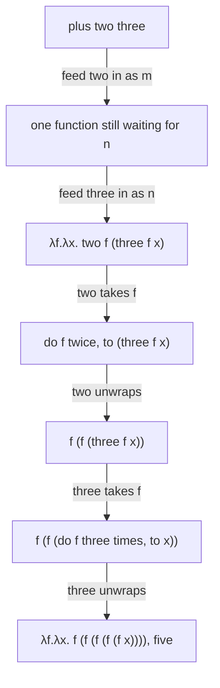

# Lambda calculus: computing with nothing but functions

[Syllabus](../../../SYLLABUS.md) → [Computability and complexity](../README.md) → [Computability and Logic](../README.md#s02) → Lambda calculus

---

## General Overview

Work out two plus three with no numerals, no plus sign and no adding machine. Only functions are allowed: rules that take an input and hand back an output.

The way out is to store a number as a habit. "Two" becomes the function that takes any action f and a starting point x, and does f twice: f (f x). "Three" does f three times. Given the action "add a tally mark" and a blank page, two draws two marks.

Addition is one more function. It takes two habits and builds a third: do f three times, then two more times. A small program, the **reducer**, rewrites this one rule at a time. After 6 rewrites it prints the habit that does f five times.

That reducer is this shelf's house example: a program that reads programs and returns each in its simplest form.

Alonzo Church introduced the λ notation in 1932, inside a larger logic that was later shown to contradict itself. Its pure function part, the **lambda calculus**, survived. By 1936 it was one of the first exact definitions of "computable".

**The lambda calculus has only functions and one rule, feed an argument into a function, and that is enough to write numbers, addition and every function a Turing machine can compute.**

**What kind of fact this is:** the numbers and plus are definitions. That plus turns any m and n into m + n in exactly 6 steps, rewriting the leftmost spot first (normal order), is a theorem, proved in Why it works; the code checks that arguments-first also takes 6 steps for m and n from 0 to 6. That the order of steps cannot change the answer is a theorem stated with its source (Church and Rosser, 1936), not proved here. So is the normalisation theorem, that normal order reaches the answer whenever there is one (Hindley and Seldin), and the match with Turing machines (Kleene, 1936; Turing, 1937).

### The picture: two plus three, rewritten six times



Each arrow is one use of the single rule.

---

## The formula

Notation first, in words. A **term** is a program in this calculus. There are only three kinds:

- a **variable**, a name such as $`x`$ or $`f`$;
- a **function**, written $`\lambda x.\, M`$: "take an input, call it $`x`$, and return $`M`$". Here λ (the Greek letter lambda) makes a function. It is not an eigenvalue.
- an **application**, written $`M\, N`$: "feed $`N`$ into $`M`$". Applications group to the left, so $`m\, f\, y`$ means $`(m\, f)\, y`$.

The one rule is **beta reduction**:

```math
(\lambda x.\, M)\; N \;\to_\beta\; M[x := N]
```

**Read it aloud:** a function that takes x and returns M, fed the argument N, rewrites in one step to M with N put in place of every free x.

A **free** x is one that no λx inside M has claimed. A term where no rule applies anywhere is a **normal form**: the answer.

Numbers and addition are then written as terms. These **Church numerals**, the habits of the overview, store n as "do f n times":

```math
\underline{0} = \lambda f.\,\lambda x.\; x, \qquad \underline{2} = \lambda f.\,\lambda x.\; f\,(f\,x), \qquad \underline{n} = \lambda f.\,\lambda x.\; \underbrace{f\,(f\,(\cdots f}_{n \text{ times}}\,x)\cdots)
```

```math
\mathrm{succ} = \lambda n.\,\lambda f.\,\lambda x.\; f\,(n\, f\, x), \qquad \mathrm{plus} = \lambda m.\,\lambda n.\,\lambda f.\,\lambda x.\; m\, f\,(n\, f\, x)
```

**Read it aloud:** succ does f n times and then once more; plus does f n times starting at x, then m more times starting where that left off.

| Symbol | Plain meaning | In our example | Push it up and the answer… |
| --- | --- | --- | --- |
| $`x`$, $`f`$, $`m`$, $`n`$, $`y`$, $`z`$, $`x'`$ | variables: names for inputs; a prime marks a renamed copy | f is the action, x the start; z is the test input fed to the renamed and the wrong versions | — |
| $`M`$, $`N`$ | any terms, that is, any programs | M is a body, N an argument | — |
| $`\lambda x.\, M`$ | a function: take x, return M | $`\lambda f.\,\lambda x.\; f\,(f\,x)`$ | — |
| $`M\, N`$ | application: feed N into M | $`\mathrm{plus}\;\underline{2}`$ | — |
| $`\to_\beta`$, $`\to_\beta^{*}`$ | one beta step; with a star, zero or more steps | 6 steps for two plus three | — |
| $`M[x := N]`$ | M with N put in place of every free x | $`(m\, f\, y)[m := \underline{2}]`$ | — |
| $`\underline{n}`$ | the Church numeral: do f n times | $`\underline{2}`$, $`\underline{3}`$, $`\underline{5}`$ | one more f inside; plus still takes 6 steps |
| $`\mathrm{succ}`$ | the successor: one more f | $`\mathrm{succ}\;\underline{2}`$ gives $`\underline{3}`$ | — |
| $`\mathrm{plus}`$ | addition, as a function of two numerals | $`\mathrm{plus}\;\underline{2}\;\underline{3}`$ | — |
| $`\mathrm{times}`$ | multiplication: $`\lambda m.\,\lambda n.\,\lambda f.\; m\,(n\, f)`$ | $`\mathrm{times}\;\underline{2}\;\underline{3}`$ gives $`\underline{6}`$ | — |
| $`\Omega`$ | omega: $`(\lambda x.\, x\, x)\,(\lambda x.\, x\, x)`$, a term with no answer | the reducer's loop case | — |

### When it holds

- **Bound names are renamed before substituting.** Putting y into $`\lambda y.\, x`$ must give $`\lambda y'.\, y`$, not $`\lambda y.\, y`$. Skip the renaming and the inner λ captures the outside y. Fed z, the wrong version returns z instead of y. On $`\underline{3}\;\underline{2}`$ the wrong version has no answer after 12 steps, and its term has 779,817 nodes; the true answer has 19.
- **A normal form exists.** $`\Omega`$ rewrites to itself in 1 step, forever. The calculus contains programs that never stop, as it must if it computes everything a Turing machine does.
- **The order of steps reaches the answer.** Always rewriting the leftmost, outermost spot (**normal order**) finds the normal form whenever one exists: the normalisation theorem, stated here without proof (Hindley and Seldin give it). Rewriting arguments first can loop: on $`(\lambda x.\,\lambda y.\, x)\; y\;\Omega`$ normal order answers y in 2 steps, and arguments-first loops on $`\Omega`$.
- **The reader decodes the answer.** A term means "5" only to someone who reads Church numerals. With no types (labels saying what kind of thing a term is), nothing stops a program feeding a number something meaningless.

---

## Why it works

### Step 0: a Church numeral is a repeat count, not a mark

[Peano's three rules](../../01-Foundations/06-Proof/07-peano-and-one-plus-one.md) build the counting numbers from a start and a next, and define addition from next. The lambda calculus has no start or next built in. So it borrows them.

A numeral takes them as inputs. $`\underline{n}`$ asks for a "next" called f and a "start" called x, and applies f to x n times. Zero is $`\lambda f.\,\lambda x.\; x`$: start, no steps. The number is the count of f's, and nothing else.

### Step 1: running a program is substitution

The only way anything happens is beta reduction: a function meets an argument, and the argument is copied into the body. The reducer finds a spot of the shape $`(\lambda x.\, M)\; N`$, rewrites it, and repeats until no such spot is left.

### Step 2: succ adds one more f

$`\mathrm{succ}\;\underline{n}`$ rewrites to $`\lambda f.\,\lambda x.\; f\,(\underline{n}\, f\, x)`$. Inside, $`\underline{n}\, f\, x`$ unwraps to n f's on x, and the outer f makes n + 1. This is Peano's "next", built out of a function.

### Step 3: plus is "do f n times, then m more times"

$`\underline{n}\, f`$ is the function "do f n times". $`\underline{m}\, f`$ is "do f m times". Plus feeds the first one's output into the second:

```math
\mathrm{plus}\;\underline{m}\;\underline{n} \;\to_\beta^{*}\; \lambda f.\,\lambda x.\; \underline{m}\, f\,(\underline{n}\, f\, x)
```

**Read it aloud:** plus of m and n rewrites, in zero or more steps (the star), to: do f n times from x, then m more times.

This is [Composing functions](../../01-Foundations/08-Relations%20and%20Functions/03-composition.md): do f n times, then do f m times, is one function that does f m + n times. Unlike most compositions, the order here does not matter: m + n = n + m.

<details>
<summary>Detailed proof: plus m n reaches the numeral m + n in exactly 6 steps of normal order</summary>

Fix any counts m and n. Write $`f^{k}\,y`$ for k copies of f applied to y. In this fold only, the raised k is a count of copies, not a power.

Steps 1 and 2 feed the numerals in for the names m and n. The numerals have no free variables, so nothing is renamed:

$`\displaystyle \mathrm{plus}\;\underline{m}\;\underline{n} \;\to_\beta\;\to_\beta\; \lambda f.\,\lambda x.\; \underline{m}\, f\,(\underline{n}\, f\, x)`$

Normal order now rewrites the leftmost spot, $`\underline{m}\, f`$. Step 3 feeds f in, giving $`\lambda x'.\, f^{m}\, x'`$, where $`x'`$ is the numeral's own start (the reducer prints it as x; its own λ keeps it apart from the outer x). Step 4 feeds in $`\underline{n}\, f\, x`$ as that start:

$`\displaystyle \lambda f.\,\lambda x.\; f^{m}\,(\underline{n}\, f\, x)`$

Steps 5 and 6 do the same to $`\underline{n}\, f\, x`$, which becomes $`f^{n}\, x`$. No step creates a new spot to rewrite, so the result is a normal form:

$`\displaystyle \lambda f.\,\lambda x.\; f^{m}\,(f^{n}\, x) \;=\; \lambda f.\,\lambda x.\; f^{m+n}\, x \;=\; \underline{m+n}`$

The count is 6 whatever m and n are: each numeral unwraps in two steps however long it is. The copying grows with m and n; the rule count does not. When m is 0, step 3 gives $`\lambda x'.\, x'`$, and step 4 returns its argument unchanged: still 6.

</details>

### Step 4: the order cannot change the answer

A term can hold several spots to rewrite. After step 2 of Worked numbers, by hand, there are two: $`\underline{2}\, f`$ and $`\underline{3}\, f`$. Either order ends at $`\underline{5}`$.

The **Church–Rosser theorem** (1936) says: if a term rewrites two different ways, both results can be rewritten further to a common term. So a term has at most one normal form, up to renaming bound names. It is stated here, not proved. The code checks it on 49 pairs: normal order and arguments-first agree on every $`\mathrm{plus}\;\underline{m}\;\underline{n}`$ with m and n from 0 to 6.

### Step 5: why functions alone reach everything

Truth values, pairs and lists are coded as functions too: true, for one, is λx.λy.x, which picks the first of two inputs. The missing piece is a loop. $`\Omega`$ supplies it: $`x\, x`$ is a program reading its own text. A cousin, the **Y combinator**, uses that trick to let a function call itself: recursion.

With recursion in hand, two theorems close the circle:

- Kleene (1936): the functions the lambda calculus defines are exactly the recursive functions (those built from zero and successor by substitution, recursion and unbounded search).
- Turing (1937): they are exactly the functions a Turing machine computes.

So the lambda calculus is the fourth model in the [Church-Turing thesis](../01-Models%20of%20Computation/08-church-turing-thesis.md).

---

## Worked numbers, by hand

Normal order, on $`\mathrm{plus}\;\underline{2}\;\underline{3}`$. Each value is the whole term after that step, exactly as the reducer prints it.

| Step | What is substituted | Value |
| --- | --- | --- |
| 0 | start | `(λm.λn.λf.λx.m f (n f x)) (λf.λx.f (f x)) (λf.λx.f (f (f x)))` |
| 1 | two, in place of m | `(λn.λf.λx.(λf.λx.f (f x)) f (n f x)) (λf.λx.f (f (f x)))` |
| 2 | three, in place of n | `λf.λx.(λf.λx.f (f x)) f ((λf.λx.f (f (f x))) f x)` |
| 3 | f, into two | `λf.λx.(λx.f (f x)) ((λf.λx.f (f (f x))) f x)` |
| 4 | three f x, into two's start | `λf.λx.f (f ((λf.λx.f (f (f x))) f x))` |
| 5 | f, into three | `λf.λx.f (f ((λx.f (f (f x))) x))` |
| 6 | x, into three's start | **`λf.λx.f (f (f (f (f x))))`: five f's, the numeral 5** |

The answer is the Church numeral 5, "do f five times". Fed "add one" and the start 0, it gives 5, reached with nothing but substitution.

### What breaks if you drop a piece

| Mistake | Comes out at | What went wrong |
| --- | --- | --- |
| Move one bracket: $`m\,(n\, f)\, x`$ instead of $`m\, f\,(n\, f\, x)`$ | $`\underline{6}`$ | That is times, not plus: it does "f three times" twice over |
| Substitute without renaming, on $`(\lambda x.\,\lambda y.\, x)\; y`$ | $`\lambda y.\, y`$, which gives z when fed z; the right answer gives y | The inner λy captured the outside y |
| Substitute without renaming, on $`\underline{3}\;\underline{2}`$ | no answer after 12 steps; 779,817 nodes against 19 | Captured names send the term the wrong way: it balloons instead of shrinking to 8 |
| Rewrite arguments first, on $`(\lambda x.\,\lambda y.\, x)\; y\;\Omega`$ | loops: $`\Omega`$ returns unchanged | The argument was never needed, but arguments-first ran it anyway |

---

## Code, from first principles, and it actually runs

The code writes out a parser, a printer and a reducer that renames before substituting. It takes **three independent roads** to two plus three, each checked against plain 2 + 3:

1. The substitution reducer in normal order, its answer decoded by counting f's.
2. An evaluator with no substitution at all. It runs the term with f bound to the host language's "add one" and x to 0, and reads off an integer.
3. The same reducer, rewriting arguments first, which must reach the identical normal form.

All three roads, and succ and times, are checked on the 49 pairs with m and n from 0 to 6. The run prints every "What breaks" row. A term that comes back unchanged is printed as proof of looping; anything else past the cap prints "still running".

### Python

```python
# Lambda calculus: two plus three with functions only, then a reducer that reads the program.
# Standard library only. A term is ('v', name), ('l', name, body) or ('a', function, argument).
def parse(s):
    toks, i = s.replace('(', ' ( ').replace(')', ' ) ').replace('.', ' . ').replace('λ', ' λ ').split(), 0
    def term():
        nonlocal i
        if toks[i] == 'λ':
            x, i = toks[i + 1], i + 3                  # skip λ, the name and the dot
            return ('l', x, term())
        t = atom()
        while i < len(toks) and toks[i] != ')':
            if toks[i] == 'λ': return ('a', t, term())  # a lambda argument runs to the end
            t = ('a', t, atom())                     # application groups to the left
        return t
    def atom():
        nonlocal i
        if toks[i] == '(':
            i += 1; t = term(); i += 1
            return t
        i += 1
        return ('v', toks[i - 1])
    return term()

def show(t):
    if t[0] == 'v': return t[1]
    if t[0] == 'l': return 'λ' + t[1] + '.' + show(t[2])
    f, a = show(t[1]), show(t[2])
    return ('(' + f + ')' if t[1][0] == 'l' else f) + ' ' + ('(' + a + ')' if t[2][0] != 'v' else a)

def free(t):
    if t[0] == 'v': return {t[1]}
    if t[0] == 'l': return free(t[2]) - {t[1]}
    return free(t[1]) | free(t[2])

def subst(t, x, s, rename=True):
    """t with every free x replaced by s; a binder that would capture a free name of s is renamed."""
    if t[0] == 'v': return s if t[1] == x else t
    if t[0] == 'a': return ('a', subst(t[1], x, s, rename), subst(t[2], x, s, rename))
    y, b = t[1], t[2]
    if y == x: return t
    if rename and y in free(s):
        z = y + "'"
        while z in free(s) | free(b): z += "'"
        y, b = z, subst(b, y, ('v', z))
    return ('l', y, subst(b, x, s, rename))

def step(t, order='normal', rename=True):
    """One beta step, or None at a normal form. normal = leftmost outermost; args = arguments first."""
    if t[0] == 'v': return None
    if t[0] == 'l':
        b = step(t[2], order, rename)
        return None if b is None else ('l', t[1], b)
    if order == 'normal' and t[1][0] == 'l': return subst(t[1][2], t[1][1], t[2], rename)
    f = step(t[1], order, rename)
    if f is not None: return ('a', f, t[2])
    a = step(t[2], order, rename)
    if a is not None: return ('a', t[1], a)
    return subst(t[1][2], t[1][1], t[2], rename) if t[1][0] == 'l' else None

def reduce(t, order='normal', cap=1000, trace=None):
    for n in range(cap + 1):
        if trace is not None: trace.append(t)
        u = step(t, order)
        if u is None: return t, n
        if u == t: return None, -n - 1              # the term came back unchanged: a proof it never stops
        t = u
    return None, cap                                 # still running after cap steps

def num(n):
    body = ('v', 'x')
    for _ in range(n): body = ('a', ('v', 'f'), body)
    return ('l', 'f', ('l', 'x', body))

def decode(t):
    """Read a normal form λf.λx.f (f (.. x)) back as a count of f's, else None."""
    if t[0] != 'l' or t[2][0] != 'l': return None
    f, x, b, k = t[1], t[2][1], t[2][2], 0
    while b[0] == 'a' and b[1] == ('v', f): b, k = b[2], k + 1
    return k if b == ('v', x) and f != x else None

def run(t, env):
    """Road 2: an environment evaluator. Numbers are host integers; inc adds one. No substitution."""
    if t[0] == 'v': return env[t[1]]
    if t[0] == 'l': return ('clo', t[1], t[2], env)
    f, a = run(t[1], env), run(t[2], env)
    return a + 1 if f == 'inc' else run(f[2], {**f[3], f[1]: a})

app = lambda *ts: ts[0] if len(ts) == 1 else ('a', app(*ts[:-1]), ts[-1])
SUCC, PLUS = parse('λn.λf.λx.f (n f x)'), parse('λm.λn.λf.λx.m f (n f x)')
TIMES, BAD = parse('λm.λn.λf.m (n f)'), parse('λm.λn.λf.λx.m (n f) x')
assert parse('λf.λx.f (f x)') == num(2) and parse('λf.λx.x') == num(0)
for name, t in [('two', num(2)), ('three', num(3)), ('succ', SUCC), ('plus', PLUS)]:
    print(f'term,{name},{show(t)}')
trace = []
five, steps = reduce(app(PLUS, num(2), num(3)), trace=trace)
for k, t in enumerate(trace): print(f'trace,{k},{show(t)}')
host = run(app(PLUS, num(2), num(3), ('v', 'inc'), ('v', 'zero')), {'inc': 'inc', 'zero': 0})
print(f'answer,decoded {decode(five)},host run {host},plain 2 + 3 = {2 + 3},beta steps {steps}')
assert decode(five) == 2 + 3 == host and five == num(5) and steps == 6
grid = [(m, n) for m in range(7) for n in range(7)]
for m, n in grid:
    r, s = reduce(app(PLUS, num(m), num(n)))
    r2, s2 = reduce(app(PLUS, num(m), num(n)), order='args')
    h = run(app(PLUS, num(m), num(n), ('v', 'inc'), ('v', 'zero')), {'inc': 'inc', 'zero': 0})
    assert decode(r) == m + n == h and r == r2 and s == s2 == 6
    assert decode(reduce(app(SUCC, num(m)))[0]) == m + 1
    assert decode(reduce(app(TIMES, num(m), num(n)))[0]) == m * n
print(f'grid,plus m n for m and n in 0..6: {len(grid)} pairs,all decode to m + n,both orders agree,6 steps each')
K = parse('λx.λy.x')
good, bad = step(app(K, ('v', 'y'))), step(app(K, ('v', 'y')), rename=False)
print(f'break,capture: (λx.λy.x) y,renamed {show(good)},naive {show(bad)}')
print(f"break,capture: then applied to z,renamed {show(step(app(good, ('v', 'z'))))},naive {show(step(app(bad, ('v', 'z'))))}")
assert step(app(good, ('v', 'z'))) == ('v', 'y') and step(app(bad, ('v', 'z'))) == ('v', 'z')
size = lambda t: 1 if t[0] == 'v' else 1 + size(t[2]) if t[0] == 'l' else 1 + size(t[1]) + size(t[2])
t = app(num(3), num(2))
for _ in range(12): t = step(t, rename=False)
print(f'break,capture: three two (power) naive,after 12 steps no answer,term size {size(t)} nodes against {size(num(8))} for 8')
assert decode(t) is None and size(t) > 1000 * size(num(8))
r, s = reduce(app(BAD, num(2), num(3)))
print(f'break,bracket moved: λm.λn.λf.λx.m (n f) x on two three,decodes to {decode(r)},not 5')
assert decode(r) == 6
OMEGA = parse('(λx.x x) (λx.x x)')
r, s = reduce(OMEGA)
print(f'break,omega {show(OMEGA)},after {-s} step the same term returns: no normal form')
assert r is None and s == -1
KO = app(K, ('v', 'y'), OMEGA)
r1, s1 = reduce(KO)
r2, s2 = reduce(KO, order='args')
print(f'break,(λx.λy.x) y omega,normal order {show(r1)} in {s1} steps')
print(f"break,(λx.λy.x) y omega,arguments first {'loops: omega returns unchanged' if s2 < 0 else 'still running'}")
assert show(r1) == 'y' and s1 == 2 and r2 is None
for label, t in [('times two three', app(TIMES, num(2), num(3))), ('three two (power)', app(num(3), num(2))),
                 ('plus twenty thirty', app(PLUS, num(20), num(30)))]:
    r, s = reduce(t)
    print(f'try,{label},decodes to {decode(r)},beta steps {s}')
assert decode(reduce(app(num(3), num(2)))[0]) == 2 ** 3
print('ALL CHECKS PASS')
```

**Ran 2026-11-19 on macOS, Python 3.14.10, standard library only. All checks passed. Output, pasted from the run:**

```text
term,two,λf.λx.f (f x)
term,three,λf.λx.f (f (f x))
term,succ,λn.λf.λx.f (n f x)
term,plus,λm.λn.λf.λx.m f (n f x)
trace,0,(λm.λn.λf.λx.m f (n f x)) (λf.λx.f (f x)) (λf.λx.f (f (f x)))
trace,1,(λn.λf.λx.(λf.λx.f (f x)) f (n f x)) (λf.λx.f (f (f x)))
trace,2,λf.λx.(λf.λx.f (f x)) f ((λf.λx.f (f (f x))) f x)
trace,3,λf.λx.(λx.f (f x)) ((λf.λx.f (f (f x))) f x)
trace,4,λf.λx.f (f ((λf.λx.f (f (f x))) f x))
trace,5,λf.λx.f (f ((λx.f (f (f x))) x))
trace,6,λf.λx.f (f (f (f (f x))))
answer,decoded 5,host run 5,plain 2 + 3 = 5,beta steps 6
grid,plus m n for m and n in 0..6: 49 pairs,all decode to m + n,both orders agree,6 steps each
break,capture: (λx.λy.x) y,renamed λy'.y,naive λy.y
break,capture: then applied to z,renamed y,naive z
break,capture: three two (power) naive,after 12 steps no answer,term size 779817 nodes against 19 for 8
break,bracket moved: λm.λn.λf.λx.m (n f) x on two three,decodes to 6,not 5
break,omega (λx.x x) (λx.x x),after 1 step the same term returns: no normal form
break,(λx.λy.x) y omega,normal order y in 2 steps
break,(λx.λy.x) y omega,arguments first loops: omega returns unchanged
try,times two three,decodes to 6,beta steps 7
try,three two (power),decodes to 8,beta steps 14
try,plus twenty thirty,decodes to 50,beta steps 6
ALL CHECKS PASS
```

### Rust

The same reducer, with terms as a shared-pointer tree. No crates.

```rust
// Lambda calculus: two plus three with functions only, then a reducer that reads the program.
// std only. A term is a variable V, a function L (name, body) or an application A (function, argument).
use std::{collections::BTreeSet, rc::Rc};
#[derive(Clone, PartialEq, Debug)]
enum T { V(String), L(String, Rc<T>), A(Rc<T>, Rc<T>) }
use T::*;
fn v(s: &str) -> Rc<T> { Rc::new(V(s.to_string())) }
fn a(f: Rc<T>, x: Rc<T>) -> Rc<T> { Rc::new(A(f, x)) }
fn l(x: &str, b: Rc<T>) -> Rc<T> { Rc::new(L(x.to_string(), b)) }
fn app(ts: &[Rc<T>]) -> Rc<T> { let mut t = ts[0].clone(); for x in &ts[1..] { t = a(t, x.clone()); } t }
struct P { toks: Vec<String>, i: usize }
fn parse(s: &str) -> Rc<T> {
    let toks = s.replace('(', " ( ").replace(')', " ) ").replace('.', " . ").replace('λ', " λ ")
        .split_whitespace().map(String::from).collect();
    P { toks, i: 0 }.term()
}
impl P {
    fn term(&mut self) -> Rc<T> {
        let x = self.toks.get(self.i + 1).cloned().unwrap_or_default();
        if self.toks[self.i] == "λ" { self.i += 3; return l(&x, self.term()); } // skip λ, the name and the dot
        let mut t = self.atom();
        while self.i < self.toks.len() && self.toks[self.i] != ")" {
            if self.toks[self.i] == "λ" { return a(t, self.term()); } // a lambda argument runs to the end
            t = a(t, self.atom()); // application groups to the left
        }
        t
    }
    fn atom(&mut self) -> Rc<T> {
        if self.toks[self.i] == "(" { self.i += 1; let t = self.term(); self.i += 1; return t; }
        self.i += 1; v(&self.toks[self.i - 1].clone())
    }
}
fn show(t: &T) -> String {
    match t { V(x) => x.clone(), L(x, b) => format!("λ{}.{}", x, show(b)), A(f, x) => {
        let fs = if matches!(**f, L(..)) { format!("({})", show(f)) } else { show(f) };
        let xs = if matches!(**x, V(_)) { show(x) } else { format!("({})", show(x)) };
        format!("{} {}", fs, xs) } }
}
fn free(t: &T) -> BTreeSet<String> {
    match t { V(x) => [x.clone()].into(), L(x, b) => { let mut s = free(b); s.remove(x); s }
              A(f, x) => { let mut s = free(f); s.extend(free(x)); s } }
}
// t with every free x replaced by s; a binder that would capture a free name of s is renamed.
fn subst(t: &Rc<T>, x: &str, s: &Rc<T>, rename: bool) -> Rc<T> {
    match &**t {
        V(y) => if y == x { s.clone() } else { t.clone() },
        A(f, g) => a(subst(f, x, s, rename), subst(g, x, s, rename)),
        L(y, b) => {
            if y == x { return t.clone(); }
            let (mut y, mut b) = (y.clone(), b.clone());
            if rename && free(s).contains(&y) {
                let (mut avoid, mut z) = (free(s), format!("{}'", y));
                avoid.extend(free(&b));
                while avoid.contains(&z) { z.push('\''); }
                b = subst(&b, &y, &v(&z), true); y = z;
            }
            l(&y, subst(&b, x, s, rename))
        }
    }
}
// One beta step, or None at a normal form. normal = leftmost outermost; otherwise arguments first.
fn step(t: &Rc<T>, normal: bool, rn: bool) -> Option<Rc<T>> {
    match &**t {
        V(_) => None,
        L(x, b) => step(b, normal, rn).map(|b| l(x, b)),
        A(f, g) => {
            if normal { if let L(x, b) = &**f { return Some(subst(b, x, g, rn)); } }
            if let Some(f2) = step(f, normal, rn) { return Some(a(f2, g.clone())); }
            if let Some(g2) = step(g, normal, rn) { return Some(a(f.clone(), g2)); }
            if let L(x, b) = &**f { Some(subst(b, x, g, rn)) } else { None }
        }
    }
}
// Returns (normal form, steps); a negative count means the term came back unchanged: it never stops.
fn reduce(t: &Rc<T>, normal: bool, cap: i64, mut trace: Option<&mut Vec<Rc<T>>>) -> (Option<Rc<T>>, i64) {
    let mut t = t.clone();
    for n in 0..=cap { // trace, if given, collects every term on the way
        if let Some(tr) = trace.as_mut() { tr.push(t.clone()); }
        match step(&t, normal, true) {
            None => return (Some(t), n),
            Some(u) => { if u == t { return (None, -n - 1); } t = u }
        }
    }
    (None, cap) // still running after cap steps
}
fn num(n: usize) -> Rc<T> { let mut b = v("x"); for _ in 0..n { b = a(v("f"), b); } l("f", l("x", b)) }
// Read a normal form λf.λx.f (f (.. x)) back as a count of f's, else -1.
fn decode(t: &Option<Rc<T>>) -> i64 {
    if let Some(t) = t { if let L(f, inner) = &**t { if let L(x, body) = &**inner {
        let (mut b, mut k) = (body.clone(), 0);
        loop {
            b = match &*b { A(g, y) if **g == V(f.clone()) => y.clone(), _ => break }; k += 1;
        }
        if *b == V(x.clone()) && f != x { return k; }
    } } }
    -1
}
// Road 2: an environment evaluator. Numbers are host integers; Inc adds one. No substitution.
#[derive(Clone)]
enum Val { Int(i64), Inc, Clo(String, Rc<T>, Vec<(String, Val)>) }
fn run(t: &Rc<T>, env: &Vec<(String, Val)>) -> Val {
    match &**t {
        V(x) => env.iter().rev().find(|(n, _)| n == x).unwrap().1.clone(),
        L(x, b) => Val::Clo(x.clone(), b.clone(), env.clone()),
        A(f, g) => match (run(f, env), run(g, env)) {
            (Val::Inc, Val::Int(k)) => Val::Int(k + 1),
            (Val::Clo(x, b, mut e), av) => { e.push((x, av)); run(&b, &e) }
            _ => panic!("not a function"),
        },
    }
}
fn host(t: Rc<T>) -> i64 {
    let env = vec![("inc".to_string(), Val::Inc), ("zero".to_string(), Val::Int(0))];
    match run(&app(&[t, v("inc"), v("zero")]), &env) { Val::Int(k) => k, _ => -1 }
}
fn main() {
    let (succ, plus) = (parse("λn.λf.λx.f (n f x)"), parse("λm.λn.λf.λx.m f (n f x)"));
    let (times, bad) = (parse("λm.λn.λf.m (n f)"), parse("λm.λn.λf.λx.m (n f) x"));
    assert!(parse("λf.λx.f (f x)") == num(2) && parse("λf.λx.x") == num(0));
    for (name, t) in [("two", num(2)), ("three", num(3)), ("succ", succ.clone()), ("plus", plus.clone())] { println!("term,{},{}", name, show(&t)); }
    let mut trace = Vec::new();
    let (five, steps) = reduce(&app(&[plus.clone(), num(2), num(3)]), true, 1000, Some(&mut trace));
    for (k, t) in trace.iter().enumerate() { println!("trace,{},{}", k, show(t)); }
    let h = host(app(&[plus.clone(), num(2), num(3)]));
    println!("answer,decoded {},host run {},plain 2 + 3 = {},beta steps {}", decode(&five), h, 2 + 3, steps);
    assert!(decode(&five) == 2 + 3 && h == 5 && five == Some(num(5)) && steps == 6);
    let mut pairs = 0;
    for m in 0..7usize { for n in 0..7usize {
        let (r, s) = reduce(&app(&[plus.clone(), num(m), num(n)]), true, 1000, None);
        let (r2, s2) = reduce(&app(&[plus.clone(), num(m), num(n)]), false, 1000, None);
        let h = host(app(&[plus.clone(), num(m), num(n)]));
        assert!(decode(&r) == (m + n) as i64 && h == (m + n) as i64 && r == r2 && s == 6 && s2 == 6);
        assert!(decode(&reduce(&app(&[succ.clone(), num(m)]), true, 1000, None).0) == (m + 1) as i64);
        assert!(decode(&reduce(&app(&[times.clone(), num(m), num(n)]), true, 1000, None).0) == (m * n) as i64); pairs += 1;
    } }
    println!("grid,plus m n for m and n in 0..6: {} pairs,all decode to m + n,both orders agree,6 steps each", pairs);
    let k = parse("λx.λy.x");
    let good = step(&app(&[k.clone(), v("y")]), true, true).unwrap();
    let naive = step(&app(&[k.clone(), v("y")]), true, false).unwrap();
    println!("break,capture: (λx.λy.x) y,renamed {},naive {}", show(&good), show(&naive));
    let (g2, n2) = (step(&a(good, v("z")), true, true).unwrap(), step(&a(naive, v("z")), true, true).unwrap());
    println!("break,capture: then applied to z,renamed {},naive {}", show(&g2), show(&n2));
    assert!(g2 == v("y") && n2 == v("z"));
    fn size(t: &T) -> usize { match t { V(_) => 1, L(_, b) => 1 + size(b), A(f, x) => 1 + size(f) + size(x) } }
    let mut t = app(&[num(3), num(2)]);
    for _ in 0..12 { t = step(&t, true, false).unwrap(); }
    println!("break,capture: three two (power) naive,after 12 steps no answer,term size {} nodes against {} for 8", size(&t), size(&num(8)));
    assert!(decode(&Some(t.clone())) == -1 && size(&t) > 1000 * size(&num(8)));
    let (r, _) = reduce(&app(&[bad, num(2), num(3)]), true, 1000, None);
    println!("break,bracket moved: λm.λn.λf.λx.m (n f) x on two three,decodes to {},not 5", decode(&r));
    assert!(decode(&r) == 6);
    let omega = parse("(λx.x x) (λx.x x)");
    let (r, s) = reduce(&omega, true, 1000, None);
    println!("break,omega {},after {} step the same term returns: no normal form", show(&omega), -s);
    assert!(r.is_none() && s == -1);
    let ko = app(&[k, v("y"), omega]);
    let ((r1, s1), (r2, s2)) = (reduce(&ko, true, 1000, None), reduce(&ko, false, 1000, None));
    let r1s = show(r1.as_ref().unwrap());
    println!("break,(λx.λy.x) y omega,normal order {} in {} steps", r1s, s1);
    println!("break,(λx.λy.x) y omega,arguments first {}", if s2 < 0 { "loops: omega returns unchanged" } else { "still running" });
    assert!(r1s == "y" && s1 == 2 && r2.is_none());
    for (label, t) in [("times two three", app(&[times.clone(), num(2), num(3)])), ("three two (power)", app(&[num(3), num(2)])),
                       ("plus twenty thirty", app(&[plus.clone(), num(20), num(30)]))] {
        let (r, s) = reduce(&t, true, 1000, None);
        println!("try,{},decodes to {},beta steps {}", label, decode(&r), s);
    }
    assert!(decode(&reduce(&app(&[num(3), num(2)]), true, 1000, None).0) == 2i64.pow(3));
    println!("ALL CHECKS PASS");
}
```

**Ran 2026-11-19 on macOS, rustc 1.98.1, no crates. All checks passed. Output, pasted from the run:**

```text
term,two,λf.λx.f (f x)
term,three,λf.λx.f (f (f x))
term,succ,λn.λf.λx.f (n f x)
term,plus,λm.λn.λf.λx.m f (n f x)
trace,0,(λm.λn.λf.λx.m f (n f x)) (λf.λx.f (f x)) (λf.λx.f (f (f x)))
trace,1,(λn.λf.λx.(λf.λx.f (f x)) f (n f x)) (λf.λx.f (f (f x)))
trace,2,λf.λx.(λf.λx.f (f x)) f ((λf.λx.f (f (f x))) f x)
trace,3,λf.λx.(λx.f (f x)) ((λf.λx.f (f (f x))) f x)
trace,4,λf.λx.f (f ((λf.λx.f (f (f x))) f x))
trace,5,λf.λx.f (f ((λx.f (f (f x))) x))
trace,6,λf.λx.f (f (f (f (f x))))
answer,decoded 5,host run 5,plain 2 + 3 = 5,beta steps 6
grid,plus m n for m and n in 0..6: 49 pairs,all decode to m + n,both orders agree,6 steps each
break,capture: (λx.λy.x) y,renamed λy'.y,naive λy.y
break,capture: then applied to z,renamed y,naive z
break,capture: three two (power) naive,after 12 steps no answer,term size 779817 nodes against 19 for 8
break,bracket moved: λm.λn.λf.λx.m (n f) x on two three,decodes to 6,not 5
break,omega (λx.x x) (λx.x x),after 1 step the same term returns: no normal form
break,(λx.λy.x) y omega,normal order y in 2 steps
break,(λx.λy.x) y omega,arguments first loops: omega returns unchanged
try,times two three,decodes to 6,beta steps 7
try,three two (power),decodes to 8,beta steps 14
try,plus twenty thirty,decodes to 50,beta steps 6
ALL CHECKS PASS
```

### Lean

Lean proves the card's three facts about plus, succ and Ω for every count m and n, and checks its worked numbers.

- Take any counts m and n. Then normal order rewrites $`\mathrm{plus}\;\underline{m}\;\underline{n}`$ to $`\underline{m+n}`$ in exactly 6 beta steps. That numeral is a normal form.
- Take any count n. Then normal order rewrites $`\mathrm{succ}\;\underline{n}`$ to $`\underline{n+1}`$, a normal form.
- Take $`\Omega`$. Then it rewrites to itself in 1 step, so after any number of steps it is $`\Omega`$ again, never a normal form.
- Two plus three reaches 5 in 6 steps, in either order, and is not yet a normal form after 5. Succ two gives three.
- The Try lines hold. Times two three gives 6 in 7 steps, three fed two gives 8 in 14, and plus twenty thirty gives 50 in 6.
- The moved bracket gives 6 on two and three, not 5.
- Take $`(\lambda x.\,\lambda y.\, x)\; y`$. Then fed z it gives y, and fed $`\Omega`$ normal order answers y in 2 steps while arguments-first loops.

The 49-pair grid, the evaluator with no substitution, and naive substitution's 779,817 nodes are left to the Python and Rust checks.

```lean
-- Lambda calculus: in normal order, plus applied to the Church numerals for m and n rewrites to the numeral for m + n in exactly 6 beta steps, succ applied to n reaches n + 1, and omega rewrites to itself forever.
import Mathlib.Logic.Function.Iterate

/-! Mathlib has no untyped lambda calculus, so this file writes one out, as the card's reducer does.
Bound names are de Bruijn indices: `var k` points to the `k`-th enclosing `λ`, counting from 0.
Substitution below shifts indices as it goes under a `λ`, so it never captures a name. This is
the card's first condition in When it holds, "bound names are renamed before substituting",
built into the representation. -/

namespace LambdaOutline

/-- A term: a variable, a function `λ. M`, or an application `M N`. -/
inductive Term
  | var : ℕ → Term
  | lam : Term → Term
  | app : Term → Term → Term
  deriving DecidableEq, Repr

open Term

/-- Add `d` to every variable index that is at least `c` (the free ones, under `c` binders). -/
def shift (d : ℕ) : ℕ → Term → Term
  | c, var k => if k < c then var k else var (k + d)
  | c, lam t => lam (shift d (c + 1) t)
  | c, app t u => app (shift d c t) (shift d c u)

/-- `substAt j s t`: put `s` in place of variable `j` in `t`, and close the gap left by the
removed binder (indices above `j` drop by one). `s` is shifted as it goes under each `λ`. -/
def substAt (j : ℕ) (s : Term) : Term → Term
  | var k => if k < j then var k else if k = j then shift j 0 s else var (k - 1)
  | lam t => lam (substAt (j + 1) s t)
  | app t u => app (substAt j s t) (substAt j s u)

/-- Beta reduction: `(λ. M) N →β M[0 := N]`. -/
def beta (body arg : Term) : Term := substAt 0 arg body

/-- One beta step in **normal order**: rewrite the leftmost, outermost spot of the shape
`(λ. M) N`. `none` means no spot is left: the term is a normal form. This is the card's `step`
with `order='normal'`. -/
def step : Term → Option Term
  | var _ => none
  | lam t => (step t).map lam
  | app (lam b) a => some (beta b a)
  | app f a =>
      match step f with
      | some f' => some (app f' a)
      | none => (step a).map (app f)

/-- One beta step **arguments first**: rewrite inside the function, then inside the argument,
and only then the outer spot. This is the card's `step` with `order='args'`. -/
def stepArgs : Term → Option Term
  | var _ => none
  | lam t => (stepArgs t).map lam
  | app f a =>
      match stepArgs f with
      | some f' => some (app f' a)
      | none =>
          match stepArgs a with
          | some a' => some (app f a')
          | none =>
              match f with
              | lam b => some (beta b a)
              | _ => none

/-- Take `k` steps with the rule `st`; `none` if a normal form is reached before all `k`. -/
def run (st : Term → Option Term) : ℕ → Term → Option Term
  | 0, t => some t
  | k + 1, t => (st t).bind (run st k)

/-- The Church numeral `n̲ = λf. λx. f (f (⋯ (f x)))`, with `n` copies of `f`.
Under the two binders, `f` is `var 1` and `x` is `var 0`. -/
def num (n : ℕ) : Term := lam (lam ((app (var 1))^[n] (var 0)))

/-- `succ = λn. λf. λx. f (n f x)`. -/
def succ : Term := lam (lam (lam (app (var 1) (app (app (var 2) (var 1)) (var 0)))))

/-- `plus = λm. λn. λf. λx. m f (n f x)`. -/
def plus : Term :=
  lam (lam (lam (lam (app (app (var 3) (var 1)) (app (app (var 2) (var 1)) (var 0))))))

/-- `times = λm. λn. λf. m (n f)`. -/
def times : Term := lam (lam (lam (app (var 2) (app (var 1) (var 0)))))

/-- The bracket moved: `λm. λn. λf. λx. m (n f) x`, which is times, not plus. -/
def badPlus : Term :=
  lam (lam (lam (lam (app (app (var 3) (app (var 2) (var 1))) (var 0)))))

/-- `K = λx. λy. x`. -/
def K : Term := lam (lam (var 1))

/-- `Ω = (λx. x x) (λx. x x)`. -/
def omega : Term := app (lam (app (var 0) (var 0))) (lam (app (var 0) (var 0)))

theorem shift_zero_id (c : ℕ) (t : Term) : shift 0 c t = t := by
  induction t generalizing c with
  | var k => simp [shift]
  | lam t ih => simp [shift, ih]
  | app t u iht ihu => simp [shift, iht, ihu]

theorem shift_iter_body (d c m : ℕ) :
    shift d (c + 1 + 1) ((app (var 1))^[m] (var 0)) = (app (var 1))^[m] (var 0) := by
  induction m with
  | zero => simp [shift]
  | succ m ih => rw [Function.iterate_succ_apply']; simp [shift, ih]

theorem shift_num (d c m : ℕ) : shift d c (num m) = num m := by
  simp only [num, shift, shift_iter_body]

theorem substAt_iter_body (j : ℕ) (s : Term) (m : ℕ) :
    substAt (j + 1 + 1) s ((app (var 1))^[m] (var 0)) = (app (var 1))^[m] (var 0) := by
  induction m with
  | zero => simp [substAt]
  | succ m ih => rw [Function.iterate_succ_apply']; simp [substAt, ih]

theorem substAt_num (j : ℕ) (s : Term) (m : ℕ) : substAt j s (num m) = num m := by
  simp only [num, substAt, substAt_iter_body]

theorem substAt_one_iter (m : ℕ) :
    substAt 1 (var 1) ((app (var 1))^[m] (var 0)) = (app (var 2))^[m] (var 0) := by
  induction m with
  | zero => simp [substAt]
  | succ m ih => rw [Function.iterate_succ_apply', Function.iterate_succ_apply']; simp [substAt, ih, shift]

theorem substAt_zero_iter (a : Term) (m : ℕ) :
    substAt 0 a ((app (var 2))^[m] (var 0)) = (app (var 1))^[m] a := by
  induction m with
  | zero => simp [substAt, shift_zero_id]
  | succ m ih => rw [Function.iterate_succ_apply', Function.iterate_succ_apply']; simp [substAt, ih]

theorem step_app_var_one (x : Term) : step (app (var 1) x) = (step x).map (app (var 1)) := by
  simp [step]

theorem step_iter (m : ℕ) (t : Term) :
    step ((app (var 1))^[m] t) = (step t).map ((app (var 1))^[m]) := by
  induction m with
  | zero => simp
  | succ m ih =>
    rw [Function.iterate_succ_apply', step_app_var_one, ih, Option.map_map]
    congr 1
    funext x
    simp only [Function.comp_apply, Function.iterate_succ_apply']

theorem step_num (m : ℕ) : step (num m) = none := by
  simp [num, step, step_iter]

theorem step_num_app_var (m : ℕ) :
    step (app (num m) (var 1)) = some (lam ((app (var 2))^[m] (var 0))) := by
  simp [num, step, beta, substAt, substAt_one_iter]

#print axioms shift_zero_id
#print axioms shift_iter_body
#print axioms shift_num
#print axioms substAt_iter_body
#print axioms substAt_num
#print axioms substAt_one_iter
#print axioms substAt_zero_iter
#print axioms step_app_var_one
#print axioms step_iter
#print axioms step_num
#print axioms step_num_app_var

/-- **Plus reaches m + n in exactly 6 steps.** For any counts `m` and `n`, normal order rewrites
`plus m̲ n̲` in exactly 6 beta steps to the Church numeral `m + n`, and that numeral is a normal
form: no seventh step applies. (Every one of the 6 steps applies, so no earlier term is a
normal form.) -/
theorem plus_reaches_sum_in_six_steps (m n : ℕ) :
    run step 6 (app (app plus (num m)) (num n)) = some (num (m + n)) ∧
      step (num (m + n)) = none := by
  refine ⟨?_, step_num _⟩
  have h1 : step (app (app plus (num m)) (num n)) =
      some (app (lam (lam (lam (app (app (num m) (var 1)) (app (app (var 2) (var 1)) (var 0))))))
        (num n)) := by
    simp [step, plus, beta, substAt, shift_num]
  have h2 : step (app (lam (lam (lam (app (app (num m) (var 1)) (app (app (var 2) (var 1)) (var 0))))))
        (num n)) =
      some (lam (lam (app (app (num m) (var 1)) (app (app (num n) (var 1)) (var 0))))) := by
    simp [step, beta, substAt, shift_num, substAt_num]
  have h3 : step (lam (lam (app (app (num m) (var 1)) (app (app (num n) (var 1)) (var 0))))) =
      some (lam (lam (app (lam ((app (var 2))^[m] (var 0))) (app (app (num n) (var 1)) (var 0))))) := by
    simp [step, step_num_app_var]
  have h4 : step (lam (lam (app (lam ((app (var 2))^[m] (var 0))) (app (app (num n) (var 1)) (var 0))))) =
      some (lam (lam ((app (var 1))^[m] (app (app (num n) (var 1)) (var 0))))) := by
    simp [step, beta, substAt_zero_iter]
  have h5 : step (lam (lam ((app (var 1))^[m] (app (app (num n) (var 1)) (var 0))))) =
      some (lam (lam ((app (var 1))^[m] (app (lam ((app (var 2))^[n] (var 0))) (var 0))))) := by
    simp [step, step_iter, step_num_app_var]
  have h6 : step (lam (lam ((app (var 1))^[m] (app (lam ((app (var 2))^[n] (var 0))) (var 0))))) =
      some (num (m + n)) := by
    simp [step, step_iter, beta, substAt_zero_iter, num, Function.iterate_add_apply]
  simp [run, h1, h2, h3, h4, h5, h6]

/-- **Succ adds one more f.** For any count `n`, normal order rewrites `succ n̲` to the Church
numeral `n + 1`, and that numeral is a normal form. -/
theorem succ_reaches_next (n : ℕ) :
    ∃ k, run step k (app succ (num n)) = some (num (n + 1)) ∧ step (num (n + 1)) = none := by
  refine ⟨3, ?_, step_num _⟩
  have h1 : step (app succ (num n)) =
      some (lam (lam (app (var 1) (app (app (num n) (var 1)) (var 0))))) := by
    simp [step, succ, beta, substAt, shift_num]
  have h2 : step (lam (lam (app (var 1) (app (app (num n) (var 1)) (var 0))))) =
      some (lam (lam (app (var 1) (app (lam ((app (var 2))^[n] (var 0))) (var 0))))) := by
    simp [step, step_num_app_var]
  have h3 : step (lam (lam (app (var 1) (app (lam ((app (var 2))^[n] (var 0))) (var 0))))) =
      some (num (n + 1)) := by
    simp [step, beta, substAt_zero_iter, num, Function.iterate_succ_apply']
  simp [run, h1, h2, h3]

/-- **Ω has no normal form.** `Ω` rewrites to itself in 1 step, so however many steps normal
order takes, the term is `Ω` again and is never a normal form. -/
theorem omega_never_stops (k : ℕ) : run step k omega = some omega ∧ step omega ≠ none := by
  have h : step omega = some omega := by decide
  refine ⟨?_, by simp [h]⟩
  induction k with
  | zero => rfl
  | succ k ih => simp [run, h, ih]

/-! ### The card's worked numbers -/

-- Worked numbers, by hand: plus two three reaches the numeral 5 in 6 steps, and stops there.
example : run step 6 (app (app plus (num 2)) (num 3)) = some (num 5) := by decide
example : step (num 5) = none := by decide
-- The same term is not yet a normal form after 5 steps.
example : (run step 5 (app (app plus (num 2)) (num 3))).bind step ≠ none := by decide
-- Arguments first also reaches 5 in 6 steps.
example : run stepArgs 6 (app (app plus (num 2)) (num 3)) = some (num 5) := by decide
-- succ two gives three.
example : ∃ k, k ≤ 3 ∧ run step k (app succ (num 2)) = some (num 3) := ⟨3, by decide, by decide⟩
-- Try lines: times two three gives 6 in 7 steps; three fed two gives 8 in 14 steps;
-- plus twenty thirty gives 50 in 6 steps.
example : run step 7 (app (app times (num 2)) (num 3)) = some (num 6) := by decide
example : run step 14 (app (num 3) (num 2)) = some (num 8) := by decide
example : run step 6 (app (app plus (num 20)) (num 30)) = some (num 50) := by decide
-- What breaks: the bracket moved gives 6 on two and three, not 5.
example : ∃ k, run step k (app (app badPlus (num 2)) (num 3)) = some (num 6) :=
  ⟨8, by decide⟩
-- What breaks: (λx. λy. x) y, then fed z, gives y (free variables: y is 0, z is 1).
example : run step 1 (app K (var 0)) = some (lam (var 1)) := by decide
example : run step 1 (app (lam (var 1)) (var 1)) = some (var 0) := by decide
-- What breaks: Ω returns unchanged after 1 step.
example : step omega = some omega := by decide
-- What breaks: on (λx. λy. x) y Ω, normal order answers y in 2 steps. Arguments first
-- reduces K y, then rewrites Ω inside (λy'. y) Ω and gets the same term back: it loops.
example : run step 2 (app (app K (var 0)) omega) = some (var 0) := by decide
example : run stepArgs 1 (app (app K (var 0)) omega) = some (app (lam (var 1)) omega) := by decide
example : stepArgs (app (lam (var 1)) omega) = some (app (lam (var 1)) omega) := by decide

#print axioms plus_reaches_sum_in_six_steps
#print axioms succ_reaches_next
#print axioms omega_never_stops

end LambdaOutline
```

**Checked 2026-11-19 on macOS, Lean 4.36.0-rc2, Mathlib v4.36.0-rc2. Every proof is complete and uses only Lean's standard axioms. Output, pasted from the run:**

```
'LambdaOutline.shift_zero_id' depends on axioms: [propext]
'LambdaOutline.shift_iter_body' depends on axioms: [propext, Quot.sound]
'LambdaOutline.shift_num' depends on axioms: [propext, Quot.sound]
'LambdaOutline.substAt_iter_body' depends on axioms: [propext, Quot.sound]
'LambdaOutline.substAt_num' depends on axioms: [propext, Quot.sound]
'LambdaOutline.substAt_one_iter' depends on axioms: [propext, Quot.sound]
'LambdaOutline.substAt_zero_iter' depends on axioms: [propext, Quot.sound]
'LambdaOutline.step_app_var_one' depends on axioms: [propext]
'LambdaOutline.step_iter' depends on axioms: [propext, Quot.sound]
'LambdaOutline.step_num' depends on axioms: [propext, Quot.sound]
'LambdaOutline.step_num_app_var' depends on axioms: [propext, Quot.sound]
'LambdaOutline.plus_reaches_sum_in_six_steps' depends on axioms: [propext, Quot.sound]
'LambdaOutline.succ_reaches_next' depends on axioms: [propext, Quot.sound]
'LambdaOutline.omega_never_stops' depends on axioms: [propext]
```

> [!TIP]
> **Try changing**
> Each experiment changes the term in the trace line, `app(PLUS, num(2), num(3))`. The `try` lines of the output give the answers.
> - **Guess first: how many steps does times take?** Use `app(TIMES, num(2), num(3))`. It decodes to **6** in **7** steps: one more than plus.
> - **Guess first: what does a number do to a number?** Use `app(num(3), num(2))`, three fed two. It decodes to **8**, which is 2 to the power 3, in **14** steps.
> - **Guess first: does a bigger sum take more steps?** Use `app(PLUS, num(20), num(30))`. It decodes to **50** in **6** steps. The copied terms are longer; the rule count is not.
> - **Guess first: is renaming worth the trouble?** Pass `rename=False` to `step` on `app(num(3), num(2))`. After 12 steps there is no answer, and the term has **779,817** nodes.

---

## The usual mistake

> [!warning]
> **Substitution as plain find-and-replace.** Putting y into $`\lambda y.\, x`$ must not produce $`\lambda y.\, y`$. The outside y is a different thing from the function's own y. Without renaming, $`(\lambda x.\,\lambda y.\, x)\; y`$ fed z returns z instead of y, and $`\underline{3}\;\underline{2}`$ grows to 779,817 nodes after 12 steps instead of reaching 8.
>
> Smaller traps:
> - **One bracket out of place.** $`\lambda m.\,\lambda n.\,\lambda f.\,\lambda x.\; m\,(n\, f)\, x`$ looks like plus and is times: two and three give 6, not 5.
> - **Reading a numeral as a value.** $`\lambda f.\,\lambda x.\; f\,(f\,x)`$ is not "f of f of x". It is a function still waiting for f and x.
> - **Thinking the order of steps never matters.** It never changes the answer, by Church–Rosser. It can decide whether an answer arrives: arguments-first loops on $`(\lambda x.\,\lambda y.\, x)\; y\;\Omega`$, where normal order answers y in 2 steps.
> - **Counting steps as cost.** Plus takes 6 steps for 2 + 3 and for 20 + 30, but each step copies a whole argument, so the real work grows with the terms.

---

## Where you meet it in real life

- **The `lambda` keyword.** Python's `lambda x: x + 1` and Java's lambdas are this calculus's λx. M, named after it. JavaScript's arrow functions are the same idea under another name.
- **Functional languages.** Haskell, OCaml and the Lisp family are built on the lambda calculus. Haskell runs an argument only when it is needed, close to normal order, so an unused argument that would run forever never runs.
- **Compilers and macros.** A compiler inlining a function performs beta reduction. Scheme's "hygienic" macros rename names so a macro cannot capture a variable of the code around it: the renaming rule of When it holds.
- **Spreadsheets.** Excel's LAMBDA function defines a named function inside a sheet, which can call itself.
- **Proof assistants.** Lean, Coq and Agda check proofs written as typed lambda terms. A proof is a program, and checking it uses a reducer like this one: see [Proof assistants](08-proof-assistants-and-formal-verification.md).

> **Say it back**
> The lambda calculus has only functions and one rule: feed an argument in by putting it in place of the input name. A number n is the Church numeral "do f n times", so two is λf.λx.f (f x). Plus feeds one numeral's output into the other, turning two and three into five in 6 steps. Names must be renamed before substituting, or the answer goes wrong. The order of steps never changes the answer but can decide whether it arrives, and with self-application the calculus computes exactly what a Turing machine does.

---

## What this builds on

- [Church-Turing thesis](../01-Models%20of%20Computation/08-church-turing-thesis.md): names the lambda calculus as a fourth model with Turing machines' power. This card builds and runs it.
- [Incompressibility](06-incompressibility-and-randomness.md): counts the short descriptions in any universal language and shows most strings have none much shorter than themselves. Lambda terms are one more such language.
- [Functions](../../01-Foundations/08-Relations%20and%20Functions/02-functions.md): one output for every input. Here everything that runs is a function.
- [Composing functions](../../01-Foundations/08-Relations%20and%20Functions/03-composition.md): do one, then the other. Plus is the composition of "do f n times" with "do f m times".
- [Peano's three rules](../../01-Foundations/06-Proof/07-peano-and-one-plus-one.md): a start, a next and addition from next, with 1 + 1 = 2 unfolded. Church numerals take the start and the next as inputs.

## Where this goes next

- [Proof assistants](08-proof-assistants-and-formal-verification.md): give every term a type, written a : A, and a term becomes a proof; a checker verifies it by checking its type, using reduction along the way.

The question this card leaves open: if every term must carry a type, which programs are lost, and is the guarantee that every reduction stops worth the loss?

---

## Sources

Verified 2026-11-19: every link below resolves to the publisher's page.

- Church, Alonzo. "A Set of Postulates for the Foundation of Logic." *Annals of Mathematics* 33, no. 2 (1932), starting on page 346. [doi:10.2307/1968337](https://doi.org/10.2307/1968337). The first appearance of the λ notation and the rule of substitution.
- Church, Alonzo, and J. B. Rosser. "Some Properties of Conversion." *Transactions of the American Mathematical Society* 39, no. 3 (1936): 472–482. [doi:10.1090/S0002-9947-1936-1501858-0](https://doi.org/10.1090/S0002-9947-1936-1501858-0). The theorem that the order of steps cannot change the normal form: Step 4.
- Kleene, S. C. "λ-definability and recursiveness." *Duke Mathematical Journal* 2, no. 2 (1936): 340–353. [doi:10.1215/S0012-7094-36-00227-2](https://doi.org/10.1215/S0012-7094-36-00227-2). The proof that lambda-definable functions are exactly the recursive functions.
- Turing, A. M. "Computability and λ-definability." *Journal of Symbolic Logic* 2, no. 4 (1937): 153–163. [doi:10.2307/2268280](https://doi.org/10.2307/2268280). The proof that lambda-definable functions are exactly those a Turing machine computes.
- Hindley, J. Roger, and Jonathan P. Seldin. *Lambda-Calculus and Combinators: An Introduction*. Cambridge University Press, 2008. [doi:10.1017/CBO9780511809835](https://doi.org/10.1017/CBO9780511809835). The textbook route: substitution with renaming, Church numerals, normal order and the theorem that it reaches every normal form, and the Y combinator.
