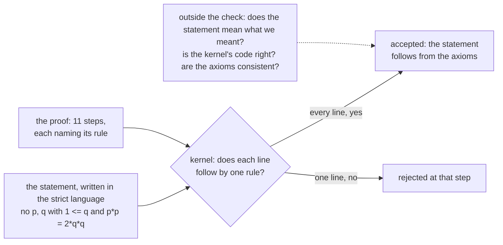

# Proof assistants: a machine checks every step of a proof

[Syllabus](../../../SYLLABUS.md) → [Computability and complexity](../README.md) → [Computability and Logic](../README.md#s02) → Proof assistants

---

## General Overview

Square 99/70 and you get 2.000204. It is close to 2, but not equal: 99 × 99 is 9,801, and 2 × 70 × 70 is 9,800. Search every bottom number q from 1 to 10,000 and no fraction squares to exactly 2. The best ones miss by exactly 1.

A search cannot settle the question. A paper proof can, and [Proof by contradiction](../../01-Foundations/06-Proof/03-proof-by-contradiction.md) gives one. But a paper proof is checked by people, and people miss gaps.

A **proof assistant** is a program that reads proofs: the house example of this shelf, a program that reads programs. The proof is written in a strict language, one small step per line. A small core program, the **kernel**, accepts each line only if one fixed rule produces it from earlier lines. On this card a kernel of 8 rules checks an 11-step proof that no fraction squares to 2.

**A proof assistant turns "is this proof right?" into a mechanical check that always finishes: if its kernel accepts every step, the statement follows from the axioms, and what is left to trust is the kernel, the axioms, and that the statement says what was meant.**

**What kind of fact this is:** "no fraction squares to 2" is a theorem, checked here by machine. "An accepted proof means the statement follows" is a theorem about the kernel, proved in Why it works, and it holds only if every kernel rule is sound. Whether a real kernel's code matches its rules is an engineering judgment, not a theorem.

### The picture: what the check covers



The solid arrows are what the machine does. The dotted box is what a person still has to judge.

---

## The formula

Notation first. A **formal system** $`F`$ is a set of axioms (starting facts, taken as given) and rules (ways to get new lines from old ones). $`F \vdash \varphi`$ says "$`F`$ proves the sentence $`\varphi`$", as on [Godel's theorems](03-godels-incompleteness-in-outline.md). This card adds one more: $`a : A`$, read "$`a`$ is a proof of $`A`$", or "$`a`$ has type $`A`$". A proof assistant treats a proof as an object and the statement as its type, the way a program has a type.

The statement on this card, in symbols:

```math
\varphi \;=\; \forall p\;\forall q\;\big(1 \le q \;\rightarrow\; p \cdot p \neq 2 \cdot q \cdot q\big)
```

**Read it aloud:** for all whole numbers p and q, if q is at least 1, then p times p is not 2 times q times q.

That is "root 2 is not a fraction", with the fraction p/q cleared of division. The guarantee is one line:

```math
\mathrm{check}(\pi, \varphi) = \text{accept} \;\Longrightarrow\; \pi : \varphi \;\Longrightarrow\; F \vdash \varphi
```

**Read it aloud:** if the checker accepts the proof π for the statement φ, then π really is a proof of φ, so the system F proves φ.

| Symbol | Plain meaning | In our example | Push it up and the answer… |
| --- | --- | --- | --- |
| $`\varphi`$ | the statement to be proved | no p, q with 1 ≤ q and p·p = 2·q·q | a longer statement needs a longer proof |
| $`\pi`$ | the proof: a list of lines, each naming a rule | 11 steps, 6 more inside two odd cases | more lines, more work for the kernel, still finite |
| $`a : A`$ | "a is a proof of A" ("a has type A") | π : φ | — |
| $`\mathrm{check}`$ | the kernel: a program that tests each line against its rules | 8 rules | more rules, more to trust |
| $`F`$ | the formal system: axioms plus rules | whole-number arithmetic with the 8 rules | stronger axioms prove more, and risk more |
| $`F \vdash \varphi`$ | F proves φ | the kernel reaches FALSE from the givens | — |
| $`p`$, $`q`$ | top and bottom of the would-be fraction | 99 and 70 come closest of the small ones | — |
| $`k`$, $`m`$ | halves: p = 2k and q = 2m | new letters the proof introduces | — |
| $`\forall`$, $`\rightarrow`$, $`\neq`$, $`\Longrightarrow`$ | "for all", "if … then", "is not equal to", "so" (one claim gives the next) | — | — |
| FALSE | a line that can never be true | reached at step 11 | — |

### When it holds

- **Every kernel rule is sound.** Sound means: a true input line always gives a true output line. Plant one bad rule and the kernel "proves" false things. The code plants a parity rule that forgets half its test, and it accepts "k + 1 = 2q has no solution", though k = 1, q = 1 solves it.
- **The kernel's code does what its rules say.** The guarantee is about the rules on paper. A bug in the program is a bad rule in disguise. This is why real kernels are kept small, so people can read them.
- **The statement says what was meant.** Drop "1 ≤ q" and the statement is false: p = 0, q = 0 solves it. The kernel then rejects the proof at step 9, because step 9 needs the given that was removed. It never sees that the shorter claim is false; the search does.
- **The axioms are consistent.** Consistent means they never prove FALSE. An inconsistent system proves everything. By [Godel's theorems](03-godels-incompleteness-in-outline.md), a system like arithmetic cannot prove its own consistency, so this trust never goes away.
- **The machine runs the program correctly.** The compiler, the chip and the memory are trusted too. Running the check twice, in two languages, guards against some of this.

---

## Why it works

### Step 0: checking a proof is mechanical; finding one is not

Finding a proof can take insight, and for some true statements there is none to find. Checking a written proof is different. Each line names a rule and the earlier lines it uses. The kernel tests that one rule on those lines, a fixed amount of arithmetic, and moves on.

So checking always finishes, with yes or no. In the language of [Decidable and semidecidable](01-decidable-and-semidecidable-sets.md): "π proves φ" is decidable, while "φ has some proof" is only semidecidable.

### Step 1: the proof on paper, in one breath

Suppose p·p = 2·q·q with q ≥ 1, and take the solution with the smallest q. Then p·p is even, so p is even: p = 2k. Then 4·k·k = 2·q·q, so q·q = 2·k·k, so q is even too: q = 2m. Then k·k = 2·m·m with m smaller than q. That is a smaller solution, so q was not the smallest. Contradiction.

[Proof by contradiction](../../01-Foundations/06-Proof/03-proof-by-contradiction.md) and [Irrational numbers](../../01-Foundations/02-The%20Number%20Line/03-irrational-numbers.md) give it in full. The machine needs every "so" spelled out.

### Step 2: the eight rules

Each rule is a small test the kernel can run. Each is sound for a reason a person can check once.

| Rule | From | It gives | Why it is sound |
| --- | --- | --- | --- |
| given | — | a line of the statement's hypothesis | assumed, to be refuted |
| case | — | x = 2y + 1, first line of an odd case | assumed inside that case only |
| subst | x = t, and a line about x | the same line with t in place of x, multiplied out | equal things can swap |
| halve | 2A = 2B, every number even | A = B | halving both sides keeps equality |
| clash | odd = even | FALSE | an odd number never equals an even one |
| even | an odd case x = 2y + 1 that ends in FALSE | x = 2y, y a new letter | every whole number is even or odd |
| half | x = 2y and 1 ≤ x | y < x, or 1 ≤ y | half of a positive number is smaller, and still positive |
| descent | k·k = 2·m·m, 1 ≤ m, m < q | FALSE | the smallest q has no smaller solution |

"Multiplied out" is real work. The kernel stores each side as a polynomial: a list of terms like 4·k·k. It expands products itself. It compares the result with the claimed line, term by term.

### Step 3: the proof, line by line

The proof is the 17 lines in the code's output below, numbered 1 to 11 with lettered lines inside the two odd cases. In words:

1. Givens: p·p = 2·q·q (line 1) and 1 ≤ q (line 2).
2. Suppose p = 2k + 1 (line 3a). Substitute into line 1: 4·k·k + 4·k + 1 = 2·q·q (3b). The left side is odd and the right side even: FALSE (3c). So p = 2k (line 3).
3. Substitute p = 2k into line 1: 4·k·k = 2·q·q (4). Halve: 2·k·k = q·q (5).
4. Suppose q = 2m + 1 (6a). Substitute into line 5: 2·k·k = 4·m·m + 4·m + 1 (6b). Even against odd: FALSE (6c). So q = 2m (6).
5. Substitute q = 2m into line 5: 2·k·k = 4·m·m (7). Halve: k·k = 2·m·m (8).
6. From q = 2m and 1 ≤ q: m < q (9) and 1 ≤ m (10).
7. Lines 8, 10 and 9 are a smaller solution: FALSE (11).

The kernel accepts all 17 lines. Each line is a tiny calculation, so a person can recheck any one of them by hand.

### Step 4: why "accepted" means "true"

The argument is induction on the lines: prove it for the first line, then show each line passes it to the next.

- Suppose some whole numbers p, q make the givens true. Then one such pair has the smallest q, and the lines are read with that pair.
- Every rule is sound for that pair, so each accepted line is then true too. The descent rule needs the smallest q; the other rules work for any pair.
- Line 11 is FALSE, and FALSE is never true.
- So no p, q make the givens true. That is the statement φ.

<details>
<summary>Detailed proof: the kernel's rules are sound, including the two that open a case or a descent</summary>

Call a line true for p, q when it holds with those values and with suitable values of the letters introduced so far. Suppose some p, q with q ≥ 1 satisfy the givens. Among all such pairs, take the one with the smallest q. This uses the well-ordering of whole numbers: every non-empty set of them has a smallest member. Claim: for this pair, every accepted line is true.

**Given, subst, halve, half.** A given holds by assumption. Subst replaces x by t when x = t holds, and the kernel's expansion is exact polynomial arithmetic, so both sides keep their values. Halve divides two equal even numbers by 2. Half: if x = 2y and x ≥ 1, then y ≥ 1, and y < y + y = x.

**Clash.** One side has an odd constant and even coefficients elsewhere, so its value is odd for every choice of letters. The other side has only even coefficients, so its value is even. They are never equal, so the input line is never true. The rule outputs FALSE only from a line that is never true.

**Even.** Every whole number x is 2y or 2y + 1 for some y. Inside the case, the kernel checks lines starting from x = 2y + 1, and by the same argument they would all be true. The case ends in FALSE, so x = 2y + 1 is impossible, and x = 2y holds. The letter y must be new, so no earlier line says anything about it.

**Descent.** This is the one rule that needs the smallest q. If the lines give k·k = 2·m·m with 1 ≤ m and m < q, then (k, m) is a solution with a smaller bottom number. That contradicts the choice of q, so FALSE.

So line 11, FALSE, would be true for this pair. It cannot be, so no pair satisfies the givens.

</details>

### Step 5: the same proof in a real proof assistant

Lean is a widely used proof assistant. Its kernel checks proofs written as terms of a typed [Lambda calculus](07-lambda-calculus-in-outline.md): a proof of A is a term of type A, which is what $`a : A`$ means. This is the **propositions-as-types** idea: checking a proof is checking a type.

The same argument in Lean 4, using only Lean's core library, is this card's Lean check: it is shown in full under Lean, after the Rust check below. `Nat.strongRecOn` is its descent: assume the claim for every smaller q. Tactics such as `omega` (a solver for whole-number sums) search for proof steps automatically. The kernel still rechecks everything they produce. So a bug in a tactic can stop a proof, but it cannot make a false one pass.

Delete `1 ≤ q →` from the statement, and the `intro` name `hq` and the last `(by omega)`, and Lean stops on the last line. It cannot show m < 2m when m may be 0. That is the same failure as the dropped given in the code below.

### Step 6: what the check does not guarantee

- **That the statement means what was intended.** A person must read φ. Lean's `Nat.sqrt 2` is 1, the whole-number square root, and a theorem about it says nothing about root 2.
- **That the kernel's code is right.** Small kernels, several independent kernels, and rechecking a proof in a second system all shrink this risk. None removes it.
- **That the axioms are consistent.** [Godel's theorems](03-godels-incompleteness-in-outline.md) show the system cannot prove this about itself.
- **That the proof is the clearest one.** A checked proof can still be unreadable. The check is about correctness only.

---

## Worked numbers, by hand

| Step | Arithmetic | Value |
| --- | --- | --- |
| the closest small fraction | 99 × 99 against 2 × 70 × 70 | 9,801 against 9,800 |
| how close | 99/70 squared | 2.000204 |
| odd case for p (3b) | (2k + 1)(2k + 1) = 4kk + 4k + 1 | odd, never 2qq |
| even case for p (4, 5) | (2k)(2k) = 4kk = 2qq, halved | 2kk = qq |
| odd case for q (6b) | 2kk against (2m + 1)(2m + 1) = 4mm + 4m + 1 | even against odd |
| even case for q (7, 8) | 2kk = 4mm, halved | kk = 2mm |
| the smaller bottom number (9) | q = 2m and q ≥ 1 | m < q |
| result (11) | (k, m) is a smaller solution | **FALSE: no fraction squares to 2** |

The kernel accepted every line, so the statement holds for every p and q, not just the 10,000 the search tried.

### What breaks if you drop a piece

| Mistake | Comes out at | What went wrong |
| --- | --- | --- |
| Step 5 written as k·k = q·q | rejected at step 5 | halving 4kk = 2qq gives 2kk = qq |
| Step 3 written as p = 2q, reusing q | rejected at step 3 | the half must be a new letter, or it smuggles in p = 2q |
| The odd case of step 3 left out | rejected at step 3 | "p is even" needs the odd case refuted |
| The given 1 ≤ q dropped | rejected at step 9; p, q = 0, 0 solves it | step 9 needs the dropped given; the shorter statement is false |
| A clash rule that tests only the constant | FALSE "proved" from k + 1 = 2q; yet k, q = 1, 1 solves it | one unsound rule and the guarantee is gone |

The code prints all five, and four more forged steps.

---

## Code, from first principles, and it actually runs

The code is a proof checker written from nothing: a parser for lines like `4*k*k+4*k+1 = 2*q*q`, polynomial multiplication, and the eight rules. It takes three independent roads. Road 1 is the kernel checking the proof. Road 2 is a search that finds no solution for q up to 10,000 and lists the near misses. Road 3 counts factors of 2: p·p always has an even count of them and 2·q·q an odd count, so they can never be equal, checked for every number up to 20,000. Roads 2 and 3 are evidence, not proof; only road 1 covers every number. Then the code feeds the kernel forged steps and a planted bug. After the Rust check, a Lean proof of the same statement is the card's third stored check.

### Python

```python
# Proof assistants -- the check behind the card.  Nothing is imported.  A tiny
# proof checker (the "kernel") accepts a proof only if every line follows from
# earlier lines by one of its eight rules.  Road 1: it checks an 11-step proof
# that no fraction p/q squares to 2.  Road 2: search.  Road 3: factors of 2.
def parse(side):                  # "4*k*k+4*k+1" -> {"kk": 4, "k": 4, "": 1}
    poly = {}
    for term in side.split("+"):
        c, mono = 1, ""
        for f in term.strip().split("*"):
            if f.isdigit(): c *= int(f)
            else: mono += f
        mono = "".join(sorted(mono))
        poly[mono] = poly.get(mono, 0) + c
    return poly
def mul(a, b):
    out = {}
    for ma, ca in a.items():
        for mb, cb in b.items():
            m = "".join(sorted(ma + mb))
            out[m] = out.get(m, 0) + ca * cb
    return out
def subst(poly, x, t):            # replace the letter x by the polynomial t
    out = {}
    for mono, c in poly.items():
        term = {"": c}
        for v in mono: term = mul(term, t if v == x else {v: 1})
        for m, d in term.items(): out[m] = out.get(m, 0) + d
    return out
def fact(claim):                  # "L = R", "L < R", "L <= R" or "FALSE"
    for op in ("<=", "<", "="):
        if op in claim:
            l, r = claim.split(op)
            return (op, parse(l), parse(r))
    return ("FALSE",)
def var(poly):                    # the letter, if poly is one bare letter
    m = next(iter(poly))
    return m if len(poly) == 1 and poly[m] == 1 and len(m) == 1 else None
def even(poly): return all(c % 2 == 0 for c in poly.values())
def odd_clash(a, b): return a.get("", 0) % 2 == 1 and even({m: c for m, c in a.items() if m}) and even(b)
BUGGY, SHOW = False, False        # switches: a planted kernel bug, and printing each step
def rule_ok(rule, f, got, givens):
    if rule == "subst":           # from x = t and L = R: L and R with x replaced by t
        (op1, x, t), (op2, l, r) = got
        return op1 == "=" and var(x) and op2 == f[0] and f[1:] == (subst(l, var(x), t), subst(r, var(x), t))
    if rule == "halve":           # from 2A = 2B: A = B
        op, l, r = got[0]
        return op == "=" and even(l) and even(r) and f == ("=", {m: c // 2 for m, c in l.items()}, {m: c // 2 for m, c in r.items()})
    if rule == "clash":           # odd = even can never hold
        op, l, r = got[0]
        if BUGGY: return op == "=" and l.get("", 0) % 2 == 1      # the bug: forgets the other terms
        return op == "=" and f == ("FALSE",) and (odd_clash(l, r) or odd_clash(r, l))
    if rule == "half":            # from x = 2*y and 1 <= x: y < x, and 1 <= y
        (op1, x, t), (op2, one, x2) = got
        y = next(iter(t))
        return (op1 == "=" and op2 == "<=" and one == {"": 1} and x2 == x and t == {y: 2}
                and f in (("<", {y: 1}, x), ("<=", {"": 1}, {y: 1})))
    if rule == "descent":         # a smaller solution, so the smallest q was not the smallest
        (op1, l, r), pos, less = got
        k, m = next(iter(l))[0], var(less[1])
        g1, g2 = fact(givens[0]), fact(givens[1])
        return (f == ("FALSE",) and (op1, l, r) == ("=", subst(g1[1], "p", {k: 1}), subst(g1[2], "q", {m: 1}))
                and pos == ("<=", g2[1], subst(g2[2], "q", {m: 1})) and less == ("<", {m: 1}, {"q": 1}))
    return False
def check(proof, givens, seen, facts=None, case=None):
    facts, f = dict(facts or {}), None
    for i, (label, claim, rule, refs, sub) in enumerate(proof):
        f, why = fact(claim), ""
        try:
            got = [facts[r] for r in refs]
            if rule == "even":    # x = 2*y, because the odd case x = 2*y+1 ends in FALSE
                x, y = var(f[1]), next(iter(f[2]))
                ok = f[0] == "=" and x and f[2] == {y: 2} and y not in seen and sub != []
                why = check(sub, givens, seen | {y}, facts, f"{x} = 2*{y}+1") if ok else ""
                ok = ok and why == "FALSE"
            else:
                ok = (rule == "given" and claim in givens or rule == "case" and i == 0 and claim == case
                      or rule_ok(rule, f, got, givens))
        except (KeyError, IndexError, ValueError, StopIteration, TypeError):
            ok = False
        if SHOW: print(f"  {label:<4}{claim:<22}{rule:<8}{','.join(refs):<9}{'ok' if ok else 'REJECTED'}")
        if not ok: return why if why.startswith("rejected") else f"rejected at step {label}"
        facts[label] = f
        seen = seen | (set("".join(f[1]) + "".join(f[2])) if len(f) > 1 else set())
    return "FALSE" if f == ("FALSE",) else "no contradiction"
ODD_P = [("3a", "p = 2*k+1", "case", [], []), ("3b", "4*k*k+4*k+1 = 2*q*q", "subst", ["3a", "1"], []),
         ("3c", "FALSE", "clash", ["3b"], [])]
ODD_Q = [("6a", "q = 2*m+1", "case", [], []), ("6b", "2*k*k = 4*m*m+4*m+1", "subst", ["6a", "5"], []),
         ("6c", "FALSE", "clash", ["6b"], [])]
PROOF = [("1", "p*p = 2*q*q", "given", [], []), ("2", "1 <= q", "given", [], []),
         ("3", "p = 2*k", "even", [], ODD_P), ("4", "4*k*k = 2*q*q", "subst", ["3", "1"], []),
         ("5", "2*k*k = q*q", "halve", ["4"], []), ("6", "q = 2*m", "even", [], ODD_Q),
         ("7", "2*k*k = 4*m*m", "subst", ["6", "5"], []), ("8", "k*k = 2*m*m", "halve", ["7"], []),
         ("9", "m < q", "half", ["6", "2"], []), ("10", "1 <= m", "half", ["6", "2"], []),
         ("11", "FALSE", "descent", ["8", "10", "9"], [])]
GIVENS = ["p*p = 2*q*q", "1 <= q"]
def swap(proof, old, new):        # the same proof with one piece of text replaced
    return [(a, b.replace(old, new), c, d, swap(e, old, new)) for a, b, c, d, e in proof]
def twos(n): return 0 if n % 2 else 1 + twos(n // 2)    # how many times 2 divides n
print("kernel rules: given, case, subst, halve, clash, even, half, descent (8)\n"
      "  step claim                 rule    uses     verdict")
SHOW = True; verdict = check(PROOF, GIVENS, set("pq")); SHOW = False
print(f"road 1, the checker: {verdict} reached from the givens, so no such p and q exist")
B, sols, near, p = 10000, [], [], 0          # road 2: for each q, walk p up to the root of 2*q*q
for q in range(1, B + 1):
    while (p + 1) * (p + 1) <= 2 * q * q: p += 1
    if p * p == 2 * q * q: sols.append((p, q))
    near += [f"{c}/{q}" for c in (p, p + 1) if abs(c * c - 2 * q * q) == 1]
print(f"road 2, search 1 <= q <= {B}: solutions {sols if sols else 'none up to ' + str(B)}")
print(f"  misses by exactly 1: {' '.join(near)}")
print(f"  99*99 = {99 * 99} and 2*70*70 = {2 * 70 * 70}; 99/70 squared = {99 * 99 / 4900:.6f}")
N = 20000                                    # road 3: an even count of 2s can never equal an odd one
ev, od = sum(twos(n * n) % 2 == 0 for n in range(1, N + 1)), sum(twos(2 * n * n) % 2 == 1 for n in range(1, N + 1))
print(f"road 3, factors of 2 for n = 1 to {N}: n*n has an even count {ev} times, 2*n*n an odd count {od} times")
print("what breaks:")
FORGED = [("k*k = q*q", ("5", "k*k = q*q", "halve", ["4"], [])), ("4*k*k = 3*q*q", ("4", "4*k*k = 3*q*q", "subst", ["3", "1"], [])),
          ("q < m", ("9", "q < m", "half", ["6", "2"], [])), ("p = 2*q, reusing q", ("3", "p = 2*q", "even", [], swap(ODD_P, "k", "q"))),
          ("p = 2*k, odd case left out", ("3", "p = 2*k", "even", [], []))]
forged = [check([f if s[0] == f[0] else s for s in PROOF], GIVENS, set("pq")) for d, f in FORGED]
for (d, f), v in zip(FORGED, forged): print(f"  step {f[0]} forged as {d}: {v}")
m2 = check([s for s in PROOF if s[0] != "2"], GIVENS[:1], set("pq"))
zero = [(a, b) for a in range(3) for b in range(3) if a * a == 2 * b * b]
print(f"  given 1 <= q dropped: {m2}; the search finds p, q = {zero[0]}, so the shorter claim is false")
bug = [("1", "k+1 = 2*q", "given", [], []), ("2", "FALSE", "clash", ["1"], [])]
BUGGY = True; b1 = check(bug, ["k+1 = 2*q"], set("kq")); BUGGY = False; b2 = check(bug, ["k+1 = 2*q"], set("kq"))
kq = [(k, q) for k in range(4) for q in range(4) if k + 1 == 2 * q]
print(f"  buggy clash rule on k+1 = 2*q: {b1}; correct kernel: {b2}; yet k, q = {kq[0]} solves it")
h3 = check([("1", "3*k*k = 2*q*q", "given", [], []), ("2", "k*k = q*q", "halve", ["1"], [])], ["3*k*k = 2*q*q"], set("kq"))
le = check([("9", "m <= q", "given", [], []) if s[0] == "9" else s for s in PROOF], GIVENS + ["m <= q"], set("pq"))
print(f"  halve on 3*k*k = 2*q*q, an odd side: {h3}; descent fed m <= q, not m < q: {le}")
print("try changing:")
m5 = check(swap(PROOF, '2*q*q', '3*q*q'), ['p*p = 3*q*q', '1 <= q'], set('pq')); print(f"  3 in place of 2: {m5}")
four = [(a, b) for b in range(1, 4) for a in range(9) if a * a == 4 * b * b]
m4 = check(swap(PROOF, '2*q*q', '4*q*q'), ['p*p = 4*q*q', '1 <= q'], set('pq')); print(f"  4 in place of 2: {m4}; the search finds {four}")
print(f"  whole-number square root of 2: {(r := max(n for n in range(3) if n * n <= 2))}, and {r}*{r} = {r * r}, not 2")
print("record (quoted, not computed): BB(5) = 47176870, settled in 2024 in Coq")
assert verdict == "FALSE" and forged == [f"rejected at step {n}" for n in (5, 4, 9, 3, 3)] and h3 == "rejected at step 2" and le == "rejected at step 11"
assert sols == [] and near[5] == "99/70" and len(near) == 11 and zero == [(0, 0)]
assert ev == N and od == N and m2 == "rejected at step 9" and m4 == "rejected at step 5" and m5 == "rejected at step 3c"
assert b1 == "FALSE" and b2 == "rejected at step 2" and kq[0] == (1, 1) and four == [(2, 1), (4, 2), (6, 3)]
print("ALL CHECKS PASS")
```

**Ran 2026-11-19 on macOS, Python 3.14.10, standard library only. All checks passed. Output, pasted from the run:**

```
kernel rules: given, case, subst, halve, clash, even, half, descent (8)
  step claim                 rule    uses     verdict
  1   p*p = 2*q*q           given            ok
  2   1 <= q                given            ok
  3a  p = 2*k+1             case             ok
  3b  4*k*k+4*k+1 = 2*q*q   subst   3a,1     ok
  3c  FALSE                 clash   3b       ok
  3   p = 2*k               even             ok
  4   4*k*k = 2*q*q         subst   3,1      ok
  5   2*k*k = q*q           halve   4        ok
  6a  q = 2*m+1             case             ok
  6b  2*k*k = 4*m*m+4*m+1   subst   6a,5     ok
  6c  FALSE                 clash   6b       ok
  6   q = 2*m               even             ok
  7   2*k*k = 4*m*m         subst   6,5      ok
  8   k*k = 2*m*m           halve   7        ok
  9   m < q                 half    6,2      ok
  10  1 <= m                half    6,2      ok
  11  FALSE                 descent 8,10,9   ok
road 1, the checker: FALSE reached from the givens, so no such p and q exist
road 2, search 1 <= q <= 10000: solutions none up to 10000
  misses by exactly 1: 1/1 3/2 7/5 17/12 41/29 99/70 239/169 577/408 1393/985 3363/2378 8119/5741
  99*99 = 9801 and 2*70*70 = 9800; 99/70 squared = 2.000204
road 3, factors of 2 for n = 1 to 20000: n*n has an even count 20000 times, 2*n*n an odd count 20000 times
what breaks:
  step 5 forged as k*k = q*q: rejected at step 5
  step 4 forged as 4*k*k = 3*q*q: rejected at step 4
  step 9 forged as q < m: rejected at step 9
  step 3 forged as p = 2*q, reusing q: rejected at step 3
  step 3 forged as p = 2*k, odd case left out: rejected at step 3
  given 1 <= q dropped: rejected at step 9; the search finds p, q = (0, 0), so the shorter claim is false
  buggy clash rule on k+1 = 2*q: FALSE; correct kernel: rejected at step 2; yet k, q = (1, 1) solves it
  halve on 3*k*k = 2*q*q, an odd side: rejected at step 2; descent fed m <= q, not m < q: rejected at step 11
try changing:
  3 in place of 2: rejected at step 3c
  4 in place of 2: rejected at step 5; the search finds [(2, 1), (4, 2), (6, 3)]
  whole-number square root of 2: 1, and 1*1 = 1, not 2
record (quoted, not computed): BB(5) = 47176870, settled in 2024 in Coq
ALL CHECKS PASS
```

### Rust

Same numbers, same labels, built with `rustc --edition 2021 -O`.

```rust
// Proof assistants -- the same check as the Python, in Rust.  No crates.  A tiny
// proof checker (the "kernel") accepts a proof only if every line follows from
// earlier lines by one of its eight rules.  Road 1: it checks an 11-step proof
// that no fraction p/q squares to 2.  Road 2: search.  Road 3: factors of 2.
use std::collections::{BTreeMap, BTreeSet, HashMap};
type Poly = BTreeMap<String, i64>;                  // "kk" -> 4 means 4*k*k
#[derive(Clone, PartialEq)] struct Fact { op: String, l: Poly, r: Poly }        // "=", "<", "<=" or "FALSE"
#[derive(Clone)] struct Step { label: String, claim: String, rule: String, refs: Vec<String>, sub: Vec<Step> }
struct Kernel { buggy: bool, show: bool }           // switches: a planted bug, and printing
fn sorted(s: &str) -> String { let mut c: Vec<char> = s.chars().collect(); c.sort(); c.into_iter().collect() }
fn parse(side: &str) -> Poly {                      // "4*k*k+4*k+1" -> {"": 1, "k": 4, "kk": 4}
    let mut poly = Poly::new();
    for term in side.split('+') {
        let (mut c, mut mono) = (1i64, String::new());
        for f in term.split('*').map(|f| f.trim()) { if let Ok(d) = f.parse::<i64>() { c *= d } else { mono.push_str(f) } }
        *poly.entry(sorted(&mono)).or_insert(0) += c;
    } poly }
fn mono(m: &str, c: i64) -> Poly { let mut p = Poly::new(); p.insert(m.to_string(), c); p }
fn mul(a: &Poly, b: &Poly) -> Poly { let mut out = Poly::new();
    for (ma, ca) in a { for (mb, cb) in b { *out.entry(sorted(&format!("{}{}", ma, mb))).or_insert(0) += ca * cb } } out }
fn subst(poly: &Poly, x: char, t: &Poly) -> Poly {  // replace the letter x by the polynomial t
    let mut out = Poly::new();
    for (m, c) in poly { let mut term = mono("", *c);
        for v in m.chars() { term = mul(&term, &if v == x { t.clone() } else { mono(&v.to_string(), 1) }) }
        for (mm, d) in term { *out.entry(mm).or_insert(0) += d } }
    out }
fn fact(claim: &str) -> Fact {                      // "L = R", "L < R", "L <= R" or "FALSE"
    for op in ["<=", "<", "="] {
        if let Some((l, r)) = claim.split_once(op) { return Fact { op: op.to_string(), l: parse(l), r: parse(r) } }
    } Fact { op: "FALSE".to_string(), l: Poly::new(), r: Poly::new() } }
fn var(p: &Poly) -> Option<char> {                  // the letter, if p is one bare letter
    let (m, c) = p.iter().next()?; if p.len() == 1 && *c == 1 && m.len() == 1 { m.chars().next() } else { None } }
fn first(p: &Poly) -> Option<String> { p.keys().next().cloned() }
fn even(p: &Poly) -> bool { p.values().all(|c| c % 2 == 0) }
fn halved(p: &Poly) -> Poly { p.iter().map(|(m, c)| (m.clone(), c / 2)).collect() }
fn odd_clash(a: &Poly, b: &Poly) -> bool { a.get("").unwrap_or(&0) % 2 == 1 && a.iter().all(|(m, c)| m.is_empty() || c % 2 == 0) && even(b) }
fn rule_ok(k: &Kernel, rule: &str, f: &Fact, got: &[Fact], givens: &[String]) -> Option<bool> {
    let n = got.len();
    Some(match rule {
        "subst" if n == 2 => {                       // from x = t and L = R: L and R with x replaced by t
            let x = var(&got[0].l)?;
            got[0].op == "=" && got[1].op == f.op && f.l == subst(&got[1].l, x, &got[0].r) && f.r == subst(&got[1].r, x, &got[0].r)
        }
        "halve" if n == 1 => { let g = &got[0];      // from 2A = 2B: A = B
            g.op == "=" && even(&g.l) && even(&g.r) && f.op == "=" && f.l == halved(&g.l) && f.r == halved(&g.r) }
        "clash" if n == 1 => { let g = &got[0];      // odd = even can never hold
            if k.buggy { g.op == "=" && g.l.get("").unwrap_or(&0) % 2 == 1 }   // the bug: forgets the other terms
            else { g.op == "=" && f.op == "FALSE" && (odd_clash(&g.l, &g.r) || odd_clash(&g.r, &g.l)) } }
        "half" if n == 2 => {                        // from x = 2*y and 1 <= x: y < x, and 1 <= y
            let y = first(&got[0].r)?;
            got[0].op == "=" && got[1].op == "<=" && got[1].l == mono("", 1) && got[1].r == got[0].l && got[0].r == mono(&y, 2)
                && ((f.op == "<" && f.l == mono(&y, 1) && f.r == got[0].l) || (f.op == "<=" && f.l == mono("", 1) && f.r == mono(&y, 1)))
        }
        "descent" if n == 3 => {                     // a smaller solution, so the smallest q was not the smallest
            let kk = first(&got[0].l)?.chars().next()?;
            let m = var(&got[2].l)?;
            let (g1, g2) = (fact(givens.get(0)?), fact(givens.get(1)?));
            f.op == "FALSE" && got[0].op == "=" && got[0].l == subst(&g1.l, 'p', &mono(&kk.to_string(), 1))
                && got[0].r == subst(&g1.r, 'q', &mono(&m.to_string(), 1)) && got[1].op == "<=" && got[1].l == g2.l
                && got[1].r == subst(&g2.r, 'q', &mono(&m.to_string(), 1)) && got[2].op == "<" && got[2].r == mono("q", 1)
        }
        _ => false,
    })
}
fn check(k: &Kernel, proof: &[Step], givens: &[String], seen0: &BTreeSet<char>, facts0: &HashMap<String, Fact>, case: &str) -> String {
    let (mut facts, mut seen) = (facts0.clone(), seen0.clone());
    let mut last = Fact { op: "none".into(), l: Poly::new(), r: Poly::new() };
    for (i, s) in proof.iter().enumerate() {
        let f = fact(&s.claim);
        let mut why = String::new();
        let got: Option<Vec<Fact>> = s.refs.iter().map(|r| facts.get(r).cloned()).collect();
        let ok = match got {
            None => false,
            Some(_) if s.rule == "even" => {       // x = 2*y, because the odd case x = 2*y+1 ends in FALSE
                match (var(&f.l), first(&f.r)) {
                    (Some(x), Some(y)) if f.op == "=" && f.r == mono(&y, 2) && y.len() == 1
                        && !seen.contains(&y.chars().next().unwrap()) && !s.sub.is_empty() => {
                        let mut s2 = seen.clone(); s2.insert(y.chars().next().unwrap());
                        why = check(k, &s.sub, givens, &s2, &facts, &format!("{} = 2*{}+1", x, y));
                        why == "FALSE"
                    }
                    _ => false,
                }
            }
            Some(got) => (s.rule == "given" && givens.contains(&s.claim)) || (s.rule == "case" && i == 0 && s.claim == case)
                || rule_ok(k, &s.rule, &f, &got, givens).unwrap_or(false),
        };
        if k.show { println!("  {:<4}{:<22}{:<8}{:<9}{}", s.label, s.claim, s.rule, s.refs.join(","), if ok { "ok" } else { "REJECTED" }) }
        if !ok { return if why.starts_with("rejected") { why } else { format!("rejected at step {}", s.label) } }
        for m in f.l.keys().chain(f.r.keys()) { for ch in m.chars() { seen.insert(ch); } }
        facts.insert(s.label.clone(), f.clone());
        last = f;
    }
    if last.op == "FALSE" { "FALSE".to_string() } else { "no contradiction".to_string() }
}
fn st(label: &str, claim: &str, rule: &str, refs: &[&str], sub: Vec<Step>) -> Step {
    Step { label: label.into(), claim: claim.into(), rule: rule.into(), refs: refs.iter().map(|r| r.to_string()).collect(), sub }
}
fn swap(proof: &[Step], old: &str, new: &str) -> Vec<Step> {   // the same proof with one piece of text replaced
    proof.iter().map(|s| Step { claim: s.claim.replace(old, new), sub: swap(&s.sub, old, new), ..s.clone() }).collect()
}
fn twos(n: u64) -> u64 { if n % 2 == 1 { 0 } else { 1 + twos(n / 2) } }   // how many times 2 divides n
fn run(k: &Kernel, proof: &[Step], givens: &[&str], seen: &str) -> String {
    check(k, proof, &givens.iter().map(|s| s.to_string()).collect::<Vec<_>>(), &seen.chars().collect(), &HashMap::new(), "")
}
fn pairs(v: &[(u64, u64)]) -> String { format!("[{}]", v.iter().map(|(a, b)| format!("({}, {})", a, b)).collect::<Vec<_>>().join(", ")) }
fn main() {
    let odd_p = vec![st("3a", "p = 2*k+1", "case", &[], vec![]), st("3b", "4*k*k+4*k+1 = 2*q*q", "subst", &["3a", "1"], vec![]),
                     st("3c", "FALSE", "clash", &["3b"], vec![])];
    let odd_q = vec![st("6a", "q = 2*m+1", "case", &[], vec![]), st("6b", "2*k*k = 4*m*m+4*m+1", "subst", &["6a", "5"], vec![]),
                     st("6c", "FALSE", "clash", &["6b"], vec![])];
    let proof = vec![st("1", "p*p = 2*q*q", "given", &[], vec![]), st("2", "1 <= q", "given", &[], vec![]),
        st("3", "p = 2*k", "even", &[], odd_p.clone()), st("4", "4*k*k = 2*q*q", "subst", &["3", "1"], vec![]),
        st("5", "2*k*k = q*q", "halve", &["4"], vec![]), st("6", "q = 2*m", "even", &[], odd_q),
        st("7", "2*k*k = 4*m*m", "subst", &["6", "5"], vec![]), st("8", "k*k = 2*m*m", "halve", &["7"], vec![]),
        st("9", "m < q", "half", &["6", "2"], vec![]), st("10", "1 <= m", "half", &["6", "2"], vec![]),
        st("11", "FALSE", "descent", &["8", "10", "9"], vec![])];
    let givens = ["p*p = 2*q*q", "1 <= q"];
    let quiet = Kernel { buggy: false, show: false };
    println!("kernel rules: given, case, subst, halve, clash, even, half, descent (8)\n  step claim                 rule    uses     verdict");
    let verdict = run(&Kernel { buggy: false, show: true }, &proof, &givens, "pq");
    println!("road 1, the checker: {} reached from the givens, so no such p and q exist", verdict);
    let (b, mut sols, mut near, mut p) = (10000u64, Vec::new(), Vec::new(), 0u64);   // road 2: walk p up to the root of 2*q*q
    for q in 1..=b {
        while (p + 1) * (p + 1) <= 2 * q * q { p += 1 }
        if p * p == 2 * q * q { sols.push((p, q)) }
        for c in [p, p + 1] { if (c * c).abs_diff(2 * q * q) == 1 { near.push(format!("{}/{}", c, q)) } }
    }
    println!("road 2, search 1 <= q <= {}: solutions {}", b, if sols.is_empty() { format!("none up to {}", b) } else { pairs(&sols) });
    println!("  misses by exactly 1: {}", near.join(" "));
    println!("  99*99 = {} and 2*70*70 = {}; 99/70 squared = {:.6}", 99 * 99, 2 * 70 * 70, 9801.0 / 4900.0);
    let n = 20000u64;                                // road 3: an even count of 2s can never equal an odd one
    let (ev, od) = ((1..=n).filter(|i| twos(i * i) % 2 == 0).count() as u64, (1..=n).filter(|i| twos(2 * i * i) % 2 == 1).count() as u64);
    println!("road 3, factors of 2 for n = 1 to {}: n*n has an even count {} times, 2*n*n an odd count {} times", n, ev, od);
    println!("what breaks:");
    let forged = [("k*k = q*q", st("5", "k*k = q*q", "halve", &["4"], vec![])), ("4*k*k = 3*q*q", st("4", "4*k*k = 3*q*q", "subst", &["3", "1"], vec![])),
        ("q < m", st("9", "q < m", "half", &["6", "2"], vec![])), ("p = 2*q, reusing q", st("3", "p = 2*q", "even", &[], swap(&odd_p, "k", "q"))),
        ("p = 2*k, odd case left out", st("3", "p = 2*k", "even", &[], vec![]))];
    let mut res = Vec::new();
    for (d, f) in &forged {
        let pf: Vec<Step> = proof.iter().map(|s| if s.label == f.label { f.clone() } else { s.clone() }).collect();
        res.push(run(&quiet, &pf, &givens, "pq")); println!("  step {} forged as {}: {}", f.label, d, res[res.len() - 1]);
    }
    let p2: Vec<Step> = proof.iter().filter(|s| s.label != "2").cloned().collect();
    let m2 = run(&quiet, &p2, &givens[..1], "pq");
    let zero: Vec<(u64, u64)> = (0..3).flat_map(|a| (0..3).map(move |c| (a, c))).filter(|(a, c)| a * a == 2 * c * c).collect();
    println!("  given 1 <= q dropped: {}; the search finds p, q = ({}, {}), so the shorter claim is false", m2, zero[0].0, zero[0].1);
    let bug = vec![st("1", "k+1 = 2*q", "given", &[], vec![]), st("2", "FALSE", "clash", &["1"], vec![])];
    let b1 = run(&Kernel { buggy: true, show: false }, &bug, &["k+1 = 2*q"], "kq");
    let b2 = run(&quiet, &bug, &["k+1 = 2*q"], "kq");
    let kq: Vec<(u64, u64)> = (0..4).flat_map(|a| (0..4).map(move |c| (a, c))).filter(|(a, c)| a + 1 == 2 * c).collect();
    println!("  buggy clash rule on k+1 = 2*q: {}; correct kernel: {}; yet k, q = ({}, {}) solves it", b1, b2, kq[0].0, kq[0].1);
    let h3 = run(&quiet, &[st("1", "3*k*k = 2*q*q", "given", &[], vec![]), st("2", "k*k = q*q", "halve", &["1"], vec![])], &["3*k*k = 2*q*q"], "kq");
    let pl: Vec<Step> = proof.iter().map(|s| if s.label == "9" { st("9", "m <= q", "given", &[], vec![]) } else { s.clone() }).collect();
    let le = run(&quiet, &pl, &["p*p = 2*q*q", "1 <= q", "m <= q"], "pq");
    println!("  halve on 3*k*k = 2*q*q, an odd side: {}; descent fed m <= q, not m < q: {}", h3, le);
    println!("try changing:");
    let m5 = run(&quiet, &swap(&proof, "2*q*q", "3*q*q"), &["p*p = 3*q*q", "1 <= q"], "pq"); println!("  3 in place of 2: {}", m5);
    let four: Vec<(u64, u64)> = (1..4).flat_map(|c| (0..9).map(move |a| (a, c))).filter(|(a, c)| a * a == 4 * c * c).collect();
    let m4 = run(&quiet, &swap(&proof, "2*q*q", "4*q*q"), &["p*p = 4*q*q", "1 <= q"], "pq");
    println!("  4 in place of 2: {}; the search finds {}", m4, pairs(&four));
    let r = (0..3u64).filter(|i| i * i <= 2).max().unwrap();
    println!("  whole-number square root of 2: {}, and {}*{} = {}, not 2", r, r, r, r * r);
    println!("record (quoted, not computed): BB(5) = 47176870, settled in 2024 in Coq");
    assert!(verdict == "FALSE" && res == [5, 4, 9, 3, 3].iter().map(|n| format!("rejected at step {}", n)).collect::<Vec<_>>());
    assert!(sols.is_empty() && near[5] == "99/70" && near.len() == 11 && zero == vec![(0, 0)]);
    assert!(ev == n && od == n && m2 == "rejected at step 9" && m4 == "rejected at step 5" && m5 == "rejected at step 3c");
    assert!(b1 == "FALSE" && b2 == "rejected at step 2" && kq[0] == (1, 1) && four == vec![(2, 1), (4, 2), (6, 3)] && h3 == "rejected at step 2" && le == "rejected at step 11");
    println!("ALL CHECKS PASS");
}
```

**Ran 2026-11-19 on macOS, rustc 1.98.1, no crates. All checks passed. Output, pasted from the run:**

```
kernel rules: given, case, subst, halve, clash, even, half, descent (8)
  step claim                 rule    uses     verdict
  1   p*p = 2*q*q           given            ok
  2   1 <= q                given            ok
  3a  p = 2*k+1             case             ok
  3b  4*k*k+4*k+1 = 2*q*q   subst   3a,1     ok
  3c  FALSE                 clash   3b       ok
  3   p = 2*k               even             ok
  4   4*k*k = 2*q*q         subst   3,1      ok
  5   2*k*k = q*q           halve   4        ok
  6a  q = 2*m+1             case             ok
  6b  2*k*k = 4*m*m+4*m+1   subst   6a,5     ok
  6c  FALSE                 clash   6b       ok
  6   q = 2*m               even             ok
  7   2*k*k = 4*m*m         subst   6,5      ok
  8   k*k = 2*m*m           halve   7        ok
  9   m < q                 half    6,2      ok
  10  1 <= m                half    6,2      ok
  11  FALSE                 descent 8,10,9   ok
road 1, the checker: FALSE reached from the givens, so no such p and q exist
road 2, search 1 <= q <= 10000: solutions none up to 10000
  misses by exactly 1: 1/1 3/2 7/5 17/12 41/29 99/70 239/169 577/408 1393/985 3363/2378 8119/5741
  99*99 = 9801 and 2*70*70 = 9800; 99/70 squared = 2.000204
road 3, factors of 2 for n = 1 to 20000: n*n has an even count 20000 times, 2*n*n an odd count 20000 times
what breaks:
  step 5 forged as k*k = q*q: rejected at step 5
  step 4 forged as 4*k*k = 3*q*q: rejected at step 4
  step 9 forged as q < m: rejected at step 9
  step 3 forged as p = 2*q, reusing q: rejected at step 3
  step 3 forged as p = 2*k, odd case left out: rejected at step 3
  given 1 <= q dropped: rejected at step 9; the search finds p, q = (0, 0), so the shorter claim is false
  buggy clash rule on k+1 = 2*q: FALSE; correct kernel: rejected at step 2; yet k, q = (1, 1) solves it
  halve on 3*k*k = 2*q*q, an odd side: rejected at step 2; descent fed m <= q, not m < q: rejected at step 11
try changing:
  3 in place of 2: rejected at step 3c
  4 in place of 2: rejected at step 5; the search finds [(2, 1), (4, 2), (6, 3)]
  whole-number square root of 2: 1, and 1*1 = 1, not 2
record (quoted, not computed): BB(5) = 47176870, settled in 2024 in Coq
ALL CHECKS PASS
```

The two outputs match line for line.

### Lean

Lean proves the card's statement for every pair of whole numbers, with no search and no bound.

- For every whole number k, (2k + 1)·(2k + 1) = 4·k·k + 4·k + 1 and (2k)·(2k) = 4·k·k: the multiplying-out in the odd and even cases.
- If p·p is even, then p is even: the odd case clashes on parity, as at steps 3 and 6.
- For all whole numbers p and q with 1 ≤ q, p·p ≠ 2·q·q: the statement φ, by descent on q.

The 8-rule kernel, the search, the count of factors of 2 and the forged steps are left to the Python and Rust checks. Lean writes `2 * (q * q)` for 2·q·q and `Nat` for the whole numbers.

```lean
-- Proof assistants: no whole numbers p and q, with q at least 1, have p * p = 2 * (q * q), so root 2 is not a fraction. Lean's core library only.
theorem sq_odd (k : Nat) : (2*k+1) * (2*k+1) = 4*(k*k) + 4*k + 1 := by
  rw [Nat.add_mul, Nat.mul_add, Nat.mul_add, Nat.mul_mul_mul_comm]; omega

theorem sq_even (k : Nat) : (2*k) * (2*k) = 4*(k*k) := by
  rw [Nat.mul_mul_mul_comm]

-- If a square is even, the number is even: the odd case clashes on parity.
theorem even_of_sq (p y : Nat) (h : p * p = 2 * y) : ∃ k, p = 2 * k := by
  cases Nat.mod_two_eq_zero_or_one p with
  | inl h0 => exact ⟨p / 2, by omega⟩
  | inr h1 =>
    have hp : p = 2 * (p / 2) + 1 := by omega
    rw [hp, sq_odd] at h; omega

theorem root_two_irrational (q : Nat) : ∀ p, 1 ≤ q → p * p ≠ 2 * (q * q) := by
  induction q using Nat.strongRecOn with
  | ind q ih =>
    intro p hq h
    obtain ⟨k, rfl⟩ := even_of_sq p (q * q) h          -- step 3: p = 2k
    rw [sq_even] at h                                  -- step 4: 4kk = 2qq
    have h5 : q * q = 2 * (k * k) := by omega          -- step 5: halve
    obtain ⟨m, rfl⟩ := even_of_sq q (k * k) h5         -- step 6: q = 2m
    rw [sq_even] at h5                                 -- step 7: 2kk = 4mm
    exact ih m (by omega) k (by omega) (by omega)      -- steps 8 to 11: descent

#print axioms sq_odd
#print axioms sq_even
#print axioms even_of_sq
#print axioms root_two_irrational
```

**Checked 2026-11-19 on macOS, Lean 4.36.0-rc2, Mathlib v4.36.0-rc2. Every proof is complete and uses only Lean's standard axioms. Output, pasted from the run:**

```
'sq_odd' depends on axioms: [propext, Quot.sound]
'sq_even' depends on axioms: [propext]
'even_of_sq' depends on axioms: [propext, Classical.choice, Quot.sound]
'root_two_irrational' depends on axioms: [propext, Classical.choice, Quot.sound]
```

Each line lists the axioms one theorem rests on: some of Lean's three standard axioms and nothing else.

> [!TIP]
> **Try changing**
> - Guess first: does the same proof work for root 3? Replace every `2*q*q` with `3*q*q`. The kernel rejects it at step 3c: 4kk + 4k + 1 = 3qq is not odd against even. Root 3 is still irrational, but its proof splits numbers by remainder after dividing by 3.
> - Guess first: what happens with 4 in place of 2? Root 4 is 2, a whole number, so the proof must fail. It fails at step 5: halving 4kk = 4qq gives 2kk = 2qq, not 2kk = qq. The search finds 2/1, 4/2 and 6/3.
> - Guess first: raise the search bound `B` from 10,000 to 100,000. It still finds none, but it lists 14 near misses, not 11, so the assert that expects 11 stops the run. No bound turns "none found" into a proof.
> - Guess first: in the Python, set `BUGGY = True` for the whole run. The buggy kernel now rejects the true proof at step 6c, where the odd side is on the right. One bad rule can accept a false proof and reject a true one.

---

## The usual mistake

> [!warning]
> **"Machine-checked" does not mean "true as meant".** The kernel guarantees that the proof proves the statement as written. If the written statement differs from the intended one, the guarantee is about the wrong claim. Someone must still read the statement, its definitions and its hypotheses.
>
> - **Testing is not proof.** No solution for q up to 10,000 is evidence. The near miss 99/70 squared is 2.000204, and a bigger search only finds closer misses.
> - **A dropped hypothesis changes the claim.** Without 1 ≤ q, the pair p = 0, q = 0 solves p·p = 2·q·q, and the "theorem" is false.
> - **Definitions hide choices.** Lean's whole-number square root of 2 is 1, and 1 × 1 = 1, not 2. Lean also defines division by zero to give 0, so "x / 0 = 0" is a theorem there.
> - **Putting the risk in the wrong place.** Automatic tactics can be wrong, but the kernel rechecks everything they produce. The risk sits in the kernel and the statement, not in the search.

---

## Where you meet it in real life

- **Operating systems.** The seL4 kernel, the core of an operating system, has a machine-checked proof (in Isabelle, 2009) that its C code matches its specification.
- **Hard mathematics.** The Kepler conjecture on packing spheres was proved in 1998 with heavy computer help. Referees could not check it all, so a team built a formal proof in HOL Light and Isabelle, published in 2017.
- **Computing records.** BB(5) = 47,176,870, the busy beaver value for five-state machines, was settled in 2024 with its proof checked in Coq ([Busy beaver](02-the-busy-beaver-function.md)).
- **Compilers and chips.** A compiler with a checked proof is proved never to change what a program means when it translates it, so long as its specification and its trusted parts are right. Chip makers check their arithmetic circuits the same way.
- **Large libraries.** Lean's mathematics library holds a large and growing body of checked definitions and theorems, root 2's irrationality among them.

> **Say it back**
> A proof assistant reads a proof written in a strict language and checks each line against a small fixed set of rules. Checking always finishes, even though finding a proof may not. If every rule is sound and the kernel accepts every line, the statement follows from the axioms. Here an 8-rule kernel accepts an 11-step proof that no p, q with q ≥ 1 have p·p = 2·q·q, and rejects every forged step. The check does not promise that the statement means what was meant, that the kernel's code is right, or that the axioms are consistent.

---

## What this builds on

- [Godel's theorems](03-godels-incompleteness-in-outline.md): formal systems, $`F \vdash \varphi`$, and a proof checker as a program; also why consistency stays outside the check.
- [Lambda calculus](07-lambda-calculus-in-outline.md): functions as terms; a proof assistant's proofs are typed terms of this kind.
- [Direct proof](../../01-Foundations/06-Proof/01-direct-proof.md): a proof as a chain of steps nobody can object to, which a kernel makes literal.
- [Proof by contradiction](../../01-Foundations/06-Proof/03-proof-by-contradiction.md): the paper proof that root 2 is not a fraction, which this card formalises.

## Where this goes next

- [Machines in proofs](../../25-Frontier/01-How%20Research%20Works/06-computer-assistance-and-formal-verification.md): computer-assisted proofs, from the four colour theorem on, and how far each is checked.
- [Fermat's last theorem, proved in 1995 and reported formalised in 2026](../../25-Frontier/03-Primes%20and%20Numbers/06-fermats-last-theorem-formalised.md): what a large formalisation claims, and how to read the claim.
- [Machines that prove](../../25-Frontier/07-Physics%2C%20Finance%20and%20Machines/02-ai-and-mathematics-2026.md): programs that search for proofs, with a kernel still doing the checking.
- [The September 2026 Navier-Stokes claim](../../25-Frontier/05-Analysis%20and%20Dynamics/01-navier-stokes-blow-up-claim-2026.md): a case study in asking "what exactly was checked?"
- [Formal proofs and soundness](11-formal-deduction-and-soundness.md): rules a machine can check, and why they never prove a falsehood.
- [Cartesian closed categories](../07-Category%20Theory%20in%20Outline/11-cartesian-closed-categories-and-curry-howard.md): where functions are objects, and proofs are programs.

A kernel can confirm a proof quickly, but finding one is still hard; the open question is how much of that search machines can take over.

---

## Sources

Verified 2026-11-19: every link below resolves to the publisher's page.

- Wiedijk, Freek, ed. *The Seventeen Provers of the World*. Lecture Notes in Computer Science 3600. Springer, 2006. [doi:10.1007/11542384](https://doi.org/10.1007/11542384). The irrationality of root 2 proved in seventeen different proof assistants, side by side.
- de Moura, Leonardo, and Sebastian Ullrich. "The Lean 4 Theorem Prover and Programming Language." *Automated Deduction – CADE 28*, Lecture Notes in Computer Science 12699. Springer, 2021: 625–635. [doi:10.1007/978-3-030-79876-5_37](https://doi.org/10.1007/978-3-030-79876-5_37). The system used for the listing on this card, and its small trusted kernel.
- Hales, Thomas, et al. "A Formal Proof of the Kepler Conjecture." *Forum of Mathematics, Pi* 5 (2017): e2. [doi:10.1017/fmp.2017.1](https://doi.org/10.1017/fmp.2017.1). A computer-assisted proof that referees could not fully check, finished in HOL Light and Isabelle.
- Klein, Gerwin, et al. "seL4: Formal Verification of an OS Kernel." *Proceedings of the 22nd ACM Symposium on Operating Systems Principles*, 2009: 207–220. [doi:10.1145/1629575.1629596](https://doi.org/10.1145/1629575.1629596). A machine-checked proof that real systems code meets its specification, and what that proof assumes.
