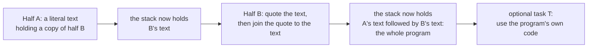

# Kleene's recursion theorem: every program can get hold of its own code

[Syllabus](../../../SYLLABUS.md) → [Computability and complexity](../README.md) → [Computability and Logic](../README.md#s02) → Kleene's recursion theorem

---

## General Overview

Here is one line of Python, 31 characters long:

```
s='s=%r;print(s%%s)';print(s%s)
```

Run it, and it prints exactly that line. It does not open its own file and it reads no input. A program that prints its own text this way is a **quine** (named after the philosopher W. V. O. Quine, who wrote about sentences that refer to themselves).

The trick has two halves. The first half, `s='...'`, stores a text: a copy of the line with a hole in it. The second half, `print(s%s)`, prints that text with its own quoted copy put into the hole. The data half describes the code half, and the code half rebuilds the data half. Together they print the whole.

Stephen Kleene proved in 1938 that this works for every program, not just this line. Any program can be given its own code, as a text it can read, measure, copy or hand to another program. That is this shelf's house example turned on itself: a program that reads programs, reading itself.

The theorem turns impossibility proofs into three lines. Suppose a program H could decide, for any program, whether it halts (stops after finitely many steps). Write the program "get my own code, ask H about it, then do the opposite". Whatever H says about that program is wrong. So H cannot exist.

**Kleene's recursion theorem: for every computable way of rewriting programs, some program behaves exactly like its own rewrite; so a program may always use its own code as if someone had handed it over.**

**What kind of fact this is:** a theorem, proved on this card in Why it works, both for the small language the code runs and, in a fold, for any programming language that has a universal machine and can fix an input into a program. The reproofs of the halting theorem, Rice's theorem and the minimal-programs theorem are theorems proved here from it.

### The picture: a program in two halves



Half A only stores; half B only rebuilds. Neither half knows the whole program, yet together they produce it.

---

## The formula

Notation first, in words.

- From [Universal machines](../01-Models%20of%20Computation/09-universal-machines-and-the-halting-problem.md): $`\langle R\rangle`$ is the **encoding** of a program R, its text as a string. It is not an inner product.
- $`\varphi_e`$ (phi sub e) is the **behaviour** of the program with text $`e`$: for each input, what it outputs, or "never halts". Two programs with the same behaviour may have different texts.
- A rewrite $`f`$ is **computable** when one program, given any program text, always halts with a new text $`f(e)`$.
- Writing two texts side by side means joining them, one after the other.

The recursion theorem, in its fixed-point form:

```math
\text{for every computable } f \text{ there is a program text } e \text{ with } \varphi_e = \varphi_{f(e)}
```

**Read it aloud:** however a computable rewrite edits program texts, some program behaves exactly like its own edited version.

A program $`e`$ with this property is a **fixed point** of $`f`$: a point the rewrite does not move, measured by behaviour, not by text.

The second form is the one programmers use. Take any task $`T`$: a program that receives a text and an input. Then some program $`R`$ runs $`T`$ on its own code:

```math
R(x) = T(\langle R\rangle, x), \qquad \langle R\rangle = q(\langle B\,T\rangle)\;\langle B\,T\rangle
```

**Read it aloud:** R does to input x what T does when handed R's own text and x; R's text is the quoted text of "B then T", followed by "B then T" itself.

Here $`q(w)`$ is the **quoting map**: it turns a text $`w`$ into the text of a program that pushes $`w`$ and stops. B is the fixed rebuild part, the same for every task.

The code runs a small language whose programs work on a stack of texts. Its instructions are single letters:

| Instruction | What it does |
| --- | --- |
| `L4:DQWC` | push the 4 characters after the colon; the length comes first, so no character ever needs escaping |
| `D` | duplicate the top text |
| `Q` | quote the top text: $`w`$ becomes $`q(w)`$, which is `L`, the length, `:` and $`w`$ |
| `W` | swap the top two texts |
| `C` | join the top two texts into one |
| `N` | replace the top text by its length, written in digits |
| `E` | run the top text as a fresh program; the rest of the current program is dropped |
| `H` | ask a decider whether the top text halts; "halts" makes the program loop for ever, "never halts" lets it carry on |

A program's output is the top text when it halts. In this language $`q(\texttt{DQWC})`$ is `L4:DQWC`, and the rebuild part is B = `DQWC`.

| Symbol | Plain meaning | In our example | Push it up and the answer… |
| --- | --- | --- | --- |
| $`e`$, $`u`$, $`v`$ | program texts; e is the fixed point, u and v are any texts in the proofs | e = `L6:DQWCQEDQWCQE`, 15 characters | — |
| $`f`$ | a computable rewrite of program texts | "quote it", "print its length", "run it, then add !" | — |
| $`\varphi_e`$ | the behaviour of $`e`$: its output, or never halts | prints its own text | — |
| $`R`$, $`\langle R\rangle`$ | the program that runs T on its own text, and that text | `L5:DQWCNDQWCN`, which prints 13 | — |
| $`T`$ | a task that receives a text | `N`, print the length | a longer task makes a longer R |
| $`q(w)`$, $`w`$ | the quoting map: the text of a program that pushes the text $`w`$ | $`q(\texttt{DQWC})`$ = `L4:DQWC` | 3 characters longer than $`w`$ here |
| B | the rebuild part: quote the text, then join | `DQWC` | — |
| $`x`$, $`g`$ | a program's input; a function fed to Y | the toy programs take no input | — |
| $`Y`$, $`W`$, $`\lambda`$, $`\to_\beta`$ | the Y combinator, its fixed point of g (a term, not the swap instruction `W`), function-making and one rewriting step, from [Lambda calculus](07-lambda-calculus-in-outline.md) | — | — |
| $`H`$ | a candidate halting decider; a capped one says "halts" only if it sees a halt within its step cap | "halts within 100 steps" | C halts after the cap plus 6 steps; a bigger cap moves the mistake, never removes it |
| $`C`$ | the contrary program: get my code, ask H, do the opposite; not the join instruction `C` | `L5:DQWCHDQWCH` | — |
| $`d`$, $`v_0`$; $`\mathcal{P}`$, S, a, b | in the folds: the helper rewrite and the program for "d, then f"; a behaviour property, a supposed decider for it, a program with it and one without | — | — |

### When it holds

- **The rewrite must be computable.** "Turn e into a program that halts exactly when e does not" has no fixed point. That is no contradiction: no program can perform that rewrite, which is the halting theorem again.
- **The fixed point matches behaviour, not text.** For "quote it", e has 15 characters and f(e) has more, yet both print the same text. A rewrite such as "add one instruction at the end" can never fix a text, but it still has a fixed point in behaviour.
- **Equal behaviour may mean "both never halt".** For "run it, then add !", the fixed point that the construction builds loops. It runs f(e), whose first part is e again, which builds and runs f(e) again. The code proves it by a repeated configuration after 16 steps. The theorem promises some fixed point, not a halting one.
- **The language must quote and run texts.** It needs a computable quoting map (the s-m-n idea below) and a universal machine. Every language that computes all computable functions has both, when its programs are numbered in a standard way (one that translates to and from Turing machines).
- **No file and no input is read.** The program computes its own text from its own instructions. A program that opens its source file depends on the file system, and fails when the file is moved or edited.

---

## Why it works

### Step 0: describe half the program, and let that half rebuild the rest

A program cannot simply contain a copy of its whole text: the copy would have to contain itself, and so on without end. The way out is to store a copy of only the *second* half. The second half then works out the first half from the copy, because the first half is just "push this copy". A text and a rule for quoting it are enough to rebuild the whole.

### Step 1: quoting is computable

The map $`q`$ takes a text and returns the text of a program that prints it. In the stack language that is three characters of bookkeeping: `L`, the length, `:`. In Python it is `repr`, which wraps a string in quote marks and escapes what needs escaping.

The general version is the **s-m-n theorem** (Kleene's name, after its subscripts): from the text of a program with two inputs and a value for the first, a computable map builds the text of a one-input program with that value fixed inside. Quoting is the case "print the fixed value".

### Step 2: the quine

Set B = `DQWC` and put its quote in front: `L4:DQWC` followed by `DQWC`. The run takes 5 steps (Worked numbers, by hand, traces them) and ends with `L4:DQWCDQWC` on the stack: the program's own 11 characters.

The Python line has the same two halves. `s='s=%r;print(s%%s)'` is half A: it stores a copy of the line with a hole `%r`. `print(s%s)` is half B. It fills the hole with the quoted copy, and it turns `%%` into `%`, which undoes the escaping that the stored copy needed. The result is `s=`, then the quoted text, then `;print(s%s)`: the line itself.

A search backs the construction from the other side. Among all 116,281 programs made of one literal of up to 4 letters from D, Q, W, C, followed by up to 4 such letters, the code finds exactly one quine: `L4:DQWCDQWC`.

### Step 3: add a task, and the program uses its own code

Put a task $`T`$ after B, and quote "B then T" in front:

1. Half A pushes the text of B followed by T.
2. B rebuilds the whole program's text on the stack.
3. T runs, with the program's own text as its input.

With T = `N`, "replace by the length", the program is `L5:DQWCNDQWCN`. It has 13 characters and it prints 13, after 6 steps. No one counted the characters and typed 13 in; the program measured itself. This is the second form of the formula: $`R(x) = T(\langle R\rangle, x)`$.

### Step 4: the fixed-point form

To build a fixed point of a rewrite $`f`$, choose the task "compute $`f`$ of my own text, then run the result". In the stack language the task is the code for $`f`$ followed by `E`. The program e then gets its own text, rewrites it to $`f(e)`$, and runs $`f(e)`$. So e does whatever $`f(e)`$ does: $`\varphi_e = \varphi_{f(e)}`$.

The code builds three fixed points and runs both sides of each:

| Rewrite f | The fixed point e | What e does | What f(e) does |
| --- | --- | --- | --- |
| quote it | `L6:DQWCQEDQWCQE` | halts after 8 steps, output its own text | halts after 1 step, same output |
| print its length | `L7:DQWCNQEDQWCNQE`, 17 characters | halts after 9 steps, output 17 | `L2:17` halts after 1 step, output 17 |
| run it, then add ! | 32 characters, given in the code output | loops: a configuration repeats after 16 steps | loops after 8 steps |

The first row is a second quine: the fixed point of "quote it" is a program that behaves like "print me", so it prints itself. The last row is the case where equal behaviour means "both never halt".

<details>
<summary>Detailed proof: the recursion theorem for any language with a universal machine and s-m-n</summary>

Number the programs so that $`\varphi_u`$ is the behaviour of program $`u`$, a universal machine runs $`u`$ on any input, and the s-m-n theorem holds. Let $`f`$ be computable and always halting.

By s-m-n there is a computable, always-halting map $`d`$ such that $`d(u)`$ is the text of this program: on input $`x`$, run program $`u`$ on input $`u`$; if that halts with a text $`v`$, run program $`v`$ on $`x`$. Building $`d(u)`$ only writes text, so $`d`$ always halts, even when program $`u`$ does not. Whenever $`\varphi_u(u)`$ halts,

$`\displaystyle \varphi_{d(u)} = \varphi_{\varphi_u(u)}.`$

The map "first $`d`$, then $`f`$" is computable and always halts, so it is some program $`v_0`$: $`\varphi_{v_0}(u) = f(d(u))`$ for every $`u`$. Put $`e = d(v_0)`$. Program $`v_0`$ halts on $`v_0`$, so

$`\displaystyle \varphi_e = \varphi_{d(v_0)} = \varphi_{\varphi_{v_0}(v_0)} = \varphi_{f(d(v_0))} = \varphi_{f(e)}.`$

That is the fixed point. The second form follows: given a task $`T`$, let $`f(e)`$ be the text of "run $`T`$ on the text $`e`$ and the input"; s-m-n makes this computable, and the fixed point $`e`$ satisfies $`\varphi_e(x) = T(e, x)`$. In the stack language, $`d(u)`$ is played by `DQWC` placed after a quoted copy, and the whole proof is the run in Step 4.

</details>

### Step 5: the lambda-calculus twin

[Lambda calculus](07-lambda-calculus-in-outline.md) has the same theorem in one term. There, $`x\,x`$ feeds a function its own text, and the Y combinator (a fixed term that turns a one-step rule into a recursive function) is built from it:

```math
Y = \lambda f.\,(\lambda x.\, f\,(x\,x))\,(\lambda x.\, f\,(x\,x)), \qquad Y\,g \to_\beta W \to_\beta g\,W, \qquad W = (\lambda x.\, g\,(x\,x))\,(\lambda x.\, g\,(x\,x))
```

**Read it aloud:** Y applied to any function g rewrites in one step to a term W, and W rewrites in one step to g applied to W; so W is a fixed point of g.

Here $`\lambda x.`$ makes a function of $`x`$ and $`\to_\beta`$ is one rewriting step, both from the lambda-calculus card. Two letters are reused: $`W`$ is a term, not the swap instruction `W`, and the $`f`$ inside $`Y`$ only names Y's input, not a rewrite of program texts. The half $`\lambda x.\, f\,(x\,x)`$ plays B, and feeding it to itself plays the quote in front. Kleene's theorem is the same idea for program numbers instead of terms.

### Step 6: the halting theorem in three lines

Suppose a program H always halts and says correctly whether any program halts. Then:

1. Let C, the **contrary program**, be "get my own code; ask H about it; if H says halts, loop for ever, otherwise stop". Step 3 makes C a real program. The letter is reused: this C is a whole program, not the join instruction `C`.
2. If H says C halts, C loops. If H says C never halts, C stops.
3. Either way H is wrong about C, so H does not exist.

The diagonal table of [Universal machines](../01-Models%20of%20Computation/09-universal-machines-and-the-halting-problem.md) is not needed: the recursion theorem gives C its own code directly. The code cannot run an impossible H, so it runs C against four real deciders:

| Decider H | H says about C | What C does |
| --- | --- | --- |
| always "halts" | halts | loops: a configuration repeats after 7 steps |
| always "never halts" | never halts | halts after 6 steps |
| halts within 100 steps | never halts | halts after 106 steps |
| halts within 300 steps | never halts | halts after 306 steps |

The capped deciders fail for a reason worth seeing. To judge C, the 100-step decider simulates C. That simulated C asks the same decider the same question, which needs another 100-step simulation, and so on. The simulations do not fit inside 100 steps, so the decider runs out and says "never halts". C sees that answer and stops, after its 6 own steps plus the 100 the decider spent.

### Step 7: Rice's theorem in three lines

[Rice's theorem](../01-Models%20of%20Computation/10-rices-theorem-and-reductions.md) says no program decides any property of behaviour that some programs have and some do not. "Halts on blank input" is one such property, and Step 6 is its proof. The general case uses the same move.

<details>
<summary>Detailed proof: Rice's theorem from the recursion theorem</summary>

Let $`\mathcal{P}`$ be a property of behaviour (two programs with the same behaviour both have it or both lack it), held by some program $`a`$ and not by some program $`b`$. Suppose a program S always halts and decides $`\mathcal{P}`$.

The rewrite $`f(e)`$ = "if S says e has $`\mathcal{P}`$, the text of $`b`$; otherwise the text of $`a`$" is computable and always halts, because S does. By the recursion theorem some $`e`$ has $`\varphi_e = \varphi_{f(e)}`$.

If $`e`$ has $`\mathcal{P}`$, then $`f(e) = b`$, so $`e`$ behaves like $`b`$, which lacks $`\mathcal{P}`$; so $`e`$ lacks it. If $`e`$ lacks $`\mathcal{P}`$, then $`f(e) = a`$, so $`e`$ behaves like $`a`$ and has it. Both cases contradict themselves, so S does not exist. In words: "get my own code, ask the decider, then behave like the program the decider says I am not".

</details>

### Step 8: minimal programs cannot be listed

Call a program **minimal** when no shorter program has the same behaviour. There are infinitely many minimal programs, at least one for each different behaviour. Suppose a program could list infinitely many of them. Then:

1. Write R: "get my own code; list minimal programs until one is longer than me; run that one".
2. Only finitely many programs are as short as R, so the endless list reaches a longer one, and R behaves exactly like it.
3. But R is shorter, so that program was not minimal after all.

So no program lists infinitely many minimal programs. It is the same flavour of result as the uncomputability of [Kolmogorov complexity](05-kolmogorov-complexity.md), where a short program would print a string it rates as complex.

---

## Worked numbers, by hand

The quine `L4:DQWCDQWC`, one instruction at a time, then the contrary program C against the 100-step decider.

| Step | Arithmetic | Value |
| --- | --- | --- |
| 1, `L4:DQWC` | push the 4 characters after the colon | stack: `DQWC` |
| 2, `D` | duplicate the top | `DQWC`, `DQWC` |
| 3, `Q` | quote the top: `L`, length 4, `:`, text | `DQWC`, `L4:DQWC` |
| 4, `W` | swap the top two | `L4:DQWC`, `DQWC` |
| 5, `C` | join them | **`L4:DQWCDQWC`: halts after 5 steps, output equals the program** |
| program C, steps 1 to 5 | the same rebuild, with task `H` | stack: C's own text, `L5:DQWCHDQWCH` |
| C, step 6 | ask the 100-step decider about C | it simulates C, which asks again, and runs out |
| the answer | no halt seen within 100 steps | "never halts" |
| C's total | 6 steps of its own + 100 spent by the decider | **halts after 106 steps** |

The quine's output is its own text, computed from a copy of only its second half. The decider said "never halts" about a program that stopped at step 106.

### What breaks if you drop a piece

| Mistake | Comes out at | What went wrong |
| --- | --- | --- |
| Copy without quoting: `L2:DCDC` | outputs `DCDC` | The copy rebuilds half B only; the quote is what recreates half A |
| Write `%` for `%%` in the Python line | 2 slots to fill, 1 value: the line stops with an error | The stored copy must escape the `%` that half B uses |
| No flip: "ask H, then agree", `L5:DQWCGDQWCG` | against "always halts" it halts after 6 steps: H is right | Self-reference alone proves nothing; the opposite is the contradiction |

---

## Code, from first principles, and it actually runs

Each script writes out the stack-language interpreter, a hand-made `repr` and `%` fill, and the decider harness; nothing imported runs code or formats the quine. A run says "loops" only when a configuration (program text, place and stack) repeats, which proves it never halts. The roads are independent: the Python line is checked by Python's own `%` and by the hand-written fill; the toy quine comes from the construction and, separately, from an exhaustive search; each fixed point e is run beside f(e), with f computed directly in the host language rather than by the toy program.

### Python

```python
# Kleene's recursion theorem -- the check behind the card.  Standard library
# only, and nothing is imported.  No eval or exec: the Python quine is checked
# by Python's own % formatting and by a hand-written repr and fill.  The toy
# language is a stack of texts, run by the interpreter below:
#   L<n>:<text> push the n characters   D duplicate the top   W swap the top two
#   Q quote: w becomes L<len w>:w       C join: a, b become a+b   N w becomes len(w)
#   E run the top text as a fresh program   H ask a decider about the top text:
#     "halts" -> loop for ever, "never halts" -> carry on    G the same, unflipped
# A run says "loops" only on a repeated configuration (text, place, stack).

def quote(w):                            # the program that pushes w and stops
    return "L" + str(len(w)) + ":" + w

def run(prog, budget, decide):
    pc, st, steps, seen = 0, [], 0, set()
    while True:
        if pc == len(prog):
            return "halts", steps, (st[-1] if st else "")
        key = (prog, pc, tuple(st))
        if key in seen:
            return "loops", steps, ""
        seen.add(key)
        if steps >= budget:
            return "running", steps, ""
        steps += 1
        if pc < 0:                       # spinning: nothing ever changes
            continue
        c, pc = prog[pc], pc + 1
        if c == "L":
            j = pc
            while j < len(prog) and prog[j] in "0123456789":
                j += 1
            if j == pc or j >= len(prog) or prog[j] != ":" or j + 1 + int(prog[pc:j]) > len(prog):
                return "crash", steps, ""
            n = int(prog[pc:j])
            st.append(prog[j + 1:j + 1 + n])
            pc = j + 1 + n
        elif c in "DQNEHG" and len(st) >= 1 or c in "WC" and len(st) >= 2:
            w = st.pop()
            if c == "D": st += [w, w]
            elif c == "Q": st.append(quote(w))
            elif c == "N": st.append(str(len(w)))
            elif c == "W": st[-1:] = [w, st[-1]]
            elif c == "C": st[-1] += w
            elif c == "E": prog, pc, st = w, 0, []
            else:
                yes, used = decide(w, budget - steps)
                steps += used
                if steps >= budget:
                    return "running", steps, ""
                if yes == (c == "H"):
                    pc = -1
        else:
            return "crash", steps, ""

def cap(n):                              # "halts if a run of n steps sees it halt"
    def d(w, left):
        status, used, _ = run(w, min(n, left), d)
        return status == "halts", used
    return d

always_yes = lambda w, left: (True, 0)
always_no = lambda w, left: (False, 0)
B = "DQWC"                               # rebuilds the whole program from its literal
def self_prog(task):                     # the recursion theorem's construction
    return quote(B + task) + B + task
def show(r):
    n = f"{r[1]} step" + ("" if r[1] == 1 else "s")
    return f"halts after {n}, output {r[2] or '(empty)'}" if r[0] == "halts" else f"{r[0]} after {n}"
def yn(claim):
    return "yes" if claim else "no"

def myrepr(w):                           # Python's repr of a plain string, written out
    return "'" + w.replace("\\", "\\\\").replace("'", "\\'") + "'"
def fill(t, args):                       # Python's % formatting, written out
    out, i, slots = "", 0, 0
    while i < len(t):
        if t[i] != "%":
            out, i = out + t[i], i + 1
            continue
        code, i = t[i + 1], i + 2
        if code == "%":
            out += "%"
            continue
        if slots < len(args):
            out += myrepr(args[slots]) if code == "r" else args[slots]
        slots += 1
    return (out if slots == len(args) else None), slots

src = "s='s=%r;print(s%%s)';print(s%s)"
s = "s=%r;print(s%%s)"
print(f"python line: {src}  ({len(src)} characters)")
print(f"s quoted by repr: {myrepr(s)}")
road1, road2 = s % s, fill(s, [s])[0]           # road 1 is Python's own %, asserted below
print(f"its output, by a hand-written repr and fill: equals the line: {yn(road2 == src)}")
quine = self_prog("")
rq = run(quine, 10000, always_no)
print(f"toy quine {quine} ({len(quine)} characters): {show(rq)}; equals itself: {yn(rq[2] == quine)}")
words = [""]
for _ in range(4):
    words += [w + c for w in words if len(w) == len(words[-1]) for c in "DQWC"]
found = [p for p in (quote(a) + b for a in words for b in words) if run(p, 50, always_no)[2] == p]
print(f"search: {len(words) ** 2} programs (one literal of up to 4 of DQWC, then up to 4 of DQWC): quines {found}")
own = self_prog("N")
ro = run(own, 10000, always_no)
print(f"self-length {own} ({len(own)} characters): {show(ro)}")
fixed = [("quote it", "QE", quote), ("print its length", "NQE", lambda w: quote(str(len(w)))),
         ("run it, then add !", "L5:L1:!CCE", lambda w: w + "L1:!C")]
for name, task, f in fixed:
    e = self_prog(task)
    a, b = run(e, 10000, always_no), run(f(e), 10000, always_no)
    print(f"fixed point of '{name}': e = {e} ({len(e)} characters)")
    print(f"  e: {show(a)}; f(e) = {f(e)}: {show(b)}")
    assert (a[0], a[2]) == (b[0], b[2])                  # e behaves like f(e)
con = self_prog("H")
print(f"contrary program C = {con}: get my own code, ask the decider, do the opposite")
for name, d, want in [("always halts", always_yes, 6 + 1), ("always never halts", always_no, 6),
                      ("halts within 100 steps", cap(100), 6 + 100), ("halts within 300 steps", cap(300), 6 + 300)]:
    says, _ = d(con, 10000)
    r = run(con, 10000, d)
    print(f"decider '{name}': says {'halts' if says else 'never halts'}; C {show(r)}")
    assert says != (r[0] == "halts")                     # every decider is wrong about C
    assert r[1] == want                                  # C's own 6 steps, plus 1 spin or the cap spent
nq = "L2:DCDC"
print(f"mistake 1, copy without quoting: {nq} outputs {run(nq, 100, always_no)[2]}")
bad = "s=%r;print(s%s)"
try:
    bad % bad; ok = True
except TypeError:
    ok = False
print(f"mistake 2, % for %%: {fill(bad, [bad])[1]} slots, 1 value; runs: {yn(ok)}")
agree = self_prog("G")
ra = run(agree, 10000, always_yes)
print(f"mistake 3, no flip: {agree} with 'always halts': {show(ra)}; decider right: {yn(ra[0] == 'halts')}")
assert road1 == src and road2 == src and not ok          # two roads to the quine
assert rq[2] == quine and found == [quine]                # construction against search
assert ro[2] == str(len(own)) and run(nq, 100, always_no)[2] != nq
print("ALL CHECKS PASS")
```

**Ran 2026-11-24 on macOS, Python 3.14.10, standard library only. All checks passed. Output, pasted from the run:**

```
python line: s='s=%r;print(s%%s)';print(s%s)  (31 characters)
s quoted by repr: 's=%r;print(s%%s)'
its output, by a hand-written repr and fill: equals the line: yes
toy quine L4:DQWCDQWC (11 characters): halts after 5 steps, output L4:DQWCDQWC; equals itself: yes
search: 116281 programs (one literal of up to 4 of DQWC, then up to 4 of DQWC): quines ['L4:DQWCDQWC']
self-length L5:DQWCNDQWCN (13 characters): halts after 6 steps, output 13
fixed point of 'quote it': e = L6:DQWCQEDQWCQE (15 characters)
  e: halts after 8 steps, output L6:DQWCQEDQWCQE; f(e) = L15:L6:DQWCQEDQWCQE: halts after 1 step, output L6:DQWCQEDQWCQE
fixed point of 'print its length': e = L7:DQWCNQEDQWCNQE (17 characters)
  e: halts after 9 steps, output 17; f(e) = L2:17: halts after 1 step, output 17
fixed point of 'run it, then add !': e = L14:DQWCL5:L1:!CCEDQWCL5:L1:!CCE (32 characters)
  e: loops after 16 steps; f(e) = L14:DQWCL5:L1:!CCEDQWCL5:L1:!CCEL1:!C: loops after 8 steps
contrary program C = L5:DQWCHDQWCH: get my own code, ask the decider, do the opposite
decider 'always halts': says halts; C loops after 7 steps
decider 'always never halts': says never halts; C halts after 6 steps, output (empty)
decider 'halts within 100 steps': says never halts; C halts after 106 steps, output (empty)
decider 'halts within 300 steps': says never halts; C halts after 306 steps, output (empty)
mistake 1, copy without quoting: L2:DCDC outputs DCDC
mistake 2, % for %%: 2 slots, 1 value; runs: no
mistake 3, no flip: L5:DQWCGDQWCG with 'always halts': halts after 6 steps, output (empty); decider right: yes
ALL CHECKS PASS
```

### Rust

Same numbers, same labels, built with `rustc --edition 2021 -O`. Rust cannot run Python's `%`, so its first road to the Python line rebuilds the line from its two halves.

```rust
// Kleene's recursion theorem -- the same check as the Python, in Rust.  No
// crates.  Rust cannot run Python, so the Python quine is checked by a
// hand-written repr and fill.  The toy language is a stack of texts:
//   L<n>:<text> push the n characters   D duplicate the top   W swap the top two
//   Q quote: w becomes L<len w>:w       C join: a, b become a+b   N w becomes len(w)
//   E run the top text as a fresh program   H ask a decider about the top text:
//     "halts" -> loop for ever, "never halts" -> carry on    G the same, unflipped
// A run says "loops" only on a repeated configuration (text, place, stack).
use std::collections::HashSet;

#[derive(Clone, Copy)]
enum Dec { Yes, No, Cap(u64) }

fn quote(w: &str) -> String { format!("L{}:{}", w.len(), w) }

fn decide(d: Dec, w: &str, left: u64) -> (bool, u64) {
    match d {
        Dec::Yes => (true, 0),
        Dec::No => (false, 0),
        Dec::Cap(n) => { let r = run(w, n.min(left), d); (r.0 == "halts", r.1) }
    }
}

fn run(start: &str, budget: u64, d: Dec) -> (&'static str, u64, String) {
    let (mut prog, mut pc, mut st, mut steps): (Vec<u8>, i64, Vec<String>, u64) =
        (start.as_bytes().to_vec(), 0, Vec::new(), 0);
    let mut seen: HashSet<(Vec<u8>, i64, Vec<String>)> = HashSet::new();
    loop {
        if pc == prog.len() as i64 { return ("halts", steps, st.last().cloned().unwrap_or_default()) }
        if !seen.insert((prog.clone(), pc, st.clone())) { return ("loops", steps, String::new()) }
        if steps >= budget { return ("running", steps, String::new()) }
        steps += 1;
        if pc < 0 { continue }                    // spinning: nothing ever changes
        let c = prog[pc as usize] as char;
        pc += 1;
        let p = pc as usize;
        if c == 'L' {
            let mut j = p;
            while j < prog.len() && prog[j].is_ascii_digit() { j += 1 }
            if j == p || j >= prog.len() || prog[j] != b':' { return ("crash", steps, String::new()) }
            let n: usize = String::from_utf8(prog[p..j].to_vec()).unwrap().parse().unwrap();
            if j + 1 + n > prog.len() { return ("crash", steps, String::new()) }
            st.push(String::from_utf8(prog[j + 1..j + 1 + n].to_vec()).unwrap());
            pc = (j + 1 + n) as i64;
        } else if ("DQNEHG".contains(c) && st.len() >= 1) || ("WC".contains(c) && st.len() >= 2) {
            let w = st.pop().unwrap();
            match c {
                'D' => { st.push(w.clone()); st.push(w) }
                'Q' => st.push(quote(&w)),
                'N' => st.push(w.len().to_string()),
                'W' => { let v = st.pop().unwrap(); st.push(w); st.push(v) }
                'C' => st.last_mut().unwrap().push_str(&w),
                'E' => { prog = w.into_bytes(); pc = 0; st.clear() }
                _ => {
                    let (yes, used) = decide(d, &w, budget - steps);
                    steps += used;
                    if steps >= budget { return ("running", steps, String::new()) }
                    if yes == (c == 'H') { pc = -1 }
                }
            }
        } else { return ("crash", steps, String::new()) }
    }
}

const B: &str = "DQWC";                           // rebuilds the whole program from its literal
fn self_prog(task: &str) -> String { format!("{}{}{}", quote(&format!("{}{}", B, task)), B, task) }
fn show(r: &(&str, u64, String)) -> String {
    let n = format!("{} step{}", r.1, if r.1 == 1 { "" } else { "s" });
    if r.0 == "halts" { format!("halts after {}, output {}", n, if r.2.is_empty() { "(empty)" } else { &r.2 }) }
    else { format!("{} after {}", r.0, n) }
}
fn yn(claim: bool) -> &'static str { if claim { "yes" } else { "no" } }

fn myrepr(w: &str) -> String { format!("'{}'", w.replace('\\', "\\\\").replace('\'', "\\'")) }
fn fill(t: &str, args: &[&str]) -> (Option<String>, usize) {  // Python's % formatting, written out
    let (b, mut out, mut i, mut slots) = (t.as_bytes(), String::new(), 0, 0);
    while i < b.len() {
        if b[i] != b'%' { out.push(b[i] as char); i += 1; continue }
        let code = b[i + 1];
        i += 2;
        if code == b'%' { out.push('%'); continue }
        if slots < args.len() {
            if code == b'r' { out += &myrepr(args[slots]) } else { out += args[slots] }
        }
        slots += 1;
    }
    (if slots == args.len() { Some(out) } else { None }, slots)
}

fn main() {
    let src = "s='s=%r;print(s%%s)';print(s%s)";
    let s = "s=%r;print(s%%s)";
    println!("python line: {}  ({} characters)", src, src.len());
    println!("s quoted by repr: {}", myrepr(s));
    let road2 = fill(s, &[s]).0.unwrap();
    let road1 = format!("s={};print(s%s)", myrepr(s));    // road 1: the line rebuilt from its halves
    println!("its output, by a hand-written repr and fill: equals the line: {}", yn(road2 == src));
    let quine = self_prog("");
    let rq = run(&quine, 10000, Dec::No);
    println!("toy quine {} ({} characters): {}; equals itself: {}", quine, quine.len(), show(&rq), yn(rq.2 == quine));
    let mut words: Vec<String> = vec![String::new()];
    for len in 0..4 {
        let last: Vec<String> = words.iter().filter(|w| w.len() == len).cloned().collect();
        for w in last { for c in B.chars() { words.push(format!("{}{}", w, c)) } }
    }
    let mut found: Vec<String> = Vec::new();
    for a in &words { for b in &words {
        let p = format!("{}{}", quote(a), b);
        if run(&p, 50, Dec::No).2 == p { found.push(p) }
    } }
    let fl: Vec<String> = found.iter().map(|p| format!("'{}'", p)).collect();
    println!("search: {} programs (one literal of up to 4 of DQWC, then up to 4 of DQWC): quines [{}]",
             words.len() * words.len(), fl.join(", "));
    let own = self_prog("N");
    let ro = run(&own, 10000, Dec::No);
    println!("self-length {} ({} characters): {}", own, own.len(), show(&ro));
    let fixed: [(&str, &str, fn(&str) -> String); 3] = [
        ("quote it", "QE", |w| quote(w)),
        ("print its length", "NQE", |w| quote(&w.len().to_string())),
        ("run it, then add !", "L5:L1:!CCE", |w| format!("{}L1:!C", w))];
    for (name, task, f) in fixed.iter() {
        let e = self_prog(task);
        let (a, b) = (run(&e, 10000, Dec::No), run(&f(&e), 10000, Dec::No));
        println!("fixed point of '{}': e = {} ({} characters)", name, e, e.len());
        println!("  e: {}; f(e) = {}: {}", show(&a), f(&e), show(&b));
        assert!(a.0 == b.0 && a.2 == b.2);                 // e behaves like f(e)
    }
    let con = self_prog("H");
    println!("contrary program C = {}: get my own code, ask the decider, do the opposite", con);
    for (name, d, want) in [("always halts", Dec::Yes, 6 + 1), ("always never halts", Dec::No, 6),
                            ("halts within 100 steps", Dec::Cap(100), 6 + 100), ("halts within 300 steps", Dec::Cap(300), 6 + 300)] {
        let says = decide(d, &con, 10000).0;
        let r = run(&con, 10000, d);
        println!("decider '{}': says {}; C {}", name, if says { "halts" } else { "never halts" }, show(&r));
        assert!(says != (r.0 == "halts"));                // every decider is wrong about C
        assert!(r.1 == want);                             // C's own 6 steps, plus 1 spin or the cap spent
    }
    let nq = "L2:DCDC";
    println!("mistake 1, copy without quoting: {} outputs {}", nq, run(nq, 100, Dec::No).2);
    let bad = "s=%r;print(s%s)";
    let (filled, slots) = fill(bad, &[bad]);
    println!("mistake 2, % for %%: {} slots, 1 value; runs: {}", slots, yn(filled.is_some()));
    let agree = self_prog("G");
    let ra = run(&agree, 10000, Dec::Yes);
    println!("mistake 3, no flip: {} with 'always halts': {}; decider right: {}", agree, show(&ra), yn(ra.0 == "halts"));
    assert!(road1 == src && road2 == src && filled.is_none());   // two roads to the quine
    assert!(rq.2 == quine && found == vec![quine.clone()]);       // construction against search
    assert!(ro.2 == own.len().to_string() && run(nq, 100, Dec::No).2 != nq);
    println!("ALL CHECKS PASS");
}
```

**Ran 2026-11-24 on macOS, rustc 1.98.1, no crates. All checks passed. Output, pasted from the run:**

```
python line: s='s=%r;print(s%%s)';print(s%s)  (31 characters)
s quoted by repr: 's=%r;print(s%%s)'
its output, by a hand-written repr and fill: equals the line: yes
toy quine L4:DQWCDQWC (11 characters): halts after 5 steps, output L4:DQWCDQWC; equals itself: yes
search: 116281 programs (one literal of up to 4 of DQWC, then up to 4 of DQWC): quines ['L4:DQWCDQWC']
self-length L5:DQWCNDQWCN (13 characters): halts after 6 steps, output 13
fixed point of 'quote it': e = L6:DQWCQEDQWCQE (15 characters)
  e: halts after 8 steps, output L6:DQWCQEDQWCQE; f(e) = L15:L6:DQWCQEDQWCQE: halts after 1 step, output L6:DQWCQEDQWCQE
fixed point of 'print its length': e = L7:DQWCNQEDQWCNQE (17 characters)
  e: halts after 9 steps, output 17; f(e) = L2:17: halts after 1 step, output 17
fixed point of 'run it, then add !': e = L14:DQWCL5:L1:!CCEDQWCL5:L1:!CCE (32 characters)
  e: loops after 16 steps; f(e) = L14:DQWCL5:L1:!CCEDQWCL5:L1:!CCEL1:!C: loops after 8 steps
contrary program C = L5:DQWCHDQWCH: get my own code, ask the decider, do the opposite
decider 'always halts': says halts; C loops after 7 steps
decider 'always never halts': says never halts; C halts after 6 steps, output (empty)
decider 'halts within 100 steps': says never halts; C halts after 106 steps, output (empty)
decider 'halts within 300 steps': says never halts; C halts after 306 steps, output (empty)
mistake 1, copy without quoting: L2:DCDC outputs DCDC
mistake 2, % for %%: 2 slots, 1 value; runs: no
mistake 3, no flip: L5:DQWCGDQWCG with 'always halts': halts after 6 steps, output (empty); decider right: yes
ALL CHECKS PASS
```

The two outputs match line for line.

### Lean

Lean proves both forms of the recursion theorem and Rice's theorem, for the program codes of Lean's Mathlib library, and checks the worked numbers.

- Take a computable rewrite $`f`$ of program texts. Then some program text $`e`$ has $`\varphi_e = \varphi_{f(e)}`$.
- Take a task $`T`$ that receives a text and an input. Then some program $`R`$ has $`R(x) = T(\langle R\rangle, x)`$ for every input $`x`$.
- Take a property of behaviour that some program has and some program lacks. Then no always-halting program decides it for every program text.
- The Python quine line has 31 characters, and the toy quine `L4:DQWCDQWC` has 11.
- The self-length program `L5:DQWCNDQWCN` has 13 characters.
- The fixed points of "quote it", "print its length" and "run it, then add !" have 15, 17 and 32 characters.
- The search covers $`(1 + 4 + 16 + 64 + 256)^2`$ = 116,281 programs.
- C's 6 own steps plus caps of 100 and 300 give 106 and 306.

Lean uses Mathlib's program codes, not the stack language, so every run, step count and search is left to the Python and Rust checks.

```lean
-- Kleene's recursion theorem: every computable rewrite of program codes has a code that behaves exactly like its own rewrite, and from it no program decides a nontrivial property of behaviour.
import Mathlib.Computability.PartrecCode
import Mathlib.Computability.Halting

open Nat.Partrec

/-- Kleene's recursion theorem, fixed-point form: for every computable (always halting)
rewrite `f` of program codes there is a program code `e` whose behaviour equals the
behaviour of its rewrite, `φ_e = φ_{f(e)}`. -/
theorem kleene_recursion_fixed_point {f : Code → Code} (hf : Computable f) :
    ∃ e : Code, Code.eval e = Code.eval (f e) := by
  obtain ⟨c, hc⟩ := Code.fixed_point hf
  exact ⟨c, hc.symm⟩

/-- The programmer's form: for every partial computable task `T` that receives a program
text and an input, some program `R` runs `T` on its own code, `R(x) = T(⟨R⟩, x)` for every
input `x`. -/
theorem program_runs_task_on_own_code {T : Code → ℕ →. ℕ} (hT : Partrec₂ T) :
    ∃ R : Code, ∀ x : ℕ, Code.eval R x = T R x := by
  obtain ⟨c, hc⟩ := Code.fixed_point₂ hT
  exact ⟨c, fun x => congrFun hc x⟩

/-- Rice's theorem, reproved from the recursion theorem: if a property `P` of behaviour is
held by some program `a` and not held by some program `b`, then no program decides, for every
program code `c`, whether the behaviour of `c` has `P`. -/
theorem no_decider_for_nontrivial_behaviour_property (P : Set (ℕ →. ℕ)) (a b : Code)
    (ha : Code.eval a ∈ P) (hb : Code.eval b ∉ P) :
    ¬ ComputablePred fun c : Code => Code.eval c ∈ P := by
  intro h
  exact hb (ComputablePred.rice P h (Code.exists_code.2 ⟨a, rfl⟩) (Code.exists_code.2 ⟨b, rfl⟩) ha)

-- The card's worked whole-number facts.
-- The Python quine line has 31 characters.
example : "s='s=%r;print(s%%s)';print(s%s)".length = 31 := by decide
-- The toy quine L4:DQWCDQWC has 11 characters.
example : "L4:DQWCDQWC".length = 11 := by decide
-- The self-length program has 13 characters, and its output is 13.
example : "L5:DQWCNDQWCN".length = 13 := by decide
-- The fixed points of "quote it" and "print its length" have 15 and 17 characters.
example : "L6:DQWCQEDQWCQE".length = 15 := by decide
example : "L7:DQWCNQEDQWCNQE".length = 17 := by decide
-- The fixed point of "run it, then add !" has 32 characters.
example : "L14:DQWCL5:L1:!CCEDQWCL5:L1:!CCE".length = 32 := by decide
-- The search space: a literal of up to 4 letters from D, Q, W, C, then up to 4 more,
-- gives (1 + 4 + 16 + 64 + 256)^2 = 116,281 programs.
example : (4 ^ 0 + 4 ^ 1 + 4 ^ 2 + 4 ^ 3 + 4 ^ 4) ^ 2 = 116281 := by decide
-- The capped deciders: C's own 6 steps plus the cap.
example : 6 + 100 = 106 ∧ 6 + 300 = 306 := by decide

#print axioms kleene_recursion_fixed_point
#print axioms program_runs_task_on_own_code
#print axioms no_decider_for_nontrivial_behaviour_property
```

**Checked 2026-11-24 on macOS, Lean 4.36.0-rc2, Mathlib v4.36.0-rc2. Every proof is complete and uses only Lean's standard axioms. Output, pasted from the run:**

```
'kleene_recursion_fixed_point' depends on axioms: [propext, Classical.choice, Quot.sound]
'program_runs_task_on_own_code' depends on axioms: [propext, Classical.choice, Quot.sound]
'no_decider_for_nontrivial_behaviour_property' depends on axioms: [propext, Classical.choice, Quot.sound]
```

> [!TIP]
> **Try changing**
> Guess first, then run it. The asserts are pinned to the card's programs, so expect one to stop the run.
> - **Drop the quote from B.** Set `B = "DWC"`. Guess first: does the self-length program still print its own length? It has 11 characters and prints 8, and the first fixed-point assert stops the run.
> - **Raise the cap.** Change `cap(300)` to `cap(1000)`. Guess first: is the decider right now? No: it still says "never halts", and C halts after 1,006 steps (the label still reads 300). Then the step-count assert, still expecting 306, stops the run.
> - **Remove the flip.** Change `self_prog("H")` to `self_prog("G")`. Guess first: which assert fails? The "every decider is wrong" assert, at the first decider, "always halts".
> - **Measure twice.** Change `self_prog("N")` to `self_prog("NN")`. Guess first: the program measures its 15 characters, then measures the answer, so it prints 2, and the last assert stops the run.

---

## The usual mistake

> [!warning]
> **Thinking a quine reads its own file.** A program that opens its source file gets its code from the outside, and breaks when the file moves. The recursion theorem builds the code from the program's own instructions, with no file and no input. That is why it works inside any proof about programs.
>
> - **Copying without quoting.** `L2:DCDC` outputs `DCDC`: half B is copied, half A is lost. The quote is what rebuilds the part that stores the copy.
> - **Forgetting the escape.** With `%` for `%%`, the Python line has 2 slots and 1 value, and stops with an error before printing anything.
> - **Expecting equal texts.** The fixed point of "quote it" is `L6:DQWCQEDQWCQE`, while its rewrite starts `L15:`. They match in behaviour only.
> - **Expecting every fixed point to halt.** For "run it, then add !", the constructed fixed point loops: a configuration repeats after 16 steps.

---

## Where you meet it in real life

- **Compilers that compile themselves.** A 1984 lecture on trust showed a compiler that inserts a hidden login backdoor and also reinserts that insertion code into every new copy of itself, using quine-style self-reproduction. The backdoor then survives in no source file.
- **Computer viruses.** A virus is a program that copies its own code into other programs. The recursion theorem guarantees any program can get its own code, and a 1988 paper built its formal theory of viruses on it.
- **Gödel's sentence.** [Godel's theorems](03-godels-incompleteness-in-outline.md) build a sentence that says "I am not provable" by the same two-half trick, applied to formulas instead of programs.
- **Proof assistants.** Mathlib, the Lean library behind [Proof assistants](08-proof-assistants-and-formal-verification.md), proves the fixed-point form for its own program codes as `Nat.Partrec.Code.fixed_point`. This card's Lean check runs that proof.

> **Say it back**
> A program can print its own text by storing a copy of its second half and letting that half quote the copy and join the two. Put a task after the rebuild, and the program runs the task on its own code; the 13-character program that prints 13 is one. For every computable rewrite f, some program e behaves exactly like f(e), though their texts differ and both may loop. "Get my own code, ask the decider, do the opposite" defeats every halting decider, and the same move proves Rice's theorem and that minimal programs cannot be listed.

---

## What this builds on

- [Universal machines](../01-Models%20of%20Computation/09-universal-machines-and-the-halting-problem.md): the encoding $`\langle M\rangle`$, the universal machine behind `E`, and the diagonal proof this card replaces with self-reference.
- [Rice's theorem](../01-Models%20of%20Computation/10-rices-theorem-and-reductions.md): the statement reproved here in three lines, there proved by reduction.
- [Decidable and semidecidable](01-decidable-and-semidecidable-sets.md): what a decider is, and why a program may confirm a yes without ever saying no.
- [Lambda calculus](07-lambda-calculus-in-outline.md): $`x\,x`$ and the Y combinator, the fixed-point theorem for functions.
- [Kolmogorov complexity](05-kolmogorov-complexity.md): shortest programs, whose uncomputability matches the minimal-programs result here.
- [Godel's theorems](03-godels-incompleteness-in-outline.md): the self-referential sentence, the same two-half trick in logic.

## Where this goes next

- [Turing degrees and the arithmetical hierarchy](10-turing-degrees-and-the-arithmetical-hierarchy.md): machines that may ask an oracle (a black box that answers one fixed question) for answers; the recursion theorem holds for them too, and that card grades how undecidable a problem is.
- [Formal proofs and soundness](11-formal-deduction-and-soundness.md): proofs as finite texts that a program checks, and why the rules never prove a falsehood.

The theorem promises a fixed point but says nothing about how short it can be; how much longer than its task must a self-referring program be?

---

## Sources

Verified 2026-11-24: every link below resolves to the publisher's page.

- Kleene, S. C. "On notation for ordinal numbers." *Journal of Symbolic Logic* 3 (1938): 150–155. [doi:10.2307/2267778](https://doi.org/10.2307/2267778). The paper in which the recursion theorem first appears.
- Sipser, Michael. *Introduction to the Theory of Computation*, 3rd ed. Cengage, 2013. [Publisher page](https://www.cengage.com/c/introduction-to-the-theory-of-computation-3e-sipser/9781133187790/). Section 6.1: the two-half SELF construction, the task form, and the halting and minimal-machine applications.
- Thompson, Ken. "Reflections on trusting trust." *Communications of the ACM* 27 (1984): 761–763. [doi:10.1145/358198.358210](https://doi.org/10.1145/358198.358210). Self-reproducing programs and the compiler that reinserts its own backdoor.
- Adleman, Leonard M. "An Abstract Theory of Computer Viruses." *Advances in Cryptology, CRYPTO '88*, Lecture Notes in Computer Science 403, Springer, 1990: 354–374. [doi:10.1007/0-387-34799-2_28](https://doi.org/10.1007/0-387-34799-2_28). A formal theory of viruses built on the recursion theorem.
