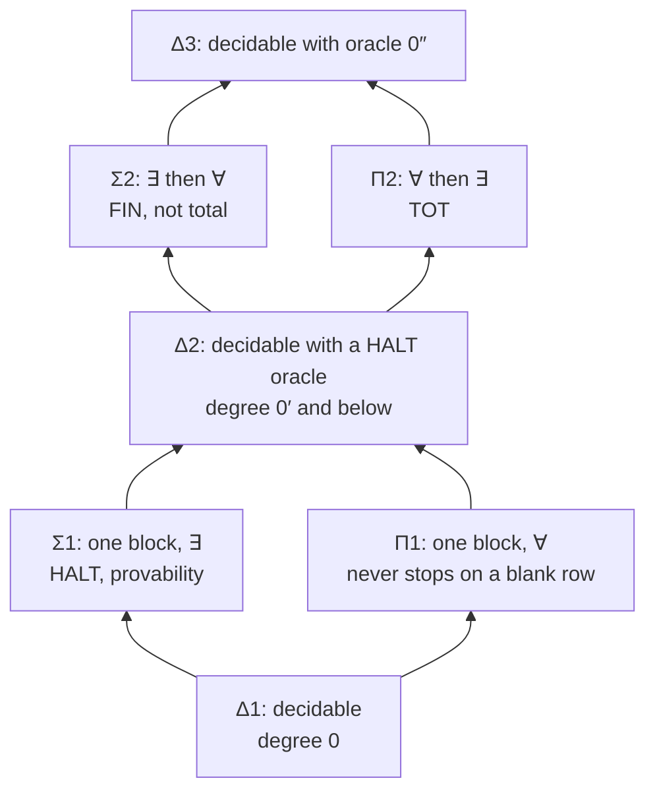

# Turing degrees and the arithmetical hierarchy: ranking unsolvable problems by oracles and by quantifiers

[Syllabus](../../../SYLLABUS.md) → [Computability and complexity](../README.md) → [Computability and Logic](../README.md#s02) → Turing degrees and the arithmetical hierarchy

---

## General Overview

Picture a program that reads programs, and asks three questions about each one.

- **HALT:** does it stop when started on a blank row of cells?
- **TOT:** does it stop on every input? TOT is short for "total".
- **FIN:** does it stop on only finitely many inputs?

No program answers any of the three for every program. But they are not equally hard. Suppose a box, called an **oracle**, answers any HALT question correctly in one step. With the box, HALT is easy: ask it. TOT is not.

Take the program `-[]`. In the shelf's small language (from [Decidable and semidecidable](01-decidable-and-semidecidable-sets.md)) the input sits in a cell, `-` takes one from the cell, and `[ ]` repeats what is between the brackets while the cell is not zero. So `-[]` stops on inputs 0 and 1 and spins forever on 2. A machine that asks the box "does it stop on 0? on 1? on 2?" gets yes, yes, no, and knows after three questions that `-[]` is not total. Now take `[-]`, which stops on every input. The machine gets yes, yes, yes, and after 30 questions it still has no answer. It never will: each answer covers one input, and no finite number of yeses covers them all.

Two rulers measure this. The first is the oracle a problem needs. The second is the fewest alternating "there is" and "for every" blocks that any definition of it needs. HALT needs one block: there is a step at which it stops. TOT needs two: for every input there is a step. Post's theorem says the two rulers agree.

**A set is in $`\Sigma_k`$ or $`\Pi_k`$ when some definition of it has $`k`$ alternating quantifier blocks, and its level in the arithmetical hierarchy is the fewest blocks any definition needs; Post's theorem says an oracle for $`\emptyset^{(k)}`$, the $`k`$-th jump of the empty set ($`\emptyset'`$ is as hard as HALT), decides every set at level $`k`$: HALT is at level 1, and TOT at level 2, beyond any HALT oracle.**

**What kind of fact this is:** Turing reduction, degree, jump and the levels $`\Sigma_n`$, $`\Pi_n`$ are definitions. The jump theorem, Post's theorem and the levels of HALT, TOT and FIN are theorems, proved here in outline, with full proofs in Soare (2016). The Friedberg–Muchnik theorem is stated, not proved. The code's HALT oracle is a stand-in that answers only what it can prove.

### The picture: the hierarchy, low to high



Schematic. Each arrow is an inclusion, and every inclusion shown is proved strict: HALT is in no box below Σ1 or beside it, and the same holds for FIN at Σ2 and TOT at Π2.

---

## The formula

The programs are the shelf's seven-symbol language from [Decidable and semidecidable](01-decidable-and-semidecidable-sets.md), without the print symbol `!`. One change: cells hold 0, 1, 2 and so on with no top, and `-` leaves 0 at 0. The input $`n`$ starts in cell 0; a blank row is input 0. A program halts when it runs off its end.

The decidable core of every set here is one relation:

```math
H(e, n, s) \;=\; \text{program } e \text{, started on input } n \text{, has halted by step } s
```

**Read it aloud:** run $`e`$ on $`n`$ for $`s`$ steps and see whether it stopped. That always finishes, so $`H`$ is decidable.

A set is in $`\Sigma_k`$ (sigma k) when some definition of it is $`k`$ alternating blocks of quantifiers, starting with "there is" ($`\exists`$), in front of a decidable relation $`R`$. It is in $`\Pi_k`$ (pi k) when the blocks start with "for every" ($`\forall`$). It is in $`\Delta_k`$ (delta k) when it is in both. The three examples:

```math
\mathrm{HALT} = \{\, e : \exists s\; H(e,0,s) \,\} \qquad \mathrm{TOT} = \{\, e : \forall n\, \exists s\; H(e,n,s) \,\} \qquad \mathrm{FIN} = \{\, e : \exists m\, \forall n\, \forall s\; (n \le m \lor \neg H(e,n,s)) \,\}
```

**Read it aloud:** HALT is "some step finds it stopped"; TOT is "every input has a step that finds it stopped"; FIN is "past some cut-off $`m`$, no input ever stops".

Post's theorem joins the quantifier count to oracles. Write $`\emptyset^{(k)}`$ for the empty set jumped $`k`$ times (the jump is defined in Step 2). So $`\emptyset^{(0)}`$ is decidable, $`\emptyset^{(1)}`$ is as hard as HALT, and $`\emptyset^{(2)}`$ is as hard as HALT's jump:

```math
A \in \Sigma_{k+1} \iff A \text{ is semidecidable with oracle } \emptyset^{(k)}, \qquad A \in \Delta_{k+1} \iff A \le_T \emptyset^{(k)}
```

**Read it aloud:** a set has $`k + 1`$ blocks starting with "there is" exactly when a machine with the $`k`$-times-jumped halting oracle can confirm its members; it is at both $`\Sigma_{k+1}`$ and $`\Pi_{k+1}`$ exactly when that oracle decides it.

| Symbol | Plain meaning | In our example | Push it up and the answer… |
| --- | --- | --- | --- |
| $`e, n, s, m`$ | a program; an input; a step count; a cut-off input | `-[]`; 2; step 2; 1 | — |
| $`H(e, n, s)`$, $`R`$ | halted by step $`s`$; any decidable relation | `-[]` on 0 halts at step 2 | larger $`s`$ can only turn no into yes |
| $`\exists`$, $`\forall`$, block | there is; for every; a run of the same quantifier side by side | FIN's $`\forall n\, \forall s`$ is one block | more blocks, higher level |
| $`\Sigma_k`$, $`\Pi_k`$, $`\Delta_k`$ | $`k`$ blocks starting with $`\exists`$; starting with $`\forall`$; in both | HALT $`\Sigma_1`$, FIN $`\Sigma_2`$, TOT $`\Pi_2`$; $`\Delta_1`$ is the decidable sets | harder sets |
| HALT, TOT, FIN | stops on a blank row; on every input; on finitely many | `-[]` is in HALT and FIN, not TOT | — |
| $`M^A`$ | an oracle machine: a program that may ask "is $`x`$ in $`A`$?" and gets the true answer in one step | the "not total" search, asking HALT | — |
| $`A \le_m B`$ | many-one reduction: one program transform $`f`$ with $`x \in A \iff f(x) \in B`$ | $`e \mapsto`$ `[-]`$`e`$ sends HALT into TOT | — |
| $`A \le_T B`$ | Turing reduction: some $`M^B`$ decides $`A`$, asking any number of questions | "not in HALT" from one question and a flip | — |
| $`A \equiv_T B`$, degree; $`0, 0', 0''`$ | reducible both ways; a class of sets that reduce to each other; the degrees of a decidable set, of HALT, of HALT's jump | HALT and its complement: both degree $`0'`$; TOT has degree $`0''`$ | — |
| $`A'`$, $`\emptyset^{(k)}`$ | the jump: the halting problem for machines with oracle $`A`$; the $`k`$-th jump of the empty set | $`\emptyset' \equiv_T`$ HALT | each jump is strictly harder |
| $`x`$, $`k`$; $`S`$, $`t_x`$; $`p`$, $`y`$ | in Steps 3 to 5: a number being tested for membership, and a second searched-for number (elsewhere $`k`$ is a level); any $`\Pi_2`$ set, and the program that searches for $`x`$'s witnesses; a proof and the sentence it proves | $`t_x`$ on input $`m`$ tries $`k = 0, 1, 2, \dots`$ | — |
| $`D^A`$, $`Q^A`$; $`c`$, $`\mathrm{Acc}`$, $`Y(c)`$, $`N(c)`$, $`q`$, $`q_1, \dots, q_r`$ | in the folds: a supposed decider for $`A'`$, and the machine built to defeat it; a coded finite run, "the run accepts $`x`$", its questions answered "halts" and "never halts", one question, and the run's $`r`$ questions in order | — | — |

### When it holds

- **The innermost relation must be decidable.** Counting blocks in front of a relation like "e halts" adds a hidden block. Write the halting out as $`\exists s\, H`$ first, or the level comes out one too low.
- **Side-by-side quantifiers of one kind merge.** Two numbers can be packed into one, so $`\forall n\, \forall s`$ is one block. Count quantifiers instead of blocks and FIN reads $`\Sigma_3`$; it is $`\Sigma_2`$.
- **Bounded quantifiers do not count.** "For every $`n \le m`$" ranges over finitely many cases. "Stops on every input up to $`m`$" is $`\forall n \le m\, \exists s\, H`$, which is $`\Sigma_1`$, not $`\Pi_2`$.
- **The oracle always answers truly.** A 100-step cap used as the HALT box calls `[-]` not total at input 34, because that question needs 103 steps.
- **"Program" means a Turing machine.** Languages of this shape can imitate any Turing machine. That every mechanical method is one is the Church–Turing thesis, not a theorem.

---

## Why it works

### Step 0: each quantifier block is one endless search

"There is a step $`s`$" is a search that stops when it finds one. That is a semidecider, the level-1 power from [Decidable and semidecidable](01-decidable-and-semidecidable-sets.md). "For every $`s`$" is a search for a counterexample, which stops only when the claim is false.

A search inside a search is worse. TOT asks, for every input, whether a step exists. An oracle can collapse the inner search into one question. The outer search is still endless. Each new block needs one more jump of the oracle.

### Step 1: reductions, many-one and Turing

A **many-one reduction** $`A \le_m B`$, from [Rice's theorem](../01-Models%20of%20Computation/10-rices-theorem-and-reductions.md), is one program transform $`f`$ with $`x \in A \iff f(x) \in B`$. Here is one from HALT to TOT. Given $`e`$, put `[-]` in front.

- `[-]` empties cell 0, whatever the input, in $`1 + 2n`$ steps.
- Then `[-]`$`e`$ runs exactly as $`e`$ runs on a blank row.
- So `[-]`$`e`$ stops on every input when $`e`$ is in HALT, and on none when it is not.

So $`e \in \mathrm{HALT} \iff`$ `[-]`$`e`$ $`\in \mathrm{TOT}`$, and $`e \notin \mathrm{HALT} \iff`$ `[-]`$`e`$ $`\in \mathrm{FIN}`$. The code checks the step-for-step match on all 451 programs of up to four symbols, on inputs 0 to 4, for 60 steps: the configurations (the position in the program, the head and every cell) agree. `-[]` halts on a blank row at step 2, and `[-]-[]` halts on inputs 0 to 4 at steps 3, 5, 7, 9 and 11.

A **Turing reduction** $`A \le_T B`$ allows more: an oracle machine $`M^B`$ that decides $`A`$, asking $`B`$ as many questions as it likes and using the answers in any way. "Not in HALT" Turing-reduces to HALT with one question and a flip: ask about `+[]`, hear no, answer yes.

That flip is no many-one reduction. A many-one reduction to a semidecidable set gives a semidecider: transform, then confirm. So "not in HALT" $`\le_m`$ HALT would make "never halts" semidecidable, and [Decidable and semidecidable](01-decidable-and-semidecidable-sets.md) proves it is not. Turing reduction asks only "is $`A`$ decidable once $`B`$ is free?"; many-one also keeps track of which side is the yes side.

### Step 2: degrees and the jump

Sets that Turing-reduce to each other carry the same amount of unsolvability. Their class is a **Turing degree**. All decidable sets share the lowest degree, $`0`$. HALT's degree is $`0'`$.

The **jump** $`A'`$ of a set $`A`$ is the halting problem for machines with oracle $`A`$. The halting proof on [Universal machines](../01-Models%20of%20Computation/09-universal-machines-and-the-halting-problem.md) works word for word with an oracle attached, so $`A'`$ is never $`\le_T A`$.

<details>
<summary>Detailed proof: the jump of A is not computable from A</summary>

Suppose an oracle machine $`D^A`$ decides $`A'`$. Build $`Q^A`$: on the text of a machine $`M`$, run $`D^A`$ on "$`M^A`$ started on its own text"; if the answer is "halts", loop forever, and otherwise stop. Every question $`Q`$ asks goes to the same oracle $`A`$, so $`Q^A`$ is itself an oracle machine with oracle $`A`$.

Run $`Q^A`$ on its own text. If it halts, $`D^A`$ said "halts", so $`Q^A`$ loops: a contradiction. If it loops, $`D^A`$ said "loops", so $`Q^A`$ stops: a contradiction. So no $`D^A`$ exists.

$`\displaystyle A' \not\le_T A \quad\text{for every set } A`$

The proof never looked inside the oracle. That is why it holds for every $`A`$, and why such proofs are said to **relativise**.

</details>

Jumping again and again gives a ladder of degrees that only climbs: $`0 < 0' < 0'' < \cdots`$.

**Post's problem** (1944) asks whether any semidecidable set has a degree strictly between $`0`$ and $`0'`$. Every natural example was decidable or as hard as HALT. Muchnik (1956) and Friedberg (1957) independently answered yes. They built two semidecidable sets, neither Turing-reducible to the other, by the **priority method**: meet an endless list of requirements, letting earlier ones override later ones. So the degrees do not form one line. This card states that theorem and does not prove it.

### Step 3: count the blocks

Write the definition out with only decidable relations inside. Then:

1. Drop every bounded quantifier, such as $`\forall n \le m`$.
2. Merge side-by-side quantifiers of the same kind into one block.
3. Count the blocks. Start with $`\exists`$ and the set is in $`\Sigma_k`$; start with $`\forall`$ and it is in $`\Pi_k`$.

The count is a ceiling, not the exact level. Idle quantifiers can always be added: "for every $`n`$ there is an $`s`$ different from itself" defines the empty set, which is decidable. A set's level is the fewest blocks any definition needs. Showing that no shorter definition exists takes a reduction, as Step 5 does for TOT.

Negation swaps the two sides. By [Negating a quantifier](../../01-Foundations/05-Logic/05-negating-quantifiers-and-counterexamples.md), "not for every" is "there is ... not", so the complement of a $`\Pi_2`$ set is $`\Sigma_2`$. The code counts the blocks for five definitions and for each complement, and checks the swap every time.

| Set | Definition | Level | Complement |
| --- | --- | --- | --- |
| HALT | $`\exists s\; H(e,0,s)`$ | $`\Sigma_1`$ | $`\Pi_1`$ |
| TOT | $`\forall n\, \exists s\; H(e,n,s)`$ | $`\Pi_2`$ | $`\Sigma_2`$ |
| FIN | $`\exists m\, \forall n\, \forall s\; (n \le m \lor \neg H)`$ | $`\Sigma_2`$ | $`\Pi_2`$ |
| provable in PA | $`\exists p\; \mathrm{Proof}(p, y)`$ | $`\Sigma_1`$ | $`\Pi_1`$ |
| stops on every input up to $`m`$ | $`\forall n \le m\, \exists s\; H(e,n,s)`$ | $`\Sigma_1`$ | $`\Pi_1`$ |

The fourth row is from [Godel's theorems](03-godels-incompleteness-in-outline.md): "provable" means "some proof exists", one block. PA is Peano arithmetic. Its consistency, "no proof of 0 = 1 exists", is the $`\Pi_1`$ complement.

### Step 4: Post's theorem, one level

Take a $`\Sigma_2`$ set: $`x \in A \iff \exists m\, \forall k\; R(x, m, k)`$ with $`R`$ decidable.

- **Blocks to oracle.** For a fixed $`m`$, the claim $`\forall k\; R(x, m, k)`$ is one HALT question: "does the search for a $`k`$ with $`R`$ false ever stop?" A machine with a HALT oracle tries $`m = 0, 1, 2, \dots`$, asks once for each, and confirms $`x`$ when the answer is "never stops". So $`A`$ is semidecidable with oracle $`\emptyset'`$.
- **Oracle to blocks.** Suppose $`M^{\mathrm{HALT}}`$ confirms $`x`$. The confirming run is finite, so it asks finitely many questions. Then $`x \in A`$ exactly when some finite run and some finite list of answers exist (the $`\exists`$ block) such that the run accepts with them, each "halts" answer is true, and each "never halts" answer is true. The "halts" answers are $`\exists`$ claims and fold into the first block. The "never halts" answers are $`\forall`$ claims and form the second block. That is $`\Sigma_2`$.

The same two moves, with $`\emptyset^{(k)}`$ in place of HALT, give every level by induction.

The code runs the first move on "not total", $`\exists n\, \forall s\; \neg H(e, n, s)`$. Question $`n`$ is about the program "$`n`$ plus signs, then $`e`$" on a blank row, which is $`e`$ on input $`n`$. The first no comes at question 2 for `[]`, 3 for `-[]` and 1 for `+[]`, at the inputs a direct scan finds: 1, 2 and 0. For `[-]` the machine is still searching after 30 questions.

<details>
<summary>Detailed proof: the oracle-to-blocks direction, written as a formula</summary>

Code a finite run of $`M`$ together with its questions $`q_1, \dots, q_r`$ and the answers it used as one number $`c`$. "The run $`c`$ follows $`M`$'s rules and accepts $`x`$" is decidable: replay it. Let $`Y(c)`$ be the questions answered "halts" and $`N(c)`$ those answered "never halts". Then

$`\displaystyle x \in A \iff \exists c\, \Big[\mathrm{Acc}(c, x) \;\land\; \forall q \in Y(c)\; \exists s\; H(q, 0, s) \;\land\; \forall q \in N(c)\; \forall s\; \neg H(q, 0, s)\Big]`$

The quantifiers over $`q`$ are bounded: $`c`$ lists finitely many questions. The middle conjunct is $`\Sigma_1`$ and merges with $`\exists c`$. The last is $`\Pi_1`$. The whole is $`\exists \forall`$ over a decidable relation, so $`\Sigma_2`$. The general step replaces HALT by $`\emptyset^{(k)}`$, whose answers are $`\Sigma_k`$ and $`\Pi_k`$ claims by the induction hypothesis.

</details>

### Step 5: why a HALT oracle cannot decide TOT

TOT is in $`\Pi_2`$. If a HALT oracle decided it, TOT would be in $`\Delta_2`$. It is not, because TOT is as hard as any $`\Pi_2`$ set.

Take any $`\Pi_2`$ set $`S`$: $`x \in S \iff \forall m\, \exists k\; R(x, m, k)`$. Build the program $`t_x`$: on input $`m`$, try $`k = 0, 1, 2, \dots`$ and stop at the first $`k`$ with $`R(x, m, k)`$ true. Then $`t_x`$ stops on input $`m`$ exactly when some $`k`$ works, so $`x \in S \iff t_x \in \mathrm{TOT}`$. Every $`\Pi_2`$ set many-one reduces to TOT.

Now suppose TOT $`\le_T \emptyset'`$. The complement of $`\emptyset''`$ is $`\Pi_2`$, since $`\emptyset''`$ is $`\Sigma_2`$ by Post's theorem. So it reduces to TOT, and from there to $`\emptyset'`$. Then $`\emptyset''`$ itself is $`\le_T \emptyset'`$, by flipping the answer. That breaks the jump theorem in Step 2.

So TOT has degree exactly $`0''`$. It is computable from $`\emptyset''`$ by Post's theorem, $`\emptyset''`$ is computable from TOT by the reduction above, and TOT is not computable from $`\emptyset'`$. A similar program, which on input $`n`$ tries to refute each witness $`m \le n`$ in turn and stalls for good at one that holds, makes FIN as hard as any $`\Sigma_2`$ set, so FIN also has degree $`0''`$ (Soare, 2016).

---

## Worked numbers, by hand

The question: where does TOT sit, and what does a HALT oracle buy?

| Step | Arithmetic | Value |
| --- | --- | --- |
| TOT's definition | $`\forall n\, \exists s\; H(e, n, s)`$ | 2 quantifiers |
| its blocks | $`\forall`$, then $`\exists`$: no two alike side by side | 2 blocks, $`\Pi_2`$ |
| not total | swap each quantifier, negate $`H`$ | $`\exists n\, \forall s\; \neg H`$: $`\Sigma_2`$ |
| Post's theorem at $`k = 1`$ | $`\Sigma_2`$ = semidecidable with oracle $`0'`$ | search $`n`$, one HALT question each |
| the question for $`n = 2`$, $`e`$ = `-[]` | 2 plus signs, then `-[]`, on a blank row | `++-[]` |
| `-[]`'s answers | yes, yes, no | witness $`n = 2`$ at question 3 |
| `[-]`'s answers | halts on input $`n`$ at step $`1 + 2n`$: 1, 3, 5, … | still searching after 30 questions |
| FIN, for comparison | $`\exists m\, \forall n\, \forall s`$: 3 quantifiers | 2 blocks, $`\Sigma_2`$ |
| the jump theorem | $`\emptyset'' \not\le_T \emptyset'`$ | **TOT is $`\Pi_2`$ and of degree $`0''`$** |

A HALT oracle turns every "no" about totality into a finite search, but no yes ever arrives: TOT needs the second jump.

### What breaks if you drop a piece

| Mistake | Comes out at | What went wrong |
| --- | --- | --- |
| Counting quantifiers, not blocks | FIN read as $`\Sigma_3`$ | $`\forall n\, \forall s`$ is one block: two numbers pack into one |
| Counting a bounded quantifier | "stops on every input up to $`m`$" read as $`\Pi_2`$; it is $`\Sigma_1`$ | $`\forall n \le m`$ covers finitely many cases |
| Leaving the outer "for every" unflipped | "not total" read as "halts on no input": 4 of the 5 programs against 1 | $`\neg \forall n\, \exists s`$ is $`\exists n\, \forall s\, \neg`$, not $`\forall n\, \forall s\, \neg`$ |
| A 100-step cap used as the oracle | `[-]` called not total at input 34, question 35 | that question halts at step 103, past the cap |

The code prints each row.

---

## Code, from first principles, and it actually runs

The code writes out the interpreter, certifies each run (halted at step $`t`$, or a repeated configuration proves it loops), and never claims an answer without one. It takes three roads. Road one counts quantifier blocks, checks the five levels against hand counts, and checks that negation swaps $`\Sigma`$ and $`\Pi`$. Road two checks the reduction $`e \mapsto`$ `[-]`$`e`$ two ways: configuration by configuration, and against the closed form $`1 + 2n`$ plus $`e`$'s own steps. Road three runs the oracle machine for "not total" against a direct scan of certified runs. The HALT oracle is a stand-in: it answers only when it has a proof, and stops the program otherwise.

### Python

```python
# Turing degrees and the arithmetical hierarchy -- the check behind the card.  Nothing is imported.
# Programs use six symbols  + - < > [ ]  on a row of cells holding 0, 1, 2, ... with no top
# ("-" leaves 0 at 0).  Input n starts in cell 0.  A program halts when it runs off its end.
# The interpreter is the one explained on the Decidable and semidecidable card, without "!".
class Run:
    def __init__(self, p, n):
        self.p, self.pc, self.ptr, self.tape, self.steps = p, 0, 0, ({0: n} if n else {}), 0
        self.jump, stack = {}, []
        for i, c in enumerate(p):
            if c == "[": stack.append(i)
            elif c == "]": j = stack.pop(); self.jump[i], self.jump[j] = j, i
    def halted(self): return self.pc >= len(self.p)
    def config(self): return (self.pc, self.ptr, tuple(sorted((k, v) for k, v in self.tape.items() if v)))
    def step(self):
        c, v = self.p[self.pc], self.tape.get(self.ptr, 0)
        self.steps += 1
        if c == "+": self.tape[self.ptr] = v + 1
        elif c == "-": self.tape[self.ptr] = max(v - 1, 0)
        elif c == ">": self.ptr += 1
        elif c == "<": self.ptr -= 1
        elif (c == "[" and v == 0) or (c == "]" and v != 0): self.pc = self.jump[self.pc]
        self.pc += 1
def certify(p, n, cap):                 # ("h", t): halts at step t; ("l", a, b): a repeat proves a loop
    r, seen = Run(p, n), {}
    while not r.halted() and r.steps < cap:
        if r.config() in seen: return ("l", seen[r.config()], r.steps)
        seen[r.config()] = r.steps; r.step()
    return ("h", r.steps) if r.halted() else ("?",)
def oracle(p, cap=5000):                # stand-in for a HALT oracle: every answer carries a proof
    a = certify(p, 0, cap)
    assert a[0] != "?", "the stand-in has no proof for " + p
    return a[0] == "h"
def not_total(e, ask, limit):           # oracle machine: ask HALT about "n plus signs, then e"
    for n in range(limit):
        if not ask("+" * n + e): return n, n + 1
    return None, limit
def blocks(prefix):                     # quantifier blocks, bounded quantifiers dropped
    out = []
    for q, var, bounded in prefix:
        if not bounded and (not out or out[-1] != q): out.append(q)
    return out
def level(prefix):
    b = blocks(prefix)
    return ("Sigma" if b[0] == "E" else "Pi") + str(len(b)) if b else "Delta0"
def negate(prefix): return [("A" if q == "E" else "E", v, bd) for q, v, bd in prefix]
def dual(lv): return lv.replace("Sigma", "P").replace("Pi", "Sigma").replace("P", "Pi")
def show(prefix): return " ".join(("exists " if q == "E" else "forall ") + v for q, v, bd in prefix)
ZOO = ["[-]", "[]", "-[]", "+[]", ">+<[[-]>-<]>[]"]
print("programs on inputs 0 to 9 (h halts, l loops, proved by a repeated configuration):")
table = {e: [certify(e, n, 5000) for n in range(10)] for e in ZOO}
for e in ZOO:
    row = table[e]
    print(f"  {e:15} {' '.join(a[0] for a in row)}   halting inputs {sum(a[0] == 'h' for a in row)} of 10")
print("[-] on input n halts at step:", " ".join(str(a[1]) for a in table["[-]"]))
a = certify("[]", 1, 50)
print(f"[] on input 1 repeats its configuration at steps {a[1]} and {a[2]}")
F = {"HALT": ([("E", "s", 0)], "H(e,0,s)"),
     "TOT": ([("A", "n", 0), ("E", "s", 0)], "H(e,n,s)"),
     "FIN": ([("E", "m", 0), ("A", "n", 0), ("A", "s", 0)], "n <= m or not H(e,n,s)"),
     "PROVABLE": ([("E", "p", 0)], "Proof(p,y)"),
     "UPTO": ([("A", "n<=m", 1), ("E", "s", 0)], "H(e,n,s)")}
print("quantifier blocks (bounded quantifiers dropped, repeats merged):")
for name, (pre, mat) in F.items():
    print(f"  {name:8} {show(pre) + ' : ' + mat:55} {level(pre):7} complement {level(negate(pre))}")
# road two: the reduction HALT <=m TOT, e -> [-]e, checked configuration by configuration
progs, layer = [], [""]
for _ in range(4):
    layer = [p + c for p in layer for c in "+-<>[]"]
    progs += [p for p in layer if all(p[:k].count("[") >= p[:k].count("]") for k in range(len(p) + 1))
              and p.count("[") == p.count("]")]
match, closed, halting = True, True, 0
for e in progs:
    base = certify(e, 0, 60)
    halting += base[0] == "h"
    for n in range(5):
        r, q = Run("[-]" + e, n), Run(e, 0)
        for _ in range(1 + 2 * n): r.step()
        for t in range(61):
            c1, c2 = r.config(), q.config()
            match &= (c1[0] - 3, c1[1], c1[2]) == c2 and r.halted() == q.halted()
            if q.halted(): break
            r.step(); q.step()
        if base[0] == "h": closed &= certify("[-]" + e, n, 200) == ("h", 1 + 2 * n + base[1])
print(f"reduction e -> [-]e on all {len(progs)} programs up to 4 symbols, inputs 0 to 4, 60 steps:")
print(f"  configurations agree at every step: {'yes' if match else 'no'}")
print(f"  {halting} halt on 0 within 60 steps; steps on n = 1 + 2n + steps of e: {'yes' if closed else 'no'}")
print(f"  -[] halts on 0 at step {certify('-[]', 0, 99)[1]}; [-]-[] on 0 to 4 at steps",
      " ".join(str(certify("[-]-[]", n, 99)[1]) for n in range(5)))
loops = all(certify("[-]+[]", n, 99)[0] == "l" for n in range(5)) and certify("+[]", 0, 99)[0] == "l"
print(f"  +[] loops on 0; [-]+[] loops on 0 to 4: {'yes' if loops else 'no'}")
# road three: an oracle machine for "not total" against a direct scan of the certified runs
print("oracle machine for 'not total', at most 30 questions to the HALT stand-in:")
found = {}
for e in ZOO:
    w, asked = not_total(e, oracle, 30)
    direct = next((n for n, a in enumerate(table[e]) if a[0] == "l"), None)
    found[e] = (w, direct)
    print(f"  {e:15} " + (f"oracle says no at question {asked}: witness n = {w}; direct scan {direct}"
                          if w is not None else f"still searching after {asked} questions, all yes"))
print("not in HALT, one question: +[] ->", "oracle yes -> answer no" if oracle("+[]") else "oracle no -> answer yes")
print("Post's theorem, levels against oracles:")
for k in range(1, 4):
    print(f"  Sigma{k}: semidecidable with oracle 0{chr(39) * (k - 1)}   Delta{k + 1}: decidable with oracle 0{chr(39) * k}")
# what breaks
naive = {name: len(pre) for name, (pre, mat) in F.items()}
print(f"mistake 1, counting quantifiers not blocks: FIN has {naive['FIN']}, read as Sigma{naive['FIN']}")
print(f"mistake 2, counting the bounded quantifier: UPTO read as Pi{naive['UPTO']}, true level {level(F['UPTO'][0])}")
nt = sum(any(a[0] == "l" for a in table[e]) for e in ZOO)
none = sum(all(a[0] == "l" for a in table[e]) for e in ZOO)
print(f"mistake 3, 'not total' read as 'halts on no input': {nt} of {len(ZOO)} not total, {none} of {len(ZOO)} halt on none")
capped = lambda p: certify(p, 0, 100)[0] == "h"
w100, asked100 = not_total("[-]", capped, 200)
print(f"mistake 4, a 100-step cap as the oracle: [-] called not total at n = {w100}, question {asked100}; "
      f"that question halts at step {certify('+' * w100 + '[-]', 0, 999)[1]}")
assert match and closed and loops and halting > 0                                   # simulation = closed form
assert all(w == d for w, d in found.values() if w is not None) and found["[-]"] == (None, None)
assert all(level(negate(pre)) == dual(level(pre)) for pre, m in F.values())
assert [name for name, (pre, m) in F.items() if naive[name] != len(blocks(pre))] == ["FIN", "UPTO"]
assert [level(F[k][0]) for k in ("HALT", "TOT", "FIN", "PROVABLE", "UPTO")] == ["Sigma1", "Pi2", "Sigma2", "Sigma1", "Sigma1"]  # by hand
assert w100 == min(n for n in range(200) if n + 1 + 2 * n > 100) and (nt, none) == (4, 1)
print("ALL CHECKS PASS")
```

**Ran 2026-11-24 on macOS, Python 3.14.10, standard library only. All checks passed. Output, pasted from the run:**

```
programs on inputs 0 to 9 (h halts, l loops, proved by a repeated configuration):
  [-]             h h h h h h h h h h   halting inputs 10 of 10
  []              h l l l l l l l l l   halting inputs 1 of 10
  -[]             h h l l l l l l l l   halting inputs 2 of 10
  +[]             l l l l l l l l l l   halting inputs 0 of 10
  >+<[[-]>-<]>[]  l h h h h h h h h h   halting inputs 9 of 10
[-] on input n halts at step: 1 3 5 7 9 11 13 15 17 19
[] on input 1 repeats its configuration at steps 1 and 2
quantifier blocks (bounded quantifiers dropped, repeats merged):
  HALT     exists s : H(e,0,s)                                     Sigma1  complement Pi1
  TOT      forall n exists s : H(e,n,s)                            Pi2     complement Sigma2
  FIN      exists m forall n forall s : n <= m or not H(e,n,s)     Sigma2  complement Pi2
  PROVABLE exists p : Proof(p,y)                                   Sigma1  complement Pi1
  UPTO     forall n<=m exists s : H(e,n,s)                         Sigma1  complement Pi1
reduction e -> [-]e on all 451 programs up to 4 symbols, inputs 0 to 4, 60 steps:
  configurations agree at every step: yes
  441 halt on 0 within 60 steps; steps on n = 1 + 2n + steps of e: yes
  -[] halts on 0 at step 2; [-]-[] on 0 to 4 at steps 3 5 7 9 11
  +[] loops on 0; [-]+[] loops on 0 to 4: yes
oracle machine for 'not total', at most 30 questions to the HALT stand-in:
  [-]             still searching after 30 questions, all yes
  []              oracle says no at question 2: witness n = 1; direct scan 1
  -[]             oracle says no at question 3: witness n = 2; direct scan 2
  +[]             oracle says no at question 1: witness n = 0; direct scan 0
  >+<[[-]>-<]>[]  oracle says no at question 1: witness n = 0; direct scan 0
not in HALT, one question: +[] -> oracle no -> answer yes
Post's theorem, levels against oracles:
  Sigma1: semidecidable with oracle 0   Delta2: decidable with oracle 0'
  Sigma2: semidecidable with oracle 0'   Delta3: decidable with oracle 0''
  Sigma3: semidecidable with oracle 0''   Delta4: decidable with oracle 0'''
mistake 1, counting quantifiers not blocks: FIN has 3, read as Sigma3
mistake 2, counting the bounded quantifier: UPTO read as Pi2, true level Sigma1
mistake 3, 'not total' read as 'halts on no input': 4 of 5 not total, 1 of 5 halt on none
mistake 4, a 100-step cap as the oracle: [-] called not total at n = 34, question 35; that question halts at step 103
ALL CHECKS PASS
```

### Rust

Same rows, same labels, built with `rustc --edition 2021 -O`.

```rust
// Turing degrees and the arithmetical hierarchy -- the same check as the Python, in Rust.  No crates.
// Programs use six symbols  + - < > [ ]  on a row of cells holding 0, 1, 2, ... with no top
// ("-" leaves 0 at 0).  Input n starts in cell 0.  A program halts when it runs off its end.
// The interpreter is the one explained on the Decidable and semidecidable card, without "!".
use std::collections::{BTreeMap, HashMap};
type Config = (usize, i64, Vec<(i64, u64)>);
struct Run { p: Vec<char>, pc: usize, ptr: i64, tape: BTreeMap<i64, u64>, steps: usize, jump: HashMap<usize, usize> }
impl Run {
    fn new(s: &str, n: u64) -> Run {
        let p: Vec<char> = s.chars().collect();
        let (mut jump, mut stack) = (HashMap::new(), vec![]);
        for (i, &c) in p.iter().enumerate() {
            if c == '[' { stack.push(i); } else if c == ']' { let j = stack.pop().unwrap(); jump.insert(i, j); jump.insert(j, i); }
        }
        let mut tape = BTreeMap::new();
        if n > 0 { tape.insert(0, n); }
        Run { p, pc: 0, ptr: 0, tape, steps: 0, jump }
    }
    fn halted(&self) -> bool { self.pc >= self.p.len() }
    fn config(&self) -> Config { (self.pc, self.ptr, self.tape.iter().filter(|(_, &v)| v != 0).map(|(&k, &v)| (k, v)).collect()) }
    fn step(&mut self) {
        let (c, v) = (self.p[self.pc], *self.tape.get(&self.ptr).unwrap_or(&0));
        self.steps += 1;
        match c {
            '+' => { self.tape.insert(self.ptr, v + 1); }
            '-' => { self.tape.insert(self.ptr, v.saturating_sub(1)); }
            '>' => self.ptr += 1,
            '<' => self.ptr -= 1,
            '[' if v == 0 => self.pc = self.jump[&self.pc],
            ']' if v != 0 => self.pc = self.jump[&self.pc],
            _ => {}
        }
        self.pc += 1;
    }
}
#[derive(PartialEq, Clone, Copy)]
enum Cert { H(usize), L(usize, usize), Unknown }
fn certify(p: &str, n: u64, cap: usize) -> Cert { // H(t): halts at step t; L(a, b): a repeat proves a loop
    let (mut r, mut seen) = (Run::new(p, n), HashMap::new());
    while !r.halted() && r.steps < cap {
        if let Some(&a) = seen.get(&r.config()) { return Cert::L(a, r.steps); }
        seen.insert(r.config(), r.steps); r.step();
    }
    if r.halted() { Cert::H(r.steps) } else { Cert::Unknown }
}
fn kind(c: Cert) -> &'static str { match c { Cert::H(_) => "h", Cert::L(_, _) => "l", Cert::Unknown => "?" } }
fn steps(c: Cert) -> usize { if let Cert::H(t) = c { t } else { 0 } }
fn oracle(p: &str) -> bool {            // stand-in for a HALT oracle: every answer carries a proof
    let a = certify(p, 0, 5000);
    assert!(a != Cert::Unknown, "the stand-in has no proof for {}", p);
    kind(a) == "h"
}
fn not_total(e: &str, ask: &dyn Fn(&str) -> bool, limit: usize) -> (Option<usize>, usize) {
    for n in 0..limit { if !ask(&format!("{}{}", "+".repeat(n), e)) { return (Some(n), n + 1); } }
    (None, limit)
}
type Prefix = Vec<(char, &'static str, bool)>;
fn blocks(pre: &Prefix) -> Vec<char> {  // quantifier blocks, bounded quantifiers dropped
    let mut out: Vec<char> = vec![];
    for &(q, _, bounded) in pre { if !bounded && out.last() != Some(&q) { out.push(q); } }
    out
}
fn level(pre: &Prefix) -> String {
    let b = blocks(pre);
    if b.is_empty() { "Delta0".to_string() } else { format!("{}{}", if b[0] == 'E' { "Sigma" } else { "Pi" }, b.len()) }
}
fn negate(pre: &Prefix) -> Prefix { pre.iter().map(|&(q, v, b)| (if q == 'E' { 'A' } else { 'E' }, v, b)).collect() }
fn dual(lv: &str) -> String { lv.replace("Sigma", "P").replace("Pi", "Sigma").replace("P", "Pi") }
fn show(pre: &Prefix) -> String {
    pre.iter().map(|&(q, v, _)| format!("{}{}", if q == 'E' { "exists " } else { "forall " }, v)).collect::<Vec<_>>().join(" ")
}
fn yn(b: bool) -> &'static str { if b { "yes" } else { "no" } }
fn main() {
    let zoo = ["[-]", "[]", "-[]", "+[]", ">+<[[-]>-<]>[]"];
    println!("programs on inputs 0 to 9 (h halts, l loops, proved by a repeated configuration):");
    let table: HashMap<&str, Vec<Cert>> = zoo.iter().map(|&e| (e, (0..10).map(|n| certify(e, n, 5000)).collect())).collect();
    for e in zoo {
        let row = &table[e];
        let marks: Vec<&str> = row.iter().map(|&a| kind(a)).collect();
        println!("  {:15} {}   halting inputs {} of 10", e, marks.join(" "), row.iter().filter(|&&a| kind(a) == "h").count());
    }
    let st: Vec<String> = table["[-]"].iter().map(|&a| steps(a).to_string()).collect();
    println!("[-] on input n halts at step: {}", st.join(" "));
    if let Cert::L(a, b) = certify("[]", 1, 50) { println!("[] on input 1 repeats its configuration at steps {} and {}", a, b); }
    let f: Vec<(&str, Prefix, &str)> = vec![
        ("HALT", vec![('E', "s", false)], "H(e,0,s)"),
        ("TOT", vec![('A', "n", false), ('E', "s", false)], "H(e,n,s)"),
        ("FIN", vec![('E', "m", false), ('A', "n", false), ('A', "s", false)], "n <= m or not H(e,n,s)"),
        ("PROVABLE", vec![('E', "p", false)], "Proof(p,y)"),
        ("UPTO", vec![('A', "n<=m", true), ('E', "s", false)], "H(e,n,s)")];
    println!("quantifier blocks (bounded quantifiers dropped, repeats merged):");
    for (name, pre, mat) in &f {
        println!("  {:8} {:55} {:7} complement {}", name, format!("{} : {}", show(pre), mat), level(pre), level(&negate(pre)));
    }
    // road two: the reduction HALT <=m TOT, e -> [-]e, checked configuration by configuration
    let (mut progs, mut layer): (Vec<String>, Vec<String>) = (vec![], vec![String::new()]);
    for _ in 0..4 {
        layer = layer.iter().flat_map(|p| "+-<>[]".chars().map(move |c| format!("{}{}", p, c))).collect();
        for p in &layer {
            let (mut d, mut ok) = (0i32, true);
            for c in p.chars() { d += (c == '[') as i32 - (c == ']') as i32; if d < 0 { ok = false; } }
            if ok && d == 0 { progs.push(p.clone()); }
        }
    }
    let (mut matched, mut closed, mut halting) = (true, true, 0);
    for e in &progs {
        let base = certify(e, 0, 60);
        if kind(base) == "h" { halting += 1; }
        for n in 0..5u64 {
            let (mut r, mut q) = (Run::new(&format!("[-]{}", e), n), Run::new(e, 0));
            for _ in 0..1 + 2 * n { r.step(); }
            for _ in 0..61 {
                let (c1, c2) = (r.config(), q.config());
                matched &= (c1.0 - 3, c1.1, c1.2) == c2 && r.halted() == q.halted();
                if q.halted() { break; }
                r.step(); q.step();
            }
            if kind(base) == "h" { closed &= certify(&format!("[-]{}", e), n, 200) == Cert::H(1 + 2 * n as usize + steps(base)); }
        }
    }
    println!("reduction e -> [-]e on all {} programs up to 4 symbols, inputs 0 to 4, 60 steps:", progs.len());
    println!("  configurations agree at every step: {}", yn(matched));
    println!("  {} halt on 0 within 60 steps; steps on n = 1 + 2n + steps of e: {}", halting, yn(closed));
    let s5: Vec<String> = (0..5).map(|n| steps(certify("[-]-[]", n, 99)).to_string()).collect();
    println!("  -[] halts on 0 at step {}; [-]-[] on 0 to 4 at steps {}", steps(certify("-[]", 0, 99)), s5.join(" "));
    let loops = (0..5).all(|n| kind(certify("[-]+[]", n, 99)) == "l") && kind(certify("+[]", 0, 99)) == "l";
    println!("  +[] loops on 0; [-]+[] loops on 0 to 4: {}", yn(loops));
    // road three: an oracle machine for "not total" against a direct scan of the certified runs
    println!("oracle machine for 'not total', at most 30 questions to the HALT stand-in:");
    let mut found: Vec<(Option<usize>, Option<usize>)> = vec![];
    for e in zoo {
        let (w, asked) = not_total(e, &|p| oracle(p), 30);
        let direct = table[e].iter().position(|&a| kind(a) == "l");
        found.push((w, direct));
        match w {
            Some(w) => println!("  {:15} oracle says no at question {}: witness n = {}; direct scan {}", e, asked, w, direct.unwrap()),
            None => println!("  {:15} still searching after {} questions, all yes", e, asked),
        }
    }
    println!("not in HALT, one question: +[] -> {}", if oracle("+[]") { "oracle yes -> answer no" } else { "oracle no -> answer yes" });
    println!("Post's theorem, levels against oracles:");
    for k in 1..4 {
        println!("  Sigma{}: semidecidable with oracle 0{}   Delta{}: decidable with oracle 0{}", k, "'".repeat(k - 1), k + 1, "'".repeat(k));
    }
    // what breaks
    let naive: Vec<usize> = f.iter().map(|x| x.1.len()).collect();
    println!("mistake 1, counting quantifiers not blocks: FIN has {}, read as Sigma{}", naive[2], naive[2]);
    println!("mistake 2, counting the bounded quantifier: UPTO read as Pi{}, true level {}", naive[4], level(&f[4].1));
    let nt = zoo.iter().filter(|&&e| table[e].iter().any(|&a| kind(a) == "l")).count();
    let none = zoo.iter().filter(|&&e| table[e].iter().all(|&a| kind(a) == "l")).count();
    println!("mistake 3, 'not total' read as 'halts on no input': {} of {} not total, {} of {} halt on none", nt, zoo.len(), none, zoo.len());
    let (w100, asked100) = not_total("[-]", &|p| kind(certify(p, 0, 100)) == "h", 200);
    let w100 = w100.unwrap();
    println!("mistake 4, a 100-step cap as the oracle: [-] called not total at n = {}, question {}; that question halts at step {}",
        w100, asked100, steps(certify(&format!("{}[-]", "+".repeat(w100)), 0, 999)));
    assert!(matched && closed && loops && halting > 0);                       // simulation = closed form
    assert!(found.iter().all(|&(w, d)| w.is_none() || w == d) && found[0] == (None, None));
    assert!(f.iter().all(|x| level(&negate(&x.1)) == dual(&level(&x.1))));
    let differ: Vec<&str> = f.iter().zip(&naive).filter(|(x, &k)| k != blocks(&x.1).len()).map(|(x, _)| x.0).collect();
    assert!(differ == ["FIN", "UPTO"]);
    assert!(f.iter().map(|x| level(&x.1)).collect::<Vec<_>>() == ["Sigma1", "Pi2", "Sigma2", "Sigma1", "Sigma1"]); // by hand
    assert!(w100 == (0..200).find(|n| n + 1 + 2 * n > 100).unwrap() && (nt, none) == (4, 1));
    println!("ALL CHECKS PASS");
}
```

**Ran 2026-11-24 on macOS, rustc 1.98.1, no crates. All checks passed. Output, pasted from the run:**

```
programs on inputs 0 to 9 (h halts, l loops, proved by a repeated configuration):
  [-]             h h h h h h h h h h   halting inputs 10 of 10
  []              h l l l l l l l l l   halting inputs 1 of 10
  -[]             h h l l l l l l l l   halting inputs 2 of 10
  +[]             l l l l l l l l l l   halting inputs 0 of 10
  >+<[[-]>-<]>[]  l h h h h h h h h h   halting inputs 9 of 10
[-] on input n halts at step: 1 3 5 7 9 11 13 15 17 19
[] on input 1 repeats its configuration at steps 1 and 2
quantifier blocks (bounded quantifiers dropped, repeats merged):
  HALT     exists s : H(e,0,s)                                     Sigma1  complement Pi1
  TOT      forall n exists s : H(e,n,s)                            Pi2     complement Sigma2
  FIN      exists m forall n forall s : n <= m or not H(e,n,s)     Sigma2  complement Pi2
  PROVABLE exists p : Proof(p,y)                                   Sigma1  complement Pi1
  UPTO     forall n<=m exists s : H(e,n,s)                         Sigma1  complement Pi1
reduction e -> [-]e on all 451 programs up to 4 symbols, inputs 0 to 4, 60 steps:
  configurations agree at every step: yes
  441 halt on 0 within 60 steps; steps on n = 1 + 2n + steps of e: yes
  -[] halts on 0 at step 2; [-]-[] on 0 to 4 at steps 3 5 7 9 11
  +[] loops on 0; [-]+[] loops on 0 to 4: yes
oracle machine for 'not total', at most 30 questions to the HALT stand-in:
  [-]             still searching after 30 questions, all yes
  []              oracle says no at question 2: witness n = 1; direct scan 1
  -[]             oracle says no at question 3: witness n = 2; direct scan 2
  +[]             oracle says no at question 1: witness n = 0; direct scan 0
  >+<[[-]>-<]>[]  oracle says no at question 1: witness n = 0; direct scan 0
not in HALT, one question: +[] -> oracle no -> answer yes
Post's theorem, levels against oracles:
  Sigma1: semidecidable with oracle 0   Delta2: decidable with oracle 0'
  Sigma2: semidecidable with oracle 0'   Delta3: decidable with oracle 0''
  Sigma3: semidecidable with oracle 0''   Delta4: decidable with oracle 0'''
mistake 1, counting quantifiers not blocks: FIN has 3, read as Sigma3
mistake 2, counting the bounded quantifier: UPTO read as Pi2, true level Sigma1
mistake 3, 'not total' read as 'halts on no input': 4 of 5 not total, 1 of 5 halt on none
mistake 4, a 100-step cap as the oracle: [-] called not total at n = 34, question 35; that question halts at step 103
ALL CHECKS PASS
```

The two outputs match line for line.

### Lean

Lean proves Post's theorem at the first two levels, and the exact levels of HALT and TOT, using its own numbered programs.

- Take any set $`A`$ of whole numbers. Then $`A`$ is in $`\Sigma_1`$ exactly when it is semidecidable.
- Take the same $`A`$. Then $`A`$ is in $`\Delta_1`$ exactly when it is decidable.
- Take the same $`A`$. Then $`A`$ is in $`\Sigma_2`$ exactly when a machine with a HALT oracle can confirm its members.
- Take the same $`A`$. Then $`A`$ is in $`\Delta_2`$ exactly when $`A \le_T \mathrm{HALT}`$.
- HALT is in $`\Sigma_1`$ and not in $`\Pi_1`$.
- TOT is in $`\Pi_2`$ and not in $`\Sigma_2`$, and no machine with a HALT oracle decides it.
- The step count $`1 + 2n`$ gives 1, 3, 5, up to 19 for inputs 0 to 9.
- Under the 100-step cap, input 34 is the first whose question needs more than 100 steps: it needs 103.
- There are 451 programs of 1 to 4 symbols whose brackets match.

Running the six-symbol programs, the step-for-step reduction check, the block counts and the oracle machine are left to the Python and Rust checks.

```lean
-- Turing degrees and the arithmetical hierarchy: counting alternating quantifier blocks over a decidable relation matches what an oracle can do at the first two levels (Post's theorem with no oracle and with a HALT oracle), HALT sits at level one exactly, and TOT sits at level two, beyond any HALT oracle.
import Mathlib.Computability.Halting
import Mathlib.Computability.TuringDegree
import Mathlib.Tactic.NormNum

open Nat.Partrec (Code)
open scoped Computability

/-! ### The card's definitions

Programs are Mathlib's codes for partial recursive functions, numbered by `Denumerable.ofNat Code`.
Sets of whole numbers are predicates `ℕ → Prop`. -/

/-- The arithmetical hierarchy. `IsSigma k A`: `A` has a definition made of `k` alternating
quantifier blocks, the first one "there is", in front of a decidable relation. Level 0 is the
decidable sets. A block of several quantifiers of one kind is packed into one number with
`Nat.pair`, as the card's "When it holds" allows. -/
def IsSigma : ℕ → (ℕ → Prop) → Prop
  | 0, A => ComputablePred A
  | k + 1, A => ∃ R : ℕ → Prop, IsSigma k (fun y => ¬ R y) ∧ ∀ x, A x ↔ ∃ m, R (Nat.pair x m)

/-- `IsPi k A`: `A` has a definition of `k` alternating blocks, the first one "for every";
equivalently, the complement of `A` is at level `Σ_k`. -/
def IsPi (k : ℕ) (A : ℕ → Prop) : Prop := IsSigma k (fun x => ¬ A x)

/-- The oracle for a set `A`: asked about `x`, it answers 1 when `x ∈ A` and 0 otherwise,
always truly and in one step. -/
noncomputable def chi (A : ℕ → Prop) : ℕ →. ℕ := by
  classical exact fun x => Part.some (if A x then 1 else 0)

/-- `A` is semidecidable with oracle `g`: some machine `M^g`, which may ask `g` questions,
stops on input `x` exactly when `x ∈ A`. -/
def SemidecidableIn (g : ℕ →. ℕ) (A : ℕ → Prop) : Prop :=
  ∃ f : ℕ →. ℕ, RecursiveIn {g} f ∧ ∀ x, A x ↔ (f x).Dom

/-- HALT: program `e` stops when started on a blank row, that is, on input 0. -/
def HALT (e : ℕ) : Prop := ((Denumerable.ofNat Code e).eval 0).Dom

/-- TOT: program `e` stops on every input. -/
def TOT (e : ℕ) : Prop := ∀ n, ((Denumerable.ofNat Code e).eval n).Dom

/-! ### Helper lemmas -/

theorem ah_c_fst : Computable fun p : ℕ => p.unpair.1 :=
  (Primrec.fst.comp Primrec.unpair).to_comp

theorem ah_c_snd : Computable fun p : ℕ => p.unpair.2 :=
  (Primrec.snd.comp Primrec.unpair).to_comp

theorem ah_c_pair {f g : ℕ → ℕ} (hf : Computable f) (hg : Computable g) :
    Computable fun p => Nat.pair (f p) (g p) :=
  Primrec₂.natPair.to_comp.comp hf hg

theorem ah_cp_and {p q : ℕ → Prop} (hp : ComputablePred p) (hq : ComputablePred q) :
    ComputablePred fun a => p a ∧ q a := by
  obtain ⟨_, hp⟩ := hp
  obtain ⟨_, hq⟩ := hq
  exact Computable.computablePred ((Primrec.and.to_comp.comp hp hq).of_eq fun a => by simp)

theorem ah_cp_or {p q : ℕ → Prop} (hp : ComputablePred p) (hq : ComputablePred q) :
    ComputablePred fun a => p a ∨ q a := by
  obtain ⟨_, hp⟩ := hp
  obtain ⟨_, hq⟩ := hq
  exact Computable.computablePred ((Primrec.or.to_comp.comp hp hq).of_eq fun a => by simp)

theorem ah_cp_comp {p : ℕ → Prop} {g : ℕ → ℕ} (hp : ComputablePred p) (hg : Computable g) :
    ComputablePred fun a => p (g a) := by
  obtain ⟨_, hp⟩ := hp
  exact Computable.computablePred (hp.comp hg)

theorem ah_cp_eq {f g : ℕ → ℕ} (hf : Computable f) (hg : Computable g) :
    ComputablePred fun a => f a = g a :=
  Computable.computablePred (Primrec.eq.decide.to_comp.comp hf hg)

theorem ah_cp_lt {f g : ℕ → ℕ} (hf : Computable f) (hg : Computable g) :
    ComputablePred fun a => f a < g a :=
  Computable.computablePred (Primrec.nat_lt.decide.to_comp.comp hf hg)

theorem ah_s1_iff {A : ℕ → Prop} :
    IsSigma 1 A ↔ ∃ R : ℕ → Prop, ComputablePred R ∧ ∀ x, A x ↔ ∃ m, R (Nat.pair x m) := by
  constructor
  · rintro ⟨R, hR, h⟩
    exact ⟨R, (ComputablePred.not hR).of_eq fun y => not_not, h⟩
  · rintro ⟨R, hR, h⟩
    exact ⟨R, ComputablePred.not hR, h⟩

theorem ah_s1_of_iff {A B : ℕ → Prop} (h : IsSigma 1 B) (e : ∀ x, A x ↔ B x) : IsSigma 1 A := by
  have : A = B := funext fun x => propext (e x)
  exact this ▸ h

theorem ah_s1_of_cp {A : ℕ → Prop} (h : ComputablePred A) : IsSigma 1 A :=
  ah_s1_iff.2 ⟨fun p => A p.unpair.1, ah_cp_comp h ah_c_fst, fun x => by simp⟩

theorem ah_s1_comp {A Q : ℕ → Prop} {g : ℕ → ℕ} (hQ : IsSigma 1 Q) (hg : Computable g)
    (e : ∀ x, A x ↔ Q (g x)) : IsSigma 1 A := by
  obtain ⟨R, hR, h⟩ := ah_s1_iff.1 hQ
  refine ah_s1_iff.2 ⟨fun p => R (Nat.pair (g p.unpair.1) p.unpair.2),
    ah_cp_comp hR (ah_c_pair (hg.comp ah_c_fst) ah_c_snd), fun x => ?_⟩
  simp [e, h]

theorem ah_s1_and {A P Q : ℕ → Prop} (hP : IsSigma 1 P) (hQ : IsSigma 1 Q)
    (e : ∀ x, A x ↔ P x ∧ Q x) : IsSigma 1 A := by
  obtain ⟨R, hR, h⟩ := ah_s1_iff.1 hP
  obtain ⟨S, hS, h'⟩ := ah_s1_iff.1 hQ
  refine ah_s1_iff.2 ⟨fun p => R (Nat.pair p.unpair.1 p.unpair.2.unpair.1) ∧
    S (Nat.pair p.unpair.1 p.unpair.2.unpair.2),
    ah_cp_and (ah_cp_comp hR (ah_c_pair ah_c_fst (ah_c_fst.comp ah_c_snd)))
      (ah_cp_comp hS (ah_c_pair ah_c_fst (ah_c_snd.comp ah_c_snd))), fun x => ?_⟩
  simp only [e, h, h', Nat.unpair_pair]
  constructor
  · rintro ⟨⟨a, ha⟩, ⟨b, hb⟩⟩
    exact ⟨Nat.pair a b, by simpa using ha, by simpa using hb⟩
  · rintro ⟨m, h1, h2⟩
    exact ⟨⟨_, h1⟩, ⟨_, h2⟩⟩

theorem ah_s1_or {A P Q : ℕ → Prop} (hP : IsSigma 1 P) (hQ : IsSigma 1 Q)
    (e : ∀ x, A x ↔ P x ∨ Q x) : IsSigma 1 A := by
  obtain ⟨R, hR, h⟩ := ah_s1_iff.1 hP
  obtain ⟨S, hS, h'⟩ := ah_s1_iff.1 hQ
  refine ah_s1_iff.2 ⟨fun p => R (Nat.pair p.unpair.1 p.unpair.2.unpair.1) ∨
    S (Nat.pair p.unpair.1 p.unpair.2.unpair.2),
    ah_cp_or (ah_cp_comp hR (ah_c_pair ah_c_fst (ah_c_fst.comp ah_c_snd)))
      (ah_cp_comp hS (ah_c_pair ah_c_fst (ah_c_snd.comp ah_c_snd))), fun x => ?_⟩
  simp only [e, h, h', Nat.unpair_pair]
  constructor
  · rintro (⟨a, ha⟩ | ⟨b, hb⟩)
    · exact ⟨Nat.pair a 0, Or.inl (by simpa using ha)⟩
    · exact ⟨Nat.pair 0 b, Or.inr (by simpa using hb)⟩
  · rintro ⟨m, h1 | h2⟩
    · exact Or.inl ⟨_, h1⟩
    · exact Or.inr ⟨_, h2⟩

theorem ah_s1_exists {A Q : ℕ → Prop} (hQ : IsSigma 1 Q)
    (e : ∀ x, A x ↔ ∃ n, Q (Nat.pair x n)) : IsSigma 1 A := by
  obtain ⟨R, hR, h⟩ := ah_s1_iff.1 hQ
  refine ah_s1_iff.2 ⟨fun p => R (Nat.pair (Nat.pair p.unpair.1 p.unpair.2.unpair.1)
    p.unpair.2.unpair.2),
    ah_cp_comp hR (ah_c_pair (ah_c_pair ah_c_fst (ah_c_fst.comp ah_c_snd))
      (ah_c_snd.comp ah_c_snd)), fun x => ?_⟩
  simp only [e, h, Nat.unpair_pair]
  constructor
  · rintro ⟨n, k, hk⟩
    exact ⟨Nat.pair n k, by simpa using hk⟩
  · rintro ⟨m, hm⟩
    exact ⟨_, _, hm⟩

theorem ah_s1_iff_code {A : ℕ → Prop} :
    IsSigma 1 A ↔ ∃ c : Code, ∀ x, A x ↔ (c.eval x).Dom := by
  rw [ah_s1_iff]
  constructor
  · rintro ⟨R, hR, h⟩
    obtain ⟨_, hR⟩ := hR
    have hp : Partrec fun x => Nat.rfind fun m => Part.some (decide (R (Nat.pair x m))) :=
      Partrec.rfind (hR.comp (Primrec₂.natPair.to_comp.comp Computable.fst Computable.snd)).partrec
    obtain ⟨c, hc⟩ := Nat.Partrec.Code.exists_code.1 (Partrec.nat_iff.1 hp)
    refine ⟨c, fun x => ?_⟩
    rw [hc, h]
    constructor
    · rintro ⟨m, hm⟩
      exact Nat.rfind_dom.2 ⟨m, by simpa using hm, fun _ => trivial⟩
    · intro hd
      obtain ⟨n, hn, -⟩ := Nat.rfind_dom.1 hd
      exact ⟨n, by simpa using hn⟩
  · rintro ⟨c, h⟩
    refine ⟨fun p => ((Nat.Partrec.Code.evaln p.unpair.2 c p.unpair.1).isSome : Prop),
      ComputablePred.computable_iff.2 ⟨_, ?_, rfl⟩, fun x => ?_⟩
    · exact (Primrec.option_isSome.comp (Nat.Partrec.Code.primrec_evaln.comp
        (Primrec.pair (Primrec.pair (Primrec.snd.comp Primrec.unpair) (Primrec.const c))
          (Primrec.fst.comp Primrec.unpair)))).to_comp
    · rw [h x, Part.dom_iff_mem]
      simp only [Nat.unpair_pair]
      constructor
      · rintro ⟨y, hy⟩
        obtain ⟨k, hk⟩ := Nat.Partrec.Code.evaln_complete.1 hy
        exact ⟨k, Option.isSome_iff_exists.2 ⟨y, hk⟩⟩
      · rintro ⟨k, hk⟩
        obtain ⟨y, hy⟩ := Option.isSome_iff_exists.1 hk
        exact ⟨y, Nat.Partrec.Code.evaln_sound hy⟩

theorem ah_p1_of_cp {A : ℕ → Prop} (h : ComputablePred A) : IsPi 1 A :=
  ah_s1_of_cp (ComputablePred.not h)

theorem ah_p1_comp {A Q : ℕ → Prop} {g : ℕ → ℕ} (hQ : IsPi 1 Q) (hg : Computable g)
    (e : ∀ x, A x ↔ Q (g x)) : IsPi 1 A :=
  ah_s1_comp hQ hg fun x => not_congr (e x)

theorem ah_p1_and {A P Q : ℕ → Prop} (hP : IsPi 1 P) (hQ : IsPi 1 Q)
    (e : ∀ x, A x ↔ P x ∧ Q x) : IsPi 1 A :=
  ah_s1_or hP hQ fun x => by rw [e x]; exact not_and_or

theorem ah_p1_or {A P Q : ℕ → Prop} (hP : IsPi 1 P) (hQ : IsPi 1 Q)
    (e : ∀ x, A x ↔ P x ∨ Q x) : IsPi 1 A :=
  ah_s1_and hP hQ fun x => by rw [e x]; exact not_or

theorem ah_p1_forall {A Q : ℕ → Prop} (hQ : IsPi 1 Q)
    (e : ∀ x, A x ↔ ∀ n, Q (Nat.pair x n)) : IsPi 1 A :=
  ah_s1_exists hQ fun x => by rw [e x]; exact not_forall

theorem ah_p1_ball {A Q : ℕ → Prop} {b : ℕ → ℕ} (hQ : IsPi 1 Q) (hb : Computable b)
    (e : ∀ x, A x ↔ ∀ i < b x, Q (Nat.pair x i)) : IsPi 1 A :=
  ah_p1_forall (Q := fun p => ¬ p.unpair.2 < b p.unpair.1 ∨ Q p)
    (ah_p1_or (ah_p1_of_cp (ComputablePred.not (ah_cp_lt ah_c_snd (hb.comp ah_c_fst)))) hQ
      fun _ => Iff.rfl)
    fun x => by rw [e x]; simp [imp_iff_not_or]

theorem ah_c_W {f g : ℕ → ℕ} (hf : Computable f) (hg : Computable g) :
    Computable fun q => ((Encodable.decode (α := List ℕ) (f q)).getD []).getD (g q) 0 :=
  (Primrec.list_getD 0).to_comp.comp
    (Primrec.option_getD.to_comp.comp (Primrec.decode.to_comp.comp hf) (Computable.const [])) hg

theorem ah_s2_iff {A : ℕ → Prop} :
    IsSigma 2 A ↔ ∃ R : ℕ → Prop, IsPi 1 R ∧ ∀ x, A x ↔ ∃ m, R (Nat.pair x m) :=
  Iff.rfl

theorem ah_s2_of_iff {A B : ℕ → Prop} (h : IsSigma 2 B) (e : ∀ x, A x ↔ B x) : IsSigma 2 A := by
  have : A = B := funext fun x => propext (e x)
  exact this ▸ h

theorem ah_s2_of_p1 {A : ℕ → Prop} (h : IsPi 1 A) : IsSigma 2 A :=
  ah_s2_iff.2 ⟨fun p => A p.unpair.1, ah_p1_comp h ah_c_fst fun _ => Iff.rfl,
    fun x => by simp⟩

theorem ah_s2_of_cp {A : ℕ → Prop} (h : ComputablePred A) : IsSigma 2 A :=
  ah_s2_of_p1 (ah_p1_of_cp h)

theorem ah_s2_of_s1 {A : ℕ → Prop} (h : IsSigma 1 A) : IsSigma 2 A := by
  obtain ⟨R, hR, e⟩ := ah_s1_iff.1 h
  exact ah_s2_iff.2 ⟨R, ah_p1_of_cp hR, e⟩

theorem ah_s2_comp {A Q : ℕ → Prop} {g : ℕ → ℕ} (hQ : IsSigma 2 Q) (hg : Computable g)
    (e : ∀ x, A x ↔ Q (g x)) : IsSigma 2 A := by
  obtain ⟨R, hR, h⟩ := ah_s2_iff.1 hQ
  refine ah_s2_iff.2 ⟨fun p => R (Nat.pair (g p.unpair.1) p.unpair.2),
    ah_p1_comp hR (ah_c_pair (hg.comp ah_c_fst) ah_c_snd) fun _ => Iff.rfl, fun x => ?_⟩
  simp [e, h]

theorem ah_s2_and {A P Q : ℕ → Prop} (hP : IsSigma 2 P) (hQ : IsSigma 2 Q)
    (e : ∀ x, A x ↔ P x ∧ Q x) : IsSigma 2 A := by
  obtain ⟨R, hR, h⟩ := ah_s2_iff.1 hP
  obtain ⟨S, hS, h'⟩ := ah_s2_iff.1 hQ
  refine ah_s2_iff.2 ⟨fun p => R (Nat.pair p.unpair.1 p.unpair.2.unpair.1) ∧
    S (Nat.pair p.unpair.1 p.unpair.2.unpair.2),
    ah_p1_and (ah_p1_comp hR (ah_c_pair ah_c_fst (ah_c_fst.comp ah_c_snd)) fun _ => Iff.rfl)
      (ah_p1_comp hS (ah_c_pair ah_c_fst (ah_c_snd.comp ah_c_snd)) fun _ => Iff.rfl)
      fun _ => Iff.rfl, fun x => ?_⟩
  simp only [e, h, h', Nat.unpair_pair]
  constructor
  · rintro ⟨⟨a, ha⟩, ⟨b, hb⟩⟩
    exact ⟨Nat.pair a b, by simpa using ha, by simpa using hb⟩
  · rintro ⟨m, h1, h2⟩
    exact ⟨⟨_, h1⟩, ⟨_, h2⟩⟩

theorem ah_s2_or {A P Q : ℕ → Prop} (hP : IsSigma 2 P) (hQ : IsSigma 2 Q)
    (e : ∀ x, A x ↔ P x ∨ Q x) : IsSigma 2 A := by
  obtain ⟨R, hR, h⟩ := ah_s2_iff.1 hP
  obtain ⟨S, hS, h'⟩ := ah_s2_iff.1 hQ
  refine ah_s2_iff.2 ⟨fun p => R (Nat.pair p.unpair.1 p.unpair.2.unpair.1) ∨
    S (Nat.pair p.unpair.1 p.unpair.2.unpair.2),
    ah_p1_or (ah_p1_comp hR (ah_c_pair ah_c_fst (ah_c_fst.comp ah_c_snd)) fun _ => Iff.rfl)
      (ah_p1_comp hS (ah_c_pair ah_c_fst (ah_c_snd.comp ah_c_snd)) fun _ => Iff.rfl)
      fun _ => Iff.rfl, fun x => ?_⟩
  simp only [e, h, h', Nat.unpair_pair]
  constructor
  · rintro (⟨a, ha⟩ | ⟨b, hb⟩)
    · exact ⟨Nat.pair a 0, Or.inl (by simpa using ha)⟩
    · exact ⟨Nat.pair 0 b, Or.inr (by simpa using hb)⟩
  · rintro ⟨m, h1 | h2⟩
    · exact Or.inl ⟨_, h1⟩
    · exact Or.inr ⟨_, h2⟩

theorem ah_s2_exists {A Q : ℕ → Prop} (hQ : IsSigma 2 Q)
    (e : ∀ x, A x ↔ ∃ n, Q (Nat.pair x n)) : IsSigma 2 A := by
  obtain ⟨R, hR, h⟩ := ah_s2_iff.1 hQ
  refine ah_s2_iff.2 ⟨fun p => R (Nat.pair (Nat.pair p.unpair.1 p.unpair.2.unpair.1)
    p.unpair.2.unpair.2),
    ah_p1_comp hR (ah_c_pair (ah_c_pair ah_c_fst (ah_c_fst.comp ah_c_snd))
      (ah_c_snd.comp ah_c_snd)) fun _ => Iff.rfl, fun x => ?_⟩
  simp only [e, h, Nat.unpair_pair]
  constructor
  · rintro ⟨n, k, hk⟩
    exact ⟨Nat.pair n k, by simpa using hk⟩
  · rintro ⟨m, hm⟩
    exact ⟨_, _, hm⟩

theorem ah_s2_ball {A Q : ℕ → Prop} {b : ℕ → ℕ} (hQ : IsSigma 2 Q) (hb : Computable b)
    (e : ∀ x, A x ↔ ∀ i < b x, Q (Nat.pair x i)) : IsSigma 2 A := by
  obtain ⟨R, hR, h⟩ := ah_s2_iff.1 hQ
  refine ah_s2_iff.2 ⟨fun p => ∀ i < b p.unpair.1, R (Nat.pair (Nat.pair p.unpair.1 i)
      (((Encodable.decode (α := List ℕ) p.unpair.2).getD []).getD i 0)), ?_, fun x => ?_⟩
  · exact ah_p1_ball (Q := fun q => R (Nat.pair (Nat.pair q.unpair.1.unpair.1 q.unpair.2)
      (((Encodable.decode (α := List ℕ) q.unpair.1.unpair.2).getD []).getD q.unpair.2 0)))
      (ah_p1_comp hR (ah_c_pair (ah_c_pair (ah_c_fst.comp ah_c_fst) ah_c_snd)
        (ah_c_W (ah_c_snd.comp ah_c_fst) ah_c_snd)) fun _ => Iff.rfl)
      (hb.comp ah_c_fst) fun p => by simp
  · simp only [e, h, Nat.unpair_pair]
    constructor
    · intro H
      have H' : ∀ i, ∃ m, i < b x → R (Nat.pair (Nat.pair x i) m) := by
        intro i
        by_cases hi : i < b x
        · obtain ⟨m, hm⟩ := H i hi
          exact ⟨m, fun _ => hm⟩
        · exact ⟨0, fun h => absurd h hi⟩
      choose g hg using H'
      refine ⟨Encodable.encode ((List.range (b x)).map g), fun i hi => ?_⟩
      have : ((List.range (b x)).map g).getD i 0 = g i := by
        simp [List.getD_eq_getElem?_getD, hi]
      simp only [Encodable.encodek, Option.getD_some, this]
      exact hg i hi
    · rintro ⟨m, hm⟩ i hi
      exact ⟨_, hm i hi⟩

theorem ah_prec_mem (f h : ℕ →. ℕ) (a : ℕ) : ∀ n y,
    y ∈ (Nat.rec (motive := fun _ => Part ℕ) (f a)
      (fun k IH => IH >>= fun i => h (Nat.pair a (Nat.pair k i))) n) ↔
    ∃ s : ℕ → ℕ, s 0 ∈ f a ∧ (∀ i < n, s (i + 1) ∈ h (Nat.pair a (Nat.pair i (s i)))) ∧
      s n = y := by
  intro n
  induction n with
  | zero =>
    intro y
    constructor
    · intro hy
      exact ⟨fun _ => y, hy, fun i hi => absurd hi (Nat.not_lt_zero _), rfl⟩
    · rintro ⟨s, hs, -, rfl⟩
      exact hs
  | succ n ih =>
    intro y
    simp only [Part.bind_eq_bind, Part.mem_bind_iff]
    constructor
    · rintro ⟨i, hi, hy⟩
      obtain ⟨s, h0, hs, rfl⟩ := (ih i).1 hi
      refine ⟨fun j => if j = n + 1 then y else s j, by simpa using h0, fun j hj => ?_, by simp⟩
      rcases Nat.lt_succ_iff_lt_or_eq.1 hj with hj | rfl
      · have h1 : j ≠ n + 1 := by omega
        have h3 : j ≠ n := by omega
        simpa [h1, h3] using hs j hj
      · simpa using hy
    · rintro ⟨s, h0, hs, rfl⟩
      exact ⟨s n, (ih (s n)).2 ⟨s, h0, fun i hi => hs i (Nat.lt_succ_of_lt hi), rfl⟩,
        hs n (Nat.lt_succ_self n)⟩

theorem ah_W_encode (s : ℕ → ℕ) (n i : ℕ) (hi : i < n) :
    ((Encodable.decode (α := List ℕ) (Encodable.encode ((List.range n).map s))).getD []).getD
      i 0 = s i := by
  simp only [Encodable.encodek, Option.getD_some]
  simp [List.getD_eq_getElem?_getD, hi]

theorem ah_mem_pair (u v : Part ℕ) (y : ℕ) :
    y ∈ (Nat.pair <$> u <*> v) ↔ y.unpair.1 ∈ u ∧ y.unpair.2 ∈ v := by
  simp only [Seq.seq]
  simp only [Part.map_eq_map, ← Part.bind_eq_bind]
  constructor
  · intro hy
    obtain ⟨g, hg, hy⟩ := Part.mem_bind_iff.1 hy
    obtain ⟨a, ha, rfl⟩ := (Part.mem_map_iff _).1 hg
    obtain ⟨b, hb, rfl⟩ := (Part.mem_map_iff _).1 hy
    simp [ha, hb]
  · rintro ⟨h1, h2⟩
    refine Part.mem_bind_iff.2 ⟨_, Part.mem_map Nat.pair h1, ?_⟩
    have := Part.mem_map (Nat.pair y.unpair.1) h2
    rwa [Nat.pair_unpair] at this

theorem ah_mem_rfind (F : ℕ → Part ℕ) (y : ℕ) :
    y ∈ Nat.rfind (fun n => (fun m => decide (m = 0)) <$> F n) ↔
      0 ∈ F y ∧ ∀ i < y, ∃ k ∈ F i, k ≠ 0 := by
  refine Nat.mem_rfind.trans ?_
  simp

theorem ah_graph {O : Set (ℕ →. ℕ)}
    (hO : ∀ g ∈ O, IsSigma 2 fun p => p.unpair.2 ∈ g p.unpair.1)
    {f : ℕ →. ℕ} (hf : Nat.RecursiveIn O f) : IsSigma 2 fun p => p.unpair.2 ∈ f p.unpair.1 := by
  induction hf with
  | zero =>
    exact ah_s2_of_iff (ah_s2_of_cp (ah_cp_eq ah_c_snd (Computable.const 0))) fun p =>
      Part.mem_some_iff
  | succ =>
    exact ah_s2_of_iff (ah_s2_of_cp (ah_cp_eq ah_c_snd (Computable.succ.comp ah_c_fst)))
      fun p => by simp
  | left =>
    exact ah_s2_of_iff (ah_s2_of_cp (ah_cp_eq ah_c_snd (ah_c_fst.comp ah_c_fst)))
      fun p => by simp
  | right =>
    exact ah_s2_of_iff (ah_s2_of_cp (ah_cp_eq ah_c_snd (ah_c_snd.comp ah_c_fst)))
      fun p => by simp
  | oracle g hg => exact hO g hg
  | @pair f h _ _ ihf ihh =>
    exact ah_s2_and (P := fun p => p.unpair.2.unpair.1 ∈ f p.unpair.1)
      (Q := fun p => p.unpair.2.unpair.2 ∈ h p.unpair.1)
      (ah_s2_comp ihf (ah_c_pair ah_c_fst (ah_c_fst.comp ah_c_snd)) fun q => by simp)
      (ah_s2_comp ihh (ah_c_pair ah_c_fst (ah_c_snd.comp ah_c_snd)) fun q => by simp)
      fun p => ah_mem_pair _ _ _
  | @comp f h _ _ ihf ihh =>
    refine ah_s2_exists (Q := fun q => q.unpair.2 ∈ h q.unpair.1.unpair.1 ∧
        q.unpair.1.unpair.2 ∈ f q.unpair.2)
      (ah_s2_and (ah_s2_comp ihh (ah_c_pair (ah_c_fst.comp ah_c_fst) ah_c_snd) fun q => by simp)
        (ah_s2_comp ihf (ah_c_pair ah_c_snd (ah_c_snd.comp ah_c_fst)) fun q => by simp)
        fun _ => Iff.rfl) ?_
    intro p
    simp only [Nat.unpair_pair]
    exact Part.mem_bind_iff
  | @prec f h _ _ ihf ihh =>
    refine ah_s2_exists (Q := fun q =>
      ((Encodable.decode (α := List ℕ) q.unpair.2).getD []).getD 0 0 ∈ f q.unpair.1.unpair.1.unpair.1 ∧
      (∀ i < q.unpair.1.unpair.1.unpair.2,
        ((Encodable.decode (α := List ℕ) q.unpair.2).getD []).getD (i + 1) 0 ∈
          h (Nat.pair q.unpair.1.unpair.1.unpair.1
            (Nat.pair i (((Encodable.decode (α := List ℕ) q.unpair.2).getD []).getD i 0)))) ∧
      ((Encodable.decode (α := List ℕ) q.unpair.2).getD []).getD q.unpair.1.unpair.1.unpair.2 0 = q.unpair.1.unpair.2) ?_ ?_
    · refine ah_s2_and
        (ah_s2_comp ihf (ah_c_pair (ah_c_fst.comp (ah_c_fst.comp ah_c_fst))
          (ah_c_W ah_c_snd (Computable.const 0))) fun q => by simp)
        (ah_s2_and
          (ah_s2_ball (b := fun q => q.unpair.1.unpair.1.unpair.2)
            (Q := fun r => ((Encodable.decode (α := List ℕ) r.unpair.1.unpair.2).getD []).getD (r.unpair.2 + 1) 0 ∈
              h (Nat.pair r.unpair.1.unpair.1.unpair.1.unpair.1
                (Nat.pair r.unpair.2 (((Encodable.decode (α := List ℕ) r.unpair.1.unpair.2).getD []).getD r.unpair.2 0))))
            (ah_s2_comp ihh (ah_c_pair
              (ah_c_pair (ah_c_fst.comp (ah_c_fst.comp (ah_c_fst.comp ah_c_fst)))
                (ah_c_pair ah_c_snd (ah_c_W (ah_c_snd.comp ah_c_fst) ah_c_snd)))
              (ah_c_W (ah_c_snd.comp ah_c_fst) (Computable.succ.comp ah_c_snd)))
              fun r => by simp)
            (ah_c_snd.comp (ah_c_fst.comp ah_c_fst)) fun q => by simp)
          (ah_s2_of_cp (ah_cp_eq (ah_c_W ah_c_snd (ah_c_snd.comp (ah_c_fst.comp ah_c_fst)))
            (ah_c_snd.comp ah_c_fst)))
          fun _ => Iff.rfl)
        fun _ => Iff.rfl
    · intro p
      obtain ⟨x, y, rfl⟩ : ∃ x y, p = Nat.pair x y := ⟨_, _, (Nat.pair_unpair p).symm⟩
      obtain ⟨a, n, rfl⟩ : ∃ a n, x = Nat.pair a n := ⟨_, _, (Nat.pair_unpair x).symm⟩
      simp only [Nat.unpair_pair]
      refine (ah_prec_mem f h a n y).trans ?_
      constructor
      · rintro ⟨s, h0, hs, rfl⟩
        refine ⟨Encodable.encode ((List.range (n + 1)).map s), ?_, fun i hi => ?_, ?_⟩
        · rw [ah_W_encode s (n + 1) 0 (by omega)]
          exact h0
        · rw [ah_W_encode s (n + 1) (i + 1) (by omega), ah_W_encode s (n + 1) i (by omega)]
          exact hs i hi
        · exact ah_W_encode s (n + 1) n (by omega)
      · rintro ⟨w, h0, hs, hn⟩
        exact ⟨fun i => ((Encodable.decode (α := List ℕ) w).getD []).getD i 0, h0, hs, hn⟩
  | @rfind f _ ihf =>
    refine ah_s2_and (P := fun p => 0 ∈ f (Nat.pair p.unpair.1 p.unpair.2))
      (Q := fun p => ∀ i < p.unpair.2, ∃ k, k ∈ f (Nat.pair p.unpair.1 i) ∧ k ≠ 0)
      (ah_s2_comp ihf (ah_c_pair (ah_c_pair ah_c_fst ah_c_snd) (Computable.const 0))
        fun p => by simp)
      (ah_s2_ball (Q := fun r => ∃ k, k ∈ f (Nat.pair r.unpair.1.unpair.1 r.unpair.2) ∧ k ≠ 0)
        (ah_s2_exists (Q := fun t => t.unpair.2 ∈ f (Nat.pair t.unpair.1.unpair.1.unpair.1
            t.unpair.1.unpair.2) ∧ t.unpair.2 ≠ 0)
          (ah_s2_and (ah_s2_comp ihf (ah_c_pair (ah_c_pair (ah_c_fst.comp (ah_c_fst.comp ah_c_fst))
              (ah_c_snd.comp ah_c_fst)) ah_c_snd) fun t => by simp)
            (ah_s2_of_cp (ComputablePred.not (ah_cp_eq ah_c_snd (Computable.const 0))))
            fun _ => Iff.rfl)
          fun r => by simp)
        ah_c_snd fun p => by simp) ?_
    intro p
    exact ah_mem_rfind (fun n => f (Nat.pair p.unpair.1 n)) _

theorem ah_chi_dom (B : ℕ → Prop) (y : ℕ) : (chi B y).Dom := by
  unfold chi
  exact trivial

theorem ah_mem_chi (B : ℕ → Prop) (y v : ℕ) :
    v ∈ chi B y ↔ (B y ∧ v = 1) ∨ (¬ B y ∧ v = 0) := by
  unfold chi
  by_cases h : B y <;> simp [h]

theorem ah_chi_some (B : ℕ → Prop) (y : ℕ) : ∃ c, chi B y = Part.some c := by
  unfold chi
  exact ⟨_, rfl⟩

theorem ah_s1_eval {g h : ℕ → ℕ} (hg : Computable g) (hh : Computable h) :
    IsSigma 1 fun p => ((Denumerable.ofNat Code (g p)).eval (h p)).Dom := by
  refine ah_s1_iff.2 ⟨fun q => ((Nat.Partrec.Code.evaln q.unpair.2
      (Denumerable.ofNat Code (g q.unpair.1)) (h q.unpair.1)).isSome : Prop),
    ComputablePred.computable_iff.2 ⟨_, ?_, rfl⟩, fun x => ?_⟩
  · exact Primrec.option_isSome.to_comp.comp (Nat.Partrec.Code.primrec_evaln.to_comp.comp
      (Computable.pair (Computable.pair ah_c_snd ((Primrec.ofNat Code).to_comp.comp
        (hg.comp ah_c_fst))) (hh.comp ah_c_fst)))
  · rw [Part.dom_iff_mem]
    simp only [Nat.unpair_pair]
    constructor
    · rintro ⟨y, hy⟩
      obtain ⟨k, hk⟩ := Nat.Partrec.Code.evaln_complete.1 hy
      exact ⟨k, Option.isSome_iff_exists.2 ⟨y, hk⟩⟩
    · rintro ⟨k, hk⟩
      obtain ⟨y, hy⟩ := Option.isSome_iff_exists.1 hk
      exact ⟨y, Nat.Partrec.Code.evaln_sound hy⟩

theorem ah_halt_s1 : IsSigma 1 HALT :=
  ah_s1_of_iff (ah_s1_eval Computable.id (Computable.const 0)) fun _ => Iff.rfl

theorem ah_reduce_halt {P : ℕ → Prop} (hP : IsSigma 1 P) :
    ∃ r : ℕ → ℕ, Computable r ∧ ∀ y, P y ↔ HALT (r y) := by
  obtain ⟨c, hc⟩ := ah_s1_iff_code.1 (ah_s1_comp (A := fun p => P p.unpair.1) hP ah_c_fst
    fun _ => Iff.rfl)
  refine ⟨fun y => Encodable.encode (Nat.Partrec.Code.curry c y),
    (Primrec.encode.comp (Nat.Partrec.Code.primrec₂_curry.comp (Primrec.const c)
      Primrec.id)).to_comp, fun y => ?_⟩
  have := hc (Nat.pair y 0)
  simp only [Nat.unpair_pair] at this
  rw [this]
  simp [HALT, Nat.Partrec.Code.eval_curry]

theorem ah_rin_of_comp {O : Set (ℕ →. ℕ)} {g : ℕ → ℕ} (hg : Computable g) :
    Nat.RecursiveIn O fun n => Part.some (g n) :=
  Nat.Partrec.recursiveIn (Partrec.nat_iff.1 hg.partrec)

theorem ah_rin_oracle_comp {O : Set (ℕ →. ℕ)} {g : ℕ →. ℕ} (hg : g ∈ O) {r : ℕ → ℕ}
    (hr : Computable r) : Nat.RecursiveIn O fun n => g (r n) :=
  (Nat.RecursiveIn.comp (Nat.RecursiveIn.oracle g hg) (ah_rin_of_comp hr)).of_eq fun n =>
    Part.bind_some (r n) g

theorem ah_graph_halt : IsSigma 2 fun p => p.unpair.2 ∈ chi HALT p.unpair.1 :=
  ah_s2_or (P := fun p => HALT p.unpair.1 ∧ p.unpair.2 = 1)
    (Q := fun p => ¬ HALT p.unpair.1 ∧ p.unpair.2 = 0)
    (ah_s2_and (ah_s2_of_s1 (ah_s1_comp ah_halt_s1 ah_c_fst fun _ => Iff.rfl))
      (ah_s2_of_cp (ah_cp_eq ah_c_snd (Computable.const 1))) fun _ => Iff.rfl)
    (ah_s2_and (ah_s2_of_p1 (ah_s1_of_iff (ah_s1_comp ah_halt_s1 ah_c_fst fun _ => Iff.rfl)
        fun _ => not_not))
      (ah_s2_of_cp (ah_cp_eq ah_c_snd (Computable.const 0))) fun _ => Iff.rfl)
    fun _ => ah_mem_chi _ _ _

theorem ah_semidec_s2 {A : ℕ → Prop} (h : SemidecidableIn (chi HALT) A) : IsSigma 2 A := by
  obtain ⟨f, hf, e⟩ := h
  have hg := ah_graph (O := {chi HALT})
    (fun g hg => by rw [Set.mem_singleton_iff.1 hg]; exact ah_graph_halt)
    (RecursiveIn.iff_nat.1 hf)
  exact ah_s2_exists hg fun x => by rw [e x, Part.dom_iff_mem]; simp

theorem ah_s2_semidec {A : ℕ → Prop} (h : IsSigma 2 A) : SemidecidableIn (chi HALT) A := by
  obtain ⟨R, hR, e⟩ := ah_s2_iff.1 h
  obtain ⟨r, hr, hr'⟩ := ah_reduce_halt hR
  have hF := ah_rin_oracle_comp (O := {chi HALT}) (Set.mem_singleton _) hr
  refine ⟨_, RecursiveIn.iff_nat.2 (Nat.RecursiveIn.rfind hF), fun x => ?_⟩
  rw [e x]
  constructor
  · rintro ⟨m, hm⟩
    refine Nat.rfind_dom.2 ⟨m, ?_, fun {m'} _ => ah_chi_dom HALT (r (Nat.pair x m'))⟩
    refine (Part.mem_map_iff _).2 ⟨0, (ah_mem_chi _ _ _).2 (Or.inr ⟨?_, rfl⟩), by simp⟩
    rw [← hr']
    exact not_not.2 hm
  · intro hd
    obtain ⟨m, hm, -⟩ := Nat.rfind_dom.1 hd
    obtain ⟨v, hv, hv0⟩ := (Part.mem_map_iff _).1 hm
    refine ⟨m, ?_⟩
    rcases (ah_mem_chi _ _ _).1 hv with ⟨-, rfl⟩ | ⟨h1, -⟩
    · simp at hv0
    · rw [← hr'] at h1
      exact not_not.1 h1

theorem ah_hO : ∀ g ∈ ({chi HALT} : Set (ℕ →. ℕ)),
    IsSigma 2 fun p => p.unpair.2 ∈ g p.unpair.1 := fun g hg => by
  rw [Set.mem_singleton_iff.1 hg]
  exact ah_graph_halt

theorem ah_delta2_rin {A : ℕ → Prop} (h1 : IsSigma 2 A) (h2 : IsSigma 2 fun x => ¬ A x) :
    Nat.RecursiveIn {chi HALT} (chi A) := by
  obtain ⟨R1, hR1, e1⟩ := ah_s2_iff.1 h1
  obtain ⟨R2, hR2, e2⟩ := ah_s2_iff.1 h2
  obtain ⟨r1, hr1, hr1'⟩ := ah_reduce_halt hR1
  obtain ⟨r, hr, hr'⟩ := ah_reduce_halt
    (ah_s1_and (A := fun y => ¬ R1 y ∧ ¬ R2 y) hR1 hR2 fun _ => Iff.rfl)
  have hO : chi HALT ∈ ({chi HALT} : Set (ℕ →. ℕ)) := Set.mem_singleton _
  have hF := ah_rin_oracle_comp hO hr
  have hF1 := ah_rin_oracle_comp hO hr1
  have hP := Nat.RecursiveIn.pair (ah_rin_of_comp (O := {chi HALT}) Computable.id)
    (Nat.RecursiveIn.rfind hF)
  have hite : Computable fun v : ℕ => if v = 0 then 1 else 0 :=
    ComputablePred.ite (Computable.const 1) (Computable.const 0)
      (ah_cp_eq Computable.id (Computable.const 0))
  have hOut := Nat.RecursiveIn.comp (ah_rin_of_comp (O := {chi HALT}) hite)
    (Nat.RecursiveIn.comp hF1 hP)
  refine hOut.of_eq fun x => ?_
  obtain ⟨c, hc⟩ := ah_chi_some A x
  rw [hc]
  refine Part.eq_some_iff.2 ?_
  have hex : ∃ m, ¬ HALT (r (Nat.pair x m)) := by
    by_cases hA : A x
    · obtain ⟨m, hm⟩ := (e1 x).1 hA
      exact ⟨m, fun hh => ((hr' _).2 hh).1 hm⟩
    · obtain ⟨m, hm⟩ := (e2 x).1 hA
      exact ⟨m, fun hh => ((hr' _).2 hh).2 hm⟩
  classical
  obtain ⟨m, hm, hmin⟩ : ∃ m, ¬ HALT (r (Nat.pair x m)) ∧ ∀ i < m, HALT (r (Nat.pair x i)) :=
    ⟨Nat.find hex, Nat.find_spec hex, fun i hi => not_not.1 (Nat.find_min hex hi)⟩
  have hmμ : m ∈ Nat.rfind fun n => (fun v => decide (v = 0)) <$> chi HALT (r (Nat.pair x n)) :=
    (ah_mem_rfind (fun n => chi HALT (r (Nat.pair x n))) m).2
      ⟨(ah_mem_chi _ _ _).2 (Or.inr ⟨hm, rfl⟩),
        fun i hi => ⟨1, (ah_mem_chi _ _ _).2 (Or.inl ⟨hmin i hi, rfl⟩), one_ne_zero⟩⟩
  have hPm : Nat.pair x m ∈ (Nat.pair <$> Part.some x <*>
      Nat.rfind fun n => (fun v => decide (v = 0)) <$> chi HALT (r (Nat.pair x n))) :=
    (ah_mem_pair _ _ _).2 ⟨by simp, by simpa using hmμ⟩
  have hc' := (ah_mem_chi A x c).1 (hc ▸ Part.mem_some c)
  by_cases hR : R1 (Nat.pair x m)
  · have hv : 0 ∈ chi HALT (r1 (Nat.pair x m)) :=
      (ah_mem_chi _ _ _).2 (Or.inr ⟨fun hh => (hr1' _).2 hh hR, rfl⟩)
    have hA : A x := (e1 x).2 ⟨m, hR⟩
    have hc1 : c = 1 := by
      rcases hc' with ⟨-, h⟩ | ⟨h, -⟩
      · exact h
      · exact absurd hA h
    subst hc1
    exact Part.mem_bind_iff.2 ⟨0, Part.mem_bind_iff.2 ⟨_, hPm, hv⟩, by simp⟩
  · have hv : 1 ∈ chi HALT (r1 (Nat.pair x m)) :=
      (ah_mem_chi _ _ _).2 (Or.inl ⟨(hr1' _).1 hR, rfl⟩)
    have hR2 : R2 (Nat.pair x m) := by
      by_contra hR2
      exact hm ((hr' _).1 ⟨hR, hR2⟩)
    have hA : ¬ A x := (e2 x).2 ⟨m, hR2⟩
    have hc0 : c = 0 := by
      rcases hc' with ⟨h, -⟩ | ⟨-, h⟩
      · exact absurd h hA
      · exact h
    subst hc0
    exact Part.mem_bind_iff.2 ⟨1, Part.mem_bind_iff.2 ⟨_, hPm, hv⟩, by simp⟩

theorem ah_delta2 {A : ℕ → Prop} : IsSigma 2 A ∧ IsPi 2 A ↔ chi A ≤ᵀ chi HALT := by
  constructor
  · rintro ⟨h1, h2⟩
    exact RecursiveIn.iff_nat.2 (ah_delta2_rin h1 h2)
  · intro h
    have hg := ah_graph ah_hO (RecursiveIn.iff_nat.1 h)
    refine ⟨ah_s2_comp hg (ah_c_pair Computable.id (Computable.const 1)) fun x => ?_,
      ah_s2_comp hg (ah_c_pair Computable.id (Computable.const 0)) fun x => ?_⟩
    · simp [ah_mem_chi]
    · simp [ah_mem_chi]

theorem ah_chi_false : chi (fun _ => False) = fun _ => Part.some 0 := by
  funext x
  unfold chi
  simp

theorem ah_s1_iff_semidec0 {A : ℕ → Prop} :
    IsSigma 1 A ↔ SemidecidableIn (chi fun _ => False) A := by
  rw [ah_s1_iff_code]
  unfold SemidecidableIn
  rw [ah_chi_false]
  constructor
  · rintro ⟨c, hc⟩
    exact ⟨c.eval, RecursiveIn.iff_nat.2
      (Nat.Partrec.recursiveIn (Nat.Partrec.Code.exists_code.2 ⟨c, rfl⟩)), hc⟩
  · rintro ⟨f, hf, e⟩
    obtain ⟨c, rfl⟩ :=
      Nat.Partrec.Code.exists_code.1 (Partrec.nat_iff.1 (RecursiveIn.partrec_of_const hf))
    exact ⟨c, e⟩

theorem ah_s1_re {B : ℕ → Prop} (h : IsSigma 1 B) : REPred B := by
  obtain ⟨c, hc⟩ := ah_s1_iff_code.1 h
  exact (Partrec.nat_iff.2 (Nat.Partrec.Code.exists_code.2 ⟨c, rfl⟩)).dom_re.of_eq
    fun a => (hc a).symm

theorem ah_partrec_chi {A : ℕ → Prop} : Partrec (chi A) ↔ ComputablePred A := by
  classical
  constructor
  · intro h
    have hv : Computable fun x => if A x then 1 else 0 := h
    exact Computable.computablePred
      ((Primrec.eq.decide.to_comp.comp hv (Computable.const 1)).of_eq fun x => by
        by_cases hx : A x <;> simp [hx])
  · intro h
    exact (ComputablePred.ite (Computable.const 1) (Computable.const 0) h).partrec

theorem ah_delta1 {A : ℕ → Prop} : IsSigma 1 A ∧ IsPi 1 A ↔ chi A ≤ᵀ chi fun _ => False := by
  have e1 : (chi A ≤ᵀ chi fun _ => False) ↔ Partrec (chi A) := by
    rw [ah_chi_false]
    exact ⟨fun h => RecursiveIn.partrec_of_const h, fun h => h.recursiveIn⟩
  rw [e1, ah_partrec_chi]
  constructor
  · rintro ⟨h1, h2⟩
    exact ComputablePred.computable_iff_re_compl_re'.2 ⟨ah_s1_re h1, ah_s1_re h2⟩
  · intro h
    exact ⟨ah_s1_of_cp h, ah_s1_of_cp h.not⟩

theorem ah_tot_not_s2 : ¬ IsSigma 2 TOT := by
  intro hT
  have hu : Nat.Partrec fun p => (Denumerable.ofNat Code p.unpair.1).eval p :=
    Partrec.nat_iff.1 (Nat.Partrec.Code.eval_part.comp
      ((Primrec.ofNat Code).to_comp.comp ah_c_fst) Computable.id)
  obtain ⟨u, hu⟩ := Nat.Partrec.Code.exists_code.1 hu
  have hD : IsSigma 2 fun x => TOT (Encodable.encode (Nat.Partrec.Code.curry u x)) :=
    ah_s2_comp hT (Primrec.encode.comp (Nat.Partrec.Code.primrec₂_curry.comp
      (Primrec.const u) Primrec.id)).to_comp fun _ => Iff.rfl
  have hD' : ∀ x, TOT (Encodable.encode (Nat.Partrec.Code.curry u x)) ↔
      ∀ m, ((Denumerable.ofNat Code x).eval (Nat.pair x m)).Dom := by
    intro x
    simp [TOT, Nat.Partrec.Code.eval_curry, hu]
  obtain ⟨R, hR, e⟩ := ah_s2_iff.1 hD
  obtain ⟨c, hc⟩ := ah_s1_iff_code.1 hR
  have key := (hD' (Encodable.encode c)).symm.trans (e (Encodable.encode c))
  simp only [Denumerable.ofNat_encode] at key
  by_cases hall : ∀ m, (c.eval (Nat.pair (Encodable.encode c) m)).Dom
  · obtain ⟨m, hm⟩ := key.1 hall
    exact (hc _).2 (hall m) hm
  · apply hall
    intro m
    exact (hc _).1 fun hm => hall (key.2 ⟨m, hm⟩)

/-! ### The card's claims -/

/-- **Post's theorem, first two levels.** With no oracle (the oracle for the empty set,
`∅⁽⁰⁾`), the `Σ₁` sets are exactly the semidecidable sets, and the sets at both `Σ₁` and `Π₁`
are exactly the decidable ones. With a HALT oracle (degree `0'`), the `Σ₂` sets are exactly the
sets a machine asking HALT can confirm, and the sets at both `Σ₂` and `Π₂` are exactly the sets
that HALT's answers decide. -/
theorem post_theorem_first_two_levels (A : ℕ → Prop) :
    (IsSigma 1 A ↔ SemidecidableIn (chi fun _ => False) A) ∧
    (IsSigma 1 A ∧ IsPi 1 A ↔ chi A ≤ᵀ chi fun _ => False) ∧
    (IsSigma 2 A ↔ SemidecidableIn (chi HALT) A) ∧
    (IsSigma 2 A ∧ IsPi 2 A ↔ chi A ≤ᵀ chi HALT) := by
  exact ⟨ah_s1_iff_semidec0, ah_delta1, ⟨ah_s2_semidec, ah_semidec_s2⟩, ah_delta2⟩

/-- **HALT is at level 1 exactly.** "There is a step at which `e` has stopped" puts HALT in
`Σ₁`, and no definition with one "for every" block exists, so HALT is not in `Π₁`. -/
theorem halt_sigma_one_not_pi_one : IsSigma 1 HALT ∧ ¬ IsPi 1 HALT := by
  refine ⟨ah_halt_s1, fun h => ?_⟩
  obtain ⟨c, hc⟩ := ah_s1_iff_code.1 h
  apply ComputablePred.halting_problem_not_re 0
  have hp : Partrec fun c' : Code => c.eval (Encodable.encode c') :=
    (Partrec.nat_iff.2 (Nat.Partrec.Code.exists_code.2 ⟨c, rfl⟩)).comp Computable.encode
  exact hp.dom_re.of_eq fun c' => by rw [← hc]; simp [HALT]

/-- **TOT is at level 2, beyond any HALT oracle.** "For every input there is a step" puts TOT in
`Π₂`; it is not in `Σ₂`; and no machine with a HALT oracle decides it. -/
theorem tot_pi_two_not_decidable_with_halt_oracle :
    IsPi 2 TOT ∧ ¬ IsSigma 2 TOT ∧ ¬ (chi TOT ≤ᵀ chi HALT) := by
  refine ⟨?_, ah_tot_not_s2, fun h => ah_tot_not_s2 (ah_delta2.2 h).1⟩
  exact ah_s2_iff.2 ⟨fun p => ¬ ((Denumerable.ofNat Code p.unpair.1).eval p.unpair.2).Dom,
    ah_s1_of_iff (ah_s1_eval ah_c_fst ah_c_snd) fun _ => not_not, fun x => by simp [TOT]⟩

/-! ### The card's worked numbers -/

-- `[-]` on input n halts at step 1 + 2n: inputs 0 to 9.
example : (List.range 10).map (fun n => 1 + 2 * n) = [1, 3, 5, 7, 9, 11, 13, 15, 17, 19] := by
  decide

-- `[-]-[]` on inputs 0 to 4: `[-]` takes 1 + 2n steps, then `-[]` halts on a blank row at step 2.
example : (List.range 5).map (fun n => 1 + 2 * n + 2) = [3, 5, 7, 9, 11] := by decide

-- A 100-step cap as the HALT oracle: question n is "n plus signs, then `[-]`", which halts at
-- step n + (1 + 2n). The first question past the cap is n = 34 (question 35), at step 103.
example : (List.range 200).find? (fun n => decide (100 < n + (1 + 2 * n))) = some 34 := by decide
example : 34 + (1 + 2 * 34) = 103 ∧ 33 + (1 + 2 * 33) = 100 := by norm_num

-- The reduction check runs over all 451 programs of 1 to 4 symbols from `+ - < > [ ]` whose
-- brackets match. Symbols 0 to 3 are `+ - < >`, 4 is `[` and 5 is `]`.
def words : ℕ → List (List (Fin 6))
  | 0 => [[]]
  | n + 1 => (words n).flatMap fun w => (List.finRange 6).map fun c => w ++ [c]

def bracketsMatch (w : List (Fin 6)) : Bool :=
  (w.foldl (fun (d : Option ℕ) c => d.bind fun d =>
      if c = 4 then some (d + 1) else if c = 5 then (if d = 0 then none else some (d - 1))
      else some d) (some 0)) == some 0

example : (((List.range 4).flatMap fun k => words (k + 1)).filter bracketsMatch).length = 451 := by
  decide +kernel

#print axioms ah_c_fst
#print axioms ah_c_snd
#print axioms ah_c_pair
#print axioms ah_cp_and
#print axioms ah_cp_or
#print axioms ah_cp_comp
#print axioms ah_cp_eq
#print axioms ah_cp_lt
#print axioms ah_s1_iff
#print axioms ah_s1_of_iff
#print axioms ah_s1_of_cp
#print axioms ah_s1_comp
#print axioms ah_s1_and
#print axioms ah_s1_or
#print axioms ah_s1_exists
#print axioms ah_s1_iff_code
#print axioms ah_p1_of_cp
#print axioms ah_p1_comp
#print axioms ah_p1_and
#print axioms ah_p1_or
#print axioms ah_p1_forall
#print axioms ah_p1_ball
#print axioms ah_c_W
#print axioms ah_s2_iff
#print axioms ah_s2_of_iff
#print axioms ah_s2_of_p1
#print axioms ah_s2_of_cp
#print axioms ah_s2_of_s1
#print axioms ah_s2_comp
#print axioms ah_s2_and
#print axioms ah_s2_or
#print axioms ah_s2_exists
#print axioms ah_s2_ball
#print axioms ah_prec_mem
#print axioms ah_W_encode
#print axioms ah_mem_pair
#print axioms ah_mem_rfind
#print axioms ah_graph
#print axioms ah_chi_dom
#print axioms ah_mem_chi
#print axioms ah_chi_some
#print axioms ah_s1_eval
#print axioms ah_halt_s1
#print axioms ah_reduce_halt
#print axioms ah_rin_of_comp
#print axioms ah_rin_oracle_comp
#print axioms ah_graph_halt
#print axioms ah_semidec_s2
#print axioms ah_s2_semidec
#print axioms ah_hO
#print axioms ah_delta2_rin
#print axioms ah_delta2
#print axioms ah_chi_false
#print axioms ah_s1_iff_semidec0
#print axioms ah_s1_re
#print axioms ah_partrec_chi
#print axioms ah_delta1
#print axioms ah_tot_not_s2
#print axioms post_theorem_first_two_levels
#print axioms halt_sigma_one_not_pi_one
#print axioms tot_pi_two_not_decidable_with_halt_oracle
```

**Checked 2026-11-24 on macOS, Lean 4.36.0-rc2, Mathlib v4.36.0-rc2. Every proof is complete and uses only Lean's standard axioms. Output, pasted from the run:**

```
'ah_c_fst' depends on axioms: [propext, Classical.choice, Quot.sound]
'ah_c_snd' depends on axioms: [propext, Classical.choice, Quot.sound]
'ah_c_pair' depends on axioms: [propext, Classical.choice, Quot.sound]
'ah_cp_and' depends on axioms: [propext, Classical.choice, Quot.sound]
'ah_cp_or' depends on axioms: [propext, Classical.choice, Quot.sound]
'ah_cp_comp' depends on axioms: [propext, Classical.choice, Quot.sound]
'ah_cp_eq' depends on axioms: [propext, Classical.choice, Quot.sound]
'ah_cp_lt' depends on axioms: [propext, Classical.choice, Quot.sound]
'ah_s1_iff' depends on axioms: [propext, Classical.choice, Quot.sound]
'ah_s1_of_iff' depends on axioms: [propext, Classical.choice, Quot.sound]
'ah_s1_of_cp' depends on axioms: [propext, Classical.choice, Quot.sound]
'ah_s1_comp' depends on axioms: [propext, Classical.choice, Quot.sound]
'ah_s1_and' depends on axioms: [propext, Classical.choice, Quot.sound]
'ah_s1_or' depends on axioms: [propext, Classical.choice, Quot.sound]
'ah_s1_exists' depends on axioms: [propext, Classical.choice, Quot.sound]
'ah_s1_iff_code' depends on axioms: [propext, Classical.choice, Quot.sound]
'ah_p1_of_cp' depends on axioms: [propext, Classical.choice, Quot.sound]
'ah_p1_comp' depends on axioms: [propext, Classical.choice, Quot.sound]
'ah_p1_and' depends on axioms: [propext, Classical.choice, Quot.sound]
'ah_p1_or' depends on axioms: [propext, Classical.choice, Quot.sound]
'ah_p1_forall' depends on axioms: [propext, Classical.choice, Quot.sound]
'ah_p1_ball' depends on axioms: [propext, Classical.choice, Quot.sound]
'ah_c_W' depends on axioms: [propext, Classical.choice, Quot.sound]
'ah_s2_iff' depends on axioms: [propext, Classical.choice, Quot.sound]
'ah_s2_of_iff' depends on axioms: [propext, Classical.choice, Quot.sound]
'ah_s2_of_p1' depends on axioms: [propext, Classical.choice, Quot.sound]
'ah_s2_of_cp' depends on axioms: [propext, Classical.choice, Quot.sound]
'ah_s2_of_s1' depends on axioms: [propext, Classical.choice, Quot.sound]
'ah_s2_comp' depends on axioms: [propext, Classical.choice, Quot.sound]
'ah_s2_and' depends on axioms: [propext, Classical.choice, Quot.sound]
'ah_s2_or' depends on axioms: [propext, Classical.choice, Quot.sound]
'ah_s2_exists' depends on axioms: [propext, Classical.choice, Quot.sound]
'ah_s2_ball' depends on axioms: [propext, Classical.choice, Quot.sound]
'ah_prec_mem' depends on axioms: [propext, Classical.choice, Quot.sound]
'ah_W_encode' depends on axioms: [propext, Classical.choice, Quot.sound]
'ah_mem_pair' depends on axioms: [propext, Classical.choice, Quot.sound]
'ah_mem_rfind' depends on axioms: [propext, Quot.sound]
'ah_graph' depends on axioms: [propext, Classical.choice, Quot.sound]
'ah_chi_dom' depends on axioms: [propext, Classical.choice, Quot.sound]
'ah_mem_chi' depends on axioms: [propext, Classical.choice, Quot.sound]
'ah_chi_some' depends on axioms: [propext, Classical.choice, Quot.sound]
'ah_s1_eval' depends on axioms: [propext, Classical.choice, Quot.sound]
'ah_halt_s1' depends on axioms: [propext, Classical.choice, Quot.sound]
'ah_reduce_halt' depends on axioms: [propext, Classical.choice, Quot.sound]
'ah_rin_of_comp' depends on axioms: [propext, Quot.sound]
'ah_rin_oracle_comp' depends on axioms: [propext, Quot.sound]
'ah_graph_halt' depends on axioms: [propext, Classical.choice, Quot.sound]
'ah_semidec_s2' depends on axioms: [propext, Classical.choice, Quot.sound]
'ah_s2_semidec' depends on axioms: [propext, Classical.choice, Quot.sound]
'ah_hO' depends on axioms: [propext, Classical.choice, Quot.sound]
'ah_delta2_rin' depends on axioms: [propext, Classical.choice, Quot.sound]
'ah_delta2' depends on axioms: [propext, Classical.choice, Quot.sound]
'ah_chi_false' depends on axioms: [propext, Classical.choice, Quot.sound]
'ah_s1_iff_semidec0' depends on axioms: [propext, Classical.choice, Quot.sound]
'ah_s1_re' depends on axioms: [propext, Classical.choice, Quot.sound]
'ah_partrec_chi' depends on axioms: [propext, Classical.choice, Quot.sound]
'ah_delta1' depends on axioms: [propext, Classical.choice, Quot.sound]
'ah_tot_not_s2' depends on axioms: [propext, Classical.choice, Quot.sound]
'post_theorem_first_two_levels' depends on axioms: [propext, Classical.choice, Quot.sound]
'halt_sigma_one_not_pi_one' depends on axioms: [propext, Classical.choice, Quot.sound]
'tot_pi_two_not_decidable_with_halt_oracle' depends on axioms: [propext, Classical.choice, Quot.sound]
```

> [!TIP]
> **Try changing**
> Guess first, then run it. The asserts are pinned to the card's numbers, so expect some changes to stop the program.
> - **Guess first: does a bigger budget help?** Change `not_total(e, oracle, 30)` to `not_total(e, oracle, 300)`. `[-]` is still searching after 300 questions, all yes, and every check still passes. No budget ever turns those yeses into a proof of totality.
> - **Guess first: a sixth program.** Add `"--[]"` to `ZOO`. It halts on inputs 0, 1 and 2, the oracle says no at question 4, and 5 of 6 programs are not total, so the last assert stops the program.
> - **Guess first: bound TOT's inner quantifier.** In `F`, change TOT's `("E", "s", 0)` to `("E", "s", 1)`. TOT now reads $`\Pi_1`$, the naive count and the block count differ on three rows instead of two, and the fourth assert fires.

---

## The usual mistake

> [!warning]
> **Thinking an oracle for HALT settles every question about programs.** It settles every question with one block of quantifiers. TOT has two. With the oracle, `-[]` is shown not total at question 3, but `[-]` gets 30 yeses and no verdict; only the second jump, $`0''`$, decides TOT.
>
> - **Counting quantifiers, not blocks.** FIN has 3 quantifiers in 2 blocks: $`\Sigma_2`$, not $`\Sigma_3`$.
> - **Counting bounded quantifiers.** "Stops on every input up to $`m`$" is $`\Sigma_1`$, not $`\Pi_2`$.
> - **Leaving the outer "for every" unflipped.** "Not total" fits 4 of the 5 programs; "no input stops" fits 1.
> - **A capped run as the oracle.** A 100-step cap calls `[-]` not total at input 34.

---

## Where you meet it in real life

- **Termination checkers.** A tool that proves a function stops on every input attacks a TOT question, $`\Pi_2`$. It finds a measure that shrinks at every loop: a proof for one program, never a decision for all.
- **Safety and liveness in verification.** "Nothing bad ever happens" is a "for every step" claim, $`\Pi_1`$ in shape. "Every request is eventually answered" is "for every request there is a step", $`\Pi_2`$. Model checkers (tools that explore a system's states) handle the two kinds differently.
- **Open problems, ranked.** Goldbach's conjecture, "every even number from 4 up is a sum of two primes", is $`\Pi_1`$: a counterexample, if one exists, is found by search. The twin prime conjecture, "past every number there is a pair of primes 2 apart", is $`\Pi_2`$: no single search refutes it.
- **Proof and consistency.** "Provable in PA" is $`\Sigma_1`$ and "PA is consistent" is $`\Pi_1`$ ([Godel's theorems](03-godels-incompleteness-in-outline.md)).

> **Say it back**
> An oracle machine may ask a fixed set questions for free, and $`A \le_T B`$ means $`B`$'s answers let a machine decide $`A`$. Sets that reduce to each other share a Turing degree, and the jump, the halting problem with the oracle attached, always climbs: $`0 < 0' < 0''`$. Counting alternating quantifier blocks over a decidable relation places HALT at $`\Sigma_1`$, FIN at $`\Sigma_2`$ and TOT at $`\Pi_2`$. Post's theorem says level $`k + 1`$ is what the $`k`$-th jump can confirm, so a HALT oracle shows `-[]` is not total at question 3 but never confirms that `[-]` is total.

---

## What this builds on

- [Kleene's recursion theorem](09-kleene-recursion-theorem.md): programs that work with their own text, the self-reference that the jump theorem's diagonal also uses, here with an oracle attached.
- [Decidable and semidecidable](01-decidable-and-semidecidable-sets.md): the language and interpreter, level $`\Sigma_1`$ as "can be listed", and "never halts" as a set that cannot be listed.
- [Godel's theorems](03-godels-incompleteness-in-outline.md): "provable" as "some proof exists", the first worked $`\Sigma_1`$ set.
- [Negating a quantifier](../../01-Foundations/05-Logic/05-negating-quantifiers-and-counterexamples.md): "not every" is "some not", which swaps $`\Sigma`$ and $`\Pi`$.
- [Universal machines](../01-Models%20of%20Computation/09-universal-machines-and-the-halting-problem.md): the halting proof that, with an oracle attached, becomes the jump theorem.
- [Rice's theorem](../01-Models%20of%20Computation/10-rices-theorem-and-reductions.md): many-one reductions, here widened to Turing reductions.

## Where this goes next

- [Above NP](../03-Time%20Complexity/08-conp-pspace-and-the-polynomial-hierarchy.md): the same block counting with every quantifier limited to polynomially long certificates, giving $`\Sigma_k^{\mathrm{p}}`$ and $`\Pi_k^{\mathrm{p}}`$.
- [P versus NP](../04-Beyond%20Worst%20Case/08-p-versus-np-what-is-known.md): oracles with time limits, and why proofs that relativise cannot settle P versus NP.
- [Decidable theories](14-decidable-theories-presburger-and-tarski.md): Presburger arithmetic and the real numbers, whose truths a program can decide, unlike arithmetic with times, whose truths lie above every level of this hierarchy.

Post's problem has an answer, but how the semidecidable degrees between $`0`$ and $`0'`$ are arranged is far from fully mapped.

---

## Sources

Verified 2026-11-24: every link below resolves to the publisher's page.

- Turing, A. M. "Systems of Logic Based on Ordinals." *Proceedings of the London Mathematical Society* s2-45 (1939): 161–228. [doi:10.1112/plms/s2-45.1.161](https://doi.org/10.1112/plms/s2-45.1.161). The oracle machine: a machine that may consult an outside answer.
- Kleene, S. C. "Recursive Predicates and Quantifiers." *Transactions of the American Mathematical Society* 53 (1943): 41–73. [doi:10.1090/S0002-9947-1943-0007371-8](https://doi.org/10.1090/S0002-9947-1943-0007371-8). The hierarchy of sets by alternating quantifiers over a decidable relation.
- Post, Emil L. "Recursively Enumerable Sets of Positive Integers and Their Decision Problems." *Bulletin of the American Mathematical Society* 50 (1944): 284–316. [doi:10.1090/S0002-9904-1944-08111-1](https://doi.org/10.1090/S0002-9904-1944-08111-1). Many-one and Turing reducibility, degrees of unsolvability, and Post's problem.
- Friedberg, Richard M. "Two Recursively Enumerable Sets of Incomparable Degrees of Unsolvability (Solution of Post's Problem, 1944)." *Proceedings of the National Academy of Sciences* 43 (1957): 236–238. [doi:10.1073/pnas.43.2.236](https://doi.org/10.1073/pnas.43.2.236). The priority method, and two semidecidable sets neither reducible to the other.
- Soare, Robert I. *Turing Computability: Theory and Applications*. Springer, 2016. [doi:10.1007/978-3-642-31933-4](https://doi.org/10.1007/978-3-642-31933-4). Full proofs of the jump theorem, Post's theorem, and the level-2 completeness of TOT and FIN.
