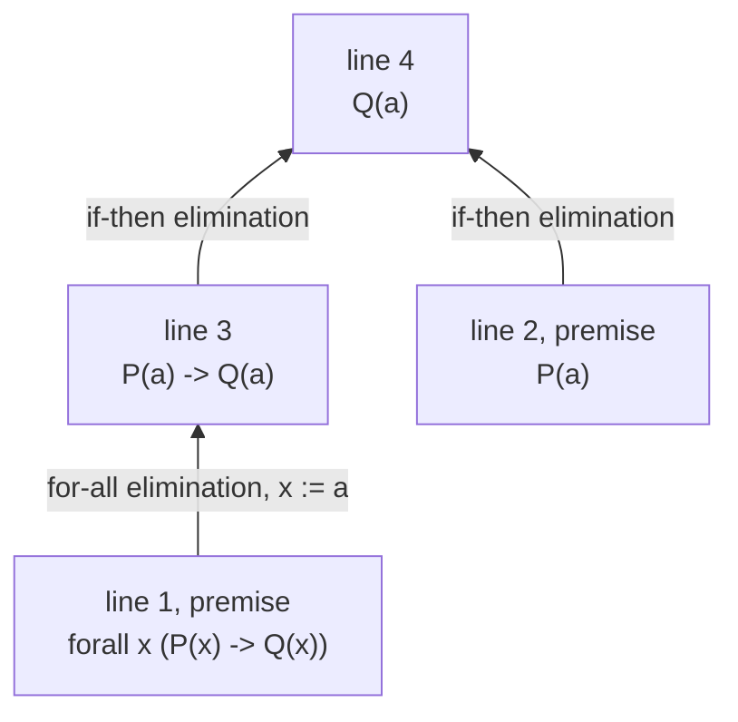

# Formal proofs and soundness: rules a machine can check, and why they never prove a falsehood

[Syllabus](../../../SYLLABUS.md) → [Computability and complexity](../README.md) → [Computability and Logic](../README.md#s02) → Formal proofs and soundness

---

## General Overview

Take two premises. "Every x with property P has property Q." "The object a has property P." Anyone concludes "a has property Q". A machine can conclude it too, in three moves: write down the first premise, specialise it to a, then apply it to the second premise. Each move uses one fixed rule.

That list of lines is a **formal proof**, or **derivation**. A short program, the **checker**, reads it and accepts each line only if its named rule produces that line from earlier lines. This is the shelf's house example again: a program that reads programs, here a program that reads proofs.

A checker that accepts lines is only useful if its rules never lead from true premises to a false conclusion. That property is **soundness**. Truth needs its own definition, separate from the rules: a **structure** is a set of objects plus a meaning for each symbol, and a sentence is true or false in it.

Soundness also works backwards. The premise "some x has P" does not give "P(a)". In the two-element structure where P holds of 0 only and a names 1, the premise is true and "P(a)" is false. So soundness says no proof of "P(a)" exists at all, however long, and no search is needed to know it.

**A derivation is a finite list of lines that a program can check rule by rule, and because every rule keeps truth in every structure, whatever is derived from premises is true in every structure where the premises are true.**

**What kind of fact this is:** the soundness theorem, proved on this card in Why it works by induction on derivations. The code's count over 228 small structures is a finite check and only evidence; the derivation plus soundness covers every structure, infinite ones included. That these seven rules never derive Peirce's law is a theorem too, proved in a fold in Step 7.

### The picture: the derivation as a tree



Read it from the bottom. Each arrow is one rule use, and the checker tests each one on its own.

---

## The formula

Notation first, each piece in words.

- $`\Gamma \vdash \varphi`$, read "Γ proves φ": some derivation ends in the formula $`\varphi`$ (phi) with all its open assumptions in the list $`\Gamma`$ (Gamma). [Godel's theorems](03-godels-incompleteness-in-outline.md) wrote $`F \vdash \varphi`$ for a whole system $`F`$; here the left side is a finite list of premises.
- $`\mathcal{M} \models \varphi[s]`$, read "φ is true in M under s": the formula is true in the structure $`\mathcal{M}`$ when each free variable takes the value that the assignment $`s`$ gives it.
- $`\Gamma \models \varphi`$, read "Γ entails φ": every structure and assignment that make all of $`\Gamma`$ true make $`\varphi`$ true.

The soundness theorem:

```math
\Gamma \vdash \varphi \;\Longrightarrow\; \Gamma \models \varphi
```

**Read it aloud:** if a derivation leads from the premises Γ to the formula φ, then φ is true in every structure, under every assignment, where all of Γ is true.

Entailment spelled out, with $`|\mathcal{M}|`$ for the set of objects of $`\mathcal{M}`$:

```math
\Gamma \models \varphi \iff \text{for every } \mathcal{M} \text{ and every } s : \text{variables} \to |\mathcal{M}| ,\; \big(\mathcal{M} \models \gamma[s] \text{ for every } \gamma \in \Gamma\big) \Rightarrow \mathcal{M} \models \varphi[s]
```

The card's example in these symbols: $`\forall x\,(P(x) \rightarrow Q(x)),\; P(a) \vdash Q(a)`$, so $`Q(a)`$ is true in each of the 34 structures on 1 to 3 objects where both premises are true.

| Symbol | Plain meaning | In our example | Push it up and the answer… |
| --- | --- | --- | --- |
| $`\Gamma`$ | the premises: the open assumptions of the derivation | the two premises, lines 1 and 2 of the derivation | more premises: more can be derived, fewer structures make them all true |
| $`\varphi`$, $`\psi`$ | formulas (phi, psi) | $`Q(a)`$ | — |
| $`\vdash`$, $`\nvdash`$ | "proves": a derivation exists; "does not prove" | $`\Gamma \vdash Q(a)`$ in 4 lines | — |
| $`\models`$ | "is true in" or "entails": a fact about structures | $`Q(a)`$ true in all 34 structures with both premises true | — |
| $`\mathcal{M}`$, $`\lvert\mathcal{M}\rvert`$ | a structure and its set of objects, its **domain** | domain $`\{0, 1\}`$ | bigger domains: more structures to refute a claim |
| $`P^{\mathcal{M}}`$, $`a^{\mathcal{M}}`$ | what $`\mathcal{M}`$ makes the symbols mean: the objects with $`P`$, the object $`a`$ names; $`t^{\mathcal{M}, s}`$ is the object a term $`t`$ names | $`P = Q = \{1\}`$, $`a = 1`$ | — |
| $`x`$, $`y`$; $`a`$; $`w`$ | variables, which quantifiers can bind; a constant, which names one fixed object; a witness name, a variable or constant used nowhere else on the line | $`x`$ in the first premise; $`a`$ in the second; $`w = y`$ in the longer derivation D2 (Step 3) | — |
| $`s`$, $`s(x \mapsto d)`$ | an assignment: a value for each free variable; the same with $`x`$ given the value $`d`$ | $`x = 0`$ in Step 2's check of the first premise | — |
| $`\varphi[t/x]`$ | $`\varphi`$ with the term $`t`$ put in for every free $`x`$ | $`(P(x) \rightarrow Q(x))[a/x] = P(a) \rightarrow Q(a)`$ | — |
| $`\forall`$, $`\exists`$, $`\rightarrow`$ | "for all", "there is", "if … then" | written `forall`, `exists`, `->` in the code | — |
| $`\Longrightarrow`$, $`\iff`$ | "so" and "exactly when", said about the formulas, not inside them | the soundness theorem | — |
| $`\Delta_n`$, $`\varphi_n`$; $`i`$, $`j`$; $`d`$, $`s'`$; $`\blacksquare`$ | in the soundness fold: line $`n`$'s open assumptions and formula; the lines a rule uses; an object of the domain, and the changed assignment $`s(x \mapsto d)`$; end of proof | — | — |

### When it holds

- **Every rule keeps truth.** Add one rule that does not, such as "from P(a) → Q(a) and Q(a), conclude P(a)", and the checker accepts a claim that fails in 57 of 228 small structures.
- **The side conditions are checked.** The two quantifier rules that introduce a name need it to be new. Skip that test, and the checker "proves" P(a) from "some x has P", which fails in 80 of 228 structures.
- **Substitution never captures.** Putting a term in for x must not let a quantifier grab the term's variable. Put y for x in "for all x, there is y with R(x, y)" and the result "there is y with R(y, y)" fails in the structure with R = {(0,1), (1,0)}.
- **Structures are not empty.** Every domain has at least one object, as in the usual definition. With an empty domain allowed, "for all x P(x)" would hold there while "there is x with P(x)" fails, and for-all elimination followed by there-is introduction would no longer keep truth.
- **The theorem is about premises, not about the world.** Soundness promises truth in the structures where Γ is true. If a premise is false in the structure meant, the conclusion can be false there too.

---

## Why it works

### Step 0: truth flows down the tree, one rule at a time

A derivation is built by rules, so it is a tree, and [Structural induction](../../01-Foundations/06-Proof/08-structural-induction-and-recursion.md) proves facts about trees. The fact to prove about each line is: "its open assumptions entail its formula".

The leaves are assumptions, and an assumption entails itself. Each rule passes the fact from the lines it uses to the line it gives. So the root has the fact too. That is the whole proof; the work is checking each rule once.

### Step 1: terms, formulas, free and bound

The language is built by rules, like the derivations.

- A **term** names an object: a variable ($`x`$, $`y`$, $`z`$) or a constant ($`a`$).
- A **predicate** is a symbol for a property, such as $`P`$, or a relation, such as $`R`$. A **formula** is built from **atoms** (a predicate applied to terms) such as $`P(x)`$ or $`R(x, y)`$ by $`\rightarrow`$, $`\forall x`$ and $`\exists x`$. That is only part of logic. Make every atom true and every such formula is true, so none of them says "not"; [Normal forms](../../01-Foundations/05-Logic/07-normal-forms-and-complete-connectives.md) uses the same test on "and" with "or". The full rules, used on [Godel's completeness theorem](12-godels-completeness-theorem.md), add "not", "and", equality and proof by contradiction; each new rule is one more case of the soundness proof below.
- An occurrence of $`x`$ inside $`\forall x\,(\dots)`$ or $`\exists x\,(\dots)`$ is **bound**. Any other occurrence is **free**.

In $`\forall x\,(P(x) \rightarrow Q(x))`$ no variable is free: the formula is a **sentence**, true or false in a structure on its own. In $`P(x)`$ the variable $`x`$ is free, so its truth also depends on the value of $`x`$. That value is what the assignment $`s`$ supplies.

**Substitution** $`\varphi[t/x]`$ replaces each free $`x`$ by $`t`$. The term $`t`$ is **free for** $`x`$ when no variable of $`t`$ lands under a quantifier on that variable. The code refuses a substitution that is not free.

### Step 2: structures and truth

A structure $`\mathcal{M}`$ fixes a non-empty domain, a set of objects for each one-place predicate, a set of pairs for each two-place predicate, and an object for each constant. Truth is then defined part by part, following how the formula was built ([Quantifiers](../../01-Foundations/05-Logic/04-quantifiers.md) treats "for all" as a long "and", and "there is" as a long "or"):

```math
\mathcal{M} \models \forall x\,\varphi\,[s] \iff \text{for every } d \in |\mathcal{M}| ,\; \mathcal{M} \models \varphi\,[s(x \mapsto d)]
```

**Read it aloud:** "for all x, φ" is true under s exactly when φ is true under s changed to give x the value d, for every object d. For $`\exists`$ replace "every" with "some". For $`\rightarrow`$: false exactly when the if-part is true and the then-part false. An atom $`P(t)`$ is true when the object $`t`$ names is in $`P^{\mathcal{M}}`$.

The card's structure: domain {0, 1}, P = Q = {1}, a = 1.

1. $`P(x) \rightarrow Q(x)`$ at $`x = 0`$: the if-part $`P(0)`$ is false, so the line is true.
2. At $`x = 1`$: $`P(1)`$ and $`Q(1)`$ are both true, so the line is true.
3. So $`\forall x\,(P(x) \rightarrow Q(x))`$ is true. $`P(a)`$ is $`P(1)`$: true. $`Q(a)`$ is $`Q(1)`$: true.

### Step 3: the seven rules

Each line of a derivation carries its open assumptions. The code checks these rules, and first that each line used has the shape the rule needs: a for-all line for ∀E, a there-is line for ∃E and a there-is claim for ∃I.

| Rule | From | It gives | Side condition | Why it keeps truth |
| --- | --- | --- | --- | --- |
| assume | — | $`\varphi`$, with $`\varphi`$ open | — | an assumption entails itself |
| →E (if-then out) | $`\varphi \rightarrow \psi`$ and $`\varphi`$ | $`\psi`$ | — | [Valid arguments](../../01-Foundations/05-Logic/06-valid-arguments.md): modus ponens |
| →I (if-then in) | $`\psi`$, with $`\varphi`$ open | $`\varphi \rightarrow \psi`$, with $`\varphi`$ closed | — | where $`\varphi`$ is false the if-then is true; where it is true, $`\psi`$ is |
| ∀E (for-all out) | $`\forall x\,\varphi`$ | $`\varphi[t/x]`$ | $`t`$ free for $`x`$ | the substitution lemma, below |
| ∀I (for-all in) | $`\varphi`$ | $`\forall x\,\varphi`$ | $`x`$ not free in an open assumption | $`x`$ was arbitrary, so any value works |
| ∃I (there-is in) | $`\varphi[t/x]`$ | $`\exists x\,\varphi`$ | $`t`$ free for $`x`$ | the object $`t`$ names is a witness |
| ∃E (there-is out) | $`\exists x\,\varphi`$, and $`\psi`$ from the assumption $`\varphi[w/x]`$ | $`\psi`$, with $`\varphi[w/x]`$ closed | $`w`$ new: not in $`\psi`$, $`\exists x\,\varphi`$ or the other open assumptions | give $`w`$ the witness's value; nothing else mentions $`w`$ |

The derivation D1, as the checker accepts it:

| Line | Rule | Uses | Open | Formula |
| --- | --- | --- | --- | --- |
| 1 | assume | — | 1 | $`\forall x\,(P(x) \rightarrow Q(x))`$ |
| 2 | assume | — | 2 | $`P(a)`$ |
| 3 | ∀E, $`t = a`$ | 1 | 1 | $`P(a) \rightarrow Q(a)`$ |
| 4 | →E | 3, 2 | 1, 2 | $`Q(a)`$ |

The code also checks two longer derivations. D2 derives "some x has Q" from the first premise and "some x has P", using ∃I and ∃E with the new witness y. D3 derives "if every x has P, every x has Q" from the first premise, using ∀I and →I.

### Step 4: the substitution lemma

The for-all and there-is rules need one fact, proved by induction on the formula: substituting a term is the same as changing the assignment.

```math
\mathcal{M} \models \varphi[t/x]\,[s] \iff \mathcal{M} \models \varphi\,[s(x \mapsto t^{\mathcal{M}, s})] \qquad (t \text{ free for } x \text{ in } \varphi)
```

**Read it aloud:** φ with t put in for x is true under s exactly when φ itself is true with x given the value that t names.

At an atom both sides look up the same object. At each quantifier the condition "free for" is what keeps the step honest: no quantifier changes the value of $`t`$ on the way in. Drop it, and F3 shows the failure: "for all x, there is y with R(x, y)" is true in the structure with R = {(0,1), (1,0)}, yet "there is y with R(y, y)" is false there.

### Step 5: the induction

Claim: on every line of an accepted derivation, the open assumptions entail the formula. Suppose the claim for the lines a rule uses, and show it for the line the rule gives. The rules fall into three kinds.

- **Connective rules, →E and →I.** These are the truth table of "if … then", checked once.
- **Rules that put in a term, ∀E and ∃I.** These rest on the substitution lemma: the formula with $`t`$ put in says the same as the formula with $`x`$ set to the object $`t`$ names.
- **Rules that use a new name, ∀I and ∃E.** Change the value of that one name. Nothing else on the line mentions it, so nothing else changes truth value. For ∀I, any value works, so "for all" holds. For ∃E, give the name the witness's value.

The last line of a derivation of $`\Gamma \vdash \varphi`$ then gives $`\Gamma \models \varphi`$. The code runs this claim on all 18 lines of D1, D2 and D3: 7,016 checks of a structure and an assignment, with no failure.

<details>
<summary>Detailed proof: soundness, every rule</summary>

Write $`\Delta_n`$ for the open assumptions of line $`n`$ and $`\varphi_n`$ for its formula. Claim: $`\Delta_n \models \varphi_n`$ for every line. The proof is by strong induction on $`n`$, which is structural induction on the tree: each line uses only earlier lines.

Fix $`\mathcal{M}`$ and $`s`$ with every member of $`\Delta_n`$ true.

**assume.** $`\Delta_n = \{\varphi_n\}`$, so $`\varphi_n`$ is true.

**→E** from lines $`i`$ and $`j`$. $`\Delta_n = \Delta_i \cup \Delta_j`$, so both sets are true. By the claim, $`\varphi \rightarrow \psi`$ and $`\varphi`$ are true, so $`\psi`$ is.

**→I** from line $`i`$, closing $`\varphi`$. $`\Delta_n = \Delta_i \setminus \{\varphi\}`$. If $`\varphi`$ is false, $`\varphi \rightarrow \psi`$ is true. If it is true, all of $`\Delta_i`$ is true, so $`\psi`$ is true by the claim, and the if-then is true.

**∀E** from line $`i`$. $`\Delta_n = \Delta_i`$, so $`\forall x\,\varphi`$ is true, so $`\varphi`$ holds under $`s(x \mapsto d)`$ for every object $`d`$, including $`d = t^{\mathcal{M}, s}`$. The substitution lemma, with $`t`$ free for $`x`$, turns that into $`\varphi[t/x]`$ true under $`s`$.

**∀I** from line $`i`$. Let $`d`$ be any object and $`s' = s(x \mapsto d)`$. A formula's truth depends only on the values of its free variables, and $`x`$ is free in no member of $`\Delta_i`$, so all of $`\Delta_i`$ is true under $`s'`$. By the claim, $`\varphi`$ is true under $`s'`$. Since $`d`$ was any object, $`\forall x\,\varphi`$ is true under $`s`$.

**∃I** from line $`i`$. $`\varphi[t/x]`$ is true under $`s`$, so by the substitution lemma $`\varphi`$ is true under $`s(x \mapsto t^{\mathcal{M}, s})`$. That object is a witness, so $`\exists x\,\varphi`$ is true.

**∃E** from lines $`i`$ and $`j`$, with witness name $`w`$. $`\Delta_n = \Delta_i \cup (\Delta_j \setminus \{\varphi[w/x]\})`$. By the claim for line $`i`$, $`\exists x\,\varphi`$ is true, so some object $`d`$ makes $`\varphi`$ true with $`x`$ set to $`d`$. Change the value of $`w`$ to $`d`$: if $`w`$ is a variable, change $`s`$; if it is a constant, change $`\mathcal{M}`$ at that one symbol. The formulas $`\exists x\,\varphi`$, $`\psi`$ and every member of $`\Delta_j \setminus \{\varphi[w/x]\}`$ do not contain $`w`$ free, so their truth values do not change. By the substitution lemma $`\varphi[w/x]`$ is now true. So all of $`\Delta_j`$ is true in the changed setting, and by the claim $`\psi`$ is true there. Since $`\psi`$ does not contain $`w`$, it is true under the original $`\mathcal{M}`$ and $`s`$.

Every case passes, so the claim holds for every line, and in particular for the last. $`\blacksquare`$

</details>

### Step 6: soundness used backwards

Read the theorem the other way round: if some structure makes Γ true and φ false, then $`\Gamma \nvdash \varphi`$. One **countermodel** (a structure that refutes the claim) rules out every derivation, of every length.

The forged proof F1 tries "some x has P, so P(a)". It assumes $`P(a)`$ as the witness case and closes it by ∃E. The checker rejects line 3: the witness $`a`$ appears in the conclusion. Rejecting one attempt proves nothing about other attempts. The countermodel does: domain {0, 1}, P = {0}, a = 1. "Some x has P" is true (0 has it), and $`P(a)`$, that is $`P(1)`$, is false.

The search finds 0 countermodels with one object, 8 with two and 72 with three: 80 of 228. With one object, "some x has P" and "P(a)" say the same thing, so a search of one-object structures alone would miss the failure.

### Step 7: what soundness does not say

- **Not the converse, which fails for these seven rules.** "Every entailment has a derivation" is completeness, a separate and harder theorem that [Godel's completeness theorem](12-godels-completeness-theorem.md) proves for the full rules. The seven rules here fall short. Peirce's law, $`((P(a) \rightarrow Q(a)) \rightarrow P(a)) \rightarrow P(a)`$, is true in every structure, yet no derivation from them reaches it (the fold below shows why). The missing piece is proof by contradiction.
- **Not that arithmetic's truths are provable.** [Godel's theorems](03-godels-incompleteness-in-outline.md) give a sentence true of the numbers 0, 1, 2, … with no proof. There is no conflict. Soundness is about truth in every structure where the axioms hold, and that sentence is false in some of them ([Godel's completeness theorem](12-godels-completeness-theorem.md) shows such a structure must exist).
- **Not that the checker's code is right.** Soundness is about the rules on paper. Whether a program applies them correctly is the trust question of [Proof assistants](08-proof-assistants-and-formal-verification.md).

<details>
<summary>Detailed proof: the seven rules never derive Peirce's law</summary>

Use soundness backwards again, with a different scale of truth. Each formula takes one of three values: false, middle or true, in that order. An atom may take any of them. An if-then is true when its if-part is no truer than its then-part; otherwise it takes its then-part's value. "For all" takes the lowest value over the domain, and "there is" the highest.

Run Step 5's induction with this claim: each line's formula is at least as true as the least true of its open assumptions. For →E, if the if-part is no truer than the then-part, the bound on the if-part carries over to the then-part; otherwise the if-then's value is the then-part's, and the bound on the if-then carries over. For →I, if the if-part is no truer than the then-part, the new if-then is true. Otherwise its value is the then-part's, and the if-part is truer than the then-part, so the least true open assumption was one of the others; the bound still holds once the if-part is closed. The quantifier rules go through as in Step 5, with "lowest" for "every" and "highest" for "some". So a derivation with no open assumptions ends in a formula with the value true.

Now give P(a) the middle value and Q(a) the value false. Then $`P(a) \rightarrow Q(a)`$ is false, so $`(P(a) \rightarrow Q(a)) \rightarrow P(a)`$ is true, so Peirce's law takes P(a)'s value: middle. No derivation from these rules ends in it. Proof by contradiction fails this test, which is why the full rules derive it.

</details>

---

## Worked numbers, by hand

| Step | Arithmetic | Value |
| --- | --- | --- |
| line 3 of D1 | $`(P(x) \rightarrow Q(x))[a/x]`$ | $`P(a) \rightarrow Q(a)`$ |
| line 4 of D1 | →E on lines 3 and 2 | $`Q(a)`$, open assumptions 1 and 2 |
| the first premise in the structure {0, 1}, P = Q = {1} | x = 0: if-part false; x = 1: both parts true | true |
| P(a) and Q(a) there, a = 1 | P(1), Q(1) | true, true |
| structures on 1 to 3 objects | $`1 \cdot 4 + 2 \cdot 16 + 3 \cdot 64`$: a value for a, a set for P, a set for Q | 228 |
| both premises true | a in P and P inside Q: $`1 + 2 \cdot 3 + 3 \cdot 9`$ | 34 |
| Q(a) true in those | a is in P, P is inside Q | **34 of 34** |
| countermodels to "some x has P, so P(a)" | P not empty, a outside P: $`0 + 2 \cdot 1 \cdot 4 + 3 \cdot 3 \cdot 8`$ | 80 of 228 |

Every structure that makes the premises true makes Q(a) true, as soundness demands, and 80 structures refute the claim that has no proof.

### What breaks if you drop a piece

| Mistake | Comes out at | What went wrong |
| --- | --- | --- |
| ∃E with the witness a in the conclusion: "some x has P, so P(a)" | rejected at line 3; refuted in 80 of 228 structures, first domain {0, 1}, P = {0}, a = 1 | the witness must be new |
| ∀I over x while P(x) is open: "P(x), so for all x P(x)" | rejected at line 2; refuted in 232 of 644 cases, first P = {0}, x = 0 on domain {0, 1} | x was not arbitrary: an assumption pins it |
| ∀E putting y for x in "for all x, there is y with R(x, y)" | rejected at line 2; refuted in 1 of 18 cases, R = {(0,1), (1,0)} | y was captured by "there is y" |
| →E backwards: "P(a) → Q(a) and Q(a), so P(a)" | rejected at line 3; refuted in 57 of 228 cases, first domain {0}, P = {}, Q = {0}, a = 0 | affirming the consequent is not a rule |

A "case" is a structure together with values for the free variables: 644 counts each structure once for each value of x.

---

## Code, from first principles, and it actually runs

The code builds formulas as small trees, a printer, free names, capture-checking substitution, the seven-rule checker, truth in a structure, and a search over every structure on 1 to 3 objects. It takes three independent roads. Road 1 is the checker accepting D1, D2 and D3. Road 2 is brute force: over all 228 structures, Q(a) holds wherever both premises hold, with the counts 228 and 34 matched against their closed forms. Road 3 runs the soundness induction itself: every accepted line, not just the last, is checked true in every structure and assignment. Then the code feeds the checker four forged proofs, and for each finds a countermodel, which by soundness rules out every proof.

### Python

```python
# Formal proofs and soundness: a checker for natural-deduction lines, and truth in every small structure.
from itertools import product
VARS = "xyz"  # variables; any other name, such as a, is a constant
def A(p, *ts): return ("atom", p, ts)
Imp, All, Ex = (lambda f, g: ("imp", f, g)), (lambda v, f: ("all", v, f)), (lambda v, f: ("ex", v, f))
tf = lambda b: "true" if b else "false"

def show(f):
    if f[0] == "atom": return f[1] + "(" + ", ".join(f[2]) + ")"
    if f[0] == "imp": return "(" + show(f[1]) + " -> " + show(f[2]) + ")"
    return ("forall " if f[0] == "all" else "exists ") + f[1] + " " + show(f[2])

def free(f):  # free names: free variables and constants
    if f[0] == "atom": return set(f[2])
    if f[0] == "imp": return free(f[1]) | free(f[2])
    return free(f[2]) - {f[1]}

def sub(f, x, t):  # f with t put in for the free x; None if a quantifier would capture t
    if f[0] == "atom": return ("atom", f[1], tuple(t if s == x else s for s in f[2]))
    if f[0] == "imp":
        l, r = sub(f[1], x, t), sub(f[2], x, t)
        return None if l is None or r is None else ("imp", l, r)
    if f[1] == x or x not in free(f[2]): return f
    if f[1] == t: return None
    b = sub(f[2], x, t)
    return None if b is None else (f[0], f[1], b)

def check(lines, side=True):  # each line is (rule, uses, claim); gives (open assumptions, claim) per line, or why it fails
    done = []
    for n, (rule, u, claim) in enumerate(lines, 1):
        bad = lambda why: "rejected at line %d: %s" % (n, why)
        if rule in ("AE", "EE", "EI") and (claim if rule == "EI" else done[u[0] - 1][1])[0] != ("all" if rule == "AE" else "ex"): return bad("wrong shape for " + rule)
        if rule == "assume": G, f = frozenset([claim]), claim
        elif rule == "->E":
            (G1, f1), (G2, f2) = done[u[0] - 1], done[u[1] - 1]
            if f1[0] != "imp" or f1[1] != f2: return bad("line %d is not the if-part of line %d" % (u[1], u[0]))
            G, f = G1 | G2, f1[2]
        elif rule == "->I": G1, f1 = done[u[0] - 1]; G, f = G1 - {u[1]}, Imp(u[1], f1)
        elif rule == "AE":
            G, f1 = done[u[0] - 1]; f = sub(f1[2], f1[1], u[1])
            if f is None: return bad(u[1] + " is not free for " + f1[1])
        elif rule == "AI":
            G, f1 = done[u[0] - 1]; f = All(u[1], f1)
            if side and any(u[1] in free(h) for h in G): return bad(u[1] + " is free in an open assumption")
        elif rule == "EI":
            G, f1 = done[u[0] - 1]; f = claim
            if sub(claim[2], claim[1], u[1]) != f1: return bad("line %d is not an instance" % u[0])
        elif rule == "EE":
            (G1, f1), (G2, f2) = done[u[0] - 1], done[u[1] - 1]; w = u[2]
            rest = G2 - {sub(f1[2], f1[1], w)}
            if side and any(w in free(h) for h in [f1, f2, *rest]): return bad("witness " + w + " is not new")
            G, f = G1 | rest, f2
        if f != claim: return bad("the rule gives " + show(f))
        done.append((G, f))
    return done

def holds(f, M, g):  # M = (size, relations, constants); g gives values to free variables
    n, rel, con = M
    if f[0] == "atom": return tuple(g[t] if t in g else con[t] for t in f[2]) in rel[f[1]]
    if f[0] == "imp": return not holds(f[1], M, g) or holds(f[2], M, g)
    vals = [holds(f[2], M, {**g, f[1]: d}) for d in range(n)]
    return all(vals) if f[0] == "all" else any(vals)

def structures(sig, nmax):  # sig: (name, places); 0 places is a constant. Every structure on {0, ..., n-1}
    for n in range(1, nmax + 1):
        for pick in product(*[range(n) if k == 0 else range(2 ** n ** k) for _, k in sig]):
            rel, con = {}, {}
            for (name, k), c in zip(sig, pick):
                if k == 0: con[name] = c
                else: rel[name] = {t for i, t in enumerate(product(range(n), repeat=k)) if c >> i & 1}
            yield (n, rel, con)

def cases(G, f, sig, nmax):  # every (structure, values) checked, and those making all of G true and f false
    vs = sorted({x for h in [*G, f] for x in free(h) if x in VARS})
    total, bad = 0, []
    for M in structures(sig, nmax):
        for vals in product(range(M[0]), repeat=len(vs)):
            g = dict(zip(vs, vals)); total += 1
            if all(holds(h, M, g) for h in G) and not holds(f, M, g): bad.append((M, g))
    return total, bad

def showM(M, g):
    n, rel, con = M
    s = ["%s = {%s}" % (r, ", ".join(",".join(map(str, t)) if len(t) == 1 else "(%d,%d)" % t for t in sorted(v))) for r, v in rel.items()]
    s += ["%s = %d" % kv for kv in con.items()] + ["%s = %d" % kv for kv in g.items()]
    return "domain {%s}: " % ", ".join(map(str, range(n))) + ", ".join(s)

P, Q = (lambda t: A("P", t)), (lambda t: A("Q", t))
SIG, rule, allP = [("P", 1), ("Q", 1), ("a", 0)], All("x", Imp(P("x"), Q("x"))), All("x", P("x"))
D = {"D1": [("assume", (), rule), ("assume", (), P("a")), ("AE", (1, "a"), Imp(P("a"), Q("a"))), ("->E", (3, 2), Q("a"))],
     "D2": [("assume", (), rule), ("assume", (), Ex("x", P("x"))), ("assume", (), P("y")), ("AE", (1, "y"), Imp(P("y"), Q("y"))),
            ("->E", (4, 3), Q("y")), ("EI", (5, "y"), Ex("x", Q("x"))), ("EE", (2, 6, "y"), Ex("x", Q("x")))],
     "D3": [("assume", (), rule), ("assume", (), allP), ("AE", (2, "x"), P("x")), ("AE", (1, "x"), Imp(P("x"), Q("x"))),
            ("->E", (4, 3), Q("x")), ("AI", (5, "x"), All("x", Q("x"))), ("->I", (6, allP), Imp(allP, All("x", Q("x"))))]}
print("road 1, the checker: every line names one rule and the lines it uses")
checks = 0
for name, lines in D.items():
    out = check(lines); assert isinstance(out, list), out
    print(name + ": line, rule, uses, open assumptions, claim")
    for n, ((r, u, c), (G, f)) in enumerate(zip(lines, out), 1):
        opn = ",".join(str(i) for i, l in enumerate(lines, 1) if l[0] == "assume" and l[2] in G)
        print("  %d %s %s {%s} %s" % (n, r, ",".join(str(x) for x in u if type(x) is int) or "-", opn, show(f)))
        total, bad = cases(G, f, SIG, 3); checks += total
        assert bad == [], (name, n)  # road 3: every accepted line is true in every case, the induction run line by line
print("road 3, soundness line by line: all %d lines of D1 to D3 true in every case: %d checks, 0 failures" % (sum(map(len, D.values())), checks))
M0 = (2, {"P": {(1,)}, "Q": {(1,)}}, {"a": 1})
row = [holds(Imp(P("x"), Q("x")), M0, {"x": d}) for d in (0, 1)]
print("the structure " + showM(M0, {}))
print("  P(x) -> Q(x) at x = 0: %s; at x = 1: %s; so forall x (P(x) -> Q(x)) is %s" % (tf(row[0]), tf(row[1]), tf(holds(rule, M0, {}))))
print("  P(a) is %s and Q(a) is %s" % (tf(holds(P("a"), M0, {})), tf(holds(Q("a"), M0, {}))))
assert row == [True, True] and holds(Q("a"), M0, {}) and not holds(P("x"), M0, {"x": 0})
allM = list(structures(SIG, 3))
prem = [M for M in allM if holds(rule, M, {}) and holds(P("a"), M, {})]
print("road 2, every structure on 1 to 3 elements: %d; both premises true in %d; Q(a) true in %d of those" %
      (len(allM), len(prem), sum(holds(Q("a"), M, {}) for M in prem)))
assert len(allM) == sum(n * 4 ** n for n in (1, 2, 3)) == 228  # n choices for a, 2^n for P, 2^n for Q
assert len(prem) == sum(n * 3 ** (n - 1) for n in (1, 2, 3)) == 34  # a in P, and P inside Q
assert all(holds(Q("a"), M, {}) for M in prem)
R = lambda s, t: A("R", s, t)
Fx, Rxy = Ex("x", P("x")), All("x", Ex("y", R("x", "y")))
F = {"F1 exists x P(x), so P(a)": ([("assume", (), Fx), ("assume", (), P("a")), ("EE", (1, 2, "a"), P("a"))], [Fx], SIG, 3),
     "F2 P(x), so forall x P(x)": ([("assume", (), P("x")), ("AI", (1, "x"), allP)], [P("x")], SIG, 3),
     "F3 forall x exists y R(x, y), so exists y R(y, y)": ([("assume", (), Rxy), ("AE", (1, "y"), Ex("y", R("y", "y")))], [Rxy], [("R", 2)], 2),
     "F4 P(a) -> Q(a) and Q(a), so P(a)": ([("assume", (), Imp(P("a"), Q("a"))), ("assume", (), Q("a")), ("->E", (1, 2), P("a"))], [Imp(P("a"), Q("a")), Q("a")], SIG, 3)}
print("forged proofs: the checker's verdict, then the first structure that refutes the claim")
for (name, (lines, prems, sig, nmax)), why in zip(F.items(), ["witness a is not new", "x is free in an open assumption", "y is not free for x", "line 2 is not the if-part of line 1"]):
    verdict = check(lines); assert verdict == "rejected at line %d: %s" % (len(lines), why), verdict  # caught by the test meant for it
    total, bad = cases(prems, lines[-1][2], sig, nmax)
    assert bad, name  # a countermodel, so by soundness no derivation of the claim exists at all
    print("  %s: %s\n    refuted in %d of %d cases, first: %s" % (name, verdict, len(bad), total, showM(*bad[0])))
_, bad1 = cases([Fx], P("a"), SIG, 3)
per = [sum(1 for M, g in bad1 if M[0] == n) for n in (1, 2, 3)]
print("F1 countermodels by size 1, 2, 3: %s; with the side conditions off, the checker gives %s" %
      (", ".join(map(str, per)), ", ".join(show(check(l, side=False)[-1][1]) for l, _, _, _ in list(F.values())[:2])))
assert per == [0, 8, 72] == [n * (2 ** (n - 1) - 1) * 2 ** n for n in (1, 2, 3)]  # a outside P, P not empty
assert showM(*bad1[0]) == "domain {0, 1}: P = {0}, Q = {}, a = 1"
four = list(structures(SIG, 4))
print("try changing, sizes up to 4: %d structures; premises of D1 true in %d; F1 refuted in %d" % (len(four),
      sum(holds(rule, M, {}) and holds(P("a"), M, {}) for M in four), len(cases([Fx], P("a"), SIG, 4)[1])))
print("ALL CHECKS PASS")
```

**Ran 2026-11-24 on macOS, Python 3.14.10, standard library only. All checks passed. Output, pasted from the run:**

```
road 1, the checker: every line names one rule and the lines it uses
D1: line, rule, uses, open assumptions, claim
  1 assume - {1} forall x (P(x) -> Q(x))
  2 assume - {2} P(a)
  3 AE 1 {1} (P(a) -> Q(a))
  4 ->E 3,2 {1,2} Q(a)
D2: line, rule, uses, open assumptions, claim
  1 assume - {1} forall x (P(x) -> Q(x))
  2 assume - {2} exists x P(x)
  3 assume - {3} P(y)
  4 AE 1 {1} (P(y) -> Q(y))
  5 ->E 4,3 {1,3} Q(y)
  6 EI 5 {1,3} exists x Q(x)
  7 EE 2,6 {1,2} exists x Q(x)
D3: line, rule, uses, open assumptions, claim
  1 assume - {1} forall x (P(x) -> Q(x))
  2 assume - {2} forall x P(x)
  3 AE 2 {2} P(x)
  4 AE 1 {1} (P(x) -> Q(x))
  5 ->E 4,3 {1,2} Q(x)
  6 AI 5 {1,2} forall x Q(x)
  7 ->I 6 {1} (forall x P(x) -> forall x Q(x))
road 3, soundness line by line: all 18 lines of D1 to D3 true in every case: 7016 checks, 0 failures
the structure domain {0, 1}: P = {1}, Q = {1}, a = 1
  P(x) -> Q(x) at x = 0: true; at x = 1: true; so forall x (P(x) -> Q(x)) is true
  P(a) is true and Q(a) is true
road 2, every structure on 1 to 3 elements: 228; both premises true in 34; Q(a) true in 34 of those
forged proofs: the checker's verdict, then the first structure that refutes the claim
  F1 exists x P(x), so P(a): rejected at line 3: witness a is not new
    refuted in 80 of 228 cases, first: domain {0, 1}: P = {0}, Q = {}, a = 1
  F2 P(x), so forall x P(x): rejected at line 2: x is free in an open assumption
    refuted in 232 of 644 cases, first: domain {0, 1}: P = {0}, Q = {}, a = 0, x = 0
  F3 forall x exists y R(x, y), so exists y R(y, y): rejected at line 2: y is not free for x
    refuted in 1 of 18 cases, first: domain {0, 1}: R = {(0,1), (1,0)}
  F4 P(a) -> Q(a) and Q(a), so P(a): rejected at line 3: line 2 is not the if-part of line 1
    refuted in 57 of 228 cases, first: domain {0}: P = {}, Q = {0}, a = 0
F1 countermodels by size 1, 2, 3: 0, 8, 72; with the side conditions off, the checker gives P(a), forall x P(x)
try changing, sizes up to 4: 1252 structures; premises of D1 true in 142; F1 refuted in 528
ALL CHECKS PASS
```

### Rust

Same numbers, same labels, built with `rustc --edition 2021 -O`.

```rust
// Formal proofs and soundness: a checker for natural-deduction lines, and truth in every small structure.
use std::collections::{BTreeMap, BTreeSet};
#[derive(Clone, PartialEq, Eq, PartialOrd, Ord)] enum F { Atom(String, Vec<String>), Imp(Box<F>, Box<F>), All(String, Box<F>), Ex(String, Box<F>) }
use F::*;
fn at(p: &str, ts: &[&str]) -> F { Atom(p.into(), ts.iter().map(|t| t.to_string()).collect()) }
fn imp(f: &F, g: &F) -> F { Imp(Box::new(f.clone()), Box::new(g.clone())) }
fn all(v: &str, f: &F) -> F { All(v.into(), Box::new(f.clone())) } fn ex(v: &str, f: &F) -> F { Ex(v.into(), Box::new(f.clone())) }
fn tf(b: bool) -> &'static str { if b { "true" } else { "false" } }
fn show(f: &F) -> String {
    match f { Atom(p, ts) => format!("{}({})", p, ts.join(", ")), Imp(a, b) => format!("({} -> {})", show(a), show(b)),
        All(v, b) => format!("forall {} {}", v, show(b)), Ex(v, b) => format!("exists {} {}", v, show(b)) }
}
fn free(f: &F) -> BTreeSet<String> { // free names: free variables and constants
    match f { Atom(_, ts) => ts.iter().cloned().collect(), Imp(a, b) => free(a).union(&free(b)).cloned().collect(),
        All(v, b) | Ex(v, b) => { let mut s = free(b); s.remove(v); s } }
}
fn sub(f: &F, x: &str, t: &str) -> Option<F> { // f with t put in for the free x; None if a quantifier would capture t
    match f {
        Atom(p, ts) => Some(Atom(p.clone(), ts.iter().map(|s| if s == x { t.to_string() } else { s.clone() }).collect())),
        Imp(a, b) => Some(Imp(Box::new(sub(a, x, t)?), Box::new(sub(b, x, t)?))),
        All(v, b) | Ex(v, b) => {
            if v == x || !free(b).contains(x) { return Some(f.clone()); }
            if v == t { return None; }
            let nb = Box::new(sub(b, x, t)?);
            Some(if let All(..) = f { All(v.clone(), nb) } else { Ex(v.clone(), nb) })
        }
    }
}
struct L { rule: &'static str, u: Vec<usize>, name: &'static str, dis: Option<F>, claim: F }
fn ln(rule: &'static str, u: &[usize], name: &'static str, claim: F) -> L { L { rule, u: u.to_vec(), name, dis: None, claim } }
type Done = Vec<(BTreeSet<F>, F)>; fn check(lines: &[L], side: bool) -> Result<Done, String> {
    let mut done: Done = vec![];
    for (i, l) in lines.iter().enumerate() {
        let bad = |why: String| Err(format!("rejected at line {}: {}", i + 1, why));
        let get = |k: usize| done[k - 1].clone();
        let (g, f) = match l.rule {
            "assume" => (BTreeSet::from([l.claim.clone()]), l.claim.clone()),
            "->E" => { let ((g1, f1), (g2, f2)) = (get(l.u[0]), get(l.u[1]));
                match &f1 { Imp(a, b) if **a == f2 => (g1.union(&g2).cloned().collect(), (**b).clone()),
                    _ => return bad(format!("line {} is not the if-part of line {}", l.u[1], l.u[0])) } }
            "->I" => { let (mut g1, f1) = get(l.u[0]); let d = l.dis.clone().unwrap(); g1.remove(&d); (g1, imp(&d, &f1)) }
            "AE" => { let (g1, f1) = get(l.u[0]);
                let All(v, b) = &f1 else { return bad(format!("wrong shape for {}", l.rule)) };
                match sub(b, v, l.name) { Some(f) => (g1, f), None => return bad(format!("{} is not free for {}", l.name, v)) } }
            "AI" => { let (g1, f1) = get(l.u[0]);
                if side && g1.iter().any(|h| free(h).contains(l.name)) { return bad(format!("{} is free in an open assumption", l.name)); }
                (g1, all(l.name, &f1)) }
            "EI" => { let (g1, f1) = get(l.u[0]);
                let Ex(v, b) = &l.claim else { return bad(format!("wrong shape for {}", l.rule)) };
                if sub(b, v, l.name) != Some(f1) { return bad(format!("line {} is not an instance", l.u[0])); }
                (g1, l.claim.clone()) }
            _ => { let ((g1, f1), (g2, f2)) = (get(l.u[0]), get(l.u[1])); let w = l.name;
                let Ex(v, b) = &f1 else { return bad(format!("wrong shape for {}", l.rule)) };
                let mut rest = g2.clone(); if let Some(h) = sub(b, v, w) { rest.remove(&h); }
                if side && [&f1, &f2].into_iter().chain(rest.iter()).any(|h| free(h).contains(w)) { return bad(format!("witness {} is not new", w)); }
                (g1.union(&rest).cloned().collect(), f2) }
        };
        if f != l.claim { return bad(format!("the rule gives {}", show(&f))); }
        done.push((g, f));
    }
    Ok(done)
}
#[derive(Clone)] struct M { n: usize, rel: Vec<(String, BTreeSet<Vec<usize>>)>, con: Vec<(String, usize)> }
type G = BTreeMap<String, usize>;
fn holds(f: &F, m: &M, g: &G) -> bool {
    match f {
        Atom(p, ts) => { let v: Vec<usize> = ts.iter().map(|t| *g.get(t).unwrap_or_else(|| &m.con.iter().find(|c| &c.0 == t).unwrap().1)).collect();
            m.rel.iter().find(|r| &r.0 == p).unwrap().1.contains(&v) }
        Imp(a, b) => !holds(a, m, g) || holds(b, m, g),
        All(v, b) | Ex(v, b) => { let mut it = (0..m.n).map(|d| { let mut h = g.clone(); h.insert(v.clone(), d); holds(b, m, &h) });
            if let All(..) = f { it.all(|x| x) } else { it.any(|x| x) } }
    }
}
fn digits(mut i: usize, radix: &[usize]) -> Vec<usize> { // mixed radix, last digit fastest
    let mut d = vec![0; radix.len()]; for k in (0..radix.len()).rev() { d[k] = i % radix[k]; i /= radix[k]; } d
}
fn structures(sig: &[(&str, u32)], nmax: usize) -> Vec<M> { // 0 places is a constant. Every structure on {0, ..., n-1}
    let mut out = vec![]; for n in 1..=nmax {
        let radix: Vec<usize> = sig.iter().map(|&(_, k)| if k == 0 { n } else { 1 << n.pow(k) }).collect();
        for idx in 0..radix.iter().product::<usize>() {
            let mut m = M { n, rel: vec![], con: vec![] };
            for (&(name, k), c) in sig.iter().zip(digits(idx, &radix)) {
                if k == 0 { m.con.push((name.into(), c)); continue; }
                let ts = (0..n.pow(k)).filter(|i| c >> i & 1 == 1).map(|i| digits(i, &vec![n; k as usize])).collect();
                m.rel.push((name.into(), ts));
            }
            out.push(m);
        } }
    out
}
fn cases(gs: &[F], f: &F, sig: &[(&str, u32)], nmax: usize) -> (usize, Vec<(M, G)>) {
    let vs: BTreeSet<String> = gs.iter().chain([f]).flat_map(|h| free(h)).filter(|x| "xyz".contains(x.as_str())).collect();
    let (mut total, mut bad) = (0, vec![]);
    for m in structures(sig, nmax) {
        for i in 0..m.n.pow(vs.len() as u32) {
            let g: G = vs.iter().cloned().zip(digits(i, &vec![m.n; vs.len()])).collect(); total += 1;
            if gs.iter().all(|h| holds(h, &m, &g)) && !holds(f, &m, &g) { bad.push((m.clone(), g)); }
        } }
    (total, bad)
}
fn show_m(m: &M, g: &G) -> String {
    let mut s: Vec<String> = m.rel.iter().map(|(r, v)| format!("{} = {{{}}}", r, v.iter().map(|t| if t.len() == 1 { t[0].to_string() }
        else { format!("({},{})", t[0], t[1]) }).collect::<Vec<_>>().join(", "))).collect();
    s.extend(m.con.iter().chain(g.iter().map(|(k, v)| (k.clone(), *v)).collect::<Vec<_>>().iter()).map(|(k, v)| format!("{} = {}", k, v)));
    format!("domain {{{}}}: {}", (0..m.n).map(|d| d.to_string()).collect::<Vec<_>>().join(", "), s.join(", "))
}
fn main() {
    let (p, q) = (|t: &str| at("P", &[t]), |t: &str| at("Q", &[t]));
    let sig = [("P", 1), ("Q", 1), ("a", 0)]; let (rule, allp) = (all("x", &imp(&p("x"), &q("x"))), all("x", &p("x")));
    let mut d7 = ln("->I", &[6], "", imp(&allp, &all("x", &q("x")))); d7.dis = Some(allp.clone());
    let ds = vec![("D1", vec![ln("assume", &[], "", rule.clone()), ln("assume", &[], "", p("a")), ln("AE", &[1], "a", imp(&p("a"), &q("a"))), ln("->E", &[3, 2], "", q("a"))]),
        ("D2", vec![ln("assume", &[], "", rule.clone()), ln("assume", &[], "", ex("x", &p("x"))), ln("assume", &[], "", p("y")), ln("AE", &[1], "y", imp(&p("y"), &q("y"))),
            ln("->E", &[4, 3], "", q("y")), ln("EI", &[5], "y", ex("x", &q("x"))), ln("EE", &[2, 6], "y", ex("x", &q("x")))]),
        ("D3", vec![ln("assume", &[], "", rule.clone()), ln("assume", &[], "", allp.clone()), ln("AE", &[2], "x", p("x")), ln("AE", &[1], "x", imp(&p("x"), &q("x"))),
            ln("->E", &[4, 3], "", q("x")), ln("AI", &[5], "x", all("x", &q("x"))), d7])];
    println!("road 1, the checker: every line names one rule and the lines it uses");
    let (mut checks, mut nlines) = (0, 0);
    for (name, lines) in &ds {
        let out = check(lines, true).unwrap();
        println!("{}: line, rule, uses, open assumptions, claim", name);
        for (n, (l, (g, f))) in lines.iter().zip(&out).enumerate() {
            let opn: Vec<String> = lines.iter().enumerate().filter(|(_, k)| k.rule == "assume" && g.contains(&k.claim)).map(|(i, _)| (i + 1).to_string()).collect();
            let u: Vec<String> = l.u.iter().map(|x| x.to_string()).collect();
            println!("  {} {} {} {{{}}} {}", n + 1, l.rule, if u.is_empty() { "-".into() } else { u.join(",") }, opn.join(","), show(f));
            let (total, bad) = cases(&g.iter().cloned().collect::<Vec<_>>(), f, &sig, 3); checks += total; nlines += 1;
            assert!(bad.is_empty()); // road 3: every accepted line is true in every case, the induction run line by line
        }
    }
    println!("road 3, soundness line by line: all {} lines of D1 to D3 true in every case: {} checks, 0 failures", nlines, checks);
    let m0 = M { n: 2, rel: vec![("P".into(), BTreeSet::from([vec![1]])), ("Q".into(), BTreeSet::from([vec![1]]))], con: vec![("a".into(), 1)] };
    let e = G::new(); let row: Vec<bool> = (0..2).map(|d| holds(&imp(&p("x"), &q("x")), &m0, &G::from([("x".to_string(), d)]))).collect();
    println!("the structure {}", show_m(&m0, &e));
    println!("  P(x) -> Q(x) at x = 0: {}; at x = 1: {}; so forall x (P(x) -> Q(x)) is {}", tf(row[0]), tf(row[1]), tf(holds(&rule, &m0, &e)));
    println!("  P(a) is {} and Q(a) is {}", tf(holds(&p("a"), &m0, &e)), tf(holds(&q("a"), &m0, &e)));
    assert!(row == [true, true] && holds(&q("a"), &m0, &e) && !holds(&p("x"), &m0, &G::from([("x".to_string(), 0)])));
    let all_m = structures(&sig, 3);
    let prem: Vec<&M> = all_m.iter().filter(|m| holds(&rule, m, &e) && holds(&p("a"), m, &e)).collect();
    println!("road 2, every structure on 1 to 3 elements: {}; both premises true in {}; Q(a) true in {} of those",
        all_m.len(), prem.len(), prem.iter().filter(|m| holds(&q("a"), m, &e)).count());
    assert!(all_m.len() == (1..=3).map(|n: usize| n * 4usize.pow(n as u32)).sum::<usize>() && all_m.len() == 228);
    assert!(prem.len() == (1..=3).map(|n: usize| n * 3usize.pow(n as u32 - 1)).sum::<usize>() && prem.len() == 34);
    assert!(prem.iter().all(|m| holds(&q("a"), m, &e)));
    let r = |s: &str, t: &str| at("R", &[s, t]);
    let (fx, rxy, sig_r) = (ex("x", &p("x")), all("x", &ex("y", &r("x", "y"))), [("R", 2)]);
    let fs: Vec<(&str, Vec<L>, Vec<F>, &[(&str, u32)], usize)> = vec![
        ("F1 exists x P(x), so P(a)", vec![ln("assume", &[], "", fx.clone()), ln("assume", &[], "", p("a")), ln("EE", &[1, 2], "a", p("a"))], vec![fx.clone()], &sig, 3),
        ("F2 P(x), so forall x P(x)", vec![ln("assume", &[], "", p("x")), ln("AI", &[1], "x", allp.clone())], vec![p("x")], &sig, 3),
        ("F3 forall x exists y R(x, y), so exists y R(y, y)", vec![ln("assume", &[], "", rxy.clone()), ln("AE", &[1], "y", ex("y", &r("y", "y")))], vec![rxy.clone()], &sig_r, 2),
        ("F4 P(a) -> Q(a) and Q(a), so P(a)", vec![ln("assume", &[], "", imp(&p("a"), &q("a"))), ln("assume", &[], "", q("a")), ln("->E", &[1, 2], "", p("a"))], vec![imp(&p("a"), &q("a")), q("a")], &sig, 3)];
    println!("forged proofs: the checker's verdict, then the first structure that refutes the claim");
    for ((name, lines, prems, sg, nmax), why) in fs.iter().zip(["witness a is not new", "x is free in an open assumption", "y is not free for x", "line 2 is not the if-part of line 1"]) {
        let verdict = check(lines, true).err().unwrap();
        assert!(verdict == format!("rejected at line {}: {}", lines.len(), why)); // caught by the test meant for it
        let (total, bad) = cases(prems, &lines.last().unwrap().claim, sg, *nmax);
        assert!(!bad.is_empty()); // a countermodel, so by soundness no derivation of the claim exists at all
        println!("  {}: {}\n    refuted in {} of {} cases, first: {}", name, verdict, bad.len(), total, show_m(&bad[0].0, &bad[0].1));
    }
    let (_, bad1) = cases(&[fx.clone()], &p("a"), &sig, 3);
    let per: Vec<usize> = (1..=3).map(|n| bad1.iter().filter(|(m, _)| m.n == n).count()).collect();
    let off: Vec<String> = fs[..2].iter().map(|f| show(&check(&f.1, false).unwrap().last().unwrap().1)).collect();
    println!("F1 countermodels by size 1, 2, 3: {}; with the side conditions off, the checker gives {}",
        per.iter().map(|x| x.to_string()).collect::<Vec<_>>().join(", "), off.join(", "));
    assert!(per == [0, 8, 72] && per == (1..=3).map(|n: u32| n as usize * (2usize.pow(n - 1) - 1) * 2usize.pow(n)).collect::<Vec<_>>()); // a outside P, P not empty
    assert!(show_m(&bad1[0].0, &bad1[0].1) == "domain {0, 1}: P = {0}, Q = {}, a = 1");
    let four = structures(&sig, 4);
    println!("try changing, sizes up to 4: {} structures; premises of D1 true in {}; F1 refuted in {}", four.len(),
        four.iter().filter(|m| holds(&rule, m, &e) && holds(&p("a"), m, &e)).count(), cases(&[fx.clone()], &p("a"), &sig, 4).1.len());
    println!("ALL CHECKS PASS");
}
```

**Ran 2026-11-24 on macOS, rustc 1.98.1, no crates. All checks passed. Output, pasted from the run:**

```
road 1, the checker: every line names one rule and the lines it uses
D1: line, rule, uses, open assumptions, claim
  1 assume - {1} forall x (P(x) -> Q(x))
  2 assume - {2} P(a)
  3 AE 1 {1} (P(a) -> Q(a))
  4 ->E 3,2 {1,2} Q(a)
D2: line, rule, uses, open assumptions, claim
  1 assume - {1} forall x (P(x) -> Q(x))
  2 assume - {2} exists x P(x)
  3 assume - {3} P(y)
  4 AE 1 {1} (P(y) -> Q(y))
  5 ->E 4,3 {1,3} Q(y)
  6 EI 5 {1,3} exists x Q(x)
  7 EE 2,6 {1,2} exists x Q(x)
D3: line, rule, uses, open assumptions, claim
  1 assume - {1} forall x (P(x) -> Q(x))
  2 assume - {2} forall x P(x)
  3 AE 2 {2} P(x)
  4 AE 1 {1} (P(x) -> Q(x))
  5 ->E 4,3 {1,2} Q(x)
  6 AI 5 {1,2} forall x Q(x)
  7 ->I 6 {1} (forall x P(x) -> forall x Q(x))
road 3, soundness line by line: all 18 lines of D1 to D3 true in every case: 7016 checks, 0 failures
the structure domain {0, 1}: P = {1}, Q = {1}, a = 1
  P(x) -> Q(x) at x = 0: true; at x = 1: true; so forall x (P(x) -> Q(x)) is true
  P(a) is true and Q(a) is true
road 2, every structure on 1 to 3 elements: 228; both premises true in 34; Q(a) true in 34 of those
forged proofs: the checker's verdict, then the first structure that refutes the claim
  F1 exists x P(x), so P(a): rejected at line 3: witness a is not new
    refuted in 80 of 228 cases, first: domain {0, 1}: P = {0}, Q = {}, a = 1
  F2 P(x), so forall x P(x): rejected at line 2: x is free in an open assumption
    refuted in 232 of 644 cases, first: domain {0, 1}: P = {0}, Q = {}, a = 0, x = 0
  F3 forall x exists y R(x, y), so exists y R(y, y): rejected at line 2: y is not free for x
    refuted in 1 of 18 cases, first: domain {0, 1}: R = {(0,1), (1,0)}
  F4 P(a) -> Q(a) and Q(a), so P(a): rejected at line 3: line 2 is not the if-part of line 1
    refuted in 57 of 228 cases, first: domain {0}: P = {}, Q = {0}, a = 0
F1 countermodels by size 1, 2, 3: 0, 8, 72; with the side conditions off, the checker gives P(a), forall x P(x)
try changing, sizes up to 4: 1252 structures; premises of D1 true in 142; F1 refuted in 528
ALL CHECKS PASS
```

### Lean

Lean proves the soundness theorem for the card's seven rules, in every structure with a non-empty domain, infinite ones included.

- Suppose a derivation leads from the premises $`\Gamma`$ to the formula $`\varphi`$. Then $`\varphi`$ is true in every structure, under every assignment, where all of $`\Gamma`$ is true.
- Lean's seven rules carry the card's side conditions: no substitution captures, and the two rules that introduce a name need it new.
- The derivation D1 is accepted: ∀E with $`t = a`$, then →E, proves Q(a) from the two premises.
- Soundness used backwards: no derivation of any length leads from "some x has P" to P(a), by a two-object countermodel.
- On two objects, Lean lists every choice of a, P and Q. It finds 32 structures, 6 with both premises true and 8 countermodels to F1.
- The sums 228, 34 and 80 over 1 to 3 objects are right.

The runs on D2, D3 and the four forged proofs, and the one- and three-object counts, are left to the Python and Rust checks.

```lean
-- Formal proofs and soundness: every formula the card's seven natural-deduction rules derive from premises Γ is true in every non-empty structure, under every assignment, where all of Γ is true.
import Mathlib.Data.Finset.Basic
import Mathlib.Data.Finset.Card
import Mathlib.Data.Fintype.Basic
import Mathlib.Data.Fintype.Prod
import Mathlib.Data.Fintype.Powerset
import Mathlib.Logic.Function.Basic
import Mathlib.Tactic.NormNum

/-! Mathlib's model theory has formulas and truth (`FirstOrder.Language.BoundedFormula.Realize`)
but no proof calculus, so this file writes out the card's own small logic: terms, formulas built
from atoms by `→`, `∀` and `∃`, structures with a non-empty domain, truth, capture-checking
substitution, and the seven rules of the card's checker. Variables, predicates and constants are
named by whole numbers: in the examples `x` is variable 0, `y` is variable 1, `P` is predicate 0,
`Q` is predicate 1 and `a` is constant 0. -/

namespace FormalDeduction

universe u

/-! ### Terms and formulas -/

/-- A term names an object: a variable or a constant. -/
inductive Term
  | var (x : ℕ)
  | const (c : ℕ)
  deriving DecidableEq

/-- Formulas: an atom (a predicate applied to terms), "if … then", "for all x" and "there is x". -/
inductive Formula
  | atom (p : ℕ) (ts : List Term)
  | imp (φ ψ : Formula)
  | all (x : ℕ) (φ : Formula)
  | ex (x : ℕ) (φ : Formula)
  deriving DecidableEq

namespace Formula

/-- The free names of a formula, as the card's `free`: its free variables and every constant
in it. A variable `x` is free in `φ` exactly when `Term.var x ∈ φ.free`. -/
def free : Formula → Finset Term
  | atom _ ts => ts.toFinset
  | imp φ ψ => φ.free ∪ ψ.free
  | all x φ => φ.free.erase (Term.var x)
  | ex x φ => φ.free.erase (Term.var x)

/-- Put the term `t` in for the variable `x` in one term. -/
def substTerm (x : ℕ) (t : Term) : Term → Term
  | Term.var y => if y = x then t else Term.var y
  | Term.const c => Term.const c

/-- `φ[t/x]`: `φ` with `t` put in for every free `x` (a quantifier on `x` stops it). -/
def subst (x : ℕ) (t : Term) : Formula → Formula
  | atom p ts => atom p (ts.map (substTerm x t))
  | imp φ ψ => imp (φ.subst x t) (ψ.subst x t)
  | all y φ => if y = x then all y φ else all y (φ.subst x t)
  | ex y φ => if y = x then ex y φ else ex y (φ.subst x t)

/-- `t` is free for `x` in `φ`: putting `t` in for `x` lets no quantifier capture `t`'s variable.
Under a quantifier on `y`, either `x` is not free there (nothing is put in), or `t` is not the
variable `y` and `t` is free for `x` inside. -/
def FreeFor (t : Term) (x : ℕ) : Formula → Prop
  | atom _ _ => True
  | imp φ ψ => FreeFor t x φ ∧ FreeFor t x ψ
  | all y φ => y = x ∨ Term.var x ∉ φ.free ∨ (t ≠ Term.var y ∧ FreeFor t x φ)
  | ex y φ => y = x ∨ Term.var x ∉ φ.free ∨ (t ≠ Term.var y ∧ FreeFor t x φ)

end Formula

open Formula

/-! ### Structures and truth -/

/-- A structure on the domain `D`: a meaning for each predicate (which lists of objects it holds
of) and an object for each constant. The domain is required to be non-empty where truth is used. -/
structure Model (D : Type u) where
  rel : ℕ → List D → Prop
  const : ℕ → D

/-- The object a term names, under the assignment `s` of values to variables. -/
def Term.eval {D : Type u} (M : Model D) (s : ℕ → D) : Term → D
  | Term.var x => s x
  | Term.const c => M.const c

/-- `M ⊨ φ[s]`: truth, defined part by part as on the card. -/
def Model.sat {D : Type u} (M : Model D) : (ℕ → D) → Formula → Prop
  | s, atom p ts => M.rel p (ts.map (Term.eval M s))
  | s, imp φ ψ => M.sat s φ → M.sat s ψ
  | s, all x φ => ∀ d : D, M.sat (Function.update s x d) φ
  | s, ex x φ => ∃ d : D, M.sat (Function.update s x d) φ

/-- `Γ ⊨ φ`: every structure with a non-empty domain and every assignment that make all of `Γ`
true make `φ` true. -/
def Entails (Γ : Finset Formula) (φ : Formula) : Prop :=
  ∀ (D : Type u) [Nonempty D] (M : Model D) (s : ℕ → D),
    (∀ γ ∈ Γ, M.sat s γ) → M.sat s φ

/-! ### The seven rules -/

/-- `Derivation Δ φ`: a derivation, built by the card's seven rules, ends in `φ` with open
assumptions exactly `Δ`. Every substitution is required to be capture-free, and the two rules
that introduce a name require it to be new. -/
inductive Derivation : Finset Formula → Formula → Prop
  /-- assume: `φ`, with `φ` open. -/
  | assume (φ : Formula) : Derivation {φ} φ
  /-- →E: from `φ → ψ` and `φ`, conclude `ψ`. -/
  | impE {Δ₁ Δ₂ : Finset Formula} {φ ψ : Formula} :
      Derivation Δ₁ (imp φ ψ) → Derivation Δ₂ φ → Derivation (Δ₁ ∪ Δ₂) ψ
  /-- →I: from `ψ`, conclude `φ → ψ` and close the assumption `φ`. -/
  | impI {Δ : Finset Formula} {ψ : Formula} (φ : Formula) :
      Derivation Δ ψ → Derivation (Δ.erase φ) (imp φ ψ)
  /-- ∀E: from `∀x φ`, conclude `φ[t/x]`, with `t` free for `x`. -/
  | allE {Δ : Finset Formula} {x : ℕ} {φ : Formula} (t : Term) :
      Derivation Δ (all x φ) → FreeFor t x φ → Derivation Δ (φ.subst x t)
  /-- ∀I: from `φ`, conclude `∀x φ`, with `x` free in no open assumption. -/
  | allI {Δ : Finset Formula} {φ : Formula} (x : ℕ) :
      Derivation Δ φ → (∀ h ∈ Δ, Term.var x ∉ h.free) → Derivation Δ (all x φ)
  /-- ∃I: from `φ[t/x]`, conclude `∃x φ`, with `t` free for `x`. -/
  | exI {Δ : Finset Formula} {φ : Formula} (x : ℕ) (t : Term) :
      Derivation Δ (φ.subst x t) → FreeFor t x φ → Derivation Δ (ex x φ)
  /-- ∃E: from `∃x φ`, and `ψ` derived with `φ[w/x]` open, conclude `ψ` and close `φ[w/x]`.
  The witness name `w` (a variable or a constant) is new: not in `∃x φ`, not in `ψ`, and not in
  the other open assumptions; and `w` is free for `x` in `φ`. -/
  | exE {Δ₁ Δ₂ : Finset Formula} {x : ℕ} {φ ψ : Formula} (w : Term) :
      Derivation Δ₁ (ex x φ) → Derivation Δ₂ ψ → FreeFor w x φ →
      w ∉ (ex x φ).free → w ∉ ψ.free → (∀ h ∈ Δ₂.erase (φ.subst x w), w ∉ h.free) →
      Derivation (Δ₁ ∪ Δ₂.erase (φ.subst x w)) ψ

/-- `Γ ⊢ φ`: some derivation ends in `φ` with all its open assumptions in `Γ`. -/
def Provable (Γ : Finset Formula) (φ : Formula) : Prop :=
  ∃ Δ, Δ ⊆ Γ ∧ Derivation Δ φ

/-! ### Helper lemmas for soundness -/

/-- Two structures with the same predicates, and two assignments, that give every free name of
`φ` the same object make `φ` equally true. -/
theorem sat_congr {D : Type u} (M M' : Model D) (hrel : M.rel = M'.rel) :
    ∀ (φ : Formula) (s s' : ℕ → D),
      (∀ τ ∈ φ.free, Term.eval M s τ = Term.eval M' s' τ) → (M.sat s φ ↔ M'.sat s' φ) := by
  intro φ
  induction φ with
  | atom p ts =>
    intro s s' h
    simp only [Model.sat]
    have : ts.map (Term.eval M s) = ts.map (Term.eval M' s') := by
      apply List.map_congr_left
      intro τ hτ
      exact h τ (by simpa [Formula.free] using hτ)
    rw [this, hrel]
  | imp φ ψ ihφ ihψ =>
    intro s s' h
    simp only [Model.sat]
    rw [ihφ s s' (fun τ hτ => h τ (by simp [Formula.free, hτ])),
      ihψ s s' (fun τ hτ => h τ (by simp [Formula.free, hτ]))]
  | all x φ ih =>
    intro s s' h
    simp only [Model.sat]
    refine forall_congr' fun d => ih _ _ fun τ hτ => ?_
    by_cases hx : τ = Term.var x
    · subst hx; simp [Term.eval]
    · have := h τ (by simp [Formula.free, hx, hτ])
      cases τ with
      | var y =>
        have hy : y ≠ x := fun e => hx (by rw [e])
        simpa [Term.eval, Function.update_of_ne hy] using this
      | const c => simpa [Term.eval] using this
  | ex x φ ih =>
    intro s s' h
    simp only [Model.sat]
    refine exists_congr fun d => ih _ _ fun τ hτ => ?_
    by_cases hx : τ = Term.var x
    · subst hx; simp [Term.eval]
    · have := h τ (by simp [Formula.free, hx, hτ])
      cases τ with
      | var y =>
        have hy : y ≠ x := fun e => hx (by rw [e])
        simpa [Term.eval, Function.update_of_ne hy] using this
      | const c => simpa [Term.eval] using this

/-- Putting a term in for a variable that is not free changes nothing. -/
theorem subst_of_not_free (x : ℕ) (t : Term) :
    ∀ φ : Formula, Term.var x ∉ φ.free → φ.subst x t = φ := by
  intro φ
  induction φ with
  | atom p ts =>
    intro h
    simp only [Formula.subst]
    congr 1
    conv_rhs => rw [← List.map_id ts]
    apply List.map_congr_left
    intro τ hτ
    cases τ with
    | var y =>
      have : y ≠ x := by
        rintro rfl; exact h (by simpa [Formula.free] using hτ)
      simp [Formula.substTerm, this]
    | const c => simp [Formula.substTerm]
  | imp φ ψ ihφ ihψ =>
    intro h
    simp only [Formula.free, Finset.mem_union, not_or] at h
    simp [Formula.subst, ihφ h.1, ihψ h.2]
  | all y φ ih =>
    intro h
    by_cases hy : y = x
    · simp [Formula.subst, hy]
    · have : Term.var x ∉ φ.free := by
        intro hm; apply h
        simp only [Formula.free, Finset.mem_erase]
        exact ⟨fun e => hy (by injection e with e; exact e.symm), hm⟩
      simp [Formula.subst, hy, ih this]
  | ex y φ ih =>
    intro h
    by_cases hy : y = x
    · simp [Formula.subst, hy]
    · have : Term.var x ∉ φ.free := by
        intro hm; apply h
        simp only [Formula.free, Finset.mem_erase]
        exact ⟨fun e => hy (by injection e with e; exact e.symm), hm⟩
      simp [Formula.subst, hy, ih this]

/-- Evaluating a term after a substitution is evaluating it under the updated assignment. -/
theorem eval_substTerm {D : Type u} (M : Model D) (s : ℕ → D) (x : ℕ) (t τ : Term) :
    Term.eval M s (Formula.substTerm x t τ) = Term.eval M (Function.update s x (Term.eval M s t)) τ := by
  cases τ with
  | var y =>
    by_cases hy : y = x
    · subst hy; simp [Formula.substTerm, Term.eval]
    · simp [Formula.substTerm, Term.eval, hy]
  | const c => simp [Formula.substTerm, Term.eval]

/-- **Substitution lemma.** When `t` is free for `x` in `φ`, `φ[t/x]` is true under `s` exactly
when `φ` is true with `x` sent to the object `t` names. -/
theorem sat_subst {D : Type u} (M : Model D) (x : ℕ) (t : Term) :
    ∀ (φ : Formula) (s : ℕ → D), FreeFor t x φ →
      (M.sat s (φ.subst x t) ↔ M.sat (Function.update s x (Term.eval M s t)) φ) := by
  intro φ
  induction φ with
  | atom p ts =>
    intro s _
    simp only [Formula.subst, Model.sat, List.map_map]
    have : (Term.eval M s ∘ Formula.substTerm x t) =
        Term.eval M (Function.update s x (Term.eval M s t)) := by
      funext τ; exact eval_substTerm M s x t τ
    rw [this]
  | imp φ ψ ihφ ihψ =>
    intro s h
    simp only [Formula.subst, Model.sat]
    rw [ihφ s h.1, ihψ s h.2]
  | all y φ ih =>
    intro s h
    by_cases hyx : y = x
    · subst hyx
      simp only [Formula.subst, ite_true, Model.sat, Function.update_idem]
    · rcases h with h | h | ⟨ht, h⟩
      · exact absurd h hyx
      · have hnf : Term.var x ∉ (Formula.all y φ).free := by
          simp only [Formula.free, Finset.mem_erase, not_and]
          intro _; exact h
        rw [subst_of_not_free x t _ hnf]
        apply sat_congr M M rfl
        intro τ hτ
        have : τ ≠ Term.var x := fun e => hnf (e ▸ hτ)
        cases τ with
        | var z =>
          have hz : z ≠ x := fun e => this (by rw [e])
          simp [Term.eval, Function.update_of_ne hz]
        | const c => simp [Term.eval]
      · simp only [Formula.subst, hyx, ite_false, Model.sat]
        refine forall_congr' fun d => ?_
        rw [ih _ h]
        have he : Term.eval M (Function.update s y d) t = Term.eval M s t := by
          cases t with
          | var z =>
            have hz : z ≠ y := fun e => ht (by rw [e])
            simp [Term.eval, Function.update_of_ne hz]
          | const c => simp [Term.eval]
        rw [he, Function.update_comm (Ne.symm hyx)]
  | ex y φ ih =>
    intro s h
    by_cases hyx : y = x
    · subst hyx
      simp only [Formula.subst, ite_true, Model.sat, Function.update_idem]
    · rcases h with h | h | ⟨ht, h⟩
      · exact absurd h hyx
      · have hnf : Term.var x ∉ (Formula.ex y φ).free := by
          simp only [Formula.free, Finset.mem_erase, not_and]
          intro _; exact h
        rw [subst_of_not_free x t _ hnf]
        apply sat_congr M M rfl
        intro τ hτ
        have : τ ≠ Term.var x := fun e => hnf (e ▸ hτ)
        cases τ with
        | var z =>
          have hz : z ≠ x := fun e => this (by rw [e])
          simp [Term.eval, Function.update_of_ne hz]
        | const c => simp [Term.eval]
      · simp only [Formula.subst, hyx, ite_false, Model.sat]
        refine exists_congr fun d => ?_
        rw [ih _ h]
        have he : Term.eval M (Function.update s y d) t = Term.eval M s t := by
          cases t with
          | var z =>
            have hz : z ≠ y := fun e => ht (by rw [e])
            simp [Term.eval, Function.update_of_ne hz]
          | const c => simp [Term.eval]
        rw [he, Function.update_comm (Ne.symm hyx)]

/-- A name `w` can be made to name any object `d` by changing only what `w` names: for a variable,
the assignment; for a constant, the structure. Every other term keeps its object. -/
theorem exists_reinterpret {D : Type u} (M : Model D) (s : ℕ → D) (w : Term) (d : D) :
    ∃ (M' : Model D) (s' : ℕ → D), M'.rel = M.rel ∧ Term.eval M' s' w = d ∧
      ∀ τ : Term, τ ≠ w → Term.eval M' s' τ = Term.eval M s τ := by
  cases w with
  | var v =>
    refine ⟨M, Function.update s v d, rfl, by simp [Term.eval], ?_⟩
    intro τ hτ
    cases τ with
    | var z =>
      have hz : z ≠ v := fun e => hτ (by rw [e])
      simp [Term.eval, Function.update_of_ne hz]
    | const c => simp [Term.eval]
  | const c =>
    refine ⟨⟨M.rel, Function.update M.const c d⟩, s, rfl, by simp [Term.eval], ?_⟩
    intro τ hτ
    cases τ with
    | var z => simp [Term.eval]
    | const e =>
      have he : e ≠ c := fun h => hτ (by rw [h])
      simp [Term.eval, Function.update_of_ne he]

/-- Every derivation is sound: its conclusion follows from its open assumptions. -/
theorem derivation_sound {Δ : Finset Formula} {φ : Formula} (h : Derivation Δ φ) :
    Entails.{u} Δ φ := by
  induction h with
  | assume φ =>
    intro D _ M s hΓ
    exact hΓ φ (Finset.mem_singleton_self φ)
  | impE _ _ ih₁ ih₂ =>
    intro D _ M s hΓ
    exact ih₁ D M s (fun γ hγ => hΓ γ (Finset.mem_union_left _ hγ))
      (ih₂ D M s (fun γ hγ => hΓ γ (Finset.mem_union_right _ hγ)))
  | impI φ _ ih =>
    intro D _ M s hΓ hφ
    apply ih D M s
    intro γ hγ
    by_cases e : γ = φ
    · subst e; exact hφ
    · exact hΓ γ (Finset.mem_erase.2 ⟨e, hγ⟩)
  | allE t _ hff ih =>
    intro D _ M s hΓ
    rw [sat_subst M _ t _ s hff]
    exact ih D M s hΓ _
  | allI x _ hx ih =>
    intro D _ M s hΓ d
    apply ih D M
    intro γ hγ
    have hc := sat_congr M M rfl γ s (Function.update s x d) (by
      intro τ hτ
      have : τ ≠ Term.var x := fun e => hx γ hγ (e ▸ hτ)
      cases τ with
      | var z =>
        have hz : z ≠ x := fun e => this (by rw [e])
        simp [Term.eval, Function.update_of_ne hz]
      | const c => simp [Term.eval])
    exact hc.1 (hΓ γ hγ)
  | exI x t _ hff ih =>
    intro D _ M s hΓ
    exact ⟨Term.eval M s t, (sat_subst M x t _ s hff).1 (ih D M s hΓ)⟩
  | @exE Δ₁ Δ₂ x φ ψ w _ _ hff hwex hwψ hwΔ ih₁ ih₂ =>
    intro D _ M s hΓ
    obtain ⟨d, hd⟩ := ih₁ D M s (fun γ hγ => hΓ γ (Finset.mem_union_left _ hγ))
    obtain ⟨M', s', hrel, hw, hother⟩ := exists_reinterpret M s w d
    have hfix : ∀ χ : Formula, w ∉ χ.free → (M'.sat s' χ ↔ M.sat s χ) := by
      intro χ hχ
      exact sat_congr M' M hrel χ s' s fun τ hτ => hother τ (fun e => hχ (e ▸ hτ))
    have hinst : M'.sat s' (φ.subst x w) := by
      rw [sat_subst M' x w φ s' hff, hw]
      refine (sat_congr M' M hrel φ _ _ ?_).2 hd
      intro τ hτ
      by_cases hτx : τ = Term.var x
      · subst hτx; simp [Term.eval]
      · have hτw : τ ≠ w := by
          intro e; apply hwex
          rw [← e]; simp [Formula.free, hτx, hτ]
        cases τ with
        | var z =>
          have hz : z ≠ x := fun e => hτx (by rw [e])
          simpa [Term.eval, Function.update_of_ne hz] using hother _ hτw
        | const c => simpa [Term.eval] using hother _ hτw
    have hψ : M'.sat s' ψ := by
      apply ih₂ D M' s'
      intro γ hγ
      by_cases e : γ = φ.subst x w
      · subst e; exact hinst
      · have hγ' : γ ∈ Δ₂.erase (φ.subst x w) := Finset.mem_erase.2 ⟨e, hγ⟩
        exact (hfix γ (hwΔ γ hγ')).2 (hΓ γ (Finset.mem_union_right _ hγ'))
    exact (hfix ψ hwψ).1 hψ

#print axioms sat_congr
#print axioms subst_of_not_free
#print axioms eval_substTerm
#print axioms sat_subst
#print axioms exists_reinterpret
#print axioms derivation_sound

/-! ### The theorems -/

/-- **Soundness.** If a derivation leads from the premises `Γ` to the formula `φ`, then `φ` is
true in every structure (with a non-empty domain), under every assignment, where all of `Γ` is
true: `Γ ⊢ φ ⟹ Γ ⊨ φ`. -/
theorem soundness {Γ : Finset Formula} {φ : Formula} (h : Provable Γ φ) :
    Entails.{u} Γ φ := by
  obtain ⟨Δ, hΔ, hd⟩ := h
  intro D _ M s hΓ
  exact derivation_sound hd D M s (fun γ hγ => hΓ γ (hΔ hγ))

/-- **The derivation D1.** "For all x, P(x) → Q(x)" and "P(a)" prove "Q(a)": for-all
elimination with `t = a`, then if-then elimination. -/
theorem d1_provable :
    Provable {all 0 (imp (atom 0 [Term.var 0]) (atom 1 [Term.var 0])), atom 0 [Term.const 0]}
      (atom 1 [Term.const 0]) := by
  have h1 := Derivation.allE (Term.const 0)
    (Derivation.assume (all 0 (imp (atom 0 [Term.var 0]) (atom 1 [Term.var 0]))))
    (⟨trivial, trivial⟩ : FreeFor (Term.const 0) 0 (imp (atom 0 [Term.var 0]) (atom 1 [Term.var 0])))
  have h2 := Derivation.impE (φ := atom 0 [Term.const 0]) (ψ := atom 1 [Term.const 0]) h1
    (Derivation.assume (atom 0 [Term.const 0]))
  refine ⟨_, ?_, h2⟩
  intro γ hγ
  simp only [Finset.mem_union, Finset.mem_singleton] at hγ
  rcases hγ with rfl | rfl <;> simp

/-- **Soundness used backwards.** "There is x with P(x)" does not prove "P(a)": no derivation of
any length exists, because the structure with domain {0, 1}, P = {0} and a = 1 makes the premise
true and the conclusion false. -/
theorem exists_P_not_provable_P_a :
    ¬ Provable {ex 0 (atom 0 [Term.var 0])} (atom 0 [Term.const 0]) := by
  intro h
  have := soundness.{0} h Bool ⟨fun _ l => l = [true], fun _ => false⟩ (fun _ => false)
    (by
      intro γ hγ
      rw [Finset.mem_singleton] at hγ
      subst hγ
      exact ⟨true, by simp [Model.sat, Term.eval]⟩)
  simp [Model.sat, Term.eval] at this

/-! ### The card's counts, checked by enumeration

A structure for the language P, Q, a on the domain `Fin n` is a value for `a` and a set for each
of `P` and `Q`. -/

-- Structures on 1 to 3 objects: 1·4 + 2·16 + 3·64 = 228.
example : 1 * 4 + 2 * 16 + 3 * 64 = 228 := by norm_num
example : Fintype.card (Fin 2 × Finset (Fin 2) × Finset (Fin 2)) = 2 * 16 := by decide

-- Both premises true (a in P, P inside Q): 1 + 2·3 + 3·9 = 34.
example : 1 + 2 * 3 + 3 * 9 = 34 := by norm_num
example : ((Finset.univ : Finset (Fin 2 × Finset (Fin 2) × Finset (Fin 2))).filter
    (fun m => m.1 ∈ m.2.1 ∧ m.2.1 ⊆ m.2.2)).card = 2 * 3 := by decide

-- Countermodels to "some x has P, so P(a)" (P not empty, a outside P): 0 + 2·1·4 + 3·3·8 = 80.
example : 0 + 2 * 1 * 4 + 3 * 3 * 8 = 80 := by norm_num
example : ((Finset.univ : Finset (Fin 2 × Finset (Fin 2) × Finset (Fin 2))).filter
    (fun m => m.2.1.Nonempty ∧ m.1 ∉ m.2.1)).card = 2 * 1 * 4 := by decide

#print axioms soundness
#print axioms d1_provable
#print axioms exists_P_not_provable_P_a

end FormalDeduction
```

**Checked 2026-11-24 on macOS, Lean 4.36.0-rc2, Mathlib v4.36.0-rc2. Every proof is complete and uses only Lean's standard axioms. Output, pasted from the run:**

```
'FormalDeduction.sat_congr' depends on axioms: [propext, Classical.choice, Quot.sound]
'FormalDeduction.subst_of_not_free' depends on axioms: [propext, Classical.choice, Quot.sound]
'FormalDeduction.eval_substTerm' depends on axioms: [propext]
'FormalDeduction.sat_subst' depends on axioms: [propext, Classical.choice, Quot.sound]
'FormalDeduction.exists_reinterpret' depends on axioms: [propext]
'FormalDeduction.derivation_sound' depends on axioms: [propext, Classical.choice, Quot.sound]
'FormalDeduction.soundness' depends on axioms: [propext, Classical.choice, Quot.sound]
'FormalDeduction.d1_provable' depends on axioms: [propext, Classical.choice, Quot.sound]
'FormalDeduction.exists_P_not_provable_P_a' depends on axioms: [propext, Classical.choice, Quot.sound]
```

> [!TIP]
> **Try changing**
> Guess first, then run it. The asserts are pinned to the card's numbers, so expect some changes to stop the run.
> - Guess first: how many structures with up to 4 objects, and does any refute D1? Change `3` to `4` in `allM = list(structures(SIG, 3))`. Road 2 prints 1,252 structures, the premises of D1 true in 142, and Q(a) true in all 142, as soundness says; then the assert pinned to 228 stops the run. The line starting `try changing` prints the same counts with no edit, and F1 refuted in 528.
> - Guess first: what does the checker accept with the side conditions off? Change `verdict = check(lines)` to `verdict = check(lines, side=False)`. F1 is accepted, and the assert on its verdict stops the run. The line starting `F1 countermodels` shows what the checker gives: P(a) and "for all x P(x)", claims refuted in 80 of 228 and 232 of 644 cases.
> - Guess first: would a search of one-object structures alone catch F1? In `F`, change F1's `[Fx], SIG, 3` to `[Fx], SIG, 1`. It finds 0 countermodels, because with one object "some x has P" and P(a) say the same thing, and the countermodel assert stops the run. The line starting `F1 countermodels` gives the counts by size: 0, then 8 with two objects and 72 with three.

---

## The usual mistake

> [!warning]
> **"The checker rejected my proof, so the claim has no proof."** A rejection is about one list of lines. Another list might pass. "No proof exists" needs a countermodel plus soundness: F1 is rejected, and separately the structure with domain {0, 1}, P = {0}, a = 1 makes "some x has P" true and P(a) false, so no derivation of P(a) can exist.
>
> - **Mixing up ⊢ and ⊨.** ⊢ is about lines and rules; ⊨ is about structures. Soundness goes from ⊢ to ⊨. The way back is a separate theorem, completeness, and it needs the full rules: these seven never derive Peirce's law.
> - **Skipping a side condition.** Without "the witness is new", the checker derives P(a) from "some x has P", a claim that fails in 80 of 228 structures.
> - **Substituting carelessly.** Putting y for x under "there is y" captures it: the claimed "there is y with R(y, y)" fails in the structure with R = {(0,1), (1,0)}.
> - **Trusting a small search for ⊨.** No countermodel among 228 structures is evidence, not proof; one-object structures alone find 0 of F1's 80 countermodels. Only a derivation plus soundness covers every structure.

---

## Where you meet it in real life

- **Proof assistant kernels.** Lean, Isabelle and Coq accept a theorem only through a small set of rules, and the soundness of those rules is what makes "accepted" mean "true in every model of the axioms".
- **Counterexample finders.** Isabelle's Nitpick and the Alloy Analyzer search small structures for a countermodel before anyone tries to prove a claim. One found countermodel saves a hopeless proof attempt, as with F1.
- **Databases.** A query in the relational calculus is a first-order formula, and the database is a finite structure. Answering the query is checking truth in that structure, as in Step 2.
- **Type checkers.** A compiler that checks types runs rules of the same shape, with side conditions about new names much like ∀I and ∃E ([Lambda calculus](07-lambda-calculus-in-outline.md) gives the link between proofs and programs).

> **Say it back**
> A derivation is a list of lines, each made from earlier lines by one named rule, so a program can check it. A structure gives each symbol a meaning, and truth is defined part by part, following how a formula is built. Soundness says each rule keeps truth, so by induction on the derivation, whatever is derived is true wherever the premises are. Here Q(a) is derived from "every P is a Q" and P(a), and it holds in all 34 small structures where both premises do. Used backwards, one countermodel, domain {0, 1} with P = {0} and a = 1, shows "some x has P" can never prove P(a).

---

## What this builds on

- [Proof assistants](08-proof-assistants-and-formal-verification.md): a kernel that checks each line against fixed rules; this card proves why such rules can be trusted.
- [Godel's theorems](03-godels-incompleteness-in-outline.md): formal systems and $`F \vdash \varphi`$, and the contrast between "provable" and "true of the numbers".
- [Quantifiers](../../01-Foundations/05-Logic/04-quantifiers.md): "for all" and "there is", and why their order matters; this card gives them rules and a definition of truth.
- [Valid arguments](../../01-Foundations/05-Logic/06-valid-arguments.md): modus ponens, which is →E, and affirming the consequent, the forged F4.
- [Normal forms](../../01-Foundations/05-Logic/07-normal-forms-and-complete-connectives.md): which connectives are enough to build every truth table; its "every input true" test shows that "if … then" alone is not, so the seven rules here cover only part of logic.
- [Structural induction](../../01-Foundations/06-Proof/08-structural-induction-and-recursion.md): the proof method behind the soundness theorem and the substitution lemma.

## Where this goes next

- [Godel's completeness theorem](12-godels-completeness-theorem.md): the full rules, with "not", "and", equality and proof by contradiction, and the converse for them: every entailment has a derivation.
- [Compactness and Lowenheim-Skolem](13-compactness-and-lowenheim-skolem.md): what soundness and completeness together say about infinite sets of premises and the sizes of structures.
- [Decidable theories](14-decidable-theories-presburger-and-tarski.md): theories where a program can decide every sentence, not only check given proofs.

Soundness says what a derivation cannot do. The seven rules here cannot derive every entailment; whether the full rules can is the question of completeness.

---

## Sources

Verified 2026-11-24: every link below resolves to the publisher's page.

- van Dalen, Dirk. *Logic and Structure*, 5th ed. Universitext. Springer, 2013. [doi:10.1007/978-1-4471-4558-5](https://doi.org/10.1007/978-1-4471-4558-5). Chapter 3: predicate logic, structures, natural deduction with its side conditions, and the soundness theorem proved by induction on derivations.
- Enderton, Herbert B. "First-Order Logic." Chapter 2 of *A Mathematical Introduction to Logic*, 2nd ed. Academic Press, 2001. [doi:10.1016/B978-0-08-049646-7.50008-4](https://doi.org/10.1016/B978-0-08-049646-7.50008-4). Terms, free variables and substitution, truth in a structure, and soundness for a different deductive calculus.
- Gentzen, Gerhard. "Untersuchungen über das logische Schließen. I." *Mathematische Zeitschrift* 39 (1935): 176–210. [doi:10.1007/BF01201353](https://doi.org/10.1007/BF01201353). The paper that introduced natural deduction, with its introduction and elimination rule for each symbol.
