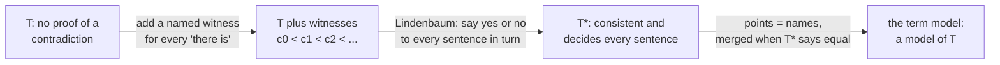

# Godel's completeness theorem: whatever is true in every model has a formal proof

[Syllabus](../../../SYLLABUS.md) → [Computability and complexity](../README.md) → [Computability and Logic](../README.md#s02) → Godel's completeness theorem

---

## General Overview

A theorem prover is a program that reads a list of axioms and searches for a formal proof: a list of lines in which each line is an axiom or follows from earlier lines by a fixed rule. Here are two short lists of axioms about one symbol, $`<`$, read "comes before".

- **The theory T.** Nothing comes before itself. If x comes before y and y before z, then x comes before z. Every point has some point after it.
- **The cycle theory.** The same first two axioms, plus: some x and y each come before the other.

A **model** is a set of points with a meaning for $`<`$ that makes every axiom true. A search through every relation on 1, 2, 3 and 4 points finds no model of either theory. On 4 points the search checks 65,536 relations and finds nothing.

Yet the two theories are opposites. T has a model: the counting numbers 0 < 1 < 2 < and so on, with no last one. The cycle theory has no model of any size, and a 4-line proof shows it: x < y and y < x give x < x, which the first axiom forbids.

Kurt Godel proved in 1930 that these are the only two cases. If no proof of a contradiction exists, a model exists. Leon Henkin found the proof this card follows in 1949: build the model out of names.

**If a list of first-order axioms has no formal proof of a contradiction, it has a model; so a sentence that is true in every model of the axioms has a formal proof from them.**

**What kind of fact this is:** a theorem, proved on this card in outline by Henkin's method. Every step is given. The two routine lemmas are proved in folds, and the full details are in Enderton's and van Dalen's books (Sources).

### The picture: Henkin's construction



Each arrow keeps the theory free of contradiction. The last one turns sentences into facts about points.

---

## The formula

A **first-order** sentence talks about the points of one set. It uses "for all" $`\forall`$ and "there is" $`\exists`$ over points, never over sets of points, together with not $`\neg`$, and $`\wedge`$, implies $`\rightarrow`$ and symbols such as $`<`$.

[Formal proofs and soundness](11-formal-deduction-and-soundness.md) gives the two arrows this card compares. $`T \vdash \varphi`$ says a formal proof from the axioms $`T`$ ends in $`\varphi`$. $`T \models \varphi`$ says $`\varphi`$ is true in every model of $`T`$. Soundness is the arrow from left to right. Completeness is the way back:

```math
T \models \varphi \;\Longrightarrow\; T \vdash \varphi
```

**Read it aloud:** if a sentence holds in every model of the axioms, then some formal proof derives it from the axioms.

The proof goes through an equivalent form, which is what Henkin's construction delivers. Write $`\bot`$ for a contradiction, a sentence together with its negation:

```math
T \nvdash \bot \;\Longrightarrow\; \text{there is a model } \mathcal{M} \text{ with } \mathcal{M} \models T
```

**Read it aloud:** if no formal proof from the axioms reaches a contradiction, then some model makes all the axioms true.

| Symbol | Plain meaning | In our example | Push it up and the answer… |
| --- | --- | --- | --- |
| $`T`$ | a theory: a set of sentences used as axioms | the three order axioms | more axioms, fewer models, more proofs |
| $`\varphi`$ | a sentence: no variable is left unbound | $`\forall x\, \neg(x < x)`$ | — |
| $`T \vdash \varphi`$ | a formal proof from $`T`$ ends in $`\varphi`$ | the cycle theory proves $`\bot`$ in 4 lines | longer claims can need far longer proofs |
| $`T \models \varphi`$ | $`\varphi`$ is true in every model of $`T`$ | $`T \models \neg\, \exists x\, (x < x)`$ | — |
| $`\bot`$ | a contradiction: some $`\psi`$ and $`\neg\psi`$ both | a < a and not a < a | — |
| $`\mathcal{M}`$ | a model: a set of points and a meaning for each symbol | 0, 1, 2, … with "less than" | — |
| $`\mathcal{M} \models T`$ | every sentence of $`T`$ is true in $`\mathcal{M}`$ | the counting numbers satisfy $`T`$ | — |
| $`<`$ | the theory's one relation symbol | "comes before" | — |
| $`c_0, c_1, c_2, \ldots`$ | Henkin constants: new names, each a witness for one "there is" sentence | $`c_1`$ names a point after $`c_0`$ | one new name per "there is" |
| $`T^{*}`$ | a maximal consistent theory: free of contradiction, and it holds $`\varphi`$ or $`\neg\varphi`$ for every $`\varphi`$ | holds $`c_i < c_j`$ exactly when $`i < j`$ | — |
| $`[t]`$ | the point named by the term $`t`$: all names that $`T^{*}`$ proves equal to $`t`$ | no other $`c_i`$ is in $`[c_3]`$ | more equalities, fewer points |
| $`a`$, $`b`$ | the two witnesses in the cycle refutation | a < b and b < a | — |

### When it holds

- **First-order logic.** Quantifiers must range over points. In second-order logic, which also quantifies over sets of points, no sound proof system whose proofs a program can check catches every sentence true in all models. The second-order axioms for the counting numbers have one model up to renaming, so a complete system would decide arithmetic, which [Godel's theorems](03-godels-incompleteness-in-outline.md) rule out.
- **A proof system with the standard rules.** It needs modus ponens (from $`\psi`$ and $`\psi \rightarrow \chi`$, get $`\chi`$), the rule for "for all", and the rules for equality. Drop the equality rules and two names that the theory proves equal can name different points, so the term model breaks.
- **A language that can be listed.** Step 3 runs through the sentences one by one, which needs them to be countable ([Countable sets](../../01-Foundations/09-Sizes%20of%20Infinity/02-countable-sets.md)). A language with one name for each real number cannot be listed, and Zorn's lemma takes over, using the axiom of choice.
- **"A model", not "the intended model".** The theorem promises some model. T also has the fractions in order as a model, and a sentence that holds in the counting numbers but fails in the fractions is not provable from T.
- **Existence, not a decision.** The theorem says a proof exists. It does not say how long the proof is, and no program can always report that none exists (Step 7).

---

## Why it works

### Step 0: build the model out of names

A consistent theory already describes a world. Take the theory's own names as the points, and let a fact about them be true exactly when the theory says so.

Two things can go wrong. The theory may say neither $`\varphi`$ nor $`\neg\varphi`$, so the description is unfinished. And it may say "there is a point after $`c_0`$" without naming one, so the world lacks the point. Lindenbaum's lemma fixes the first problem and Henkin's witnesses fix the second.

### Step 1: reduce to "consistent theories have models"

Suppose $`T \nvdash \varphi`$. Then adding $`\neg\varphi`$ to $`T`$ creates no contradiction: if it did, a proof by contradiction would give $`T \vdash \varphi`$.

So $`T`$ plus $`\neg\varphi`$ is consistent. If every consistent theory has a model, this one has a model, where all of $`T`$ is true and $`\varphi`$ is false. Then $`T \not\models \varphi`$. Read backwards, $`T \models \varphi`$ gives $`T \vdash \varphi`$. The rest of the card proves the second form of the formula.

### Step 2: give every "there is" a name

For each sentence $`\exists x\, \psi(x)`$, add a new constant $`c`$ and the **witness axiom** $`\exists x\, \psi(x) \rightarrow \psi(c)`$: if some point has the property, $`c`$ is one.

In T, the sentence "there is some point", $`\exists x\, (x = x)`$, gets the witness $`c_0`$. Then the axiom "every point has a point after it" gives $`\exists y\, (c_0 < y)`$. Its witness is a new name $`c_1`$, with $`c_0 < c_1`$. Then $`\exists y\, (c_1 < y)`$ gets $`c_2`$, and so on. The new names make new sentences, so the step repeats once for each counting number and takes the union.

Adding a witness never creates a contradiction, because the new name says nothing beyond its own axiom.

<details>
<summary>Detailed proof: a witness axiom keeps a theory consistent</summary>

Suppose $`T`$ plus $`\exists x\, \psi(x) \rightarrow \psi(c)`$ proves $`\bot`$, where $`c`$ appears nowhere in $`T`$ or $`\psi`$. Then $`T`$ proves the negation of that axiom:

$`\displaystyle T \vdash \exists x\, \psi(x) \quad \text{and} \quad T \vdash \neg\psi(c)`$

The proof of $`\neg\psi(c)`$ uses nothing about $`c`$, so the same proof with a fresh variable in place of $`c`$ works. The rule for "for all" then gives $`T \vdash \forall x\, \neg\psi(x)`$, which is $`T \vdash \neg\exists x\, \psi(x)`$.

Now $`T`$ proves both $`\exists x\, \psi(x)`$ and its negation. So $`T`$ was already inconsistent. Read the other way: a consistent $`T`$ stays consistent.

</details>

### Step 3: decide every sentence, one at a time (Lindenbaum)

The language is countable, so its sentences form a list $`\varphi_0, \varphi_1, \varphi_2, \ldots`$. Walk down the list. At sentence $`\varphi_n`$, add it if the theory stays consistent; otherwise add $`\neg\varphi_n`$.

One of the two always works. If both $`\varphi_n`$ and $`\neg\varphi_n`$ led to contradictions, Step 1's argument would make the theory prove both $`\neg\varphi_n`$ and $`\varphi_n`$, so it was already inconsistent.

The union of all stages is $`T^{*}`$. It is consistent because a proof is finite: a proof of $`\bot`$ from $`T^{*}`$ uses finitely many sentences, which are all present at some stage $`n`$, and that stage is consistent.

For an uncountable language there is no list, and Zorn's lemma does the walk at once ([Zorn's lemma and the well-ordering theorem](../../01-Foundations/09-Sizes%20of%20Infinity/08-zorns-lemma-and-well-ordering.md)). Consistent extensions of $`T`$, ordered by inclusion, have the property that every chain (a family in which each member contains the one before) has its union as an upper bound, again because proofs are finite. So a maximal one exists.

### Step 4: the term model, and why it satisfies T*

The points of $`\mathcal{M}`$ are the closed terms: names with no variables, here $`c_0, c_1, c_2`$ and the rest. Two names are one point when $`T^{*}`$ contains $`s = t`$. This merge is the quotient, and the point named by $`t`$ is written $`[t]`$.

Define $`[s] < [t]`$ exactly when $`T^{*}`$ contains $`s < t`$. The equality rules make this independent of which name is chosen.

The **truth lemma** says every sentence is true in $`\mathcal{M}`$ exactly when it is in $`T^{*}`$. Since $`T`$ is inside $`T^{*}`$, $`\mathcal{M}`$ is a model of $`T`$.

<details>
<summary>Detailed proof: the truth lemma, by induction on the sentence</summary>

The claim is

$`\displaystyle \mathcal{M} \models \varphi \iff \varphi \in T^{*}`$

for every sentence $`\varphi`$, proved from the shortest sentences up.

- **An atom $`s < t`$ or $`s = t`$.** True in $`\mathcal{M}`$ by the definition of the points and of $`<`$.
- **A negation $`\neg\varphi`$.** $`\mathcal{M} \models \neg\varphi`$ means $`\varphi`$ is false in $`\mathcal{M}`$, so $`\varphi \notin T^{*}`$ by the induction. $`T^{*}`$ holds exactly one of $`\varphi`$ and $`\neg\varphi`$, since it is maximal and consistent, so $`\neg\varphi \in T^{*}`$.
- **A conjunction $`\varphi \wedge \chi`$.** $`T^{*}`$ contains everything it proves; otherwise the missing sentence's negation would be in it, a contradiction. So $`\varphi \wedge \chi \in T^{*}`$ exactly when both parts are, and the induction finishes the case.
- **"There is" $`\exists x\, \psi(x)`$.** If it is in $`T^{*}`$, its witness axiom puts $`\psi(c)`$ in $`T^{*}`$, so $`\psi([c])`$ holds in $`\mathcal{M}`$ by the induction. Conversely, if some point $`[t]`$ has $`\psi([t])`$, then $`\psi(t) \in T^{*}`$, which proves $`\exists x\, \psi(x)`$.

The other connectives and "for all" are written with these four. The "there is" case is the one that needs witnesses: without them, a "there is" in $`T^{*}`$ could have no named point to make it true.

</details>

### Step 5: the example, read back

In $`T^{*}`$, the witnesses give $`c_0 < c_1`$, $`c_1 < c_2`$, $`c_2 < c_3`$. Transitivity then forces $`c_i < c_j`$ whenever $`i < j`$. The reverse $`c_j < c_i`$ is ruled out: with $`c_i < c_j`$ it gives $`c_i < c_i`$ by transitivity, which irreflexivity forbids.

So the chain of witnesses $`c_0 < c_1 < c_2 < \ldots`$ is a copy of the counting numbers in order. Two different $`c_i`$ are never merged, since $`c_i = c_j`$ with $`c_i < c_j`$ would give $`c_i < c_i`$.

The code runs the construction on the first $`n`$ witnesses. Stage 4 decides all 16 atoms $`c_i < c_j`$ and keeps 6. Brute force over all 65,536 relations on 4 points finds exactly one strict order containing the witness facts, and it is the same one.

Each finite stage has one point waiting for its witness: $`c_3`$ at stage 4. The next stage supplies it. In the union, no point waits, so "every point has a point after it" holds.

Other "there is" sentences get witnesses too, which can add points off the chain; the code follows the chain.

### Step 6: no model means a refutation

Read the theorem from the other side. The cycle theory has no model, so it is not consistent: some formal proof reaches $`\bot`$. Completeness promises the proof exists; here it is.

| Line | Sentence | Reason |
| --- | --- | --- |
| 1 | a < b and b < a | the cycle axiom, with a and b as its witnesses |
| 2 | (a < b and b < a) → a < a | transitivity, with x = a, y = b, z = a |
| 3 | a < a | modus ponens from lines 1 and 2 |
| 4 | not a < a | irreflexivity, with x = a |

Lines 3 and 4 contradict each other. Because a and b appear nowhere else, the contradiction refutes the "there is" axiom itself.

The table compresses routine steps. In the seven rules of [Formal proofs and soundness](11-formal-deduction-and-soundness.md), line 2 takes three "for-all out" steps, one each for x, y and z, and using a and b as the witnesses takes two "there-is out" steps.

Finite search could not tell these two theories apart: both show 0 models on 1 to 4 points. The proof settles the cycle theory for every size at once, by soundness ([Formal proofs and soundness](11-formal-deduction-and-soundness.md)). Henkin's model settles T, at an infinite size that no finite search reaches.

### Step 7: what follows, and what does not

- **Valid sentences can be listed.** A program that reads every possible proof in turn, shortest first, eventually prints every sentence true in all models. So the valid sentences form a semidecidable set ([Decidable and semidecidable](01-decidable-and-semidecidable-sets.md)).
- **They cannot be decided.** Church proved in 1936 that no program sorts first-order sentences into valid and not valid. The search confirms a yes; for a no it can run forever.
- **Compactness.** A proof uses finitely many axioms. So if every finite part of a theory has a model, the whole theory has one. [Compactness and Lowenheim-Skolem](13-compactness-and-lowenheim-skolem.md) takes this further.

Completeness and incompleteness answer different questions.

| | Completeness, 1930 | Incompleteness, 1931 |
| --- | --- | --- |
| The question | Does proof catch every sentence true in all models of $`T`$? | Does one theory prove or refute every sentence? |
| The answer | yes, for every first-order $`T`$ | no, for any consistent listable theory that can do basic arithmetic with plus and times |
| How they fit | Godel's sentence $`G`$ is true in the counting numbers but false in some other model of arithmetic, so it is not true in every model | the same $`G`$: neither proved nor refuted |

---

## Worked numbers, by hand

The construction on T, then the refutation of the cycle theory.

| Step | Arithmetic | Value |
| --- | --- | --- |
| witnesses at stage 4 | one per "point after", $`c_0`$ to $`c_3`$ | $`c_0 < c_1`$, $`c_1 < c_2`$, $`c_2 < c_3`$ |
| atoms to decide | 4 names × 4 names | 16 |
| Lindenbaum keeps | pairs $`i < j`$ from 4 names: 4 × 3 ÷ 2 | **6**: c0<c1 c0<c2 c0<c3 c1<c2 c1<c3 c2<c3 |
| saying "no" first instead | the theory forces the same 6 | same set |
| brute force on 4 points | $`2^{16}`$ relations, keep strict orders with the witness facts | 65,536 checked, 1 kept, the same |
| still waiting at stage 4 | the newest name | $`c_3`$ |
| stage 6 | 6 × 5 ÷ 2 of 36 atoms | 15 kept, $`c_5`$ waiting |
| strict orders on 1, 2, 3, 4 points | brute force | 1, 3, 19, 219 |
| of those, where every point has a point after it | every finite order has a maximal point (one with nothing after it) | 0, 0, 0, 0 |
| cycle theory refuted | lines 1 to 4 above | **contradiction in 4 lines** |

Inside T's term model the witnesses $`c_0 < c_1 < c_2 < \ldots`$ form a copy of the counting numbers, built from 6 facts at stage 4 and 15 at stage 6; the rest of the term model depends on the choices Lindenbaum's pass makes. The cycle theory, which also has no finite model, has a proof of a contradiction instead.

### What breaks if you drop a piece

| Mistake | Comes out at | What went wrong |
| --- | --- | --- |
| No witnesses, and Lindenbaum says "no" first | 0 true atoms; 4 of 4 points have nothing after them | Every atom is decided and consistent with T, yet the 4 names are not a model of T: the "there is" has no named point |
| Add every atom without the consistency test | 16 atoms true, $`c_i < c_i`$ at 4 points, inconsistent | Lindenbaum must check before it adds |
| Search finite models instead of proving | T: 0, 0, 0, 0 models on 1 to 4 points, yet T is consistent | Finite search misses infinite models |
| Drop transitivity from the cycle theory | line 2 of the refutation is rejected; a 2-point model appears | Without the axiom there is no proof, and a model a < b, b < a exists |

The code prints all four.

---

## Code, from first principles, and it actually runs

The code runs Henkin's construction on T and Lindenbaum's yes-or-no pass over every atom, at stages 1 to 6. It takes three independent roads. Road one is the construction, with consistency tested by forward chaining: repeatedly adding what transitivity forces, then looking for $`c_i < c_i`$. Road two is brute force over every relation on up to 4 points, checked against the axioms directly. Road three is a proof checker that accepts the 4-line refutation only if each line is an axiom instance or follows by modus ponens. Forward chaining also reaches the contradiction on its own. The consistency test is exact here: the order axioms are Horn clauses (each has at most one positive part), and for those forward chaining finds every contradiction.

### Python

```python
# Godel's completeness theorem -- the check behind the card.  Standard library
# only, nothing imported.  It runs Henkin's construction on T, the theory of a
# strict order where every point has one after it: witnesses c0 < c1 < c2 ..., then
# Lindenbaum's yes-or-no pass over every atom ci < cj, then the model read off
# the result.  It also checks the 4-line refutation of the cycle theory.
# Consistency test: T's order axioms are Horn clauses (at most one positive
# part), so a set of atoms and negated atoms is consistent with them exactly
# when its transitive closure has no ci < ci and hits no negated atom.  The
# point-after axiom can always be met by new points above, so it adds nothing.

def closure(pos):                        # forward chaining with transitivity
    known = set(pos)
    while True:
        new = {(i, l) for (i, j) in known for (k, l) in known if j == k} - known
        if not new:
            return known
        known |= new

def consistent(pos, neg):
    c = closure(pos)
    return all(i != j for (i, j) in c) and not (c & neg)

def lindenbaum(n, witnesses, yes_first):  # decide every atom, in a fixed list
    pos = {(i, i + 1) for i in range(n - 1)} if witnesses else set()
    neg = set()
    for a in [(i, j) for i in range(n) for j in range(n)]:
        if yes_first:
            (pos if consistent(pos | {a}, neg) else neg).add(a)
        else:
            (neg if consistent(pos, neg | {a}) else pos).add(a)
    return closure(pos), neg

def waiting(n, rel):                     # points with nothing above them
    return [i for i in range(n) if not any((i, j) in rel for j in range(n))]

def show(rel):
    return " ".join(f"c{i}<c{j}" for (i, j) in sorted(rel)) or "(none)"

def all_relations(n):                    # brute force: every relation on n points
    pairs = [(i, j) for i in range(n) for j in range(n)]
    for mask in range(2 ** len(pairs)):
        yield {p for b, p in enumerate(pairs) if mask >> b & 1}

def is_order(n, r):                      # irreflexive and transitive, checked directly
    return all((i, i) not in r for i in range(n)) and all(
        (i, k) in r for (i, j) in r for (j2, k) in r if j == j2)

def two_way(r):
    return any((j, i) in r for (i, j) in r)

L = lambda x, y: ("<", x, y)
IRR = ("not", L("x", "x"))
TRANS = ("imp", ("and", L("x", "y"), L("y", "z")), L("x", "z"))
HYP = ("and", L("a", "b"), L("b", "a"))  # the cycle claim, with witnesses a, b

def match(schema, f, sub):               # is f the schema with x, y, z filled in?
    if isinstance(schema, str):
        return sub.setdefault(schema, f) == f if schema in "xyz" else schema == f
    return (isinstance(f, tuple) and len(f) == len(schema) and f[0] == schema[0]
            and all(match(s, g, sub) for s, g in zip(schema[1:], f[1:])))

def check(proof, axioms):                # each line must earn its place
    for k, (f, why) in enumerate(proof):
        ok = (f == HYP if why == "hypothesis" else
              why in axioms and match(axioms[why], f, {}) if why in ("transitivity", "irreflexivity") else
              why.startswith("mp") and ("imp", proof[int(why[3]) - 1][0], f) == proof[int(why[5]) - 1][0])
        if not ok:
            return f"line {k + 1} rejected"
    lines = [f for f, _ in proof]
    return "contradiction reached" if any(("not", g) in lines for g in lines) else "no contradiction"

proof = [(HYP, "hypothesis"), (("imp", HYP, L("a", "a")), "transitivity"),
         (L("a", "a"), "mp 1 2"), (("not", L("a", "a")), "irreflexivity")]
words = ["a<b and b<a", "(a<b and b<a) -> a<a", "a<a", "not a<a"]

print("Henkin stages for T: stage n has c0..c(n-1) and witnesses c(i) < c(i+1)")
for n in range(1, 7):
    rel, neg = lindenbaum(n, True, True)
    assert rel == {(i, j) for i in range(n) for j in range(n) if i < j}
    assert len(rel) == n * (n - 1) // 2 and len(rel) + len(neg) == n * n
    print(f"stage {n}: atoms decided {n * n}, true {len(rel)}, "
          f"waiting for a witness {['c%d' % i for i in waiting(n, rel)]}")
yes4, _ = lindenbaum(4, True, True)
no4, _ = lindenbaum(4, True, False)
print(f"stage 4, yes-first pass: {show(yes4)}")
print(f"stage 4, no-first pass gives the same set: {'yes' if no4 == yes4 else 'no'}")
brute = [r for r in all_relations(4) if is_order(4, r) and {(0, 1), (1, 2), (2, 3)} <= r]
print(f"brute force over {2 ** 16} relations on 4 points: {len(brute)} model(s) "
      f"with the witness facts, equal to Lindenbaum's: {'yes' if brute == [yes4] else 'no'}")
counts = {"orders": [], "T": [], "cycle": [], "cycle, no transitivity": []}
for n in range(1, 5):
    rels = list(all_relations(n))
    orders = [r for r in rels if is_order(n, r)]
    counts["orders"].append(len(orders))
    counts["T"].append(sum(1 for r in orders if not waiting(n, r)))
    counts["cycle"].append(sum(1 for r in orders if two_way(r)))
    counts["cycle, no transitivity"].append(
        sum(1 for r in rels if two_way(r) and all((i, i) not in r for i in range(n))))
for k, v in counts.items():
    print(f"models on 1, 2, 3, 4 points, {k}: {v}")
print("refutation of the cycle theory:")
for k, (f, why) in enumerate(proof):
    print(f"  {k + 1}. {words[k]:24s} {why}")
print(f"checker: {check(proof, {'transitivity': TRANS, 'irreflexivity': IRR})}")
print(f"forward chaining from a<b, b<a reaches a<a: {'yes' if (0, 0) in closure({(0, 1), (1, 0)}) else 'no'}")
print(f"mistake 1, no witnesses, no-first pass on 4 points: true atoms {show(lindenbaum(4, False, False)[0])}, "
      f"points with nothing above {len(waiting(4, lindenbaum(4, False, False)[0]))} of 4")
everything = {(i, j) for i in range(4) for j in range(4)}
print(f"mistake 2, every atom added unchecked: {len(everything)} true, c(i)<c(i) at "
      f"{sum(1 for i in range(4) if (i, i) in everything)} points, consistent: "
      f"{'yes' if consistent(everything, set()) else 'no'}")
print(f"mistake 3, finite search for T finds {counts['T']}, yet stage 6 above is consistent")
print(f"mistake 4, transitivity dropped: checker says {check(proof, {'irreflexivity': IRR})}; "
      f"a 2-point model exists: {counts['cycle, no transitivity'][1]}")
assert counts["orders"] == [1, 3, 19, 219] and counts["T"] == [0, 0, 0, 0]
assert brute == [yes4] and no4 == yes4 and counts["cycle"] == [0, 0, 0, 0]
assert check(proof, {"transitivity": TRANS, "irreflexivity": IRR}) == "contradiction reached"
assert check([(HYP, "hypothesis"), (("imp", HYP, L("b", "b")), "transitivity")], {"transitivity": TRANS}) == "line 2 rejected"
assert check(proof[:2] + [(L("b", "b"), "mp 1 2")], {"transitivity": TRANS}) == "line 3 rejected"   # modus ponens must match
assert not consistent({(0, 1), (1, 2)}, {(0, 2)})   # transitivity forces c0<c2, which was denied
assert not consistent({(0, 1), (1, 0)}, set()) and consistent(yes4, everything - yes4)
assert check(proof, {"irreflexivity": IRR}) == "line 2 rejected" and counts["cycle, no transitivity"][1] == 1
print("ALL CHECKS PASS")
```

**Ran 2026-11-24 on macOS, Python 3.14.10, standard library only. All checks passed. Output, pasted from the run:**

```
Henkin stages for T: stage n has c0..c(n-1) and witnesses c(i) < c(i+1)
stage 1: atoms decided 1, true 0, waiting for a witness ['c0']
stage 2: atoms decided 4, true 1, waiting for a witness ['c1']
stage 3: atoms decided 9, true 3, waiting for a witness ['c2']
stage 4: atoms decided 16, true 6, waiting for a witness ['c3']
stage 5: atoms decided 25, true 10, waiting for a witness ['c4']
stage 6: atoms decided 36, true 15, waiting for a witness ['c5']
stage 4, yes-first pass: c0<c1 c0<c2 c0<c3 c1<c2 c1<c3 c2<c3
stage 4, no-first pass gives the same set: yes
brute force over 65536 relations on 4 points: 1 model(s) with the witness facts, equal to Lindenbaum's: yes
models on 1, 2, 3, 4 points, orders: [1, 3, 19, 219]
models on 1, 2, 3, 4 points, T: [0, 0, 0, 0]
models on 1, 2, 3, 4 points, cycle: [0, 0, 0, 0]
models on 1, 2, 3, 4 points, cycle, no transitivity: [0, 1, 37, 3367]
refutation of the cycle theory:
  1. a<b and b<a              hypothesis
  2. (a<b and b<a) -> a<a     transitivity
  3. a<a                      mp 1 2
  4. not a<a                  irreflexivity
checker: contradiction reached
forward chaining from a<b, b<a reaches a<a: yes
mistake 1, no witnesses, no-first pass on 4 points: true atoms (none), points with nothing above 4 of 4
mistake 2, every atom added unchecked: 16 true, c(i)<c(i) at 4 points, consistent: no
mistake 3, finite search for T finds [0, 0, 0, 0], yet stage 6 above is consistent
mistake 4, transitivity dropped: checker says line 2 rejected; a 2-point model exists: 1
ALL CHECKS PASS
```

### Rust

Same numbers, same labels, built with `rustc --edition 2021 -O`.

```rust
// Godel's completeness theorem -- the same check as the Python, in Rust.  No
// crates.  It runs Henkin's construction on T, the theory of a strict order
// where every point has one after it: witnesses c0 < c1 < c2 ..., then Lindenbaum's
// yes-or-no pass over every atom ci < cj, then the model read off the result.
// It also checks the 4-line refutation of the cycle theory.
// Consistency test: T's order axioms are Horn clauses (at most one positive
// part), so a set of atoms and negated atoms is consistent with them exactly
// when its transitive closure has no ci < ci and hits no negated atom.  The
// point-after axiom can always be met by new points above, so it adds nothing.
use std::collections::{BTreeMap, BTreeSet};
type Rel = BTreeSet<(usize, usize)>;

fn closure(pos: &Rel) -> Rel {                  // forward chaining with transitivity
    let mut known = pos.clone();
    loop {
        let mut new = Rel::new();
        for &(i, j) in &known { for &(k, l) in &known { if j == k && !known.contains(&(i, l)) { new.insert((i, l)); } } }
        if new.is_empty() { return known; }
        known.extend(new);
    }
}

fn consistent(pos: &Rel, neg: &Rel) -> bool {
    let c = closure(pos);
    c.iter().all(|&(i, j)| i != j) && c.intersection(neg).next().is_none()
}

fn lindenbaum(n: usize, witnesses: bool, yes_first: bool) -> (Rel, Rel) {
    let mut pos: Rel = if witnesses { (0..n.saturating_sub(1)).map(|i| (i, i + 1)).collect() } else { Rel::new() };
    let mut neg = Rel::new();
    for i in 0..n { for j in 0..n {
        let a = (i, j);
        let (mut p2, mut n2) = (pos.clone(), neg.clone());
        if yes_first {
            p2.insert(a);
            if consistent(&p2, &neg) { pos.insert(a); } else { neg.insert(a); }
        } else {
            n2.insert(a);
            if consistent(&pos, &n2) { neg.insert(a); } else { pos.insert(a); }
        }
    } }
    (closure(&pos), neg)
}

fn waiting(n: usize, r: &Rel) -> Vec<usize> { (0..n).filter(|&i| !(0..n).any(|j| r.contains(&(i, j)))).collect() }

fn show(r: &Rel) -> String {
    if r.is_empty() { return "(none)".to_string(); }
    r.iter().map(|&(i, j)| format!("c{}<c{}", i, j)).collect::<Vec<_>>().join(" ")
}

fn all_relations(n: usize) -> Vec<Rel> {        // brute force: every relation on n points
    let pairs: Vec<(usize, usize)> = (0..n).flat_map(|i| (0..n).map(move |j| (i, j))).collect();
    (0u64..1 << pairs.len()).map(|m| pairs.iter().enumerate().filter(|(b, _)| m >> b & 1 == 1).map(|(_, &p)| p).collect()).collect()
}

fn is_order(n: usize, r: &Rel) -> bool {        // irreflexive and transitive, checked directly
    (0..n).all(|i| !r.contains(&(i, i)))
        && r.iter().all(|&(i, j)| r.iter().all(|&(j2, k)| j != j2 || r.contains(&(i, k))))
}

fn two_way(r: &Rel) -> bool { r.iter().any(|&(i, j)| r.contains(&(j, i))) }

#[derive(Clone, PartialEq, Debug)]
enum F { Lt(char, char), Not(Box<F>), And(Box<F>, Box<F>), Imp(Box<F>, Box<F>) }
fn lt(x: char, y: char) -> F { F::Lt(x, y) }
fn not(f: F) -> F { F::Not(Box::new(f)) }
fn and(f: F, g: F) -> F { F::And(Box::new(f), Box::new(g)) }
fn imp(f: F, g: F) -> F { F::Imp(Box::new(f), Box::new(g)) }

fn var(s: char, c: char, sub: &mut BTreeMap<char, char>) -> bool {
    if "xyz".contains(s) { *sub.entry(s).or_insert(c) == c } else { s == c }
}

fn matches(schema: &F, f: &F, sub: &mut BTreeMap<char, char>) -> bool {   // is f the schema with x, y, z filled in?
    match (schema, f) {
        (F::Lt(a, b), F::Lt(c, d)) => var(*a, *c, sub) && var(*b, *d, sub),
        (F::Not(a), F::Not(c)) => matches(a, c, sub),
        (F::And(a, b), F::And(c, d)) | (F::Imp(a, b), F::Imp(c, d)) => matches(a, c, sub) && matches(b, d, sub),
        _ => false,
    }
}

fn check(proof: &[(F, &str)], axioms: &BTreeMap<&str, F>, hyp: &F) -> String {
    for (k, (f, why)) in proof.iter().enumerate() {
        let ok = if *why == "hypothesis" { f == hyp }
            else if *why == "transitivity" || *why == "irreflexivity" { axioms.get(why).map_or(false, |s| matches(s, f, &mut BTreeMap::new())) }
            else if why.starts_with("mp") {
                let b = why.as_bytes();
                let (i, j) = ((b[3] - b'1') as usize, (b[5] - b'1') as usize);
                imp(proof[i].0.clone(), f.clone()) == proof[j].0
            } else { false };
        if !ok { return format!("line {} rejected", k + 1); }
    }
    if proof.iter().any(|(g, _)| proof.iter().any(|(h, _)| *h == not(g.clone()))) { "contradiction reached".into() } else { "no contradiction".into() }
}

fn yn(b: bool) -> &'static str { if b { "yes" } else { "no" } }

fn main() {
    let irr = not(lt('x', 'x'));
    let trans = imp(and(lt('x', 'y'), lt('y', 'z')), lt('x', 'z'));
    let hyp = and(lt('a', 'b'), lt('b', 'a'));
    let proof = vec![(hyp.clone(), "hypothesis"), (imp(hyp.clone(), lt('a', 'a')), "transitivity"),
                     (lt('a', 'a'), "mp 1 2"), (not(lt('a', 'a')), "irreflexivity")];
    let words = ["a<b and b<a", "(a<b and b<a) -> a<a", "a<a", "not a<a"];
    let full: BTreeMap<&str, F> = [("transitivity", trans.clone()), ("irreflexivity", irr.clone())].into_iter().collect();
    let no_trans: BTreeMap<&str, F> = [("irreflexivity", irr.clone())].into_iter().collect();
    println!("Henkin stages for T: stage n has c0..c(n-1) and witnesses c(i) < c(i+1)");
    for n in 1..7 {
        let (rel, neg) = lindenbaum(n, true, true);
        let expect: Rel = (0..n).flat_map(|i| (0..n).map(move |j| (i, j))).filter(|&(i, j)| i < j).collect();
        assert!(rel == expect && rel.len() == n * (n - 1) / 2 && rel.len() + neg.len() == n * n);
        let w: Vec<String> = waiting(n, &rel).iter().map(|i| format!("'c{}'", i)).collect();
        println!("stage {}: atoms decided {}, true {}, waiting for a witness [{}]", n, n * n, rel.len(), w.join(", "));
    }
    let (yes4, _) = lindenbaum(4, true, true);
    let (no4, _) = lindenbaum(4, true, false);
    println!("stage 4, yes-first pass: {}", show(&yes4));
    println!("stage 4, no-first pass gives the same set: {}", yn(no4 == yes4));
    let facts: Rel = [(0, 1), (1, 2), (2, 3)].into_iter().collect();
    let brute: Vec<Rel> = all_relations(4).into_iter().filter(|r| is_order(4, r) && facts.is_subset(r)).collect();
    println!("brute force over {} relations on 4 points: {} model(s) with the witness facts, equal to Lindenbaum's: {}",
             1u64 << 16, brute.len(), yn(brute == vec![yes4.clone()]));
    let names = ["orders", "T", "cycle", "cycle, no transitivity"];
    let mut counts: Vec<Vec<usize>> = vec![Vec::new(); 4];
    for n in 1..5 {
        let rels = all_relations(n);
        let orders: Vec<&Rel> = rels.iter().filter(|r| is_order(n, r)).collect();
        counts[0].push(orders.len());
        counts[1].push(orders.iter().filter(|r| waiting(n, r).is_empty()).count());
        counts[2].push(orders.iter().filter(|r| two_way(r)).count());
        counts[3].push(rels.iter().filter(|r| two_way(r) && (0..n).all(|i| !r.contains(&(i, i)))).count());
    }
    for k in 0..4 { println!("models on 1, 2, 3, 4 points, {}: {:?}", names[k], counts[k]); }
    println!("refutation of the cycle theory:");
    for (k, (_, why)) in proof.iter().enumerate() { println!("  {}. {:<24} {}", k + 1, words[k], why); }
    println!("checker: {}", check(&proof, &full, &hyp));
    let cyc: Rel = [(0, 1), (1, 0)].into_iter().collect();
    println!("forward chaining from a<b, b<a reaches a<a: {}", yn(closure(&cyc).contains(&(0, 0))));
    let bare = lindenbaum(4, false, false).0;
    println!("mistake 1, no witnesses, no-first pass on 4 points: true atoms {}, points with nothing above {} of 4",
             show(&bare), waiting(4, &bare).len());
    let everything: Rel = (0..4).flat_map(|i| (0..4).map(move |j| (i, j))).collect();
    println!("mistake 2, every atom added unchecked: {} true, c(i)<c(i) at {} points, consistent: {}", everything.len(),
             (0..4).filter(|&i| everything.contains(&(i, i))).count(), yn(consistent(&everything, &Rel::new())));
    println!("mistake 3, finite search for T finds {:?}, yet stage 6 above is consistent", counts[1]);
    println!("mistake 4, transitivity dropped: checker says {}; a 2-point model exists: {}", check(&proof, &no_trans, &hyp), counts[3][1]);
    assert!(counts[0] == vec![1, 3, 19, 219] && counts[1] == vec![0, 0, 0, 0]);
    assert!(brute == vec![yes4.clone()] && no4 == yes4 && counts[2] == vec![0, 0, 0, 0]);
    assert!(check(&proof, &full, &hyp) == "contradiction reached");
    assert!(check(&[(hyp.clone(), "hypothesis"), (imp(hyp.clone(), lt('b', 'b')), "transitivity")], &full, &hyp) == "line 2 rejected");
    assert!(check(&[proof[0].clone(), proof[1].clone(), (lt('b', 'b'), "mp 1 2")], &full, &hyp) == "line 3 rejected"); // modus ponens must match
    let (p2, n2): (Rel, Rel) = ([(0, 1), (1, 2)].into_iter().collect(), [(0, 2)].into_iter().collect());
    assert!(!consistent(&p2, &n2));                 // transitivity forces c0<c2, which was denied
    let rest: Rel = everything.difference(&yes4).copied().collect();
    assert!(!consistent(&cyc, &Rel::new()) && consistent(&yes4, &rest));
    assert!(check(&proof, &no_trans, &hyp) == "line 2 rejected" && counts[3][1] == 1);
    println!("ALL CHECKS PASS");
}
```

**Ran 2026-11-24 on macOS, rustc 1.98.1, no crates. All checks passed. Output, pasted from the run:**

```
Henkin stages for T: stage n has c0..c(n-1) and witnesses c(i) < c(i+1)
stage 1: atoms decided 1, true 0, waiting for a witness ['c0']
stage 2: atoms decided 4, true 1, waiting for a witness ['c1']
stage 3: atoms decided 9, true 3, waiting for a witness ['c2']
stage 4: atoms decided 16, true 6, waiting for a witness ['c3']
stage 5: atoms decided 25, true 10, waiting for a witness ['c4']
stage 6: atoms decided 36, true 15, waiting for a witness ['c5']
stage 4, yes-first pass: c0<c1 c0<c2 c0<c3 c1<c2 c1<c3 c2<c3
stage 4, no-first pass gives the same set: yes
brute force over 65536 relations on 4 points: 1 model(s) with the witness facts, equal to Lindenbaum's: yes
models on 1, 2, 3, 4 points, orders: [1, 3, 19, 219]
models on 1, 2, 3, 4 points, T: [0, 0, 0, 0]
models on 1, 2, 3, 4 points, cycle: [0, 0, 0, 0]
models on 1, 2, 3, 4 points, cycle, no transitivity: [0, 1, 37, 3367]
refutation of the cycle theory:
  1. a<b and b<a              hypothesis
  2. (a<b and b<a) -> a<a     transitivity
  3. a<a                      mp 1 2
  4. not a<a                  irreflexivity
checker: contradiction reached
forward chaining from a<b, b<a reaches a<a: yes
mistake 1, no witnesses, no-first pass on 4 points: true atoms (none), points with nothing above 4 of 4
mistake 2, every atom added unchecked: 16 true, c(i)<c(i) at 4 points, consistent: no
mistake 3, finite search for T finds [0, 0, 0, 0], yet stage 6 above is consistent
mistake 4, transitivity dropped: checker says line 2 rejected; a 2-point model exists: 1
ALL CHECKS PASS
```

The two outputs match line for line.

### Lean

Lean proves Lindenbaum's step, compactness and the witness chain for every language, but not completeness itself: Lean's library has no proof system.

- Suppose a set is consistent exactly when every finite part is, and a consistent set can always take $`\varphi`$ or $`\neg\varphi`$. Then every consistent theory $`T`$ lies inside a consistent $`T^{*}`$ that holds $`\varphi`$ or $`\neg\varphi`$ for every sentence.
- That $`T^{*}`$ is maximal: no consistent theory is strictly bigger.
- The sentences need not be listed, so this covers the uncountable languages where Zorn's lemma takes over.
- Suppose every finite part of a first-order theory has a model. Then the whole theory has a model.
- Suppose nothing comes before itself, $`<`$ is transitive, and $`c_i < c_{i+1}`$ for every $`i`$. Then $`c_i < c_j`$ holds exactly when $`i < j`$.
- The counting numbers with "less than" are a model of T.
- Take any points where nothing comes before itself and $`<`$ is transitive. Then no $`a`$ and $`b`$ have both $`a < b`$ and $`b < a`$, so the cycle theory has no model.
- The worked numbers also check: stages 1 to 6 keep 0, 1, 3, 6, 10 and 15 atoms, and 4 points carry 65,536 relations.
- So do the 1, 3 and 19 strict orders on 1, 2 and 3 points, and T's 0 models on each.
- With transitivity dropped, the cycle theory has 0 models on 1 point and 1 model on 2 points.

Henkin's construction, the term model, the refutation checker and the counts on 4 points are left to the Python and Rust checks.

```lean
-- Godel's completeness theorem: Lindenbaum's step (a consistent theory extends to a maximal consistent one that decides every sentence), the compactness theorem, and the card's order examples.
import Mathlib.ModelTheory.Satisfiability
import Mathlib.Order.Zorn
import Mathlib.Data.Fintype.Pi
import Mathlib.Data.Fintype.Prod
import Mathlib.Data.Fintype.Card

/-! Mathlib's model theory has theories, models and satisfiability
(`FirstOrder.Language.Theory.IsSatisfiable`) but no proof calculus, so the completeness theorem
itself (`T ⊨ φ ⟹ T ⊢ φ`) is not stated here. This file states what can be stated exactly:

* Lindenbaum's lemma (the card's Step 3), for any notion of consistency with the two properties
  the card uses: a set is consistent when every finite part is (proofs are finite), and a
  consistent set stays consistent after adding `φ` or after adding `¬φ`. No countability is
  assumed, so this covers the Zorn's-lemma case for uncountable languages too.
* The compactness theorem (the card's Step 7), in Mathlib's first-order terms.
* The term model read back (the card's Step 5): a strict order on the counting numbers that
  holds each witness fact `cᵢ < cᵢ₊₁` is exactly "less than".

The examples check the card's whole-number counts by `decide`. -/

namespace GodelCompleteness

/-- **Lindenbaum's lemma.** Suppose consistency of a set of sentences has the two properties
the card uses: a set is consistent exactly when every finite part of it is (a proof uses
finitely many sentences), and if a consistent set cannot take `φ`, it can take `¬φ` ("one of
the two always works"). Then every consistent theory `T` lies inside a theory `T*` that is
consistent, holds `φ` or `¬φ` for every sentence `φ`, and is maximal: no consistent theory is
strictly bigger. -/
theorem lindenbaum_maximal_consistent_extension {α : Type*} (Con : Set α → Prop) (neg : α → α)
    (proofs_are_finite : ∀ S : Set α, Con S ↔ ∀ F : Finset α, (F : Set α) ⊆ S → Con F)
    (one_of_two_works : ∀ S : Set α, Con S → ∀ φ : α, Con (insert φ S) ∨ Con (insert (neg φ) S))
    {T : Set α} (hT : Con T) :
    ∃ Tstar : Set α, T ⊆ Tstar ∧ Con Tstar ∧ (∀ φ : α, φ ∈ Tstar ∨ neg φ ∈ Tstar) ∧
      ∀ S : Set α, Tstar ⊆ S → Con S → S = Tstar := by
  classical
  obtain ⟨M, hTM, hM⟩ := zorn_subset_nonempty {S | Con S} (fun c hc hchain hne => by
    refine ⟨⋃₀ c, ?_, fun s hs => Set.subset_sUnion_of_mem hs⟩
    show Con (⋃₀ c)
    rw [proofs_are_finite]
    intro F hF
    obtain ⟨t, htc, hFt⟩ :=
      hchain.directedOn.exists_mem_subset_of_finite_of_subset_sUnion hne F.finite_toSet hF
    exact (proofs_are_finite t).1 (hc htc) F hFt) T hT
  have hMcon : Con M := hM.prop
  refine ⟨M, hTM, hMcon, fun φ => ?_, fun S hMS hS => (hM.eq_of_subset hS hMS).symm⟩
  rcases one_of_two_works M hMcon φ with h | h
  · exact Or.inl (Set.insert_subset_iff.1 (hM.eq_of_subset h (Set.subset_insert _ _)).ge).1
  · exact Or.inr (Set.insert_subset_iff.1 (hM.eq_of_subset h (Set.subset_insert _ _)).ge).1

/-- **Compactness.** If every finite part of a first-order theory has a model, the whole theory
has a model. -/
theorem compactness_finite_parts_have_models {L : FirstOrder.Language} (T : L.Theory)
    (h : ∀ T0 : Finset L.Sentence, (T0 : L.Theory) ⊆ T →
      FirstOrder.Language.Theory.IsSatisfiable (T0 : L.Theory)) :
    T.IsSatisfiable := by
  exact FirstOrder.Language.Theory.isSatisfiable_iff_isFinitelySatisfiable.2 h

/-- **The witness chain is a copy of the counting numbers.** If a relation `<` on the names
`c₀, c₁, c₂, …` (indexed by the counting numbers) is irreflexive and transitive and holds each
witness fact `cᵢ < cᵢ₊₁`, then `cᵢ < cⱼ` holds exactly when `i < j`. -/
theorem witness_chain_is_counting_order (r : ℕ → ℕ → Prop) (irrefl : ∀ x, ¬ r x x)
    (trans : ∀ x y z, r x y → r y z → r x z) (witness : ∀ i, r i (i + 1)) :
    ∀ i j : ℕ, r i j ↔ i < j := by
  have up : ∀ i j, i < j → r i j := by
    intro i j hij
    induction hij with
    | refl => exact witness i
    | step _ ih => exact trans _ _ _ ih (witness _)
  intro i j
  refine ⟨fun h => ?_, up i j⟩
  by_contra hne
  rcases (not_lt.1 hne).lt_or_eq with hlt | heq
  · exact irrefl _ (trans _ _ _ h (up _ _ hlt))
  · subst heq; exact irrefl _ h

/-! ### The card's examples -/

/-- The theory T has a model: the counting numbers with "less than". Nothing comes before
itself, "less than" is transitive, and every number has one after it. -/
example : (∀ x : ℕ, ¬ x < x) ∧ (∀ x y z : ℕ, x < y → y < z → x < z) ∧ ∀ x : ℕ, ∃ y, x < y := by
  exact ⟨fun x => lt_irrefl x, fun _ _ _ => lt_trans, fun x => ⟨x + 1, Nat.lt_succ_self x⟩⟩

/-- The cycle theory has no model of any size: irreflexivity and transitivity rule out
`a < b` and `b < a` together (the card's 4-line refutation). -/
example {β : Type*} (r : β → β → Prop) (irrefl : ∀ x, ¬ r x x)
    (trans : ∀ x y z, r x y → r y z → r x z) : ¬ ∃ a b, r a b ∧ r b a := by
  exact fun ⟨a, b, hab, hba⟩ => irrefl a (trans a b a hab hba)

/-- The relations on `n` points that satisfy the first two axioms of T: strict orders. -/
def strictOrders (n : ℕ) : Finset (Fin n → Fin n → Bool) :=
  Finset.univ.filter fun r =>
    (∀ i, r i i = false) ∧ ∀ i j k, r i j = true → r j k = true → r i k = true

/-- The models of T on `n` points: strict orders in which every point has one after it. -/
def modelsOfT (n : ℕ) : Finset (Fin n → Fin n → Bool) :=
  (strictOrders n).filter fun r => ∀ i, ∃ j, r i j = true

/-- The models on `n` points of the cycle theory with transitivity dropped. -/
def cycleNoTransitivity (n : ℕ) : Finset (Fin n → Fin n → Bool) :=
  Finset.univ.filter fun r => (∀ i, r i i = false) ∧ ∃ a b, r a b = true ∧ r b a = true

/-- The atoms `cᵢ < cⱼ` that stage `n` keeps: those with `i < j`. -/
def keptAtoms (n : ℕ) : Finset (Fin n × Fin n) :=
  Finset.univ.filter fun p => p.1 < p.2

-- Stages 1 to 6 decide n² atoms and keep 0, 1, 3, 6, 10, 15 of them.
example : [(keptAtoms 1).card, (keptAtoms 2).card, (keptAtoms 3).card, (keptAtoms 4).card,
    (keptAtoms 5).card, (keptAtoms 6).card] = [0, 1, 3, 6, 10, 15] := by decide
example : Fintype.card (Fin 4 × Fin 4) = 16 := by decide

-- On 4 points there are 2^16 = 65,536 relations.
example : Fintype.card (Fin 4 → Fin 4 → Bool) = 65536 := by simp

-- Strict orders on 1, 2, 3 points: 1, 3, 19 (the card's list continues with 219 on 4 points).
example : (strictOrders 1).card = 1 := by decide
example : (strictOrders 2).card = 3 := by decide
example : (strictOrders 3).card = 19 := by decide

-- T has no model on 1, 2 or 3 points.
example : (modelsOfT 1).card = 0 ∧ (modelsOfT 2).card = 0 ∧ (modelsOfT 3).card = 0 := by decide

-- With transitivity dropped, the cycle theory has 0 models on 1 point and 1 model on 2 points.
example : (cycleNoTransitivity 1).card = 0 ∧ (cycleNoTransitivity 2).card = 1 := by decide

#print axioms lindenbaum_maximal_consistent_extension
#print axioms compactness_finite_parts_have_models
#print axioms witness_chain_is_counting_order

end GodelCompleteness
```

**Checked 2026-11-24 on macOS, Lean 4.36.0-rc2, Mathlib v4.36.0-rc2. Every proof is complete and uses only Lean's standard axioms. Output, pasted from the run:**

```
'GodelCompleteness.lindenbaum_maximal_consistent_extension' depends on axioms: [propext, Classical.choice, Quot.sound]
'GodelCompleteness.compactness_finite_parts_have_models' depends on axioms: [propext, Classical.choice, Quot.sound]
'GodelCompleteness.witness_chain_is_counting_order' depends on axioms: [propext, Classical.choice, Quot.sound]
```

> [!TIP]
> **Try changing**
> - Guess first: how many atoms does stage 8 keep, and which name waits? Change `range(1, 7)` to `range(1, 9)`. Answer: 28 of 64, with c7 waiting.
> - Guess first: without witnesses, does a "yes" first pass still find the chain? In the mistake 1 line, change both `lindenbaum(4, False, False)` calls to `lindenbaum(4, False, True)`. Answer: yes, all 6 atoms, because yes-first adds every pair that fits. The order of choices decides the model when the theory does not.
> - Guess first: what does the checker say if line 4 is deleted? Pass `proof[:3]` to `check`. Answer: "no contradiction". Three lines prove a < a, which is not yet a contradiction.
> - Guess first: is a cycle of four, c0 < c1 < c2 < c3 < c0, consistent with T? Call `consistent({(0, 1), (1, 2), (2, 3), (3, 0)}, set())`. Answer: False; forward chaining reaches c0 < c0.

---

## The usual mistake

> [!warning]
> **Reading "complete" as "proves every true sentence".** Completeness means that every sentence true in *all* models of the axioms has a proof. It does not mean that every sentence true in the counting numbers has one. Godel's sentence $`G`$ is true in the counting numbers but fails in another model of arithmetic, so the two theorems do not clash.
>
> Four smaller traps:
> - **Trusting a finite search.** T has 0 models on 1, 2, 3 and 4 points, yet it is consistent. Its models are all infinite.
> - **Taking the term model as the only model.** The term model is one model, shaped by the choices Lindenbaum's pass makes where the theory is silent. T also has the fractions in order as a model. So a fact true in the counting numbers, such as "every point has a next point", is not provable from T.
> - **Leaving out the witnesses.** Without them, Lindenbaum's "no" first pass gives 0 true atoms, and all 4 names have nothing after them. The theory says "there is a point after c0", but no name is that point.
> - **Expecting a decision procedure.** The proof search halts when a proof exists. When none exists, it may run forever, and Church showed no program can always say so.

---

## Where you meet it in real life

- **Automated theorem provers.** Provers for first-order logic negate the claim, add it to the axioms and search for a contradiction. Completeness guarantees a contradiction exists whenever the claim holds in every model.
- **Counterexample finders.** A tool that searches small models answers the other half. A model where the axioms hold and the claim fails proves no proof exists, by soundness. Finding none up to 4 points proves nothing, as T shows.
- **Chip and software verification.** Solvers for true-or-false variables use the same two outcomes on a finite scale: a satisfying assignment, or a refutation that a separate checker can read line by line.
- **Proof assistants.** [Proof assistants](08-proof-assistants-and-formal-verification.md) check every line mechanically. Completeness is why a mechanical checker loses nothing for first-order claims: what follows from the axioms has a proof to check.

> **Say it back**
> A theory with no proof of a contradiction has a model, so whatever holds in every model has a proof. Henkin's proof adds a named witness for every "there is", then says yes or no to every sentence in turn while keeping the theory consistent. The names become the points of a model, merged where the theory proves them equal, and every sentence the theory holds is true there. For T, where every point has a point after it, the witnesses form a copy of the counting numbers. A theory with no model at all, such as the cycle theory, has a formal refutation: here it takes 4 lines.

---

## What this builds on

- [Formal proofs and soundness](11-formal-deduction-and-soundness.md): the proof system, $`\vdash`$, $`\models`$ and the arrow from proofs to truth; this card proves the arrow back.
- [Decidable and semidecidable](01-decidable-and-semidecidable-sets.md): the listing program, which here lists every valid sentence, and why a list is not a decision.
- [Zorn's lemma and the well-ordering theorem](../../01-Foundations/09-Sizes%20of%20Infinity/08-zorns-lemma-and-well-ordering.md): the maximal object that Lindenbaum's lemma needs when the sentences cannot be listed.
- [Countable sets](../../01-Foundations/09-Sizes%20of%20Infinity/02-countable-sets.md): putting every sentence in one queue, the walk that Step 3 takes.

## Where this goes next

- [Compactness and Lowenheim-Skolem](13-compactness-and-lowenheim-skolem.md): the corollaries in full, with models of every infinite size and the strange models of arithmetic.
- [Decidable theories](14-decidable-theories-presburger-and-tarski.md): particular theories, such as addition on the counting numbers, where the proof search can be replaced by a decision procedure.

The question this card leaves open: which first-order theories have a program that decides every sentence, when the valid sentences in general do not?

---

## Sources

Verified 2026-11-24: every link below resolves to the publisher's page.

- Gödel, Kurt. "Die Vollständigkeit der Axiome des logischen Funktionenkalküls." *Monatshefte für Mathematik und Physik* 37 (1930): 349–360. [doi:10.1007/BF01696781](https://doi.org/10.1007/BF01696781). The original completeness theorem.
- Henkin, Leon. "The Completeness of the First-Order Functional Calculus." *Journal of Symbolic Logic* 14, no. 3 (1949): 159–166. [doi:10.2307/2267044](https://doi.org/10.2307/2267044). The witness constants and the term model followed on this card.
- Church, Alonzo. "A Note on the Entscheidungsproblem." *Journal of Symbolic Logic* 1, no. 1 (1936): 40–41. [doi:10.2307/2269326](https://doi.org/10.2307/2269326). No program decides first-order validity.
- Enderton, Herbert B. *A Mathematical Introduction to Logic*, 2nd ed. Academic Press, 2001. [Publisher page](https://shop.elsevier.com/books/a-mathematical-introduction-to-logic/enderton/978-0-08-049646-7). Chapter 2, first-order logic: the completeness theorem with every lemma proved.
- van Dalen, Dirk. *Logic and Structure*, 5th ed. Springer, 2013. [doi:10.1007/978-1-4471-4558-5](https://doi.org/10.1007/978-1-4471-4558-5). Chapter 4, Completeness and Applications: Henkin's proof for a natural-deduction system.
