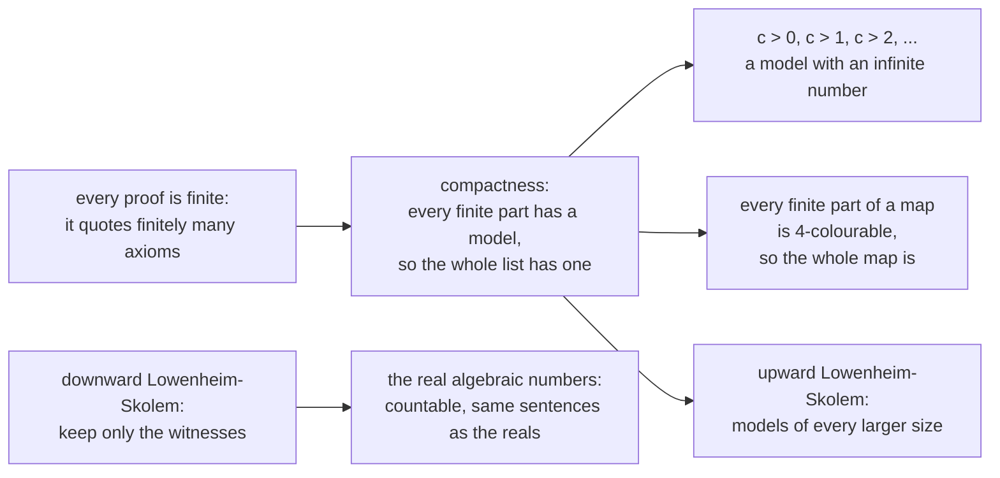

# Compactness and Lowenheim-Skolem: finite checks decide everything, and no first-order theory can fix an infinite size

[Syllabus](../../../SYLLABUS.md) → [Computability and complexity](../README.md) → [Computability and Logic](../README.md#s02) → Compactness and Lowenheim-Skolem

---

## General Overview

A proof checker is a program that reads proofs, line by line ([Formal proofs and soundness](11-formal-deduction-and-soundness.md)). Every proof it accepts is finite, so it quotes only finitely many axioms (the starting facts a proof may use). This card turns that plain fact into two theorems about what logic can say.

Take the rules of ordinary counting: every sentence true about 0, 1, 2, 3, ... with plus, times and "less than". This list is called **true arithmetic**. Add a new name, c, and an endless list of new axioms: c > 0, c > 1, c > 2, and so on. Can all of them hold at once?

Check any finite batch. The batch of the first 1,000 axioms names the numbers 0 to 999. Let c be 1,000, one more than the largest number named, and every axiom in the batch holds. The **compactness theorem** says that is enough: because every finite batch holds somewhere, the whole list holds somewhere. So there is a structure that obeys every true rule of counting and also holds an element c bigger than 0, 1, 2, and every other counting number. It is a **nonstandard model of arithmetic**: it looks like the counting numbers to every sentence, yet it has an "infinite number".

The same move colours an infinite map from its finite pieces. A second theorem, **Lowenheim-Skolem**, moves a structure to other infinite sizes. It finds a countable stand-in for the reals, the real algebraic numbers, that no first-order sentence can tell apart from them.

**A set of first-order sentences has a model as soon as every finite part of it does, and a countable set of sentences with one infinite model has models of every infinite size, so first-order sentences can never pin down an infinite structure up to its size.**

**What kind of fact this is:** two theorems. Compactness is proved on this card from [Godel's completeness theorem](12-godels-completeness-theorem.md). Lowenheim-Skolem is proved in outline, with every step given and the bookkeeping left to the named sources. One supporting fact, that the real algebraic numbers satisfy the same first-order sentences as the reals, is Tarski's theorem, stated with its source.

### The picture: one finite fact, three uses



The bottom chain needs no compactness: it shrinks a model by keeping only what sentences demand.

---

## The formula

Notation first, in words.

- A **first-order sentence** is a statement built from the structure's own symbols (such as 0, +, ×, <), the logic signs ¬, ∧, ∨, ∀, ∃, and variables that range over elements. "First-order" means the quantifiers ∀ (for all) and ∃ (there exists) range over single elements, never over sets of elements.
- A **theory** $`T`$ is a set of sentences, possibly infinite. A **model** of $`T`$ is a structure where every sentence of $`T`$ is true.
- $`M \models \varphi`$, read "$`M`$ satisfies $`\varphi`$", says the sentence $`\varphi`$ is true in the structure $`M`$.
- $`T \vdash \varphi`$, read "$`T`$ proves $`\varphi`$", says some finite proof from axioms in $`T`$ ends in $`\varphi`$, as on [Godel's theorems](03-godels-incompleteness-in-outline.md).
- The **size** of a model is how many elements it has. $`\aleph_0`$, "aleph-null", is the size of the counting numbers ([Cardinal arithmetic](../../01-Foundations/09-Sizes%20of%20Infinity/09-cardinal-arithmetic.md)). A set is **countable** when it is finite or has size $`\aleph_0`$.

The compactness theorem:

```math
T \text{ has a model} \iff \text{every finite } T_0 \subseteq T \text{ has a model}
```

**Read it aloud:** a list of sentences can all be true together exactly when every finite batch of them can.

The Lowenheim-Skolem theorem, for a theory in a countable language (countably many symbols):

```math
T \text{ has an infinite model} \implies T \text{ has a model of size } \kappa \text{ for every infinite size } \kappa
```

**Read it aloud:** once a countable theory has one infinite model, it has a model of every infinite size, from $`\aleph_0`$ upward.

Going down to $`\aleph_0`$ is the **downward** half; going up is the **upward** half. Two structures are **elementarily equivalent**, written $`M \equiv N`$, when exactly the same first-order sentences are true in both.

| Symbol | Plain meaning | In our example | Push it up and the answer… |
| --- | --- | --- | --- |
| $`T`$ | a theory: a set of sentences | true arithmetic plus c > 0, c > 1, ... | more sentences: fewer models |
| $`T_0`$ | one finite batch of $`T`$ | the first 1,000 axioms | a bigger batch needs a bigger witness |
| $`M`$, $`N`$ | structures: a set of elements with the symbols' meanings | the counting numbers; the reals | — |
| $`\varphi`$, $`M \models \varphi`$ | one sentence; $`\varphi`$ is true in $`M`$ | c = 1,000 satisfies c > 999 | — |
| $`T \vdash \varphi`$, $`\bot`$ | $`T`$ proves $`\varphi`$ with a finite proof; $`\bot`$ is a contradiction | true arithmetic proves no $`\bot`$ | — |
| k | the number of colours | 4 | fewer than 4: a 2 × 2 block has 0 colourings |
| $`c`$, $`d_\alpha`$ | new constants: names with no meaning yet | c is the "infinite number" | — |
| $`n`$ | a counting number, written as a numeral in sentences | 0, 1, ..., 999 | its axiom c > n asks for a larger c |
| $`\kappa`$, $`\aleph_0`$ | an infinite size, read "kappa"; the size of the counting numbers | the real algebraic numbers have size $`\aleph_0`$ | — |
| $`M \equiv N`$ | same first-order sentences true in both | real algebraic numbers and the reals | — |
| $`A_0, A_1, \ldots`$ | the rounds of witnesses in the downward proof | the integers, then roots of their polynomials | — |
| height | degree plus the sum of the coefficients' sizes | $`x^2 - 2`$: 2 + 1 + 2 = 5 | more polynomials, still finitely many |

### When it holds

- **First-order sentences only.** Allow quantifiers over sets, as in "every bounded set of reals has a least upper bound", and compactness fails: one such sentence says "every element is 0 or reached from 0 by finitely many steps", and then c > 0, c > 1, ... has no model.
- **Models, not finite models.** Each finite batch of "there are at least n elements" has a finite model; the whole list has only infinite ones. Compactness promises a model, never a small one.
- **A countable language for the downward half.** With uncountably many constants, all named different, no countable model exists. In general the smallest size reachable is the number of symbols, or $`\aleph_0`$ if that is larger.
- **Choice, for uncountable languages.** The proofs then pick witnesses without a rule, using the axiom of choice. For countable languages a fixed listing order is enough for compactness. Step 4 still picks its witnesses inside a given model, such as the reals, so even there it needs a weaker form of choice (dependent choice: infinitely many picks made one after another).

---

## Why it works

### Step 0: a proof only ever touches finitely many axioms

A proof is a finite list of lines. If $`T`$ proves a contradiction, the proof quotes only finitely many members of $`T`$. [Godel's completeness theorem](12-godels-completeness-theorem.md) links proofs to models: a theory has a model exactly when it proves no contradiction. Put those together and "has a model" becomes a finite matter.

### Step 1: compactness from completeness

Suppose every finite batch $`T_0`$ has a model, but $`T`$ has none.

1. $`T`$ has no model, so a contradiction, written $`\bot`$, is true in every model of $`T`$: there are none to check. By completeness, $`T \vdash \bot`$.
2. That proof quotes finitely many axioms. Collect them as $`T_0`$. Then $`T_0 \vdash \bot`$.
3. By soundness ([Formal proofs and soundness](11-formal-deduction-and-soundness.md)), anything a theory proves is true in each of its models. Nothing makes $`\bot`$ true, so $`T_0`$ has no model.

That contradicts the assumption, so $`T`$ has a model. The other direction is plain: a model of $`T`$ is a model of each part.

The name comes from topology. For yes-or-no variables, the truth assignments form a product of two-point spaces, compact by Tychonoff's theorem ([Compactness with no distances, and Tychonoff](../../17-Topology/02-Topological%20Spaces/06-compactness-and-tychonoff.md)). Each sentence picks out a closed set of assignments, and closed sets that meet in every finite batch meet all together.

### Step 2: a model with an infinite number

Let $`T`$ be every sentence true in the counting numbers, plus c > 0, c > 1, c > 2, and so on. A finite batch $`T_0`$ names finitely many numbers. Read c as one more than the largest; the counting numbers then satisfy $`T_0`$. By Step 1, $`T`$ has a model $`M`$.

$`M`$ satisfies every sentence true of the counting numbers, so $`M \equiv`$ the counting numbers. Yet $`M`$ holds an element c above every numeral (the name 1 + 1 + ... + 1 that a sentence uses for a counting number). Since "every number other than 0 has a predecessor" is true in counting, c − 1 exists in $`M`$, and it too lies above every numeral. So does c − 2, c + 1, 2c, and c × c.

The counting numbers alone cannot do this. If c is a counting number, say 1,000, then the axiom c > 1,000 is on the list and fails.

<details>
<summary>A model you can see: counting with only 0, next and less-than</summary>

Keep only the symbols 0, next (add one) and <. Build a structure from the counting numbers followed by a full copy of the integers, ..., −2, −1, 0, 1, 2, .... Every element of the first part is below every element of the second.

In it, 0 has no predecessor, every other element has exactly one, and nothing lies between x and next(x). Every sentence in 0, next and < that holds in the counting numbers holds here too: a theorem, proved in Enderton's sections on number theory with successor and with order. The 0 of the integer copy serves as c, and the whole copy sits above every numeral.

With plus and times, no such simple picture exists. The check verifies the small model on a finite window.

</details>

### Step 3: colouring an infinite map from its finite parts

A **proper colouring** gives every region a colour so that touching regions differ ([Colouring](../../04-Combinatorics%20and%20graphs/12-Planarity%20and%20Colouring/03-vertex-colouring-and-chromatic-number.md)). The de Bruijn-Erdos theorem (1951): if every finite part of an infinite map can be properly coloured with k colours, so can the whole map.

Write it as a theory with one yes-or-no variable for each pair "region v gets colour i". The sentences say:

- each region gets at least one of the k colours;
- each region gets at most one;
- touching regions do not share a colour.

A finite batch mentions finitely many regions, and a colouring of those regions, which exists by assumption, satisfies it. By compactness one assignment satisfies every sentence: a proper colouring of the whole map. With the four colour theorem for finite maps, every infinite planar map can be 4-coloured.

The check runs this on an infinite board of squares, where squares touching at a side or a corner clash. Each 2 × 2 block needs all 4 colours. The builder colours square by square and keeps a colour only if the box one size larger can still be completed.

<details>
<summary>Detailed proof: the countable case without logic, by choosing only extendable colours</summary>

List the regions $`v_1, v_2, v_3, \ldots`$. Call a colouring of $`v_1, \ldots, v_n`$ **good** when, for every $`m \ge n`$, it extends to a proper colouring of $`v_1, \ldots, v_m`$. The empty colouring is good, by the assumption on finite parts.

Suppose a colouring of $`v_1, \ldots, v_n`$ is good. Try the k ways to colour $`v_{n+1}`$. If none were good, each would fail at some size $`m_i`$. Take the largest, $`m`$. The good colouring extends to $`v_1, \ldots, v_m`$; that extension gives $`v_{n+1}`$ one of the k colours, and so passes size $`m_i`$ for that colour. Contradiction.

So a good choice always exists, and choosing one at each step colours every region. Two touching regions are coloured at some finite stage, inside a proper colouring, so they differ.

</details>

### Step 4: downward, keep only the witnesses

Start from any model $`M`$, such as the reals with 0, 1, +, ×, <. Build a small part of it in rounds.

1. Start with a countable set $`A_0`$, such as the integers.
2. For each sentence "there exists an x with property P", where P may mention elements of $`A_0`$, if it is true in $`M`$, add one such x. Call the result $`A_1`$.
3. Repeat to get $`A_2, A_3, \ldots`$, and take the union $`A`$.

Each round adds countably many elements: there are countably many formulas and countably many choices of parameters (the elements a formula mentions), and $`\aleph_0 \times \aleph_0 = \aleph_0`$ ([Cardinal arithmetic](../../01-Foundations/09-Sizes%20of%20Infinity/09-cardinal-arithmetic.md)). So $`A`$ is countable. Every "there exists" question asked inside $`A`$ has its answer inside $`A`$, and that is exactly what makes $`A`$ satisfy the same sentences as $`M`$ (the Tarski-Vaught test, proved in Marker, chapter 2).

For the reals, the needed witnesses are solutions of polynomial equations. Each real root of an integer polynomial is pinned down by a sentence ("the third root of this polynomial"), so it must be added. Choose every other witness as such a root too, and the result is the **real algebraic numbers**: the real roots of polynomials with integer coefficients. Tarski proved that the real algebraic numbers satisfy exactly the same first-order sentences about 0, 1, +, ×, < as the reals (Tarski, 1951; see also [Decidable theories](14-decidable-theories-presburger-and-tarski.md)).

They are countable. Sort the polynomials by **height**: degree plus the sum of the coefficients' sizes. Each height holds finitely many polynomials, each with finitely many roots. Listing height 2, then 3, then 4 puts every real algebraic number at a finite place: the list is a queue, unlike the reals in [Cantor's diagonal](../../01-Foundations/09-Sizes%20of%20Infinity/03-cantors-diagonal-argument.md).

### Step 5: upward, add more names than the model can hold

Given an infinite model $`M`$ of $`T`$ and a size $`\kappa`$, add $`\kappa`$ new constants $`d_\alpha`$ and the sentences $`d_\alpha \ne d_\beta`$ for every pair. A finite batch mentions finitely many new constants. $`M`$ is infinite, so it has room to give them different elements, and it satisfies the batch. By compactness the whole theory has a model, with at least $`\kappa`$ different elements. Step 4, run with $`\kappa`$ symbols, cuts it down to exactly $`\kappa`$.

So no first-order theory with an infinite model fixes its size. True arithmetic has models of size $`\aleph_0`$ that are not the counting numbers, and models of every larger size. The theory of the reals has a countable model.

### Step 6: Skolem's paradox

Set theory has first-order axioms. If they have a model at all, Step 4 gives a countable one. Yet set theory proves "the real numbers are uncountable". How can a countable model satisfy that?

The sentence says that no function inside the model lists the reals. The countable model lacks such a function. From outside, its reals can be listed, but that listing is not in the model. "Uncountable" means "uncountable as seen from inside", so Skolem's paradox is no contradiction.

The real algebraic numbers show it in miniature. They pass every first-order test the reals pass: every positive number has a square root, every odd-degree polynomial has a root. What they fail is a statement about sets: the set of algebraic numbers below π has no least upper bound among them, because π is not algebraic. That statement is not first-order, so no first-order sentence sees the gap.

---

## Worked numbers, by hand

| Step | Arithmetic | Value |
| --- | --- | --- |
| witness for the first 1,000 axioms | largest number named is 999; 999 + 1 | c = 1,000 |
| witness for the batch 3, 17, 999, 123,456 | 123,456 + 1 | c = 123,457 |
| try c = 1,000 on the whole list | the axiom c > 1,000 asks 1,000 > 1,000 | fails |
| colourings of one 2 × 2 block | all four squares touch: 4 × 3 × 2 × 1 | 24 |
| colourings of the 3 × 3 box | 24 × (2 × 2 − 1) | 72 |
| colourings of the 5 × 5 box | 24 × (16 − 1) | 360 |
| height of $`x^2 - 2`$ | degree 2, plus 1 + 0 + 2 | 5 |
| polynomials of height 5, leading coefficient positive | degree 1, 2, 3, 4: 7 + 13 + 7 + 1 | 28 |
| place of $`\sqrt 2 = 1.414213562373`$ in the list | 19 real roots found by height 5 | **entry 15** |

Every finite batch has a witness, so a model with an infinite number exists. The board has a 4-colouring, built from its boxes. The real algebraic numbers queue up in a fixed order: by height, then by degree, then by coefficient list in dictionary order (leading coefficient first), and each polynomial's roots from left to right, skipping any already listed. In that order $`\sqrt 2`$ is entry 15, and the golden ratio, root of $`x^2 - x - 1`$, is entry 13.

The box count comes from one rule. Every 2 × 2 block uses all four colours, and this forces either every row to repeat with period 2 or every column to.

- If the rows repeat, the first two columns fix everything. Their top pair has 4 × 3 = 12 colourings, and each pair below must use the other two colours, in 2 orders. That gives $`12 \times 2^{n-1}`$.
- The columns-repeat case gives the same number.
- The 24 colourings that repeat both ways were counted twice.

So the n × n box has $`24 \times 2^{n-1} - 24 = 24(2^{n-1} - 1)`$ colourings.

### What breaks if you drop a piece

| Mistake | Comes out at | What went wrong |
| --- | --- | --- |
| Drop "finite batch": ask the counting numbers to meet every axiom at once | c = 1,000 fails c > 1,000; c = 123,457 fails c > 123,457 | no standard number works; compactness gives a new model, not a choice inside the old one |
| Choose a colour that is legal now but does not extend | 0 completions of the 3 × 3 box (4 with colour 1 there) | square (0, 2) has no coloured neighbour yet, but squares (0, 1) and (1, 1) are forced to colours 3 and 4; the proof keeps only extendable choices |
| Use 3 colours instead of 4 | 0 colourings of one 2 × 2 block | the hypothesis "every finite part is colourable" fails, so nothing follows for the whole board |
| Shrink the reals to witnesses of degree 1 only | 23 rational entries up to height 7, none squares to 2 | the rationals miss the witness for "there is an x with x × x = 2", so they are not $`\equiv`$ the reals |

---

## Code, from first principles, and it actually runs

The check runs the constructions, never an impossible program. No code can test infinitely many axioms, so every "all" is tested on a stated finite window. The colouring and the algebraic numbers each take **two independent roads**; the arithmetic part checks its constructions directly:

- **Arithmetic:** each batch's witness tested against every axiom in it (and the next number down shown to fail), and the counting-then-integers model checked element by element on a window.
- **Colouring:** brute-force counts of each box against the formula $`24(2^{n-1} - 1)`$, and the square-by-square board against the pattern 1 + (x mod 2) + 2(y mod 2).
- **Algebraic numbers:** polynomials of each height listed and counted by a formula. Their real roots are found twice: in decimals, by sign changes and halving; and exactly, in whole numbers, where Sturm's theorem (a count of sign changes along a chain of polynomial remainders) gives each polynomial's number of real roots, and a greatest common divisor removes the roots an earlier polynomial already gave. The rational entries are also checked against a direct count of the fractions −b/a whose polynomial ax + b has height up to 7.

### Python

```python
# Compactness and Lowenheim-Skolem -- the check behind the card.  Standard library
# only, nothing imported.  It runs the constructions behind the proofs.  No program
# can check infinitely many axioms; every claim about "all" uses a stated window.

# ---- 1. the axioms c > 0, c > 1, c > 2, ... ----
def first_fail(c, batch): return next((n for n in batch if not c > n), None)   # first axiom c > n broken
batches = [("first 10", list(range(10))), ("first 1000", list(range(1000))),
           ("scattered {3, 17, 999, 123456}", [3, 17, 999, 123456])]
for name, b in batches:
    c = max(b) + 1                     # one more than the largest number named
    assert first_fail(c, b) is None and first_fail(c - 1, b) == c - 1
    print(f"batch {name}: witness c = {c}, all {len(b)} axioms hold")
for c in [0, 10, 1000, 123457]:        # the whole list in the counting numbers
    n = first_fail(c, range(c + 2))
    assert n == c
    print(f"whole list in the counting numbers: c = {c} fails axiom c > {n}")
# N followed by a copy of the integers Z: element (0, k), k >= 0, or (1, k), any k
W = 50
window = [(0, k) for k in range(W + 1)] + [(1, k) for k in range(-W, W + 1)]
nxt = lambda x: (x[0], x[1] + 1)
less = lambda x, y: x < y              # block first, then position: lexicographic
zero, c = (0, 0), (1, 0)
assert all(nxt(x) != zero for x in window)
preds = [x for x in window if x not in (zero, (1, -W))   # (1, -W): its predecessor is
         and sum(1 for y in window if nxt(y) == x) == 1]      # just outside the window
assert len(preds) == len(window) - 2 and not any(less(x, y) and less(y, nxt(x)) for x in window for y in window)
numerals = [(0, n) for n in range(W + 1)]
above = [x for x in window if all(less(m, x) for m in numerals)]
assert c in above and (1, -1) in above and len(above) == 2 * W + 1
print(f"N then Z, window of {len(window)} elements: 0 has no predecessor, "
      f"{len(preds)} others checked to have one, nothing between x and next(x)")
print(f"elements above every numeral 0..{W}: {len(above)}, including c and c - 1")

# ---- 2. colouring an infinite board: squares touching at a side or a corner clash ----
def clash(a, b): return a != b and abs(a[0] - b[0]) <= 1 and abs(a[1] - b[1]) <= 1
def colourings(n, fixed, k=4):        # every proper k-colouring of the n x n box
    if any(fixed[a] == fixed[b] for a in fixed for b in fixed if clash(a, b)): return []
    cells = [(x, y) for y in range(n) for x in range(n) if (x, y) not in fixed]
    col, out = dict(fixed), []
    def go(i):
        if i == len(cells): out.append(dict(col)); return
        x, y = cells[i]
        for colour in range(1, k + 1):
            if all(col.get((x + dx, y + dy)) != colour for dx in (-1, 0, 1) for dy in (-1, 0, 1)):
                col[(x, y)] = colour; go(i + 1); del col[(x, y)]
    go(0)
    return out
for n in range(1, 6):
    count, formula = len(colourings(n, {})), 4 if n == 1 else 24 * (2 ** (n - 1) - 1)
    assert count == formula
    print(f"box {n}x{n}: {count} proper 4-colourings (formula 24(2^(n-1) - 1): {formula})")
for n in range(2, 5):
    cols = colourings(n, {})
    ext = sum(1 for f in cols if colourings(n + 1, f))
    assert ext == len(cols)
    print(f"colourings of the {n}x{n} box that extend to {n + 1}x{n + 1}: {ext} of {len(cols)}")
# build the colouring piece by piece: each square takes the smallest colour
# that still extends to a proper colouring of the box one size larger
N, board = 8, {}
for size in range(1, N + 1):
    for cell in [(x, y) for y in range(size) for x in range(size) if (x, y) not in board]:
        board[cell] = next(k for k in range(1, 5) if colourings(size + 1, {**board, cell: k}))
assert all(board[a] != board[b] for a in board for b in board if clash(a, b))
assert all(board[(x, y)] == 1 + x % 2 + 2 * (y % 2) for (x, y) in board)
for y in range(4):
    print("row", y, "".join(str(board[(x, y)]) for x in range(N)))
print(f"{N}x{N} board built square by square: proper, equal to 1 + (x mod 2) + 2(y mod 2)")
trap, safe = {(0, 0): 1, (1, 0): 2, (0, 2): 3}, {(0, 0): 1, (1, 0): 2, (0, 2): 1}
assert len(colourings(3, trap)) == 0 and len(colourings(3, safe)) > 0
print(f"trap: corner 1, 2 and colour 3 two rows up: {len(colourings(3, trap))} completions "
      f"of the 3x3 box; with colour 1 there: {len(colourings(3, safe))}")
assert colourings(2, {}, k=3) == []
print(f"3 colours: the 2x2 box has {len(colourings(2, {}, k=3))} colourings, so the board has none")

# ---- 3. the real algebraic numbers are countable: list them by height ----
# height = degree + sum of |coefficients|; finitely many polynomials per height
def vectors(length, s):                # integer vectors with sum of |entries| = s
    return ([()] if s == 0 else []) if length == 0 else [(a,) + r for a in range(-s, s + 1) for r in vectors(length - 1, s - abs(a))]
def binom(n, k): return 0 if k < 0 or k > n else (1 if k == 0 else binom(n - 1, k - 1) * n // k)
def n_vectors(length, s):              # the same count, by a formula
    return 1 if s == 0 else sum(binom(length, k) * binom(s - 1, k - 1) * 2 ** k for k in range(1, length + 1))
def value(p, x): return p[0] if len(p) == 1 else value(p[:-1], x) * x + p[-1]   # Horner's rule
def real_roots(p):                     # road 1: sign changes on a 1/64 grid, then halving
    out, bound = [], sum(abs(a) for a in p) + 1
    for i in range(-64 * bound, 64 * bound):
        a, b = i / 64, (i + 1) / 64
        fa, fb = value(p, a), value(p, b)
        if fa == 0: out.append(a)
        elif fa * fb < 0:
            for _ in range(60):
                m = (a + b) / 2
                a, b = (m, b) if (value(p, m) < 0) == (fa < 0) else (a, m)
            out.append((a + b) / 2)
    return out
# road 2, exact integers: Sturm's theorem counts real roots; a gcd strips roots met before
def gcd(a, b): return gcd(b, a % b) if b else abs(a)
def content(p): return gcd(p[0], content(p[1:])) if p else 0
def prim(p):                           # leading zeros dropped, common factor divided out
    while p and p[0] == 0: p = p[1:]
    return [a // content(p) for a in p]
def pdm(a, b):                         # |lead of b|^k a = q b + r, all in integers
    q, s, t = [], abs(b[0]), 1 if b[0] > 0 else -1
    while len(a) >= len(b):
        q, a = [s * e for e in q] + [t * a[0]], [s * x - t * a[0] * (b + [0] * len(a))[i] for i, x in enumerate(a)][1:]
    return prim(q), prim(a)
def pgcd(a, b): return pgcd(b, pdm(a, b)[1]) if b else a
def deriv(p): return prim([a * (len(p) - 1 - i) for i, a in enumerate(p[:-1])])
def sturm(p):                          # real roots: sign changes at -infinity minus at +infinity
    seq = [p, deriv(p)]
    while pdm(seq[-2], seq[-1])[1]: seq.append([-a for a in pdm(seq[-2], seq[-1])[1]])
    ch = lambda v: sum(u * w < 0 for u, w in zip(v, v[1:]))
    return ch([f[0] * (-1) ** (len(f) - 1) for f in seq]) - ch([f[0] for f in seq])
H, listing, found, kept, total = 8, [], {}, [], 0
for h in range(2, H):
    made = 0
    for d in range(1, h):
        ps = [p for p in vectors(d + 1, h - d) if p[0] > 0]     # leading coefficient first
        assert 2 * len(ps) == n_vectors(d + 1, h - d) - n_vectors(d, h - d)
        made += len(ps)
        for p in ps:
            g = pdm(list(p), pgcd(list(p), deriv(list(p))))[0]   # each root once
            for k in kept: g = pdm(g, pgcd(g, k))[0]             # drop roots met before
            n = sturm(g) if len(g) > 1 else 0
            kept, total = kept + [g] * (n > 0), total + n
            for r in real_roots(p):
                if all(abs(r - q) > 1e-9 for q in listing):
                    listing.append(r); found[len(listing)] = (h, p, total - n, total)
    assert len(listing) == total, "decimal roots disagree with the exact count"
    print(f"height {h}: polynomials {made}, distinct real roots so far {len(listing)}")
for name, x, m in [("sqrt 2", 2 ** 0.5, [1, 0, -2]), ("golden ratio", (1 + 5 ** 0.5) / 2, [1, -1, -1]),
                   ("cube root of 2", 2 ** (1 / 3), [1, 0, 0, -2])]:
    k = next(i for i, q in enumerate(listing, 1) if abs(q - x) < 1e-9)
    assert not pdm(list(found[k][1]), m)[1] and found[k][2] < k <= found[k][3]   # m divides p; k in p's block
    print(f"{name} = {listing[k - 1]:.12f}: entry {k}, height {found[k][0]}, polynomial {found[k][1]}")
rationals = [found[k] for k in found if len(found[k][1]) == 2]
fractions = {(-b // gcd(a, b), a // gcd(a, b)) for a in range(1, H) for b in range(-H, H) if a + abs(b) <= H - 2}
assert len(rationals) == len(fractions), "rational entries are the fractions -b/a with a + |b| <= H - 2"
print(f"{len(rationals)} entries are rational (degree 1): none squares to 2")
print("ALL CHECKS PASS")
```

**Ran 2026-11-24 on macOS, Python 3.14.10, standard library only. All checks passed. Output, pasted from the run:**

```
batch first 10: witness c = 10, all 10 axioms hold
batch first 1000: witness c = 1000, all 1000 axioms hold
batch scattered {3, 17, 999, 123456}: witness c = 123457, all 4 axioms hold
whole list in the counting numbers: c = 0 fails axiom c > 0
whole list in the counting numbers: c = 10 fails axiom c > 10
whole list in the counting numbers: c = 1000 fails axiom c > 1000
whole list in the counting numbers: c = 123457 fails axiom c > 123457
N then Z, window of 152 elements: 0 has no predecessor, 150 others checked to have one, nothing between x and next(x)
elements above every numeral 0..50: 101, including c and c - 1
box 1x1: 4 proper 4-colourings (formula 24(2^(n-1) - 1): 4)
box 2x2: 24 proper 4-colourings (formula 24(2^(n-1) - 1): 24)
box 3x3: 72 proper 4-colourings (formula 24(2^(n-1) - 1): 72)
box 4x4: 168 proper 4-colourings (formula 24(2^(n-1) - 1): 168)
box 5x5: 360 proper 4-colourings (formula 24(2^(n-1) - 1): 360)
colourings of the 2x2 box that extend to 3x3: 24 of 24
colourings of the 3x3 box that extend to 4x4: 72 of 72
colourings of the 4x4 box that extend to 5x5: 168 of 168
row 0 12121212
row 1 34343434
row 2 12121212
row 3 34343434
8x8 board built square by square: proper, equal to 1 + (x mod 2) + 2(y mod 2)
trap: corner 1, 2 and colour 3 two rows up: 0 completions of the 3x3 box; with colour 1 there: 4
3 colours: the 2x2 box has 0 colourings, so the board has none
height 2: polynomials 1, distinct real roots so far 1
height 3: polynomials 4, distinct real roots so far 3
height 4: polynomials 11, distinct real roots so far 7
height 5: polynomials 28, distinct real roots so far 19
height 6: polynomials 69, distinct real roots so far 47
height 7: polynomials 168, distinct real roots so far 119
sqrt 2 = 1.414213562373: entry 15, height 5, polynomial (1, 0, -2)
golden ratio = 1.618033988750: entry 13, height 5, polynomial (1, -1, -1)
cube root of 2 = 1.259921049895: entry 40, height 6, polynomial (1, 0, 0, -2)
23 entries are rational (degree 1): none squares to 2
ALL CHECKS PASS
```

### Rust

```rust
// Compactness and Lowenheim-Skolem -- the check behind the card.  Rust std only.
// It runs the constructions behind the proofs; every claim about "all" is checked
// on a stated window.  The output matches the Python check line for line.
use std::collections::BTreeSet;

// ---- 1. the axioms c > 0, c > 1, c > 2, ... ----
fn first_fail(c: i64, batch: &[i64]) -> Option<i64> { batch.iter().copied().find(|&n| !(c > n)) } // first axiom c > n broken

// ---- 2. colouring an infinite board: squares touching at a side or a corner clash ----
type Grid = [[u8; 12]; 12]; // square (x, y) lives at [x + 1][y + 1]; 0 means uncoloured
fn ok(g: &Grid, x: usize, y: usize, colour: u8) -> bool { (0..3).all(|dx| (0..3).all(|dy| (dx, dy) == (1, 1) || g[x + dx][y + dy] != colour)) }
fn consistent(g: &Grid) -> bool { (1..11).all(|x| (1..11).all(|y| g[x][y] == 0 || ok(g, x - 1, y - 1, g[x][y]))) }
// count proper k-colourings of the n x n box; with `ext`, count those that extend to n + 1
fn colourings(n: usize, g: &mut Grid, k: u8, ext: bool) -> u64 {
    if !consistent(g) { return 0; }
    let cells: Vec<(usize, usize)> = (0..n).flat_map(|y| (0..n).map(move |x| (x, y))).filter(|&(x, y)| g[x + 1][y + 1] == 0).collect();
    fn go(i: usize, cells: &[(usize, usize)], g: &mut Grid, n: usize, k: u8, ext: bool) -> u64 {
        if i == cells.len() { return if !ext || colourings(n + 1, g, 4, false) > 0 { 1 } else { 0 }; }
        let ((x, y), mut total) = (cells[i], 0);
        for colour in 1..=k {
            if ok(g, x, y, colour) { g[x + 1][y + 1] = colour; total += go(i + 1, cells, g, n, k, ext); g[x + 1][y + 1] = 0; }
        }
        total
    }
    go(0, &cells, g, n, k, ext)
}

// ---- 3. the real algebraic numbers: polynomials by height ----
fn vectors(length: usize, s: i64) -> Vec<Vec<i64>> { // integer vectors, sum of |entries| = s
    if length == 0 { return if s == 0 { vec![vec![]] } else { vec![] }; }
    (-s..=s).flat_map(|a| vectors(length - 1, s - a.abs()).into_iter().map(move |r| [vec![a], r].concat())).collect()
}
fn binom(n: i64, k: i64) -> i64 { if k < 0 || k > n { 0 } else if k == 0 { 1 } else { binom(n - 1, k - 1) * n / k } }
fn n_vectors(length: i64, s: i64) -> i64 { // the same count, by a formula
    if s == 0 { 1 } else { (1..=length).map(|k| binom(length, k) * binom(s - 1, k - 1) * (1i64 << k)).sum() }
}
fn value(p: &[i64], x: f64) -> f64 { p.iter().fold(0.0, |r, &a| r * x + a as f64) } // Horner's rule
fn real_roots(p: &[i64]) -> Vec<f64> { // road 1: sign changes on a 1/64 grid, then halving
    let (bound, mut out) = (p.iter().map(|a| a.abs()).sum::<i64>() + 1, vec![]);
    for i in -64 * bound..64 * bound {
        let (mut a, mut b) = (i as f64 / 64.0, (i + 1) as f64 / 64.0);
        let fa = value(p, a);
        if fa == 0.0 { out.push(a); } else if fa * value(p, b) < 0.0 {
            for _ in 0..60 { let m = (a + b) / 2.0; if (value(p, m) < 0.0) == (fa < 0.0) { a = m; } else { b = m; } }
            out.push((a + b) / 2.0);
        }
    }
    out
}
// road 2, exact integers: Sturm's theorem counts real roots; a gcd strips roots met before
type P = Vec<i128>;
fn gcd(a: i128, b: i128) -> i128 { if b == 0 { a.abs() } else { gcd(b, a % b) } }
fn prim(p: &[i128]) -> P { // leading zeros dropped, common factor divided out
    let p: P = p.iter().copied().skip_while(|&a| a == 0).collect();
    let g = p.iter().fold(0, |g, &a| gcd(g, a)); p.iter().map(|&a| a / g).collect()
}
fn pdm(a: &[i128], b: &[i128]) -> (P, P) { // |lead of b|^k a = q b + r, all in integers
    let (mut q, mut a, s, t): (P, P, i128, i128) = (vec![], a.to_vec(), b[0].abs(), b[0].signum());
    while a.len() >= b.len() {
        q = q.iter().map(|e| s * e).chain([t * a[0]]).collect();
        a = (1..a.len()).map(|i| s * a[i] - t * a[0] * b.get(i).copied().unwrap_or(0)).collect();
    }
    (prim(&q), prim(&a))
}
fn pgcd(a: &[i128], b: &[i128]) -> P { if b.is_empty() { a.to_vec() } else { pgcd(b, &pdm(a, b).1) } }
fn deriv(p: &[i128]) -> P { prim(&(0..p.len() - 1).map(|i| p[i] * (p.len() - 1 - i) as i128).collect::<P>()) }
fn sturm(p: &[i128]) -> i64 { // real roots: sign changes at -infinity minus at +infinity
    let mut seq = vec![p.to_vec(), deriv(p)];
    loop { let r = pdm(&seq[seq.len() - 2], &seq[seq.len() - 1]).1; if r.is_empty() { break; } seq.push(r.iter().map(|a| -a).collect()); }
    let ch = |v: Vec<i128>| v.windows(2).filter(|w| w[0] * w[1] < 0).count() as i64;
    ch(seq.iter().map(|f| if f.len() % 2 == 0 { -f[0].signum() } else { f[0].signum() }).collect()) - ch(seq.iter().map(|f| f[0].signum()).collect())
}
fn wide(p: &[i64]) -> P { p.iter().map(|&a| a as i128).collect() }
fn tuple(p: &[i64]) -> String { format!("({})", p.iter().map(|a| a.to_string()).collect::<Vec<_>>().join(", ")) }

fn main() {
    let batches: Vec<(&str, Vec<i64>)> = vec![("first 10", (0..10).collect()),
        ("first 1000", (0..1000).collect()), ("scattered {3, 17, 999, 123456}", vec![3, 17, 999, 123456])];
    for (name, b) in &batches {
        let c = b.iter().max().unwrap() + 1; // one more than the largest number named
        assert!(first_fail(c, b).is_none() && first_fail(c - 1, b) == Some(c - 1));
        println!("batch {}: witness c = {}, all {} axioms hold", name, c, b.len());
    }
    for c in [0i64, 10, 1000, 123457] { // the whole list in the counting numbers
        let n = first_fail(c, &(0..c + 2).collect::<Vec<i64>>()).unwrap();
        assert_eq!(n, c);
        println!("whole list in the counting numbers: c = {} fails axiom c > {}", c, n);
    }
    // N followed by a copy of the integers Z: element (0, k), k >= 0, or (1, k), any k
    let w: i64 = 50;
    let mut window: Vec<(i64, i64)> = (0..=w).map(|k| (0, k)).collect();
    window.extend((-w..=w).map(|k| (1, k)));
    let nxt = |x: (i64, i64)| (x.0, x.1 + 1); // order: block first, then position
    let (zero, c) = ((0i64, 0i64), (1i64, 0i64));
    assert!(window.iter().all(|&x| nxt(x) != zero));
    let preds = window.iter().filter(|&&x| x != zero && x != (1, -w) // (1, -w): predecessor outside
        && window.iter().filter(|&&y| nxt(y) == x).count() == 1).count();
    assert!(preds == window.len() - 2 && !window.iter().any(|&x| window.iter().any(|&y| x < y && y < nxt(x))));
    let above: Vec<(i64, i64)> = window.iter().copied().filter(|&x| (0..=w).all(|n| (0, n) < x)).collect();
    assert!(above.contains(&c) && above.contains(&(1, -1)) && above.len() as i64 == 2 * w + 1);
    println!("N then Z, window of {} elements: 0 has no predecessor, {} others checked to have one, nothing between x and next(x)", window.len(), preds);
    println!("elements above every numeral 0..{}: {}, including c and c - 1", w, above.len());
    for n in 1..6usize {
        let (count, formula) = (colourings(n, &mut [[0; 12]; 12], 4, false),  if n == 1 { 4 } else { 24 * ((1u64 << (n - 1)) - 1) });
        assert_eq!(count, formula);
        println!("box {}x{}: {} proper 4-colourings (formula 24(2^(n-1) - 1): {})", n, n, count, formula);
    }
    for n in 2..5usize {
        let (ext, all) = (colourings(n, &mut [[0; 12]; 12], 4, true), colourings(n, &mut [[0; 12]; 12], 4, false));
        assert_eq!(ext, all);
        println!("colourings of the {}x{} box that extend to {}x{}: {} of {}", n, n, n + 1, n + 1, ext, all);
    }
    // build the colouring piece by piece: each square takes the smallest colour
    // that still extends to a proper colouring of the box one size larger
    let (big, mut board): (usize, Grid) = (8, [[0; 12]; 12]);
    for size in 1..=big { for y in 0..size { for x in 0..size {
        if board[x + 1][y + 1] != 0 { continue; }
        board[x + 1][y + 1] = (1..=4u8).find(|&k| {
            let mut t = board; t[x + 1][y + 1] = k; colourings(size + 1, &mut t, 4, false) > 0
        }).unwrap();
    } } }
    assert!(consistent(&board));
    assert!((0..big).all(|x| (0..big).all(|y| board[x + 1][y + 1] as usize == 1 + x % 2 + 2 * (y % 2))));
    for y in 0..4 { println!("row {} {}", y, (0..big).map(|x| board[x + 1][y + 1].to_string()).collect::<String>()); }
    println!("{}x{} board built square by square: proper, equal to 1 + (x mod 2) + 2(y mod 2)", big, big);
    let mut trap: Grid = [[0; 12]; 12]; trap[1][1] = 1; trap[2][1] = 2; trap[1][3] = 3;
    let mut safe = trap; safe[1][3] = 1;
    let (t, s) = (colourings(3, &mut trap, 4, false), colourings(3, &mut safe, 4, false));
    assert!(t == 0 && s > 0);
    println!("trap: corner 1, 2 and colour 3 two rows up: {} completions of the 3x3 box; with colour 1 there: {}", t, s);
    let three = colourings(2, &mut [[0; 12]; 12], 3, false); assert_eq!(three, 0);
    println!("3 colours: the 2x2 box has {} colourings, so the board has none", three);
    // height = degree + sum of |coefficients|; finitely many polynomials per height
    let hmax = 8i64;
    let (mut listing, mut found, mut kept, mut total) = (Vec::<f64>::new(), Vec::<(i64, Vec<i64>, i64, i64)>::new(), Vec::<P>::new(), 0i64);
    for h in 2..hmax {
        let mut made = 0;
        for d in 1..h {
            let ps: Vec<Vec<i64>> = vectors(d as usize + 1, h - d).into_iter().filter(|p| p[0] > 0).collect();
            assert_eq!(2 * ps.len() as i64, n_vectors(d + 1, h - d) - n_vectors(d, h - d));
            made += ps.len();
            for p in &ps {
                let mut g = pdm(&wide(p), &pgcd(&wide(p), &deriv(&wide(p)))).0; // each root once
                for k in &kept { g = pdm(&g, &pgcd(&g, k)).0; } // drop roots met before
                let n = if g.len() > 1 { sturm(&g) } else { 0 };
                total += n; if n > 0 { kept.push(g); }
                for r in real_roots(p) {
                    if listing.iter().all(|q| (r - q).abs() > 1e-9) { listing.push(r); found.push((h, p.clone(), total - n, total)); }
                }
            }
        }
        assert_eq!(listing.len() as i64, total, "decimal roots disagree with the exact count");
        println!("height {}: polynomials {}, distinct real roots so far {}", h, made, listing.len());
    }
    for (name, x, m) in [("sqrt 2", 2f64.sqrt(), vec![1i128, 0, -2]), ("golden ratio", (1.0 + 5f64.sqrt()) / 2.0, vec![1, -1, -1]),
                         ("cube root of 2", 2f64.cbrt(), vec![1, 0, 0, -2])] {
        let k = listing.iter().position(|q| (q - x).abs() < 1e-9).unwrap();
        let (h, p, lo, hi) = &found[k];
        assert!(pdm(&wide(p), &m).1.is_empty() && *lo < k as i64 + 1 && k as i64 + 1 <= *hi); // m divides p; k in p's block
        println!("{} = {:.12}: entry {}, height {}, polynomial {}", name, listing[k], k + 1, h, tuple(p));
    }
    let rationals = found.iter().filter(|f| f.1.len() == 2).count();
    let fractions: BTreeSet<(i64, i64)> = (1..hmax).flat_map(|a| (-hmax..hmax).map(move |b| (a, b)))
        .filter(|&(a, b)| a + b.abs() <= hmax - 2).map(|(a, b)| { let g = gcd(a as i128, b as i128) as i64; (-b / g, a / g) }).collect();
    assert_eq!(rationals, fractions.len(), "rational entries are the fractions -b/a with a + |b| <= H - 2");
    println!("{} entries are rational (degree 1): none squares to 2", rationals);
    println!("ALL CHECKS PASS");
}
```

**Ran 2026-11-24 on macOS, rustc 1.98.1, no crates. All checks passed. Output, pasted from the run:**

```
batch first 10: witness c = 10, all 10 axioms hold
batch first 1000: witness c = 1000, all 1000 axioms hold
batch scattered {3, 17, 999, 123456}: witness c = 123457, all 4 axioms hold
whole list in the counting numbers: c = 0 fails axiom c > 0
whole list in the counting numbers: c = 10 fails axiom c > 10
whole list in the counting numbers: c = 1000 fails axiom c > 1000
whole list in the counting numbers: c = 123457 fails axiom c > 123457
N then Z, window of 152 elements: 0 has no predecessor, 150 others checked to have one, nothing between x and next(x)
elements above every numeral 0..50: 101, including c and c - 1
box 1x1: 4 proper 4-colourings (formula 24(2^(n-1) - 1): 4)
box 2x2: 24 proper 4-colourings (formula 24(2^(n-1) - 1): 24)
box 3x3: 72 proper 4-colourings (formula 24(2^(n-1) - 1): 72)
box 4x4: 168 proper 4-colourings (formula 24(2^(n-1) - 1): 168)
box 5x5: 360 proper 4-colourings (formula 24(2^(n-1) - 1): 360)
colourings of the 2x2 box that extend to 3x3: 24 of 24
colourings of the 3x3 box that extend to 4x4: 72 of 72
colourings of the 4x4 box that extend to 5x5: 168 of 168
row 0 12121212
row 1 34343434
row 2 12121212
row 3 34343434
8x8 board built square by square: proper, equal to 1 + (x mod 2) + 2(y mod 2)
trap: corner 1, 2 and colour 3 two rows up: 0 completions of the 3x3 box; with colour 1 there: 4
3 colours: the 2x2 box has 0 colourings, so the board has none
height 2: polynomials 1, distinct real roots so far 1
height 3: polynomials 4, distinct real roots so far 3
height 4: polynomials 11, distinct real roots so far 7
height 5: polynomials 28, distinct real roots so far 19
height 6: polynomials 69, distinct real roots so far 47
height 7: polynomials 168, distinct real roots so far 119
sqrt 2 = 1.414213562373: entry 15, height 5, polynomial (1, 0, -2)
golden ratio = 1.618033988750: entry 13, height 5, polynomial (1, -1, -1)
cube root of 2 = 1.259921049895: entry 40, height 6, polynomial (1, 0, 0, -2)
23 entries are rational (degree 1): none squares to 2
ALL CHECKS PASS
```

### Lean

Lean proves the card's three theorems for every theory and every map, and checks the card's hand numbers.

- A theory has a model exactly when every finite batch of it has a model.
- Take a theory in a countable language with one infinite model. Then it has a model of size $`\kappa`$ for every infinite size $`\kappa`$.
- Suppose every finite part of a map can be properly coloured with k colours. Then the whole map can.
- Each batch has its witness: c = 1,000 for the first 1,000 axioms, and c = 123,457 for 3, 17, 999, 123,456.
- In the counting numbers, c = 1,000 fails the axiom c > 1,000.
- One 2 × 2 block has 4 × 3 × 2 × 1 = 24 colourings.
- The formula $`24(2^{n-1} - 1)`$ gives 24, 72, 168 and 360 for n = 2, 3, 4, 5.
- $`x^2 - 2`$ has height 2 + 1 + 0 + 2 = 5, and 7 + 13 + 7 + 1 = 28.

The Python and Rust checks still do the counting: the box colourings, the board built square by square, and the algebraic numbers by height.

```lean
-- Compactness and Lowenheim-Skolem: a first-order theory has a model exactly when every finite part of it has one, a countable theory with an infinite model has models of every infinite size, and an infinite graph whose finite parts are k-colourable is k-colourable.
import Mathlib.ModelTheory.Satisfiability
import Mathlib.Combinatorics.SimpleGraph.Coloring.Vertex
import Mathlib.Tactic.NormNum
import Mathlib.Combinatorics.Compactness

open FirstOrder FirstOrder.Language Cardinal

universe u v w w'

/-- The compactness theorem: a set of first-order sentences `T` has a model exactly when
every finite batch `T0` of sentences taken from `T` has a model. -/
theorem compactness {L : Language.{u, v}} (T : L.Theory) :
    T.IsSatisfiable ↔
      ∀ T0 : Finset L.Sentence, (T0 : L.Theory) ⊆ T → Theory.IsSatisfiable (T0 : L.Theory) := by
  exact Theory.isSatisfiable_iff_isFinitelySatisfiable

/-- The Lowenheim-Skolem theorem: if a theory `T` in a countable language has one infinite
model `M`, then for every infinite size `κ` it has a model of size exactly `κ`. -/
theorem lowenheim_skolem {L : Language.{u, v}} [Countable L.Symbols] (T : L.Theory)
    (M : Type w') [L.Structure M] [M ⊨ T] [Infinite M]
    (κ : Cardinal.{w}) (hκ : ℵ₀ ≤ κ) :
    ∃ N : T.ModelType.{u, v, w}, #N = κ := by
  have hL : Cardinal.lift.{w} L.card ≤ Cardinal.lift.{max u v} κ := by
    have h0 : L.card ≤ ℵ₀ := Cardinal.mk_le_aleph0
    have h1 : Cardinal.lift.{w} L.card ≤ ℵ₀ := by
      simpa using Cardinal.lift_le.{w}.2 h0
    have h2 : ℵ₀ ≤ Cardinal.lift.{max u v} κ := by
      simpa using Cardinal.lift_le.{max u v}.2 hκ
    exact h1.trans h2
  obtain ⟨N, hMN, hN⟩ := exists_elementarilyEquivalent_card_eq L M κ hκ hL
  have : Nonempty N := hMN.nonempty
  have : N ⊨ T := hMN.theory_model
  exact ⟨Theory.ModelType.of T N, hN⟩

/-- The de Bruijn-Erdos theorem: if every finite part of a graph (a map, with touching regions
joined) can be properly coloured with `k` colours, then the whole graph can. -/
theorem de_bruijn_erdos {V : Type*} (G : SimpleGraph V) (k : ℕ)
    (h : ∀ s : Finset V, (G.induce (s : Set V)).Colorable k) :
    G.Colorable k := by
  classical
  obtain ⟨χ, hχ⟩ := Finset.rado_selection_subtype (β := fun _ : V => Fin k)
    (fun s x => (h s).some x)
  refine ⟨SimpleGraph.Coloring.mk χ ?_⟩
  intro u v huv
  obtain ⟨t, hst, ht⟩ := hχ {u, v}
  have hu := ht ⟨u, by simp⟩
  have hv := ht ⟨v, by simp⟩
  simp only at hu hv
  rw [hu, hv]
  apply (h t).some.valid
  simpa using huv

-- Worked numbers from the card.
-- Witness for the first 1,000 axioms c > 0, ..., c > 999: c = 999 + 1 = 1,000.
example : 999 + 1 = 1000 := by norm_num
example : ∀ n : ℕ, n < 1000 → 999 + 1 > n := by norm_num
-- Witness for the batch 3, 17, 999, 123,456: c = 123,457.
example : 123456 + 1 = 123457 ∧ 123457 > 3 ∧ 123457 > 17 ∧ 123457 > 999 ∧ 123457 > 123456 := by
  norm_num
-- c = 1,000 fails the axiom c > 1,000.
example : ¬ (1000 > 1000) := by decide
-- Colourings of one 2 × 2 block: 4 × 3 × 2 × 1 = 24.
example : 4 * 3 * 2 * 1 = 24 := by norm_num
-- Colourings of the n × n box, 24(2^(n-1) - 1), for n = 2, 3, 4, 5.
example : 24 * (2 ^ (2 - 1) - 1) = 24 := by norm_num
example : 24 * (2 ^ (3 - 1) - 1) = 72 := by norm_num
example : 24 * (2 ^ (4 - 1) - 1) = 168 := by norm_num
example : 24 * (2 ^ (5 - 1) - 1) = 360 := by norm_num
-- Height of x^2 - 2: degree 2 plus 1 + 0 + 2.
example : 2 + (1 + 0 + 2) = 5 := by norm_num
-- Polynomials of height 5 with positive leading coefficient, by degree 1, 2, 3, 4.
example : 7 + 13 + 7 + 1 = 28 := by norm_num

#print axioms compactness
#print axioms lowenheim_skolem
#print axioms de_bruijn_erdos
```

**Checked 2026-11-24 on macOS, Lean 4.36.0-rc2, Mathlib v4.36.0-rc2. Every proof is complete and uses only Lean's standard axioms. Output, pasted from the run:**

```
'compactness' depends on axioms: [propext, Classical.choice, Quot.sound]
'lowenheim_skolem' depends on axioms: [propext, Classical.choice, Quot.sound]
'de_bruijn_erdos' depends on axioms: [propext, Classical.choice, Quot.sound]
```

> [!TIP]
> **Try changing**
> - Guess first: how many window elements sit above every numeral if the window grows? Set `W = 200`. Answer: the window has 602 elements and 401 of them, the whole integer copy, are above every numeral 0 to 200.
> - Guess first: is a colour next to the corner always a trap? Change the trap to `{(0, 0): 1, (1, 0): 2, (2, 0): 1}`. Answer: it extends, so the trap assert fails and the run stops: the check really tests extension.
> - Guess first: how fast does the list of algebraic numbers grow? In the line that starts `H, listing`, change the 8 to 9. Answer: height 8 adds 407 polynomials and the list reaches 295 distinct real roots; the rational entries reach 35, still none squaring to 2.
> - Guess first: does the board need lookahead at all? Make the builder ask only that the current box can still be completed: `colourings(size, ...)` in place of `colourings(size + 1, ...)`. Answer: on this board the result is the same, because every box colouring extends one size, as the check prints (24 of 24, 72 of 72, 168 of 168); on a general map it is the lookahead that prevents the trap.

---

## The usual mistake

> [!warning]
> **Reading compactness as "the counting numbers contain an infinite number".** They do not: c = 1,000 fails the axiom c > 1,000, and every counting number fails its own axiom the same way, as the check prints. Compactness builds a different structure that satisfies the same sentences. The lesson is about the sentences: first-order logic cannot express "finite" or "standard number".
>
> Smaller traps:
> - **Taking a good finite choice as a safe one.** The trap colour on the board fits every coloured neighbour, yet leaves 0 completions of the 3 × 3 box.
> - **Thinking compactness works for any logic.** It needs finite proofs. With quantifiers over sets, the sentence "every element is reached from 0 in finitely many steps" kills every nonstandard model, and compactness fails.
> - **Expecting downward Lowenheim-Skolem to keep everything.** The real algebraic numbers keep every first-order fact about the reals but lose the least-upper-bound property, which talks about sets. The rationals lose even more: no rational squares to 2.

---

## Where you meet it in real life

- **Infinite scheduling and colouring.** Assign channels to an endless grid of transmitters: if every finite patch works, the whole grid does. The board on this card is such a grid, where diagonal neighbours also interfere.
- **Nonstandard analysis.** Compactness applied to the reals adds an element smaller than every 1/n but above 0: a true infinitesimal. Calculus can then be done with infinitely small numbers, rigorously.
- **Logic and proof tools.** Compactness is why a refutation search can stop at a finite set of clauses: if a list of conditions cannot all hold, some finite part already fails, and a program can find it ([Decidable and semidecidable](01-decidable-and-semidecidable-sets.md)).
- **The limits of axioms.** No first-order list of axioms pins down the counting numbers or the reals. That is why the reals' least-upper-bound axiom and full induction are stated about sets.

> **Say it back**
> Every proof is finite, so if every finite batch of sentences has a model, the whole list has one. Adding c > 0, c > 1, c > 2, ... to arithmetic gives a model with an element above every number. An infinite map whose finite parts are 4-colourable is 4-colourable. A countable theory with one infinite model has models of every infinite size, built down by keeping witnesses and up by adding names. So the countable real algebraic numbers satisfy every first-order sentence the reals do, and no first-order theory fixes an infinite size.

---

## What this builds on

- [Godel's completeness theorem](12-godels-completeness-theorem.md): a theory with no contradiction has a model; Step 1 reads it backwards to get compactness.
- [Compactness with no distances, and Tychonoff](../../17-Topology/02-Topological%20Spaces/06-compactness-and-tychonoff.md): the finite intersection property and the compact product of two-point spaces that give compactness its name.
- [Colouring](../../04-Combinatorics%20and%20graphs/12-Planarity%20and%20Colouring/03-vertex-colouring-and-chromatic-number.md): proper colourings and the four colour theorem for finite maps, which Step 3 extends to infinite ones.
- [Cardinal arithmetic](../../01-Foundations/09-Sizes%20of%20Infinity/09-cardinal-arithmetic.md): $`\aleph_0 \times \aleph_0 = \aleph_0`$, which keeps the witness closure in Step 4 countable.
- [Cantor's diagonal](../../01-Foundations/09-Sizes%20of%20Infinity/03-cantors-diagonal-argument.md): the reals cannot be listed, the fact Skolem's paradox seems to contradict.
- [Godel's theorems](03-godels-incompleteness-in-outline.md): the notation $`F \vdash \varphi`$; read with this card, a sentence arithmetic cannot settle is true in some models and false in others.
- [Formal proofs and soundness](11-formal-deduction-and-soundness.md): proofs a machine can check, each finite, and soundness, used in Step 1.

## Where this goes next

- [Decidable theories](14-decidable-theories-presburger-and-tarski.md): Tarski's decision method for the reals, the source of the fact that the real algebraic numbers and the reals satisfy the same sentences, and Presburger's for addition alone.

The question this card leaves open: if first-order sentences cannot fix the size of the counting numbers, what exactly do they fix, and which theories have only one model at each size?

---

## Sources

Verified 2026-11-24: every link below resolves to the publisher's page.

- Löwenheim, Leopold. "Über Möglichkeiten im Relativkalkül." *Mathematische Annalen* 76 (1915): 447–470. [doi:10.1007/BF01458217](https://doi.org/10.1007/BF01458217). The first form of the downward theorem: a first-order sentence with an infinite model has a countable one.
- Gödel, Kurt. "Die Vollständigkeit der Axiome des logischen Funktionenkalküls." *Monatshefte für Mathematik und Physik* 37 (1930): 349–360. [doi:10.1007/BF01696781](https://doi.org/10.1007/BF01696781). The completeness theorem, with compactness for countable languages as a consequence.
- Tarski, Alfred. *A Decision Method for Elementary Algebra and Geometry*. RAND Corporation, R-109, 1951. [Publisher page](https://www.rand.org/pubs/reports/R109.html). Decides every first-order sentence about the reals; the source for Step 4's claim about the real algebraic numbers.
- Enderton, Herbert B. *A Mathematical Introduction to Logic*, 2nd ed. Academic Press, 2001. [Publisher page](https://shop.elsevier.com/books/a-mathematical-introduction-to-logic/enderton/978-0-08-049646-7). Compactness, Lowenheim-Skolem and nonstandard arithmetic at textbook pace, and the theory of 0, next and < used in Step 2's fold.
- Marker, David. *Model Theory: An Introduction*. Graduate Texts in Mathematics 217, Springer, 2002. [doi:10.1007/b98860](https://doi.org/10.1007/b98860). Chapter 2: compactness, the Tarski-Vaught test and both Lowenheim-Skolem theorems with full proofs.
