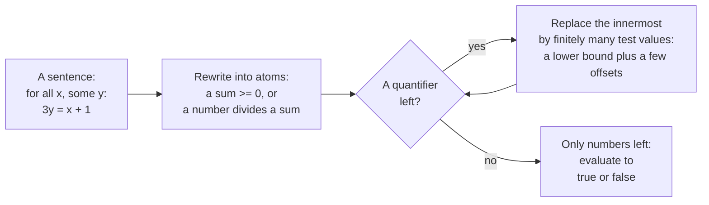

# Decidable theories: Presburger's arithmetic without times, and Tarski's real numbers

[Syllabus](../../../SYLLABUS.md) → [Computability and complexity](../README.md) → [Computability and Logic](../README.md#s02) → Decidable theories

---

## General Overview

A post office sells only 3p and 5p stamps. Which amounts can a clerk make exactly? The question is a sentence about whole numbers: "there are y and w with x = 3y + 5w". It uses plus, but never times.

This card builds a program that reads such sentences and always stops with "true" or "false". It is the shelf's house example turned around. A program that reads programs cannot decide whether they stop. A program that reads sentences about plus can decide whether they are true. For the stamps it answers that every amount from 8p up can be made, and that 1p, 2p, 4p and 7p cannot.

The method is **quantifier elimination**: rewrite "there is y with …" as an equal statement that has no y in it. Three examples carry the card.

- "There is y with x = 2y or x = 2y + 1" becomes "x is even or x is odd", which is true for every x.
- "There is y with 3y = x + 1" becomes "x leaves remainder 2 on division by 3".
- Over the real numbers, "there is x with x² + bx + c = 0" becomes "b² − 4c ≥ 0".

The first two belong to **Presburger arithmetic**: the numbers 0, 1, 2, … with 0, 1, plus and "less than", studied by Mojżesz Presburger in 1929. The third belongs to **Tarski's real field**: the real numbers with plus, times and "less than", decided by Alfred Tarski (report 1948, revised 1951).

Times breaks the pattern on the whole numbers. Every set that plus alone can describe repeats with a fixed period after some point. The squares 0, 1, 4, 9, 16, … have growing gaps, so plus alone cannot describe them.

**Without times, every question about whole numbers reduces to remainders and finitely many test values, so a program decides it; the real numbers stay decidable even with times, but the whole numbers with times do not.**

**What kind of fact this is:** three theorems. Presburger's theorem (1929) is proved on this card, one quantifier at a time, and the code runs the full procedure. Tarski's theorem (1951) is stated, with the quadratic case proved and the general proof named in Sources. The undecidability of plus and times on the whole numbers goes back to Church in 1936; this card derives it from the MRDP theorem, proved in outline on [Hilbert's tenth problem](04-hilberts-tenth-problem.md).

### The picture: the decision procedure



Each pass removes one quantifier and adds none, so the loop ends. For "for all x, some y: 3y = x + 1" the answer is false: x = 0 has no y, because 3y = 1 has no whole-number answer.

---

## The formula

Some words first.

- A **formula** is a statement built from atoms with "and", "or", "not", "there is" (∃) and "for all" (∀). A **sentence** is a formula whose letters are all bound by quantifiers, so it is true or false on its own.
- A **term** is a sum like 3y − x − 1: fixed whole-number multiples of letters, plus a constant. Plus allows 3y = y + y + y, but never a letter times a letter.
- An **atom** here has one of three kinds: t ≥ 0; $`m \mid t`$, "m divides t"; and "m does not divide t". Here t is a term and m is a fixed whole number from 2 up. Divisibility is [Congruence](../../02-Number%20theory/03-Clock%20Arithmetic/01-congruence-mod-n.md) in other words: $`m \mid t`$ says t ≡ 0 (mod m).
- A theory is **decidable** when one program takes any sentence and always stops with its truth value, as on [Decidable and semidecidable](01-decidable-and-semidecidable-sets.md).

The step that removes one quantifier is this rule. Its letter z ranges over 0, 1, 2, …, and φ is built from atoms with "and" and "or" only. φ includes the atom z ≥ 0, joined to the rest by "and" (Step 2 adds it), so a test value below 0 makes φ false and never counts.

```math
\exists z\, \varphi(z) \iff \bigvee_{\ell \in B}\ \bigvee_{j = 0}^{D - 1} \varphi(\ell + j)
```

**Read it aloud:** some z makes φ true exactly when some test value makes it true, where a test value is a lower bound ℓ from the list B plus an offset j from 0 to D − 1.

The lower bounds are 0 and every term ℓ with an atom saying z ≥ ℓ. D is the least common multiple of the divisors m that test z. The right side has no z in it, only the other letters.

For the real numbers, Tarski's theorem gives such a rule for every formula. The quadratic case is the one to remember:

```math
\exists x\, \left(x^2 + bx + c = 0\right) \iff b^2 - 4c \ge 0
```

**Read it aloud:** some real number x solves x² + bx + c = 0 exactly when b squared minus four times c is zero or more.

With b = −6 and c = 8 the test gives 36 − 32 = 4, so a root exists (x = 2 and x = 4). With b = 1 and c = 1 it gives −3, so none does.

| Symbol | Plain meaning | In our example | Push it up and the answer… |
| --- | --- | --- | --- |
| $`x, y, w`$ | letters for whole numbers 0, 1, 2, … | x the amount, y and w the numbers of 3p and 5p stamps | — |
| $`\exists, \forall`$; $`\varphi`$; $`\psi(x)`$ | "there is", "for all"; a formula; the formula left after removing a quantifier | φ: 3y = x + 1; ψ: 3 divides x + 1 | each extra quantifier is one more pass |
| $`t, u`$; $`q, k`$ | terms; a fixed multiplier and a fixed constant | t = 3y − x − 1 | — |
| $`m \mid t`$ | m divides t: t leaves remainder 0 on division by m | $`3 \mid x + 1`$ | — |
| $`L`$ | the least common multiple of y's coefficients | 3, from 3y | — |
| $`z`$ | L times y: a new letter whose coefficient is 1 | z = 3y | — |
| $`B`$; $`\ell`$ | the list of lower bounds for z, always with 0; one of them | B = {x + 1, 0} | more atoms, more test values |
| $`D`$ | the least common multiple of the divisors that test z | 3 | test values grow with D |
| $`j`$ | the offset added to a lower bound, 0 to D − 1 | z = (x + 1) + 0 | — |
| $`b, c`$ | the coefficients of the quadratic $`x^2 + bx + c`$ | b = −6, c = 8 | larger c, fewer roots |
| $`b^2 - 4c`$ | the discriminant: its sign decides whether a real root exists | 4 | — |
| $`P`$; $`p, s, n`$ | a set's eventual period; a period, a start point and a number in the squares argument (in Step 8, n is a sentence's length in symbols) | P = 3 for "3 divides x + 1"; p ≤ 40, s ≤ 100 | — |

### When it holds

- **No letter times a letter.** The rule needs terms with fixed coefficients. Allow y · y and the sentences include every [Hilbert's tenth problem](04-hilberts-tenth-problem.md) equation, and then no procedure exists.
- **The letters range over 0, 1, 2, ….** The proof takes a least solution, which exists because 0 bounds the solutions below. Over all integers the method needs one more case, for solution sets with no least member (Cooper's 1972 version handles it).
- **Tarski's theorem is about the real numbers.** The test b² − 4c ≥ 0 says x² − 2 = 0 has a root, √2. It has no whole-number root, so the test says nothing about whole numbers.

---

## Why it works

### Step 0: without times, a formula sees only cut points and remainders

Fix every letter except y. Each atom t ≥ 0 then says that y is above or below one value. Each divisibility atom says that y has a certain remainder on division by its divisor.

So the set of y that make the formula true is a pattern that repeats every D steps, cut at a few points. A least solution, if one exists, sits within D − 1 of a cut point. That makes the search finite.

### Step 1: rewrite into atoms joined by "and" and "or"

Every formula becomes one with "not" only on atoms, and then with no "not" at all.

- An equation t = u, for terms t and u, becomes t − u ≥ 0 and u − t ≥ 0.
- "t < u" becomes u − t − 1 ≥ 0, because the values are whole numbers.
- "Not t ≥ 0" becomes −t − 1 ≥ 0. "Not $`m \mid t`$" is the atom "m does not divide t", and the reverse.
- "Not (A and B)" becomes "not A or not B", and the same with "and" and "or" swapped.

### Step 2: make y's coefficient 1

Let L be the least common multiple of y's coefficients. Multiply each atom so that y's coefficient becomes L or −L. In a divisibility atom the divisor is multiplied too: for any whole number q ≥ 1, $`m \mid t`$ holds exactly when $`qm \mid qt`$.

Now every atom with y contains L·y. Write z for L·y. A whole number z comes from some y exactly when $`L \mid z`$, so add that atom, and add z ≥ 0.

For 3y = x + 1: L = 3, z = 3y, and the atoms are z − x − 1 ≥ 0, x + 1 − z ≥ 0, $`3 \mid z`$ and z ≥ 0.

### Step 3: the least solution sits near a lower bound

This is the heart of the theorem. The atoms with +z are the **lower bounds**: z − x − 1 ≥ 0 says z ≥ x + 1. Collect them in B, together with 0. D is the least common multiple of the divisors in atoms with z; here D = 3.

Suppose some z makes φ true, and take the least one. Some lower bound in B lies at or below z, because z ≥ 0 and 0 is in B. Take the largest such ℓ. If z were D or more above ℓ, then z − D would also make φ true:

- every divisibility atom keeps its truth value, because D is a multiple of each divisor;
- every upper-bound atom stays true, because z went down;
- every lower-bound atom stays true, because no lower bound lies between z − D and z.

That contradicts z being the least. So z = ℓ + j with j from 0 to D − 1, which is the rule on The formula. The other direction is immediate: a test value that works is a solution.

<details>
<summary>Detailed proof: why atoms that are false cause no trouble</summary>

After Step 1 the formula φ uses only "and" and "or". Such a formula stays true when every true atom stays true, whatever the false atoms do: a false atom that turns true can only help "and" and "or".

So it is enough that every atom true at z is still true at z − D. Write the atoms with z as these three kinds.

- **Divisibility,** $`m \mid z + u`$ or its "not", for a term u without z: D is a multiple of m, so z + u and z − D + u leave the same remainder.
- **Upper bound,** u − z ≥ 0: if it holds at z, then u − (z − D) = u − z + D ≥ 0.
- **Lower bound,** z − ℓ ≥ 0 with ℓ in B: if it holds at z, then ℓ ≤ z, so ℓ is at most the largest lower bound at or below z. That bound is at most z − D, by the assumption. So z − D ≥ ℓ.

The lower bound z ≥ 0 is one of them, so z − D is still a whole number. Hence z − D is a smaller solution, against the choice of z.

</details>

### Step 4: one quantifier at a time decides a sentence

The right side of the rule is again a formula of atoms, with z gone. A "for all x" is "not there is x with not". So the procedure removes the innermost quantifier, then the next, until no letter is left.

A sentence with no letters is a list of atoms like 3 ≥ 0 or $`3 \mid 6`$, and arithmetic settles each one. This is Presburger's theorem: the true sentences about 0, 1, plus and "less than" on the whole numbers form a decidable set. Presburger also showed that his axioms, a few rules plus an induction pattern a program can list, prove every true sentence or its denial, so the theory is **complete**, the property [Godel's theorems](03-godels-incompleteness-in-outline.md) deny to arithmetic with times.

### Step 5: every set described with plus is eventually periodic

Take any formula with one free letter x and remove its quantifiers. What is left is built from atoms x ≥ k, k ≥ x and $`m \mid x + k`$, each k a fixed number. Past the largest k, the inequality atoms stop changing. The divisibility atoms repeat with period P, the least common multiple of their divisors. So the set repeats with period P from some point on: it is **eventually periodic**.

The code names the three examples EVEN, THIRD and STAMP. It prints their sets and the squares, x from 0 to 29, # for a member:

```
EVEN    ##############################
THIRD   ..#..#..#..#..#..#..#..#..#..#
STAMP   #..#.##.######################
squares ##..#....#......#........#....
```

The squares are not eventually periodic. Suppose they repeated with period p from some point s on. Take n with n² ≥ s and 2n + 1 > p. Then n² is a square, but n² + p lies strictly between n² and (n + 1)² = n² + 2n + 1, so it is not. So "x is a square" has no formula with plus alone, and neither does times, since "x = y · y" would describe the squares. The code checks every period p up to 40 and every start s up to 100: all 4,040 pairs break.

### Step 6: Tarski's real numbers, where times is allowed

Over the real numbers the atoms are polynomial signs: p > 0, p = 0, p < 0. Tarski proved that these also allow quantifier elimination, so the theory of the real numbers with plus, times and "less than" is decidable. Marker's textbook, chapter 3, gives a modern proof. The same elimination works in every real closed field (an ordered field where every positive number has a square root and every odd-degree polynomial has a root). A sentence with no letters left is arithmetic on whole numbers, settled the same way in each such field, so all of them, the real algebraic numbers among them, satisfy exactly the same sentences as the reals. Collins's 1975 method, **cylindrical decomposition**, cuts space into finitely many cells on which every polynomial in the sentence keeps one sign.

The quadratic case needs only completing the square, as on [The quadratic formula](../../03-Algebra/02-Polynomials/03-quadratic-formula.md):

```math
x^2 + bx + c = \left(x + \tfrac{b}{2}\right)^2 + \left(c - \tfrac{b^2}{4}\right)
```

The square is at least 0, and it is 0 at x = −b/2. So the smallest value of the left side is c − b²/4. The left side grows without bound as x moves away, and it is continuous, so by the intermediate value theorem (a continuous function that is negative at one point and positive at another is 0 somewhere between) it reaches 0 exactly when its smallest value is 0 or below. That is c − b²/4 ≤ 0, which is b² − 4c ≥ 0.

An odd degree is different. x³ + bx + c is negative far to the left and positive far to the right, so it always has a root: "there is x with x³ + bx + c = 0" eliminates to "true".

The sets of real numbers that a formula with one free letter describes are finite unions of points and intervals. The whole numbers are infinitely many separate points, so no formula over the reals picks them out. That is why times is harmless there.

### Step 7: why times breaks decidability on the whole numbers

With plus and times on 0, 1, 2, …, the sentences "there are whole numbers solving this polynomial equation" are allowed, for every equation. [Hilbert's tenth problem](04-hilberts-tenth-problem.md) shows that no program decides which of them have solutions, because a machine's run fits into such an equation. So no program decides the true sentences of arithmetic with times.

| Numbers | Operations | Decidable? | Reason |
| --- | --- | --- | --- |
| whole numbers 0, 1, 2, … | 0, 1, plus, less than | yes (Presburger, 1929) | test values and remainders, Step 3 |
| real numbers | 0, 1, plus, times, less than | yes (Tarski, 1951) | polynomial signs on finitely many cells |
| whole numbers 0, 1, 2, … | 0, 1, plus, times | no | equations encode machines (MRDP, 1970) |

### Step 8: decidable, but expensive

Each pass multiplies the formula's size by the number of test values. Fischer and Rabin proved in 1974 that this cannot be avoided in general. For some fixed number c > 0 (a constant from their proof, not the quadratic's c), every decision procedure for Presburger arithmetic needs at least $`2^{2^{cn}}`$ steps on some sentences of length n. For the real numbers with plus alone the same paper proves at least $`2^{cn}`$. Collins's method runs in time doubly exponential in the number of letters.

The code counts its own test values. One quantifier in THIRD needs 6; the stamp sentence, with three quantifiers, needs 145.

---

## Worked numbers, by hand

Remove the quantifier from "there is y with 3y = x + 1".

| Step | Arithmetic | Value |
| --- | --- | --- |
| atoms | 3y − x − 1 ≥ 0 and x + 1 − 3y ≥ 0 | an equation as two inequalities |
| L and z | the only coefficient of y is 3 | L = 3, z = 3y, add $`3 \mid z`$ and z ≥ 0 |
| lower bounds | z ≥ x + 1, and z ≥ 0 | B = {x + 1, 0} |
| D | only the divisor 3 tests z | D = 3 |
| test values | {x + 1, 0} plus 0, 1, 2 | 2 × 3 = 6 |
| z = x + 1 | both inequalities hold; $`3 \mid x + 1`$ remains | $`3 \mid x + 1`$ and x + 1 ≥ 0 |
| z = x + 2, x + 3 | x + 1 − z ≥ 0 fails | false |
| z = 0 | −x − 1 ≥ 0 and x + 1 ≥ 0, so x = −1 | never, for x ≥ 0 |
| z = 1, 2 | z = x + 1 needs x = 0 or 1, but 3 does not divide 1 or 2 | false |
| result | | **$`3 \mid x + 1`$, that is x ≡ 2 (mod 3)** |

The code prints the same result, "THIRD becomes ((3 | x + 1 and x + 1 >= 0) or (-x - 1 >= 0 and x + 1 >= 0))". At x = 5 it is true (y = 2), and at x = 4 it is false. The quantifier is gone, and what remains is a remainder test a clerk could run.

For the first example the code gets four parts: x even; x − 1 even with x ≥ 1; x = 0; x = 1. For every x ≥ 0 one of the first two holds, so the formula is true, and the sentence "for all x, some y: x = 2y or x = 2y + 1" decides as true after 12 test values.

### What breaks if you drop a piece

| Mistake | Comes out at | What went wrong |
| --- | --- | --- |
| Drop the atom "L divides z" | "3y = x + 1" true for 60 of 60 x (truth: 20) | z = x + 1 always works, but z must be a multiple of 3 |
| Test only j = 0 | stamps make 28 of 60 amounts (truth: 56) | the least solution can sit up to D − 1 above its lower bound |
| Ask "for all x ≥ 7" for the stamps | false | 7p cannot be made: 7 is the largest amount missed |
| Read b² − 4c ≥ 0 as a whole-number test for x² − 2 | 8, "a root exists" | the root is √2; the search finds none up to 1,000 |

The code prints all four.

---

## Code, from first principles, and it actually runs

The code is a complete decision procedure for Presburger sentences, the rule of Step 3 applied one quantifier at a time. It takes four roads to the answers.

1. **Elimination against brute force.** Each eliminated formula is evaluated for x from 0 to 59 and compared with a direct search for y and w: the three examples, and 108 more formulas with inequalities and divisors from 2 to 5.
2. **Sentences decided.** Five sentences go to true or false, among them the stamp sentence: true from 8p, false from 7p.
3. **Periodicity as an invariant.** Each eliminated set repeats with the period its atoms predict. The squares fail every period up to 40.
4. **Tarski's quadratic test against a grid.** For b and c from −6 to 6, b² − 4c ≥ 0 is compared with a search for a point x = k/4 where x² + bx + c ≤ 0.

### Python

```python
# Decidable theories -- the check behind the card.  Standard library only.
# Part 1: a decision procedure for Presburger arithmetic (0, 1, +, <, on the
#         numbers 0, 1, 2, ...) by quantifier elimination with congruences,
#         checked against brute-force search on every x up to 59.
# Part 2: definable sets are eventually periodic; the squares are not.
# Part 3: over the reals, "some x has x^2 + bx + c = 0" against a grid search.
T, F, COUNT = ("T",), ("F",), [0]
def gcd(a, b): return gcd(b, a % b) if b else a
def lcm(a, b): return a * b // gcd(a, b)
def atom(kind, m, cs, k):          # cs.(x, y, w) + k >= 0, or m divides it ("dvd"), or not ("ndvd")
    if any(cs): return (kind, m, tuple(cs), k)
    return T if (k >= 0 if kind == "ge" else (k % m == 0) == (kind == "dvd")) else F
def join(op, fs):                  # "and" / "or", flattened, constants folded, repeats dropped
    (stop, unit), out = (F, T) if op == "and" else (T, F), []
    for f in fs:
        for g in (f[1] if f[0] == op else (f,)):
            if g == stop: return stop
            if g != unit and g not in out: out.append(g)
    return unit if not out else out[0] if len(out) == 1 else (op, tuple(out))
def amap(f, fn):                   # apply fn to every atom of a quantifier-free formula
    if f[0] in ("and", "or"): return join(f[0], [amap(g, fn) for g in f[1]])
    return f if f in (T, F) else fn(f)
def atoms(f): return [a for g in f[1] for a in atoms(g)] if f[0] in ("and", "or") else [] if f in (T, F) else [f]
def neg(f):                        # push "not" down to the atoms
    if f[0] in ("and", "or"): return join("or" if f[0] == "and" else "and", [neg(g) for g in f[1]])
    if f in (T, F): return F if f == T else T
    kind, m, cs, k = f
    if kind == "ge": return atom("ge", None, [-c for c in cs], -k - 1)
    return atom("ndvd" if kind == "dvd" else "dvd", m, cs, k)
def elim(v, f, keep_div=True, offsets=True):   # "some v >= 0 has f", rewritten without v
    L = 1
    for a in atoms(f):
        if a[2][v]: L = lcm(L, abs(a[2][v]))
    def scale(a):                  # make v's coefficient +1 or -1: z stands for L * v
        kind, m, cs, k = a
        if not cs[v]: return a
        c = L // abs(cs[v]); cs2 = [c * x for x in cs]; cs2[v] = 1 if cs[v] > 0 else -1
        return atom(kind, m and m * c, cs2, k * c)
    unit = [0, 0, 0]; unit[v] = 1
    g = join("and", [amap(f, scale), atom("dvd", L, unit, 0) if keep_div else T, atom("ge", None, unit, 0)])
    D, B = 1, []
    for kind, m, cs, k in atoms(g):
        if cs[v] and kind != "ge": D = lcm(D, m)
        if kind == "ge" and cs[v] == 1:            # z >= -(rest): a lower bound
            b = ([0 if i == v else -cs[i] for i in range(3)], -k)
            if b not in B: B.append(b)
    def put(a, b, j):              # replace z by b + j
        kind, m, cs, k = a; cz = cs[v]
        return atom(kind, m, [0 if i == v else cs[i] + cz * b[0][i] for i in range(3)], k + cz * (b[1] + j))
    COUNT[0] += len(B) * (D if offsets else 1)
    return join("or", [amap(g, lambda a: put(a, b, j)) for b in B for j in range(D if offsets else 1)])
def qe(f, **kw):
    if f[0] in ("and", "or"): return join(f[0], [qe(g, **kw) for g in f[1]])
    if f[0] == "not": return neg(qe(f[1], **kw))
    if f[0] == "ex": return elim(f[1], qe(f[2], **kw), **kw)
    if f[0] == "all": return neg(elim(f[1], neg(qe(f[2], **kw)), **kw))
    return f
def holds(f, x):
    if f in (T, F): return f == T
    if f[0] in ("and", "or"): return (all if f[0] == "and" else any)(holds(g, x) for g in f[1])
    kind, m, cs, k = f; s = cs[0] * x + k
    return s >= 0 if kind == "ge" else (s % m == 0) == (kind == "dvd")
def show(f):                       # print a formula in x alone
    if f in (T, F): return "true" if f == T else "false"
    if f[0] in ("and", "or"): return "(" + f" {f[0]} ".join(show(g) for g in f[1]) + ")"
    kind, m, cs, k = f
    t = ("-x" if cs[0] < 0 else "x") + (f" + {k}" if k > 0 else f" - {-k}" if k < 0 else "")
    return f"{t} >= 0" if kind == "ge" else f"{m} {'|' if kind == 'dvd' else 'does not divide'} {t}"
def eq(cs, k): return join("and", [atom("ge", None, cs, k), atom("ge", None, [-c for c in cs], -k)])
def iff(a, b): return ("and", (("or", (("not", a), b)), ("or", (a, ("not", b)))))
EVEN = ("ex", 1, ("or", (eq([1, -2, 0], 0), eq([1, -2, 0], -1))))      # x = 2y or x = 2y + 1
THIRD = ("ex", 1, eq([-1, 3, 0], -1))                                 # 3y = x + 1
STAMP = ("ex", 1, ("ex", 2, eq([1, -3, -5], 0)))                      # x = 3y + 5w
X = range(60)
brute = {"EVEN": [any(x in (2 * y, 2 * y + 1) for y in X) for x in X],
         "THIRD": [any(3 * y == x + 1 for y in range(61)) for x in X],
         "STAMP": [any(3 * y + 5 * w == x for y in X for w in X) for x in X]}
print("part 1: quantifier elimination, free variable x = 0 to 59")
psi = {}
for name, f in (("EVEN", EVEN), ("THIRD", THIRD), ("STAMP", STAMP)):
    COUNT[0] = 0; psi[name] = p = qe(f)
    got = [holds(p, x) for x in X]
    print(f"{name:<5}: candidates {COUNT[0]:>3}, atoms left {len(atoms(p)):>3}, true for {sum(got)} of 60, brute force {sum(brute[name])} of 60")
    assert got == brute[name], "elimination disagrees with search"
print("EVEN  becomes", show(psi["EVEN"]))
print("THIRD becomes", show(psi["THIRD"]))
mod3 = [holds(psi["THIRD"], x) for x in X] == [x % 3 == 2 for x in X]
print("THIRD true exactly when x mod 3 = 2:", mod3, " at x = 4:", holds(psi["THIRD"], 4), " at x = 5:", holds(psi["THIRD"], 5), " STAMP false at:", *[x for x in X if not holds(psi["STAMP"], x)])
SENT = [("for all x, some y: x = 2y or x = 2y + 1", ("all", 0, EVEN)),
        ("for all x, some y: 3y = x + 1", ("all", 0, THIRD)),
        ("for all x: (some y: 3y = x + 1) iff 3 divides x + 1", ("all", 0, iff(THIRD, atom("dvd", 3, [1, 0, 0], 1)))),
        ("for all x >= 8, some y, w: x = 3y + 5w", ("all", 0, ("or", (atom("ge", None, [-1, 0, 0], 7), STAMP)))),
        ("for all x >= 7, some y, w: x = 3y + 5w", ("all", 0, ("or", (atom("ge", None, [-1, 0, 0], 6), STAMP))))]
verdict = []
for text, s in SENT:
    COUNT[0] = 0; r = qe(s); verdict.append(r)
    print(f"decide: {text:<52} -> {'true' if r == T else 'false'}  ({COUNT[0]} candidates)")
assert verdict == [T, F, T, T, F] and mod3, "the five verdicts, and 3y = x + 1 means x mod 3 = 2"
fam = [(a, m, k, r) for a in (1, 2, 3) for m in (2, 3, 4, 5) for k in (0, 1, 2) for r in (0, 1, 2)]
bad = [(a, m, k, r) for a, m, k, r in fam if [holds(qe(("ex", 1, ("and", (atom("ge", None, [-1, a, 0], -k),
       atom("ge", None, [1, -a, 0], k + 2), atom("dvd", m, [0, 1, 0], r))))), x) for x in X]
       != [any(x + k <= a * y <= x + k + 2 and (y + r) % m == 0 for y in range(70)) for x in X]]
print(f"family: some y, x + k <= ay <= x + k + 2 and m | y + r, a <= 3, m <= 5, k, r <= 2: {len(fam) - len(bad)} of {len(fam)} agree")
assert not bad, "elimination disagrees with search on the family"
print("part 2: eventually periodic sets")
for name, p in psi.items():
    per, start = 1, 0
    for kind, m, cs, k in atoms(p):
        if kind == "ge": start = max(start, abs(k) + 1)
        else: per = lcm(per, m)
    ok = all(holds(p, x) == holds(p, x + per) for x in range(start, start + 300))
    print(f"{name:<5}: repeats with period {per} from x = {start}: {ok}")
    assert ok, "a definable set must be eventually periodic"
sq = set(n * n for n in range(200))
broken = sum(any(n * n >= s and n * n + p not in sq for n in range(200)) for p in range(1, 41) for s in range(101))
print(f"squares: (period p <= 40, start s <= 100) pairs broken by some n^2 with n^2 + p not square: {broken} of 4040")
assert broken == 4040, "no period fits the squares"
for name, row in psi.items(): print(f"{name:<7}", "".join("#" if holds(row, x) else "." for x in range(30)))
print("squares", "".join("#" if x in sq else "." for x in range(30)))
print("what breaks")
for label, name, f, kw in (("drop 'L divides z'", "THIRD", THIRD, dict(keep_div=False)),
                           ("offset j = 0 only", "STAMP", STAMP, dict(offsets=False))):
    r = [holds(qe(f, **kw), x) for x in X]
    print(f"{label}: {name} true for {sum(r)} of 60 (truth {sum(brute[name])})")
    assert r != brute[name], "a broken elimination must give a wrong set"
print("part 3: some real x has x^2 + bx + c = 0, for b, c = -6 to 6")
agree = roots = 0
for b in range(-6, 7):
    for c in range(-6, 7):
        disc = b * b - 4 * c >= 0
        grid = any(k * k + 4 * b * k + 16 * c <= 0 for k in range(-60, 61))   # 16 f(k/4), x from -15 to 15
        agree += disc == grid; roots += disc
for b, c in ((-6, 8), (2, 1), (1, 1)):
    print(f"b = {b}, c = {c}: b^2 - 4c = {b * b - 4 * c}, grid finds x^2 + bx + c <= 0:", any(k * k + 4 * b * k + 16 * c <= 0 for k in range(-60, 61)))
print(f"b^2 - 4c >= 0 against a grid search: agree on {agree} of 169, real root in {roots}")
cube = all(-64 - 4 * b + c < 0 < 64 + 4 * b + c for b in range(-6, 7) for c in range(-6, 7))
print("x^3 + bx + c changes sign between x = -4 and x = 4 for all 169 pairs:", cube)
print("x^2 - 2: b^2 - 4c =", 0 - 4 * -2, "  whole-number roots up to 1000:", [x for x in range(-1000, 1001) if x * x == 2] or "none")
assert agree == 169, "discriminant and grid disagree"
print("ALL CHECKS PASS")
```

**Ran 2026-11-24 on macOS, Python 3.14.10, standard library only. All checks passed. Output, pasted from the run:**

```
part 1: quantifier elimination, free variable x = 0 to 59
EVEN : candidates   6, atoms left   8, true for 60 of 60, brute force 60 of 60
THIRD: candidates   6, atoms left   4, true for 20 of 60, brute force 20 of 60
STAMP: candidates  40, atoms left  22, true for 56 of 60, brute force 56 of 60
EVEN  becomes ((2 | x and x >= 0) or (2 | x - 1 and x - 1 >= 0) or (x >= 0 and -x >= 0) or (x - 1 >= 0 and -x + 1 >= 0))
THIRD becomes ((3 | x + 1 and x + 1 >= 0) or (-x - 1 >= 0 and x + 1 >= 0))
THIRD true exactly when x mod 3 = 2: True  at x = 4: False  at x = 5: True  STAMP false at: 1 2 4 7
decide: for all x, some y: x = 2y or x = 2y + 1              -> true  (12 candidates)
decide: for all x, some y: 3y = x + 1                        -> false  (9 candidates)
decide: for all x: (some y: 3y = x + 1) iff 3 divides x + 1  -> true  (18 candidates)
decide: for all x >= 8, some y, w: x = 3y + 5w               -> true  (145 candidates)
decide: for all x >= 7, some y, w: x = 3y + 5w               -> false  (130 candidates)
family: some y, x + k <= ay <= x + k + 2 and m | y + r, a <= 3, m <= 5, k, r <= 2: 108 of 108 agree
part 2: eventually periodic sets
EVEN : repeats with period 2 from x = 2: True
THIRD: repeats with period 3 from x = 2: True
STAMP: repeats with period 15 from x = 13: True
squares: (period p <= 40, start s <= 100) pairs broken by some n^2 with n^2 + p not square: 4040 of 4040
EVEN    ##############################
THIRD   ..#..#..#..#..#..#..#..#..#..#
STAMP   #..#.##.######################
squares ##..#....#......#........#....
what breaks
drop 'L divides z': THIRD true for 60 of 60 (truth 20)
offset j = 0 only: STAMP true for 28 of 60 (truth 56)
part 3: some real x has x^2 + bx + c = 0, for b, c = -6 to 6
b = -6, c = 8: b^2 - 4c = 4, grid finds x^2 + bx + c <= 0: True
b = 2, c = 1: b^2 - 4c = 0, grid finds x^2 + bx + c <= 0: True
b = 1, c = 1: b^2 - 4c = -3, grid finds x^2 + bx + c <= 0: False
b^2 - 4c >= 0 against a grid search: agree on 169 of 169, real root in 129
x^3 + bx + c changes sign between x = -4 and x = 4 for all 169 pairs: True
x^2 - 2: b^2 - 4c = 8   whole-number roots up to 1000: none
ALL CHECKS PASS
```

### Rust

```rust
// Decidable theories -- the check behind the card.  std only, no crates.
// Part 1: a decision procedure for Presburger arithmetic (0, 1, +, <, on the
//         numbers 0, 1, 2, ...) by quantifier elimination with congruences,
//         checked against brute-force search on every x up to 59.
// Part 2: definable sets are eventually periodic; the squares are not.
// Part 3: over the reals, "some x has x^2 + bx + c = 0" against a grid search.
use std::collections::HashSet;
#[derive(Clone, Copy, PartialEq)] enum K { Ge, Dvd, Ndvd }
#[derive(Clone, PartialEq)] enum Fm { T, F, At(K, i64, [i64; 3], i64), And(Vec<Fm>), Or(Vec<Fm>), Not(Box<Fm>), Ex(usize, Box<Fm>), All(usize, Box<Fm>) }
use Fm::*;
fn gcd(a: i64, b: i64) -> i64 { if b == 0 { a } else { gcd(b, a % b) } } fn lcm(a: i64, b: i64) -> i64 { a * b / gcd(a, b) }
fn atom(k: K, m: i64, cs: [i64; 3], c: i64) -> Fm { // cs.(x, y, w) + c >= 0, or m divides it (Dvd), or not
    if cs.iter().any(|&v| v != 0) { return At(k, m, cs, c); }
    if match k { K::Ge => c >= 0, K::Dvd => c.rem_euclid(m) == 0, K::Ndvd => c.rem_euclid(m) != 0 } { T } else { F }
}
fn join(and: bool, fs: Vec<Fm>) -> Fm { // flattened, constants folded, repeats dropped
    let (stop, unit) = if and { (F, T) } else { (T, F) };
    let mut out: Vec<Fm> = Vec::new();
    for f in fs {
        let parts = match f { And(v) if and => v, Or(v) if !and => v, g => vec![g] };
        for g in parts { if g == stop { return stop; } if g != unit && !out.contains(&g) { out.push(g); } }
    }
    if out.is_empty() { unit } else if out.len() == 1 { out.pop().unwrap() } else if and { And(out) } else { Or(out) }
}
fn amap(f: &Fm, fun: &dyn Fn(&Fm) -> Fm) -> Fm {
    match f { And(v) => join(true, v.iter().map(|g| amap(g, fun)).collect()),
              Or(v) => join(false, v.iter().map(|g| amap(g, fun)).collect()), T | F => f.clone(), _ => fun(f) }
}
fn atoms(f: &Fm, out: &mut Vec<(K, i64, [i64; 3], i64)>) {
    match f { And(v) | Or(v) => for g in v { atoms(g, out) }, At(k, m, cs, c) => out.push((*k, *m, *cs, *c)), _ => {} }
}
fn neg(f: &Fm) -> Fm { // push "not" down to the atoms
    match f {
        And(v) => join(false, v.iter().map(neg).collect()), Or(v) => join(true, v.iter().map(neg).collect()),
        T => F, F => T, At(K::Ge, _, cs, c) => atom(K::Ge, 0, [-cs[0], -cs[1], -cs[2]], -c - 1),
        At(k, m, cs, c) => atom(if *k == K::Dvd { K::Ndvd } else { K::Dvd }, *m, *cs, *c), _ => unreachable!() }
}
fn elim(v: usize, f: &Fm, kd: bool, off: bool, count: &mut usize) -> Fm { // "some v >= 0 has f", without v
    let (mut a, mut l) = (Vec::new(), 1); atoms(f, &mut a);
    for t in &a { if t.2[v] != 0 { l = lcm(l, t.2[v].abs()); } }
    let scale = |g: &Fm| -> Fm { // make v's coefficient +1 or -1: z stands for L * v
        let At(k, m, cs, c) = g else { unreachable!() }; if cs[v] == 0 { return g.clone(); }
        let s = l / cs[v].abs(); let mut c2 = [s * cs[0], s * cs[1], s * cs[2]]; c2[v] = cs[v].signum();
        atom(*k, m * s, c2, c * s)
    };
    let mut unit = [0i64; 3]; unit[v] = 1;
    let g = join(true, vec![amap(f, &scale), if kd { atom(K::Dvd, l, unit, 0) } else { T }, atom(K::Ge, 0, unit, 0)]);
    let (mut d, mut b, mut ga): (i64, Vec<([i64; 3], i64)>, _) = (1, Vec::new(), Vec::new()); atoms(&g, &mut ga);
    for (k, m, cs, c) in ga {
        if cs[v] != 0 && k != K::Ge { d = lcm(d, m); }
        if k == K::Ge && cs[v] == 1 { // z >= -(rest): a lower bound
            let mut bc = [-cs[0], -cs[1], -cs[2]]; bc[v] = 0;
            if !b.contains(&(bc, -c)) { b.push((bc, -c)); }
        }
    }
    let (js, mut alts) = (if off { d } else { 1 }, Vec::new()); *count += b.len() * js as usize;
    for bb in &b { for j in 0..js {
        let put = |t: &Fm| -> Fm { // replace z by b + j
            let At(k, m, cs, c) = t else { unreachable!() }; let (cz, mut c2) = (cs[v], [0i64; 3]);
            for i in 0..3 { if i != v { c2[i] = cs[i] + cz * bb.0[i]; } }
            atom(*k, *m, c2, c + cz * (bb.1 + j))
        };
        alts.push(amap(&g, &put)); } }
    join(false, alts)
}
fn qe(f: &Fm, kd: bool, off: bool, n: &mut usize) -> Fm {
    match f {
        And(v) => join(true, v.iter().map(|g| qe(g, kd, off, n)).collect()),
        Or(v) => join(false, v.iter().map(|g| qe(g, kd, off, n)).collect()),
        Not(g) => neg(&qe(g, kd, off, n)),
        Ex(v, g) => { let b = qe(g, kd, off, n); elim(*v, &b, kd, off, n) }
        All(v, g) => { let b = neg(&qe(g, kd, off, n)); neg(&elim(*v, &b, kd, off, n)) } _ => f.clone() }
}
fn holds(f: &Fm, x: i64) -> bool {
    match f {
        T => true, F => false, And(v) => v.iter().all(|g| holds(g, x)), Or(v) => v.iter().any(|g| holds(g, x)),
        At(k, m, cs, c) => { let s = cs[0] * x + c;
            match k { K::Ge => s >= 0, K::Dvd => s.rem_euclid(*m) == 0, K::Ndvd => s.rem_euclid(*m) != 0 } } _ => unreachable!() }
}
fn show(f: &Fm) -> String { // print a formula in x alone
    match f {
        T => "true".into(), F => "false".into(),
        And(v) => format!("({})", v.iter().map(show).collect::<Vec<_>>().join(" and ")),
        Or(v) => format!("({})", v.iter().map(show).collect::<Vec<_>>().join(" or ")),
        At(k, m, cs, c) => {
            let t = format!("{}{}", if cs[0] < 0 { "-x" } else { "x" }, if *c > 0 { format!(" + {}", c) } else if *c < 0 { format!(" - {}", -c) } else { String::new() });
            match k { K::Ge => format!("{} >= 0", t), K::Dvd => format!("{} | {}", m, t), K::Ndvd => format!("{} does not divide {}", m, t) }
        } _ => unreachable!() }
}
fn eq(cs: [i64; 3], c: i64) -> Fm { join(true, vec![atom(K::Ge, 0, cs, c), atom(K::Ge, 0, [-cs[0], -cs[1], -cs[2]], -c)]) }
fn iff(a: Fm, b: Fm) -> Fm { And(vec![Or(vec![Not(Box::new(a.clone())), b.clone()]), Or(vec![a, Not(Box::new(b))])]) }
fn tf(b: bool) -> &'static str { if b { "True" } else { "False" } }
fn main() {
    let even = Ex(1, Box::new(Or(vec![eq([1, -2, 0], 0), eq([1, -2, 0], -1)]))); // x = 2y or x = 2y + 1
    let third = Ex(1, Box::new(eq([-1, 3, 0], -1)));                            // 3y = x + 1
    let stamp = Ex(1, Box::new(Ex(2, Box::new(eq([1, -3, -5], 0)))));            // x = 3y + 5w
    let brute: Vec<Vec<bool>> = vec![(0..60).map(|x| (0..60).any(|y| x == 2 * y || x == 2 * y + 1)).collect(),
        (0..60).map(|x| (0..61).any(|y| 3 * y == x + 1)).collect(),
        (0..60).map(|x| (0..60).any(|y| (0..60).any(|w| 3 * y + 5 * w == x))).collect()];
    let names = ["EVEN", "THIRD", "STAMP"];
    println!("part 1: quantifier elimination, free variable x = 0 to 59");
    let mut psi = Vec::new();
    for (i, f) in [&even, &third, &stamp].iter().enumerate() {
        let mut n = 0; let p = qe(f, true, true, &mut n);
        let got: Vec<bool> = (0..60).map(|x| holds(&p, x)).collect();
        let mut a = Vec::new(); atoms(&p, &mut a);
        println!("{:<5}: candidates {:>3}, atoms left {:>3}, true for {} of 60, brute force {} of 60", names[i], n, a.len(),
                 got.iter().filter(|&&b| b).count(), brute[i].iter().filter(|&&b| b).count());
        assert!(got == brute[i], "elimination disagrees with search");
        psi.push(p);
    }
    println!("EVEN  becomes {}\nTHIRD becomes {}", show(&psi[0]), show(&psi[1]));
    let mod3 = (0..60).all(|x| holds(&psi[1], x) == (x % 3 == 2));
    let miss: Vec<String> = (0..60).filter(|&x| !holds(&psi[2], x)).map(|x| x.to_string()).collect();
    println!("THIRD true exactly when x mod 3 = 2: {}  at x = 4: {}  at x = 5: {}  STAMP false at: {}", tf(mod3), tf(holds(&psi[1], 4)), tf(holds(&psi[1], 5)), miss.join(" "));
    let ge = |c: i64| atom(K::Ge, 0, [-1, 0, 0], c);
    let sent = [("for all x, some y: x = 2y or x = 2y + 1", All(0, Box::new(even.clone()))),
        ("for all x, some y: 3y = x + 1", All(0, Box::new(third.clone()))),
        ("for all x: (some y: 3y = x + 1) iff 3 divides x + 1", All(0, Box::new(iff(third.clone(), atom(K::Dvd, 3, [1, 0, 0], 1))))),
        ("for all x >= 8, some y, w: x = 3y + 5w", All(0, Box::new(Or(vec![ge(7), stamp.clone()])))),
        ("for all x >= 7, some y, w: x = 3y + 5w", All(0, Box::new(Or(vec![ge(6), stamp.clone()]))))];
    let mut verdict = Vec::new();
    for (text, s) in sent.iter() {
        let mut n = 0; let r = qe(s, true, true, &mut n);
        println!("decide: {:<52} -> {}  ({} candidates)", text, if r == T { "true" } else { "false" }, n);
        verdict.push(r);
    }
    assert!(verdict == vec![T, F, T, T, F] && mod3, "the five verdicts, and 3y = x + 1 means x mod 3 = 2");
    let mut fam = 0; for a in 1..4i64 { for m in 2..6i64 { for k in 0..3i64 { for r in 0..3i64 {
        let f = Ex(1, Box::new(And(vec![atom(K::Ge, 0, [-1, a, 0], -k), atom(K::Ge, 0, [1, -a, 0], k + 2), atom(K::Dvd, m, [0, 1, 0], r)])));
        let mut n = 0; let p = qe(&f, true, true, &mut n); if (0..60).all(|x| holds(&p, x) == (0..70).any(|y| x + k <= a * y && a * y <= x + k + 2 && (y + r) % m == 0)) { fam += 1; }
    } } } }
    println!("family: some y, x + k <= ay <= x + k + 2 and m | y + r, a <= 3, m <= 5, k, r <= 2: {} of 108 agree", fam); assert!(fam == 108, "elimination disagrees with search on the family");
    println!("part 2: eventually periodic sets");
    for (i, p) in psi.iter().enumerate() {
        let (mut per, mut start, mut a) = (1i64, 0i64, Vec::new()); atoms(p, &mut a);
        for (k, m, _, c) in a { if k == K::Ge { start = start.max(c.abs() + 1); } else { per = lcm(per, m); } }
        let ok = (start..start + 300).all(|x| holds(p, x) == holds(p, x + per));
        println!("{:<5}: repeats with period {} from x = {}: {}", names[i], per, start, tf(ok));
        assert!(ok, "a definable set must be eventually periodic"); }
    let sq: HashSet<i64> = (0..200).map(|n| n * n).collect();
    let mut broken = 0;
    for p in 1..41 { for s in 0..101 { if (0..200i64).any(|n| n * n >= s && !sq.contains(&(n * n + p))) { broken += 1; } } }
    println!("squares: (period p <= 40, start s <= 100) pairs broken by some n^2 with n^2 + p not square: {} of 4040", broken);
    assert!(broken == 4040, "no period fits the squares");
    for i in 0..3 { println!("{:<7} {}", names[i], (0..30).map(|x| if holds(&psi[i], x) { '#' } else { '.' }).collect::<String>()); }
    println!("squares {}", (0..30).map(|x| if sq.contains(&x) { '#' } else { '.' }).collect::<String>());
    println!("what breaks");
    for (label, i, f, kd, off) in [("drop 'L divides z'", 1, &third, false, true), ("offset j = 0 only", 2, &stamp, true, false)] {
        let mut n = 0; let p = qe(f, kd, off, &mut n);
        let r: Vec<bool> = (0..60).map(|x| holds(&p, x)).collect();
        println!("{}: {} true for {} of 60 (truth {})", label, names[i], r.iter().filter(|&&b| b).count(), brute[i].iter().filter(|&&b| b).count());
        assert!(r != brute[i], "a broken elimination must give a wrong set");
    }
    println!("part 3: some real x has x^2 + bx + c = 0, for b, c = -6 to 6");
    let grid = |b: i64, c: i64| (-60..61i64).any(|k| k * k + 4 * b * k + 16 * c <= 0); // 16 f(k/4), x from -15 to 15
    let (mut agree, mut roots) = (0, 0);
    for b in -6..7 { for c in -6..7 { let disc = b * b - 4 * c >= 0; if disc == grid(b, c) { agree += 1; } if disc { roots += 1; } } }
    for (b, c) in [(-6i64, 8i64), (2, 1), (1, 1)] {
        println!("b = {}, c = {}: b^2 - 4c = {}, grid finds x^2 + bx + c <= 0: {}", b, c, b * b - 4 * c, tf(grid(b, c)));
    }
    println!("b^2 - 4c >= 0 against a grid search: agree on {} of 169, real root in {}", agree, roots);
    let cube = (-6..7i64).all(|b| (-6..7i64).all(|c| -64 - 4 * b + c < 0 && 0 < 64 + 4 * b + c));
    println!("x^3 + bx + c changes sign between x = -4 and x = 4 for all 169 pairs: {}", tf(cube));
    let ints: Vec<i64> = (-1000..1001i64).filter(|x| x * x == 2).collect();
    println!("x^2 - 2: b^2 - 4c = {}   whole-number roots up to 1000: {}", 0 - 4 * -2, if ints.is_empty() { "none".to_string() } else { format!("{:?}", ints) });
    assert!(agree == 169, "discriminant and grid disagree");
    println!("ALL CHECKS PASS");
}
```

**Ran 2026-11-24 on macOS, rustc 1.98.1, no crates. All checks passed. Output, pasted from the run:**

```
part 1: quantifier elimination, free variable x = 0 to 59
EVEN : candidates   6, atoms left   8, true for 60 of 60, brute force 60 of 60
THIRD: candidates   6, atoms left   4, true for 20 of 60, brute force 20 of 60
STAMP: candidates  40, atoms left  22, true for 56 of 60, brute force 56 of 60
EVEN  becomes ((2 | x and x >= 0) or (2 | x - 1 and x - 1 >= 0) or (x >= 0 and -x >= 0) or (x - 1 >= 0 and -x + 1 >= 0))
THIRD becomes ((3 | x + 1 and x + 1 >= 0) or (-x - 1 >= 0 and x + 1 >= 0))
THIRD true exactly when x mod 3 = 2: True  at x = 4: False  at x = 5: True  STAMP false at: 1 2 4 7
decide: for all x, some y: x = 2y or x = 2y + 1              -> true  (12 candidates)
decide: for all x, some y: 3y = x + 1                        -> false  (9 candidates)
decide: for all x: (some y: 3y = x + 1) iff 3 divides x + 1  -> true  (18 candidates)
decide: for all x >= 8, some y, w: x = 3y + 5w               -> true  (145 candidates)
decide: for all x >= 7, some y, w: x = 3y + 5w               -> false  (130 candidates)
family: some y, x + k <= ay <= x + k + 2 and m | y + r, a <= 3, m <= 5, k, r <= 2: 108 of 108 agree
part 2: eventually periodic sets
EVEN : repeats with period 2 from x = 2: True
THIRD: repeats with period 3 from x = 2: True
STAMP: repeats with period 15 from x = 13: True
squares: (period p <= 40, start s <= 100) pairs broken by some n^2 with n^2 + p not square: 4040 of 4040
EVEN    ##############################
THIRD   ..#..#..#..#..#..#..#..#..#..#
STAMP   #..#.##.######################
squares ##..#....#......#........#....
what breaks
drop 'L divides z': THIRD true for 60 of 60 (truth 20)
offset j = 0 only: STAMP true for 28 of 60 (truth 56)
part 3: some real x has x^2 + bx + c = 0, for b, c = -6 to 6
b = -6, c = 8: b^2 - 4c = 4, grid finds x^2 + bx + c <= 0: True
b = 2, c = 1: b^2 - 4c = 0, grid finds x^2 + bx + c <= 0: True
b = 1, c = 1: b^2 - 4c = -3, grid finds x^2 + bx + c <= 0: False
b^2 - 4c >= 0 against a grid search: agree on 169 of 169, real root in 129
x^3 + bx + c changes sign between x = -4 and x = 4 for all 169 pairs: True
x^2 - 2: b^2 - 4c = 8   whole-number roots up to 1000: none
ALL CHECKS PASS
```

The two outputs match line for line. "Candidates" counts the test values tried over every pass; "atoms left" is the size of the formula that remains.

### Lean

Lean proves Step 5's periodic sets and squares, and Step 6's quadratic case, and checks the card's worked numbers.

- Take a set of whole numbers that some formula with plus alone describes. Then it is eventually periodic: from some point on, it repeats with some period p.
- The squares 0, 1, 4, 9, … have no formula with plus alone.
- Take the triples of whole numbers x, y, z with x = y · z. Then no formula with plus alone describes them, so times cannot be written with plus.
- Take any real numbers b and c. Then some real x solves x² + bx + c = 0 exactly when b² − 4c ≥ 0.
- Take x from 0 to 59. Then some y has 3y = x + 1 exactly when x leaves remainder 2 on division by 3.
- Take x from 0 to 59. Then x = 2y or x = 2y + 1 for some y.
- With 3p and 5p stamps, every amount from 8p to 59p can be made, but 1p, 2p, 4p and 7p cannot.
- Take b = −6 and c = 8. Then b² − 4c = 4, and x = 2 and x = 4 are both roots.
- Take b = 1 and c = 1. Then b² − 4c = −3.
- Take x² − 2, so b = 0 and c = −2. Then b² − 4c = 8, yet no whole number x up to 1,000 has x · x = 2.

The decision procedure, its test-value counts and the grid search stay with Python and Rust; Tarski's general theorem rests on Marker's book.

```lean
-- Decidable theories: every set of whole numbers that plus alone describes repeats with a fixed period after some point, so the squares and times cannot be described with plus, and over the reals some x solves x^2 + bx + c = 0 exactly when b^2 - 4c >= 0.
import Mathlib.ModelTheory.Arithmetic.Presburger.Definability
import Mathlib.Basic.Real.Basic
import Mathlib.Tactic.NormNum
import Mathlib.Analysis.Real.Sqrt

open FirstOrder Language

/-- Every set of whole numbers that a formula of Presburger arithmetic (0, 1 and plus on the
numbers 0, 1, 2, ...; "less than" is itself written with plus) describes is eventually periodic:
from some point k on, it repeats with some period p > 0. -/
theorem presburger_definable_eventually_periodic (s : Set ℕ)
    (hs : (∅ : Set ℕ).Definable₁ presburger s) :
    ∃ k, ∃ p > 0, ∀ x ≥ k, x ∈ s ↔ x + p ∈ s := by
  exact presburger.definable₁_iff_ultimately_periodic.mp hs

/-- The squares 0, 1, 4, 9, ... have no formula with plus alone, and neither does times:
the set of triples (x, y, z) with x = y * z is not Presburger definable. -/
theorem squares_and_times_not_presburger_definable :
    ¬ (∅ : Set ℕ).Definable₁ presburger {x | ∃ n, x = n * n} ∧
    ¬ (∅ : Set ℕ).Definable presburger {v : Fin 3 → ℕ | v 0 = v 1 * v 2} := by
  refine ⟨?_, presburger.mul_not_definable⟩
  intro hsqr
  rw [presburger.definable₁_iff_ultimately_periodic] at hsqr
  rcases hsqr with ⟨k, p, hp, h⟩
  specialize h ((max k p) * (max k p)) ((Nat.le_mul_self _).trans' (le_max_left _ _))
  have h' := h.mp ⟨max k p, rfl⟩
  rcases h' with ⟨x, h₁⟩
  by_cases h₂ : x ≤ max k p
  · apply Nat.mul_self_le_mul_self at h₂
    grind
  · simp only [not_le, Nat.lt_iff_add_one_le] at h₂
    apply Nat.mul_self_le_mul_self at h₂
    grind

/-- Tarski's quadratic case: over the real numbers, some x solves x^2 + bx + c = 0
exactly when b^2 - 4c >= 0. -/
theorem exists_real_root_quadratic_iff (b c : ℝ) :
    (∃ x : ℝ, x ^ 2 + b * x + c = 0) ↔ b ^ 2 - 4 * c ≥ 0 := by
  constructor
  · rintro ⟨x, hx⟩
    nlinarith [sq_nonneg (2 * x + b)]
  · intro h
    refine ⟨(-b + Real.sqrt (b ^ 2 - 4 * c)) / 2, ?_⟩
    have hs := Real.sq_sqrt (show (0:ℝ) ≤ b ^ 2 - 4 * c by linarith)
    nlinarith [hs]

-- "There is y with 3y = x + 1" holds exactly when x leaves remainder 2 on division by 3,
-- checked for x from 0 to 59 (y up to 60 is enough).
example : ∀ x < 60, (∃ y ≤ 60, 3 * y = x + 1) ↔ x % 3 = 2 := by decide

-- "There is y with x = 2y or x = 2y + 1" is true for every x from 0 to 59.
example : ∀ x < 60, ∃ y ≤ 30, x = 2 * y ∨ x = 2 * y + 1 := by decide

-- Stamps of 3p and 5p: every amount from 8p to 59p can be made.
example : ∀ x < 60, 8 ≤ x → ∃ y ≤ 20, ∃ w ≤ 12, x = 3 * y + 5 * w := by decide

-- 1p, 2p, 4p and 7p cannot be made, so 7p is the largest amount missed.
example : ∀ x ∈ ({1, 2, 4, 7} : Finset ℕ), ¬ ∃ y ≤ 7, ∃ w ≤ 7, x = 3 * y + 5 * w := by decide

-- b = -6, c = 8: the test gives 36 - 32 = 4, and x = 2 and x = 4 are roots.
example : (-6 : ℤ) ^ 2 - 4 * 8 = 4 := by norm_num
example : (2 : ℝ) ^ 2 + (-6) * 2 + 8 = 0 ∧ (4 : ℝ) ^ 2 + (-6) * 4 + 8 = 0 := by norm_num

-- b = 1, c = 1: the test gives -3, so there is no real root.
example : (1 : ℤ) ^ 2 - 4 * 1 = -3 := by norm_num

-- x^2 - 2: the test gives 8, but no whole number x up to 1000 has x * x = 2.
example : (0 : ℤ) ^ 2 - 4 * (-2) = 8 := by norm_num
example : ∀ x < 1001, x * x ≠ 2 := by decide +kernel

#print axioms presburger_definable_eventually_periodic
#print axioms squares_and_times_not_presburger_definable
#print axioms exists_real_root_quadratic_iff
```

**Checked 2026-11-24 on macOS, Lean 4.36.0-rc2, Mathlib v4.36.0-rc2. Every proof is complete and uses only Lean's standard axioms. Output, pasted from the run:**

```
'presburger_definable_eventually_periodic' depends on axioms: [propext, Classical.choice, Quot.sound]
'squares_and_times_not_presburger_definable' depends on axioms: [propext, Classical.choice, Quot.sound]
'exists_real_root_quadratic_iff' depends on axioms: [propext, Classical.choice, Quot.sound]
```

> [!TIP]
> **Try changing**
> - **Guess first:** in the stamp sentence "for all x ≥ 8", change the 7 in `[-1, 0, 0], 7` to 5, so it reads "for all x ≥ 6". True or false? False, after 145 candidates, because 7p cannot be made. The verdict assert then stops the program.
> - **Guess first:** add 6 to the family's divisors, `for m in (2, 3, 4, 5, 6)`. Does elimination still agree with search? Yes: 135 of 135. (The printed label still says m ≤ 5.)
> - **Guess first:** in the squares test, change `range(200)` to `range(10)` in both places. Only 3,280 of the 4,040 pairs break, because the n that breaks a large start s is no longer tried, and the assert fails. A finite search cannot see the growing gaps.
> - **Guess first:** change the quadratic example (1, 1) to (0, 1). Then b² − 4c = −4 and the grid finds no point at or below 0: x² + 1 has no real root.

---

## The usual mistake

> [!warning]
> **Reading "decidable" as "fast".** Presburger arithmetic is decidable, but some sentences of length n need at least $`2^{2^{cn}}`$ steps, whatever the method (Fischer and Rabin, 1974). The code's stamp sentence already tries 145 test values for three quantifiers. Solvers in practice work because most real sentences are small and simple, not because the worst case is tame.
>
> - **Forgetting the divisibility atom.** Replacing 3y by z without $`3 \mid z`$ makes "there is y with 3y = x + 1" true for all 60 values, not 20.
> - **Testing too few offsets.** With j = 0 only, the stamps make 28 amounts out of 60, not 56.
> - **Thinking times is always fatal.** Over the real numbers times is allowed and the theory is still decidable. What fails is times on the whole numbers.
> - **Carrying a real-number answer to whole numbers.** b² − 4c = 8 for x² − 2, so a real root exists, but there is no whole-number root.

---

## Where you meet it in real life

- **Program verification.** Solvers that check software, such as array bounds and loop counters, decide linear integer arithmetic, which is Presburger arithmetic with negative numbers allowed. They use descendants of this card's procedure.
- **Compilers.** Whether two passes of a loop touch the same array cell is a Presburger question about the loop counters. Some compilers decide it exactly before they reorder loops.
- **Proof assistants.** Lean's `omega` tactic, met on [Proof assistants](08-proof-assistants-and-formal-verification.md), is built on the omega test, a decision method for linear arithmetic on whole numbers and integers. It proves most such proof steps automatically, though Lean's version is not yet complete.
- **Geometry and robotics.** Tarski's theorem decides any statement of school geometry once it is written in coordinates. Cylindrical decomposition also answers questions such as whether a robot arm can move between two positions without hitting an obstacle.
- **Postage and coins.** The stamp sentence is [The coin problem](../../02-Number%20theory/03-Clock%20Arithmetic/07-frobenius-coin-problem.md) for 3p and 5p: the largest amount that cannot be made is 7p.

> **Say it back**
> Presburger arithmetic is the whole numbers with plus but no times. A program decides every sentence in it by removing quantifiers one at a time. Each removal replaces "there is y" by finitely many test values, a lower bound plus an offset below D, because the least solution must sit near a lower bound. So every set it describes is eventually periodic, and the squares are not. Tarski's theorem decides the real numbers even with times, but times on the whole numbers encodes machines, and nothing decides those.

---

## What this builds on

- [Compactness and Lowenheim-Skolem](13-compactness-and-lowenheim-skolem.md): models of a theory and what first-order sentences can and cannot pin down, the setting in which a theory is complete.
- [Godel's completeness theorem](12-godels-completeness-theorem.md): a sentence follows from axioms exactly when it has a formal proof, so deciding truth in a complete theory is deciding provability.
- [Godel's theorems](03-godels-incompleteness-in-outline.md): arithmetic with times is incomplete; this card shows why plus alone escapes.
- [Hilbert's tenth problem](04-hilberts-tenth-problem.md): with times, equations encode machines, so no decision procedure exists; Step 7 uses it.
- [Congruence](../../02-Number%20theory/03-Clock%20Arithmetic/01-congruence-mod-n.md): remainders and "m divides t", the atoms the procedure adds.
- [The quadratic formula](../../03-Algebra/02-Polynomials/03-quadratic-formula.md): completing the square, which proves the quadratic case of Tarski's theorem.

## Where this goes next

- [SAT solvers](../03-Time%20Complexity/07-sat-solvers-and-hard-problems-in-practice.md): solvers that are hard in the worst case and often fast on real inputs, the same gap as Step 8.
- [Above NP](../03-Time%20Complexity/08-conp-pspace-and-the-polynomial-hierarchy.md): alternating "there is" and "for all", the source of the cost in deciding quantified sentences.
- [Hilbert's and Smale's lists](../../25-Frontier/06-Algebra%2C%20Logic%20and%20Computation/05-hilbert-and-smale-problems-selected.md): the problems where these decision questions began.
- André–Oort (planned, wing 25): o-minimality, the property of Tarski's real field that its definable sets are finite unions of points and intervals, used to count special points.
- [Hilbert's tenth problem beyond the integers](../../25-Frontier/06-Algebra%2C%20Logic%20and%20Computation/07-hilberts-tenth-problem-over-number-fields.md): undecidable over every ring of integers, still open over the rationals.
- [Andre-Oort and o-minimality](../../25-Frontier/06-Algebra%2C%20Logic%20and%20Computation/08-andre-oort-and-o-minimality.md): special points on modular curves, counted with logic.

Add the exponential function $`e^x`$ to Tarski's real numbers: is the theory still decidable? Tarski asked in 1951. The answer is yes if Schanuel's conjecture holds, and it is unproved as of 2026-11-24.

---

## Sources

Verified 2026-11-24: every link below resolves to the publisher's page.

- Presburger, Mojżesz, translated by Dale Jacquette. "On the completeness of a certain system of arithmetic of whole numbers in which addition occurs as the only operation." *History and Philosophy of Logic* 12 (1991), 225–233. [doi:10.1080/014453409108837187](https://doi.org/10.1080/014453409108837187). The 1929 decision procedure and completeness proof, in English.
- Tarski, Alfred. *A Decision Method for Elementary Algebra and Geometry*. RAND Corporation report R-109, 1951 (first issued 1948). [rand.org/pubs/reports/R109](https://www.rand.org/pubs/reports/R109.html). Quantifier elimination for the real numbers with plus, times and "less than".
- Marker, David. *Model Theory: An Introduction*. Graduate Texts in Mathematics 217, Springer, 2002. [doi:10.1007/b98860](https://doi.org/10.1007/b98860). Chapter 3, Algebraic Examples: a test for quantifier elimination, and the modern proof of Tarski's theorem for real closed fields (ordered fields where every positive number has a square root and every odd-degree polynomial has a root, such as the real numbers).
- Fischer, Michael J., and Rabin, Michael O. "Super-Exponential Complexity of Presburger Arithmetic." In *Quantifier Elimination and Cylindrical Algebraic Decomposition*, Springer, 1998 (first published 1974). [doi:10.1007/978-3-7091-9459-1_5](https://doi.org/10.1007/978-3-7091-9459-1_5). The doubly exponential lower bound of Step 8, and the exponential one for the reals with plus.
- Collins, George E. "Quantifier elimination for real closed fields by cylindrical algebraic decomposition." *Automata Theory and Formal Languages*, Lecture Notes in Computer Science 33, Springer, 1975. [doi:10.1007/3-540-07407-4_17](https://doi.org/10.1007/3-540-07407-4_17). The cylindrical decomposition method of Step 6 and its doubly exponential running time.
