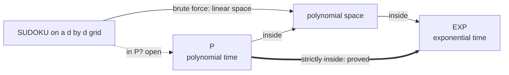
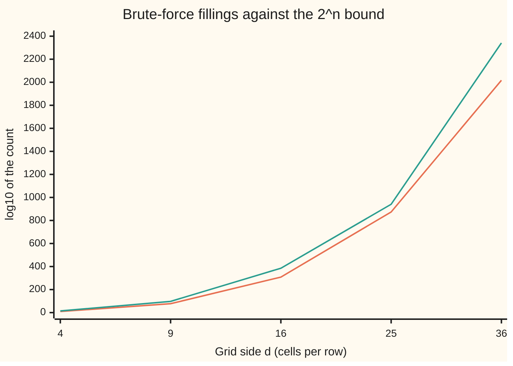

# Time and space classes: cost measured against how the input grows

[Syllabus](../../../SYLLABUS.md) → [Computability and complexity](../README.md) → [Time Complexity](../README.md#s03) → Time and space classes

---

## General Overview

A 4 by 4 sudoku has 16 cells, digits 1 to 4, and four 2 by 2 boxes. Every row, column and box must hold each digit once. The puzzle on this card gives 8 cells and leaves 8 blank.

The bluntest solver is **brute force**: write every possible filling of the 8 blanks, and check each one. Each blank takes one of 4 digits, so there are 4 × 4 × … × 4, eight fours, = 65,536 fillings. Checking one filling compares every pair of cells in every row, column and box: 72 comparisons. The whole search is 4,718,592 comparisons, and it finds exactly one solution.

A 9 by 9 newspaper puzzle with 17 givens has 64 blanks and about 1.18 × 10^61 fillings. What matters is how the worst-case cost grows with the grid. A **complexity class** answers that. It is the set of all problems that some machine can solve within a stated cost bound, where the bound is a function of the input's length.

Two resources get measured. **Time** is the number of steps a Turing machine takes. **Space** is the number of tape cells it visits. Brute-force search takes exponential time, but only as much space as the grid itself, because the same cells are reused for every filling.

**A time or space class collects every problem that some machine solves within a stated bound on steps or tape cells, as a function of the input length; placing a problem in a class means exhibiting one machine and proving its bound on every input.**

**What kind of fact this is:** TIME, SPACE, P and EXP are definitions. Four theorems are proved on this card in Why it works: time bounds space, space bounds time for a machine that halts, the tape counter takes exactly $`2(4^{b+1} - 1)/3`$ steps, and brute-force sudoku sits in linear space and in EXP. Whether sudoku is in P is open: by a theorem stated with its source in Step 5, it is equivalent to P = NP, an open question; the conjecture P ≠ NP is unproved as of 2026-11-11.

### The picture: where brute-force sudoku sits



Schematic, not to scale. A solid arrow means "is contained in". The thick arrow from P to EXP marks the one strict containment that is proved ([Hierarchy and Ladner](09-time-hierarchy-and-ladners-theorem.md)). The dotted arrow from SUDOKU to P is a question, not a containment: nobody knows whether it holds. Whether P differs from polynomial space, or polynomial space from EXP, is unknown. Polynomial space is named here and studied in [Above NP](08-conp-pspace-and-the-polynomial-hierarchy.md).

---

## The formula

Notation first, in words. A **decision problem** is a yes-or-no question about an input string, here "can this grid be completed?". Its yes-inputs form a **language** L ([Finite automata](../01-Models%20of%20Computation/01-finite-automata-and-regular-languages.md)). A machine **decides** L if it halts on every input and answers yes exactly on the strings in L. The **input length** n is the number of symbols on the tape, $`n = \lvert w\rvert`$ for an input string w.

For a cost bound t(n):

```math
\mathrm{TIME}(t(n)) = \{\, L : \text{some deterministic tape machine decides } L \text{ in } O(t(n)) \text{ steps on every input of length } n \,\}
```

**Read it aloud:** TIME of t is the set of problems that some one-tape machine, with one rule per state and symbol, answers within a constant times t(n) steps, on every input of every length.

Space is the same with tape cells visited in place of steps:

```math
\mathrm{SPACE}(s(n)) = \{\, L : \text{some deterministic tape machine decides } L \text{ visiting } O(s(n)) \text{ cells on every input of length } n \,\}
```

The two classes this card names join whole families of bounds:

```math
\mathrm{P} = \bigcup_{k \ge 1} \mathrm{TIME}(n^k), \qquad \mathrm{EXP} = \bigcup_{k \ge 1} \mathrm{TIME}(2^{n^k})
```

**Read it aloud:** P is everything solvable in some fixed power of n steps; EXP is everything solvable in 2 to some fixed power of n steps.

Two bridges connect time and space, both proved below. The second counts **configurations**: snapshots of state, head position and tape contents.

```math
\mathrm{TIME}(t(n)) \subseteq \mathrm{SPACE}(t(n)) \text{ for } t(n) \ge n, \qquad \text{steps of a halting run} < \lvert Q\rvert \cdot s \cdot \lvert \Gamma\rvert^{s}
```

**Read it aloud:** when the time bound is at least the input length, a machine cannot visit more cells than it takes steps; and a machine that halts inside s cells takes fewer steps than it has configurations.

On the tape counter below, with 8 blanks: s = 10 cells, $`\lvert Q\rvert = 3`$, $`\lvert \Gamma\rvert = 5`$, so the bound is 3 × 10 × 5^10 = 292,968,750. The run takes 174,762 steps.

| Symbol | Plain meaning | In our example | Push it up and the answer… |
| --- | --- | --- | --- |
| $`w`$, $`n = \lvert w\rvert`$ | the input string and its length in symbols | a 4 by 4 grid in 48 bits | the bound allows more steps |
| $`L`$ | a language: the inputs whose answer is yes | SUDOKU: grids that can be completed | — |
| $`t(n)`$ | a time bound: steps allowed at input length n | $`2^{2n}`$ for brute force | a bigger class |
| $`s(n)`$ | a space bound: cells allowed at input length n | about n for brute force | a bigger class |
| $`\mathrm{TIME}(t(n))`$, $`\mathrm{SPACE}(s(n))`$ | the problems some machine decides within the bound | SUDOKU is in $`\mathrm{SPACE}(n)`$ | — |
| $`\mathrm{P}`$, $`\mathrm{EXP}`$ | polynomial time; exponential time | SUDOKU is in EXP | — |
| $`k`$ | the fixed power inside P or EXP | any fixed whole number | a bigger single class, same union |
| $`O(\,)`$ | up to a constant multiple, for large n ([Big-O](../../14-Applied%20and%20computational/01-Algorithms%20and%20Growth/01-big-o-and-growth-rates.md)) | 100n counts as O(n) | — |
| $`Q`$, $`\Gamma`$ | the machine's states and its tape alphabet; bars count them | 3 states; 5 symbols, 1 to 4 and blank | more configurations |
| $`d`$ | the grid's side: digits 1 to d | 4, then 9, 16, 25, 36 | input length about $`d^2 \log_2 d`$ bits |
| $`b`$ | the number of blank cells | 8 | fillings $`4^b`$, so ×4 per blank |
| $`T(b)`$, $`j`$ | the counter's total steps; trailing 4s at one increment | 174,762; 0 to 7 | steps about ×4 per blank |

On this shelf the grid is called n by n. This card keeps n for the input length, as the wing does everywhere, and writes the side as d.

### When it holds

- **The cost is the worst case over every input of each length.** One easy puzzle says nothing. Backtracking solves this card's puzzle with 32 digit tests, yet that count says nothing about the hardest grid of each size.
- **The input is written compactly.** A d by d grid takes $`d^2`$ cells of $`\lceil \log_2(d+1)\rceil`$ bits each: 324 bits for 9 by 9. Write numbers in unary (one mark per unit) and a slow method can look fast: see [Pseudo-polynomial time](06-pseudo-polynomial-time-and-numbers-in-the-input.md).
- **The machine is deterministic and halts.** The space-to-time bridge fails for a machine that runs forever: the looping counter below stays inside 10 cells and never stops.
- **Small classes depend on the model; P and EXP do not.** A machine with several tapes running t steps is simulated on one tape in $`O(t^2)`$ steps, and a random-access machine (numbered memory read in one step) in polynomially many. So TIME(n) changes with the model, while P and EXP stay the same.
- **Space counts the input.** With s(n) at least n, as here, cells visited include the input. Classes below n, such as [logarithmic space](10-logarithmic-space-l-and-nl.md), need a separate read-only input tape.

---

## Why it works

### Step 0: one machine is a proof of membership

To put a problem in a class, build one machine and prove its bound on every input. That machine can be slow and crude. Keeping a problem out of a class needs a proof about every possible machine.

So brute force gives an upper bound. It shows sudoku is in EXP. It cannot show sudoku is outside P, because a cleverer machine might exist.

### Step 1: time bounds space

Each step moves the head one cell, so in t steps the head reaches at most t + 1 distinct cells. Space also counts the n input cells. With t(n) at least n, a machine in $`\mathrm{TIME}(t(n))`$ visits at most n + t(n) + 1 cells, which is $`O(t(n))`$. That is $`\mathrm{TIME}(t(n)) \subseteq \mathrm{SPACE}(t(n))`$, and in particular P sits inside polynomial space.

### Step 2: space bounds time, for a machine that halts

A configuration inside s cells is fixed by three things: the state ($`\lvert Q\rvert`$ choices), the head position (s choices) and the contents of the s cells ($`\lvert\Gamma\rvert^s`$ choices). So there are at most $`\lvert Q\rvert \cdot s \cdot \lvert\Gamma\rvert^s`$ configurations.

A deterministic machine has one rule per state and symbol, so each configuration has exactly one successor. If a run met the same configuration twice, it would repeat the loop between them forever. A halting run therefore never repeats, and its length is less than the number of configurations.

For s(n) at least n, that count is $`2^{O(s(n))}`$. So polynomial space sits inside EXP.

<details>
<summary>Detailed proof: a halting machine in s cells takes fewer than |Q| · s · |Γ|^s steps</summary>

Let $`c_0, c_1, \ldots, c_T`$ be the configurations of a halting run, with $`c_T`$ the one where no rule applies. Each $`c_{i+1}`$ is a function of $`c_i`$ alone, because the machine has at most one rule for each state and symbol.

Suppose $`c_i = c_j`$ with $`i < j`$. Then $`c_{i+1} = c_{j+1}`$, and by induction $`c_{i+m} = c_{j+m}`$ for every m. The run then reaches $`c_i`$ again at step $`j + (j - i)`$, and again after that, without end. It never halts, which contradicts the assumption.

So $`c_0, \ldots, c_T`$ are all different. Cells outside the s visited ones never change, so each configuration is fixed by the state, the head's cell and the s visited cells' contents. Counting those choices,

$`\displaystyle T + 1 \le \lvert Q\rvert \cdot s \cdot \lvert\Gamma\rvert^{s}.`$

With $`s \ge n`$ and fixed $`\lvert Q\rvert`$ and $`\lvert\Gamma\rvert`$, the right side is at most $`2^{c\,s}`$ for some constant c, since $`s \le 2^s`$.

</details>

### Step 3: the enumeration on a tape, counted exactly

Brute force is an odometer ([Turing machines](../01-Models%20of%20Computation/07-turing-machines.md)) in base 4. Write the b blank cells as a row of digits, all 1 to start. The counter's rule table has two working states:

- `right` walks right over the digits; at the blank past the end it steps back and switches to `carry`.
- `carry` turns each 4 into 1 and moves left; at a digit 1, 2 or 3 it adds one and switches back to `right`. At the blank on the left it has passed the last value, and halts in `done`.

Every value from 11…1 to 44…4 appears once, so the run sees $`4^b`$ values. The total step count is exactly

```math
T(b) = \frac{2\,(4^{b+1} - 1)}{3}
```

**Read it aloud:** take 4 to the power b + 1, subtract 1, and multiply by two thirds: that is the counter's step count.

For b = 8 that is 174,762 steps, while the head visits only b + 2 = 10 cells. Time grows fourfold per blank; space grows by one cell. That is the whole contrast between the two resources.

<details>
<summary>Detailed proof: the counter takes 2(4^(b+1) − 1)/3 steps</summary>

The first walk takes b steps right, plus one step back from the blank: b + 1 steps.

An increment that meets j trailing 4s takes j carry steps, one step writing the new digit, j steps walking right again, and one step back from the blank: 2j + 2 steps. Of the $`4^b - 1`$ increments, exactly $`3 \cdot 4^{b-1-j}`$ meet j trailing 4s, for j from 0 to b − 1: the j digits on the right are 4s, the next is 1, 2 or 3, and the rest are free.

The last pass meets b 4s and the left blank: b + 1 steps. Adding,

$`\displaystyle T(b) = 2(b+1) + \sum_{j=0}^{b-1} 3 \cdot 4^{b-1-j}\,(2j+2) = 2(b+1) + \frac{2\,(4^{b+1} - 3b - 4)}{3} = \frac{2\,(4^{b+1} - 1)}{3}.`$

The middle step uses $`\sum_{i=0}^{b-1} (b - i)\,4^i = (4^{b+1} - 3b - 4)/9`$, which follows from the geometric sum. The checks confirm the formula by simulation for b = 1 to 9.

</details>

### Step 4: placing SUDOKU in linear space and in EXP

Let SUDOKU be the language of well-formed d by d grids, d a perfect square, that can be completed. The encoding uses $`\lceil \log_2(d+1)\rceil`$ bits per cell, with 0 for a blank.

The brute-force tape machine marks each blank cell, then runs the counter over the marked cells, writing digits in place. After each new value it checks every row, column and box. It answers yes at the first valid filling, and no after the last.

- **Space.** It works inside the grid's own n cells plus a few markers: SUDOKU is in $`\mathrm{SPACE}(n)`$.
- **Time.** A filling is one string of n bits, so there are at most $`2^n`$ fillings. Each check makes $`3d \cdot d(d-1)/2`$ comparisons, under $`n^2`$. Each comparison finds two cells and matches their bits one at a time, walking the tape with markers: $`O(n^2)`$ steps. So the total is at most $`2^n \cdot O(n^4)`$, which is $`O(2^{2n})`$: SUDOKU is in $`\mathrm{TIME}(2^{2n})`$, inside EXP.

Step 2 gives a second road to the same place: $`\mathrm{SPACE}(n)`$ sits inside $`\mathrm{TIME}(2^{O(n)})`$.

### Step 5: what this does not settle

Neither road says SUDOKU is outside P. Generalised d by d sudoku is known to be NP-complete: every problem whose yes-answers can be checked quickly reduces to it ([Reductions](03-polynomial-reductions-and-np-completeness.md)). That is a theorem of Yato and Seta (2003, *IEICE Transactions on Fundamentals* E86-A, 1052–1060), stated here without proof. Its key steps: completing a partly filled Latin square (a grid with each symbol at most once per row and column) is NP-complete (Colbourn, 1984), and their reduction turns any such square into a sudoku whose side is the square's side squared, which can be completed exactly when the square can ([Karp's list](05-karps-problems-and-hardness-recipes.md)). So SUDOKU is in P exactly when P = NP ([P and NP](02-p-and-np.md)). That is an open question; the conjecture P ≠ NP is unproved as of 2026-11-11.

What is proved is that EXP holds problems outside P. That is the time hierarchy theorem, on [Hierarchy and Ladner](09-time-hierarchy-and-ladners-theorem.md).

---

## Worked numbers, by hand

The puzzle, by rows with 0 for a blank: `0 0 3 4 / 0 4 0 2 / 2 0 4 0 / 4 3 0 0`.

| Step | Arithmetic | Value |
| --- | --- | --- |
| input length | 16 cells × 3 bits (0 to 4 needs 3 bits) | 48 bits |
| fillings of 8 blanks | eight 4s multiplied | 65,536 |
| comparisons per check | 12 units × 6 pairs | 72 |
| whole brute-force search | 65,536 × 72 | 4,718,592 comparisons |
| solutions found | every filling checked | 1: `1 2 3 4 / 3 4 1 2 / 2 1 4 3 / 4 3 2 1` |
| tape counter, time | 2(4^9 − 1)/3 | 174,762 steps |
| tape counter, space | 8 digits + 2 blanks | 10 cells |
| configuration bound | 3 × 10 × 5^10 | 292,968,750 |
| placement | at most 2^n fillings, polynomial work each | **SUDOKU is in SPACE(n) and in TIME(2 to the 2n), so in EXP** |

Brute force answers every grid, but its time bound doubles with each extra input bit, while its space only matches the grid.

The same counts at growing sizes, from the checks. Fillings are shown as their power of ten.

| Side d | Input bits n | log10 of fillings, all blank | log10 of 2^n | n^4 | Comparisons per check |
| ---: | ---: | ---: | ---: | ---: | ---: |
| 4 | 48 | 9.63 | 14.45 | 5,308,416 | 72 |
| 9 | 324 | 77.29 | 97.53 | 11,019,960,576 | 972 |
| 16 | 1,280 | 308.25 | 385.32 | 2,684,354,560,000 | 5,760 |
| 25 | 3,125 | 873.71 | 940.72 | 95,367,431,640,625 | 22,500 |
| 36 | 7,776 | 2016.97 | 2340.81 | 3,656,158,440,062,976 | 68,040 |



The orange line is the number of fillings of an all-blank grid, $`d^{d^2}`$. The green line is $`2^n`$, the bound used in Step 4. Orange stays under green at every size, as the proof says. The $`n^4`$ column, the polynomial work per filling allowed in Step 4, stays under $`10^{16}`$ at every size, so it would sit near zero on this chart.

### What breaks if you drop a piece

| Mistake | Comes out at | What went wrong |
| --- | --- | --- |
| Placing one fixed 9 by 9 grid in a class | 9^81 = 1.97 × 10^77 fillings, a constant: TIME(1) | A finite problem is in every class; classes need inputs that grow |
| Taking backtracking's run as its cost | 32 digit tests here, against 65,536 fillings | One easy instance is not the worst case |
| Counting space as time | 10 cells, but 174,762 steps | Cells are reused; steps are not |
| Dropping the halting row, so overflow restarts | 10 cells; the configuration repeats at step 174,762, so it never halts | The space-to-time bridge needs a machine that halts |

The code prints every row.

---

## Code, from first principles, and it actually runs

The code counts every comparison and every step. It takes **three independent roads**. Road 1 is brute force: an odometer over the 8 blanks, with every filling checked in full, its counts compared with $`4^b`$ and $`4^b \times 72`$. Road 2 is backtracking, which places a digit only if nothing clashes; it must find the same single solution. Road 3 runs the counter as a tape machine, copied from the [Turing machines](../01-Models%20of%20Computation/07-turing-machines.md) kit, for b = 1 to 9. Its steps are checked against $`2(4^{b+1} - 1)/3`$, its values seen against $`4^b`$, and its steps against the configuration bound. The looping version is caught by a repeated configuration: a proof that it never halts, not a timeout.

### Python

```python
# Time and space classes -- the check behind the card.  Standard library only.
# Costs are counted steps and comparisons, never a stopwatch.  The puzzle is a
# 4 by 4 sudoku (digits 1 to 4, boxes 2 by 2) with 8 blank cells, written 0.
import math
PUZZLE = [0, 0, 3, 4,  0, 4, 0, 2,  2, 0, 4, 0,  4, 3, 0, 0]
D = 4
UNITS = ([[r * D + c for c in range(D)] for r in range(D)] + [[r * D + c for r in range(D)] for c in range(D)]
         + [[(br + i) * D + bc + j for i in range(2) for j in range(2)] for br in (0, 2) for bc in (0, 2)])
BLANKS = [i for i in range(D * D) if PUZZLE[i] == 0]

def bits(v):                                   # how many bits write the number v
    return len(format(v, "b"))

def rows(g):
    return " / ".join(" ".join(str(x) for x in g[r * D:r * D + D]) for r in range(D))

def full_check(g):                             # every pair in every unit, no early exit
    comps, good = 0, True
    for u in UNITS:
        for a in range(D):
            for b in range(a + 1, D):
                comps += 1
                good = good and g[u[a]] != g[u[b]]
    return good, comps

# ---- road 1: brute force, a base-4 odometer over the blanks ----
digits, fillings, comps, found = [1] * len(BLANKS), 0, 0, []
while True:
    g = PUZZLE[:]
    for i, v in zip(BLANKS, digits):
        g[i] = v
    good, c = full_check(g)
    fillings, comps = fillings + 1, comps + c
    if good:
        found.append(g)
    k = len(digits) - 1
    while k >= 0 and digits[k] == D:
        digits[k], k = 1, k - 1
    if k < 0:
        break
    digits[k] += 1
b = len(BLANKS)
per = 3 * D * D * (D - 1) // 2
print(f"grid {D} x {D}, {b} blanks; puzzle by rows (0 = blank): {rows(PUZZLE)}")
print(f"input length: {D * D} cells x {bits(D)} bits = {D * D * bits(D)} bits")
print(f"road 1, brute force: fillings tried {fillings:,} = 4^{b}; comparisons {comps:,} = {fillings:,} x {per}")
print(f"road 1, solutions found {len(found)}: {rows(found[0])}")
assert fillings == D ** b and comps == D ** b * per and len(found) == 1

# ---- road 2: backtracking, place a digit only if it clashes with nothing so far ----
tests = 0
def back(g, k, out):
    global tests
    if k == len(BLANKS):
        out.append(g[:]); return
    i = BLANKS[k]
    for v in range(1, D + 1):
        tests += 1
        if all(g[j] != v for u in UNITS if i in u for j in u):
            g[i] = v; back(g, k + 1, out); g[i] = 0
sols = []
back(PUZZLE[:], 0, sols)
print(f"road 2, backtracking: same single solution {'yes' if sols == found else 'no'}; digits tested {tests}")
assert sols == found

# ---- road 3: the enumeration on a tape: a base-4 counter over b cells ----
COUNTER = {("right", c): (c, "R", "right") for c in "1234"}
COUNTER.update({("right", "_"): ("_", "L", "carry"), ("carry", "4"): ("1", "L", "carry"),
                ("carry", "1"): ("2", "R", "right"), ("carry", "2"): ("3", "R", "right"),
                ("carry", "3"): ("4", "R", "right"), ("carry", "_"): ("_", "R", "done")})

def run(rules, word, state, cap=10 ** 7, watch=False):
    # Halts when no row applies.  Returns steps, cells visited, values seen, and
    # the step at which a whole configuration first repeats (watch=True only).
    tape, head, steps, cells, seen, configs = dict(enumerate(word)), 0, 0, {0}, 1, set()
    while (state, tape.get(head, "_")) in rules and steps < cap:
        if watch:
            key = (state, head, tuple(sorted(x for x in tape.items() if x[1] != "_")))
            if key in configs:
                return steps, len(cells), seen, steps
            configs.add(key)
        w, m, nxt = rules[(state, tape.get(head, "_"))]
        seen += state == "carry" and nxt == "right"      # one more value of the counter
        state = nxt
        tape[head] = w
        head += 1 if m == "R" else -1
        steps, cells = steps + 1, cells | {head}
    return steps, len(cells), seen, None

print("tape counter on b blanks: steps, cells used, values seen, steps by 2(4^(b+1) - 1)/3, configuration bound")
for k in range(1, 9):
    steps, cells, seen, _ = run(COUNTER, "1" * k, "right")
    bound = 3 * cells * 5 ** cells
    print(f"  b {k}  steps {steps:>7,}  cells {cells:>2}  values {seen:>6,}  formula {2 * (4 ** (k + 1) - 1) // 3:>7,}  bound {bound:>13,}")
    assert steps == 2 * (4 ** (k + 1) - 1) // 3 and cells == k + 2 and seen == 4 ** k and steps <= bound

print("sizes: d, input bits n, log10 of d^(d^2) fillings, log10 of 2^n, n^4, comparisons per check")
chart = []
for d in (4, 9, 16, 25, 36):
    n = d * d * bits(d)
    f, e = d * d * math.log10(d), n * math.log10(2)
    chart.append((d, f, e))
    print(f"  d {d:>2}  n {n:>5,}  {f:8.2f}  {e:8.2f}  {n ** 4:>22,}  {3 * d * d * (d - 1) // 2:>7,}")
    assert f <= e                              # a filling is one string of n bits

def sci(x):
    e = math.floor(x)
    return f"{10 ** (x - e):.2f} x 10^{e}"
print(f"9 x 9 with 17 givens: 64 blanks, 9^64 = {sci(64 * math.log10(9))} fillings; 324^4 = {324 ** 4:,}")

# ---- what breaks ----
print(f"wrong: one fixed 9 x 9 grid, all blank: 9^81 = {sci(81 * math.log10(9))} fillings, a constant")
print(f"wrong: backtracking's {tests} tests on this puzzle read as the worst case, against {fillings:,} fillings")
s8, c8, _, _ = run(COUNTER, "1" * 8, "right")
print(f"wrong: counting space as time: 8 blanks use {c8} cells but {s8:,} steps")
LOOP = dict(COUNTER); LOOP[("carry", "_")] = ("_", "R", "right")   # overflow restarts the count
for k in (2, 8):
    steps, cells, _, rep = run(LOOP, "1" * k, "right", watch=True)
    print(f"wrong: no halting row, b {k}: {cells} cells, configuration repeats at step {rep:,}, so it never halts")
    assert rep == 2 * (4 ** (k + 1) - 1) // 3 and rep <= 3 * cells * 5 ** cells
steps, cells, _, _ = run(COUNTER, "1" * 9, "right")
print(f"try: counter on 9 blanks: {steps:,} steps, {cells} cells")
assert steps == 2 * (4 ** 10 - 1) // 3 and cells == 11
print("chart, log10 fillings " + " ".join(f"{f:.1f}" for _, f, _ in chart))
print("chart, log10 2^n      " + " ".join(f"{e:.1f}" for _, _, e in chart))
print("ALL CHECKS PASS")
```

**Ran 2026-11-19 on macOS, Python 3.14.10, standard library only. All checks passed. Output, pasted from the run:**

```text
grid 4 x 4, 8 blanks; puzzle by rows (0 = blank): 0 0 3 4 / 0 4 0 2 / 2 0 4 0 / 4 3 0 0
input length: 16 cells x 3 bits = 48 bits
road 1, brute force: fillings tried 65,536 = 4^8; comparisons 4,718,592 = 65,536 x 72
road 1, solutions found 1: 1 2 3 4 / 3 4 1 2 / 2 1 4 3 / 4 3 2 1
road 2, backtracking: same single solution yes; digits tested 32
tape counter on b blanks: steps, cells used, values seen, steps by 2(4^(b+1) - 1)/3, configuration bound
  b 1  steps      10  cells  3  values      4  formula      10  bound         1,125
  b 2  steps      42  cells  4  values     16  formula      42  bound         7,500
  b 3  steps     170  cells  5  values     64  formula     170  bound        46,875
  b 4  steps     682  cells  6  values    256  formula     682  bound       281,250
  b 5  steps   2,730  cells  7  values  1,024  formula   2,730  bound     1,640,625
  b 6  steps  10,922  cells  8  values  4,096  formula  10,922  bound     9,375,000
  b 7  steps  43,690  cells  9  values 16,384  formula  43,690  bound    52,734,375
  b 8  steps 174,762  cells 10  values 65,536  formula 174,762  bound   292,968,750
sizes: d, input bits n, log10 of d^(d^2) fillings, log10 of 2^n, n^4, comparisons per check
  d  4  n    48      9.63     14.45               5,308,416       72
  d  9  n   324     77.29     97.53          11,019,960,576      972
  d 16  n 1,280    308.25    385.32       2,684,354,560,000    5,760
  d 25  n 3,125    873.71    940.72      95,367,431,640,625   22,500
  d 36  n 7,776   2016.97   2340.81   3,656,158,440,062,976   68,040
9 x 9 with 17 givens: 64 blanks, 9^64 = 1.18 x 10^61 fillings; 324^4 = 11,019,960,576
wrong: one fixed 9 x 9 grid, all blank: 9^81 = 1.97 x 10^77 fillings, a constant
wrong: backtracking's 32 tests on this puzzle read as the worst case, against 65,536 fillings
wrong: counting space as time: 8 blanks use 10 cells but 174,762 steps
wrong: no halting row, b 2: 4 cells, configuration repeats at step 42, so it never halts
wrong: no halting row, b 8: 10 cells, configuration repeats at step 174,762, so it never halts
try: counter on 9 blanks: 699,050 steps, 11 cells
chart, log10 fillings 9.6 77.3 308.3 873.7 2017.0
chart, log10 2^n      14.4 97.5 385.3 940.7 2340.8
ALL CHECKS PASS
```

### Rust

```rust
// Time and space classes -- the check behind the card.  Rust std only, no crates.
// Costs are counted steps and comparisons, never a stopwatch.  The puzzle is a
// 4 by 4 sudoku (digits 1 to 4, boxes 2 by 2) with 8 blank cells, written 0.
use std::collections::{BTreeMap, HashMap, HashSet};
const PUZZLE: [u32; 16] = [0, 0, 3, 4, 0, 4, 0, 2, 2, 0, 4, 0, 4, 3, 0, 0];
const D: usize = 4;
type Rules = HashMap<(&'static str, char), (char, char, &'static str)>;

fn commas(v: u128) -> String {                     // 65536 -> "65,536"
    let s = v.to_string();
    let mut out = String::new();
    for (i, c) in s.chars().enumerate() {
        if i > 0 && (s.len() - i) % 3 == 0 { out.push(','); }
        out.push(c);
    }
    out
}

fn bits(v: usize) -> usize { format!("{:b}", v).len() } // how many bits write the number v

fn rows(g: &[u32]) -> String {
    (0..D).map(|r| g[r * D..r * D + D].iter().map(|x| x.to_string()).collect::<Vec<_>>().join(" "))
        .collect::<Vec<_>>().join(" / ")
}

fn units() -> Vec<Vec<usize>> {
    let mut u: Vec<Vec<usize>> = (0..D).map(|r| (0..D).map(|c| r * D + c).collect()).collect();
    u.extend((0..D).map(|c| (0..D).map(|r| r * D + c).collect::<Vec<_>>()));
    for br in [0, 2] { for bc in [0, 2] {
        u.push((0..2).flat_map(|i| (0..2).map(move |j| (br + i) * D + bc + j)).collect());
    } }
    u
}

fn full_check(g: &[u32], us: &[Vec<usize>]) -> (bool, u64) { // every pair in every unit, no early exit
    let (mut comps, mut good) = (0u64, true);
    for u in us { for a in 0..D { for b in a + 1..D {
        comps += 1;
        good = good && g[u[a]] != g[u[b]];
    } } }
    (good, comps)
}

fn back(g: &mut Vec<u32>, k: usize, blanks: &[usize], us: &[Vec<usize>], tests: &mut u64, out: &mut Vec<Vec<u32>>) {
    if k == blanks.len() { out.push(g.clone()); return; }
    let i = blanks[k];
    for v in 1..=D as u32 {
        *tests += 1;
        if us.iter().filter(|u| u.contains(&i)).all(|u| u.iter().all(|&j| g[j] != v)) {
            g[i] = v; back(g, k + 1, blanks, us, tests, out); g[i] = 0;
        }
    }
}

// Halts when no row applies.  Returns steps, cells visited, values seen, and
// the step at which a whole configuration first repeats (watch = true only).
fn run(rules: &Rules, word: &str, start: &'static str, watch: bool) -> (u64, usize, u64, Option<u64>) {
    let mut tape: BTreeMap<i64, char> = word.chars().enumerate().map(|(i, c)| (i as i64, c)).collect();
    let (mut head, mut state, mut steps, mut seen) = (0i64, start, 0u64, 1u64);
    let mut cells: HashSet<i64> = HashSet::from([0]);
    let mut configs: HashSet<(&str, i64, Vec<(i64, char)>)> = HashSet::new();
    while let Some(&(w, m, nxt)) = rules.get(&(state, *tape.get(&head).unwrap_or(&'_'))) {
        if steps >= 10_000_000 { break; }
        if watch {
            let key = (state, head, tape.iter().filter(|x| *x.1 != '_').map(|(a, b)| (*a, *b)).collect());
            if configs.contains(&key) { return (steps, cells.len(), seen, Some(steps)); }
            configs.insert(key);
        }
        if state == "carry" && nxt == "right" { seen += 1; } // one more value of the counter
        state = nxt;
        tape.insert(head, w);
        head += if m == 'R' { 1 } else { -1 };
        steps += 1;
        cells.insert(head);
    }
    (steps, cells.len(), seen, None)
}

fn sci(x: f64) -> String { let e = x.floor(); format!("{:.2} x 10^{}", 10f64.powf(x - e), e as i64) }

fn main() {
    let us = units();
    let blanks: Vec<usize> = (0..D * D).filter(|&i| PUZZLE[i] == 0).collect();
    // ---- road 1: brute force, a base-4 odometer over the blanks ----
    let (mut digits, mut fillings, mut comps, mut found) = (vec![1u32; blanks.len()], 0u64, 0u64, Vec::new());
    loop {
        let mut g = PUZZLE.to_vec();
        for (i, v) in blanks.iter().zip(&digits) { g[*i] = *v; }
        let (good, c) = full_check(&g, &us);
        fillings += 1; comps += c;
        if good { found.push(g); }
        let mut k = digits.len() as i64 - 1;
        while k >= 0 && digits[k as usize] == D as u32 { digits[k as usize] = 1; k -= 1; }
        if k < 0 { break; }
        digits[k as usize] += 1;
    }
    let b = blanks.len() as u32;
    let per = (3 * D * D * (D - 1) / 2) as u64;
    println!("grid {} x {}, {} blanks; puzzle by rows (0 = blank): {}", D, D, b, rows(&PUZZLE));
    println!("input length: {} cells x {} bits = {} bits", D * D, bits(D), D * D * bits(D));
    println!("road 1, brute force: fillings tried {} = 4^{}; comparisons {} = {} x {}", commas(fillings as u128), b, commas(comps as u128), commas(fillings as u128), per);
    println!("road 1, solutions found {}: {}", found.len(), rows(&found[0]));
    assert!(fillings == 4u64.pow(b) && comps == 4u64.pow(b) * per && found.len() == 1);

    // ---- road 2: backtracking, place a digit only if it clashes with nothing so far ----
    let (mut tests, mut sols) = (0u64, Vec::new());
    back(&mut PUZZLE.to_vec(), 0, &blanks, &us, &mut tests, &mut sols);
    println!("road 2, backtracking: same single solution {}; digits tested {}", if sols == found { "yes" } else { "no" }, tests);
    assert!(sols == found);

    // ---- road 3: the enumeration on a tape: a base-4 counter over b cells ----
    let mut counter: Rules = HashMap::new();
    for c in ['1', '2', '3', '4'] { counter.insert(("right", c), (c, 'R', "right")); }
    for (k, v) in [(("right", '_'), ('_', 'L', "carry")), (("carry", '4'), ('1', 'L', "carry")),
                   (("carry", '1'), ('2', 'R', "right")), (("carry", '2'), ('3', 'R', "right")),
                   (("carry", '3'), ('4', 'R', "right")), (("carry", '_'), ('_', 'R', "done"))] { counter.insert(k, v); }
    let formula = |k: u32| 2 * (4u64.pow(k + 1) - 1) / 3;
    println!("tape counter on b blanks: steps, cells used, values seen, steps by 2(4^(b+1) - 1)/3, configuration bound");
    for k in 1..=8u32 {
        let (steps, cells, seen, _) = run(&counter, &"1".repeat(k as usize), "right", false);
        let bound = 3 * cells as u128 * 5u128.pow(cells as u32);
        println!("  b {}  steps {:>7}  cells {:>2}  values {:>6}  formula {:>7}  bound {:>13}", k, commas(steps as u128), cells, commas(seen as u128), commas(formula(k) as u128), commas(bound));
        assert!(steps == formula(k) && cells == k as usize + 2 && seen == 4u64.pow(k) && steps as u128 <= bound);
    }

    println!("sizes: d, input bits n, log10 of d^(d^2) fillings, log10 of 2^n, n^4, comparisons per check");
    let mut chart = Vec::new();
    for d in [4usize, 9, 16, 25, 36] {
        let n = d * d * bits(d);
        let (f, e) = ((d * d) as f64 * (d as f64).log10(), n as f64 * 2f64.log10());
        chart.push((f, e));
        println!("  d {:>2}  n {:>5}  {:8.2}  {:8.2}  {:>22}  {:>7}", d, commas(n as u128), f, e, commas((n as u128).pow(4)), commas((3 * d * d * (d - 1) / 2) as u128));
        assert!(f <= e); // a filling is one string of n bits
    }
    println!("9 x 9 with 17 givens: 64 blanks, 9^64 = {} fillings; 324^4 = {}", sci(64.0 * 9f64.log10()), commas(324u128.pow(4)));

    // ---- what breaks ----
    println!("wrong: one fixed 9 x 9 grid, all blank: 9^81 = {} fillings, a constant", sci(81.0 * 9f64.log10()));
    println!("wrong: backtracking's {} tests on this puzzle read as the worst case, against {} fillings", tests, commas(fillings as u128));
    let (s8, c8, _, _) = run(&counter, &"1".repeat(8), "right", false);
    println!("wrong: counting space as time: 8 blanks use {} cells but {} steps", c8, commas(s8 as u128));
    let mut looping = counter.clone();
    looping.insert(("carry", '_'), ('_', 'R', "right")); // overflow restarts the count
    for k in [2u32, 8] {
        let (_, cells, _, rep) = run(&looping, &"1".repeat(k as usize), "right", true);
        let rep = rep.unwrap();
        println!("wrong: no halting row, b {}: {} cells, configuration repeats at step {}, so it never halts", k, cells, commas(rep as u128));
        assert!(rep == formula(k) && rep as u128 <= 3 * cells as u128 * 5u128.pow(cells as u32));
    }
    let (steps, cells, _, _) = run(&counter, &"1".repeat(9), "right", false);
    println!("try: counter on 9 blanks: {} steps, {} cells", commas(steps as u128), cells);
    assert!(steps == formula(9) && cells == 11);
    println!("chart, log10 fillings {}", chart.iter().map(|c| format!("{:.1}", c.0)).collect::<Vec<_>>().join(" "));
    println!("chart, log10 2^n      {}", chart.iter().map(|c| format!("{:.1}", c.1)).collect::<Vec<_>>().join(" "));
    println!("ALL CHECKS PASS");
}
```

**Ran 2026-11-19 on macOS, rustc 1.98.1, no crates. All checks passed. Output, pasted from the run:**

```text
grid 4 x 4, 8 blanks; puzzle by rows (0 = blank): 0 0 3 4 / 0 4 0 2 / 2 0 4 0 / 4 3 0 0
input length: 16 cells x 3 bits = 48 bits
road 1, brute force: fillings tried 65,536 = 4^8; comparisons 4,718,592 = 65,536 x 72
road 1, solutions found 1: 1 2 3 4 / 3 4 1 2 / 2 1 4 3 / 4 3 2 1
road 2, backtracking: same single solution yes; digits tested 32
tape counter on b blanks: steps, cells used, values seen, steps by 2(4^(b+1) - 1)/3, configuration bound
  b 1  steps      10  cells  3  values      4  formula      10  bound         1,125
  b 2  steps      42  cells  4  values     16  formula      42  bound         7,500
  b 3  steps     170  cells  5  values     64  formula     170  bound        46,875
  b 4  steps     682  cells  6  values    256  formula     682  bound       281,250
  b 5  steps   2,730  cells  7  values  1,024  formula   2,730  bound     1,640,625
  b 6  steps  10,922  cells  8  values  4,096  formula  10,922  bound     9,375,000
  b 7  steps  43,690  cells  9  values 16,384  formula  43,690  bound    52,734,375
  b 8  steps 174,762  cells 10  values 65,536  formula 174,762  bound   292,968,750
sizes: d, input bits n, log10 of d^(d^2) fillings, log10 of 2^n, n^4, comparisons per check
  d  4  n    48      9.63     14.45               5,308,416       72
  d  9  n   324     77.29     97.53          11,019,960,576      972
  d 16  n 1,280    308.25    385.32       2,684,354,560,000    5,760
  d 25  n 3,125    873.71    940.72      95,367,431,640,625   22,500
  d 36  n 7,776   2016.97   2340.81   3,656,158,440,062,976   68,040
9 x 9 with 17 givens: 64 blanks, 9^64 = 1.18 x 10^61 fillings; 324^4 = 11,019,960,576
wrong: one fixed 9 x 9 grid, all blank: 9^81 = 1.97 x 10^77 fillings, a constant
wrong: backtracking's 32 tests on this puzzle read as the worst case, against 65,536 fillings
wrong: counting space as time: 8 blanks use 10 cells but 174,762 steps
wrong: no halting row, b 2: 4 cells, configuration repeats at step 42, so it never halts
wrong: no halting row, b 8: 10 cells, configuration repeats at step 174,762, so it never halts
try: counter on 9 blanks: 699,050 steps, 11 cells
chart, log10 fillings 9.6 77.3 308.3 873.7 2017.0
chart, log10 2^n      14.4 97.5 385.3 940.7 2340.8
ALL CHECKS PASS
```

The two outputs match line for line.

### Lean

Lean proves the space-to-time bridge for every deterministic machine, and the counter's exact steps and cells for every b.

- Take a deterministic machine that halts after T steps without leaving s cells. Then $`T < \lvert Q\rvert \cdot s \cdot \lvert\Gamma\rvert^{s}`$.
- Take the tape counter on b blanks. Then it halts after exactly $`T(b) = 2(4^{b+1} - 1)/3`$ steps.
- Take the same counter. Then its head visits exactly b + 2 cells: the b digits and one blank on each side.
- The hand numbers are right: $`4^8`$ = 65,536 fillings, 72 comparisons per check, and 4,718,592 comparisons in all.
- The sizes table multiplies out: n = 48, 324, 1,280, 3,125 and 7,776, with their $`n^4`$ and comparisons per check.
- The step formula gives 10, 42 and so on up to 699,050 for b = 1 to 9.
- The configuration bounds for b = 1 to 8 are right, and 174,762 steps sit under 292,968,750.
- The sum in the counter's detailed proof gives 174,762 at b = 8.
- The puzzle has 8 blanks, and its solution keeps every given with no repeat in any row, column or box.
- Run step by step, the counter halts after exactly 10 steps on 1 blank and 42 steps on 2.

The brute-force and backtracking runs, the log10 columns and the looping counter are left to the Python and Rust checks.

```lean
-- Time and space classes: a deterministic machine that halts inside s tape cells takes fewer than |Q| · s · |Γ|^s steps, and the card's base-4 tape counter on b cells halts after exactly 2(4^(b+1) − 1)/3 steps while visiting only b + 2 cells.
import Mathlib.Data.Fintype.Prod
import Mathlib.Data.Fintype.Pi
import Mathlib.Data.Fintype.Card
import Mathlib.Order.Interval.Set.Basic
import Mathlib.Logic.Function.Iterate
import Mathlib.Tactic.NormNum
import Mathlib.Algebra.BigOperators.Group.Finset.Defs
import Mathlib.Data.Fintype.BigOperators
import Mathlib.Tactic.Ring

/-! ### The configuration bound (Step 2 of the card)

A configuration of a one-tape machine that stays inside `s` cells is its state (in `Q`),
the head's cell (in `Fin s`) and the contents of the `s` cells (a map `Fin s → Γ`).
A deterministic machine is a step function on configurations: `step c = some c'` is the
one successor, and `step c = none` means no rule applies, so the machine halts.
Running for `T` steps is `T`-fold iteration of `Option.bind · step`. -/

/-- Space bounds time, for a machine that halts: a deterministic machine whose run stays
inside `s` tape cells, with state set `Q` and tape alphabet `Γ`, and which halts after `T`
steps (it reaches a configuration `c` after `T` steps and no rule applies at `c`), takes
fewer than `|Q| · s · |Γ|^s` steps. -/
theorem halting_run_steps_lt_configurations
    {Q Γ : Type*} [Fintype Q] [Fintype Γ] {s : ℕ}
    (step : Q × Fin s × (Fin s → Γ) → Option (Q × Fin s × (Fin s → Γ)))
    (c₀ c : Q × Fin s × (Fin s → Γ)) (T : ℕ)
    (hrun : (fun o => Option.bind o step)^[T] (some c₀) = some c)
    (hhalt : step c = none) :
    T < Fintype.card Q * s * Fintype.card Γ ^ s := by
  set g : Option (Q × Fin s × (Fin s → Γ)) → Option (Q × Fin s × (Fin s → Γ)) :=
    fun o => Option.bind o step with hg
  have gnone : ∀ n, g^[n] none = none := by
    intro n
    induction n with
    | zero => rfl
    | succ n ih => rw [Function.iterate_succ_apply]; exact ih
  have hT1 : g^[T + 1] (some c₀) = none := by
    rw [Function.iterate_succ_apply', hrun]; simp [hg, hhalt]
  have hsome : ∀ n ≤ T, g^[n] (some c₀) ≠ none := by
    intro n hn h
    have : g^[T] (some c₀) = none := by
      obtain ⟨k, rfl⟩ := Nat.exists_eq_add_of_le hn
      rw [add_comm, Function.iterate_add_apply, h, gnone]
    rw [hrun] at this; cases this
  let f : Fin (T + 1) → Q × Fin s × (Fin s → Γ) := fun i => (g^[i] (some c₀)).getD c₀
  have hf : ∀ i : Fin (T + 1), g^[i] (some c₀) = some (f i) := by
    intro i
    have := hsome i (Nat.lt_succ_iff.mp i.2)
    obtain ⟨x, hx⟩ := Option.ne_none_iff_exists'.mp this
    simp [f, hx]
  have hinj : Function.Injective f := by
    intro i j hij
    have heq : g^[i] (some c₀) = g^[j] (some c₀) := by rw [hf, hf, hij]
    by_contra hne
    have key : ∀ (a b : ℕ), a < b → b ≤ T → g^[a] (some c₀) = g^[b] (some c₀) → False := by
      intro a b hab hbT he
      have hp : ∀ k, g^[a + k] (some c₀) = g^[b + k] (some c₀) := by
        intro k
        rw [add_comm a, add_comm b, Function.iterate_add_apply, Function.iterate_add_apply, he]
      have h1 := hp (T + 1 - b)
      rw [show b + (T + 1 - b) = T + 1 by omega, hT1] at h1
      exact hsome (a + (T + 1 - b)) (by omega) h1
    rcases Nat.lt_or_gt_of_ne (fun h => hne (Fin.ext h)) with h | h
    · exact key i j h (Nat.lt_succ_iff.mp j.2) heq
    · exact key j i h (Nat.lt_succ_iff.mp i.2) heq.symm
  have := Fintype.card_le_of_injective f hinj
  simp only [Fintype.card_fin, Fintype.card_prod, Fintype.card_fun] at this
  rw [mul_assoc]; omega

/-! ### The card's tape counter (Step 3 of the card)

Tape symbols are whole numbers: `0` is the blank and `1` to `4` are digits. Cells are
numbered by integers. The input is `b` digits `1` in cells `0` to `b - 1`, head on cell `0`,
state `right`. Each rule reads one cell, writes one symbol, moves one cell and changes state,
exactly as in the card's rule table:

* `right` on a digit: keep it, move right, stay in `right`;
  `right` on the blank: keep it, move left, go to `carry`.
* `carry` on `4`: write `1`, move left, stay in `carry`;
  `carry` on `1`, `2` or `3`: add one, move right, go to `right`;
  `carry` on the blank: keep it, move right, go to `done`.
* `done` has no rules, so the machine halts there. -/

/-- The three states of the base-4 counter. -/
inductive CounterState
  | right
  | carry
  | done
  deriving DecidableEq

/-- One step of the counter on configuration (state, head cell, tape). `none` means no rule
applies, so the machine halts. -/
def counterStep : CounterState × ℤ × (ℤ → ℕ) → Option (CounterState × ℤ × (ℤ → ℕ))
  | (.right, h, t) =>
      if 1 ≤ t h ∧ t h ≤ 4 then some (.right, h + 1, t)
      else if t h = 0 then some (.carry, h - 1, t)
      else none
  | (.carry, h, t) =>
      if t h = 4 then some (.carry, h - 1, Function.update t h 1)
      else if 1 ≤ t h ∧ t h ≤ 3 then some (.right, h + 1, Function.update t h (t h + 1))
      else if t h = 0 then some (.done, h + 1, t)
      else none
  | (.done, _, _) => none

/-- The counter's start: `b` digits `1` in cells `0` to `b - 1`, blanks elsewhere, head on
cell `0`, state `right`. -/
def counterStart (b : ℕ) : CounterState × ℤ × (ℤ → ℕ) :=
  (.right, 0, fun i => if 0 ≤ i ∧ i < (b : ℤ) then 1 else 0)

/-- The counter's configuration after `k` steps (`none` once it has halted). -/
def counterRun (b : ℕ) (k : ℕ) : Option (CounterState × ℤ × (ℤ → ℕ)) :=
  (fun o => Option.bind o counterStep)^[k] (some (counterStart b))

/-- Helper: `n` steps of the counter lead from `c` to `c'`. -/
def CounterReach (n : ℕ) (c c' : CounterState × ℤ × (ℤ → ℕ)) : Prop :=
  (fun o => Option.bind o counterStep)^[n] (some c) = some c'

theorem counterReach_zero (c : CounterState × ℤ × (ℤ → ℕ)) : CounterReach 0 c c := rfl

theorem counterReach_one {c c' : CounterState × ℤ × (ℤ → ℕ)} (h : counterStep c = some c') :
    CounterReach 1 c c' := by
  simpa [CounterReach] using h

theorem counterReach_trans {n m : ℕ} {c c' c'' : CounterState × ℤ × (ℤ → ℕ)}
    (h1 : CounterReach n c c') (h2 : CounterReach m c' c'') : CounterReach (n + m) c c'' := by
  unfold CounterReach at *
  rw [add_comm, Function.iterate_add_apply, h1, h2]

theorem counterStep_right_digit {h : ℤ} {t : ℤ → ℕ} (h1 : 1 ≤ t h) (h4 : t h ≤ 4) :
    counterStep (.right, h, t) = some (.right, h + 1, t) := by
  simp [counterStep, h1, h4]

theorem counterStep_right_blank {h : ℤ} {t : ℤ → ℕ} (h0 : t h = 0) :
    counterStep (.right, h, t) = some (.carry, h - 1, t) := by
  simp [counterStep, h0]

theorem counterStep_carry_four {h : ℤ} {t : ℤ → ℕ} (h4 : t h = 4) :
    counterStep (.carry, h, t) = some (.carry, h - 1, Function.update t h 1) := by
  simp [counterStep, h4]

theorem counterStep_carry_inc {h : ℤ} {t : ℤ → ℕ} (h1 : 1 ≤ t h) (h3 : t h ≤ 3) :
    counterStep (.carry, h, t) = some (.right, h + 1, Function.update t h (t h + 1)) := by
  have : t h ≠ 4 := by omega
  simp [counterStep, h1, h3, this]

theorem counterStep_carry_blank {h : ℤ} {t : ℤ → ℕ} (h0 : t h = 0) :
    counterStep (.carry, h, t) = some (.done, h + 1, t) := by
  simp [counterStep, h0]

/-- Helper: the `right` state walks over `k` digits. -/
theorem counter_walk (t : ℤ → ℕ) :
    ∀ (k : ℕ) (h : ℤ), (∀ i, h ≤ i → i < h + k → 1 ≤ t i ∧ t i ≤ 4) →
      CounterReach k (.right, h, t) (.right, h + k, t) := by
  intro k
  induction k with
  | zero => intro h _; simpa using counterReach_zero (.right, h, t)
  | succ k ih =>
    intro h ht
    have h0 := ht h le_rfl (by push_cast; omega)
    have s1 := counterReach_one (counterStep_right_digit (t := t) h0.1 h0.2)
    have s2 := ih (h + 1) (fun i hi1 hi2 => ht i (by omega) (by push_cast at hi2 ⊢; omega))
    have := counterReach_trans s1 s2
    rw [add_comm 1 k] at this
    convert this using 3
    push_cast; ring

/-- Helper: the step count of the carry phase on `m` cells. -/
def counterN : ℕ → ℕ
  | 0 => 0
  | m + 1 => 4 * counterN m + 3 * m + 7

theorem counterN_closed (m : ℕ) : 3 * counterN m + 3 * m + 8 = 8 * 4 ^ m := by
  induction m with
  | zero => simp [counterN]
  | succ m ih => rw [counterN, pow_succ]; omega

/-- Helper: from `carry` at the last cell with the last `m` cells all `1`, the counter runs
through all `4^m` values of those cells and arrives at `carry` one cell left of them. -/
theorem counter_carry_phase (B : ℤ) :
    ∀ (m : ℕ) (t : ℤ → ℕ), (∀ i, B - m ≤ i → i < B → t i = 1) → t B = 0 →
      CounterReach (counterN m) (.carry, B - 1, t) (.carry, B - m - 1, t) := by
  intro m
  induction m with
  | zero => intro t _ _; simpa [counterN] using counterReach_zero (.carry, B - 1, t)
  | succ m ih =>
    intro t ht hB
    set p : ℤ := B - (m + 1 : ℕ) with hp
    -- one increment of cell p: carry at p (inner cells 1) back to carry at p
    have phase : ∀ (u : ℤ → ℕ), (∀ i, B - m ≤ i → i < B → u i = 1) → u B = 0 →
        1 ≤ u p → u p ≤ 3 →
        CounterReach (1 + m + 1 + counterN m) (.carry, p, u)
          (.carry, p, Function.update u p (u p + 1)) := by
      intro u hu huB h1 h3
      have s1 := counterReach_one (counterStep_carry_inc (t := u) h1 h3)
      set u' := Function.update u p (u p + 1) with hu'
      have hpB : p < B := by rw [hp]; push_cast; omega
      have u'i : ∀ i, B - m ≤ i → i < B → u' i = 1 := by
        intro i hi1 hi2
        have : i ≠ p := by rw [hp]; push_cast; omega
        rw [hu', Function.update_of_ne this]; exact hu i hi1 hi2
      have u'B : u' B = 0 := by
        rw [hu', Function.update_of_ne (ne_of_gt hpB)]; exact huB
      have s2 := counter_walk u' m (p + 1) (fun i hi1 hi2 => by
        rw [u'i i (by rw [hp] at hi1; push_cast at hi1; omega)
          (by rw [hp] at hi2; push_cast at hi2; omega)]; omega)
      have s3 : CounterReach 1 (.right, p + 1 + m, u') (.carry, B - 1, u') := by
        have : p + 1 + m = B := by rw [hp]; push_cast; ring
        rw [this]; exact counterReach_one (counterStep_right_blank u'B)
      have s4 := ih u' u'i u'B
      have hpm : B - m - 1 = p := by rw [hp]; push_cast; ring
      rw [hpm] at s4
      exact counterReach_trans (counterReach_trans (counterReach_trans s1 s2) s3) s4
    have hti : ∀ i, B - m ≤ i → i < B → t i = 1 := fun i h1 h2 => ht i (by omega) h2
    have htp : t p = 1 := ht p (by rw [hp]) (by rw [hp]; push_cast; omega)
    have hpB : p < B := by rw [hp]; push_cast; omega
    have upd_i : ∀ (u : ℤ → ℕ) (v : ℕ), (∀ i, B - m ≤ i → i < B → u i = 1) →
        ∀ i, B - m ≤ i → i < B → Function.update u p v i = 1 := by
      intro u v hu i h1 h2
      have : i ≠ p := by rw [hp]; push_cast; omega
      rw [Function.update_of_ne this]; exact hu i h1 h2
    have upd_B : ∀ (u : ℤ → ℕ) (v : ℕ), u B = 0 → Function.update u p v B = 0 := by
      intro u v hu
      rw [Function.update_of_ne (ne_of_gt hpB)]; exact hu
    have r0 := ih t hti hB
    have hpm : B - m - 1 = p := by rw [hp]; push_cast; ring
    rw [hpm] at r0
    have r1 := phase t hti hB (by omega) (by omega)
    rw [htp] at r1
    have r2 := phase (Function.update t p 2) (upd_i t 2 hti) (upd_B t 2 hB)
      (by simp) (by simp)
    simp only [Function.update_self, Function.update_idem] at r2
    have r3 := phase (Function.update t p 3) (upd_i t 3 hti) (upd_B t 3 hB)
      (by simp) (by simp)
    simp only [Function.update_self, Function.update_idem] at r3
    have r4 := counterReach_one
      (counterStep_carry_four (t := Function.update t p 4) (h := p) (by simp))
    simp only [Function.update_idem] at r4
    have key : Function.update t p 1 = t := by rw [← htp]; exact Function.update_eq_self p t
    rw [key] at r4
    have hfin : p - 1 = B - ((m + 1 : ℕ) : ℤ) - 1 := by rw [hp]
    rw [hfin] at r4
    have := counterReach_trans (counterReach_trans (counterReach_trans
      (counterReach_trans r0 r1) r2) r3) r4
    convert this using 1
    simp only [counterN]; ring

/-- Helper: the whole run, as reach facts. -/
theorem counter_reaches_end (b : ℕ) :
    CounterReach (b + 1 + counterN b) (counterStart b)
      (.carry, -1, fun i => if 0 ≤ i ∧ i < (b : ℤ) then 1 else 0) := by
  set t : ℤ → ℕ := fun i => if 0 ≤ i ∧ i < (b : ℤ) then 1 else 0 with ht
  have w := counter_walk t b 0 (fun i h1 h2 => by
    simp only [ht]; split_ifs <;> omega)
  have hb : t b = 0 := by simp [ht]
  simp only [zero_add] at w
  have s := counterReach_one (counterStep_right_blank hb)
  have c := counter_carry_phase (b : ℤ) b t (fun i h1 h2 => by
    simp only [ht]; split_ifs <;> omega) hb
  simp only [sub_self, zero_sub] at c
  exact counterReach_trans (counterReach_trans w s) c

theorem counter_total (b : ℕ) : 2 * (4 ^ (b + 1) - 1) / 3 = b + 1 + counterN b + 1 := by
  have := counterN_closed b
  have h1 : 1 ≤ 4 ^ b := Nat.one_le_pow _ _ (by norm_num)
  rw [pow_succ]
  omega

/-- Helper: every configuration of the run keeps the tape as digits on `0..b-1` and blanks
elsewhere, and keeps the head inside `-1..b`. -/
def CounterInv (b : ℕ) : CounterState × ℤ × (ℤ → ℕ) → Prop
  | (q, h, t) =>
    (∀ i, (0 ≤ i ∧ i < (b : ℤ)) → 1 ≤ t i ∧ t i ≤ 4) ∧
    (∀ i, ¬ (0 ≤ i ∧ i < (b : ℤ)) → t i = 0) ∧
    (match q with
      | .right => 0 ≤ h ∧ h ≤ b
      | .carry => -1 ≤ h ∧ h ≤ b - 1
      | .done => 0 ≤ h ∧ h ≤ b)

theorem counterInv_step (b : ℕ) (c c' : CounterState × ℤ × (ℤ → ℕ))
    (hc : CounterInv b c) (hs : counterStep c = some c') : CounterInv b c' := by
  obtain ⟨q, h, t⟩ := c
  obtain ⟨hd, hz, hh⟩ := hc
  cases q with
  | right =>
    simp only at hh
    by_cases h1 : 1 ≤ t h ∧ t h ≤ 4
    · rw [counterStep_right_digit h1.1 h1.2] at hs
      cases hs
      have : h < b := by
        by_contra hn; have := hz h (by omega); omega
      exact ⟨hd, hz, by simp only; omega⟩
    · by_cases h0 : t h = 0
      · rw [counterStep_right_blank h0] at hs
        cases hs
        have : h = b := by
          by_contra hn; have := hd h (by omega); omega
        exact ⟨hd, hz, by simp only; omega⟩
      · simp [counterStep, h1, h0] at hs
  | carry =>
    simp only at hh
    by_cases h4 : t h = 4
    · rw [counterStep_carry_four h4] at hs
      cases hs
      have hin : 0 ≤ h ∧ h < b := by
        by_contra hn; have := hz h hn; omega
      refine ⟨fun i hi => ?_, fun i hi => ?_, by simp only; omega⟩
      · by_cases e : i = h
        · subst e; simp
        · rw [Function.update_of_ne e]; exact hd i hi
      · have e : i ≠ h := by rintro rfl; exact hi hin
        rw [Function.update_of_ne e]; exact hz i hi
    · by_cases h13 : 1 ≤ t h ∧ t h ≤ 3
      · rw [counterStep_carry_inc h13.1 h13.2] at hs
        cases hs
        have hin : 0 ≤ h ∧ h < b := by
          by_contra hn; have := hz h hn; omega
        refine ⟨fun i hi => ?_, fun i hi => ?_, by simp only; omega⟩
        · by_cases e : i = h
          · subst e; simp; omega
          · rw [Function.update_of_ne e]; exact hd i hi
        · have e : i ≠ h := by rintro rfl; exact hi hin
          rw [Function.update_of_ne e]; exact hz i hi
      · by_cases h0 : t h = 0
        · rw [counterStep_carry_blank h0] at hs
          cases hs
          exact ⟨hd, hz, by simp only; omega⟩
        · simp [counterStep, h4, h13, h0] at hs
  | done => simp [counterStep] at hs

theorem counterInv_run (b k : ℕ) (c : CounterState × ℤ × (ℤ → ℕ))
    (hk : counterRun b k = some c) : CounterInv b c := by
  induction k generalizing c with
  | zero =>
    simp only [counterRun, Function.iterate_zero, id, Option.some.injEq] at hk
    subst hk
    refine ⟨fun i hi => by simp [hi], fun i hi => by simp [hi], ?_⟩
    simp only; omega
  | succ k ih =>
    unfold counterRun at hk
    rw [Function.iterate_succ_apply'] at hk
    cases hprev : (fun o => Option.bind o counterStep)^[k] (some (counterStart b)) with
    | none => rw [hprev] at hk; simp at hk
    | some c₁ =>
      rw [hprev] at hk
      exact counterInv_step b c₁ c (ih c₁ hprev) hk

/-- The tape counter's time, counted exactly: on `b` blank cells the base-4 counter runs
through every value from `11…1` to `44…4` and halts after exactly `2(4^(b+1) − 1)/3` steps:
after that many steps it is in a configuration where no rule applies. -/
theorem counter_halts_in_exact_steps (b : ℕ) :
    ∃ c, counterRun b (2 * (4 ^ (b + 1) - 1) / 3) = some c ∧ counterStep c = none := by
  have e := counter_reaches_end b
  have s := counterReach_one (counterStep_carry_blank
    (h := -1) (t := fun i => if 0 ≤ i ∧ i < (b : ℤ) then 1 else 0) (by simp))
  refine ⟨(.done, -1 + 1, fun i => if 0 ≤ i ∧ i < (b : ℤ) then 1 else 0), ?_, ?_⟩
  · rw [counter_total]; exact counterReach_trans e s
  · simp [counterStep]

/-- The tape counter's space: during its whole halting run the counter's head visits exactly
the `b + 2` cells numbered `-1` to `b` (the `b` digits and one blank on each side). -/
theorem counter_visits_exactly_b_plus_two_cells (b : ℕ) :
    {h : ℤ | ∃ k ≤ 2 * (4 ^ (b + 1) - 1) / 3, ∃ q t, counterRun b k = some (q, h, t)} =
      Set.Icc (-1 : ℤ) b := by
  ext h
  simp only [Set.mem_ofPred_eq, Set.mem_Icc]
  constructor
  · rintro ⟨k, -, q, t, hk⟩
    obtain ⟨-, -, hh⟩ := counterInv_run b k _ hk
    cases q <;> simp only at hh <;> omega
  · intro hh
    rw [counter_total]
    by_cases hm : h = -1
    · subst hm
      exact ⟨b + 1 + counterN b, by omega, _, _, counter_reaches_end b⟩
    · lift h to ℕ using (by omega) with n
      refine ⟨n, by omega, .right, fun i => if 0 ≤ i ∧ i < (b : ℤ) then 1 else 0, ?_⟩
      have w := counter_walk (fun i => if 0 ≤ i ∧ i < (b : ℤ) then 1 else 0) n 0
        (fun i h1 h2 => by split_ifs <;> omega)
      simp only [zero_add] at w
      exact w

/-! ### The card's whole-number worked examples -/

-- input length: 16 cells of 3 bits each (0 to 4 needs 3 bits)
example : 16 * 3 = 48 ∧ 2 ^ 2 ≤ 4 ∧ 4 < 2 ^ 3 := by norm_num
-- fillings of 8 blanks: eight 4s multiplied
example : 4 ^ 8 = 65536 := by norm_num
-- comparisons per check: 12 units of 6 pairs, that is 3d · d(d − 1)/2 at d = 4
example : 12 * 6 = 72 ∧ 3 * 4 * (4 * 3 / 2) = 72 := by norm_num
-- the whole brute-force search
example : 65536 * 72 = 4718592 := by norm_num
-- comparisons per check at d = 9, 16, 25, 36
example : 3 * 9 * (9 * 8 / 2) = 972 ∧ 3 * 16 * (16 * 15 / 2) = 5760 ∧
    3 * 25 * (25 * 24 / 2) = 22500 ∧ 3 * 36 * (36 * 35 / 2) = 68040 := by norm_num
-- input bits n at d = 9, 16, 25, 36 (4, 5, 5, 6 bits per cell) and n^4
example : 81 * 4 = 324 ∧ 256 * 5 = 1280 ∧ 625 * 5 = 3125 ∧ 1296 * 6 = 7776 := by norm_num
example : 48 ^ 4 = 5308416 ∧ 324 ^ 4 = 11019960576 ∧ 1280 ^ 4 = 2684354560000 ∧
    3125 ^ 4 = 95367431640625 ∧ 7776 ^ 4 = 3656158440062976 := by norm_num
-- the tape counter's step formula 2(4^(b+1) − 1)/3 for b = 1 to 9
example : 2 * (4 ^ 2 - 1) / 3 = 10 ∧ 2 * (4 ^ 3 - 1) / 3 = 42 ∧ 2 * (4 ^ 4 - 1) / 3 = 170 ∧
    2 * (4 ^ 5 - 1) / 3 = 682 ∧ 2 * (4 ^ 6 - 1) / 3 = 2730 ∧ 2 * (4 ^ 7 - 1) / 3 = 10922 ∧
    2 * (4 ^ 8 - 1) / 3 = 43690 ∧ 2 * (4 ^ 9 - 1) / 3 = 174762 ∧
    2 * (4 ^ 10 - 1) / 3 = 699050 := by norm_num
-- the configuration bound at b = 8: 3 states, 10 cells, 5 symbols
example : 3 * 10 * 5 ^ 10 = 292968750 ∧ 174762 < 3 * 10 * 5 ^ 10 := by norm_num
-- the configuration bounds at b = 1 to 7 (cells b + 2)
example : 3 * 3 * 5 ^ 3 = 1125 ∧ 3 * 4 * 5 ^ 4 = 7500 ∧ 3 * 5 * 5 ^ 5 = 46875 ∧
    3 * 6 * 5 ^ 6 = 281250 ∧ 3 * 7 * 5 ^ 7 = 1640625 ∧ 3 * 8 * 5 ^ 8 = 9375000 ∧
    3 * 9 * 5 ^ 9 = 52734375 := by norm_num
-- the sum in the counter's proof at b = 8: first walk, increments by trailing 4s, last pass
example : 2 * (8 + 1) + (∑ j ∈ Finset.range 8, 3 * 4 ^ (8 - 1 - j) * (2 * j + 2)) = 174762 := by
  decide
-- the puzzle's solution 1 2 3 4 / 3 4 1 2 / 2 1 4 3 / 4 3 2 1 keeps every given of
-- 0 0 3 4 / 0 4 0 2 / 2 0 4 0 / 4 3 0 0 and has no repeat in any row, column or 2 by 2 box
example :
    let puzzle : List ℕ := [0, 0, 3, 4, 0, 4, 0, 2, 2, 0, 4, 0, 4, 3, 0, 0]
    let sol : List ℕ := [1, 2, 3, 4, 3, 4, 1, 2, 2, 1, 4, 3, 4, 3, 2, 1]
    let units : List (List ℕ) :=
      [[0, 1, 2, 3], [4, 5, 6, 7], [8, 9, 10, 11], [12, 13, 14, 15],
       [0, 4, 8, 12], [1, 5, 9, 13], [2, 6, 10, 14], [3, 7, 11, 15],
       [0, 1, 4, 5], [2, 3, 6, 7], [8, 9, 12, 13], [10, 11, 14, 15]]
    (List.zip puzzle sol).all (fun p => p.1 == 0 || p.1 == p.2) = true ∧
      units.all (fun u => (u.map fun i => sol.getD i 0).Nodup) = true ∧
      (puzzle.filter (· == 0)).length = 8 := by
  decide
-- the counter on b = 1 and b = 2 blanks halts after exactly 10 and 42 steps
example : (counterRun 1 10).isSome = true ∧ (counterRun 1 10).bind counterStep = none := by
  decide
example : (counterRun 2 42).isSome = true ∧ (counterRun 2 42).bind counterStep = none := by
  decide

#print axioms CounterReach
#print axioms counterReach_zero
#print axioms counterReach_one
#print axioms counterReach_trans
#print axioms counterStep_right_digit
#print axioms counterStep_right_blank
#print axioms counterStep_carry_four
#print axioms counterStep_carry_inc
#print axioms counterStep_carry_blank
#print axioms counter_walk
#print axioms counterN
#print axioms counterN_closed
#print axioms counter_carry_phase
#print axioms counter_reaches_end
#print axioms counter_total
#print axioms CounterInv
#print axioms counterInv_step
#print axioms counterInv_run
#print axioms halting_run_steps_lt_configurations
#print axioms counter_halts_in_exact_steps
#print axioms counter_visits_exactly_b_plus_two_cells
```

**Checked 2026-11-19 on macOS, Lean 4.36.0-rc2, Mathlib v4.36.0-rc2. Every proof is complete and uses only Lean's standard axioms. Output, pasted from the run:**

```
'CounterReach' does not depend on any axioms
'counterReach_zero' does not depend on any axioms
'counterReach_one' depends on axioms: [Quot.sound]
'counterReach_trans' depends on axioms: [propext]
'counterStep_right_digit' depends on axioms: [propext]
'counterStep_right_blank' depends on axioms: [propext]
'counterStep_carry_four' depends on axioms: [propext]
'counterStep_carry_inc' depends on axioms: [propext, Quot.sound]
'counterStep_carry_blank' depends on axioms: [propext]
'counter_walk' depends on axioms: [propext, Quot.sound]
'counterN' does not depend on any axioms
'counterN_closed' depends on axioms: [propext, Quot.sound]
'counter_carry_phase' depends on axioms: [propext, Classical.choice, Quot.sound]
'counter_reaches_end' depends on axioms: [propext, Classical.choice, Quot.sound]
'counter_total' depends on axioms: [propext, Classical.choice, Quot.sound]
'CounterInv' does not depend on any axioms
'counterInv_step' depends on axioms: [propext, Classical.choice, Quot.sound]
'counterInv_run' depends on axioms: [propext, Classical.choice, Quot.sound]
'halting_run_steps_lt_configurations' depends on axioms: [propext, Classical.choice, Quot.sound]
'counter_halts_in_exact_steps' depends on axioms: [propext, Classical.choice, Quot.sound]
'counter_visits_exactly_b_plus_two_cells' depends on axioms: [propext, Classical.choice, Quot.sound]
```

> [!TIP]
> **Try changing**
> - Guess first: how many steps and cells does the counter need for 9 and 10 blanks? Change `range(1, 9)` in the counter loop to `range(1, 11)`. Answer: 699,050 steps in 11 cells, then 2,796,202 steps in 12 cells, each under its configuration bound (1,611,328,125 and 8,789,062,500). Time grows fourfold per blank; space grows by one cell. Every assert passes.
> - Guess first: at what step does the looping counter on 5 blanks repeat its configuration? Change `for k in (2, 8)` to `for k in (5,)`. Answer: step 2,730, inside 7 cells, which equals T(5). Every assert passes.
> - Guess first: blank one more given by changing the 3 in the first row of `PUZZLE` to 0. How many fillings, and how many solutions? Answer: 4^9 = 262,144 fillings and 18,874,368 comparisons, and now 2 solutions, the second `3 2 1 4 / 1 4 3 2 / 2 1 4 3 / 4 3 2 1`. The one-solution assert stops the run.
> - Guess first: add 49 to the sizes loop, `for d in (4, 9, 16, 25, 36, 49)`. How many input bits, and do the fillings still sit under 2^n? Answer: 14,406 bits; 10^4058.16 fillings against 10^4336.64, so the assert passes.

---

## The usual mistake

> [!warning]
> **Reading a slow machine as proof that a problem is hard.** Brute force takes exponential time, so it places SUDOKU in EXP. It does not place SUDOKU outside P. Membership needs one machine; exclusion needs a proof about every machine. For SUDOKU that exclusion would prove P ≠ NP, which is unproved as of 2026-11-11.
>
> Smaller traps, each with the wrong number it produces:
> - **Measuring against the grid side, not the input length.** A 9 by 9 grid is 324 bits, not 9. Classes are defined in input length.
> - **Placing one fixed size in a class.** One 9 by 9 grid has at most 9^81 = 1.97 × 10^77 fillings: a constant, so TIME(1). That says nothing about growth.
> - **Counting space as time.** The counter on 8 blanks uses 10 cells and 174,762 steps. Space is reused; time is not.
> - **Treating one run as the worst case.** Backtracking's 32 digit tests on this puzzle say nothing about its worst case.

---

## Where you meet it in real life

- **Puzzle apps.** A 9 by 9 sudoku is one fixed size, so solvers finish fast with backtracking and deduction.
- **Choosing an algorithm.** Library documentation quotes costs such as O(n log n). "In P" is the coarse version: some fixed power of n, on any reasonable machine.
- **Checking hardware and protocols.** A model checker explores every configuration of a design with fixed memory. The count $`\lvert Q\rvert \cdot s \cdot \lvert\Gamma\rvert^s`$ is why that search explodes as memory grows.
- **Type checkers.** Deciding whether a program in the ML family of programming languages has a type is complete for exponential time in the worst case, as Mairson, and independently Kfoury, Tiuryn and Urzyczyn, proved in 1990. On programs people write, it runs fast: a class is a worst-case statement.

> **Say it back**
> A time class holds every problem some deterministic tape machine solves within a step bound, and a space class within a bound on cells visited, both as functions of the input length. P is polynomial time and EXP is exponential time. A machine visits no more cells than it takes steps, and a halting machine takes fewer steps than it has configurations. Brute-force sudoku reuses the grid's cells for every filling, so it sits in linear space and in EXP. Whether sudoku is in P is the P versus NP question.

---

## What this builds on

- [Turing machines](../01-Models%20of%20Computation/07-turing-machines.md): the tape, head and rule table that define one step and one cell, and the odometer that became the base-4 counter here.
- [Big-O](../../14-Applied%20and%20computational/01-Algorithms%20and%20Growth/01-big-o-and-growth-rates.md): O( ) as "up to a constant, for large n", which lets TIME(100n) equal TIME(n).
- [Polynomial or exponential](../../14-Applied%20and%20computational/01-Algorithms%20and%20Growth/03-polynomial-versus-exponential-time.md): the comparison of n³ with 2ⁿ at real sizes, which is why P and EXP are the classes worth naming.

## Where this goes next

- [P and NP](02-p-and-np.md): the class of problems whose yes-answers can be checked quickly, where a filled-in sudoku is the certificate.
- [Hierarchy and Ladner](09-time-hierarchy-and-ladners-theorem.md): the proof that more time really buys more, so P is strictly inside EXP.
- [Logarithmic space](10-logarithmic-space-l-and-nl.md): L and NL, where a few counters are all the memory you get.
- [Space hierarchy](12-space-hierarchy-theorem.md): more memory really helps, and L is strictly smaller than PSPACE.
- [NC and P-completeness](../05-Algebraic%2C%20Interactive%20and%20Quantum/09-parallel-complexity-nc-and-p-completeness.md): what parallel machines do fast, and what seems stubbornly sequential.

The question this card leaves open: can the $`2^n`$ search for a sudoku solution be replaced by a polynomial one, or does checking quickly not mean solving quickly?

---

## Sources

Verified 2026-11-19: every link below resolves to the publisher's page.

- Hartmanis, Juris, and Richard E. Stearns. "On the Computational Complexity of Algorithms." *Transactions of the American Mathematical Society* 117 (1965): 285–306. [doi:10.1090/S0002-9947-1965-0170805-7](https://doi.org/10.1090/S0002-9947-1965-0170805-7). Defines time classes by step bounds on tape machines, and simulates several tapes on one in squared time.
- Stearns, Richard E., Juris Hartmanis, and Philip M. Lewis II. "Hierarchies of Memory Limited Computations." *6th Annual Symposium on Switching Circuit Theory and Logical Design* (1965): 179–190. [doi:10.1109/FOCS.1965.11](https://doi.org/10.1109/FOCS.1965.11). The matching definition for space, counted in tape cells.
- Cook, Stephen A., and Robert A. Reckhow. "Time Bounded Random Access Machines." *Journal of Computer and System Sciences* 7 (1973): 354–375. [doi:10.1016/S0022-0000(73)80029-7](https://doi.org/10.1016/S0022-0000(73)80029-7). Random-access machines and tape machines simulate each other in polynomial time, so P does not depend on the model.
- Sipser, Michael. *Introduction to the Theory of Computation*, 3rd ed. Cengage. [Publisher page](https://www.cengage.com/c/introduction-to-the-theory-of-computation-3e-sipser/9781133187790/). TIME, SPACE, P and EXP in the form used here, and the configuration count, chapters 7 and 8.
- Mairson, Harry G. "Deciding ML Typability Is Complete for Deterministic Exponential Time." *Proceedings of the 17th ACM SIGPLAN-SIGACT Symposium on Principles of Programming Languages* (1990): 382–401. [doi:10.1145/96709.96748](https://doi.org/10.1145/96709.96748). The worst-case cost of ML type inference, cited under Type checkers.
