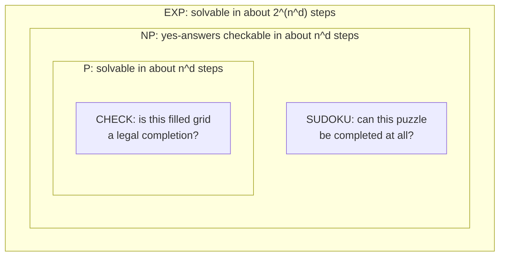
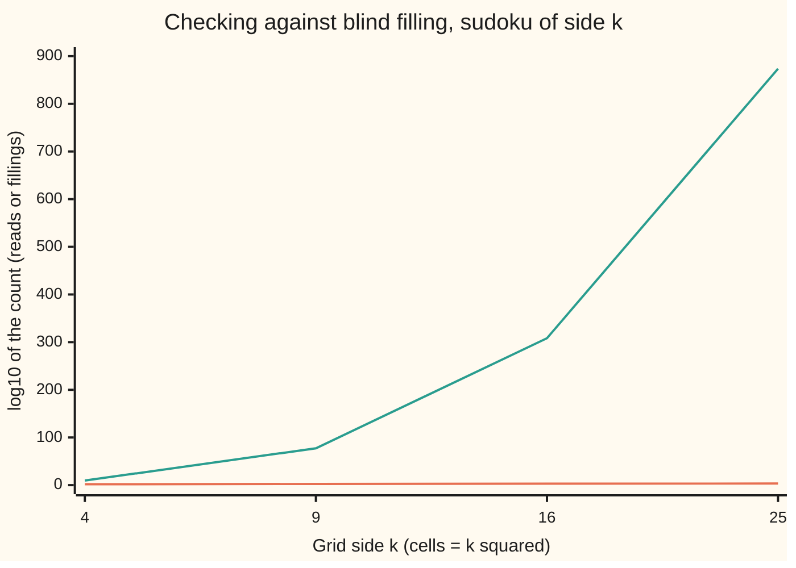

# P and NP: solving quickly against checking quickly

[Syllabus](../../../SYLLABUS.md) → [Computability and complexity](../README.md) → [Time Complexity](../README.md#s03) → P and NP

---

## General Overview

A newspaper sudoku is a 9 by 9 grid with some digits printed in it, the **givens**. The rule: every row, every column and every 3 by 3 box holds the digits 1 to 9 once each. A puzzle with one answer can have as few as 17 givens, which leaves 64 blank cells.

Two tasks sit on that page, and they cost very different amounts.

- **Checking a filled grid.** Compare the 81 cells with the givens, then read each of the 27 groups (9 rows, 9 columns, 9 boxes) once. That is 324 cell reads, done in minutes by hand.
- **Filling the grid.** Trying every way to write a digit in each blank gives $`9^{64}`$, about $`1.18 \times 10^{61}`$, fillings. Clever solvers do far better on newspaper puzzles. Nobody has proved that any method stays fast on every puzzle as the grid grows.

Complexity theory gives the two tasks names. Problems a machine can **solve** in a number of steps bounded by a power of the input length form the class **P**. Problems whose yes-answers come with evidence that a machine can **check** in such a number of steps form the class **NP**.

This card states both classes exactly, on yes-or-no problems, and places the two sudoku tasks. A small 4 by 4 sudoku carries the worked numbers.

**P holds the yes-or-no problems a machine answers in polynomially many steps; NP holds those whose yes-answers have a short certificate that such a machine can check; checking a filled sudoku is in P, and deciding whether a puzzle can be filled is in NP, with nobody knowing whether it is also in P.**

**What kind of fact this is:** two definitions, plus theorems proved on this card in Why it works: checking a grid is in P, filling is in NP, P sits inside NP, NP sits inside exponential time, and the checking definition of NP equals the guessing-machine one. Whether P equals NP is open: P ≠ NP is a conjecture, unproved as of 2026-11-11.

### The picture: where the two tasks sit



Schematic, not to scale. P ⊆ NP ⊆ EXP is proved on this card. P ≠ EXP is proved (the time hierarchy, on [Hierarchy and Ladner](09-time-hierarchy-and-ladners-theorem.md)), so at least one of the two inclusions is strict. Which one is unknown. SUDOKU is drawn outside P only because no one knows how to put it inside.

---

## The formula

Notation first, in words. A **decision problem** is a yes-or-no question about an input. The input is a string x of n symbols, so $`n = \lvert x\rvert`$. The problem itself is the set L of inputs whose answer is yes, called a language on the shelf 01 cards. "Decide L" means: say yes on every x in L and no on every x outside it.

[Time and space classes](01-time-and-space-classes.md) defines $`\mathrm{TIME}(t(n))`$: the problems some machine decides in about t(n) steps on inputs of length n. P collects every polynomial bound:

```math
\mathrm{P} = \bigcup_{d \ge 1} \mathrm{TIME}(n^d)
```

**Read it aloud:** P is every problem that some machine decides within n to some fixed power d steps.

A **verifier** V(x, c) is a machine that reads the input x and a second string c, the **certificate** (proposed evidence), and answers 1 (accept) or 0 (reject). NP is defined by verifiers:

```math
L \in \mathrm{NP} \iff \text{some } V \text{ runs in about } n^d \text{ steps, and for every input } x\text{: } x \in L \iff \exists\, c \text{ with } \lvert c\rvert \le n^d \text{ and } V(x, c) = 1
```

**Read it aloud:** a problem is in NP when a fast verifier exists such that every input is a yes exactly when some short certificate makes the verifier accept.

The symbol $`\in`$ means "is a member of", $`\bigcup`$ joins the classes for every d into one, and $`\iff`$ means "exactly when". The symbol $`\exists`$ means "there exists", as on [Quantifiers](../../01-Foundations/05-Logic/04-quantifiers.md). Only the yes side needs evidence. A no-input must make the verifier reject every certificate, but nothing short has to prove that it is a no.

P names a class, not a probability; this wing writes probability as Pr[·].

| Symbol | Plain meaning | In our example | Push it up and the answer… |
| --- | --- | --- | --- |
| $`x`$ | the input: one puzzle, written cell by cell | `1.3. / .41. / 2..3 / .3.1` | — |
| $`n = \lvert x\rvert`$ | input length, in bits as on [Time and space classes](01-time-and-space-classes.md) | 48: 16 cells of 3 bits | every cost below is measured against it |
| $`k`$ | the grid's side; the grid has $`k^2`$ cells | 4 | n grows as about $`k^2 \log_2 k`$ |
| $`L`$ | the problem: the set of yes-inputs | SUDOKU, the puzzles that have a completion | — |
| $`c`$ | certificate: evidence offered for a yes | the filled grid `1234 / 3412 / 2143 / 4321` | a longer one is allowed only up to $`n^d`$ |
| $`\lvert c\rvert`$ | certificate length, in bits | 48, the same as n | past every $`n^d`$ it no longer counts |
| $`V(x, c)`$ | verifier: answers 1 or 0 | 64 cell reads, answer 1 | — |
| $`d`$ | the fixed power in a polynomial bound | 1 when cell reads are counted: the verifier makes $`4k^2`$ reads; in machine steps, a larger fixed power | a bigger fixed d is still polynomial |
| $`\mathrm{TIME}(t(n))`$ | problems decided in about t(n) steps | CHECK is in $`\mathrm{TIME}(n^d)`$ for a fixed d: $`4k^2`$ reads, each costing polynomially many steps | the class grows |
| P | decided in polynomially many steps | CHECK | — |
| NP | yes-answers checked in polynomially many steps | SUDOKU | — |
| EXP | decided in about $`2^{n^d}`$ steps | blind search, 65,536 fillings | — |

[Time and space classes](01-time-and-space-classes.md) wrote the power as k and the grid's side as d. This card swaps them to match the later cards on this shelf, which write powers as $`n^d`$: here d is the power and k the side.

### When it holds

- **A yes-or-no question.** "Fill this grid" asks for an object, not a yes or no; the classes hold its decision version, "can this grid be filled?" Asked one blank at a time, yes-or-no answers rebuild a filling: try each digit in the first blank and keep one the answer calls fillable.
- **A family of inputs that grows.** One fixed 9 by 9 grid is a finite problem, and any finite problem is in P: a table of answers does it. The classes speak about sudoku on k by k grids as k grows, with k a square number (4, 9, 16, 25) so that the boxes fit.
- **A short certificate.** It must have at most $`n^d`$ symbols. Allow any length and a no-puzzle, such as the one in What breaks below, gets a certificate of "no completion" too: the list of all 65,536 failed fillings, 1,048,576 digits against the puzzle's 16. That is no longer a quick check.
- **A verifier that checks everything.** A verifier that reads only the rows accepts 16 fillings of the puzzle, not 1. Accepting a wrong certificate breaks the "only if" half of the definition.
- **Yes and no are not symmetric.** NP promises evidence for yes only. The class whose no-answers have short certificates is coNP, on [Above NP](08-conp-pspace-and-the-polynomial-hierarchy.md).

---

## Why it works

### Step 0: a yes-answer can carry its own evidence

A completed grid proves that the puzzle has a completion. Anyone can check it without knowing how it was found. NP is the set of problems where this always works with evidence of polynomial length.

P asks more: the machine must find the answer itself, with no help. The rest of the card counts both costs on sudoku.

### Step 1: checking a filled grid is in P

CHECK takes a puzzle and a filled grid and asks: is the grid a legal completion? The checker does two passes.

1. For each of the $`k^2`$ cells, compare the filled digit with the given, where there is one: $`k^2`$ reads.
2. For each of the 3k groups (k rows, k columns, k boxes), read its k cells and tick each digit off a list of 1 to k: $`3k \times k = 3k^2`$ reads.

The total is $`4k^2`$ reads, four per cell. On the 4 by 4 puzzle that is 64 reads; on a 9 by 9, 324.

CHECK's input is the puzzle plus the grid, $`2k^2`$ cells, so the reads are twice the number of input cells: linear, a polynomial with d = 1. That d = 1 counts reads, not machine steps. One read is not a single step: a digit up to k takes about $`\log_2 k`$ bits, and a one-tape machine must walk between the puzzle, the grid and its tick list. Each read and tick still costs a polynomial number of steps in n, so the total is polynomial and CHECK is in P.

Cells and bits are polynomially related. A grid of $`k^2`$ cells takes $`n = k^2 \lceil \log_2(k+1)\rceil`$ bits, the bits per cell rounded up to a whole number: 48 for 4 by 4 and 324 for 9 by 9, as on [Time and space classes](01-time-and-space-classes.md). So a cost polynomial in cells is polynomial in n, and the costs below are counted in cells.

### Step 2: deciding SUDOKU is in NP

SUDOKU asks: does this puzzle have any legal completion? Take the certificate c to be a filled grid, written cell by cell like the puzzle, so $`\lvert c\rvert = n`$. Take V to be the checker from Step 1.

Both halves of the definition hold.

- If the puzzle has a completion, that completion is a certificate V accepts.
- If V accepts some c, then c agrees with every given and fills every group legally, so c is a completion and the puzzle is a yes.

The givens pass does real work: run on all 288 legal 4 by 4 grids, V accepts 1 for the puzzle and 0 for the no-puzzle in What breaks. V makes $`4k^2`$ reads, polynomially many steps. So SUDOKU is in NP.

### Step 3: P sits inside NP

Take a problem in P and its fast decider. Build a verifier that ignores the certificate and runs the decider on x. It runs in polynomial time, and the empty certificate works for every yes. So every problem in P is in NP. CHECK is in both.

### Step 4: NP sits inside exponential time

A verifier with certificates of at most $`n^d`$ symbols can be run on every possible certificate. With a fixed alphabet there are exponentially many, about $`2^{n^d}`$ up to a fixed factor in the power. Each is checked in about $`n^d`$ steps, and the product is still about 2 to a polynomial power of n. So the problem is in EXP.

For the 4 by 4 puzzle with 8 blanks the search tries $`4^8 = 65{,}536`$ fillings at 64 reads each: 4,194,304 reads. It finds exactly one completion. That is the price of having no evidence.

### Step 5: checking is the same as guessing

NP is short for **nondeterministic polynomial time**. A guessing machine, as on [Guessing machines](../01-Models%20of%20Computation/02-nondeterminism-and-the-subset-construction.md), may take every allowed move at once and accepts when any branch accepts. The original definition of NP uses a guessing tape machine of the kind on [Turing machines](../01-Models%20of%20Computation/07-turing-machines.md), stopping within $`n^d`$ steps on every branch. It agrees with the verifier definition.

- **Verifier to guesser.** Guess the certificate one symbol at a time, then run V. For the puzzle: guess 8 digits, then read 64 cells. That is 65,536 branches of 72 counted moves each, 8 guesses and 64 reads, and one branch accepts.
- **Guesser to verifier.** If a guessing machine accepts within $`n^d`$ steps, the list of choices along an accepting branch is a certificate of at most $`n^d`$ symbols. The verifier replays the machine, taking those choices.

<details>
<summary>Detailed proof: the two definitions of NP agree</summary>

Suppose L has a verifier V running in at most $`n^d`$ steps, with certificates of at most $`n^d`$ symbols. Build a guessing machine N. On input x it writes a certificate c, one symbol per step, choosing each symbol by a guess, for at most $`n^d`$ steps. Then it runs V on x and c and accepts when V accepts.

Some branch of N accepts exactly when some c makes V accept, which is exactly when x is in L. Every branch takes at most twice $`n^d`$ steps, still a polynomial.

Conversely, suppose a guessing machine N decides L, every branch stopping within $`n^d`$ steps. At each step N has a fixed, small number of allowed moves, set by its rule table and not by x. Number them 1, 2, 3 and so on. A branch is then a string of at most $`n^d`$ choice numbers.

The verifier V reads x and such a string c and simulates N on x. At each step it takes the move whose number is the next symbol of c, and rejects if that move does not exist. Each simulated step costs polynomially many steps, because a one-tape V must walk between the certificate and its copy of N's tape, so V runs in polynomial time. V accepts some c exactly when some branch of N accepts, which is when x is in L.

The certificate length is at most $`n^d`$. So L has a polynomial-time verifier, and the two definitions give the same class.

</details>

### Step 6: what is not known

Nobody knows whether SUDOKU is in P. More is known: sudoku on k by k grids is **NP-complete**, a theorem of Yato and Seta (2003, *IEICE Transactions on Fundamentals* E86-A, 1052–1060), stated here without proof. That means every problem in NP translates into it at polynomial cost, as [Reductions](03-polynomial-reductions-and-np-completeness.md) defines and [Cook-Levin](04-cook-levin-theorem.md) first shows for satisfiability. The key steps: completing a partly filled Latin square (a grid with each symbol at most once per row and column) is NP-complete (Colbourn, 1984), and Yato and Seta turn any such square into a sudoku whose side is the square's side squared, which can be completed exactly when the square can ([Karp's list](05-karps-problems-and-hardness-recipes.md)).

So a polynomial-time sudoku solver for every k would put all of NP inside P. The conjecture P ≠ NP, unproved as of 2026-11-11, says no such solver exists. Every claim on this card that filling is "hard" rests on that conjecture.

---

## Worked numbers, by hand

The puzzle, with dots for blanks, and its one completion:

```
puzzle        completion
1 . 3 .       1 2 3 4
. 4 1 .       3 4 1 2
2 . . 3       2 1 4 3
. 3 . 1       4 3 2 1
```

| Step | Arithmetic | Value |
| --- | --- | --- |
| input length | 16 cells × 3 bits | n = 48 bits |
| blanks | 16 − 8 givens | 8 |
| check the givens | one read per cell | 16 reads |
| check the groups | 12 groups × 4 cells | 48 reads |
| the verifier's cost | 16 + 48, four reads per cell | **64 reads** |
| blind search | $`4^8`$ fillings | 65,536 |
| blind search's cost | 65,536 × 64 | **4,194,304 reads** |
| completions found | blind search, backtracking and the list of all 288 grids agree | **1** |
| backtracking | placements tried before the grid closed | 22 |

Checking the completion costs 64 reads. Finding it blind costs 65,536 times as much. Nothing in that gap is proved to be necessary; it is only what blind search pays.

[Time and space classes](01-time-and-space-classes.md) uses a different 8-given puzzle with the same completion, and prices one check at 72 pair comparisons: every pair of cells in each group. This card ticks each group's digits off a list instead, one read per cell per group, plus one read per cell for the givens: 64 reads. The two are different counts of checking a filled grid, and both grow polynomially.

### Larger grids

The verifier's reads grow as $`4k^2`$. Blind search on an empty grid grows as $`k^{k^2}`$. The chart shows both as powers of ten.



The flat line near the floor is the verifier's reads: 64, 324, 1,024 and 2,500. The steep line is the number of blind fillings of an empty grid: about $`10^{9.63}`$ at k = 4 and $`10^{873.71}`$ at k = 25. The first grows as a polynomial in n; the second as $`k^{k^2}`$, exponential, though never above $`2^n`$.

### What breaks if you drop a piece

| Mistake | Comes out at | What went wrong |
| --- | --- | --- |
| A verifier that checks only the rows | accepts 16 fillings | Columns and boxes go unread, so wrong grids pass |
| A verifier that ignores the givens | accepts 288 grids | Any legal grid passes, not only completions of this puzzle |
| A "no" proof on the puzzle with its last given changed to 2 | 1,048,576 digits | The only obvious evidence lists all 65,536 failed fillings: exponential, not short |

The no-puzzle `1.3. / .41. / 2..3 / .3.2` has no immediate clash, yet blind search, backtracking (16 placements) and the list of 288 grids all find no completion. NP's definition asks nothing of it; whether short evidence for "no" exists is the coNP question.

---

## Code, from first principles, and it actually runs

Both programs build the verifier V(x, c) and run it on the 4 by 4 puzzle. They take three independent roads to the completion: blind search over all 65,536 fillings (the guessing machine run branch by branch), a backtracking solver that never places a clashing digit, and the list of all 288 legal grids built from row orderings and filtered by the givens. They count cell reads, run the verifier on all 288 legal grids to test its givens pass, test the broken verifiers and the no-puzzle, and print the scale table with n in bits. The exact value of $`9^{64}`$ is computed digit by digit and checked against the logarithm road.

### Python

```python
# P and NP -- the check behind the card.  A 4 by 4 sudoku (side k = 4, 16 cells
# of 3 bits, so n = 48 bits; 0 = blank).  Checking a filled grid is V(x, c);
# filling it is a search over certificates.  Three roads to the answer:
# blind search over every filling, a backtracking solver, and the list of all
# valid grids built from row orderings.  Standard library only.
import math

K = 4
BITS = len(format(K, "b"))                  # bits per cell, as on Time and space classes
PUZZLE = [1, 0, 3, 0, 0, 4, 1, 0, 2, 0, 0, 3, 0, 3, 0, 1]
BROKEN = [1, 0, 3, 0, 0, 4, 1, 0, 2, 0, 0, 3, 0, 3, 0, 2]  # last given 1 -> 2
ROWS = [[r * 4 + c for c in range(4)] for r in range(4)]
COLS = [[r * 4 + c for r in range(4)] for c in range(4)]
BOXES = [[(br + i) * 4 + bc + j for i in range(2) for j in range(2)]
         for br in (0, 2) for bc in (0, 2)]
GROUPS = ROWS + COLS + BOXES

def verify(x, c, groups=GROUPS, use_givens=True):
    """V(x, c): 1 when grid c fills puzzle x legally.  Returns (ok, cell reads)."""
    ok, reads = True, 0
    for i in range(16):                     # c must agree with every given
        reads += 1
        if use_givens and x[i] != 0 and c[i] != x[i]:
            ok = False
    for g in groups:                        # each group holds 1..k once
        seen = [False] * (K + 1)
        for i in g:
            reads += 1
            v = c[i]
            if v < 1 or v > K or seen[v]:
                ok = False
            else:
                seen[v] = True
    return ok, reads

def blind_search(x, groups=GROUPS):
    """Deterministic run of the guessing machine: try every filling of the blanks."""
    blanks = [i for i in range(16) if x[i] == 0]
    found, tried, reads = [], 0, 0
    for code in range(K ** len(blanks)):
        c = list(x)
        for b in blanks:
            c[b] = code % K + 1
            code //= K
        ok, r = verify(x, c, groups)
        tried, reads = tried + 1, reads + r
        if ok:
            found.append(c)
    return found, tried, reads, len(blanks)

def backtrack(x):
    """A second road: fill blanks in order, never placing a clashing digit."""
    g, nodes = list(x), 0
    def fits(i, v):
        return all(g[j] != v for grp in GROUPS if i in grp for j in grp)
    def go(i):
        nonlocal nodes
        if i == 16:
            return True
        if g[i] != 0:
            return go(i + 1)
        for v in range(1, K + 1):
            nodes += 1
            if fits(i, v):
                g[i] = v
                if go(i + 1):
                    return True
                g[i] = 0
        return False
    return (list(g) if go(0) else None), nodes

def orderings(items):
    if len(items) <= 1:
        return [list(items)]
    out = []
    for i in range(len(items)):
        for rest in orderings(items[:i] + items[i + 1:]):
            out.append([items[i]] + rest)
    return out

def all_valid_grids():
    """A third road: every grid whose rows are orderings of 1..4, kept if valid."""
    rows, grids = orderings([1, 2, 3, 4]), []
    for a in rows:
        for b in rows:
            for c in rows:
                for d in rows:
                    g = a + b + c + d
                    if verify([0] * 16, g)[0]:
                        grids.append(g)
    return grids

show = lambda g: " / ".join("".join(str(v or ".") for v in g[r*4:r*4+4]) for r in range(4))
print("puzzle", show(PUZZLE), "| givens", sum(1 for v in PUZZLE if v), "| n =", 16 * BITS, "bits: 16 cells x", BITS, "bits")
found, tried, reads, b = blind_search(PUZZLE)
sol, nodes = backtrack(PUZZLE)
valid = all_valid_grids()
matches = [g for g in valid if all(p == 0 or p == v for p, v in zip(PUZZLE, g))]
print("blanks", b, "| fillings tried", tried, "| completions found", len(found))
print("solution", show(found[0]))
print("verifier reads per grid", verify(PUZZLE, found[0])[1])
print("blind search total reads", reads)
print("guessing machine: branches", K ** b, "| guesses + reads per branch", b + 64)
print("backtracking placements tried", nodes)
print("valid 4 by 4 grids", len(valid), "| agreeing with the givens", len(matches))
gives = [sum(1 for g in valid if verify(x, g)[0]) for x in (PUZZLE, BROKEN)]  # the givens pass at work
print("verifier over all", len(valid), "grids: accepts", gives[0], "for the puzzle,", gives[1], "for the no-instance")
swapped = list(sol); swapped[1], swapped[2] = swapped[2], swapped[1]
print("verifier on solution", int(verify(PUZZLE, sol)[0]), "| with two cells swapped", int(verify(PUZZLE, swapped)[0]))
assert len(found) == 1 and sol == found[0]           # road 1 = road 2
assert matches == [sol]                              # road 3 agrees
assert len(valid) == 288                             # known count of 4 by 4 grids
assert verify(PUZZLE, sol)[0] and not verify(PUZZLE, swapped)[0]
assert reads == tried * 4 * K * K                    # 4k^2 reads per grid
# What breaks
rows_only, _, _, _ = blind_search(PUZZLE, ROWS)
loose = [g for g in valid if verify(PUZZLE, g, GROUPS, False)[0]]
bfound, btried, _, _ = blind_search(BROKEN)
bsol, bnodes = backtrack(BROKEN)
bmatch = [g for g in valid if all(p == 0 or p == v for p, v in zip(BROKEN, g))]
row_choices = math.prod(math.factorial(sum(1 for i in r if PUZZLE[i] == 0)) for r in ROWS)
print("broken: rows-only verifier accepts", len(rows_only), "| row choices multiplied", row_choices)
print("broken: verifier ignoring givens accepts", len(loose))
print("no-instance", show(BROKEN), "| completions", len(bfound), "| backtracking placements", bnodes)
print("no-instance: listing every failed filling takes", btried * 16, "digits, the puzzle has 16")
assert len(rows_only) == row_choices and len(loose) == 288
assert bfound == [] and bsol is None and bmatch == []
assert gives == [len(matches), len(bmatch)]               # the givens pass, against the agree filter
# Scale: verifier reads 4k^2 against blind fillings of an empty grid, k^(k^2)
for k in (4, 9, 16, 25):
    lg = k * k * math.log10(k)
    print(f"scale k={k} cells={k*k} n={k*k*len(format(k, 'b'))} groups={3*k} verifier reads={4*k*k} log10 reads={math.log10(4*k*k):.2f} log10 blind fillings={lg:.2f}")
lg17 = 64 * math.log10(9)
print(f"9 by 9 with 17 givens: 64 blanks, 9^64 = {10 ** (lg17 - math.floor(lg17)):.2f} x 10^{math.floor(lg17)}")
exact = str(9 ** 64)                                 # exact integer against the log road
assert len(exact) == math.floor(lg17) + 1 and f"{int(exact[:4]) / 1000:.2f}" == f"{10 ** (lg17 - math.floor(lg17)):.2f}"
print("ALL CHECKS PASS")
```

**Ran 2026-11-19 on macOS, Python 3.14.10, standard library only. All checks passed. Output, pasted from the run:**

```
puzzle 1.3. / .41. / 2..3 / .3.1 | givens 8 | n = 48 bits: 16 cells x 3 bits
blanks 8 | fillings tried 65536 | completions found 1
solution 1234 / 3412 / 2143 / 4321
verifier reads per grid 64
blind search total reads 4194304
guessing machine: branches 65536 | guesses + reads per branch 72
backtracking placements tried 22
valid 4 by 4 grids 288 | agreeing with the givens 1
verifier over all 288 grids: accepts 1 for the puzzle, 0 for the no-instance
verifier on solution 1 | with two cells swapped 0
broken: rows-only verifier accepts 16 | row choices multiplied 16
broken: verifier ignoring givens accepts 288
no-instance 1.3. / .41. / 2..3 / .3.2 | completions 0 | backtracking placements 16
no-instance: listing every failed filling takes 1048576 digits, the puzzle has 16
scale k=4 cells=16 n=48 groups=12 verifier reads=64 log10 reads=1.81 log10 blind fillings=9.63
scale k=9 cells=81 n=324 groups=27 verifier reads=324 log10 reads=2.51 log10 blind fillings=77.29
scale k=16 cells=256 n=1280 groups=48 verifier reads=1024 log10 reads=3.01 log10 blind fillings=308.25
scale k=25 cells=625 n=3125 groups=75 verifier reads=2500 log10 reads=3.40 log10 blind fillings=873.71
9 by 9 with 17 givens: 64 blanks, 9^64 = 1.18 x 10^61
ALL CHECKS PASS
```

### Rust

```rust
// P and NP -- the check behind the card, in Rust with std only.  The same
// 4 by 4 sudoku (side k = 4, 16 cells of 3 bits, n = 48 bits; 0 = blank) and the same
// three roads: blind search over every filling, a backtracking solver, and
// the list of all valid grids built from row orderings.
const K: usize = 4;
const PUZZLE: [usize; 16] = [1, 0, 3, 0, 0, 4, 1, 0, 2, 0, 0, 3, 0, 3, 0, 1];
const BROKEN: [usize; 16] = [1, 0, 3, 0, 0, 4, 1, 0, 2, 0, 0, 3, 0, 3, 0, 2]; // last given 1 -> 2
type Grid = [usize; 16];

fn groups() -> (Vec<Vec<usize>>, Vec<Vec<usize>>) {
    let rows: Vec<Vec<usize>> = (0..4).map(|r| (0..4).map(|c| r * 4 + c).collect()).collect();
    let mut all = rows.clone();
    for c in 0..4 { all.push((0..4).map(|r| r * 4 + c).collect()); }
    for br in [0, 2] { for bc in [0, 2] {
        all.push((0..4).map(|t| (br + t / 2) * 4 + bc + t % 2).collect());
    } }
    (rows, all)
}

/// V(x, c): true when grid c fills puzzle x legally, with the cell reads spent.
fn verify(x: &Grid, c: &Grid, gs: &[Vec<usize>], use_givens: bool) -> (bool, u64) {
    let (mut ok, mut reads) = (true, 0u64);
    for i in 0..16 {
        reads += 1;
        if use_givens && x[i] != 0 && c[i] != x[i] { ok = false; }
    }
    for g in gs {
        let mut seen = [false; K + 1];
        for &i in g {
            reads += 1;
            let v = c[i];
            if v < 1 || v > K || seen[v] { ok = false; } else { seen[v] = true; }
        }
    }
    (ok, reads)
}

/// Deterministic run of the guessing machine: try every filling of the blanks.
fn blind_search(x: &Grid, gs: &[Vec<usize>]) -> (Vec<Grid>, u64, u64, usize) {
    let blanks: Vec<usize> = (0..16).filter(|&i| x[i] == 0).collect();
    let (mut found, mut tried, mut reads) = (Vec::new(), 0u64, 0u64);
    for code0 in 0..K.pow(blanks.len() as u32) {
        let (mut c, mut code) = (*x, code0);
        for &b in &blanks { c[b] = code % K + 1; code /= K; }
        let (ok, r) = verify(x, &c, gs, true);
        tried += 1; reads += r;
        if ok { found.push(c); }
    }
    (found, tried, reads, blanks.len())
}

/// A second road: fill blanks in order, never placing a clashing digit.
fn go(g: &mut Grid, i: usize, nodes: &mut u64, gs: &[Vec<usize>]) -> bool {
    if i == 16 { return true; }
    if g[i] != 0 { return go(g, i + 1, nodes, gs); }
    for v in 1..=K {
        *nodes += 1;
        let fits = gs.iter().filter(|grp| grp.contains(&i)).all(|grp| grp.iter().all(|&j| g[j] != v));
        if fits {
            g[i] = v;
            if go(g, i + 1, nodes, gs) { return true; }
            g[i] = 0;
        }
    }
    false
}
fn backtrack(x: &Grid, gs: &[Vec<usize>]) -> (Option<Grid>, u64) {
    let (mut g, mut nodes) = (*x, 0u64);
    let ok = go(&mut g, 0, &mut nodes, gs);
    (if ok { Some(g) } else { None }, nodes)
}

fn orderings(items: &[usize]) -> Vec<Vec<usize>> {
    if items.len() <= 1 { return vec![items.to_vec()]; }
    let mut out = Vec::new();
    for i in 0..items.len() {
        let mut rest = items.to_vec();
        let head = rest.remove(i);
        for mut r in orderings(&rest) { r.insert(0, head); out.push(r); }
    }
    out
}

/// A third road: every grid whose rows are orderings of 1..4, kept if valid.
fn all_valid_grids(gs: &[Vec<usize>]) -> Vec<Grid> {
    let rows = orderings(&[1, 2, 3, 4]);
    let mut grids = Vec::new();
    for a in &rows { for b in &rows { for c in &rows { for d in &rows {
        let mut g = [0usize; 16];
        for t in 0..4 { g[t] = a[t]; g[4 + t] = b[t]; g[8 + t] = c[t]; g[12 + t] = d[t]; }
        if verify(&[0; 16], &g, gs, true).0 { grids.push(g); }
    } } } }
    grids
}

fn show(g: &Grid) -> String {
    (0..4).map(|r| g[r * 4..r * 4 + 4].iter().map(|&v| if v == 0 { ".".to_string() } else { v.to_string() }).collect::<String>())
        .collect::<Vec<_>>().join(" / ")
}
fn agrees(x: &Grid, g: &Grid) -> bool { (0..16).all(|i| x[i] == 0 || x[i] == g[i]) }

fn main() {
    let (rows, gs) = groups();
    let bits = |v: usize| format!("{:b}", v).len(); // bits per cell, as on Time and space classes
    println!("puzzle {} | givens {} | n = {} bits: 16 cells x {} bits", show(&PUZZLE), PUZZLE.iter().filter(|&&v| v != 0).count(), 16 * bits(K), bits(K));
    let (found, tried, reads, b) = blind_search(&PUZZLE, &gs);
    let (sol, nodes) = backtrack(&PUZZLE, &gs);
    let sol = sol.expect("puzzle has a completion");
    let valid = all_valid_grids(&gs);
    let matches: Vec<Grid> = valid.iter().filter(|g| agrees(&PUZZLE, g)).cloned().collect();
    println!("blanks {} | fillings tried {} | completions found {}", b, tried, found.len());
    println!("solution {}", show(&found[0]));
    println!("verifier reads per grid {}", verify(&PUZZLE, &found[0], &gs, true).1);
    println!("blind search total reads {}", reads);
    println!("guessing machine: branches {} | guesses + reads per branch {}", K.pow(b as u32), b + 64);
    println!("backtracking placements tried {}", nodes);
    println!("valid 4 by 4 grids {} | agreeing with the givens {}", valid.len(), matches.len());
    let gives: Vec<usize> = [PUZZLE, BROKEN].iter().map(|x| valid.iter().filter(|g| verify(x, g, &gs, true).0).count()).collect(); // the givens pass at work
    println!("verifier over all {} grids: accepts {} for the puzzle, {} for the no-instance", valid.len(), gives[0], gives[1]);
    let mut swapped = sol; swapped.swap(1, 2);
    println!("verifier on solution {} | with two cells swapped {}",
        verify(&PUZZLE, &sol, &gs, true).0 as u8, verify(&PUZZLE, &swapped, &gs, true).0 as u8);
    assert!(found.len() == 1 && sol == found[0]); // road 1 = road 2
    assert!(matches == vec![sol]); // road 3 agrees
    assert_eq!(valid.len(), 288); // known count of 4 by 4 grids
    assert!(verify(&PUZZLE, &sol, &gs, true).0 && !verify(&PUZZLE, &swapped, &gs, true).0);
    assert_eq!(reads, tried * 4 * (K * K) as u64); // 4k^2 reads per grid
    // What breaks
    let (rows_only, _, _, _) = blind_search(&PUZZLE, &rows);
    let loose = valid.iter().filter(|g| verify(&PUZZLE, g, &gs, false).0).count();
    let (bfound, btried, _, _) = blind_search(&BROKEN, &gs);
    let (bsol, bnodes) = backtrack(&BROKEN, &gs);
    let bmatch = valid.iter().filter(|g| agrees(&BROKEN, g)).count();
    let row_choices: usize = rows.iter().map(|r| (1..=r.iter().filter(|&&i| PUZZLE[i] == 0).count()).product::<usize>()).product();
    println!("broken: rows-only verifier accepts {} | row choices multiplied {}", rows_only.len(), row_choices);
    println!("broken: verifier ignoring givens accepts {}", loose);
    println!("no-instance {} | completions {} | backtracking placements {}", show(&BROKEN), bfound.len(), bnodes);
    println!("no-instance: listing every failed filling takes {} digits, the puzzle has 16", btried * 16);
    assert!(rows_only.len() == row_choices && loose == 288);
    assert!(bfound.is_empty() && bsol.is_none() && bmatch == 0);
    assert!(gives == vec![matches.len(), bmatch]); // the givens pass, against the agree filter
    // Scale: verifier reads 4k^2 against blind fillings of an empty grid, k^(k^2)
    for k in [4usize, 9, 16, 25] {
        let lg = (k * k) as f64 * (k as f64).log10();
        println!("scale k={} cells={} n={} groups={} verifier reads={} log10 reads={:.2} log10 blind fillings={:.2}",
            k, k * k, k * k * bits(k), 3 * k, 4 * k * k, ((4 * k * k) as f64).log10(), lg);
    }
    let lg17 = 64.0 * 9f64.log10();
    let mant = 10f64.powf(lg17 - lg17.floor());
    println!("9 by 9 with 17 givens: 64 blanks, 9^64 = {:.2} x 10^{}", mant, lg17.floor());
    // exact 9^64 in decimal digits (least significant first), against the log road
    let mut digits = vec![1u32];
    for _ in 0..64 {
        let mut carry = 0;
        for d in digits.iter_mut() { let t = *d * 9 + carry; *d = t % 10; carry = t / 10; }
        while carry > 0 { digits.push(carry % 10); carry /= 10; }
    }
    let n = digits.len();
    let lead = digits[n - 1] * 1000 + digits[n - 2] * 100 + digits[n - 3] * 10 + digits[n - 4];
    assert!(n == lg17.floor() as usize + 1 && format!("{:.2}", lead as f64 / 1000.0) == format!("{:.2}", mant));
    println!("ALL CHECKS PASS");
}
```

**Ran 2026-11-19 on macOS, rustc 1.98.1, no crates. All checks passed. Output, pasted from the run:**

```
puzzle 1.3. / .41. / 2..3 / .3.1 | givens 8 | n = 48 bits: 16 cells x 3 bits
blanks 8 | fillings tried 65536 | completions found 1
solution 1234 / 3412 / 2143 / 4321
verifier reads per grid 64
blind search total reads 4194304
guessing machine: branches 65536 | guesses + reads per branch 72
backtracking placements tried 22
valid 4 by 4 grids 288 | agreeing with the givens 1
verifier over all 288 grids: accepts 1 for the puzzle, 0 for the no-instance
verifier on solution 1 | with two cells swapped 0
broken: rows-only verifier accepts 16 | row choices multiplied 16
broken: verifier ignoring givens accepts 288
no-instance 1.3. / .41. / 2..3 / .3.2 | completions 0 | backtracking placements 16
no-instance: listing every failed filling takes 1048576 digits, the puzzle has 16
scale k=4 cells=16 n=48 groups=12 verifier reads=64 log10 reads=1.81 log10 blind fillings=9.63
scale k=9 cells=81 n=324 groups=27 verifier reads=324 log10 reads=2.51 log10 blind fillings=77.29
scale k=16 cells=256 n=1280 groups=48 verifier reads=1024 log10 reads=3.01 log10 blind fillings=308.25
scale k=25 cells=625 n=3125 groups=75 verifier reads=2500 log10 reads=3.40 log10 blind fillings=873.71
9 by 9 with 17 givens: 64 blanks, 9^64 = 1.18 x 10^61
ALL CHECKS PASS
```

### Lean

Lean proves both halves of Step 2 for every square side, the search of Step 4 for every verifier, and the 4 by 4 results.

- Take any puzzle on a k by k grid, with k a square number. Then V accepts a filled grid exactly when it is a legal completion.
- So that puzzle is a yes exactly when some certificate makes V accept.
- Take any problem L whose yes-inputs have a certificate of at most $`n^d`$ bits that V accepts. Then x is a yes exactly when V accepts one of these bit strings.
- There are exactly $`2^{n^d + 1} - 1`$ bit strings of at most $`n^d`$ bits.
- The 4 by 4 puzzle `1.3. / .41. / 2..3 / .3.1` has exactly one completion, `1234 / 3412 / 2143 / 4321`.
- The no-puzzle `1.3. / .41. / 2..3 / .3.2` has no completion.
- V accepts that completion and rejects it with two cells swapped, and the puzzle has 8 givens.
- The arithmetic also checks: 64 reads, 65,536 fillings, 4,194,304 reads, 72 moves, 1,048,576 digits and the scale table.

Counting reads as the code runs, backtracking, the 288 legal grids and the broken verifiers are left to the Python and Rust checks.

```lean
-- P and NP: a sudoku puzzle of any side k = m·m can be completed exactly when some filled grid passes the checker, any verifier-defined problem is decided by searching all 2^(N+1) − 1 certificates of length at most N, and the card's 4 by 4 puzzle has exactly one completion while its no-instance has none.
import Mathlib.Logic.Equiv.Fin.Basic
import Mathlib.Data.Fintype.Pi
import Mathlib.Data.Fintype.Prod
import Mathlib.Data.Fintype.Card
import Mathlib.Data.Nat.Factorial.Basic
import Mathlib.Tactic.NormNum
import Mathlib.Tactic.FinCases
import Mathlib.Data.Fintype.BigOperators

namespace PAndNP

/-! ### Sudoku of side k = m · m

A cell is a row and a column in `Fin (m * m)`. A digit is an element of `Fin (m * m)`;
the digit written d on the card (1 to k) is stored as d − 1. A puzzle gives some cells
(`some d`) and leaves the rest blank (`none`). The box of a cell is found by splitting its row
and column with `finProdFinEquiv : Fin m × Fin m ≃ Fin (m * m)`, which sends (a, i) to m·a + i:
a picks the band of boxes, i the place inside it. -/

/-- A filled grid: a digit in every cell. This is the certificate c, k² cells long. -/
abbrev Grid (m : ℕ) := Fin (m * m) → Fin (m * m) → Fin (m * m)

/-- A puzzle: a given digit or a blank in every cell. This is the input x. -/
abbrev Puzzle (m : ℕ) := Fin (m * m) → Fin (m * m) → Option (Fin (m * m))

/-- The digits of box (a, b), read cell by cell. -/
def box {m : ℕ} (c : Grid m) (a b : Fin m) : Fin m × Fin m → Fin (m * m) :=
  fun p => c (finProdFinEquiv (a, p.1)) (finProdFinEquiv (b, p.2))

/-- The sudoku rule: every row, every column and every box holds each digit exactly once. -/
def IsLegal {m : ℕ} (c : Grid m) : Prop :=
  (∀ r, Function.Bijective (c r)) ∧
  (∀ j, Function.Bijective (fun r => c r j)) ∧
  (∀ a b, Function.Bijective (box c a b))

/-- The grid agrees with every given of the puzzle. -/
def Agrees {m : ℕ} (x : Puzzle m) (c : Grid m) : Prop :=
  ∀ r j d, x r j = some d → c r j = d

instance {m : ℕ} (x : Puzzle m) (c : Grid m) : Decidable (Agrees x c) := by
  unfold Agrees; infer_instance

/-- A legal completion of the puzzle. -/
def IsCompletion {m : ℕ} (x : Puzzle m) (c : Grid m) : Prop :=
  Agrees x c ∧ IsLegal c

/-- SUDOKU: the yes-or-no problem "can this puzzle be completed at all?", as the set of
puzzles whose answer is yes. -/
def SUDOKU (m : ℕ) : Set (Puzzle m) := {x | ∃ c, IsCompletion x c}

/-- The card's verifier V(x, c). Pass 1 compares each cell with the given, where there is one.
Pass 2 reads each of the 3k groups and ticks its digits off a list, rejecting on a repeat:
it checks only that no digit appears twice in a group. -/
def verify {m : ℕ} (x : Puzzle m) (c : Grid m) : Bool :=
  decide (Agrees x c) &&
  decide (∀ r, Function.Injective (c r)) &&
  decide (∀ j, Function.Injective (fun r => c r j)) &&
  decide (∀ a b, Function.Injective (box c a b))

/-- Step 2 of the card: SUDOKU has the form NP asks for, with the filled grid as certificate and
the tick-list checker as verifier. Both halves hold for every grid c: the verifier accepts c
exactly when c is a legal completion of x (so a completion is a certificate it accepts, and
anything it accepts is a completion). Hence a puzzle is a yes exactly when some certificate makes
the verifier accept. -/
theorem sudoku_yes_iff_some_certificate_accepted (m : ℕ) (x : Puzzle m) :
    (∀ c : Grid m, verify x c = true ↔ IsCompletion x c) ∧
    (x ∈ SUDOKU m ↔ ∃ c : Grid m, verify x c = true) := by
  have key : ∀ c : Grid m, verify x c = true ↔ IsCompletion x c := by
    intro c
    have hbox : ∀ a b, Function.Injective (box c a b) ↔ Function.Bijective (box c a b) := by
      intro a b
      rw [Fintype.bijective_iff_injective_and_card]
      simp [Fintype.card_prod, Fintype.card_fin]
    simp only [verify, IsCompletion, IsLegal, Bool.and_eq_true, decide_eq_true_eq]
    simp only [← Finite.injective_iff_bijective, ← hbox, and_assoc]
  refine ⟨key, ?_⟩
  show (∃ c, IsCompletion x c) ↔ _
  simp only [key]

/-! ### Step 4: a verifier gives an exponential search -/

/-- Every string of bits of length at most N. -/
def certificates (N : ℕ) : Finset (List Bool) :=
  (Finset.range (N + 1)).biUnion fun n =>
    (Finset.univ : Finset (Fin n → Bool)).image List.ofFn

/-- Step 4 of the card (NP sits inside EXP): if a problem's yes-inputs are exactly those with
some certificate of at most |x|^d bits that the verifier accepts, then running the verifier on
every bit string of length at most |x|^d decides the problem, and there are 2^(|x|^d + 1) − 1
such strings, so the search is exponential in a power of n. -/
theorem verifier_problem_decided_by_search (L : Set (List Bool))
    (V : List Bool → List Bool → Bool) (d : ℕ)
    (hL : ∀ x, x ∈ L ↔ ∃ c : List Bool, c.length ≤ x.length ^ d ∧ V x c = true)
    (x : List Bool) :
    (x ∈ L ↔ ∃ c ∈ certificates (x.length ^ d), V x c = true) ∧
    (certificates (x.length ^ d)).card = 2 ^ (x.length ^ d + 1) - 1 := by
  have mem : ∀ N (c : List Bool), c ∈ certificates N ↔ c.length ≤ N := by
    intro N c
    simp only [certificates, Finset.mem_biUnion, Finset.mem_range, Finset.mem_image,
      Finset.mem_univ, true_and]
    constructor
    · rintro ⟨n, hn, f, rfl⟩
      simp only [List.length_ofFn]
      omega
    · intro h
      exact ⟨c.length, by omega, c.get, List.ofFn_get c⟩
  have geom : ∀ N : ℕ, (Finset.range (N + 1)).sum (fun n => 2 ^ n) = 2 ^ (N + 1) - 1 := by
    intro N
    induction N with
    | zero => simp
    | succ k ih =>
      rw [Finset.sum_range_succ, ih, pow_succ 2 (k + 1)]
      have : 1 ≤ 2 ^ (k + 1) := Nat.one_le_two_pow
      omega
  refine ⟨?_, ?_⟩
  · rw [hL x]
    constructor
    · rintro ⟨c, hc, hv⟩
      exact ⟨c, (mem _ c).2 hc, hv⟩
    · rintro ⟨c, hc, hv⟩
      exact ⟨c, (mem _ c).1 hc, hv⟩
  · rw [certificates, Finset.card_biUnion]
    · have : ∀ n ∈ Finset.range (x.length ^ d + 1),
          ((Finset.univ : Finset (Fin n → Bool)).image List.ofFn).card = 2 ^ n := by
        intro n _
        rw [Finset.card_image_of_injective _ List.ofFn_injective]
        simp
      rw [Finset.sum_congr rfl this, geom]
    · intro i _ j _ hij
      simp only [Function.onFun]
      rw [Finset.disjoint_left]
      intro l hi hj
      simp only [Finset.mem_image, Finset.mem_univ, true_and] at hi hj
      obtain ⟨f, rfl⟩ := hi
      obtain ⟨g, hg⟩ := hj
      have := congrArg List.length hg
      simp only [List.length_ofFn] at this
      exact hij this.symm

/-! ### The card's 4 by 4 puzzle -/

/-- The digit written d (1 to 4) on the card, stored as d − 1. -/
def dig (d : ℕ) : Fin (2 * 2) := ⟨(d + 3) % 4, Nat.mod_lt _ (by norm_num)⟩

/-- A card row of digits, 0 for a blank. -/
def given (d : ℕ) : Option (Fin (2 * 2)) := if d = 0 then none else some (dig d)

/-- The puzzle 1.3. / .41. / 2..3 / .3.1 -/
def puzzle : Puzzle 2 := fun r j =>
  given (![![1, 0, 3, 0], ![0, 4, 1, 0], ![2, 0, 0, 3], ![0, 3, 0, 1]] r j)

/-- The no-instance 1.3. / .41. / 2..3 / .3.2: the last given changed from 1 to 2. -/
def broken : Puzzle 2 := fun r j =>
  given (![![1, 0, 3, 0], ![0, 4, 1, 0], ![2, 0, 0, 3], ![0, 3, 0, 2]] r j)

/-- The completion 1234 / 3412 / 2143 / 4321. -/
def solution : Grid 2 := fun r j =>
  dig (![![1, 2, 3, 4], ![3, 4, 1, 2], ![2, 1, 4, 3], ![4, 3, 2, 1]] r j)

/-- The solution with its cells in row 1, columns 2 and 3, swapped: 1324 / 3412 / 2143 / 4321. -/
def swapped : Grid 2 := fun r j =>
  dig (![![1, 3, 2, 4], ![3, 4, 1, 2], ![2, 1, 4, 3], ![4, 3, 2, 1]] r j)

/-- The card's worked result: blind search, backtracking and the list of all 288 grids agree that
the 4 by 4 puzzle has exactly one completion, 1234 / 3412 / 2143 / 4321, and that the
no-instance has none. -/
theorem card_puzzle_unique_and_broken_none :
    (∀ c : Grid 2, IsCompletion puzzle c ↔ c = solution) ∧ broken ∉ SUDOKU 2 := by
  refine ⟨fun c => ⟨fun ⟨hag, hr, hc, _⟩ => ?_, fun h => ?_⟩, ?_⟩
  · have r := fun i => (hr i).1
    have k := fun j => (hc j).1
    have h00 : c 0 0 = 0 := hag 0 0 _ rfl
    have h02 : c 0 2 = 2 := hag 0 2 _ rfl
    have h11 : c 1 1 = 3 := hag 1 1 _ rfl
    have h12 : c 1 2 = 0 := hag 1 2 _ rfl
    have h20 : c 2 0 = 1 := hag 2 0 _ rfl
    have h23 : c 2 3 = 2 := hag 2 3 _ rfl
    have h31 : c 3 1 = 2 := hag 3 1 _ rfl
    have h33 : c 3 3 = 0 := hag 3 3 _ rfl
    have h01 : c 0 1 = 1 := by
      have a1 : c 0 1 ≠ c 0 0 := (r 0).ne (by decide)
      have a2 : c 0 1 ≠ c 0 2 := (r 0).ne (by decide)
      have a3 : c 0 1 ≠ c 1 1 := (k 1).ne (by decide)
      rw [h00] at a1; rw [h02] at a2; rw [h11] at a3
      revert a1 a2 a3; generalize c 0 1 = v; revert v; decide
    have h03 : c 0 3 = 3 := by
      have a1 : c 0 3 ≠ c 0 0 := (r 0).ne (by decide)
      have a2 : c 0 3 ≠ c 0 1 := (r 0).ne (by decide)
      have a3 : c 0 3 ≠ c 0 2 := (r 0).ne (by decide)
      rw [h00] at a1; rw [h01] at a2; rw [h02] at a3
      revert a1 a2 a3; generalize c 0 3 = v; revert v; decide
    have h10 : c 1 0 = 2 := by
      have a1 : c 1 0 ≠ c 1 1 := (r 1).ne (by decide)
      have a2 : c 1 0 ≠ c 1 2 := (r 1).ne (by decide)
      have a3 : c 1 0 ≠ c 2 0 := (k 0).ne (by decide)
      rw [h11] at a1; rw [h12] at a2; rw [h20] at a3
      revert a1 a2 a3; generalize c 1 0 = v; revert v; decide
    have h13 : c 1 3 = 1 := by
      have a1 : c 1 3 ≠ c 1 0 := (r 1).ne (by decide)
      have a2 : c 1 3 ≠ c 1 1 := (r 1).ne (by decide)
      have a3 : c 1 3 ≠ c 1 2 := (r 1).ne (by decide)
      rw [h10] at a1; rw [h11] at a2; rw [h12] at a3
      revert a1 a2 a3; generalize c 1 3 = v; revert v; decide
    have h21 : c 2 1 = 0 := by
      have a1 : c 2 1 ≠ c 0 1 := (k 1).ne (by decide)
      have a2 : c 2 1 ≠ c 1 1 := (k 1).ne (by decide)
      have a3 : c 2 1 ≠ c 3 1 := (k 1).ne (by decide)
      rw [h01] at a1; rw [h11] at a2; rw [h31] at a3
      revert a1 a2 a3; generalize c 2 1 = v; revert v; decide
    have h22 : c 2 2 = 3 := by
      have a1 : c 2 2 ≠ c 2 0 := (r 2).ne (by decide)
      have a2 : c 2 2 ≠ c 2 1 := (r 2).ne (by decide)
      have a3 : c 2 2 ≠ c 2 3 := (r 2).ne (by decide)
      rw [h20] at a1; rw [h21] at a2; rw [h23] at a3
      revert a1 a2 a3; generalize c 2 2 = v; revert v; decide
    have h30 : c 3 0 = 3 := by
      have a1 : c 3 0 ≠ c 0 0 := (k 0).ne (by decide)
      have a2 : c 3 0 ≠ c 1 0 := (k 0).ne (by decide)
      have a3 : c 3 0 ≠ c 2 0 := (k 0).ne (by decide)
      rw [h00] at a1; rw [h10] at a2; rw [h20] at a3
      revert a1 a2 a3; generalize c 3 0 = v; revert v; decide
    have h32 : c 3 2 = 1 := by
      have a1 : c 3 2 ≠ c 3 0 := (r 3).ne (by decide)
      have a2 : c 3 2 ≠ c 3 1 := (r 3).ne (by decide)
      have a3 : c 3 2 ≠ c 3 3 := (r 3).ne (by decide)
      rw [h30] at a1; rw [h31] at a2; rw [h33] at a3
      revert a1 a2 a3; generalize c 3 2 = v; revert v; decide
    funext i j
    fin_cases i <;> fin_cases j <;> assumption
  · subst h
    exact ((sudoku_yes_iff_some_certificate_accepted 2 puzzle).1 solution).1 (by decide)
  · rintro ⟨c, hag, hr, hc, _⟩
    have r := fun i => (hr i).1
    have k := fun j => (hc j).1
    have h00 : c 0 0 = 0 := hag 0 0 _ rfl
    have h02 : c 0 2 = 2 := hag 0 2 _ rfl
    have h11 : c 1 1 = 3 := hag 1 1 _ rfl
    have h12 : c 1 2 = 0 := hag 1 2 _ rfl
    have h20 : c 2 0 = 1 := hag 2 0 _ rfl
    have h33 : c 3 3 = 1 := hag 3 3 _ rfl
    have h01 : c 0 1 = 1 := by
      have a1 : c 0 1 ≠ c 0 0 := (r 0).ne (by decide)
      have a2 : c 0 1 ≠ c 0 2 := (r 0).ne (by decide)
      have a3 : c 0 1 ≠ c 1 1 := (k 1).ne (by decide)
      rw [h00] at a1; rw [h02] at a2; rw [h11] at a3
      revert a1 a2 a3; generalize c 0 1 = v; revert v; decide
    have h10 : c 1 0 = 2 := by
      have a1 : c 1 0 ≠ c 1 1 := (r 1).ne (by decide)
      have a2 : c 1 0 ≠ c 1 2 := (r 1).ne (by decide)
      have a3 : c 1 0 ≠ c 2 0 := (k 0).ne (by decide)
      rw [h11] at a1; rw [h12] at a2; rw [h20] at a3
      revert a1 a2 a3; generalize c 1 0 = v; revert v; decide
    have h13 : c 1 3 = 1 := by
      have a1 : c 1 3 ≠ c 1 0 := (r 1).ne (by decide)
      have a2 : c 1 3 ≠ c 1 1 := (r 1).ne (by decide)
      have a3 : c 1 3 ≠ c 1 2 := (r 1).ne (by decide)
      rw [h10] at a1; rw [h11] at a2; rw [h12] at a3
      revert a1 a2 a3; generalize c 1 3 = v; revert v; decide
    have : c 1 3 ≠ c 3 3 := (k 3).ne (by decide)
    rw [h13, h33] at this
    exact this rfl

-- The verifier accepts the solution and rejects it with two cells swapped.
example : verify puzzle solution = true := by decide
example : verify puzzle swapped = false := by decide
-- The puzzle has 8 givens, so 8 blanks; n = 16 cells × 3 bits = 48.
example : ((List.finRange 4).flatMap fun r => (List.finRange 4).filter fun j =>
    (puzzle r j).isSome).length = 8 := by decide
example : 16 * 3 = 48 ∧ 16 - 8 = 8 := by norm_num
-- The verifier's reads: 16 for the givens plus 12 groups × 4 cells = 64 = 4 · 4².
example : 16 + 12 * 4 = 64 ∧ 4 * 4 ^ 2 = 64 := by norm_num
-- Blind search: 4^8 = 65,536 fillings at 64 reads each, 4,194,304 reads.
example : 4 ^ 8 = 65536 ∧ 65536 * 64 = 4194304 := by norm_num
-- The guessing machine: 65,536 branches of 8 guesses + 64 reads = 72 moves.
example : 8 + 64 = 72 := by norm_num
-- Rows-only verifier: each row has 2 blanks, so 2! · 2! · 2! · 2! = 16 fillings pass.
example : Nat.factorial 2 * Nat.factorial 2 * Nat.factorial 2 * Nat.factorial 2 = 16 := by decide
-- Listing every failed filling of the no-instance: 65,536 × 16 = 1,048,576 digits.
example : 65536 * 16 = 1048576 := by norm_num
-- The scale table: cells k², n = k² · bits per cell, 3k groups, 4k² reads.
example : 9 * 9 = 81 ∧ 81 * 4 = 324 ∧ 3 * 9 = 27 ∧ 4 * 9 ^ 2 = 324 := by norm_num
example : 16 * 16 = 256 ∧ 256 * 5 = 1280 ∧ 3 * 16 = 48 ∧ 4 * 16 ^ 2 = 1024 := by norm_num
example : 25 * 25 = 625 ∧ 625 * 5 = 3125 ∧ 3 * 25 = 75 ∧ 4 * 25 ^ 2 = 2500 := by norm_num
-- A 9 by 9 with 17 givens: 64 blanks, and 9^64 rounds to 1.18 × 10^61.
example : 81 - 17 = 64 := by norm_num
example : 1175 * 10 ^ 58 ≤ 9 ^ 64 ∧ 9 ^ 64 < 1185 * 10 ^ 58 := by norm_num
-- 9^64 has 62 digits.
example : 10 ^ 61 ≤ 9 ^ 64 ∧ 9 ^ 64 < 10 ^ 62 := by norm_num

#print axioms sudoku_yes_iff_some_certificate_accepted
#print axioms verifier_problem_decided_by_search
#print axioms card_puzzle_unique_and_broken_none

end PAndNP
```

**Checked 2026-11-19 on macOS, Lean 4.36.0-rc2, Mathlib v4.36.0-rc2. Every proof is complete and uses only Lean's standard axioms. Output, pasted from the run:**

```
'PAndNP.sudoku_yes_iff_some_certificate_accepted' depends on axioms: [propext, Classical.choice, Quot.sound]
'PAndNP.verifier_problem_decided_by_search' depends on axioms: [propext, Classical.choice, Quot.sound]
'PAndNP.card_puzzle_unique_and_broken_none' depends on axioms: [propext, Classical.choice, Quot.sound]
```

> [!TIP]
> **Try changing**
> Guess first, then run it. An assert is a line that stops the program when a number comes out wrong.
> - **Drop the box check.** Set `GROUPS = ROWS + COLS`. Guess first: does the puzzle still have one completion? It does here, but the list of legal grids grows from 288 to 576 (rows and columns only), and the 288 assert stops the run.
> - **Remove a given.** Change the first cell of `PUZZLE` from 1 to 0. Guess first: how much do the two costs move? Blind search tries 262,144 fillings, four times as many; the verifier still reads 64 cells. Every assert passes.
> - **Reverse the digit order** in the backtracker: `range(K, 0, -1)`. Guess first: does the answer change? No. Placements fall from 22 to 18. One solver's count on one puzzle says nothing about the worst case.

---

## The usual mistake

> [!warning]
> **Reading NP as "not polynomial".** NP means nondeterministic polynomial: checkable in polynomial time given a certificate. Every problem in P is in NP, including CHECK at 64 reads. "In NP" is an upper bound on difficulty, not a proof of hardness.
>
> - **Calling one fixed puzzle NP-hard.** The 9 by 9 sudoku is finite, so a table of answers solves it. Classes describe how costs grow with k: 64 reads at k = 4, 2,500 at k = 25.
> - **Taking a fast solver run as proof of P.** Backtracking closed the puzzle in 22 placements. That is one easy input; P needs a bound on every input.
> - **Thinking a "no" is as easy to prove as a "yes".** A completion proves yes in 64 reads. The only obvious proof of no lists 1,048,576 digits.
> - **A verifier that checks too little.** Reading only the rows accepts 16 fillings, so the "only if" half of the definition fails.

---

## Where you meet it in real life

- **Puzzle setting.** A setter must know the puzzle has exactly one answer. Checking a reader's answer is one pass. Proving uniqueness means showing that no second answer exists, a no-type claim with no known short certificate.
- **Rotas and timetables.** A proposed staff rota is checked against every rule in one pass. Finding one is the hard part, which is why [SAT solvers](07-sat-solvers-and-hard-problems-in-practice.md) exist.
- **Codes and keys.** "Does this number have a factor below m?" is in NP: the factor is the certificate, and one division checks it. The security of RSA keys rests on finding such factors staying hard.
- **Mathematical proof.** "Does this statement have a proof of at most m lines?", with m written as m marks, is in NP: a written proof is checked line by line. Written in binary, m would allow proofs exponentially longer than the input. Finding one is the mathematician's job.

> **Say it back**
> A decision problem is a yes-or-no question about an input of n symbols. P holds the problems a machine decides in about $`n^d`$ steps for a fixed d. NP holds the problems whose yes-inputs have a certificate of at most $`n^d`$ symbols that a polynomial-time verifier accepts, and whose no-inputs have none. Checking a filled 4 by 4 sudoku takes 64 reads, so it is in P; deciding whether a puzzle can be filled is in NP, because the filled grid is the certificate. Blind search pays 65,536 fillings, and whether some method always does polynomially well is the open P versus NP question.

---

## What this builds on

- [Time and space classes](01-time-and-space-classes.md): $`\mathrm{TIME}(t(n))`$, the class P as a union of polynomial times, and EXP.
- [Quantifiers](../../01-Foundations/05-Logic/04-quantifiers.md): the $`\exists`$ in NP's definition, and why "for every no-input, every certificate fails" is a different claim.

## Where this goes next

- [Reductions](03-polynomial-reductions-and-np-completeness.md): translating one problem into another at polynomial cost, and what NP-complete means.
- [Above NP](08-conp-pspace-and-the-polynomial-hierarchy.md): coNP for short proofs of no, PSPACE, and the classes built by stacking quantifiers.
- [BPP](../04-Beyond%20Worst%20Case/03-randomised-complexity-and-bpp.md): problems solved quickly by a machine that flips coins and may err with small probability.
- Graph isomorphism (planned): a problem in NP that is not known to be in P and not known to be NP-complete.
- [P versus NP](../04-Beyond%20Worst%20Case/08-p-versus-np-what-is-known.md): the precise open question and the barriers that block a proof.

Left open: does SUDOKU, or any problem in NP, need more than polynomial time?

---

## Sources

Verified 2026-11-19: every link below resolves to the publisher's page.

- Cook, Stephen A. "The Complexity of Theorem-Proving Procedures." *Proceedings of the Third Annual ACM Symposium on Theory of Computing*, 1971. [doi:10.1145/800157.805047](https://doi.org/10.1145/800157.805047). Defines problems accepted by nondeterministic machines in polynomial time and shows satisfiability carries them all.
- Edmonds, Jack. "Paths, Trees, and Flowers." *Canadian Journal of Mathematics* 17, 1965. [doi:10.4153/CJM-1965-045-4](https://doi.org/10.4153/CJM-1965-045-4). Proposes polynomial step counts as the mark of a good algorithm, the idea behind P.
- Arora, Sanjeev, and Boaz Barak. *Computational Complexity: A Modern Approach*. Cambridge University Press, 2009. [doi:10.1017/CBO9780511804090](https://doi.org/10.1017/CBO9780511804090). Chapter 2 defines NP by verifiers and proves it equals the guessing-machine definition.
- McGuire, Gary, Bastian Tugemann, and Gilles Civario. "There Is No 16-Clue Sudoku: Solving the Sudoku Minimum Number of Clues Problem via Hitting Set Enumeration." *Experimental Mathematics* 23, 2014. [doi:10.1080/10586458.2013.870056](https://doi.org/10.1080/10586458.2013.870056). The computer search showing 17 givens is the fewest a 9 by 9 puzzle with one answer can have.
