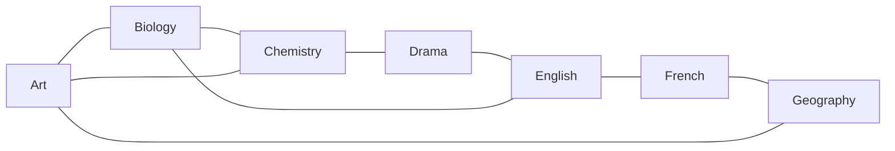
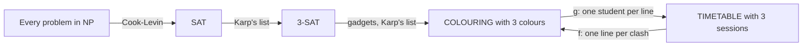

# Reductions: convert one problem into another to compare difficulty

[Syllabus](../../../SYLLABUS.md) → [Computability and complexity](../README.md) → [Time Complexity](../README.md#s03) → Reductions

---

## General Overview

A school has seven exams to fit into the exam week: Art, Biology, Chemistry, Drama, English, French and Geography. Eight students sit them:

| Student | Exams |
| --- | --- |
| 1 | Art, Biology, Chemistry |
| 2 | Chemistry, Drama |
| 3 | Drama, English |
| 4 | English, French |
| 5 | French, Geography |
| 6 | Geography, Art |
| 7 | Biology, English |
| 8 | Drama, English |

Two exams **clash** when one student sits both. Clashing exams cannot share a session. Can the week work with two sessions? With three?

[Colouring](../../04-Combinatorics%20and%20graphs/12-Planarity%20and%20Colouring/03-vertex-colouring-and-chromatic-number.md) already shows the modelling: draw a dot per exam and a line per clash, and a timetable becomes a colouring, with sessions as colours. Here that gives 9 lines. Two sessions fail, and three work in 48 ways.

This card asks a different question: **how hard is timetabling, for every school, not just this one?** The tool is a **reduction**: a cheap, mechanical conversion of every instance of one problem (one particular question of that kind, such as this school) into an instance of another, with the same yes-or-no answer. Converting this school costs 10 steps, one per pair of exams a student sits. Searching every way to place 7 exams in 3 sessions costs 3^7 = 2,187 tries, and at 40 exams about 1.22 × 10^19.

A reduction runs in one direction, and the direction is the whole lesson. Turning timetables into colouring shows timetabling is *no harder* than colouring. Turning colouring into timetables shows timetabling is *at least as hard* as colouring. Only the second direction proves timetabling hard.

**A polynomial reduction from A to B is a fast translation that keeps every answer, so a fast method for B gives one for A, and hardness flows along the arrow from A to B; a problem is NP-complete when it is in NP and every problem in NP reduces to it.**

**What kind of fact this is:** definitions (the reduction, NP-hard and NP-complete), and theorems proved on this card in Why it works: reductions combine, they carry fast methods and NP membership backwards and hardness forwards, and timetabling and colouring reduce to each other. That 3-colouring is NP-complete is a theorem stated here with its key steps and sources (Stockmeyer, 1973; Garey, Johnson and Stockmeyer, 1976). That P ≠ NP is a conjecture, unproved as of 2026-11-11.

### The picture: the school's clashes



The triangle Art, Biology, Chemistry is student 1, so three sessions is the floor. Students 3 and 8 both give the Drama–English line, so 10 pairs make 9 lines.

---

## The formula

Notation first, in words. From [P and NP](02-p-and-np.md):

- A **decision problem** is a set of yes-instances: the input strings whose answer is yes.
- $`n`$ is the input length in symbols.
- **P** is the class of decision problems that some program decides in at most a constant times $`n^d`$ steps, for a fixed whole number $`d`$.
- **NP** is the class whose yes-instances have a certificate $`c`$ (a proposed solution) that a verifier $`V(x, c)`$ checks in polynomial time.

This card introduces one notation. $`A \le_p B`$, read "A reduces to B in polynomial time", says:

```math
A \le_p B \iff \text{some program } f \text{ runs in } O(n^d) \text{ steps and } \big( x \in A \iff f(x) \in B \big) \text{ for every input } x
```

**Read it aloud:** A reduces to B when a fast program f turns every input x of A into an input f(x) of B, so that x is a yes for A exactly when f(x) is a yes for B.

It is the mapping reduction $`A \le_m B`$ of [Rice's theorem](../01-Models%20of%20Computation/10-rices-theorem-and-reductions.md), with one more demand: f must be fast, not just computable. The reduction carries a fast method backwards along the arrow:

```math
A \le_p B \;\text{ and }\; B \in \mathrm{P} \implies A \in \mathrm{P}
```

**Read it aloud:** if A converts fast into B, and B has a fast decider, then A has one too: convert, then ask B's decider.

Read the other way, the same line carries hardness forwards. Two definitions name the hardest problems:

- B is **NP-hard** when $`A \le_p B`$ for every problem A in NP.
- B is **NP-complete** when B is NP-hard and B is in NP.

The problems on this card, named in capitals by house style:

- $`\mathrm{TIMETABLE}_k`$: given exams, students and their exam lists, can the exams fit in $`k`$ sessions with no student sitting two at once?
- $`\mathrm{COLOURING}_k`$: given a graph $`G = (V, E)`$ (dots $`V`$, lines $`E`$), can the dots take $`k`$ colours so that no line joins two dots of one colour?

| Symbol | Plain meaning | In our example | Push it up and the answer… |
| --- | --- | --- | --- |
| $`A`$, $`B`$, $`C`$, $`D`$ | decision problems: sets of yes-instances | $`\mathrm{TIMETABLE}_3`$, $`\mathrm{COLOURING}_3`$ | — |
| $`x`$ | one input of A | the school's 8 exam lists | — |
| $`n`$ | input length in symbols | 24: the 8 exam lists written `ABC/CD/DE/EF/FG/GA/BE/DE`, one letter per exam | f's cost grows as a power of it |
| $`f`$, $`g`$, $`h`$ | reductions: fast converters (h is a second one, used after f) | f: exam lists to clash lines; g: lines back to students | — |
| $`f(x)`$ | the converted input, for B | 7 dots, 9 lines, $`k = 3`$ | — |
| $`d`$ | the fixed power in a polynomial bound | squared, for f | a slower but still polynomial converter |
| $`p(n)`$, $`q(n)`$, $`r(n)`$ | step bounds: f's, B's decider's, and h's | for f, at most $`n^2`$, which is 576 here; f writes 10 pairs | — |
| $`\le_p`$ | "reduces in polynomial time to" | $`\mathrm{TIMETABLE}_3 \le_p \mathrm{COLOURING}_3`$ | — |
| $`k`$ | sessions, which are colours | 2 or 3 | yes becomes easier to reach |
| $`m`$, $`s`$ | exams in the school (dots in the graph); exams one student sits | 7; 3 for student 1 | search grows as $`k^m`$; pairs grow as $`s(s - 1)/2`$ |
| $`G = (V, E)`$ | a graph: dots and lines | the clash graph | more lines, more colours needed |
| $`\mathrm{P}`$, $`\mathrm{NP}`$, $`V(x, c)`$ | fast to decide; fast to check, by a verifier V reading a certificate c | the certificate is a timetable, checked in 10 steps | — |

### When it holds

- **The converter must be polynomial.** A "reduction" that first solves the problem by search, then writes a fixed yes or no instance, keeps every answer. It costs 2,187 tries at 7 exams and about 1.22 × 10^19 at 40, so it carries no speed.
- **It must keep no-answers as well as yes-answers.** Dropping student 1 turns a no for two sessions into a yes, so a solver for the converted school would answer wrongly.
- **The converted input must stay polynomially long.** A fast f writes a short output, so B's decider stays fast on it. A map that wrote an exponentially long instance would carry no speed.
- **Hardness moves in one direction only.** $`A \le_p B`$ with B hard says nothing about A: two-session timetabling converts into three-session timetabling, yet it is decided in 25 steps.

---

## Why it works

### Step 0: a reduction is a translator that keeps the answer

A reduction translates every question about A into a question about B with the same answer. So any solver for B, with the translator in front, is a solver for A. So if B is easy, A is easy. That is why $`A \le_p B`$ reads "A is no harder than B".

### Step 1: fast translation plus fast solving is fast

Suppose f runs in at most $`p(n)`$ steps, and B's decider runs in at most $`q(n)`$ steps, where $`p`$ and $`q`$ are polynomials (fixed powers of $`n`$ times constants, added up). A program writes at most one symbol per step, so $`f(x)`$ has length at most $`p(n)`$. Then deciding A costs at most $`p(n) + q(p(n))`$ steps. A polynomial of a polynomial is a polynomial: $`(n^2)^3 = n^6`$. So A is in P.

<details>
<summary>Detailed proof: reductions combine, and the arrow carries P and NP backwards and NP-hardness forwards</summary>

**Fast methods go backwards.** Let f be a reduction as above, with $`x \in A \iff f(x) \in B`$. Run f, then run B's decider on $`f(x)`$ and copy its answer. The answer is right because of the two-way condition. The cost is at most

$`\displaystyle p(n) + q(p(n)) \le a\,n^{d} + b\,(a\,n^{d})^{j}`$

when $`p(n) \le a\,n^{d}`$ and $`q(n) \le b\,n^{j}`$ for constants $`a, b, d, j`$. The right side is a polynomial in $`n`$.

**Membership in NP goes backwards too.** Let B have a verifier V. For an input x of A, compute f(x), then run V on f(x) and a certificate c. That is a verifier for A: x is a yes exactly when f(x) is, which is exactly when some short c makes V accept f(x). Since f(x) has length at most $`p(n)`$, the certificates stay polynomially long and the check stays polynomial. So A is in NP.

**Reductions combine.** If $`A \le_p B`$ by f and $`B \le_p C`$ by h, then $`x \in A \iff f(x) \in B \iff h(f(x)) \in C`$. If h runs in at most $`r(n)`$ steps, the composed map $`h \circ f`$ (f first, then h) costs at most $`p(n) + r(p(n))`$ steps, again a polynomial. So $`A \le_p C`$.

**Hardness goes forwards.** Let A be NP-hard and $`A \le_p B`$. Every problem D in NP has $`D \le_p A`$, and combining gives $`D \le_p B`$. So B is NP-hard.

**One complete problem in P collapses NP.** Let B be NP-complete and in P. Every D in NP has $`D \le_p B`$, and fast methods go backwards, so D is in P. Then P = NP.

</details>

### Step 2: hardness flows along the arrows

Two fast translators in a row are one fast translator: if $`A \le_p B`$ and $`B \le_p C`$, then $`A \le_p C`$. So once one problem is NP-hard, every problem it reduces to is NP-hard. To prove a new problem hard, reduce a known hard problem **to** it, never the other way.

The first NP-hard problem needs a different argument, because nothing is known hard yet. That is [Cook-Levin](04-cook-levin-theorem.md): every problem in NP reduces to SAT, the question whether a logic formula can be made true. After that, each new hardness proof is one more arrow.



Each arrow is a polynomial reduction, so hardness runs left to right. The pair of arrows between colouring and timetabling says the two are equally hard.

### Step 3: timetables convert into colouring

The map f writes one dot per exam, and for each student one line per pair of exams that student sits. A student with $`s`$ exams gives $`s(s - 1)/2`$ pairs, under $`s^2`$, and the students' values of s add up to at most n. So f costs at most the input length squared: polynomial.

f keeps every answer. A timetable gives each exam a session; it is valid exactly when no student's two exams share one, which is exactly when no line joins two dots of one colour. So $`\mathrm{TIMETABLE}_k \le_p \mathrm{COLOURING}_k`$.

On the school: student 1 gives 3 pairs and the other seven give 1 each, so f writes 10 pairs and keeps 9 distinct lines. Written out as `ABC/CD/DE/EF/FG/GA/BE/DE`, the school is n = 24 symbols, so the bound is $`24^2 = 576`$; the 10 pairs sit far inside it. With 2 sessions, both searches find 0 timetables. With 3, both find 48.

This direction gives an upper bound. Colouring is in NP, so timetabling is in NP too, which is also seen directly. The certificate is a timetable, and the verifier makes one check per pair: 10 checks on this school.

### Step 4: colouring converts into timetables

The map g goes back. Given a graph, write one exam per dot and one student per line, enrolled in that line's two ends. It costs one step per line: polynomial.

g keeps every answer by the same argument read backwards. A student sitting two exams is a line between two dots. So $`\mathrm{COLOURING}_k \le_p \mathrm{TIMETABLE}_k`$.

The code checks g on all 64 graphs with 4 dots and $`k = 1, 2, 3`$: 192 of 192 answers agree. Converting back with f returns the graph each time.

### Step 5: so three-session timetabling is NP-complete

Three-colouring is NP-complete. Karp (1972) proved colouring NP-complete when the number of colours is part of the input. Stockmeyer (1973) proved it with three colours fixed, even for graphs drawn flat with no crossing lines, and Garey, Johnson and Stockmeyer (1976) sharpened that to flat graphs with at most 4 lines at each dot. The standard route starts from 3-SAT (SAT with three terms per clause). In it, each logic variable becomes a pair of joined dots, one "true" and one "false". Each clause becomes a small graph that can be 3-coloured only when one of its three terms is true. [Karp's list](05-karps-problems-and-hardness-recipes.md) works these gadgets in full; this card uses the result.

Then Step 2 does the rest. Three-colouring reduces to three-session timetabling by g, so timetabling is NP-hard. Step 3 put it in NP. So $`\mathrm{TIMETABLE}_3`$ is NP-complete. Even, Itai and Shamir (1976) proved related timetabling problems NP-complete, where teachers and classes also have hours they cannot attend.

What this buys is a sharp choice. If some method solved every three-session timetable in polynomial time, then P = NP. Most researchers expect P ≠ NP, but it is a conjecture, unproved as of 2026-11-11. So a scheduler should expect no exact method that is fast on every school.

---

## Worked numbers, by hand

| Step | Arithmetic | Value |
| --- | --- | --- |
| pairs f writes | 3 for student 1, plus 1 for each of 7 others | 10 |
| distinct clash lines | students 3 and 8 both give Drama–English | 9 |
| timetables with 2 sessions | the triangle Art, Biology, Chemistry needs 3 | 0 |
| timetables with 3 sessions | both searches count | 48 |
| one of them | Chemistry, English, Geography in 1; Biology, Drama, French in 2; Art in 3 | valid |
| verifier's checks | one per pair | 10 |
| search size at 7 exams | 3^7 | 2,187 |
| f's cost at 40 exams | 80 students × 10 pairs each | 800 pairs |
| search size at 40 exams | 3^40 | about 1.22 × 10^19 |
| **the answer** | g carries 3-colouring's hardness in; f puts timetabling in NP | **NP-complete** |

The school fits in three sessions and not two. The cost of f grows in a straight line with the school, while the search multiplies by 3 for every exam:

| Exams | Students, 5 exams each | Pairs f writes | Distinct lines | Search, 3^m |
| ---: | ---: | ---: | ---: | ---: |
| 10 | 20 | 200 | 45 | about 5.90 × 10^4 |
| 20 | 40 | 400 | 160 | about 3.49 × 10^9 |
| 40 | 80 | 800 | 495 | about 1.22 × 10^19 |
| 80 | 160 | 1,600 | 1,256 | about 1.48 × 10^38 |

These schools are drawn at random by SplitMix64, a small number generator written out in both checks with seed 7.

### What breaks if you drop a piece

| Mistake | Comes out at | What went wrong |
| --- | --- | --- |
| Reducing in the wrong direction: two sessions into three, by adding one exam that clashes with all | correct on 64 of 64 graphs, yet two sessions is decided in 25 steps | an arrow into a hard problem says nothing about the source |
| Searching inside the "reduction" | 2,187 tries at 7 exams, about 1.22 × 10^19 at 40 | not polynomial, so no speed is carried |
| Dropping student 1 as a shortcut | 2 sessions, true answer 3 | the map turned a no into a yes |

Two sessions is easy because sessions alternate: put each clashing exam in the other session and spread out. A clash left inside one session means an odd ring of clashes, so the answer is no. This search says no in 25 steps on the school, and yes in 19 without student 1.

---

## Code, from first principles, and it actually runs

Nothing is imported. Both maps, f and g, are run and their steps counted. The answer comes by two independent roads: one search over timetables that checks each student's exam list, and one over colourings that checks each clash line of the converted graph. They must agree on the school, on all 64 graphs with 4 dots after g, and on 200 random schools after f, drawn by the same SplitMix64 generator with seed 2026. A third road, the alternating search, decides the two-session question without any search over assignments.

### Python

```python
# Polynomial reductions and NP-completeness -- the check behind the card.  Nothing is imported.
# A school timetable becomes a clash graph (the map f) and a graph becomes a timetable (the map g).
# Each map is run, its cost is counted, and on every small instance it sends yes to yes and no to no:
# a search over timetables and a search over colourings give the same answers.
EXAMS = ["Art", "Biology", "Chemistry", "Drama", "English", "French", "Geography"]
SCHOOL = [[0, 1, 2], [2, 3], [3, 4], [4, 5], [5, 6], [6, 0], [1, 4], [3, 4]]
M64 = (1 << 64) - 1

def f(students):                       # timetable -> graph: one line per pair of exams one student sits
    pairs, lines = 0, set()
    for s in students:
        for i in range(len(s)):
            for j in range(i + 1, len(s)):
                pairs += 1
                lines.add((min(s[i], s[j]), max(s[i], s[j])))
    return pairs, sorted(lines)

def g(lines):                          # graph -> timetable: one student per line, sitting its two ends
    return [[a, b] for a, b in lines]

def assignments(m, k):                 # every way to hand m exams one of k sessions
    for code in range(k ** m):
        out = []
        for _ in range(m):
            out.append(code % k)
            code //= k
        yield out

def count_tt(students, m, k):          # road one: timetables, checked student by student
    return sum(1 for a in assignments(m, k)
               if all(len({a[e] for e in s}) == len(s) for s in students))

def count_col(lines, m, k):            # road two: proper colourings, checked line by line
    return sum(1 for a in assignments(m, k) if all(a[u] != a[v] for u, v in lines))

def fewest(lines, m):                  # the smallest session count with a timetable
    return next(k for k in range(1, m + 1) if count_col(lines, m, k) > 0)

def two_sessions_bfs(lines, m):        # 2 sessions in polynomial time: spread out, alternate sessions
    adj = [[v for v in range(m) if (u, v) in lines or (v, u) in lines] for u in range(m)]
    side, steps, ok = [-1] * m, 0, True
    for start in range(m):
        if side[start] >= 0:
            continue
        side[start], queue = 0, [start]
        while queue:
            u = queue.pop(0)
            steps += 1
            for v in adj[u]:
                steps += 1
                if side[v] < 0:
                    side[v] = 1 - side[u]
                    queue.append(v)
                elif side[v] == side[u]:
                    ok = False
    return ok, steps

def splitmix(state):
    state = (state + 0x9E3779B97F4A7C15) & M64
    z = state
    z = ((z ^ (z >> 30)) * 0xBF58476D1CE4E5B9) & M64
    z = ((z ^ (z >> 27)) * 0x94D049BB133111EB) & M64
    return state, z ^ (z >> 31)

def random_school(state, m, students, size):
    school = []
    for _ in range(students):
        s = []
        while len(s) < size:
            state, z = splitmix(state)
            if z % m not in s:
                s.append(z % m)
        school.append(s)
    return state, school

def sci(x):                            # 3 significant figures, rounded with integers only
    t = (x * 1000 // 10 ** (len(str(x)) - 1) + 5) // 10
    return f"{t // 100}.{t % 100:02d}e{len(str(x)) - 1}"

yn = lambda t: "yes" if t else "no"

m = len(EXAMS)
pairs, lines = f(SCHOOL)
print(f"school: {m} exams, {len(SCHOOL)} students, {pairs} pairs written, {len(lines)} clash lines")
print("clash lines: " + " ".join(EXAMS[u][0] + EXAMS[v][0] for u, v in lines))
written = "/".join("".join(EXAMS[e][0] for e in s) for s in SCHOOL)   # the input, one letter per exam
print(f"input written out: {written}, n = {len(written)} symbols; f writes {pairs} pairs, under n^2 = {len(written) ** 2}")
counts = {k: (count_tt(SCHOOL, m, k), count_col(lines, m, k)) for k in (2, 3)}
for k in (2, 3):
    print(f"{k} sessions: {counts[k][0]} timetables by students, {counts[k][1]} colourings of f(school)")
best = next(a for a in assignments(m, 3) if all(a[u] != a[v] for u, v in lines))
print(f"fewest sessions {fewest(lines, m)}; first timetable: "
      + ", ".join(f"{EXAMS[e]} {best[e] + 1}" for e in range(m)))
checks = sum(len(s) * (len(s) - 1) // 2 for s in SCHOOL)
print(f"verifier on that timetable: {checks} pair checks, accepted: "
      f"{yn(all(len({best[e] for e in s}) == len(s) for s in SCHOOL))}")
all_pairs = [(a, b) for a in range(4) for b in range(a + 1, 4)]
graphs = [[all_pairs[i] for i in range(6) if mask >> i & 1] for mask in range(64)]
agree_g = sum(1 for G in graphs for k in (1, 2, 3) if (count_col(G, 4, k) > 0) == (count_tt(g(G), 4, k) > 0))
round_trip = sum(1 for G in graphs if f(g(G))[1] == G)
print(f"g on all 64 graphs with 4 dots, k = 1, 2, 3: {agree_g} of 192 answers agree; f(g(G)) = G for {round_trip} of 64")
state, agree_f, yes = 2026, 0, 0
for _ in range(200):
    state, sc = random_school(state, 6, 5, 2 + state % 2)
    for k in (2, 3):
        direct = count_tt(sc, 6, k) > 0
        agree_f += direct == (count_col(f(sc)[1], 6, k) > 0)
        yes += direct
print(f"f on 200 random schools, k = 2 and 3: {agree_f} of 400 answers agree; {yes} yes, {400 - yes} no")
cost = []
for size in (10, 20, 40, 80):
    state, sc = random_school(7, size, 2 * size, 5)
    p, ls = f(sc)
    cost.append(p)
    print(f"cost at {size} exams, {2 * size} students of 5 exams: f writes {p} pairs, "
          f"{len(ls)} lines; search tries 3^{size} = {sci(3 ** size)}")
apex = sum(1 for G in graphs
           if (count_col(G, 4, 2) > 0) == (count_col(G + [(v, 4) for v in range(4)], 5, 3) > 0))
print(f"mistake 1, wrong direction: 2 sessions -> 3 sessions plus one all-clash exam agrees on {apex} of 64 graphs")
ok_full, st_full = two_sessions_bfs(lines, m)
dropped = f(SCHOOL[1:])[1]
ok_drop, st_drop = two_sessions_bfs(dropped, m)
print(f"  yet 2 sessions is easy: alternating search on the school {yn(ok_full)} in {st_full} steps, "
      f"without student 1 {yn(ok_drop)} in {st_drop} steps")
print(f"mistake 2, a 'reduction' that searches first: {3 ** m} assignments at {m} exams, {sci(3 ** 40)} at 40")
print(f"mistake 3, dropping student 1 is no reduction: fewest sessions {fewest(dropped, m)}, true answer {fewest(lines, m)}")
for k, r in ((4, 2), (9, 3)):                                     # k: the grid's side, also its colours
    cells = [(i, j) for i in range(k) for j in range(k)]
    e = sum(1 for x in range(k * k) for y in range(x + 1, k * k)
            if cells[x][0] == cells[y][0] or cells[x][1] == cells[y][1]
            or (cells[x][0] // r == cells[y][0] // r and cells[x][1] // r == cells[y][1] // r))
    print(f"sudoku {k} by {k} as colouring: {k * k} cells, {e} lines, {k} colours; "
          f"plus {k} digit dots joined in {k * (k - 1) // 2} lines")
    assert e == k * k * (3 * k - 2 * r - 1) // 2                     # count against a formula
assert counts[2] == (0, 0) and counts[3][0] == counts[3][1] > 0     # two searches, one answer
assert agree_g == 192 and round_trip == 64 and agree_f == 400        # yes to yes, no to no
assert apex == 64 and ok_full == (counts[2][0] > 0) and ok_drop == (fewest(dropped, m) == 2)
assert cost == [20 * s for s in (10, 20, 40, 80)] and pairs == checks and pairs <= len(written) ** 2
print("ALL CHECKS PASS")
```

**Ran 2026-11-19 on macOS, Python 3.14.10, standard library only. All checks passed. Output, pasted from the run:**

```
school: 7 exams, 8 students, 10 pairs written, 9 clash lines
clash lines: AB AC AG BC BE CD DE EF FG
input written out: ABC/CD/DE/EF/FG/GA/BE/DE, n = 24 symbols; f writes 10 pairs, under n^2 = 576
2 sessions: 0 timetables by students, 0 colourings of f(school)
3 sessions: 48 timetables by students, 48 colourings of f(school)
fewest sessions 3; first timetable: Art 3, Biology 2, Chemistry 1, Drama 2, English 1, French 2, Geography 1
verifier on that timetable: 10 pair checks, accepted: yes
g on all 64 graphs with 4 dots, k = 1, 2, 3: 192 of 192 answers agree; f(g(G)) = G for 64 of 64
f on 200 random schools, k = 2 and 3: 400 of 400 answers agree; 196 yes, 204 no
cost at 10 exams, 20 students of 5 exams: f writes 200 pairs, 45 lines; search tries 3^10 = 5.90e4
cost at 20 exams, 40 students of 5 exams: f writes 400 pairs, 160 lines; search tries 3^20 = 3.49e9
cost at 40 exams, 80 students of 5 exams: f writes 800 pairs, 495 lines; search tries 3^40 = 1.22e19
cost at 80 exams, 160 students of 5 exams: f writes 1600 pairs, 1256 lines; search tries 3^80 = 1.48e38
mistake 1, wrong direction: 2 sessions -> 3 sessions plus one all-clash exam agrees on 64 of 64 graphs
  yet 2 sessions is easy: alternating search on the school no in 25 steps, without student 1 yes in 19 steps
mistake 2, a 'reduction' that searches first: 2187 assignments at 7 exams, 1.22e19 at 40
mistake 3, dropping student 1 is no reduction: fewest sessions 2, true answer 3
sudoku 4 by 4 as colouring: 16 cells, 56 lines, 4 colours; plus 4 digit dots joined in 6 lines
sudoku 9 by 9 as colouring: 81 cells, 810 lines, 9 colours; plus 9 digit dots joined in 36 lines
ALL CHECKS PASS
```

### Rust

Same numbers, same labels, built with `rustc --edition 2021 -O`.

```rust
// Polynomial reductions and NP-completeness -- the same check as the Python, in Rust.  No crates.
// A school timetable becomes a clash graph (the map f) and a graph becomes a timetable (the map g).
// Each map is run, its cost is counted, and on every small instance it sends yes to yes and no to no:
// a search over timetables and a search over colourings give the same answers.
use std::collections::BTreeSet;
type Lines = Vec<(usize, usize)>;
const EXAMS: [&str; 7] = ["Art", "Biology", "Chemistry", "Drama", "English", "French", "Geography"];

fn f(students: &[Vec<usize>]) -> (usize, Lines) {   // one line per pair of exams one student sits
    let (mut pairs, mut lines) = (0, BTreeSet::new());
    for s in students {
        for i in 0..s.len() {
            for j in i + 1..s.len() {
                pairs += 1;
                lines.insert((s[i].min(s[j]), s[i].max(s[j])));
            }
        }
    }
    (pairs, lines.into_iter().collect())
}

fn g(lines: &Lines) -> Vec<Vec<usize>> {             // one student per line, sitting its two ends
    lines.iter().map(|&(a, b)| vec![a, b]).collect()
}

fn assignment(mut code: usize, m: usize, k: usize) -> Vec<usize> {
    let mut out = Vec::new();
    for _ in 0..m { out.push(code % k); code /= k }
    out
}

fn fits(a: &[usize], s: &[usize]) -> bool {          // a student's exams all in different sessions
    s.iter().map(|&e| a[e]).collect::<BTreeSet<_>>().len() == s.len()
}

fn count_tt(students: &[Vec<usize>], m: usize, k: usize) -> usize {   // road one: by students
    (0..k.pow(m as u32)).filter(|&c| { let a = assignment(c, m, k); students.iter().all(|s| fits(&a, s)) }).count()
}

fn count_col(lines: &Lines, m: usize, k: usize) -> usize {           // road two: by lines
    (0..k.pow(m as u32)).filter(|&c| { let a = assignment(c, m, k); lines.iter().all(|&(u, v)| a[u] != a[v]) }).count()
}

fn fewest(lines: &Lines, m: usize) -> usize {
    (1..=m).find(|&k| count_col(lines, m, k) > 0).unwrap()
}

fn two_sessions_bfs(lines: &Lines, m: usize) -> (bool, usize) {
    let adj: Vec<Vec<usize>> = (0..m).map(|u| (0..m).filter(|&v| lines.contains(&(u, v)) || lines.contains(&(v, u))).collect()).collect();
    let (mut side, mut steps, mut ok) = (vec![-1i32; m], 0, true);
    for start in 0..m {
        if side[start] >= 0 { continue }
        side[start] = 0;
        let mut queue = std::collections::VecDeque::from([start]);
        while let Some(u) = queue.pop_front() {
            steps += 1;
            for &v in &adj[u] {
                steps += 1;
                if side[v] < 0 { side[v] = 1 - side[u]; queue.push_back(v) } else if side[v] == side[u] { ok = false }
            }
        }
    }
    (ok, steps)
}

fn splitmix(state: u64) -> (u64, u64) {
    let s = state.wrapping_add(0x9E3779B97F4A7C15);
    let mut z = s;
    z = (z ^ (z >> 30)).wrapping_mul(0xBF58476D1CE4E5B9);
    z = (z ^ (z >> 27)).wrapping_mul(0x94D049BB133111EB);
    (s, z ^ (z >> 31))
}

fn random_school(mut state: u64, m: usize, students: usize, size: usize) -> (u64, Vec<Vec<usize>>) {
    let mut school = Vec::new();
    for _ in 0..students {
        let mut s: Vec<usize> = Vec::new();
        while s.len() < size {
            let (st, z) = splitmix(state);
            state = st;
            let e = (z % m as u64) as usize;
            if !s.contains(&e) { s.push(e) }
        }
        school.push(s);
    }
    (state, school)
}

fn sci(x: u128) -> String {                          // 3 significant figures, rounded with integers only
    let d = x.to_string();
    let t = (d[..4].parse::<u32>().unwrap() + 5) / 10;
    format!("{}.{:02}e{}", t / 100, t % 100, d.len() - 1)
}

fn yn(t: bool) -> &'static str { if t { "yes" } else { "no" } }

fn main() {
    let school: Vec<Vec<usize>> = vec![vec![0, 1, 2], vec![2, 3], vec![3, 4], vec![4, 5], vec![5, 6], vec![6, 0], vec![1, 4], vec![3, 4]];
    let m = EXAMS.len();
    let (pairs, lines) = f(&school);
    let ini = |e: usize| EXAMS[e].chars().next().unwrap();
    println!("school: {} exams, {} students, {} pairs written, {} clash lines", m, school.len(), pairs, lines.len());
    println!("clash lines: {}", lines.iter().map(|&(u, v)| format!("{}{}", ini(u), ini(v))).collect::<Vec<_>>().join(" "));
    let written = school.iter().map(|s| s.iter().map(|&e| ini(e)).collect::<String>()).collect::<Vec<_>>().join("/"); // the input
    println!("input written out: {}, n = {} symbols; f writes {} pairs, under n^2 = {}", written, written.len(), pairs, written.len().pow(2));
    let counts: Vec<(usize, usize)> = [2, 3].iter().map(|&k| (count_tt(&school, m, k), count_col(&lines, m, k))).collect();
    for (i, k) in [2, 3].iter().enumerate() {
        println!("{} sessions: {} timetables by students, {} colourings of f(school)", k, counts[i].0, counts[i].1);
    }
    let best = (0..3usize.pow(m as u32)).map(|c| assignment(c, m, 3)).find(|a| lines.iter().all(|&(u, v)| a[u] != a[v])).unwrap();
    println!("fewest sessions {}; first timetable: {}", fewest(&lines, m),
             (0..m).map(|e| format!("{} {}", EXAMS[e], best[e] + 1)).collect::<Vec<_>>().join(", "));
    let checks: usize = school.iter().map(|s| s.len() * (s.len() - 1) / 2).sum();
    println!("verifier on that timetable: {} pair checks, accepted: {}", checks, yn(school.iter().all(|s| fits(&best, s))));
    let all_pairs: Lines = (0..4).flat_map(|a| (a + 1..4).map(move |b| (a, b))).collect();
    let graphs: Vec<Lines> = (0..64).map(|mask: usize| (0..6).filter(|i| mask >> i & 1 == 1).map(|i| all_pairs[i]).collect()).collect();
    let agree_g = graphs.iter().map(|gr| [1, 2, 3].iter().filter(|&&k| (count_col(gr, 4, k) > 0) == (count_tt(&g(gr), 4, k) > 0)).count()).sum::<usize>();
    let round_trip = graphs.iter().filter(|gr| f(&g(gr)).1 == **gr).count();
    println!("g on all 64 graphs with 4 dots, k = 1, 2, 3: {} of 192 answers agree; f(g(G)) = G for {} of 64", agree_g, round_trip);
    let (mut state, mut agree_f, mut yes) = (2026u64, 0, 0);
    for _ in 0..200 {
        let (st, sc) = random_school(state, 6, 5, 2 + (state % 2) as usize);
        state = st;
        for k in [2, 3] {
            let direct = count_tt(&sc, 6, k) > 0;
            if direct == (count_col(&f(&sc).1, 6, k) > 0) { agree_f += 1 }
            if direct { yes += 1 }
        }
    }
    println!("f on 200 random schools, k = 2 and 3: {} of 400 answers agree; {} yes, {} no", agree_f, yes, 400 - yes);
    let mut cost = Vec::new();
    for size in [10usize, 20, 40, 80] {
        let (_, sc) = random_school(7, size, 2 * size, 5);
        let (p, ls) = f(&sc);
        cost.push(p);
        println!("cost at {} exams, {} students of 5 exams: f writes {} pairs, {} lines; search tries 3^{} = {}",
                 size, 2 * size, p, ls.len(), size, sci(3u128.pow(size as u32)));
    }
    let apex = graphs.iter().filter(|gr| {
        let mut big = (*gr).clone();
        for v in 0..4 { big.push((v, 4)) }
        (count_col(gr, 4, 2) > 0) == (count_col(&big, 5, 3) > 0)
    }).count();
    println!("mistake 1, wrong direction: 2 sessions -> 3 sessions plus one all-clash exam agrees on {} of 64 graphs", apex);
    let (ok_full, st_full) = two_sessions_bfs(&lines, m);
    let dropped = f(&school[1..]).1;
    let (ok_drop, st_drop) = two_sessions_bfs(&dropped, m);
    println!("  yet 2 sessions is easy: alternating search on the school {} in {} steps, without student 1 {} in {} steps",
             yn(ok_full), st_full, yn(ok_drop), st_drop);
    println!("mistake 2, a 'reduction' that searches first: {} assignments at {} exams, {} at 40", 3usize.pow(m as u32), m, sci(3u128.pow(40)));
    println!("mistake 3, dropping student 1 is no reduction: fewest sessions {}, true answer {}", fewest(&dropped, m), fewest(&lines, m));
    for (k, r) in [(4usize, 2usize), (9, 3)] {                              // k: the grid's side, also its colours
        let cells: Vec<(usize, usize)> = (0..k).flat_map(|i| (0..k).map(move |j| (i, j))).collect();
        let mut e = 0;
        for x in 0..k * k {
            for y in x + 1..k * k {
                let (a, b) = (cells[x], cells[y]);
                if a.0 == b.0 || a.1 == b.1 || (a.0 / r == b.0 / r && a.1 / r == b.1 / r) { e += 1 }
            }
        }
        println!("sudoku {} by {} as colouring: {} cells, {} lines, {} colours; plus {} digit dots joined in {} lines",
                 k, k, k * k, e, k, k, k * (k - 1) / 2);
        assert!(e == k * k * (3 * k - 2 * r - 1) / 2);                    // count against a formula
    }
    assert!(counts[0] == (0, 0) && counts[1].0 == counts[1].1 && counts[1].0 > 0);   // two searches, one answer
    assert!(agree_g == 192 && round_trip == 64 && agree_f == 400);       // yes to yes, no to no
    assert!(apex == 64 && ok_full == (counts[0].0 > 0) && ok_drop == (fewest(&dropped, m) == 2));
    assert!(cost == vec![200, 400, 800, 1600] && pairs == checks && pairs <= written.len().pow(2));
    println!("ALL CHECKS PASS");
}
```

**Ran 2026-11-19 on macOS, rustc 1.98.1, no crates. All checks passed. Output, pasted from the run:**

```
school: 7 exams, 8 students, 10 pairs written, 9 clash lines
clash lines: AB AC AG BC BE CD DE EF FG
input written out: ABC/CD/DE/EF/FG/GA/BE/DE, n = 24 symbols; f writes 10 pairs, under n^2 = 576
2 sessions: 0 timetables by students, 0 colourings of f(school)
3 sessions: 48 timetables by students, 48 colourings of f(school)
fewest sessions 3; first timetable: Art 3, Biology 2, Chemistry 1, Drama 2, English 1, French 2, Geography 1
verifier on that timetable: 10 pair checks, accepted: yes
g on all 64 graphs with 4 dots, k = 1, 2, 3: 192 of 192 answers agree; f(g(G)) = G for 64 of 64
f on 200 random schools, k = 2 and 3: 400 of 400 answers agree; 196 yes, 204 no
cost at 10 exams, 20 students of 5 exams: f writes 200 pairs, 45 lines; search tries 3^10 = 5.90e4
cost at 20 exams, 40 students of 5 exams: f writes 400 pairs, 160 lines; search tries 3^20 = 3.49e9
cost at 40 exams, 80 students of 5 exams: f writes 800 pairs, 495 lines; search tries 3^40 = 1.22e19
cost at 80 exams, 160 students of 5 exams: f writes 1600 pairs, 1256 lines; search tries 3^80 = 1.48e38
mistake 1, wrong direction: 2 sessions -> 3 sessions plus one all-clash exam agrees on 64 of 64 graphs
  yet 2 sessions is easy: alternating search on the school no in 25 steps, without student 1 yes in 19 steps
mistake 2, a 'reduction' that searches first: 2187 assignments at 7 exams, 1.22e19 at 40
mistake 3, dropping student 1 is no reduction: fewest sessions 2, true answer 3
sudoku 4 by 4 as colouring: 16 cells, 56 lines, 4 colours; plus 4 digit dots joined in 6 lines
sudoku 9 by 9 as colouring: 81 cells, 810 lines, 9 colours; plus 9 digit dots joined in 36 lines
ALL CHECKS PASS
```

The two outputs match line for line.

### Lean

Lean proves that both maps keep every answer, for any school, any graph and any $`k`$, and bounds the pairs f writes.

- Take any school and any number $`k`$ of sessions. Then it fits in $`k`$ sessions exactly when its clash graph has a $`k`$-colouring.
- Take any graph and any $`k`$. Then it has a $`k`$-colouring exactly when g's school, one student per line, fits in $`k`$ sessions.
- Take any students, each sitting some number $`s`$ of exams. Then their $`s(s - 1)/2`$ pairs total at most the square of their values of $`s`$ added up.
- On the school, f writes 10 pairs and keeps 9 distinct lines, and the 24 symbols give the bound $`24^2 = 576`$.
- Searching every assignment of the 7 exams, two sessions give 0 timetables and three give 48.
- The search sizes 2,187 and about 1.22 × 10^19, f's costs of 200, 400, 800 and 1,600 pairs, and the sudoku line counts are right too.

The step counts, the runs on 64 graphs and on random schools, and the alternating search are left to the Python and Rust checks.

```lean
-- Reductions: a school fits its exams into k sessions exactly when its clash graph has a k-colouring, a graph has a k-colouring exactly when its one-student-per-line school fits, and the map f writes at most n squared pairs.
import Mathlib.Combinatorics.SimpleGraph.Coloring.Vertex

/-! The card's two problems and its two maps.

`students i` is the set of exams that student `i` sits. A school fits in `k` sessions when some
assignment of one of `k` sessions to each exam gives each student's exams different sessions
(TIMETABLE_k). The map f writes one dot per exam and a line between two exams one student sits.
The map g writes one exam per dot and one student per line, sitting that line's two ends. -/

/-- TIMETABLE_k: the exams fit in `k` sessions with no student sitting two exams at once. -/
def FitsInSessions {V ι : Type*} (students : ι → Set V) (k : ℕ) : Prop :=
  ∃ a : V → Fin k, ∀ i, Set.InjOn a (students i)

/-- The map f: the clash graph, a line between two different exams that one student sits. -/
def clashGraph {V ι : Type*} (students : ι → Set V) : SimpleGraph V :=
  SimpleGraph.fromRel fun u v => ∃ i, u ∈ students i ∧ v ∈ students i

/-- The map g: one student per line of `G`, enrolled in the line's two ends. -/
def schoolOf {V : Type*} (G : SimpleGraph V) : {p : V × V // G.Adj p.1 p.2} → Set V :=
  fun e => {e.1.1, e.1.2}

/-- The map f keeps every answer: a school fits in `k` sessions exactly when its clash graph can be
coloured with `k` colours, no line joining two dots of one colour. So TIMETABLE_k reduces to
COLOURING_k, sending yes to yes and no to no. -/
theorem timetable_fits_iff_clash_graph_colorable {V ι : Type*} (students : ι → Set V) (k : ℕ) :
    FitsInSessions students k ↔ (clashGraph students).Colorable k := by
  constructor
  · rintro ⟨a, ha⟩
    refine ⟨SimpleGraph.Coloring.mk a ?_⟩
    intro u v huv hau
    rw [clashGraph, SimpleGraph.fromRel_adj] at huv
    obtain ⟨hne, ⟨i, hu, hv⟩ | ⟨i, hv, hu⟩⟩ := huv
    · exact hne (ha i hu hv hau)
    · exact hne (ha i hu hv hau)
  · rintro ⟨C⟩
    refine ⟨C, fun i u hu v hv huv => ?_⟩
    by_contra hne
    have hadj : (clashGraph students).Adj u v := by
      rw [clashGraph, SimpleGraph.fromRel_adj]
      exact ⟨hne, Or.inl ⟨i, hu, hv⟩⟩
    exact C.valid hadj huv

/-- The map g keeps every answer: a graph can be coloured with `k` colours exactly when the school
with one student per line, sitting its two ends, fits in `k` sessions. So COLOURING_k reduces to
TIMETABLE_k, which is the direction that carries colouring's hardness into timetabling. -/
theorem colorable_iff_school_of_graph_fits {V : Type*} (G : SimpleGraph V) (k : ℕ) :
    G.Colorable k ↔ FitsInSessions (schoolOf G) k := by
  constructor
  · rintro ⟨C⟩
    refine ⟨C, fun e u hu v hv huv => ?_⟩
    simp only [schoolOf, Set.mem_insert_iff, Set.mem_singleton_iff] at hu hv
    rcases hu with rfl | rfl <;> rcases hv with rfl | rfl
    · rfl
    · exact absurd huv (C.valid e.2)
    · exact absurd huv.symm (C.valid e.2)
    · rfl
  · rintro ⟨a, ha⟩
    refine ⟨SimpleGraph.Coloring.mk a ?_⟩
    intro u v huv hau
    have := ha ⟨(u, v), huv⟩ (by simp [schoolOf]) (by simp [schoolOf]) hau
    exact G.ne_of_adj huv this

/-- The map f is polynomial: a student sitting `s` exams gives `s (s - 1) / 2` pairs, and the pairs
for all students add up to at most the square of the total number of exam entries, so at most
the input length squared. -/
theorem clash_pairs_le_sq_input_length (sizes : List ℕ) :
    (sizes.map fun s => s * (s - 1) / 2).sum ≤ sizes.sum ^ 2 := by
  induction sizes with
  | nil => simp
  | cons s t ih =>
    simp only [List.map_cons, List.sum_cons]
    have h1 : s * (s - 1) / 2 ≤ s * s :=
      (Nat.div_le_self _ _).trans (Nat.mul_le_mul_left _ (Nat.sub_le _ _))
    calc s * (s - 1) / 2 + (t.map fun s => s * (s - 1) / 2).sum ≤ s * s + t.sum ^ 2 :=
          Nat.add_le_add h1 ih
      _ ≤ (s + t.sum) ^ 2 := by
          rw [add_sq, sq s]
          exact Nat.add_le_add_right (Nat.le_add_right _ _) _

/-! The card's school: Art 0, Biology 1, Chemistry 2, Drama 3, English 4, French 5, Geography 6. -/

/-- The eight students' exam lists. -/
def school : List (List ℕ) := [[0, 1, 2], [2, 3], [3, 4], [4, 5], [5, 6], [6, 0], [1, 4], [3, 4]]

/-- Every pair of exams one student sits, as the map f writes them, smaller exam first. -/
def schoolPairs : List (ℕ × ℕ) :=
  school.flatMap fun s =>
    (List.range s.length).flatMap fun i =>
      ((List.range s.length).filter (i < ·)).map fun j => (min s[i]! s[j]!, max s[i]! s[j]!)

/-- The session of exam `e` under assignment number `c`, read as `k`-ary digits, as in the code. -/
def session (k c e : ℕ) : ℕ := c / k ^ e % k

/-- The number of ways to give the 7 exams one of `k` sessions with every student's exams apart. -/
def timetables (k : ℕ) : ℕ :=
  ((List.range (k ^ 7)).filter fun c =>
    school.all fun s => (s.map (session k c)).Nodup).length

-- f writes 10 pairs and keeps 9 distinct clash lines.
example : schoolPairs.length = 10 := by decide
example : schoolPairs.dedup.length = 9 := by decide
-- The school written out, ABC/CD/DE/EF/FG/GA/BE/DE, is n = 24 symbols, and 10 ≤ 24 ^ 2 = 576.
example : (school.map List.length).sum + (school.length - 1) = 24 := by decide
example : (school.map fun s => s.length * (s.length - 1) / 2).sum = 10 ∧ 10 ≤ 24 ^ 2 ∧ 24 ^ 2 = 576 := by
  decide
-- Two sessions fail, three work in 48 ways.
example : timetables 2 = 0 := by decide +kernel
example : timetables 3 = 48 := by decide +kernel
-- The search sizes: 3 ^ 7 = 2,187 at 7 exams and 3 ^ 40, about 1.22 × 10 ^ 19, at 40.
example : 3 ^ 7 = 2187 := by decide
example : 3 ^ 40 = 12157665459056928801 := by decide
-- f's cost at m exams with 2m students of 5 exams each: 10 pairs per student.
example : [10, 20, 40, 80].map (fun m => 2 * m * (5 * 4 / 2)) = [200, 400, 800, 1600] := by decide
-- Sudoku as colouring: the k by k grid with r by r boxes has k ^ 2 (3k - 2r - 1) / 2 lines.
example : 4 ^ 2 * (3 * 4 - 2 * 2 - 1) / 2 = 56 ∧ 9 ^ 2 * (3 * 9 - 2 * 3 - 1) / 2 = 810 := by decide
example : 4 * 3 / 2 = 6 ∧ 9 * 8 / 2 = 36 := by decide

#print axioms timetable_fits_iff_clash_graph_colorable
#print axioms colorable_iff_school_of_graph_fits
#print axioms clash_pairs_le_sq_input_length
```

**Checked 2026-11-19 on macOS, Lean 4.36.0-rc2, Mathlib v4.36.0-rc2. Every proof is complete and uses only Lean's standard axioms. Output, pasted from the run:**

```
'timetable_fits_iff_clash_graph_colorable' depends on axioms: [propext, Classical.choice, Quot.sound]
'colorable_iff_school_of_graph_fits' depends on axioms: [propext, Classical.choice, Quot.sound]
'clash_pairs_le_sq_input_length' depends on axioms: [propext]
```

> [!TIP]
> **Try changing**
> Guess first, then run it. The asserts are pinned to the school as given, so some changes stop the program.
> - **Send student 1 home.** Delete `[0, 1, 2], ` from `SCHOOL`. Guess: does two sessions now work? Yes: 6 lines, 2 two-session timetables, 192 three-session ones. The two-searches assert stops the run, since it expects 0.
> - **Add a busy student.** Append `[3, 5, 6]` (Drama, French, Geography) to `SCHOOL`. Guess: does the floor rise to 4? No: 13 pairs, 11 lines, still 3 sessions, but only 12 timetables now. Every assert passes.
> - **Busier students in the cost table.** Change the `5` in `random_school(7, size, 2 * size, 5)` to `8`. Guess the pairs at 10 exams: each student now gives 28, so 560. The 45 lines are every pair of the 10 exams. The cost assert stops the run.
> - **Break g.** Make g enrol each student in one exam only: `[[a] for a, b in lines]`. Guess: the map now loses every clash, so no-answers turn into yes. Only 105 of 192 answers agree, and the round trip returns 1 graph of 64, the one with no lines.

---

## The usual mistake

> [!warning]
> **Reducing the new problem to a known hard one, and calling the new problem hard.** The arrow $`A \le_p B`$ says A is no harder than B. Converting a timetable into colouring, which is hard, proves nothing about timetables. Two-session timetabling converts correctly into three-session timetabling, which is NP-complete, yet two sessions is decided in 25 steps on this school. To prove a problem hard, reduce a known hard problem **into** it.
>
> - **A slow converter.** A map that searches first keeps every answer but costs 3^40, about 1.22 × 10^19 tries, at 40 exams. It carries no speed, so it proves nothing.
> - **A map that keeps only yes-answers.** Dropping student 1 keeps every valid timetable valid, but the converted school fits in 2 sessions where the real one needs 3.
> - **NP-hard read as NP-complete.** NP-complete also needs membership in NP: a certificate checked fast. For timetabling the certificate is the timetable, checked in 10 steps here.
> - **NP-complete read as every instance hard.** NP-complete is a worst-case statement about every school at once. This school is settled in 2,187 tries, and many real schools are easy for a good solver.

---

## Where you meet it in real life

- **Exam and course timetabling.** Universities schedule hundreds of exams around thousands of students. Because the problem is NP-complete, timetabling software uses heuristics (rules of thumb that usually work) and SAT solvers, not an exact method promised fast on every input. See [SAT solvers](07-sat-solvers-and-hard-problems-in-practice.md).
- **Compilers.** A compiler places a program's variables in a small number of processor registers. Variables in use at the same time clash, so this is colouring again. That arrow alone proves nothing about hardness. The hardness comes from the other arrow: every graph is the clash graph of some program, so colouring reduces into register placement.
- **Sudoku.** A sudoku on a k by k grid is a colouring with k colours, one per digit: one dot per cell, and a line between cells sharing a row, column or box. The 4 by 4 grid gives 16 cells and 56 lines; the 9 by 9 grid gives 81 cells and 810 lines. To fix the given clues, add k digit dots joined to each other, in 6 lines for 4 by 4 and 36 for 9 by 9. Then join each clue cell to every digit dot except its own digit. This shows sudoku is no harder than colouring. Proving sudoku hard needs a reduction into sudoku from a problem already known to be hard.
- **Deciding what to build.** An NP-completeness proof tells an engineer to stop looking for an exact fast method for every input. The useful next steps are approximation, special cases, or a small parameter, as in [Approximation](../04-Beyond%20Worst%20Case/01-approximation-and-hardness-of-approximation.md) and [Parameterised complexity](../04-Beyond%20Worst%20Case/05-parameterised-complexity.md).

> **Say it back**
> A polynomial reduction from A to B is a fast converter that sends every yes of A to a yes of B and every no to a no. A fast solver for B then gives a fast solver for A, so A is no harder than B. Hardness therefore flows along the arrow: to prove B hard, reduce a known hard problem into B. Colouring converts into timetabling with one student per line, and timetables are checked fast, so three-session timetabling is NP-complete. A fast exact method for it would prove P = NP.

---

## What this builds on

- [P and NP](02-p-and-np.md): the classes P and NP, input length n, and the verifier $`V(x, c)`$ that checks a certificate c.
- [Colouring](../../04-Combinatorics%20and%20graphs/12-Planarity%20and%20Colouring/03-vertex-colouring-and-chromatic-number.md): exams as dots, clashes as lines and sessions as colours, the modelling that f and g run.
- [Rice's theorem](../01-Models%20of%20Computation/10-rices-theorem-and-reductions.md): the mapping reduction $`A \le_m B`$, which this card makes fast.
- [Time and space classes](01-time-and-space-classes.md): step counts measured against input length, and the class P.

## Where this goes next

- [Cook-Levin](04-cook-levin-theorem.md): the first NP-complete problem, SAT, reached from every problem in NP at once.
- [Karp's list](05-karps-problems-and-hardness-recipes.md): the gadget reduction from 3-SAT to 3-colouring, and more arrows built the same way.
- [SAT solvers](07-sat-solvers-and-hard-problems-in-practice.md): why NP-complete problems are often solved fast on the instances that arise.
- [Pseudo-polynomial time](06-pseudo-polynomial-time-and-numbers-in-the-input.md): what the input length means when numbers are written in the input.
- [P versus NP](../04-Beyond%20Worst%20Case/08-p-versus-np-what-is-known.md): what is known about the conjecture every NP-completeness proof leans on.

The question this card leaves open: every arrow here starts from a problem already known to be hard, so where does the first hard problem come from?

---

## Sources

Verified 2026-11-19: every link below resolves to the publisher's page.

- Cook, Stephen A. "The Complexity of Theorem-Proving Procedures." *Proceedings of the Third Annual ACM Symposium on Theory of Computing* (1971): 151–158. [doi:10.1145/800157.805047](https://doi.org/10.1145/800157.805047). Polynomial-time reducibility and the first complete problem.
- Karp, Richard M. "Reducibility among Combinatorial Problems." In *Complexity of Computer Computations*, Plenum, 1972: 85–103. [doi:10.1007/978-1-4684-2001-2_9](https://doi.org/10.1007/978-1-4684-2001-2_9). The many-one polynomial reduction used here, and colouring among the first NP-complete problems.
- Stockmeyer, Larry. "Planar 3-Colorability Is Polynomial Complete." *ACM SIGACT News* 5, no. 3 (1973): 19–25. [doi:10.1145/1008293.1008294](https://doi.org/10.1145/1008293.1008294). Three-colouring NP-complete with the number of colours fixed at three, even on planar graphs.
- Garey, M. R., D. S. Johnson, and L. Stockmeyer. "Some Simplified NP-Complete Graph Problems." *Theoretical Computer Science* 1, no. 3 (1976): 237–267. [doi:10.1016/0304-3975(76)90059-1](https://doi.org/10.1016/0304-3975(76)90059-1). Three-colouring stays NP-complete on planar graphs with at most four lines at each dot.
- Even, S., A. Itai, and A. Shamir. "On the Complexity of Timetable and Multicommodity Flow Problems." *SIAM Journal on Computing* 5, no. 4 (1976): 691–703. [doi:10.1137/0205048](https://doi.org/10.1137/0205048). Timetabling problems proved NP-complete by reduction.
