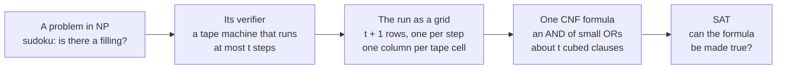

# Cook-Levin: satisfiability is the first universally hardest problem

[Syllabus](../../../SYLLABUS.md) → [Computability and complexity](../README.md) → [Time Complexity](../README.md#s03) → Cook-Levin

---

## General Overview

A 4 by 4 sudoku uses the digits 1 to 4. Each row, each column and each 2 by 2 box must hold every digit once. The top row of one puzzle reads 1, then two empty squares, then 4.

A checker program takes a proposed filling and answers yes or no. Checking is quick. Finding a filling can take a long search. Sudoku belongs to NP: the problems where a yes answer comes with a short proof, a **certificate**, that a fast program, the **verifier**, can check ([P and NP](02-p-and-np.md)).

The Cook-Levin theorem takes the checker's whole run, every step and every tape cell, and writes it as one logical formula. The formula's yes-or-no variables say things like "at step 7, cell 2 holds the digit 3". The formula can be made true exactly when some filling makes the checker say yes.

That turns any problem in NP into one question: can this formula be made true? That question is **SAT**, short for satisfiability. Stephen Cook proved the theorem in 1971; Leonid Levin found it on his own and published it in 1973.

On this card the checker checks the top row. Its accepting run takes 25 steps on a tape (the machine's working row of cells) of 5 cells. Written out, the run becomes 1,118 variables and 18,878 clauses. Exactly 2 settings of the variables make the formula true, and they read back as the fillings 2, 3 and 3, 2: the same two fillings the checker accepts.

**Any verifier's run can be written, in polynomial time, as an AND of small ORs that is satisfiable exactly when some certificate is accepted, so every NP problem reduces to SAT, and SAT is NP-complete.**

**What kind of fact this is:** a theorem, proved on this card in Why it works, with both directions in a fold. The code runs the construction on one small run; that illustrates the proof but does not replace it.

### The picture: from any NP problem to one formula



Each arrow is built in polynomial time, so the whole chain is a polynomial reduction ([Reductions](03-polynomial-reductions-and-np-completeness.md)).

---

## The formula

First the words. A **Boolean variable** is a yes-or-no unknown, true or false. A **literal** is a variable or its negation, such as "cell 2 holds a 3" or "cell 2 does not hold a 3". A **clause** is an OR of literals: it is true when at least one of its literals is true.

A formula in **CNF** (conjunctive normal form) is an AND of clauses. It is true when every clause is true. **SAT** is the problem: given a CNF formula, is there a setting of its variables, an **assignment**, that makes it true? If there is, the formula is **satisfiable**.

The construction builds one CNF formula $`\varphi_x`$ from the input $`x`$ (here, the puzzle row), in five families of clauses:

```math
\varphi_x = \Phi_{\mathrm{one}} \land \Phi_{\mathrm{start}} \land \Phi_{\mathrm{rule}} \land \Phi_{\mathrm{frame}} \land \Phi_{\mathrm{accept}}
```

**Read it aloud:** the formula for this input says that every cell holds one symbol, the run starts on the input, each step follows the machine's rules, untouched cells keep their symbols, and the run ends in the accept state.

The theorem is what this formula achieves:

```math
\varphi_x \text{ is satisfiable} \iff \text{some certificate } c \text{ makes } V(x, c) \text{ accept within } t \text{ steps}
```

**Read it aloud:** the formula can be made true exactly when some filling makes the verifier say yes in time.

A typical rule clause says "if the head is at cell $`j`$, the state is $`q`$ and the cell holds $`s`$, then the next row's cell holds $`b`$". An if-then with an AND in front is one clause:

```math
\neg\,\mathrm{head}_{i,j} \lor \neg\,\mathrm{state}_{i,q} \lor \neg\,\mathrm{cell}_{i,j,s} \lor \mathrm{cell}_{i+1,j,b}
```

**Read it aloud:** either the head is not at cell $`j`$, or the state is not $`q`$, or the cell does not hold $`s`$, or else the next row's cell holds $`b`$.

| Symbol | Plain meaning | In our example | Push it up and the answer… |
| --- | --- | --- | --- |
| $`x`$ | the input: the puzzle part the checker reads | the row 1, empty, empty, 4, then an end mark # | longer input, longer run |
| $`c`$ | the certificate: the proposed answer | digits for the two empty squares, such as 2, 3 | more empty squares, more fillings to search |
| $`V(x, c)`$ | the verifier: the checking machine | the row checker, 8 states, 6 tape symbols | more states, more clauses per cell |
| $`t`$ | the step bound: the most steps the verifier may take | 25 | one row of variables per extra step |
| $`i`$, $`j`$, $`s`$, $`b`$, $`q`$ | a step, a tape cell, a symbol read, a symbol written, a state | $`i`$ from 0 to 25, $`j`$ from 0 to 4; symbols 1 to 4, the mark X, the end mark #; states P, C1 to C4, B, A (accept), R (reject) | — |
| $`S`$, $`\lvert Q\rvert`$, $`W`$ | the counts of tape symbols, states ($`Q`$ is the set of states) and tape cells, the grid's columns, used in the size count | 6, 8 and 5 | more clauses per row; $`W`$ also adds pairs of head positions |
| $`\mathrm{cell}_{i,j,s}`$ | variable: at step $`i`$, cell $`j`$ holds $`s`$ | 780 of them | — |
| $`\mathrm{state}_{i,q}`$, $`\mathrm{head}_{i,j}`$ | variables: at step $`i`$ the state is $`q`$; the head is at cell $`j`$ | 208 and 130 of them | — |
| $`\Phi_{\mathrm{one}}`$ to $`\Phi_{\mathrm{accept}}`$ | the five clause families, each an AND of clauses | 3,120, then 7, 15,000, 750 and 1 clauses | — |
| $`\varphi_x`$ | the whole formula, an AND of clauses | 18,878 clauses | a clause count that grows like $`t^3`$ |
| $`L`$, $`n`$, $`p(n)`$ | a problem in NP, the input length, a polynomial bound on the steps | the sudoku row, 5 symbols, $`t`$ = 25 | — |
| $`A \le_p B`$ | A reduces to B: a polynomial-time translation keeps every yes and every no | sudoku row $`\le_p`$ SAT | — |

### When it holds

- **The verifier runs in polynomial time.** The grid has one row per step. If the verifier needs $`2^n`$ steps, the formula still exists, but it is too big to write in polynomial time, and the reduction fails. With the step bound one short, 24 instead of 25, the formula has no satisfying assignment, though the row is solvable.
- **The start row allows exactly the certificates the problem allows.** Here each empty square may hold only a digit. Let it hold any tape symbol, and 11 of 36 fillings satisfy the formula, 9 of them nonsense such as the row 1, 2, #, 4. The formula still follows the checker exactly, since the checker accepts the same 11, but it now answers a different question.
- **The machine is fixed.** It has a finite list of states and symbols, so each cell and step needs only a fixed number of clauses. The input size changes the grid's size, never the rule table.
- **A step changes only the cell under the head.** This locality is what lets small clauses describe a whole run. Drop the frame clauses that say "other cells stay the same", and a faked run satisfies the formula for all 16 fillings.

---

## Why it works

### Step 0: a run is a grid, and each row follows from the row above by a local rule

Write the machine's run as a table. Row $`i`$ lists the state, the head position and the whole tape after $`i`$ steps. Row $`i + 1`$ differs from row $`i`$ only at the head's cell, and the difference depends only on the state and that cell's symbol.

So checking a whole run means checking many small, identical windows, and a small fixed check on yes-or-no values can always be written as a few clauses. The [Boolean algebra](../../03-Algebra/10-For%20the%20Curious/05-boolean-algebra-and-lattices.md) card already writes a rule with AND, OR and NOT and checks it on all 8 rows of its truth table. This card spends its effort on the clauses.

### Step 1: the machine and its run

The row checker is a tape machine as on the [Turing machines](../01-Models%20of%20Computation/07-turing-machines.md) card. It marks the leftmost unmarked digit with X, carries that digit right in its state, and rejects if it meets the same digit again. At the end mark # it walks back left to the last X and starts again. Its rule table, in the wing's columns:

| state | read | write | move | next |
| --- | --- | --- | --- | --- |
| P (pick) | a digit d | X | R | Cd (carry d) |
| P | # | # | L | A (accept) |
| Cd | a digit other than d | the same digit | R | Cd |
| Cd | d | d | R | R (reject) |
| Cd | # | # | L | B (back) |
| B | a digit | the same digit | L | B |
| B | X | X | R | P |

A and R are halting states. Once there, the machine stays put, so every later row copies the row before. Every other state-and-symbol pair has no rule.

On the row 1, 2, 3, 4 the run takes 25 steps, so the grid has 26 rows. Part of it, with the head's cell in brackets:

| step | state | tape |
| --- | --- | --- |
| 0 | P | [1] 2 3 4 # |
| 1 | C1 | X [2] 3 4 # |
| 4 | C1 | X 2 3 4 [#] |
| 8 | B | [X] 2 3 4 # |
| 9 | P | X [2] 3 4 # |
| 22 | C4 | X X X X [#] |
| 24 | P | X X X X [#] |
| 25 | A | X X X [X] # |

The full run is in the code output below.

### Step 2: one variable for every fact the grid could state

For each step $`i`$ from 0 to 25 there are three kinds of variable:

- $`\mathrm{cell}_{i,j,s}`$ for each of 5 cells and 6 symbols: 30 per row.
- $`\mathrm{state}_{i,q}`$ for each of 8 states: 8 per row.
- $`\mathrm{head}_{i,j}`$ for each of 5 cells: 5 per row.

That is 43 per row and 1,118 in all. An assignment is a guess at the whole grid; the clauses throw out every guess that is not a real run.

### Step 3: exactly one symbol per cell, one state, one head

"Exactly one" is two kinds of clause. One clause says at least one: $`\mathrm{cell}_{i,j,1} \lor \dots \lor \mathrm{cell}_{i,j,\#}`$. Then one clause per pair says not both: $`\neg\,\mathrm{cell}_{i,j,1} \lor \neg\,\mathrm{cell}_{i,j,2}`$, and so on.

Six symbols make 1 + 15 = 16 clauses per cell. Eight states make 1 + 28 = 29. Five head positions make 1 + 10 = 11. Per row that is 80 + 29 + 11 = 120, and 3,120 over 26 rows. Now every satisfying assignment draws a real grid: one symbol in each cell, one state, one head.

### Step 4: the start row holds the input, and only the certificate is free

Seven clauses pin down row 0. The state is P, the head is at cell 0, and cells 0, 3 and 4 hold 1, 4 and #. Each empty square gets one clause, $`\mathrm{cell}_{0,1,1} \lor \mathrm{cell}_{0,1,2} \lor \mathrm{cell}_{0,1,3} \lor \mathrm{cell}_{0,1,4}`$: some digit, which one left open.

That open choice is the certificate. It is the only freedom in the whole formula.

### Step 5: each row forces the next

For every step, cell, state and symbol with a rule, three clauses fix the next row: the symbol written, the next state and the new head position. Each has the shape shown in The formula. That gives 13,500 rule clauses.

A pair with no rule, or a move off the grid's 5 columns, gets one clause saying it never happens: $`\neg\,\mathrm{head}_{i,j} \lor \neg\,\mathrm{state}_{i,q} \lor \neg\,\mathrm{cell}_{i,j,s}`$. There are 1,500 of those. This run never leaves cells 0 to 4. A general verifier gets a grid wide enough that its run never leaves it either, as the fold below explains.

The **frame** clauses say a cell away from the head keeps its symbol: $`\mathrm{head}_{i,j} \lor \neg\,\mathrm{cell}_{i,j,s} \lor \mathrm{cell}_{i+1,j,s}`$. That is 25 steps times 5 cells times 6 symbols, 750 clauses.

With rows 0 to $`i`$ fixed, these clauses leave row $`i + 1`$ exactly one choice: the machine's next row. By induction, a satisfying assignment is the machine's own run.

### Step 6: one clause asks for the verdict

The last clause is a single literal, $`\mathrm{state}_{25,\mathrm{A}}`$: the run ends in the accept state. Because A and R copy themselves forward, this is the same as "the machine accepted at some step up to 25".

The total is 3,120 + 7 + 13,500 + 1,500 + 750 + 1 = 18,878 clauses.

<details>
<summary>Detailed proof: satisfiable exactly when some certificate is accepted</summary>

**The grid.** The tape runs on in both directions, and in $`t`$ steps the head moves at most $`t`$ cells either way. So the grid has $`W = 2t + 1`$ columns, numbered $`-t`$ to $`t`$, with the start cell at 0 in the middle. Row 0 holds $`x`$ and the certificate's cells from the start cell rightward, and the blank ␣ (the Turing machines card's symbol for an empty cell) in every other cell; any part past column $`t`$ is never read and is left out. A move off the grid gets a no-rule clause, but no run of $`t`$ steps makes one. The sudoku run needs only cells 0 to 4, so the code uses those 5 columns.

**If some certificate is accepted.** Run the verifier on $`x`$ and that $`c`$ for $`t`$ steps. Set each variable true when the run makes its fact true, and false otherwise.

Every family then holds. Each row of a real run has one symbol per cell, one state and one head, so the exactly-one clauses hold. Row 0 is $`x`$ and $`c`$ with the blank ␣ elsewhere, so the start clauses hold. The run follows the rule table, changes only the head's cell and never leaves the grid, so the rule, no-rule and frame clauses hold. The run accepts, so the last clause holds.

**If some assignment satisfies the formula.** The exactly-one clauses make each row a real configuration: a tape, a state and a head position. The start clauses make row 0 the input, with some certificate $`c`$ in its cells and the blank ␣ elsewhere.

Suppose row $`i`$ is the verifier's configuration after $`i`$ steps on $`(x, c)`$. If the state halts, the rule clauses copy the row. Otherwise the state and the head's symbol have a rule, since the no-rule clauses exclude every other case. The three rule clauses fix the head cell's new symbol, the new state and the new head position. The frame clauses fix every other cell. The at-most-one clauses rule out any second state, symbol or head. So row $`i + 1`$ is the configuration after $`i + 1`$ steps.

By induction row $`t`$ is the configuration after $`t`$ steps, and the last clause says its state is A. So $`V(x, c)`$ accepts.

**Size.** With $`S`$ symbols, $`\lvert Q\rvert`$ states and $`W`$ columns, the clause count is at most

$`\displaystyle (t+1)\Big(W\big(1 + \tbinom{S}{2}\big) + 1 + \tbinom{\lvert Q\rvert}{2} + 1 + \tbinom{W}{2}\Big) + t\,W\,S\,(3\lvert Q\rvert + 1) + W + 3`$

where $`\tbinom{m}{2} = m(m-1)/2`$ counts pairs. With $`W = 2t + 1`$ the count is a polynomial in $`t`$. Each clause is written in a fixed amount of work from the rule table. If $`t`$ is a polynomial in $`n`$, the input length, the whole formula is built in polynomial time in $`n`$.

</details>

### Step 7: read the theorem off the formula

Take any problem $`L`$ in NP, with a verifier that runs in time $`t = p(n)`$ for some polynomial $`p`$. The map $`x \mapsto \varphi_x`$ is computed in polynomial time, and it sends yes-inputs to satisfiable formulas and no-inputs to unsatisfiable ones. So $`L \le_p \mathrm{SAT}`$.

SAT is itself in NP. The certificate is the assignment, and the verifier checks each clause once: one pass over the 67,758 literals here. A problem in NP that every NP problem reduces to is **NP-complete**. So SAT is NP-complete, the first problem proved so.

The consequence: if SAT has a polynomial-time algorithm, every NP problem does, and P = NP. Whether that happens is the P versus NP question. The common belief is the conjecture P ≠ NP, unproved as of 2026-11-11.

### Step 8: how big the formula gets

The size grows like a polynomial, not an exponential. With the same 6 symbols and 8 states, on the grid of $`2t + 1`$ columns from the fold:

| Steps $`t`$ | Cells | Variables | Clauses, at most |
| ---: | ---: | ---: | ---: |
| 10 | 21 | 1,705 | 37,860 |
| 100 | 201 | 142,915 | 5,373,150 |
| 1,000 | 2,001 | 14,029,015 | 2,335,231,050 |

The variables grow like $`t^2`$. The clauses grow like $`t^3`$, because "at most one head position" is written pair by pair, $`\tbinom{2t+1}{2}`$ clauses per row. Tighter encodings get close to $`t^2`$. Either way the count is polynomial, which is all the theorem needs.

---

## Worked numbers, by hand

| Step | Arithmetic | Value |
| --- | --- | --- |
| fillings of the two empty squares | 4 × 4 | 16 |
| steps of an accepting run | counted in the run table | 25 |
| variables per row | 5 × 6 cell facts + 8 states + 5 head places | 43 |
| variables in all | 26 rows × 43 | 1,118 |
| exactly-one clauses | 26 rows × (5 × 16 + 29 + 11) | 3,120 |
| start clauses | state, head, 3 givens, 2 empty squares | 7 |
| rule and no-rule clauses | counted from the rule table | 13,500 and 1,500 |
| frame clauses | 25 steps × 5 cells × 6 symbols | 750 |
| accept clause | one literal | 1 |
| all clauses | 3,120 + 7 + 13,500 + 1,500 + 750 + 1 | 18,878 |
| fillings the checker accepts | run it 16 times | 2, 3 and 3, 2 |
| satisfying assignments | count them all | **2** |

The formula has exactly as many satisfying assignments as there are accepted fillings, and each one reads back as its filling and its whole run.

### What breaks if you drop a piece

| Mistake | Comes out at | What went wrong |
| --- | --- | --- |
| Step bound 24 instead of 25 | 0 satisfying assignments | the run has not reached A yet, so a solvable row looks unsolvable |
| Empty squares may hold any tape symbol | 11 of 36 fillings satisfiable | a # in an empty square ends the row early, so the row 1, 2, #, 4 passes |
| No accept clause | 16 of 16 fillings satisfiable | the formula describes the run but never asks for the verdict |
| No frame clauses | a faked run satisfies it for 16 of 16 fillings | cells away from the head may change, so a repeat can be erased |

The faked run starts from the chosen filling, then jumps to the run of 1, 2, 3, 4 at step 1. Without frame clauses nothing forbids the jump; the code checks it clause by clause.

---

## Code, from first principles, and it actually runs

The code runs the row checker, builds the formula clause by clause, and solves it with its own small SAT solver: unit propagation (a clause with one unset literal forces that literal) plus branching. Three roads reach the accepted fillings. Road 1 runs the machine on all 16 fillings. Road 2 fixes each filling in the formula and tests it, counting the solver's branches. Road 3 leaves the empty squares free and counts every satisfying assignment. The asserts also check that each satisfying assignment, read row by row, is the machine's own run.

### Python

```python
# Cook-Levin: write a checker's whole run as clauses (an AND of ORs), then test it.
# The tape machine follows the Turing-machines card: state, read, write, move, next.
from itertools import product
DIG, SYM, ST, W = "1234", "1234X#", ["P", "C1", "C2", "C3", "C4", "B", "A", "R"], 5
ROW = "1__4#"                      # top row of a 4 by 4 sudoku; _ is an empty square

def delta(q, s):                   # (write, move, next); None = no rule
    if q == "P" and s in DIG: return ("X", 1, "C" + s)
    if q == "P" and s == "#": return ("#", -1, "A")
    if q[0] == "C" and s in DIG: return (s, 1, q) if s != q[1] else (s, 1, "R")
    if q[0] == "C" and s == "#": return ("#", -1, "B")
    if q == "B" and s in DIG: return (s, -1, "B")
    if q == "B" and s == "X": return ("X", 1, "P")
    return None

def run(tape, T):                  # road 1: run the machine; A and R stay put
    tape, q, h, rows = list(tape), "P", 0, []
    for i in range(T + 1):
        rows.append((q, h, "".join(tape)))
        if q in "AR" or i == T: continue
        r = delta(q, tape[h])
        if r is None: return rows, False
        tape[h], h, q = r[0], h + r[1], r[2]
    return rows, q == "A"

def fill(c):                      # the row with its two empty squares filled from c
    it = iter(c); return "".join(next(it) if x == "_" else x for x in ROW)

def formula(T, cert=DIG, frame=True, accept=True):
    V, C = {}, []
    def v(*k): return V.setdefault(k, len(V) + 1)
    def one(xs):                   # exactly one: at least one, and no two
        C.append(xs)
        C.extend([-xs[a], -xs[b]] for a in range(len(xs)) for b in range(a + 1, len(xs)))
    for i in range(T + 1):
        for j in range(W): one([v("c", i, j, s) for s in SYM])
        one([v("q", i, q) for q in ST]); one([v("h", i, j) for j in range(W)])
    C += [[v("q", 0, "P")], [v("h", 0, 0)]]
    for j, s in enumerate(ROW):    # start row: givens fixed, empty squares from cert
        C.append([v("c", 0, j, s)] if s != "_" else [v("c", 0, j, d) for d in cert])
    for i, j, q, s in product(range(T), range(W), ST, SYM):
        pre = [-v("h", i, j), -v("q", i, q), -v("c", i, j, s)]
        r = (s, 0, q) if q in "AR" else delta(q, s)
        if r is None or not 0 <= j + r[1] < W: C.append(pre); continue
        C += [pre + [v("c", i + 1, j, r[0])], pre + [v("q", i + 1, r[2])], pre + [v("h", i + 1, j + r[1])]]
    if frame:                      # a cell away from the head keeps its symbol
        C += [[v("h", i, j), -v("c", i, j, s), v("c", i + 1, j, s)] for i, j, s in product(range(T), range(W), SYM)]
    if accept: C.append([v("q", T, "A")])
    return V, C

def solve(V, C, fix=(), limit=10 ** 9):   # roads 2 and 3: a small SAT solver that counts models
    occ, val, models = {}, {}, []
    for k, c in enumerate(C):
        for x in c: occ.setdefault(-x, []).append(k)
    def setlit(x, trail):          # make x true, then follow every forced literal
        stack = [x]
        while stack:
            x = stack.pop()
            if val.get(abs(x)) is not None:
                if val[abs(x)] != (x > 0): return False
                continue
            val[abs(x)] = x > 0; trail.append(abs(x))
            for k in occ.get(x, []):
                if any(val.get(abs(y)) == (y > 0) for y in C[k]): continue
                free = [y for y in C[k] if val.get(abs(y)) is None]
                if not free: return False
                if len(free) == 1: stack.append(free[0])
        return True
    def go(n):
        if len(models) >= limit: return
        x = next((a for a in range(n, len(V) + 1) if val.get(a) is None), None)
        if x is None: models.append(dict(val)); return
        solve.branches += 1        # a branch: try x true, then x false
        for lit in (x, -x):
            trail = []
            if setlit(lit, trail): go(x + 1)
            for a in trail: val[a] = None
    if all(setlit(x, []) for x in [c[0] for c in C if len(c) == 1] + list(fix)): go(1)
    return models
solve.branches = 0                 # branches the solver has taken so far

def bound(T, W, S, Q):             # clause count from the recipe, without building anything
    one = lambda m: 1 + m * (m - 1) // 2
    return (T + 1) * (W * one(S) + one(Q) + one(W)) + T * W * S * (3 * Q + 1) + 2 + W + 1

def sat_fillings(F, alphabet):     # fillings of the two empty squares whose formula is satisfiable
    V, C = F
    return ["".join(c) for c in product(alphabet, repeat=2)
            if solve(V, C, [V[("c", 0, 1, c[0])], V[("c", 0, 2, c[1])]], 1)]

T = next(i for i, r in enumerate(run("1234#", 99)[0]) if r[0] == "A")
print("machine: 8 states, 6 tape symbols; row", ROW[:4], "; steps to accept:", T)
print("the run on the row 1 2 3 4, one row per step:")
for i, (q, h, t) in enumerate(run("1234#", T)[0]):
    print((f"step {i:2d} state {q:2s} tape " + "".join(f"[{c}]" if k == h else f" {c} " for k, c in enumerate(t))).rstrip())
V, C = formula(T)
cl = [len(c) for c in C]
print("variables", len(V), "clauses", len(C), "literals", sum(cl))
print("clauses by length:", ", ".join(f"{k}: {cl.count(k)}" for k in sorted(set(cl))))
acc = sum(1 for c in C if c == [V[("q", T, "A")]])
fam = [sum(1 for c in C if (len(c) == 2 and c[0] < 0) or (min(c) > 0 and len(c) >= 5)),
       sum(1 for c in C if min(c) > 0 and len(c) <= 4) - acc, sum(1 for c in C if len(c) == 4 and c[0] < 0),
       sum(1 for c in C if len(c) == 3 and max(c) < 0), sum(1 for c in C if len(c) == 3 and c[0] > 0), acc]
print("families: exactly-one", fam[0], "start", fam[1], "rule", fam[2], "forbidden", fam[3], "frame", fam[4], "accept", fam[5])
print("recipe bound on clauses", bound(T, W, 6, 8), "built", len(C))
direct = ["".join(c) for c in product(DIG, repeat=2) if run(fill(c), T)[1]]
print("road 1, run the machine on all 16 fillings: accepted", *direct)
fixed, branched = sat_fillings((V, C), DIG), solve.branches
print("road 2, formula with each filling fixed: satisfiable", *fixed, "; solver branches", branched)
models = solve(V, C)
read = ["".join(d for j in (1, 2) for d in DIG if m[V[("c", 0, j, d)]]) for m in models]
print("road 3, formula left free: satisfying assignments", len(models), "read back as", *read)
for t in (10, 100, 1000):
    print(f"growth: {t} steps on {2 * t + 1} cells: variables {(t + 1) * (7 * (2 * t + 1) + 8)}, clauses at most {bound(t, 2 * t + 1, 6, 8)}")
assert direct == fixed == sorted(read) == ["23", "32"] and len(models) == 2 and branched == 0
assert len(V) == (T + 1) * (6 * W + 8 + W) and bound(T, W, 6, 8) == len(C) + 2 * fam[3] and sum(fam) == len(C)
for m, filling in zip(models, read):  # each assignment, read row by row, is the machine's own run
    tab = [(next(q for q in ST if m[V[("q", i, q)]]), next(j for j in range(W) if m[V[("h", i, j)]]),
            "".join(s for j in range(W) for s in SYM if m[V[("c", i, j, s)]])) for i in range(T + 1)]
    assert tab == run(fill(filling), T)[0]
short = solve(*formula(T - 1))
anys = sat_fillings(formula(T, SYM), SYM)
anyrun = ["".join(c) for c in product(SYM, repeat=2) if run(fill(c), T)[1]]
noacc = sat_fillings(formula(T, accept=False), DIG)
def assign(V, tab):                # the variables that a table of rows makes true
    on = {("q", i, q) for i, (q, h, t) in enumerate(tab)} | {("h", i, h) for i, (q, h, t) in enumerate(tab)}
    on |= {("c", i, j, s) for i, (q, h, t) in enumerate(tab) for j, s in enumerate(t)}
    return {V[k]: k in on for k in V}
good = run("1234#", T)[0]
fakes = [[("P", 0, fill(c))] + good[1:] for c in product(DIG, repeat=2)]
Vn, Cn = formula(T, frame=False)
holds = lambda C, a: all(any(a[abs(x)] == (x > 0) for x in c) for c in C)
noframe = [f[0][2][1:3] for f in fakes if holds(Cn, assign(Vn, f))]
assert len(noframe) == 16 and not holds(C, assign(V, fakes[0])) and holds(C, assign(V, good))
assert anys == anyrun and len(short) == 0 and len(noacc) == 16
print("break: step bound", T - 1, "instead of", T, ": satisfying assignments", len(short))
print("break: empty squares may hold any tape symbol: satisfiable", len(anys), "of 36:", *anys)
print("break: no accept clause: satisfiable fillings", len(noacc), "of 16")
print("break: no frame clauses: satisfied by a faked run for", len(noframe), "of 16 fillings")
print("ALL CHECKS PASS")
```

**Ran 2026-11-19 on macOS, Python 3.14.10, standard library only. All checks passed. Output, pasted from the run:**

```
machine: 8 states, 6 tape symbols; row 1__4 ; steps to accept: 25
the run on the row 1 2 3 4, one row per step:
step  0 state P  tape [1] 2  3  4  #
step  1 state C1 tape  X [2] 3  4  #
step  2 state C1 tape  X  2 [3] 4  #
step  3 state C1 tape  X  2  3 [4] #
step  4 state C1 tape  X  2  3  4 [#]
step  5 state B  tape  X  2  3 [4] #
step  6 state B  tape  X  2 [3] 4  #
step  7 state B  tape  X [2] 3  4  #
step  8 state B  tape [X] 2  3  4  #
step  9 state P  tape  X [2] 3  4  #
step 10 state C2 tape  X  X [3] 4  #
step 11 state C2 tape  X  X  3 [4] #
step 12 state C2 tape  X  X  3  4 [#]
step 13 state B  tape  X  X  3 [4] #
step 14 state B  tape  X  X [3] 4  #
step 15 state B  tape  X [X] 3  4  #
step 16 state P  tape  X  X [3] 4  #
step 17 state C3 tape  X  X  X [4] #
step 18 state C3 tape  X  X  X  4 [#]
step 19 state B  tape  X  X  X [4] #
step 20 state B  tape  X  X [X] 4  #
step 21 state P  tape  X  X  X [4] #
step 22 state C4 tape  X  X  X  X [#]
step 23 state B  tape  X  X  X [X] #
step 24 state P  tape  X  X  X  X [#]
step 25 state A  tape  X  X  X [X] #
variables 1118 clauses 18878 literals 67758
clauses by length: 1: 6, 2: 2938, 3: 2250, 4: 13502, 5: 26, 6: 130, 8: 26
families: exactly-one 3120 start 7 rule 13500 forbidden 1500 frame 750 accept 1
recipe bound on clauses 21878 built 18878
road 1, run the machine on all 16 fillings: accepted 23 32
road 2, formula with each filling fixed: satisfiable 23 32 ; solver branches 0
road 3, formula left free: satisfying assignments 2 read back as 23 32
growth: 10 steps on 21 cells: variables 1705, clauses at most 37860
growth: 100 steps on 201 cells: variables 142915, clauses at most 5373150
growth: 1000 steps on 2001 cells: variables 14029015, clauses at most 2335231050
break: step bound 24 instead of 25 : satisfying assignments 0
break: empty squares may hold any tape symbol: satisfiable 11 of 36: 23 2# 32 3# 4# #1 #2 #3 #4 #X ##
break: no accept clause: satisfiable fillings 16 of 16
break: no frame clauses: satisfied by a faked run for 16 of 16 fillings
ALL CHECKS PASS
```

### Rust

```rust
// Cook-Levin: write a checker's whole run as clauses (an AND of ORs), then test it.
// The tape machine follows the Turing-machines card: state, read, write, move, next.
const DIG: &[u8] = b"1234"; const SYM: &[u8] = b"1234X#";
const ST: [&str; 8] = ["P", "C1", "C2", "C3", "C4", "B", "A", "R"]; const W: usize = 5;
const ROW: &[u8] = b"1__4#"; // top row of a 4 by 4 sudoku; _ is an empty square
type Row = (usize, usize, Vec<u8>); // state number, head, tape
use std::sync::atomic::{AtomicUsize, Ordering::Relaxed}; static BRANCHES: AtomicUsize = AtomicUsize::new(0); // branches the solver has taken so far

fn delta(q: usize, s: u8) -> Option<(u8, i64, usize)> { // (write, move, next); None = no rule
    let dig = DIG.contains(&s);
    match q {
        0 if dig => Some((b'X', 1, (s - b'0') as usize)),
        0 if s == b'#' => Some((b'#', -1, 6)),
        1..=4 if dig => Some(if s - b'0' != q as u8 { (s, 1, q) } else { (s, 1, 7) }),
        1..=4 if s == b'#' => Some((b'#', -1, 5)),
        5 if dig => Some((s, -1, 5)),
        5 if s == b'X' => Some((b'X', 1, 0)),
        _ => None,
    }
}
fn run(tape: &[u8], t: usize) -> (Vec<Row>, bool) { // road 1: run the machine; A and R stay put
    let (mut tape, mut q, mut h, mut rows) = (tape.to_vec(), 0usize, 0usize, vec![]);
    for i in 0..=t {
        rows.push((q, h, tape.clone()));
        if q >= 6 || i == t { continue; }
        let Some((b, m, q2)) = delta(q, tape[h]) else { return (rows, false) };
        tape[h] = b; h = (h as i64 + m) as usize; q = q2;
    }
    (rows, q == 6)
}
fn per() -> usize { W * SYM.len() + 8 + W }
fn vc(i: usize, j: usize, s: usize) -> i64 { (i * per() + j * SYM.len() + s + 1) as i64 }
fn vq(i: usize, q: usize) -> i64 { (i * per() + W * SYM.len() + q + 1) as i64 }
fn vh(i: usize, j: usize) -> i64 { (i * per() + W * SYM.len() + 8 + j + 1) as i64 }
fn si(s: u8) -> usize { SYM.iter().position(|&x| x == s).unwrap() }
fn formula(t: usize, cert: &[u8], frame: bool, accept: bool) -> (usize, Vec<Vec<i64>>) {
    let mut c: Vec<Vec<i64>> = vec![];
    let one = |c: &mut Vec<Vec<i64>>, xs: Vec<i64>| { c.push(xs.clone()); // exactly one: at least one, and no two
        for a in 0..xs.len() { for b in a + 1..xs.len() { c.push(vec![-xs[a], -xs[b]]); } }
    };
    for i in 0..=t {
        for j in 0..W { one(&mut c, (0..SYM.len()).map(|s| vc(i, j, s)).collect()); }
        one(&mut c, (0..8).map(|q| vq(i, q)).collect());
        one(&mut c, (0..W).map(|j| vh(i, j)).collect());
    }
    c.push(vec![vq(0, 0)]); c.push(vec![vh(0, 0)]);
    for (j, &s) in ROW.iter().enumerate() { // start row: givens fixed, empty squares from cert
        c.push(if s != b'_' { vec![vc(0, j, si(s))] } else { cert.iter().map(|&d| vc(0, j, si(d))).collect() });
    }
    for i in 0..t { for j in 0..W { for q in 0..8 { for (s, &sy) in SYM.iter().enumerate() {
        let pre = vec![-vh(i, j), -vq(i, q), -vc(i, j, s)];
        let r = if q >= 6 { Some((sy, 0, q)) } else { delta(q, sy) };
        let j2 = j as i64 + r.map_or(0, |x| x.1);
        match r {
            Some((b, _, q2)) if j2 >= 0 && (j2 as usize) < W => for x in [vc(i + 1, j, si(b)), vq(i + 1, q2), vh(i + 1, j2 as usize)] {
                let mut cl = pre.clone(); cl.push(x); c.push(cl);
            },
            _ => c.push(pre),
        }
    }}}}
    for i in 0..t { for j in 0..W { for s in 0..SYM.len() { // frame: a cell away from the head keeps its symbol
        if frame { c.push(vec![vh(i, j), -vc(i, j, s), vc(i + 1, j, s)]); }
    }}}
    if accept { c.push(vec![vq(t, 6)]); }
    ((t + 1) * per(), c)
}
struct Solver<'a> { c: &'a Vec<Vec<i64>>, occ: Vec<Vec<usize>>, val: Vec<i8>, models: Vec<Vec<i8>>, limit: usize }
impl<'a> Solver<'a> { // roads 2 and 3: a small SAT solver that counts models
    fn lit(&self, y: i64) -> i8 { let v = self.val[y.unsigned_abs() as usize]; if v < 0 { -1 } else { (v == 1) as i8 ^ (y < 0) as i8 } }
    fn key(x: i64) -> usize { (2 * x.unsigned_abs() as usize) + (x < 0) as usize }
    fn setlit(&mut self, x: i64, trail: &mut Vec<usize>) -> bool { // make x true, then follow every forced literal
        let mut stack = vec![x];
        while let Some(x) = stack.pop() {
            let a = x.unsigned_abs() as usize;
            if self.val[a] >= 0 { if (self.val[a] == 1) != (x > 0) { return false; } continue; }
            self.val[a] = (x > 0) as i8; trail.push(a);
            for &k in &self.occ[Self::key(x)] {
                if self.c[k].iter().any(|&y| self.lit(y) == 1) { continue; }
                let free: Vec<i64> = self.c[k].iter().cloned().filter(|&y| self.lit(y) < 0).collect();
                if free.is_empty() { return false; }
                if free.len() == 1 { stack.push(free[0]); }
            }
        }
        true
    }
    fn go(&mut self, n: usize) {
        if self.models.len() >= self.limit { return; }
        match (n..self.val.len()).find(|&a| self.val[a] < 0) {
            None => self.models.push(self.val.clone()),
            Some(x) => { BRANCHES.fetch_add(1, Relaxed); for lit in [x as i64, -(x as i64)] { // a branch: try x true, then x false
                let mut trail = vec![];
                if self.setlit(lit, &mut trail) { self.go(x + 1); }
                for a in trail { self.val[a] = -1; }
            }},
        }
    }
}
fn solve(nv: usize, c: &Vec<Vec<i64>>, fix: &[i64], limit: usize) -> Vec<Vec<i8>> {
    let mut occ = vec![vec![]; 2 * nv + 2];
    for (k, cl) in c.iter().enumerate() { for &x in cl { occ[Solver::key(-x)].push(k); } }
    let mut s = Solver { c, occ, val: vec![-1; nv + 1], models: vec![], limit };
    let units: Vec<i64> = c.iter().filter(|cl| cl.len() == 1).map(|cl| cl[0]).chain(fix.iter().cloned()).collect();
    if units.iter().all(|&x| s.setlit(x, &mut vec![])) { s.go(1); }
    s.models
}
fn bound(t: usize, w: usize, s: usize, q: usize) -> usize { // clause count from the recipe, without building anything
    let one = |m: usize| 1 + m * (m - 1) / 2;
    (t + 1) * (w * one(s) + one(q) + one(w)) + t * w * s * (3 * q + 1) + 2 + w + 1
}
fn pairs(a: &[u8]) -> Vec<[u8; 2]> { a.iter().flat_map(|&x| a.iter().map(move |&y| [x, y])).collect() }
fn row_of(p: [u8; 2]) -> Vec<u8> { let mut k = 0; ROW.iter().map(|&x| if x == b'_' { k += 1; p[k - 1] } else { x }).collect() } fn st(p: &[u8]) -> String { String::from_utf8(p.to_vec()).unwrap() }
fn sat_fillings(f: &(usize, Vec<Vec<i64>>), alphabet: &[u8]) -> Vec<String> { // fillings whose formula is satisfiable
    pairs(alphabet).into_iter().filter(|p| !solve(f.0, &f.1, &[vc(0, 1, si(p[0])), vc(0, 2, si(p[1]))], 1).is_empty()).map(|p| st(&p)).collect()
}
fn assign(nv: usize, tab: &[Row]) -> Vec<i8> { // the variables that a table of rows makes true
    let mut a = vec![0i8; nv + 1];
    for (i, (q, h, t)) in tab.iter().enumerate() {
        a[vq(i, *q) as usize] = 1; a[vh(i, *h) as usize] = 1; for (j, &s) in t.iter().enumerate() { a[vc(i, j, si(s)) as usize] = 1; }
    }
    a
}
fn holds(c: &[Vec<i64>], a: &[i8]) -> bool { c.iter().all(|cl| cl.iter().any(|&x| (a[x.unsigned_abs() as usize] == 1) == (x > 0))) }
fn main() {
    let t = run(b"1234#", 99).0.iter().position(|r| r.0 == 6).unwrap();
    println!("machine: 8 states, 6 tape symbols; row {} ; steps to accept: {}", st(&ROW[..4]), t);
    println!("the run on the row 1 2 3 4, one row per step:");
    for (i, (q, h, tape)) in run(b"1234#", t).0.iter().enumerate() {
        let cells: String = tape.iter().enumerate().map(|(k, &c)| if k == *h { format!("[{}]", c as char) } else { format!(" {} ", c as char) }).collect();
        println!("{}", format!("step {:2} state {:2} tape {}", i, ST[*q], cells).trim_end());
    }
    let (nv, c) = formula(t, DIG, true, true); let cl: Vec<usize> = c.iter().map(|x| x.len()).collect();
    println!("variables {} clauses {} literals {}", nv, c.len(), cl.iter().sum::<usize>());
    let mut lens: Vec<usize> = cl.clone(); lens.sort(); lens.dedup();
    println!("clauses by length: {}", lens.iter().map(|&k| format!("{}: {}", k, cl.iter().filter(|&&x| x == k).count())).collect::<Vec<_>>().join(", "));
    let cnt = |f: &dyn Fn(&Vec<i64>) -> bool| c.iter().filter(|x| f(x)).count(); let acc = cnt(&|x| *x == vec![vq(t, 6)]);
    let fam = [cnt(&|x| (x.len() == 2 && x[0] < 0) || (*x.iter().min().unwrap() > 0 && x.len() >= 5)), cnt(&|x| *x.iter().min().unwrap() > 0 && x.len() <= 4) - acc,
        cnt(&|x| x.len() == 4 && x[0] < 0), cnt(&|x| x.len() == 3 && *x.iter().max().unwrap() < 0), cnt(&|x| x.len() == 3 && x[0] > 0), acc];
    println!("families: exactly-one {} start {} rule {} forbidden {} frame {} accept {}", fam[0], fam[1], fam[2], fam[3], fam[4], fam[5]);
    println!("recipe bound on clauses {} built {}", bound(t, W, 6, 8), c.len());
    let direct: Vec<String> = pairs(DIG).into_iter().filter(|&p| run(&row_of(p), t).1).map(|p| st(&p)).collect();
    println!("road 1, run the machine on all 16 fillings: accepted {}", direct.join(" "));
    let fixed = sat_fillings(&(nv, c.clone()), DIG); let branched = BRANCHES.load(Relaxed);
    println!("road 2, formula with each filling fixed: satisfiable {} ; solver branches {}", fixed.join(" "), branched);
    let models = solve(nv, &c, &[], usize::MAX);
    let read: Vec<String> = models.iter().map(|m| (1..3).map(|j| DIG.iter().find(|&&d| m[vc(0, j, si(d)) as usize] == 1).map(|&d| d as char).unwrap()).collect()).collect();
    println!("road 3, formula left free: satisfying assignments {} read back as {}", models.len(), read.join(" "));
    for n in [10, 100, 1000] { let w = 2 * n + 1; println!("growth: {n} steps on {w} cells: variables {}, clauses at most {}", (n + 1) * (7 * w + 8), bound(n, w, 6, 8)); }
    let mut sr = read.clone(); sr.sort();
    assert!(direct == fixed && fixed == sr && sr == ["23", "32"] && models.len() == 2 && branched == 0);
    assert!(nv == (t + 1) * (6 * W + 8 + W) && bound(t, W, 6, 8) == c.len() + 2 * fam[3] && fam.iter().sum::<usize>() == c.len());
    for (m, filling) in models.iter().zip(&read) { // each assignment, read row by row, is the machine's own run
        let tab: Vec<Row> = (0..=t).map(|i| ((0..8).find(|&q| m[vq(i, q) as usize] == 1).unwrap(), (0..W).find(|&j| m[vh(i, j) as usize] == 1).unwrap(),
            (0..W).map(|j| SYM[(0..6).find(|&s| m[vc(i, j, s) as usize] == 1).unwrap()]).collect())).collect();
        assert!(tab == run(&row_of([filling.as_bytes()[0], filling.as_bytes()[1]]), t).0);
    }
    let (ns, cs) = formula(t - 1, DIG, true, true); let short = solve(ns, &cs, &[], usize::MAX);
    let anys = sat_fillings(&formula(t, SYM, true, true), SYM);
    let anyrun: Vec<String> = pairs(SYM).into_iter().filter(|&p| run(&row_of(p), t).1).map(|p| st(&p)).collect();
    let noacc = sat_fillings(&formula(t, DIG, true, false), DIG);
    let good = run(b"1234#", t).0;
    let fakes: Vec<Vec<Row>> = pairs(DIG).into_iter().map(|p| { let mut f = vec![(0, 0, row_of(p))]; f.extend(good[1..].iter().cloned()); f }).collect();
    let (nn, cn) = formula(t, DIG, false, true);
    let noframe = fakes.iter().filter(|f| holds(&cn, &assign(nn, f))).count();
    assert!(noframe == 16 && !holds(&c, &assign(nv, &fakes[0])) && holds(&c, &assign(nv, &good)) && anys == anyrun && short.is_empty() && noacc.len() == 16);
    println!("break: step bound {} instead of {} : satisfying assignments {}", t - 1, t, short.len());
    println!("break: empty squares may hold any tape symbol: satisfiable {} of 36: {}", anys.len(), anys.join(" "));
    println!("break: no accept clause: satisfiable fillings {} of 16", noacc.len());
    println!("break: no frame clauses: satisfied by a faked run for {} of 16 fillings", noframe);
    println!("ALL CHECKS PASS");
}
```

**Ran 2026-11-19 on macOS, rustc 1.98.1, no crates. All checks passed. Output, pasted from the run:**

```
machine: 8 states, 6 tape symbols; row 1__4 ; steps to accept: 25
the run on the row 1 2 3 4, one row per step:
step  0 state P  tape [1] 2  3  4  #
step  1 state C1 tape  X [2] 3  4  #
step  2 state C1 tape  X  2 [3] 4  #
step  3 state C1 tape  X  2  3 [4] #
step  4 state C1 tape  X  2  3  4 [#]
step  5 state B  tape  X  2  3 [4] #
step  6 state B  tape  X  2 [3] 4  #
step  7 state B  tape  X [2] 3  4  #
step  8 state B  tape [X] 2  3  4  #
step  9 state P  tape  X [2] 3  4  #
step 10 state C2 tape  X  X [3] 4  #
step 11 state C2 tape  X  X  3 [4] #
step 12 state C2 tape  X  X  3  4 [#]
step 13 state B  tape  X  X  3 [4] #
step 14 state B  tape  X  X [3] 4  #
step 15 state B  tape  X [X] 3  4  #
step 16 state P  tape  X  X [3] 4  #
step 17 state C3 tape  X  X  X [4] #
step 18 state C3 tape  X  X  X  4 [#]
step 19 state B  tape  X  X  X [4] #
step 20 state B  tape  X  X [X] 4  #
step 21 state P  tape  X  X  X [4] #
step 22 state C4 tape  X  X  X  X [#]
step 23 state B  tape  X  X  X [X] #
step 24 state P  tape  X  X  X  X [#]
step 25 state A  tape  X  X  X [X] #
variables 1118 clauses 18878 literals 67758
clauses by length: 1: 6, 2: 2938, 3: 2250, 4: 13502, 5: 26, 6: 130, 8: 26
families: exactly-one 3120 start 7 rule 13500 forbidden 1500 frame 750 accept 1
recipe bound on clauses 21878 built 18878
road 1, run the machine on all 16 fillings: accepted 23 32
road 2, formula with each filling fixed: satisfiable 23 32 ; solver branches 0
road 3, formula left free: satisfying assignments 2 read back as 23 32
growth: 10 steps on 21 cells: variables 1705, clauses at most 37860
growth: 100 steps on 201 cells: variables 142915, clauses at most 5373150
growth: 1000 steps on 2001 cells: variables 14029015, clauses at most 2335231050
break: step bound 24 instead of 25 : satisfying assignments 0
break: empty squares may hold any tape symbol: satisfiable 11 of 36: 23 2# 32 3# 4# #1 #2 #3 #4 #X ##
break: no accept clause: satisfiable fillings 16 of 16
break: no frame clauses: satisfied by a faked run for 16 of 16 fillings
ALL CHECKS PASS
```

### Lean

Lean proves the construction's three facts for any fixed machine, and checks the card's row checker and hand numbers.

- Take any fixed machine, any grid of $`W`$ cells, any start row and any step bound $`t`$. Then $`\varphi_x`$ is satisfiable exactly when some certificate the start row allows is accepted within $`t`$ steps.
- Take the same machine and grid, with $`S`$ symbols and $`\lvert Q\rvert`$ states. Then $`\varphi_x`$ has at most the fold's clause count, a polynomial in $`t`$ once $`W = 2t + 1`$.
- Suppose two satisfying assignments agree on row 0's cells. Then they agree on every variable of rows 0 to $`t`$.
- The row checker's run on the row 1, 2, 3, 4 reaches A at step 25, and not by step 24.
- Of the 16 digit fillings, the checker accepts exactly 2, 3 and 3, 2 within 25 steps.
- Let the empty squares hold any tape symbol, and the checker accepts 11 of the 36 fillings.
- The hand numbers are right: 43 variables per row, 1,118 in all, and 3,120 exactly-one clauses.
- The clause counts 3,120, 7, 13,500, 1,500, 750 and 1 add up to 18,878.
- The fold's size count at 25 steps, 5 cells, 6 symbols and 8 states gives 21,878.
- The growth table's variables and clause bounds at 10, 100 and 1,000 steps are right.

Building this card's formula, roads 2 and 3, the solver's branches and the breaks run on the formula are left to the Python and Rust checks.

```lean
-- Cook-Levin: the CNF formula written from a fixed tape machine's run on a grid of W cells and t + 1 steps is satisfiable exactly when some allowed certificate is accepted within t steps, it has at most the card's polynomial number of clauses, its satisfying settings are fixed by their start row, and the card's sudoku row checker accepts exactly the fillings 2, 3 and 3, 2.
import Mathlib.Computability.TuringMachine.Tape
import Mathlib.Data.Finset.Dedup
import Mathlib.Data.Fintype.Prod
import Mathlib.Data.Fin.VecNotation
import Mathlib.Data.Nat.Choose.Basic
import Mathlib.Tactic.NormNum
import Mathlib.Tactic.Linarith
import Mathlib.Tactic.Ring

open Turing

namespace CookLevin

/-! ## CNF formulas

A literal is a variable with a sign: `pos = true` is the variable, `pos = false` its negation.
A clause is an OR of literals, a CNF formula an AND of clauses. -/

/-- A literal over variables of type `α`. -/
structure Lit (α : Type*) where
  var : α
  pos : Bool

/-- A clause: an OR of literals. -/
abbrev Clause (α : Type*) := List (Lit α)

/-- A CNF formula: an AND of clauses. -/
abbrev CNF (α : Type*) := List (Clause α)

/-- The assignment `a` makes the formula true: every clause has a literal that `a` makes true. -/
def Satisfies {α : Type*} (a : α → Bool) (φ : CNF α) : Prop :=
  ∀ C ∈ φ, ∃ l ∈ C, a l.var = l.pos

/-- SAT's question for one formula: some assignment makes it true. -/
def Satisfiable {α : Type*} (φ : CNF α) : Prop :=
  ∃ a : α → Bool, Satisfies a φ

/-- The literal "v is true". -/
def pos {α : Type*} (v : α) : Lit α := ⟨v, true⟩

/-- The literal "v is false". -/
def neg {α : Type*} (v : α) : Lit α := ⟨v, false⟩

/-- At most one of the listed variables is true: one clause `¬a ∨ ¬b` per pair. -/
def atMostOne {α : Type*} : List α → CNF α
  | [] => []
  | a :: rest => rest.map (fun b => [neg a, neg b]) ++ atMostOne rest

/-- Exactly one of the listed variables is true: one "at least one" clause, then the pairs. -/
def exactlyOne {α : Type*} (xs : List α) : CNF α :=
  xs.map pos :: atMostOne xs

/-! ## The machine on a grid of W cells

A fixed machine: finitely many states `Q` and tape symbols `Γ`, a start state, an accept state
A and a reject state R, and a rule table `δ q s = some (b, d, q')` (write `b`, move one cell in
direction `d`, go to `q'`), `none` where there is no rule. A and R are halting states: once
there, the machine stays put. The tape is the grid's `W` cells; a missing rule, or a move off
the grid, ends the run with no verdict. -/

/-- A fixed tape machine with accept and reject states. -/
structure Machine (Q Γ : Type*) where
  start : Q
  accept : Q
  reject : Q
  δ : Q → Γ → Option (Γ × Dir × Q)

/-- One row of the grid: the state, the head's cell and the tape. -/
structure Config (Q Γ : Type*) (W : ℕ) where
  state : Q
  head : Fin W
  tape : Fin W → Γ

/-- The head's next cell, or `none` for a move off the grid. -/
def moveHead {W : ℕ} (j : Fin W) : Dir → Option (Fin W)
  | .left => if h : 0 < j.val then some ⟨j.val - 1, by omega⟩ else none
  | .right => if h : j.val + 1 < W then some ⟨j.val + 1, h⟩ else none

variable {Q Γ : Type*} [DecidableEq Q] {W : ℕ}

/-- The state halts: it is A or R. -/
def Machine.Halts (M : Machine Q Γ) (q : Q) : Prop := q = M.accept ∨ q = M.reject

instance (M : Machine Q Γ) (q : Q) : Decidable (M.Halts q) := by
  unfold Machine.Halts; infer_instance

/-- One step: a halting state copies the row; otherwise apply the rule for (state, symbol under
the head). `none` when there is no rule or the move leaves the grid. -/
def Machine.step (M : Machine Q Γ) (c : Config Q Γ W) : Option (Config Q Γ W) :=
  if M.Halts c.state then some c else
    match M.δ c.state (c.tape c.head) with
    | none => none
    | some (b, d, q') =>
        (moveHead c.head d).map fun j' => ⟨q', j', Function.update c.tape c.head b⟩

/-- The row after `k` steps from `c`, or `none` if the run broke off before step `k`. -/
def Machine.run (M : Machine Q Γ) : ℕ → Config Q Γ W → Option (Config Q Γ W)
  | 0, c => some c
  | k + 1, c => (M.step c).bind (M.run k)

/-- The machine, started at `c`, is in the accept state A at some step `k ≤ t`. -/
def Machine.AcceptsWithin (M : Machine Q Γ) (t : ℕ) (c : Config Q Γ W) : Prop :=
  ∃ k ≤ t, (M.run k c).map Config.state = some M.accept

instance (M : Machine Q Γ) (t : ℕ) (c : Config Q Γ W) : Decidable (M.AcceptsWithin t c) := by
  unfold Machine.AcceptsWithin; infer_instance

/-! ## The formula φ_x

Variables: `cell i j s` (at step `i`, cell `j` holds `s`), `state i q` (at step `i` the state
is `q`) and `head i j` (at step `i` the head is at cell `j`). The start row is described cell by
cell by `allowed j`, the symbols cell `j` may hold at step 0: one symbol for the input's given
cells, the certificate's symbols for its free cells. A certificate is a start tape `w` with
`w j ∈ allowed j` for every cell. -/

/-- The grid's yes-or-no variables. -/
inductive Var (Q Γ : Type*) (W : ℕ)
  | cell : ℕ → Fin W → Γ → Var Q Γ W
  | state : ℕ → Q → Var Q Γ W
  | head : ℕ → Fin W → Var Q Γ W

variable [Fintype Q] [Fintype Γ] [DecidableEq Γ]

/-- All states, listed once each. -/
noncomputable def allStates (Q : Type*) [Fintype Q] : List Q := (Finset.univ : Finset Q).toList

/-- All tape symbols, listed once each. -/
noncomputable def allSymbols (Γ : Type*) [Fintype Γ] : List Γ := (Finset.univ : Finset Γ).toList

/-- Φ_one: in each of rows 0 to t, every cell holds exactly one symbol, there is exactly one
state and exactly one head position. -/
noncomputable def phiOne (Q Γ : Type*) [Fintype Q] [Fintype Γ] (W t : ℕ) : CNF (Var Q Γ W) :=
  (List.range (t + 1)).flatMap fun i =>
    ((List.finRange W).flatMap fun j => exactlyOne ((allSymbols Γ).map (Var.cell i j))) ++
    exactlyOne ((allStates Q).map (Var.state i)) ++
    exactlyOne ((List.finRange W).map (Var.head i))

/-- Φ_start: row 0 is in the start state with the head at `h0`, and cell `j` holds one of the
symbols `allowed j`. -/
noncomputable def phiStart (M : Machine Q Γ) (allowed : Fin W → Finset Γ) (h0 : Fin W) :
    CNF (Var Q Γ W) :=
  [pos (Var.state 0 M.start)] :: [pos (Var.head 0 h0)] ::
    (List.finRange W).map fun j => (allowed j).toList.map fun s => pos (Var.cell 0 j s)

/-- The clauses for one step `i`, cell `j`, state `q` and symbol `s`. With the premise "head at
`j`, state `q`, cell `j` holds `s`" in front, a halting state copies the cell, the state and the
head; a rule fixes the symbol written, the next state and the new head cell; a pair with no rule,
or a move off the grid, gets one clause saying it never happens. -/
def ruleClauses (M : Machine Q Γ) (i : ℕ) (j : Fin W) (q : Q) (s : Γ) : CNF (Var Q Γ W) :=
  let pre : Clause (Var Q Γ W) :=
    [neg (Var.head i j), neg (Var.state i q), neg (Var.cell i j s)]
  if M.Halts q then
    [pre ++ [pos (Var.cell (i + 1) j s)], pre ++ [pos (Var.state (i + 1) q)],
      pre ++ [pos (Var.head (i + 1) j)]]
  else
    match M.δ q s with
    | none => [pre]
    | some (b, d, q') =>
        match moveHead j d with
        | none => [pre]
        | some j' =>
            [pre ++ [pos (Var.cell (i + 1) j b)], pre ++ [pos (Var.state (i + 1) q')],
              pre ++ [pos (Var.head (i + 1) j')]]

/-- Φ_rule: the rule and no-rule clauses for every step before `t`. -/
noncomputable def phiRule (M : Machine Q Γ) (t : ℕ) : CNF (Var Q Γ W) :=
  (List.range t).flatMap fun i => (List.finRange W).flatMap fun j =>
    (allStates Q).flatMap fun q => (allSymbols Γ).flatMap fun s => ruleClauses M i j q s

/-- Φ_frame: a cell away from the head keeps its symbol. -/
noncomputable def phiFrame (Q Γ : Type*) [Fintype Γ] (W t : ℕ) : CNF (Var Q Γ W) :=
  (List.range t).flatMap fun i => (List.finRange W).flatMap fun j =>
    (allSymbols Γ).map fun s =>
      [pos (Var.head i j), neg (Var.cell i j s), pos (Var.cell (i + 1) j s)]

/-- Φ_accept: the run ends in the accept state. -/
def phiAccept (M : Machine Q Γ) (t : ℕ) : CNF (Var Q Γ W) :=
  [[pos (Var.state t M.accept)]]

/-- The whole formula φ_x = Φ_one ∧ Φ_start ∧ Φ_rule ∧ Φ_frame ∧ Φ_accept. -/
noncomputable def tableau (M : Machine Q Γ) (allowed : Fin W → Finset Γ) (h0 : Fin W) (t : ℕ) :
    CNF (Var Q Γ W) :=
  phiOne Q Γ W t ++ phiStart M allowed h0 ++ phiRule M t ++ phiFrame Q Γ W t ++ phiAccept M t

/-! ## Helper lemmas for the proofs -/

theorem satisfies_append {α : Type*} (a : α → Bool) (φ ψ : CNF α) :
    Satisfies a (φ ++ ψ) ↔ Satisfies a φ ∧ Satisfies a ψ := by
  unfold Satisfies
  simp only [List.mem_append]
  constructor
  · intro h
    exact ⟨fun C hC => h C (Or.inl hC), fun C hC => h C (Or.inr hC)⟩
  · rintro ⟨h1, h2⟩ C (hC | hC)
    exacts [h1 C hC, h2 C hC]

theorem satisfies_cons {α : Type*} (a : α → Bool) (C : Clause α) (φ : CNF α) :
    Satisfies a (C :: φ) ↔ (∃ l ∈ C, a l.var = l.pos) ∧ Satisfies a φ := by
  unfold Satisfies
  simp

theorem satisfies_flatMap {α β : Type*} (a : α → Bool) (l : List β) (f : β → CNF α) :
    Satisfies a (l.flatMap f) ↔ ∀ x ∈ l, Satisfies a (f x) := by
  unfold Satisfies
  simp only [List.mem_flatMap]
  constructor
  · intro h x hx C hC
    exact h C ⟨x, hx, hC⟩
  · rintro h C ⟨x, hx, hC⟩
    exact h x hx C hC

theorem satisfies_atMostOne {α : Type*} (a : α → Bool) (xs : List α) :
    Satisfies a (atMostOne xs) ↔ xs.Pairwise (fun x y => a x = false ∨ a y = false) := by
  induction xs with
  | nil => simp [atMostOne, Satisfies]
  | cons x rest ih =>
    rw [atMostOne, satisfies_append, ih, List.pairwise_cons]
    unfold Satisfies
    simp [neg]

theorem satisfies_exactlyOne {α : Type*} (a : α → Bool) (xs : List α) :
    Satisfies a (exactlyOne xs) ↔
      (∃ x ∈ xs, a x = true) ∧ xs.Pairwise (fun x y => a x = false ∨ a y = false) := by
  rw [exactlyOne, satisfies_cons, satisfies_atMostOne]
  simp [pos]

theorem eq_of_pairwise_true {α : Type*} (a : α → Bool) (xs : List α)
    (h : xs.Pairwise (fun x y => a x = false ∨ a y = false)) (x y : α) (hx : x ∈ xs)
    (hy : y ∈ xs) (hax : a x = true) (hay : a y = true) : x = y := by
  induction xs with
  | nil => simp at hx
  | cons z rest ih =>
    rw [List.pairwise_cons] at h
    rcases List.mem_cons.1 hx with rfl | hx' <;> rcases List.mem_cons.1 hy with rfl | hy'
    · rfl
    · rcases h.1 y hy' with h' | h' <;> simp_all
    · rcases h.1 x hx' with h' | h' <;> simp_all
    · exact ih h.2 hx' hy'

theorem unique_of_exactlyOne {α β : Type*} [DecidableEq β] (a : α → Bool) (f : β → α) (xs : List β)
    (hall : ∀ z, z ∈ xs) (h : Satisfies a (exactlyOne (xs.map f))) :
    ∃ y, ∀ z, a (f z) = decide (y = z) := by
  rw [satisfies_exactlyOne, List.pairwise_map] at h
  obtain ⟨⟨_, hx, hax⟩, hp⟩ := h
  obtain ⟨y, -, rfl⟩ := List.mem_map.1 hx
  refine ⟨y, fun z => ?_⟩
  by_cases hz : y = z
  · subst hz
    simp [hax]
  · simp only [hz, decide_false]
    cases hfz : a (f z)
    · rfl
    · exact absurd (eq_of_pairwise_true (a ∘ f) xs hp y z (hall y) (hall z) hax hfz) hz

theorem satisfies_exactlyOne_of {α β : Type*} [DecidableEq β] (a : α → Bool) (f : β → α) (xs : List β)
    (hnd : xs.Nodup) (y : β) (hy : y ∈ xs) (h : ∀ z, a (f z) = decide (y = z)) :
    Satisfies a (exactlyOne (xs.map f)) := by
  rw [satisfies_exactlyOne, List.pairwise_map]
  refine ⟨⟨f y, List.mem_map_of_mem hy, by simp [h]⟩, hnd.imp fun {x z} hxz => ?_⟩
  simp only [h]
  by_cases hx : y = x
  · subst hx
    right
    simpa using hxz
  · left
    simpa using hx

theorem mem_allSymbols (s : Γ) : s ∈ allSymbols Γ := by
  simp [allSymbols]

theorem mem_allStates (q : Q) : q ∈ allStates Q := by
  simp [allStates]

theorem run_succ' (M : Machine Q Γ) (n : ℕ) (c : Config Q Γ W) :
    M.run (n + 1) c = (M.run n c).bind M.step := by
  induction n generalizing c with
  | zero => simp [Machine.run]
  | succ n ih =>
    show (M.step c).bind (M.run (n + 1)) = ((M.step c).bind (M.run n)).bind M.step
    cases M.step c with
    | none => rfl
    | some c' => exact ih c'

theorem run_add (M : Machine Q Γ) (m n : ℕ) (c : Config Q Γ W) :
    M.run (m + n) c = (M.run m c).bind (M.run n) := by
  induction m generalizing c with
  | zero => simp [Machine.run]
  | succ m ih =>
    rw [Nat.add_right_comm]
    show (M.step c).bind (M.run (m + n)) = ((M.step c).bind (M.run m)).bind (M.run n)
    cases M.step c with
    | none => rfl
    | some c' => exact ih c'

theorem run_of_halts (M : Machine Q Γ) (n : ℕ) (c : Config Q Γ W) (h : M.Halts c.state) :
    M.run n c = some c := by
  induction n with
  | zero => rfl
  | succ n ih =>
    show (M.step c).bind (M.run n) = some c
    simp [Machine.step, h, ih]

theorem config_eq {c c' : Config Q Γ W} (h1 : c.state = c'.state) (h2 : c.head = c'.head)
    (h3 : ∀ j, c.tape j = c'.tape j) : c = c' := by
  cases c
  cases c'
  simp only at h1 h2 h3
  subst h1 h2
  rw [funext h3]

/-- Rows `i` and `i + 1` of a satisfying setting, read as configurations, are one step apart. -/
theorem step_of_satisfies (M : Machine Q Γ) (a : Var Q Γ W → Bool) (i : ℕ)
    (c c' : Config Q Γ W)
    (hcc : ∀ j s, a (Var.cell i j s) = decide (c.tape j = s))
    (hcs : ∀ q, a (Var.state i q) = decide (c.state = q))
    (hch : ∀ j, a (Var.head i j) = decide (c.head = j))
    (hcc' : ∀ j s, a (Var.cell (i + 1) j s) = decide (c'.tape j = s))
    (hcs' : ∀ q, a (Var.state (i + 1) q) = decide (c'.state = q))
    (hch' : ∀ j, a (Var.head (i + 1) j) = decide (c'.head = j))
    (hrule : Satisfies a ((List.finRange W).flatMap fun j =>
      (allStates Q).flatMap fun q => (allSymbols Γ).flatMap fun s => ruleClauses M i j q s))
    (hframe : Satisfies a ((List.finRange W).flatMap fun j =>
      (allSymbols Γ).map fun s =>
        [pos (Var.head i j), neg (Var.cell i j s), pos (Var.cell (i + 1) j s)])) :
    M.step c = some c' := by
  have hfr : ∀ j, j ≠ c.head → c'.tape j = c.tape j := by
    intro j hj
    rw [satisfies_flatMap] at hframe
    have h := hframe j (List.mem_finRange j)
    unfold Satisfies at h
    have h' := h _ (List.mem_map_of_mem (mem_allSymbols (c.tape j)))
    simp [pos, neg, hch, hcc, hcc'] at h'
    rcases h' with h' | h'
    · exact absurd h'.symm hj
    · exact h'
  have hr : Satisfies a (ruleClauses M i c.head c.state (c.tape c.head)) := by
    rw [satisfies_flatMap] at hrule
    have h := hrule c.head (List.mem_finRange _)
    rw [satisfies_flatMap] at h
    have h2 := h c.state (mem_allStates _)
    rw [satisfies_flatMap] at h2
    exact h2 _ (mem_allSymbols _)
  unfold ruleClauses at hr
  unfold Machine.step
  by_cases hH : M.Halts c.state
  · simp only [hH, ite_true] at hr ⊢
    unfold Satisfies at hr
    simp [pos, neg, hch, hcc, hcs, hcc', hcs', hch'] at hr
    obtain ⟨h1, h2, h3⟩ := hr
    congr 1
    refine config_eq h2.symm h3.symm fun j => ?_
    by_cases hj : j = c.head
    · subst hj
      exact h1.symm
    · exact (hfr j hj).symm
  · simp only [hH, ite_false] at hr ⊢
    rcases hδ : M.δ c.state (c.tape c.head) with _ | ⟨b, d, q'⟩
    · simp only [hδ] at hr
      unfold Satisfies at hr
      simp [neg, hch, hcc, hcs] at hr
    · simp only [hδ] at hr ⊢
      rcases hm : moveHead c.head d with _ | j'
      · simp only [hm] at hr
        unfold Satisfies at hr
        simp [neg, hch, hcc, hcs] at hr
      · simp only [hm] at hr ⊢
        unfold Satisfies at hr
        simp [pos, neg, hch, hcc, hcs, hcc', hcs', hch'] at hr
        obtain ⟨h1, h2, h3⟩ := hr
        simp only [Option.map_some]
        congr 1
        refine config_eq h2.symm h3.symm fun j => ?_
        by_cases hj : j = c.head
        · subst hj
          simp [h1]
        · simp [Function.update_of_ne hj, hfr j hj]

/-- Every clause of `ruleClauses` starts with the premise "head at `j`, state `q`, cell `j`
holds `s`". -/
theorem ruleClauses_premise (M : Machine Q Γ) (i : ℕ) (j : Fin W) (q : Q) (s : Γ) :
    ∀ C ∈ ruleClauses M i j q s, neg (Var.head i j) ∈ C ∧ neg (Var.state i q) ∈ C ∧
      neg (Var.cell i j s) ∈ C := by
  unfold ruleClauses
  split_ifs
  · simp
  · split
    · simp
    · split <;> simp

/-- A run step, written as rows `i` and `i + 1`, satisfies that step's rule and frame clauses. -/
theorem satisfies_of_step (M : Machine Q Γ) (a : Var Q Γ W → Bool) (i : ℕ)
    (c c' : Config Q Γ W)
    (hcc : ∀ j s, a (Var.cell i j s) = decide (c.tape j = s))
    (hcs : ∀ q, a (Var.state i q) = decide (c.state = q))
    (hch : ∀ j, a (Var.head i j) = decide (c.head = j))
    (hcc' : ∀ j s, a (Var.cell (i + 1) j s) = decide (c'.tape j = s))
    (hcs' : ∀ q, a (Var.state (i + 1) q) = decide (c'.state = q))
    (hch' : ∀ j, a (Var.head (i + 1) j) = decide (c'.head = j))
    (hstep : M.step c = some c') :
    Satisfies a ((List.finRange W).flatMap fun j =>
      (allStates Q).flatMap fun q => (allSymbols Γ).flatMap fun s => ruleClauses M i j q s) ∧
    Satisfies a ((List.finRange W).flatMap fun j =>
      (allSymbols Γ).map fun s =>
        [pos (Var.head i j), neg (Var.cell i j s), pos (Var.cell (i + 1) j s)]) := by
  have hfr : ∀ j, j ≠ c.head → c'.tape j = c.tape j := by
    intro j hj
    unfold Machine.step at hstep
    split_ifs at hstep with hH
    · simp at hstep
      rw [hstep]
    · split at hstep
      · simp at hstep
      · rename_i b d q' _
        rcases hm : moveHead c.head d with _ | j'
        · simp [hm] at hstep
        · simp [hm] at hstep
          rw [← hstep]
          simp [Function.update_of_ne hj]
  constructor
  · rw [satisfies_flatMap]
    intro j _
    rw [satisfies_flatMap]
    intro q _
    rw [satisfies_flatMap]
    intro s _
    by_cases hpre : c.head = j ∧ c.state = q ∧ c.tape j = s
    · obtain ⟨rfl, rfl, rfl⟩ := hpre
      unfold ruleClauses
      unfold Machine.step at hstep
      by_cases hH : M.Halts c.state
      · simp only [hH, ite_true] at hstep ⊢
        cases hstep
        unfold Satisfies
        simp [pos, hcc', hcs', hch']
      · simp only [hH, ite_false] at hstep ⊢
        rcases hδ : M.δ c.state (c.tape c.head) with _ | ⟨b, d, q'⟩
        · simp [hδ] at hstep
        · simp only [hδ] at hstep ⊢
          rcases hm : moveHead c.head d with _ | j'
          · simp [hm] at hstep
          · simp only [hm, Option.map_some, Option.some.injEq] at hstep ⊢
            subst hstep
            unfold Satisfies
            simp [pos, hcc', hcs', hch']
    · intro C hC
      obtain ⟨h1, h2, h3⟩ := ruleClauses_premise M i j q s C hC
      by_cases hj : c.head = j
      · by_cases hq : c.state = q
        · refine ⟨_, h3, ?_⟩
          have : c.tape j ≠ s := fun h => hpre ⟨hj, hq, h⟩
          simp [neg, hcc, this]
        · exact ⟨_, h2, by simp [neg, hcs, hq]⟩
      · exact ⟨_, h1, by simp [neg, hch, hj]⟩
  · rw [satisfies_flatMap]
    intro j _
    unfold Satisfies
    simp only [List.mem_map]
    rintro C ⟨s, -, rfl⟩
    by_cases hj : c.head = j
    · exact ⟨_, List.mem_cons_self, by simp [pos, hch, hj]⟩
    · by_cases hs : c.tape j = s
      · refine ⟨pos (Var.cell (i + 1) j s), by simp, ?_⟩
        simp [pos, hcc', hfr j (Ne.symm hj), hs]
      · exact ⟨neg (Var.cell i j s), by simp, by simp [neg, hcc, hs]⟩

/-- Each row `i ≤ t` of a setting that satisfies Φ_one reads as one configuration. -/
theorem row_of_phiOne (a : Var Q Γ W → Bool) (t : ℕ) (h : Satisfies a (phiOne Q Γ W t))
    (i : ℕ) (hi : i ≤ t) :
    ∃ c : Config Q Γ W, (∀ j s, a (Var.cell i j s) = decide (c.tape j = s)) ∧
      (∀ q, a (Var.state i q) = decide (c.state = q)) ∧
      (∀ j, a (Var.head i j) = decide (c.head = j)) := by
  rw [phiOne, satisfies_flatMap] at h
  have h' := h i (List.mem_range.2 (by omega))
  rw [satisfies_append, satisfies_append, satisfies_flatMap] at h'
  obtain ⟨⟨hcells, hst⟩, hhd⟩ := h'
  have hc : ∀ j, ∃ y, ∀ z, a (Var.cell i j z) = decide (y = z) := fun j =>
    unique_of_exactlyOne a (Var.cell i j) _ mem_allSymbols (hcells j (List.mem_finRange j))
  choose tape htape using hc
  obtain ⟨q, hq⟩ := unique_of_exactlyOne a (Var.state i) _ mem_allStates hst
  obtain ⟨hd, hhd'⟩ := unique_of_exactlyOne a (Var.head i) _ List.mem_finRange hhd
  exact ⟨⟨q, hd, tape⟩, htape, hq, hhd'⟩

/-- A satisfying setting is a run of the machine from an allowed start row. -/
theorem run_of_satisfies (M : Machine Q Γ) (allowed : Fin W → Finset Γ) (h0 : Fin W) (t : ℕ)
    (a : Var Q Γ W → Bool) (ha : Satisfies a (tableau M allowed h0 t)) :
    ∃ w : Fin W → Γ, (∀ j, w j ∈ allowed j) ∧ (∀ j s, a (Var.cell 0 j s) = decide (w j = s)) ∧
      ∀ i ≤ t, ∃ c, M.run i (⟨M.start, h0, w⟩ : Config Q Γ W) = some c ∧
        (∀ j s, a (Var.cell i j s) = decide (c.tape j = s)) ∧
        (∀ q, a (Var.state i q) = decide (c.state = q)) ∧
        (∀ j, a (Var.head i j) = decide (c.head = j)) := by
  simp only [tableau, satisfies_append] at ha
  obtain ⟨⟨⟨⟨h1, h2⟩, h3⟩, h4⟩, -⟩ := ha
  obtain ⟨c0, hc0c, hc0s, hc0h⟩ := row_of_phiOne a t h1 0 (Nat.zero_le _)
  rw [phiStart, satisfies_cons, satisfies_cons] at h2
  obtain ⟨hs0, hh0, hcl⟩ := h2
  simp [pos, hc0s] at hs0
  simp [pos, hc0h] at hh0
  have hw : ∀ j, c0.tape j ∈ allowed j := by
    intro j
    unfold Satisfies at hcl
    have := hcl _ (List.mem_map_of_mem (List.mem_finRange j))
    simpa [pos, hc0c] using this
  have hc0 : (⟨M.start, h0, c0.tape⟩ : Config Q Γ W) = c0 :=
    config_eq hs0.symm hh0.symm fun _ => rfl
  refine ⟨c0.tape, hw, hc0c, fun i hi => ?_⟩
  induction i with
  | zero => exact ⟨c0, by rw [hc0]; rfl, hc0c, hc0s, hc0h⟩
  | succ n ih =>
    obtain ⟨c, hrun, hcc, hcs, hch⟩ := ih (by omega)
    obtain ⟨c', hcc', hcs', hch'⟩ := row_of_phiOne a t h1 (n + 1) hi
    refine ⟨c', ?_, hcc', hcs', hch'⟩
    rw [run_succ', hrun]
    rw [phiRule, satisfies_flatMap] at h3
    rw [phiFrame, satisfies_flatMap] at h4
    exact step_of_satisfies M a n c c' hcc hcs hch hcc' hcs' hch'
      (h3 n (List.mem_range.2 (by omega))) (h4 n (List.mem_range.2 (by omega)))

/-- A run that is in the accept state at step `t` gives a satisfying setting. -/
theorem satisfies_of_run (M : Machine Q Γ) (allowed : Fin W → Finset Γ) (h0 : Fin W) (t : ℕ)
    (w : Fin W → Γ) (hw : ∀ j, w j ∈ allowed j) (cfg : ℕ → Config Q Γ W)
    (a : Var Q Γ W → Bool)
    (hcell : ∀ i j s, a (Var.cell i j s) = decide ((cfg i).tape j = s))
    (hst : ∀ i q, a (Var.state i q) = decide ((cfg i).state = q))
    (hhd : ∀ i j, a (Var.head i j) = decide ((cfg i).head = j))
    (h0cfg : cfg 0 = ⟨M.start, h0, w⟩)
    (hstep : ∀ i < t, M.step (cfg i) = some (cfg (i + 1)))
    (hacc : (cfg t).state = M.accept) :
    Satisfies a (tableau M allowed h0 t) := by
  simp only [tableau, satisfies_append]
  refine ⟨⟨⟨⟨?_, ?_⟩, ?_⟩, ?_⟩, ?_⟩
  · rw [phiOne, satisfies_flatMap]
    intro i _
    rw [satisfies_append, satisfies_append, satisfies_flatMap]
    refine ⟨⟨fun j _ => ?_, ?_⟩, ?_⟩
    · exact satisfies_exactlyOne_of a (Var.cell i j) _ (Finset.nodup_toList _) _
        (mem_allSymbols _) (hcell i j)
    · exact satisfies_exactlyOne_of a (Var.state i) _ (Finset.nodup_toList _) _
        (mem_allStates _) (hst i)
    · exact satisfies_exactlyOne_of a (Var.head i) _ (List.nodup_finRange W) _
        (List.mem_finRange _) (hhd i)
  · rw [phiStart, satisfies_cons, satisfies_cons]
    refine ⟨⟨_, List.mem_singleton_self _, by simp [pos, hst, h0cfg]⟩,
      ⟨_, List.mem_singleton_self _, by simp [pos, hhd, h0cfg]⟩, ?_⟩
    unfold Satisfies
    simp only [List.mem_map]
    rintro C ⟨j, -, rfl⟩
    exact ⟨pos (Var.cell 0 j (w j)), List.mem_map_of_mem (Finset.mem_toList.2 (hw j)),
      by simp [pos, hcell, h0cfg]⟩
  · rw [phiRule, satisfies_flatMap]
    intro i hi
    exact (satisfies_of_step M a i (cfg i) (cfg (i + 1)) (hcell i) (hst i) (hhd i) (hcell (i + 1))
      (hst (i + 1)) (hhd (i + 1)) (hstep i (List.mem_range.1 hi))).1
  · rw [phiFrame, satisfies_flatMap]
    intro i hi
    exact (satisfies_of_step M a i (cfg i) (cfg (i + 1)) (hcell i) (hst i) (hhd i) (hcell (i + 1))
      (hst (i + 1)) (hhd (i + 1)) (hstep i (List.mem_range.1 hi))).2
  · unfold Satisfies phiAccept
    simp [pos, hst, hacc]

theorem length_atMostOne {α : Type*} (xs : List α) :
    (atMostOne xs).length = xs.length.choose 2 := by
  induction xs with
  | nil => simp [atMostOne]
  | cons x rest ih =>
    rw [atMostOne, List.length_append, List.length_map, ih, List.length_cons]
    show _ = (rest.length + 1).choose (1 + 1)
    rw [Nat.choose_succ_succ, Nat.choose_one_right]

theorem length_exactlyOne {α : Type*} (xs : List α) :
    (exactlyOne xs).length = 1 + xs.length.choose 2 := by
  rw [exactlyOne, List.length_cons, length_atMostOne]
  omega

theorem length_flatMap_le {α β : Type*} (l : List α) (f : α → List β) (n : ℕ)
    (h : ∀ x ∈ l, (f x).length ≤ n) : (l.flatMap f).length ≤ l.length * n := by
  induction l with
  | nil => simp
  | cons x rest ih =>
    rw [List.flatMap_cons, List.length_append, List.length_cons, Nat.succ_mul]
    have h1 := h x List.mem_cons_self
    have h2 := ih fun y hy => h y (List.mem_cons_of_mem _ hy)
    omega

theorem length_ruleClauses_le (M : Machine Q Γ) (i : ℕ) (j : Fin W) (q : Q) (s : Γ) :
    (ruleClauses M i j q s).length ≤ 3 := by
  unfold ruleClauses
  split_ifs
  · simp
  · split
    · simp
    · split <;> simp

theorem length_allSymbols : (allSymbols Γ).length = Fintype.card Γ := by
  simp [allSymbols]

theorem length_allStates : (allStates Q).length = Fintype.card Q := by
  simp [allStates]

/-! ## The theorem and the size count -/

/-- Cook-Levin's construction: for any fixed machine (finitely many states and symbols), any
grid of `W` cells, start head cell `h0`, start-row pattern `allowed` and step bound `t`, the
formula φ_x is satisfiable exactly when some certificate (a start tape allowed cell by cell)
makes the machine accept within `t` steps. -/
theorem tableau_satisfiable_iff_some_certificate_accepted (M : Machine Q Γ)
    (allowed : Fin W → Finset Γ) (h0 : Fin W) (t : ℕ) :
    Satisfiable (tableau M allowed h0 t) ↔
      ∃ w : Fin W → Γ, (∀ j, w j ∈ allowed j) ∧
        M.AcceptsWithin t (⟨M.start, h0, w⟩ : Config Q Γ W) := by
  constructor
  · rintro ⟨a, ha⟩
    obtain ⟨w, hw, -, hrows⟩ := run_of_satisfies M allowed h0 t a ha
    refine ⟨w, hw, t, le_rfl, ?_⟩
    obtain ⟨c, hrun, -, hs, -⟩ := hrows t le_rfl
    have hacc : a (Var.state t M.accept) = true := by
      simp only [tableau, satisfies_append] at ha
      have h5 := ha.2
      unfold Satisfies phiAccept at h5
      simpa [pos] using h5
    rw [hs] at hacc
    rw [hrun]
    simpa using hacc
  · rintro ⟨w, hw, k, hk, hacc⟩
    obtain ⟨c0, hc0⟩ : ∃ c0 : Config Q Γ W, c0 = ⟨M.start, h0, w⟩ := ⟨_, rfl⟩
    rw [← hc0] at hacc
    obtain ⟨c1, hc1, hc1s⟩ : ∃ c1, M.run k c0 = some c1 ∧ c1.state = M.accept := by
      simpa using hacc
    have hrun_t : M.run t c0 = some c1 := by
      obtain ⟨m, rfl⟩ := Nat.exists_eq_add_of_le hk
      rw [run_add, hc1]
      exact run_of_halts M m c1 (Or.inl hc1s)
    obtain ⟨cfg, hcfg⟩ : ∃ cfg : ℕ → Config Q Γ W, ∀ i, cfg i = (M.run i c0).getD c0 :=
      ⟨_, fun _ => rfl⟩
    have hsome : ∀ i ≤ t, M.run i c0 = some (cfg i) := by
      intro i hi
      rw [hcfg]
      cases hr : M.run i c0 with
      | none =>
        obtain ⟨m, rfl⟩ := Nat.exists_eq_add_of_le hi
        rw [run_add, hr] at hrun_t
        simp at hrun_t
      | some c => rfl
    refine ⟨fun v => Var.rec (motive := fun _ => Bool)
      (fun i j s => decide ((cfg i).tape j = s)) (fun i q => decide ((cfg i).state = q))
      (fun i j => decide ((cfg i).head = j)) v, ?_⟩
    refine satisfies_of_run M allowed h0 t w hw cfg _ (fun _ _ _ => rfl) (fun _ _ => rfl)
      (fun _ _ => rfl) ?_ ?_ ?_
    · rw [hcfg, ← hc0]
      rfl
    · intro i hi
      have h1 := hsome (i + 1) hi
      rw [run_succ', hsome i (by omega)] at h1
      exact h1
    · have := hsome t le_rfl
      rw [hrun_t] at this
      cases this
      exact hc1s

/-- The size count: with `S` symbols, `|Q|` states and `W` cells, φ_x has at most
`(t + 1)(W(1 + C(S, 2)) + 1 + C(|Q|, 2) + 1 + C(W, 2)) + t W S (3|Q| + 1) + W + 3` clauses,
a polynomial in `t` once `W = 2t + 1`. -/
theorem tableau_length_le (M : Machine Q Γ) (allowed : Fin W → Finset Γ) (h0 : Fin W)
    (t : ℕ) :
    (tableau M allowed h0 t).length ≤
      (t + 1) * (W * (1 + (Fintype.card Γ).choose 2) + 1 + (Fintype.card Q).choose 2 + 1 +
          W.choose 2) +
        t * W * Fintype.card Γ * (3 * Fintype.card Q + 1) + W + 3 := by
  have hOne : (phiOne Q Γ W t).length ≤ (t + 1) * (W * (1 + (Fintype.card Γ).choose 2) +
      (1 + (Fintype.card Q).choose 2) + (1 + W.choose 2)) := by
    unfold phiOne
    refine le_trans (length_flatMap_le _ _ _ fun i _ => ?_) (by rw [List.length_range])
    simp only [List.length_append, length_exactlyOne, List.length_map, length_allStates,
      List.length_finRange]
    have := length_flatMap_le (List.finRange W)
      (fun j => exactlyOne ((allSymbols Γ).map (Var.cell (Q := Q) i j)))
      (1 + (Fintype.card Γ).choose 2)
      (fun j _ => by simp [length_exactlyOne, length_allSymbols])
    rw [List.length_finRange] at this
    omega
  have hStart : (phiStart M allowed h0).length = W + 2 := by
    simp [phiStart]
  have hRule : (phiRule M t : CNF (Var Q Γ W)).length ≤
      t * (W * (Fintype.card Q * (Fintype.card Γ * 3))) := by
    unfold phiRule
    refine le_trans (length_flatMap_le _ _ _ fun i _ => ?_) (by rw [List.length_range])
    refine le_trans (length_flatMap_le _ _ _ fun j _ => ?_) (by rw [List.length_finRange])
    refine le_trans (length_flatMap_le _ _ _ fun q _ => ?_) (by rw [length_allStates])
    refine le_trans (length_flatMap_le _ _ _ fun s _ => ?_) (by rw [length_allSymbols])
    exact length_ruleClauses_le M i j q s
  have hFrame : (phiFrame Q Γ W t).length ≤ t * (W * Fintype.card Γ) := by
    unfold phiFrame
    refine le_trans (length_flatMap_le _ _ _ fun i _ => ?_) (by rw [List.length_range])
    refine le_trans (length_flatMap_le _ _ _ fun j _ => ?_) (by rw [List.length_finRange])
    simp [length_allSymbols]
  have hAcc : (phiAccept M t : CNF (Var Q Γ W)).length = 1 := rfl
  simp only [tableau, List.length_append]
  nlinarith

/-- A satisfying setting is the machine's own run: two satisfying assignments that agree on the
start row's cells agree on every variable of rows 0 to `t`. So the satisfying settings, read on
the grid, match the accepted certificates one for one. -/
theorem satisfying_assignment_fixed_by_start_row (M : Machine Q Γ)
    (allowed : Fin W → Finset Γ) (h0 : Fin W) (t : ℕ) (a b : Var Q Γ W → Bool)
    (ha : Satisfies a (tableau M allowed h0 t)) (hb : Satisfies b (tableau M allowed h0 t))
    (hrow : ∀ j s, a (Var.cell 0 j s) = b (Var.cell 0 j s)) :
    ∀ i ≤ t, (∀ j s, a (Var.cell i j s) = b (Var.cell i j s)) ∧
      (∀ q, a (Var.state i q) = b (Var.state i q)) ∧
      (∀ j, a (Var.head i j) = b (Var.head i j)) := by
  obtain ⟨wa, -, ha0, hra⟩ := run_of_satisfies M allowed h0 t a ha
  obtain ⟨wb, -, hb0, hrb⟩ := run_of_satisfies M allowed h0 t b hb
  have hw : wa = wb := by
    funext j
    have h1 := ha0 j (wa j)
    rw [hrow, hb0] at h1
    simp at h1
    exact h1.symm
  subst hw
  intro i hi
  obtain ⟨c, hc, hac, has, hah⟩ := hra i hi
  obtain ⟨c', hc', hbc, hbs, hbh⟩ := hrb i hi
  rw [hc] at hc'
  obtain rfl := Option.some.inj hc'
  exact ⟨fun j s => by rw [hac, hbc], fun q => by rw [has, hbs], fun j => by rw [hah, hbh]⟩

/-! ## The card's row checker

The top row of a 4 by 4 sudoku, 1, two empty squares, 4, then the end mark #, on 5 cells.
States P (pick), C1 to C4 (carry a digit), B (back), A (accept), R (reject); symbols the digits
1 to 4, the mark X and the end mark #. -/

/-- The six tape symbols. -/
inductive Sym | one | two | three | four | X | hash
  deriving DecidableEq

instance : Fintype Sym :=
  ⟨⟨[Sym.one, .two, .three, .four, .X, .hash], by decide⟩, fun x => by cases x <;> decide⟩

/-- The eight states. -/
inductive St | P | C1 | C2 | C3 | C4 | B | A | R
  deriving DecidableEq

instance : Fintype St :=
  ⟨⟨[St.P, .C1, .C2, .C3, .C4, .B, .A, .R], by decide⟩, fun x => by cases x <;> decide⟩

/-- The carry state for a digit. -/
def carrier : Sym → Option St
  | .one => some .C1 | .two => some .C2 | .three => some .C3 | .four => some .C4
  | _ => none

/-- Carrying digit `d` in state `q`: another digit moves on, `d` again rejects, # turns back. -/
def carryRule (q : St) (d e : Sym) : Option (Sym × Dir × St) :=
  match e with
  | .X => none
  | .hash => some (.hash, .left, .B)
  | e => if e = d then some (e, .right, .R) else some (e, .right, q)

/-- The rule table of the card's Step 1. -/
def rowRules : St → Sym → Option (Sym × Dir × St)
  | .P, .hash => some (.hash, .left, .A)
  | .P, .X => none
  | .P, s => (carrier s).map fun q => (.X, .right, q)
  | .C1, e => carryRule .C1 .one e
  | .C2, e => carryRule .C2 .two e
  | .C3, e => carryRule .C3 .three e
  | .C4, e => carryRule .C4 .four e
  | .B, .X => some (.X, .right, .P)
  | .B, .hash => none
  | .B, s => some (s, .left, .B)
  | .A, _ => none
  | .R, _ => none

/-- The row checker: start in P, accept in A, reject in R. -/
def rowChecker : Machine St Sym := ⟨.P, .A, .R, rowRules⟩

/-- Row 0 for the filling a, b of the two empty squares, head at cell 0. -/
def startRow (a b : Sym) : Config St Sym 5 := ⟨.P, 0, ![Sym.one, a, b, .four, .hash]⟩

-- The run on the filling 2, 3 (the row 1, 2, 3, 4) reaches A at step 25, not before.
example : (rowChecker.run 25 (startRow .two .three)).map Config.state = some St.A := by
  decide +kernel
example : ¬ rowChecker.AcceptsWithin 24 (startRow .two .three) := by decide +kernel
-- Road 1: of the 16 digit fillings, the checker accepts exactly 2, 3 and 3, 2 within 25 steps.
example : ∀ a b : Sym, a ∈ [Sym.one, .two, .three, .four] → b ∈ [Sym.one, .two, .three, .four] →
    (rowChecker.AcceptsWithin 25 (startRow a b) ↔
      (a = .two ∧ b = .three) ∨ (a = .three ∧ b = .two)) := by
  decide +kernel
-- Break: let the empty squares hold any of the 6 tape symbols, and 11 of the 36 fillings pass.
example : (Finset.univ.filter fun p : Sym × Sym =>
    rowChecker.AcceptsWithin 25 (startRow p.1 p.2)).card = 11 := by
  decide +kernel

-- Worked numbers: 16 fillings, 43 variables per row, 1,118 in all.
example : 4 * 4 = 16 := by norm_num
example : 5 * 6 + 8 + 5 = 43 ∧ 26 * 43 = 1118 := by norm_num
-- Exactly-one clauses per cell, state and head: 1 + 15, 1 + 28, 1 + 10; 3,120 over 26 rows.
example : 1 + Nat.choose 6 2 = 16 ∧ 1 + Nat.choose 8 2 = 29 ∧ 1 + Nat.choose 5 2 = 11 := by
  decide
example : 26 * (5 * 16 + 29 + 11) = 3120 := by norm_num
-- Frame clauses and the total.
example : 25 * 5 * 6 = 750 := by norm_num
example : 3120 + 7 + 13500 + 1500 + 750 + 1 = 18878 := by norm_num
-- The size count at t = 25, W = 5, S = 6, |Q| = 8 is 21,878, above the 18,878 built.
example : (25 + 1) * (5 * (1 + Nat.choose 6 2) + 1 + Nat.choose 8 2 + 1 + Nat.choose 5 2) +
    25 * 5 * 6 * (3 * 8 + 1) + 5 + 3 = 21878 := by
  simp [Nat.choose_two_right]
-- Growth on 2t + 1 cells: variables (t + 1)(7(2t + 1) + 8) and the clause count.
example : (10 + 1) * (7 * 21 + 8) = 1705 ∧ (100 + 1) * (7 * 201 + 8) = 142915 ∧
    (1000 + 1) * (7 * 2001 + 8) = 14029015 := by norm_num
example : (10 + 1) * (21 * (1 + Nat.choose 6 2) + 1 + Nat.choose 8 2 + 1 + Nat.choose 21 2) +
    10 * 21 * 6 * (3 * 8 + 1) + 21 + 3 = 37860 := by
  simp [Nat.choose_two_right]
example : (100 + 1) * (201 * (1 + Nat.choose 6 2) + 1 + Nat.choose 8 2 + 1 + Nat.choose 201 2) +
    100 * 201 * 6 * (3 * 8 + 1) + 201 + 3 = 5373150 := by
  simp [Nat.choose_two_right]
example : (1000 + 1) * (2001 * (1 + Nat.choose 6 2) + 1 + Nat.choose 8 2 + 1 +
    Nat.choose 2001 2) + 1000 * 2001 * 6 * (3 * 8 + 1) + 2001 + 3 = 2335231050 := by
  simp [Nat.choose_two_right]

#print axioms satisfies_append
#print axioms satisfies_cons
#print axioms satisfies_flatMap
#print axioms satisfies_atMostOne
#print axioms satisfies_exactlyOne
#print axioms eq_of_pairwise_true
#print axioms unique_of_exactlyOne
#print axioms satisfies_exactlyOne_of
#print axioms mem_allSymbols
#print axioms mem_allStates
#print axioms run_succ'
#print axioms run_add
#print axioms run_of_halts
#print axioms config_eq
#print axioms step_of_satisfies
#print axioms ruleClauses_premise
#print axioms satisfies_of_step
#print axioms row_of_phiOne
#print axioms run_of_satisfies
#print axioms satisfies_of_run
#print axioms length_atMostOne
#print axioms length_exactlyOne
#print axioms length_flatMap_le
#print axioms length_ruleClauses_le
#print axioms length_allSymbols
#print axioms length_allStates
#print axioms tableau_satisfiable_iff_some_certificate_accepted
#print axioms tableau_length_le
#print axioms satisfying_assignment_fixed_by_start_row

end CookLevin
```

**Checked 2026-11-19 on macOS, Lean 4.36.0-rc2, Mathlib v4.36.0-rc2. Every proof is complete and uses only Lean's standard axioms. Output, pasted from the run:**

```
'CookLevin.satisfies_append' depends on axioms: [propext, Quot.sound]
'CookLevin.satisfies_cons' depends on axioms: [propext, Quot.sound]
'CookLevin.satisfies_flatMap' depends on axioms: [propext, Quot.sound]
'CookLevin.satisfies_atMostOne' depends on axioms: [propext, Quot.sound]
'CookLevin.satisfies_exactlyOne' depends on axioms: [propext, Quot.sound]
'CookLevin.eq_of_pairwise_true' depends on axioms: [propext]
'CookLevin.unique_of_exactlyOne' depends on axioms: [propext, Quot.sound]
'CookLevin.satisfies_exactlyOne_of' depends on axioms: [propext, Quot.sound]
'CookLevin.mem_allSymbols' depends on axioms: [propext, Classical.choice, Quot.sound]
'CookLevin.mem_allStates' depends on axioms: [propext, Classical.choice, Quot.sound]
'CookLevin.run_succ'' depends on axioms: [propext, Classical.choice, Quot.sound]
'CookLevin.run_add' depends on axioms: [propext, Classical.choice, Quot.sound]
'CookLevin.run_of_halts' depends on axioms: [propext, Classical.choice, Quot.sound]
'CookLevin.config_eq' depends on axioms: [propext, Classical.choice, Quot.sound]
'CookLevin.step_of_satisfies' depends on axioms: [propext, Classical.choice, Quot.sound]
'CookLevin.ruleClauses_premise' depends on axioms: [propext, Classical.choice, Quot.sound]
'CookLevin.satisfies_of_step' depends on axioms: [propext, Classical.choice, Quot.sound]
'CookLevin.row_of_phiOne' depends on axioms: [propext, Classical.choice, Quot.sound]
'CookLevin.run_of_satisfies' depends on axioms: [propext, Classical.choice, Quot.sound]
'CookLevin.satisfies_of_run' depends on axioms: [propext, Classical.choice, Quot.sound]
'CookLevin.length_atMostOne' depends on axioms: [propext]
'CookLevin.length_exactlyOne' depends on axioms: [propext, Quot.sound]
'CookLevin.length_flatMap_le' depends on axioms: [propext, Quot.sound]
'CookLevin.length_ruleClauses_le' depends on axioms: [propext, Classical.choice, Quot.sound]
'CookLevin.length_allSymbols' depends on axioms: [propext, Classical.choice, Quot.sound]
'CookLevin.length_allStates' depends on axioms: [propext, Classical.choice, Quot.sound]
'CookLevin.tableau_satisfiable_iff_some_certificate_accepted' depends on axioms: [propext, Classical.choice, Quot.sound]
'CookLevin.tableau_length_le' depends on axioms: [propext, Classical.choice, Quot.sound]
'CookLevin.satisfying_assignment_fixed_by_start_row' depends on axioms: [propext, Classical.choice, Quot.sound]
```

> [!TIP]
> **Try changing**
> - Guess first: give the row two 1s. Set `ROW = "1__1#"`. Every road prints no filling and 0 satisfying assignments; then the asserts stop the run, since they expect 2, 3 and 3, 2.
> - Guess first: start the row with 2 instead of 1. Set `ROW = "2__4#"`. All three roads print 13 31: the formula follows the new input with no other change; then the asserts stop the run, since they expect 2, 3 and 3, 2.
> - Guess first: how many clauses at 10,000 steps on 20,001 cells? Add 10000 to the growth list. The bound reads 2,033,502,310,050 clauses, about 2.03 trillion, and 1,400,290,015 variables.
> - Guess first: does a step bound past 25 change the answer? Set the formula's step bound to 30. The run halts at 25 and A copies itself forward, so roads 2 and 3 still print 23 32, now with 1,333 variables over 31 rows; then the asserts stop the run, since they expect 26 rows.

---

## The usual mistake

> [!warning]
> **Reducing in the wrong direction.** Writing sudoku as a SAT formula, as this card does, shows that sudoku is no harder than SAT. It does not show that sudoku is hard. To prove a new problem NP-complete, reduce SAT, or another known NP-complete problem, to the new problem. Cook-Levin is the one proof that starts from scratch; every later hardness proof starts from it ([Karp's list](05-karps-problems-and-hardness-recipes.md)).
>
> Smaller traps:
> - **Thinking every SAT formula is hard.** The theorem is about the worst case. Once a filling is fixed, unit propagation settles this formula of 18,878 clauses without a single branch: road 2 counts 0 branches over all 16 fillings ([SAT solvers](07-sat-solvers-and-hard-problems-in-practice.md)).
> - **Measuring the formula against the input, not the run.** Its size is polynomial in the step bound $`t`$, and so in the input length only because $`t`$ is.
> - **Forgetting the frame clauses.** They are the easiest family to leave out, and without them a faked run satisfies the formula for 16 of 16 fillings.
> - **Reading the theorem as P ≠ NP.** Cook-Levin says SAT is as hard as anything in NP. It says nothing on whether NP problems are hard at all.

---

## Where you meet it in real life

- **Checking chip designs.** Hardware engineers unroll a circuit's behaviour over a fixed number of clock cycles into one SAT formula, row by row, exactly as this card unrolls a run. A satisfying assignment is a concrete bug trace.
- **Sudoku and puzzle solvers.** A sudoku is often solved by writing "cell r, c holds digit d" as variables and handing the clauses to a SAT solver.
- **Installing software.** Some package managers turn "install these packages, respect every version conflict" into a SAT formula and let a solver find a consistent set.
- **Scheduling and staff rotas.** "Each shift has one nurse, nobody works two nights running" is a list of clauses of the same exactly-one shape as Step 3.

> **Say it back**
> A verifier's run is a grid: one row per step, one column per tape cell. Yes-or-no variables state what each cell holds, the state, and where the head is. Clauses say each cell holds one symbol, the first row is the input with a free certificate, each row follows from the one above by the rule table, and the last row accepts. The formula is satisfiable exactly when some certificate is accepted, and it is built in polynomial time. So every NP problem reduces to SAT, and SAT, being in NP, is NP-complete.

---

## What this builds on

- [Reductions](03-polynomial-reductions-and-np-completeness.md): the translation $`A \le_p B`$ and the meaning of NP-complete. This card gives the first problem that meets that definition.
- [Statements and connectives](../../01-Foundations/05-Logic/01-statements-and-connectives.md): AND, OR and NOT as fixed rules on true and false, the pieces every clause is made of.
- [Boolean algebra](../../03-Algebra/10-For%20the%20Curious/05-boolean-algebra-and-lattices.md): rules on yes-or-no inputs written with AND, OR and NOT and checked on a whole truth table; here those rules become clauses.

## Where this goes next

- [Karp's list](05-karps-problems-and-hardness-recipes.md): 3-SAT and a kit of reductions from SAT, which make dozens of problems NP-complete.
- [Circuit lower bounds](../04-Beyond%20Worst%20Case/07-circuit-complexity-and-lower-bounds.md): the same grid gives a circuit of polynomial size for any fast machine, so a proof that some NP problem needs huge circuits would separate P from NP.
- [Boolean circuits](../05-Algebraic%2C%20Interactive%20and%20Quantum/01-boolean-circuits-and-formulas.md): the grid's local rules as gates, the form in which the construction is often stated.
- [P versus NP](../04-Beyond%20Worst%20Case/08-p-versus-np-what-is-known.md): what is known about the question SAT now carries alone.

The question this card leaves open: SAT holds every NP problem inside it, so is there any polynomial-time algorithm for it at all?

---

## Sources

Verified 2026-11-19: every link below resolves to the publisher's page.

- Cook, Stephen A. "The complexity of theorem-proving procedures." *Proceedings of the Third Annual ACM Symposium on Theory of Computing*, 1971, 151–158. [doi:10.1145/800157.805047](https://doi.org/10.1145/800157.805047). The original proof that every problem a guessing machine solves in polynomial time reduces to satisfiability.
- Trakhtenbrot, B. A. "A Survey of Russian Approaches to Perebor (Brute-Force Searches) Algorithms." *IEEE Annals of the History of Computing* 6, no. 4 (1984): 384–400. [doi:10.1109/MAHC.1984.10036](https://doi.org/10.1109/MAHC.1984.10036). The history of the independent discovery, with an English translation of Levin's 1973 paper on universal search problems.
- Karp, Richard M. "Reducibility among Combinatorial Problems." In *Complexity of Computer Computations*, 85–103. Springer, 1972. [doi:10.1007/978-1-4684-2001-2_9](https://doi.org/10.1007/978-1-4684-2001-2_9). The paper that used SAT as the starting point for twenty-one NP-complete problems.
- Sipser, Michael. *Introduction to the Theory of Computation*, 3rd ed. Cengage, 2013. [Publisher page](https://www.cengage.com/c/introduction-to-the-theory-of-computation-3e-sipser/9781133187790/). The textbook proof by a tableau of configurations, the grid used on this card.
