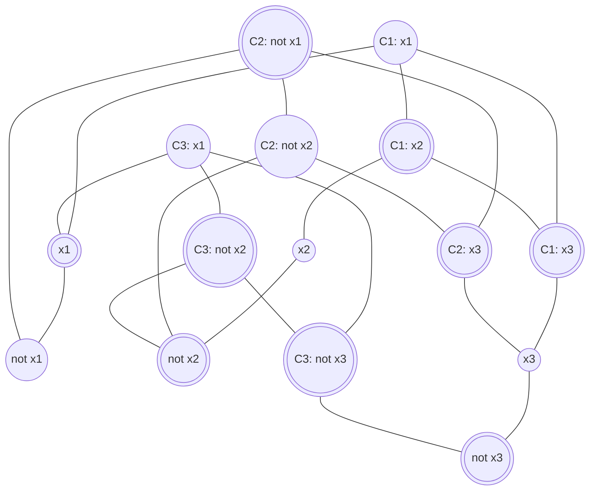

# Karp's list: a small kit of reductions that reaches everything

[Syllabus](../../../SYLLABUS.md) → [Computability and complexity](../README.md) → [Time Complexity](../README.md#s03) → Karp's list

---

## General Overview

A puzzle app solves every 9 by 9 sudoku in a blink. The team plans 16 by 16 and 25 by 25 grids next. Should they expect a fast method that works on every grid of every size?

Checking a filled grid is easy. A 25 by 25 grid has 75 groups (rows, columns and boxes) of 25 cells, so a check reads 1,875 cells. Finding the filling is the hard part, and no known method stays fast as the grid grows.

To show that a problem is hard, nobody builds a proof from nothing. They pick a problem already known to be hard and translate it into the new one. In 1972 Richard Karp did this for 21 problems in one paper. That list, and the habits it taught, is the kit on this card.

The card works one chain all the way through. A logic formula with 3 true-or-false variables and 3 rules becomes a graph of 15 vertices (points) and 21 edges (lines joining two points). The formula can be made true exactly when some 9 vertices touch every edge. That graph then becomes a list of 15 sets over 21 items, where 9 sets must cover every item.

**To prove a new problem hardest-in-NP, translate a known hardest problem into it: pick the known problem whose shape matches, then build a fast conversion that turns every yes into a yes and every no into a no.**

**What kind of fact this is:** three theorems proved on this card (3-SAT to vertex cover, vertex cover to set cover, Hamiltonian cycle to travelling salesman), and Karp's other reductions stated with his paper as the source. Every claim that these problems have no fast method rests on P ≠ NP, a conjecture unproved as of 2026-11-11.

### The picture: the chain this card works


Schematic. Each arrow is a fast conversion from the problem on its left into the problem on its right. Hardness flows along the arrows, left to right.

---

## The formula

Some words first, each taught on an earlier card and recalled here in one line.

- **P** is the class of yes-or-no problems solved in **polynomial time**: steps at most a fixed power of the input length ([P and NP](02-p-and-np.md)).
- **NP** is the class whose yes-answers can be checked in polynomial time, given a **certificate** (a proposed answer).
- A **reduction** $`A \le_p B`$ is a polynomial-time conversion $`f`$ that turns each input of problem $`A`$ into an input of problem $`B`$ with the same answer ([Reductions](03-polynomial-reductions-and-np-completeness.md)).
- A problem is **NP-complete** when it is in NP and every NP problem reduces to it. **SAT** asks whether a logic formula can be made true; [Cook-Levin](04-cook-levin-theorem.md) proves it NP-complete.

One rule does all the work on this card:

```math
A \text{ NP-complete},\quad A \le_p B,\quad B \in \mathrm{NP} \quad\Longrightarrow\quad B \text{ NP-complete}
```

**Read it aloud:** if a known hardest problem converts fast into a new problem, and the new problem's answers can be checked fast, then the new problem is hardest too.

The first worked conversion turns a formula into a graph. A **CNF** formula is an AND of **clauses**, each an OR of **literals** (a variable or its negation). **3-SAT** is SAT restricted to CNF formulas with exactly three literals in every clause; this card introduces the name. Karp's own version allowed at most three, and a short clause is padded to three with a fresh variable used both ways, so the two versions are equally hard. A **vertex cover** is a set of vertices touching every edge, as the [Konig's theorem](../../04-Combinatorics%20and%20graphs/13-Matchings%20and%20Flows/03-konigs-theorem-and-vertex-cover.md) card defines it.

```math
\varphi \text{ satisfiable} \iff \tau(G_\varphi) \le k = n + 2m, \qquad |V| = 2n + 3m,\quad |E| = n + 6m
```

**Read it aloud:** the formula can be made true exactly when its graph has a vertex cover of at most n plus 2m vertices, and the graph has 2n plus 3m vertices and n plus 6m edges.

| Symbol | Plain meaning | In our example | Push it up and the answer… |
| --- | --- | --- | --- |
| $`A`$, $`B`$ | the known hard problem, and the new problem | 3-SAT, VERTEX COVER | — |
| $`w`$ | one input of problem $`A`$ | the formula $`\varphi`$ | — |
| $`f`$ | the conversion, run in polynomial time | formula to graph | a slower $`f`$ proves nothing |
| $`A \le_p B`$ | "A converts fast into B": B is at least as hard | 3-SAT $`\le_p`$ VERTEX COVER | — |
| $`\varphi`$, $`\psi`$ | the two test formulas ("phi", "psi") | $`\varphi`$ satisfiable, $`\psi`$ not | — |
| $`x_i`$, $`\neg x_i`$ | variable $`i`$, and its negation ("not $`x_i`$") | $`x_1, x_2, x_3`$ | — |
| $`n`$ | number of variables | 3 | 2 more vertices, 1 more edge each |
| $`m`$ | number of clauses | 3 | 3 more vertices, 6 more edges each |
| $`G_\varphi`$, $`\lvert V \rvert`$, $`\lvert E \rvert`$ | the graph built from $`\varphi`$, its number of vertices, its number of edges | 15 and 21 | — |
| $`k`$ | the cover budget, $`n + 2m`$ | 9 | a larger budget is easier to meet |
| $`\tau(G)`$ | the size of a smallest vertex cover of $`G`$ ("tau") | 9 for $`G_\varphi`$, 20 for $`G_\psi`$ | — |
| $`N`$ | number of cities in the tour of Step 3, also its budget | 8 (cube), 10 (Petersen) | a longer tour, same yes-or-no |

Here $`\varphi = (x_1 \lor x_2 \lor x_3) \land (\neg x_1 \lor \neg x_2 \lor x_3) \land (x_1 \lor \neg x_2 \lor \neg x_3)`$. The formula $`\psi`$ has all 8 clauses on $`x_1, x_2, x_3`$, one for each pattern of signs, so every assignment breaks one of them.

### When it holds

- **The conversion runs in polynomial time.** A conversion that first solves the formula by trying all $`2^n`$ assignments, then outputs a fixed yes-graph or no-graph, maps answers correctly and proves nothing.
- **It maps both ways.** Yes must go to yes and no must go to no. Drop the link edges and the unsatisfiable $`\psi`$ gets a cover of 19 = $`k`$, a false yes.
- **The new problem is in NP.** Without a fast check of certificates, the rule gives "NP-hard" (at least as hard as all of NP), not NP-complete.
- **The conversion runs from the known problem to the new one.** Converting the new problem into 3-SAT shows only that it is no harder than 3-SAT.
- **P ≠ NP for the practical reading.** "NP-complete" is a proved fact. "So no fast method exists" holds only if P ≠ NP, unproved as of 2026-11-11.

---

## Why it works

### Step 0: a conversion carries hardness backwards

Suppose a fast method solved the new problem $`B`$. Feed it $`f(w)`$ for any input $`w`$ of $`A`$. Its answer is the answer for $`w`$, because $`f`$ keeps answers. So $`A`$ would be fast too.

Run that backwards. If $`A`$ is hardest in NP, then $`B`$ is at least as hard. Conversions also chain: a polynomial of a polynomial is still a polynomial, so $`A \le_p B`$ and $`B \le_p C`$ give $`A \le_p C`$.

That chaining is why a short list reaches so far. Cook-Levin supplies one hardest problem, SAT. Every new reduction adds one more, and each new one can serve as the starting point for the next.

The skill is choosing the starting point. A conversion is easy when the known problem already has the new problem's shape. Steps 1 to 3 show the three standard shapes of proof, and Step 4 lists the starting points.

### Step 1: component design, 3-SAT to vertex cover

**Component design** builds small graphs, called **gadgets**, that act out the parts of the known problem. Here there are two kinds.

- **A variable gadget.** For each variable $`x_i`$, two vertices $`x_i`$ and $`\neg x_i`$ joined by one edge. A cover must take at least one of them. Taking exactly one picks a truth value.
- **A clause gadget.** For each clause, a triangle with one corner per literal. A cover must take at least two corners of any triangle. The corner it leaves out marks the literal that makes the clause true.
- **Links.** Each triangle corner is joined to the variable vertex of its literal. The corner $`x_1`$ in clause 1 joins the vertex $`x_1`$.

Count the pieces. There are $`2n`$ variable vertices and $`3m`$ triangle corners. There are $`n`$ variable edges, $`3m`$ triangle edges and $`3m`$ links, so $`n + 6m`$ edges. Building them takes one pass over the formula.

**Why the budget is $`n + 2m`$.** The $`n`$ variable edges share no vertex, and neither do the $`m`$ triangles. So every cover has at least one vertex per variable edge and two per triangle: at least $`n + 2m`$. A cover of exactly that size has exactly one vertex per variable and two per triangle, no more.

**Yes goes to yes.** Take an assignment that makes $`\varphi`$ true. Put the true literal's vertex of each variable in the cover. In each clause, leave out one corner whose literal is true, and take the other two. The left-out corner's link ends at a true literal's vertex, which is in the cover. Every edge is touched, with $`n + 2m`$ vertices.

**No goes to no.** Put the other way round: a cover within budget gives a true assignment. Take a cover of size $`n + 2m`$. It holds exactly one vertex per variable edge, so call that literal true. In each triangle one corner is left out, and its link must be touched at the other end. So that corner's literal is in the cover, which means it is true. Every clause has a true literal.

**The NP check.** A certificate for VERTEX COVER is the cover itself, checked edge by edge in one pass. With both directions and the one-pass build, VERTEX COVER is NP-complete.

The graph for our $`\varphi`$, with the cover built from the assignment $`x_1`$ true, $`x_2`$ false, $`x_3`$ false drawn as double circles:



Schematic. Top row: the three variable edges. Below: one triangle per clause, labelled C1 to C3 with its literal. Nine double circles touch all 21 edges.

### Step 2: restriction, vertex cover to set cover

**SET COVER** asks: given a list of items and a list of sets of items, can at most $`k`$ sets cover every item?

**Restriction** shows that the new problem contains a known hard one as a special case. Make the items the edges of the graph. Make one set per vertex: the edges touching that vertex. A cover of $`k`$ vertices is then exactly $`k`$ sets that hold every edge.

For $`G_\varphi`$ that is 21 items and 15 sets, each item in exactly two sets. The fewest sets covering all 21 items is 9, the same as the smallest vertex cover. SET COVER is in NP, because a chosen list of sets is checked item by item. So SET COVER is NP-complete.

The special case is the whole proof. A general problem that holds a hard problem inside it cannot be easier than that problem.

### Step 3: local replacement, Hamiltonian cycle to travelling salesman

A **Hamiltonian cycle** visits every vertex once and returns, as the [Hamiltonian cycles](../../04-Combinatorics%20and%20graphs/11-Tours%20-%20Euler%20and%20Hamilton/03-hamiltonian-cycles.md) card defines it. The decision form of [The travelling salesman](../../04-Combinatorics%20and%20graphs/11-Tours%20-%20Euler%20and%20Hamilton/04-travelling-salesman-in-outline.md) asks: is there a round trip through all cities costing at most a budget?

**Local replacement** swaps each piece of the known problem for a small piece of the new one. The clearest case is the arrow from SAT to 3-SAT in the picture: each long clause is replaced by a chain of three-literal clauses joined by fresh variables. Here the pieces are pairs of vertices. Each vertex becomes a city. Two cities joined by an edge are distance 1 apart; two cities with no edge are distance 2 apart. The budget is the number of vertices. Each pair is replaced by a single distance, so this conversion can as well be read as restriction: TSP with distances 1 and 2 only is Hamiltonian cycle in disguise.

A tour of $`N`$ cities has $`N`$ legs, each costing at least 1. So it costs $`N`$ exactly when every leg is an edge, which is exactly a Hamiltonian cycle. Any tour that uses a missing edge costs at least $`N + 1`$.

- **The cube** (8 corners, 12 edges) has 6 Hamiltonian cycles. Its cheapest tour costs 8, within the budget of 8: yes.
- **The Petersen graph** (10 vertices, 15 edges) has none. Its cheapest tour costs 11, over the budget of 10: no.

### Step 4: choosing the starting problem

Karp's 1972 paper chains 21 problems from SAT. The table gives each problem and the problem Karp reduced it from. Some names are modern: Karp's "node cover" is vertex cover, and his "knapsack" is today's subset sum.

| Problem | Karp reduced it from |
| --- | --- |
| SAT | every NP problem (Cook-Levin) |
| 0-1 integer programming | SAT |
| CLIQUE | SAT |
| 3-SAT | SAT |
| SET PACKING | CLIQUE |
| VERTEX COVER | CLIQUE |
| SET COVER | VERTEX COVER |
| FEEDBACK VERTEX SET | VERTEX COVER |
| FEEDBACK ARC SET | VERTEX COVER |
| DIRECTED HAMILTONIAN CYCLE | VERTEX COVER |
| HAMILTONIAN CYCLE | DIRECTED HAMILTONIAN CYCLE |
| CHROMATIC NUMBER | 3-SAT |
| CLIQUE COVER | CHROMATIC NUMBER |
| EXACT COVER | CHROMATIC NUMBER |
| HITTING SET | EXACT COVER |
| STEINER TREE | EXACT COVER |
| 3-DIMENSIONAL MATCHING | EXACT COVER |
| KNAPSACK (subset sum) | EXACT COVER |
| JOB SEQUENCING | KNAPSACK |
| PARTITION | KNAPSACK |
| MAX CUT | PARTITION |

One route on this card differs from Karp's own, and one problem is added. He reached vertex cover from CLIQUE: a clique (vertices all joined to each other) in a graph is a set with no edges inside in the complement graph, and the other vertices then form a cover. The 3-SAT gadget of Step 1 is the later textbook route, from Garey, Johnson and Stockmeyer in 1976. TSP is not on the list itself; Step 3 adds it.

To choose a starting problem, match the shape of the new question:

| The new problem asks you to… | Start from | Example |
| --- | --- | --- |
| pick few things that touch every requirement | VERTEX COVER, SET COVER | cameras covering every corridor |
| pick many things with no conflict | CLIQUE, independent set, SET PACKING | non-clashing timetable slots |
| split into blocks that cover exactly once | EXACT COVER, 3-DIMENSIONAL MATCHING | teams of three with no overlap |
| visit everything once, in an order | HAMILTONIAN CYCLE | a delivery round |
| hit a target total with numbers | SUBSET SUM, PARTITION | splitting a load evenly |
| give labels under conflict rules | 3-colouring, Latin-square completion | exam timetables, sudoku |
| make true-or-false choices under local rules | 3-SAT | configuration options |

The labels row rests on 3-colouring, which comes from 3-SAT by gadgets like those of Step 1. Each variable gets the vertices $`x_i`$ and $`\neg x_i`$, joined to each other and to a shared base vertex, so one takes the "true" colour and the other the "false" one. Each clause gets a small graph that can be 3-coloured only when one of its literals has the "true" colour. This card names that gadget and does not work it; [Reductions](03-polynomial-reductions-and-np-completeness.md) uses the result and gives its sources.

Sudoku sits on the labels row. A **Latin square** is a square grid with each symbol once per row and column. Colbourn proved in 1984 that completing a partly filled Latin square is NP-complete. Yato and Seta's 2003 reduction from it shows that sudoku, taken over all grid sizes together (9 by 9, 16 by 16, 25 by 25 and on), is NP-complete too; this card states that step without proof. So the app team should not expect a method that stays fast as the grid grows: finding one would prove P = NP.

---

## Worked numbers, by hand

The chain on $`\varphi`$, with the assignment $`x_1`$ true, $`x_2`$ false, $`x_3`$ false.

| Step | Arithmetic | Value |
| --- | --- | --- |
| assignments that satisfy $`\varphi`$ | 8 minus the 3 that break one clause (FFF, TTF, FTT) | 5 |
| vertices of $`G_\varphi`$ | 2 × 3 + 3 × 3 | 15 |
| edges of $`G_\varphi`$ | 3 + 6 × 3 | 21 |
| budget $`k`$ | 3 + 2 × 3 | 9 |
| variable vertices taken | $`x_1`$, $`\neg x_2`$, $`\neg x_3`$ | 3 |
| clause 1: $`x_1`$ is true, leave its corner | take corners $`x_2`$, $`x_3`$ | 2 |
| clause 2: $`\neg x_2`$ is true, leave its corner | take corners $`\neg x_1`$, $`x_3`$ | 2 |
| clause 3: $`x_1`$ is true, leave its corner | take corners $`\neg x_2`$, $`\neg x_3`$ | 2 |
| cover size | 3 + 2 + 2 + 2 | **9** |
| no smaller cover | 3 disjoint edges + 2 for each of 3 disjoint triangles | 9 |
| set cover: items, sets, fewest sets | 21 edges, 15 vertices, the same 9 | **9** |
| $`\psi`$: vertices, edges, budget | 2 × 3 + 3 × 8, 3 + 6 × 8, 3 + 2 × 8 | 30, 51, 19 |
| $`\psi`$: smallest cover | one clause is always broken, costing a third corner | **20** |

So $`\varphi`$ is satisfiable and its graph meets the budget of 9 exactly; $`\psi`$ is not, and its graph misses the budget of 19 by one vertex.

### What breaks if you drop a piece

| Mistake | Comes out at | What went wrong |
| --- | --- | --- |
| Budget $`n + m`$ instead of $`n + 2m`$ | 6, below the true 9 | each triangle needs two corners, so a satisfiable formula reads as no |
| Drop the link edges | cover 19 on $`\psi`$, within budget 19 | triangles no longer depend on the truth values: a false yes |
| Drop the variable edges | cover 18 on $`\psi`$, within budget 19 | nothing forces one truth value per variable: a false yes |
| Use Konig's matching = cover on $`G_\varphi`$ | largest matching 7, true cover 9 | $`G_\varphi`$ has triangles, so it is not two-sided and the equality fails |
| Missing edges cost 1 instead of 2 in TSP | Petersen tour 10, within budget 10 | every tour now costs $`N`$: a false yes on a graph with no cycle |

The code prints all five.

---

## Code, from first principles, and it actually runs

The code builds each conversion and solves both sides by separate searches. It takes five independent roads.

1. **Brute force on the formula:** try all $`2^n`$ assignments.
2. **Branch search on the graph:** a vertex is in the cover, or all its neighbours are. It must agree with road 1 on $`\varphi`$, $`\psi`$ and 40 random formulas.
3. **Branch search on the sets:** the first uncovered item must be covered by one of its sets. It must give the same 9 and 20.
4. **Certificates both ways:** a cover built from the assignment is checked edge by edge, and an assignment read from the search's cover is checked clause by clause, on $`\varphi`$ and on all 35 satisfiable random formulas.
5. **Two tour solvers:** a backtracking count of Hamiltonian cycles against a Held-Karp table (cheapest path through each subset of cities). The built graph sizes are counted against $`2n + 3m`$ and $`n + 6m`$.

### Python

```python
# Karp's list -- the check behind the card.  Standard library only.  Three
# reductions are built and run: 3-SAT to vertex cover (gadgets), vertex cover
# to set cover (a special case), Hamiltonian cycle to travelling salesman (one
# weight per pair).  Each side is solved by its own exhaustive search, and the
# reduction must turn every yes into yes and every no into no.
M64 = (1 << 64) - 1
def splitmix(seed):                       # SplitMix64, written out (wing 09)
    while True:
        seed = (seed + 0x9E3779B97F4A7C15) & M64
        z = ((seed ^ (seed >> 30)) * 0xBF58476D1CE4E5B9) & M64
        z = ((z ^ (z >> 27)) * 0x94D049BB133111EB) & M64
        yield z ^ (z >> 31)
def true_lit(l, a): return ((a >> (abs(l) - 1)) & 1) == (1 if l > 0 else 0)
def sat_count(n, cl):                     # road 1: try all 2^n assignments
    good = [a for a in range(1 << n) if all(any(true_lit(l, a) for l in c) for c in cl)]
    return len(good), (good[0] if good else -1)
def lit_vertex(l): return 2 * (abs(l) - 1) + (1 if l < 0 else 0)   # x_i: 2i-2, not x_i: 2i-1
def gadget(n, cl, var_edges=True, links=True):
    edges = [(2 * i, 2 * i + 1) for i in range(n)] if var_edges else []
    for j, c in enumerate(cl):
        t = [2 * n + 3 * j + p for p in range(3)]              # the clause triangle
        edges += [(t[0], t[1]), (t[0], t[2]), (t[1], t[2])]
        if links: edges += [(t[p], lit_vertex(c[p])) for p in range(3)]
    return 2 * n + 3 * len(cl), edges
def min_cover(nv, edges):                 # road 2: branch on a busiest vertex
    adj = [0] * nv
    for u, v in edges: adj[u] |= 1 << v; adj[v] |= 1 << u
    best = [nv + 1, 0]
    def go(gone, size, chosen):
        if size >= best[0]: return
        degs = [(adj[v] & ~gone).bit_count() if not gone >> v & 1 else 0 for v in range(nv)]
        d = max(degs)
        if d == 0: best[0], best[1] = size, chosen; return
        if size + -(-(sum(degs) // 2) // d) >= best[0]: return   # each pick covers <= d edges
        v = degs.index(d); nb = adj[v] & ~gone
        go(gone | 1 << v, size + 1, chosen | 1 << v)            # v is in the cover
        go(gone | nb | 1 << v, size + d, chosen | nb)           # or all its neighbours are
    go(0, 0, 0); return best[0], best[1]
def covers(edges, mask): return all(mask >> u & 1 or mask >> v & 1 for u, v in edges)
def min_set_cover(n_elems, sets):         # road 3: branch on the first uncovered element
    full, best, most = (1 << n_elems) - 1, [len(sets) + 1], max(s.bit_count() for s in sets)
    def go(got, size):
        if got == full: best[0] = min(best[0], size); return
        left = ~got & full
        if size + -(-left.bit_count() // most) >= best[0]: return   # a set covers <= most
        e = left & -left
        for s in sorted((s for s in sets if s & e), key=lambda s: -(s & left).bit_count()):
            go(got | s, size + 1)
    go(0, 0); return best[0]
def edge_sets(nv, edges): return [sum(1 << i for i, (u, v) in enumerate(edges) if w in (u, v)) for w in range(nv)]
def max_matching(nv, edges):              # Konig's number, by search over the lowest free vertex
    adj = [0] * nv
    for u, v in edges: adj[u] |= 1 << v; adj[v] |= 1 << u
    def go(free):
        if free == 0: return 0
        u = (free & -free).bit_length() - 1; rest = free & ~(1 << u)
        best = go(rest)
        for v in range(nv):
            if rest >> v & 1 and adj[u] >> v & 1: best = max(best, 1 + go(rest & ~(1 << v)))
        return best
    return go((1 << nv) - 1)
def ham_cycles(nv, edges):                # walks from vertex 0, each cycle found twice
    adj = [0] * nv
    for u, v in edges: adj[u] |= 1 << v; adj[v] |= 1 << u
    def go(v, seen):
        if seen == (1 << nv) - 1: return 1 if adj[v] & 1 else 0
        return sum(go(w, seen | 1 << w) for w in range(nv) if adj[v] >> w & 1 and not seen >> w & 1)
    return go(0, 1) // 2
def cheapest_tour(nv, edges, far=2):      # Held-Karp table; a non-edge costs `far`
    es = {(u, v) for u, v in edges} | {(v, u) for u, v in edges}
    w = lambda a, b: 1 if (a, b) in es else far
    big = 10 ** 9; dp = [[big] * nv for _ in range(1 << nv)]; dp[1][0] = 0
    for mask in range(1, 1 << nv, 2):
        for v in range(nv):
            if dp[mask][v] < big:
                for u in range(nv):
                    if not mask >> u & 1: dp[mask | 1 << u][u] = min(dp[mask | 1 << u][u], dp[mask][v] + w(v, u))
    return min(dp[(1 << nv) - 1][v] + w(v, 0) for v in range(1, nv))
def show(a, n): return ", ".join(f"x{i + 1}={'T' if a >> i & 1 else 'F'}" for i in range(n))

phi = [(1, 2, 3), (-1, -2, 3), (1, -2, -3)]
n, m = 3, len(phi); k = n + 2 * m
(count, a), (nv, E) = sat_count(n, phi), gadget(n, phi)
tau, solver_cover = min_cover(nv, E)
print(f"phi: n = {n} variables, m = {m} clauses, satisfying assignments {count} of {1 << n}")
print(f"first satisfying assignment: {show(a, n)}")
print(f"G_phi: vertices {nv} (2n + 3m = {2 * n + 3 * m}), edges {len(E)} (n + 6m = {n + 6 * m}), target k = n + 2m = {k}")
built = sum(1 << lit_vertex(i + 1 if a >> i & 1 else -(i + 1)) for i in range(n))
for j, c in enumerate(phi):              # leave out one true literal's corner, take the other two
    keep = next(p for p in range(3) if true_lit(c[p], a))
    built |= sum(1 << (2 * n + 3 * j + p) for p in range(3) if p != keep)
print(f"cover built from the assignment: vertices {[v for v in range(nv) if built >> v & 1]}, size {built.bit_count()}, covers every edge: {covers(E, built)}")
def read_back(cov, n): return sum(1 << i for i in range(n) if cov >> (2 * i) & 1)   # x_i true when its vertex is in the cover
back = read_back(solver_cover, n); back_ok = all(any(true_lit(l, back) for l in c) for c in phi)
print(f"smallest vertex cover found by search: {tau}; assignment read back from it: {show(back, n)}, satisfies phi: {back_ok}")
sc = min_set_cover(len(E), edge_sets(nv, E))
print(f"set cover: {len(E)} elements (the edges), {nv} sets (one per vertex), fewest sets covering all: {sc}")
psi = [(s1, 2 * s2, 3 * s3) for s1 in (1, -1) for s2 in (1, -1) for s3 in (1, -1)]
cpsi, _ = sat_count(3, psi); nvp, Ep = gadget(3, psi); kp = 3 + 2 * len(psi)
taup, _ = min_cover(nvp, Ep); scp = min_set_cover(len(Ep), edge_sets(nvp, Ep))
print(f"psi, all 8 clauses on x1..x3: satisfying assignments {cpsi}; G_psi: vertices {nvp}, edges {len(Ep)}, target {kp}")
print(f"smallest vertex cover of G_psi: {taup}; fewest sets in its set cover: {scp}")
assert count > 0 and tau == k and built.bit_count() == k and covers(E, built) and back_ok
assert covers(E, solver_cover) and solver_cover.bit_count() == tau and sc == tau
assert cpsi == 0 and taup == kp + 1 and scp == taup
pool = [tuple(sg[p] * vs[p] for p in range(3)) for d in range(4) for vs in [[v for v in (1, 2, 3, 4) if v != d + 1]]
        for sg in [(s1, s2, s3) for s1 in (1, -1) for s2 in (1, -1) for s3 in (1, -1)]]
rng, tally, agree, backs = splitmix(2026), [0, 0], 0, 0
for t in range(40):                       # 40 random formulas: 4 variables, 11 to 14 distinct clauses
    left, cl = pool[:], []
    for _ in range(11 + t % 4): cl.append(left.pop(next(rng) % len(left)))
    c, _ = sat_count(4, cl); gv, ge = gadget(4, cl); tc, tcov = min_cover(gv, ge)
    tally[c == 0] += 1; agree += (c > 0) == (tc <= 4 + 2 * len(cl))
    bk = read_back(tcov, 4); backs += c > 0 and all(any(true_lit(l, bk) for l in q) for q in cl)
print(f"random batch, seed 2026: 40 formulas, satisfiable {tally[0]}, unsatisfiable {tally[1]}, reduction agrees on {agree}, assignments read back and checked {backs}")
assert agree == 40 and tally[1] > 0 and backs == tally[0]
cube = [(u, u ^ b) for u in range(8) for b in (1, 2, 4) if u < u ^ b]
pet = [(i, (i + 1) % 5) for i in range(5)] + [(i, i + 5) for i in range(5)] + [(5 + i, 5 + (i + 2) % 5) for i in range(5)]
hc, hp = ham_cycles(8, cube), ham_cycles(10, pet)
tc, tp, tp1 = cheapest_tour(8, cube), cheapest_tour(10, pet), cheapest_tour(10, pet, far=1)
print(f"cube: 8 vertices, {len(cube)} edges, Hamiltonian cycles {hc}, cheapest tour {tc} against budget 8")
print(f"Petersen: 10 vertices, {len(pet)} edges, Hamiltonian cycles {hp}, cheapest tour {tp} against budget 10")
assert hc == 6 and tc == 8 and hp == 0 and tp == 11 and len(cube) == 12
_, el = gadget(3, psi, links=False); _, ev = gadget(3, psi, var_edges=False)
nl, nvar, mm = min_cover(30, el)[0], min_cover(30, ev)[0], max_matching(nv, E)
print(f"mistake, target n + m = {n + m} on phi: smallest cover {tau} is above it, so a satisfiable formula reads as no")
print(f"mistake, links dropped on psi: smallest cover {nl} <= {kp}, so an unsatisfiable formula reads as yes")
print(f"mistake, variable edges dropped on psi: smallest cover {nvar} <= {kp}, the same false yes")
print(f"mistake, Konig's matching on G_phi: largest matching {mm} against smallest cover {tau}")
print(f"mistake, non-edges cost 1 on Petersen: cheapest tour {tp1} <= 10, a false yes")
assert nl <= kp and nvar <= kp and mm < tau and tp1 == 10
print("sizes: variables, clauses, vertices, edges built, edges by formula, assignments 2^n")
for sn, smm in ((10, 43), (40, 172), (100, 430)):
    big = [(next(rng) % sn + 1, -(next(rng) % sn + 1), next(rng) % sn + 1) for _ in range(smm)]
    gv, ge = gadget(sn, big)
    print(f"  {sn}, {smm}, {gv}, {len(ge)}, {sn + 6 * smm}, {1 << sn}")
    assert gv == 2 * sn + 3 * smm and len(ge) == sn + 6 * smm
for g in (9, 16, 25):
    print(f"sudoku {g} by {g}: {g * g} cells; checking a filled grid reads {3 * g} groups of {g}, {3 * g * g} cells")
print("ALL CHECKS PASS")
```

**Ran 2026-11-19 on macOS, Python 3.14.10, standard library only. All checks passed. Output, pasted from the run:**

```
phi: n = 3 variables, m = 3 clauses, satisfying assignments 5 of 8
first satisfying assignment: x1=T, x2=F, x3=F
G_phi: vertices 15 (2n + 3m = 15), edges 21 (n + 6m = 21), target k = n + 2m = 9
cover built from the assignment: vertices [0, 3, 5, 7, 8, 9, 11, 13, 14], size 9, covers every edge: True
smallest vertex cover found by search: 9; assignment read back from it: x1=T, x2=F, x3=T, satisfies phi: True
set cover: 21 elements (the edges), 15 sets (one per vertex), fewest sets covering all: 9
psi, all 8 clauses on x1..x3: satisfying assignments 0; G_psi: vertices 30, edges 51, target 19
smallest vertex cover of G_psi: 20; fewest sets in its set cover: 20
random batch, seed 2026: 40 formulas, satisfiable 35, unsatisfiable 5, reduction agrees on 40, assignments read back and checked 35
cube: 8 vertices, 12 edges, Hamiltonian cycles 6, cheapest tour 8 against budget 8
Petersen: 10 vertices, 15 edges, Hamiltonian cycles 0, cheapest tour 11 against budget 10
mistake, target n + m = 6 on phi: smallest cover 9 is above it, so a satisfiable formula reads as no
mistake, links dropped on psi: smallest cover 19 <= 19, so an unsatisfiable formula reads as yes
mistake, variable edges dropped on psi: smallest cover 18 <= 19, the same false yes
mistake, Konig's matching on G_phi: largest matching 7 against smallest cover 9
mistake, non-edges cost 1 on Petersen: cheapest tour 10 <= 10, a false yes
sizes: variables, clauses, vertices, edges built, edges by formula, assignments 2^n
  10, 43, 149, 268, 268, 1024
  40, 172, 596, 1072, 1072, 1099511627776
  100, 430, 1490, 2680, 2680, 1267650600228229401496703205376
sudoku 9 by 9: 81 cells; checking a filled grid reads 27 groups of 9, 243 cells
sudoku 16 by 16: 256 cells; checking a filled grid reads 48 groups of 16, 768 cells
sudoku 25 by 25: 625 cells; checking a filled grid reads 75 groups of 25, 1875 cells
ALL CHECKS PASS
```

### Rust

Same searches, same labels, built with `rustc --edition 2021 -O`.

```rust
// Karp's list -- the same check as the Python, in Rust.  No crates.  Three
// reductions are built and run: 3-SAT to vertex cover (gadgets), vertex cover
// to set cover (a special case), Hamiltonian cycle to travelling salesman (one
// weight per pair).  Each side is solved by its own exhaustive search, and the
// reduction must turn every yes into yes and every no into no.
struct SplitMix(u64);
impl SplitMix {                            // SplitMix64, written out (wing 09)
    fn next(&mut self) -> u64 {
        self.0 = self.0.wrapping_add(0x9E3779B97F4A7C15);
        let z = (self.0 ^ (self.0 >> 30)).wrapping_mul(0xBF58476D1CE4E5B9);
        let z = (z ^ (z >> 27)).wrapping_mul(0x94D049BB133111EB);
        z ^ (z >> 31) } }
type Clause = [i64; 3];
fn true_lit(l: i64, a: u64) -> bool { ((a >> (l.abs() - 1)) & 1) == if l > 0 { 1 } else { 0 } }
fn sat_count(n: u32, cl: &[Clause]) -> (usize, i64) {   // road 1: try all 2^n assignments
    let good: Vec<u64> = (0..1u64 << n).filter(|&a| cl.iter().all(|c| c.iter().any(|&l| true_lit(l, a)))).collect();
    (good.len(), if good.is_empty() { -1 } else { good[0] as i64 })
}
fn lit_vertex(l: i64) -> usize { (2 * (l.abs() - 1) + if l < 0 { 1 } else { 0 }) as usize }
fn gadget(n: usize, cl: &[Clause], var_edges: bool, links: bool) -> (usize, Vec<(usize, usize)>) {
    let mut e: Vec<(usize, usize)> = if var_edges { (0..n).map(|i| (2 * i, 2 * i + 1)).collect() } else { vec![] };
    for (j, c) in cl.iter().enumerate() {
        let t = [2 * n + 3 * j, 2 * n + 3 * j + 1, 2 * n + 3 * j + 2];   // the clause triangle
        e.extend([(t[0], t[1]), (t[0], t[2]), (t[1], t[2])]);
        if links { for p in 0..3 { e.push((t[p], lit_vertex(c[p]))); } }
    }
    (2 * n + 3 * cl.len(), e)
}
fn adjacency(nv: usize, e: &[(usize, usize)]) -> Vec<u64> {
    let mut adj = vec![0u64; nv];
    for &(u, v) in e { adj[u] |= 1 << v; adj[v] |= 1 << u; }
    adj }
fn cover_go(adj: &[u64], gone: u64, size: usize, chosen: u64, best: &mut (usize, u64)) {
    if size >= best.0 { return; }
    let degs: Vec<usize> = (0..adj.len()).map(|v| if gone >> v & 1 == 0 { (adj[v] & !gone).count_ones() as usize } else { 0 }).collect();
    let d = *degs.iter().max().unwrap();
    if d == 0 { *best = (size, chosen); return; }
    let edges: usize = degs.iter().sum::<usize>() / 2;
    if size + (edges + d - 1) / d >= best.0 { return; }          // each pick covers <= d edges
    let v = degs.iter().position(|&x| x == d).unwrap();
    let nb = adj[v] & !gone;
    cover_go(adj, gone | 1 << v, size + 1, chosen | 1 << v, best);   // v is in the cover
    cover_go(adj, gone | nb | 1 << v, size + d, chosen | nb, best);  // or all its neighbours are
}
fn min_cover(nv: usize, e: &[(usize, usize)]) -> (usize, u64) {   // road 2
    let mut best = (nv + 1, 0u64);
    cover_go(&adjacency(nv, e), 0, 0, 0, &mut best);
    best }
fn covers(e: &[(usize, usize)], mask: u64) -> bool { e.iter().all(|&(u, v)| mask >> u & 1 == 1 || mask >> v & 1 == 1) }
fn sc_go(sets: &[u64], full: u64, most: u32, got: u64, size: usize, best: &mut usize) {
    if got == full { if size < *best { *best = size; } return; }
    let left = !got & full;
    if size + ((left.count_ones() + most - 1) / most) as usize >= *best { return; }   // a set covers <= most
    let e = left & left.wrapping_neg();
    let mut opts: Vec<u64> = sets.iter().cloned().filter(|s| s & e != 0).collect();
    opts.sort_by_key(|s| -((s & left).count_ones() as i64));
    for s in opts { sc_go(sets, full, most, got | s, size + 1, best); }
}
fn min_set_cover(n_elems: usize, sets: &[u64]) -> usize {   // road 3: branch on the first uncovered element
    let mut best = sets.len() + 1;
    let most = sets.iter().map(|s| s.count_ones()).max().unwrap();
    sc_go(sets, (1u64 << n_elems) - 1, most, 0, 0, &mut best);
    best }
fn edge_sets(nv: usize, e: &[(usize, usize)]) -> Vec<u64> {
    (0..nv).map(|w| e.iter().enumerate().filter(|(_, &(u, v))| u == w || v == w).map(|(i, _)| 1u64 << i).sum()).collect()
}
fn match_go(adj: &[u64], free: u64) -> usize {     // Konig's number, by search over the lowest free vertex
    if free == 0 { return 0; }
    let u = free.trailing_zeros() as usize;
    let rest = free & !(1 << u);
    let mut best = match_go(adj, rest);
    for v in (0..adj.len()).filter(|&v| rest >> v & 1 == 1 && adj[u] >> v & 1 == 1) { best = best.max(1 + match_go(adj, rest & !(1 << v))); }
    best }
fn ham_go(adj: &[u64], v: usize, seen: u64) -> usize {   // walks from vertex 0, each cycle found twice
    let full = (1u64 << adj.len()) - 1;
    if seen == full { return if adj[v] & 1 == 1 { 1 } else { 0 }; }
    (0..adj.len()).filter(|&w| adj[v] >> w & 1 == 1 && seen >> w & 1 == 0).map(|w| ham_go(adj, w, seen | 1 << w)).sum()
}
fn cheapest_tour(nv: usize, e: &[(usize, usize)], far: usize) -> usize {   // Held-Karp; a non-edge costs `far`
    let adj = adjacency(nv, e);
    let w = |a: usize, b: usize| if adj[a] >> b & 1 == 1 { 1 } else { far };
    let big = 1_000_000_000usize;
    let mut dp = vec![vec![big; nv]; 1 << nv];
    dp[1][0] = 0;
    for mask in (1..1usize << nv).step_by(2) {
        for v in 0..nv {
            if dp[mask][v] == big { continue; }
            for u in (0..nv).filter(|&u| mask >> u & 1 == 0) { let c = dp[mask][v] + w(v, u); let t = &mut dp[mask | 1 << u][u]; if c < *t { *t = c; } }
        }
    }
    (1..nv).map(|v| dp[(1 << nv) - 1][v] + w(v, 0)).min().unwrap()
}
fn show(a: u64, n: usize) -> String { (0..n).map(|i| format!("x{}={}", i + 1, if a >> i & 1 == 1 { "T" } else { "F" })).collect::<Vec<_>>().join(", ") }
fn read_back(cov: u64, n: usize) -> u64 { (0..n).filter(|&i| cov >> (2 * i) & 1 == 1).map(|i| 1u64 << i).sum() } // x_i true when its vertex is in the cover
fn py(b: bool) -> &'static str { if b { "True" } else { "False" } }
fn signs() -> Vec<[i64; 3]> { let mut v = vec![]; for a in [1, -1] { for b in [1, -1] { for c in [1, -1] { v.push([a, b, c]); } } } v }
fn main() {
    let phi: Vec<Clause> = vec![[1, 2, 3], [-1, -2, 3], [1, -2, -3]];
    let (n, m) = (3usize, phi.len()); let k = n + 2 * m;
    let (count, a) = sat_count(3, &phi); let a = a as u64;
    let (nv, e) = gadget(n, &phi, true, true); let (tau, solver_cover) = min_cover(nv, &e);
    println!("phi: n = {} variables, m = {} clauses, satisfying assignments {} of {}", n, m, count, 1 << n);
    println!("first satisfying assignment: {}", show(a, n));
    println!("G_phi: vertices {} (2n + 3m = {}), edges {} (n + 6m = {}), target k = n + 2m = {}", nv, 2 * n + 3 * m, e.len(), n + 6 * m, k);
    let mut built: u64 = (0..n).map(|i| 1u64 << lit_vertex(if a >> i & 1 == 1 { i as i64 + 1 } else { -(i as i64 + 1) })).sum();
    for (j, c) in phi.iter().enumerate() {   // leave out one true literal's corner, take the other two
        let keep = (0..3).find(|&p| true_lit(c[p], a)).unwrap();
        for p in 0..3 { if p != keep { built |= 1 << (2 * n + 3 * j + p); } }
    }
    let bl: Vec<usize> = (0..nv).filter(|&v| built >> v & 1 == 1).collect();
    println!("cover built from the assignment: vertices {:?}, size {}, covers every edge: {}", bl, built.count_ones(), py(covers(&e, built)));
    let back = read_back(solver_cover, n);
    let back_ok = phi.iter().all(|c| c.iter().any(|&l| true_lit(l, back)));
    println!("smallest vertex cover found by search: {}; assignment read back from it: {}, satisfies phi: {}", tau, show(back, n), py(back_ok));
    let sc = min_set_cover(e.len(), &edge_sets(nv, &e));
    println!("set cover: {} elements (the edges), {} sets (one per vertex), fewest sets covering all: {}", e.len(), nv, sc);
    let psi: Vec<Clause> = signs().iter().map(|s| [s[0], 2 * s[1], 3 * s[2]]).collect();
    let (cpsi, _) = sat_count(3, &psi);
    let (nvp, ep) = gadget(3, &psi, true, true);
    let (kp, (taup, _)) = (3 + 2 * psi.len(), min_cover(nvp, &ep));
    let scp = min_set_cover(ep.len(), &edge_sets(nvp, &ep));
    println!("psi, all 8 clauses on x1..x3: satisfying assignments {}; G_psi: vertices {}, edges {}, target {}", cpsi, nvp, ep.len(), kp);
    println!("smallest vertex cover of G_psi: {}; fewest sets in its set cover: {}", taup, scp);
    assert!(count > 0 && tau == k && built.count_ones() as usize == k && covers(&e, built) && back_ok);
    assert!(covers(&e, solver_cover) && solver_cover.count_ones() as usize == tau && sc == tau);
    assert!(cpsi == 0 && taup == kp + 1 && scp == taup);
    let mut pool: Vec<Clause> = vec![];
    for d in 0..4i64 {
        let vs: Vec<i64> = (1..5).filter(|&v| v != d + 1).collect();
        for s in signs() { pool.push([s[0] * vs[0], s[1] * vs[1], s[2] * vs[2]]); }
    }
    let mut rng = SplitMix(2026);
    let (mut tally, mut agree, mut backs) = ([0usize, 0], 0, 0);
    for t in 0..40 {                       // 40 random formulas: 4 variables, 11 to 14 distinct clauses
        let (mut left, mut cl) = (pool.clone(), Vec::<Clause>::new());
        for _ in 0..11 + t % 4 { let i = (rng.next() % left.len() as u64) as usize; cl.push(left.remove(i)); }
        let ((c, _), (gv, ge)) = (sat_count(4, &cl), gadget(4, &cl, true, true));
        let (tc, tcov) = min_cover(gv, &ge);
        tally[(c == 0) as usize] += 1; if (c > 0) == (tc <= 4 + 2 * cl.len()) { agree += 1; }
        let bk = read_back(tcov, 4);
        if c > 0 && cl.iter().all(|q| q.iter().any(|&l| true_lit(l, bk))) { backs += 1; }
    }
    println!("random batch, seed 2026: 40 formulas, satisfiable {}, unsatisfiable {}, reduction agrees on {}, assignments read back and checked {}", tally[0], tally[1], agree, backs);
    assert!(agree == 40 && tally[1] > 0 && backs == tally[0]);
    let mut cube = vec![];
    for u in 0..8usize { for b in [1usize, 2, 4] { if u < u ^ b { cube.push((u, u ^ b)); } } }
    let pet: Vec<(usize, usize)> = (0..5).map(|i| (i, (i + 1) % 5)).chain((0..5).map(|i| (i, i + 5))).chain((0..5).map(|i| (5 + i, 5 + (i + 2) % 5))).collect();
    let (hc, hp) = (ham_go(&adjacency(8, &cube), 0, 1) / 2, ham_go(&adjacency(10, &pet), 0, 1) / 2);
    let (tc, tp, tp1) = (cheapest_tour(8, &cube, 2), cheapest_tour(10, &pet, 2), cheapest_tour(10, &pet, 1));
    println!("cube: 8 vertices, {} edges, Hamiltonian cycles {}, cheapest tour {} against budget 8", cube.len(), hc, tc);
    println!("Petersen: 10 vertices, {} edges, Hamiltonian cycles {}, cheapest tour {} against budget 10", pet.len(), hp, tp);
    assert!(hc == 6 && tc == 8 && hp == 0 && tp == 11 && cube.len() == 12);
    let ((_, el), (_, ev)) = (gadget(3, &psi, true, false), gadget(3, &psi, false, true));
    let (nl, nvar, mm) = (min_cover(30, &el).0, min_cover(30, &ev).0, match_go(&adjacency(nv, &e), (1u64 << nv) - 1));
    println!("mistake, target n + m = {} on phi: smallest cover {} is above it, so a satisfiable formula reads as no", n + m, tau);
    println!("mistake, links dropped on psi: smallest cover {} <= {}, so an unsatisfiable formula reads as yes", nl, kp);
    println!("mistake, variable edges dropped on psi: smallest cover {} <= {}, the same false yes", nvar, kp);
    println!("mistake, Konig's matching on G_phi: largest matching {} against smallest cover {}", mm, tau);
    println!("mistake, non-edges cost 1 on Petersen: cheapest tour {} <= 10, a false yes", tp1);
    assert!(nl <= kp && nvar <= kp && mm < tau && tp1 == 10);
    println!("sizes: variables, clauses, vertices, edges built, edges by formula, assignments 2^n");
    for (sn, smm) in [(10u64, 43usize), (40, 172), (100, 430)] {
        let big: Vec<Clause> = (0..smm).map(|_| { let x = rng.next() % sn + 1; let y = rng.next() % sn + 1; let z = rng.next() % sn + 1; [x as i64, -(y as i64), z as i64] }).collect();
        let (gv, ge) = gadget(sn as usize, &big, true, true);
        println!("  {}, {}, {}, {}, {}, {}", sn, smm, gv, ge.len(), sn as usize + 6 * smm, 1u128 << sn);
        assert!(gv == 2 * sn as usize + 3 * smm && ge.len() == sn as usize + 6 * smm);
    }
    for g in [9, 16, 25] { println!("sudoku {} by {}: {} cells; checking a filled grid reads {} groups of {}, {} cells", g, g, g * g, 3 * g, g, 3 * g * g); }
    println!("ALL CHECKS PASS");
}
```

**Ran 2026-11-19 on macOS, rustc 1.98.1, no crates. All checks passed. Output, pasted from the run:**

```
phi: n = 3 variables, m = 3 clauses, satisfying assignments 5 of 8
first satisfying assignment: x1=T, x2=F, x3=F
G_phi: vertices 15 (2n + 3m = 15), edges 21 (n + 6m = 21), target k = n + 2m = 9
cover built from the assignment: vertices [0, 3, 5, 7, 8, 9, 11, 13, 14], size 9, covers every edge: True
smallest vertex cover found by search: 9; assignment read back from it: x1=T, x2=F, x3=T, satisfies phi: True
set cover: 21 elements (the edges), 15 sets (one per vertex), fewest sets covering all: 9
psi, all 8 clauses on x1..x3: satisfying assignments 0; G_psi: vertices 30, edges 51, target 19
smallest vertex cover of G_psi: 20; fewest sets in its set cover: 20
random batch, seed 2026: 40 formulas, satisfiable 35, unsatisfiable 5, reduction agrees on 40, assignments read back and checked 35
cube: 8 vertices, 12 edges, Hamiltonian cycles 6, cheapest tour 8 against budget 8
Petersen: 10 vertices, 15 edges, Hamiltonian cycles 0, cheapest tour 11 against budget 10
mistake, target n + m = 6 on phi: smallest cover 9 is above it, so a satisfiable formula reads as no
mistake, links dropped on psi: smallest cover 19 <= 19, so an unsatisfiable formula reads as yes
mistake, variable edges dropped on psi: smallest cover 18 <= 19, the same false yes
mistake, Konig's matching on G_phi: largest matching 7 against smallest cover 9
mistake, non-edges cost 1 on Petersen: cheapest tour 10 <= 10, a false yes
sizes: variables, clauses, vertices, edges built, edges by formula, assignments 2^n
  10, 43, 149, 268, 268, 1024
  40, 172, 596, 1072, 1072, 1099511627776
  100, 430, 1490, 2680, 2680, 1267650600228229401496703205376
sudoku 9 by 9: 81 cells; checking a filled grid reads 27 groups of 9, 243 cells
sudoku 16 by 16: 256 cells; checking a filled grid reads 48 groups of 16, 768 cells
sudoku 25 by 25: 625 cells; checking a filled grid reads 75 groups of 25, 1875 cells
ALL CHECKS PASS
```

The two outputs match line for line.

The sizes rows show why the conversion is cheap and the search is not. For 100 variables and 430 clauses the graph has 1,490 vertices and 2,680 edges, built in one pass. Trying every assignment would take $`2^{100}`$ = 1,267,650,600,228,229,401,496,703,205,376 tries. At 40 variables it is already 1,099,511,627,776.

### Lean

Lean proves the three worked reductions for every formula and every graph, not only for the examples.

- Take any 3-SAT formula with n variables and m clauses. Then $`G_\varphi`$ has $`2n + 3m`$ vertices and $`n + 6m`$ edges.
- Take the same formula. Then it can be made true exactly when $`G_\varphi`$ has a vertex cover of at most $`n + 2m`$ vertices.
- Take any graph, with its edges as items and one set per vertex. Then k vertices touch every edge exactly when their k sets hold every item.
- Take any graph with N vertices, N at least 3, and distances 1 along edges and 2 elsewhere. Then it has a Hamiltonian cycle exactly when some tour costs at most N.
- For $`\varphi`$, 5 of the 8 assignments work, and $`G_\varphi`$ has 21 edges.
- The cover built from $`x_1`$ true, $`x_2`$ false, $`x_3`$ false has 9 vertices and touches every edge.
- No assignment makes $`\psi`$ true, and $`G_\psi`$ has 51 edges.
- The cube has 12 edges, and the tour 0, 1, 3, 2, 6, 7, 5, 4 costs 8.
- The graph sizes for 10, 40 and 100 variables, and the sudoku check counts, are right too.

Smallest covers, the random batch, the Petersen tour and the five mistakes are left to the Python and Rust checks.

```lean
-- Karp's list: a three-literal formula can be made true exactly when its gadget graph of 2n + 3m vertices and n + 6m edges has a vertex cover of at most n + 2m vertices, that cover is a set cover of the edges, and a graph has a Hamiltonian cycle exactly when the 1-and-2 distance tour problem meets the budget N.
import Mathlib.Combinatorics.SimpleGraph.VertexCover
import Mathlib.Combinatorics.SimpleGraph.Hamiltonian
import Mathlib.Combinatorics.SimpleGraph.Finite
import Mathlib.Logic.Equiv.Fin.Rotate
import Mathlib.Tactic.NormNum
import Mathlib.Algebra.Order.BigOperators.Group.Finset
import Mathlib.Algebra.BigOperators.Fin
import Mathlib.Combinatorics.SimpleGraph.DegreeSum
import Mathlib.Tactic.Ring

open SimpleGraph

namespace KarpsList

/-- A literal over the variables `x_1, ..., x_n` (numbered from 0 in Lean): a variable and a sign,
`true` for `x_i` and `false` for `¬x_i`. -/
abbrev Literal (n : ℕ) := Fin n × Bool

/-- A 3-SAT formula with `n` variables and `m` clauses: each clause has exactly three literals. -/
abbrev Formula3 (n m : ℕ) := Fin m → Fin 3 → Literal n

/-- The formula can be made true: some assignment makes at least one literal true in every
clause (the literal `(i, b)` is true when `x_i` gets the value `b`). -/
def Satisfiable {n m : ℕ} (φ : Formula3 n m) : Prop :=
  ∃ a : Fin n → Bool, ∀ j : Fin m, ∃ p : Fin 3, a (φ j p).1 = (φ j p).2

/-- The vertices of the gadget graph: one per literal (`x_i` and `¬x_i`), and one triangle
corner per clause position. -/
abbrev GadgetVertex (n m : ℕ) := Literal n ⊕ (Fin m × Fin 3)

/-- The gadget's joins, one direction of each: the variable edge `x_i — ¬x_i`, the three sides
of each clause triangle, and the link from each corner to the vertex of its literal. -/
def gadgetLink {n m : ℕ} (φ : Formula3 n m) : GadgetVertex n m → GadgetVertex n m → Bool
  | .inl l, .inl l' => decide (l.1 = l'.1 ∧ l.2 ≠ l'.2)
  | .inr c, .inr c' => decide (c.1 = c'.1 ∧ c.2 ≠ c'.2)
  | .inr c, .inl l => decide (φ c.1 c.2 = l)
  | .inl _, .inr _ => false

/-- The graph `G_φ` built from the formula `φ` (Step 1 of the card). -/
def gadget {n m : ℕ} (φ : Formula3 n m) : SimpleGraph (GadgetVertex n m) :=
  SimpleGraph.fromRel fun u v => gadgetLink φ u v = true

instance {n m : ℕ} (φ : Formula3 n m) : DecidableRel (gadget φ).Adj := fun u v => by
  unfold gadget; simp only [fromRel_adj]; infer_instance

theorem gadget_adj_inl_inl {n m : ℕ} (φ : Formula3 n m) (l l' : Literal n) :
    (gadget φ).Adj (.inl l) (.inl l') ↔ l.1 = l'.1 ∧ l.2 ≠ l'.2 := by
  obtain ⟨i, b⟩ := l
  obtain ⟨i', b'⟩ := l'
  simp only [gadget, gadgetLink, fromRel_adj, ne_eq, Sum.inl.injEq, Prod.mk.injEq,
    decide_eq_true_eq]
  constructor
  · rintro ⟨-, h | h⟩
    · exact h
    · exact ⟨h.1.symm, fun e => h.2 e.symm⟩
  · rintro ⟨h1, h2⟩
    exact ⟨fun e => h2 e.2, Or.inl ⟨h1, h2⟩⟩

theorem gadget_adj_inr_inr {n m : ℕ} (φ : Formula3 n m) (c c' : Fin m × Fin 3) :
    (gadget φ).Adj (.inr c) (.inr c') ↔ c.1 = c'.1 ∧ c.2 ≠ c'.2 := by
  obtain ⟨i, b⟩ := c
  obtain ⟨i', b'⟩ := c'
  simp only [gadget, gadgetLink, fromRel_adj, ne_eq, Sum.inr.injEq, Prod.mk.injEq,
    decide_eq_true_eq]
  constructor
  · rintro ⟨-, h | h⟩
    · exact h
    · exact ⟨h.1.symm, fun e => h.2 e.symm⟩
  · rintro ⟨h1, h2⟩
    exact ⟨fun e => h2 e.2, Or.inl ⟨h1, h2⟩⟩

theorem gadget_adj_inr_inl {n m : ℕ} (φ : Formula3 n m) (c : Fin m × Fin 3) (l : Literal n) :
    (gadget φ).Adj (.inr c) (.inl l) ↔ φ c.1 c.2 = l := by
  simp [gadget, gadgetLink, fromRel_adj]

theorem gadget_adj_inl_inr {n m : ℕ} (φ : Formula3 n m) (l : Literal n) (c : Fin m × Fin 3) :
    (gadget φ).Adj (.inl l) (.inr c) ↔ φ c.1 c.2 = l := by
  rw [adj_comm, gadget_adj_inr_inl]

theorem gadget_card_split {n m : ℕ} (C : Finset (GadgetVertex n m)) :
    C.card = ∑ i : Fin n, ((if Sum.inl (i, true) ∈ C then 1 else 0) +
        (if Sum.inl (i, false) ∈ C then 1 else 0)) +
      ∑ j : Fin m, ((if Sum.inr (j, 0) ∈ C then 1 else 0) +
        (if Sum.inr (j, 1) ∈ C then 1 else 0) + (if Sum.inr (j, 2) ∈ C then 1 else 0)) := by
  calc C.card = (Finset.univ.filter (· ∈ C)).card := by congr 1; ext; simp
    _ = ∑ v, if v ∈ C then 1 else 0 := Finset.card_filter _ _
    _ = _ := by
      rw [Fintype.sum_sum_type, Fintype.sum_prod_type, Fintype.sum_prod_type]
      simp only [Fintype.sum_bool, Fin.sum_univ_three]

theorem gadget_edge_count {n m : ℕ} (φ : Formula3 n m) :
    (gadget φ).edgeFinset.card = n + 6 * m := by
  have h := (gadget φ).sum_degrees_eq_twice_card_edges
  have hdeg : ∀ v, (gadget φ).degree v = ∑ w, if (gadget φ).Adj v w then 1 else 0 := by
    intro v
    rw [← card_neighborFinset_eq_degree, neighborFinset_eq_filter, Finset.card_filter]
  simp only [hdeg, Fintype.sum_sum_type, gadget_adj_inl_inl, gadget_adj_inr_inr,
    gadget_adj_inr_inl, gadget_adj_inl_inr] at h
  have hLL : ∑ l : Literal n, ∑ l' : Literal n,
      (if l.1 = l'.1 ∧ l.2 ≠ l'.2 then 1 else 0) = 2 * n := by
    simp only [Fintype.sum_prod_type, Fintype.sum_bool]
    simp
    ring
  have hRR : ∑ c : Fin m × Fin 3, ∑ c' : Fin m × Fin 3,
      (if c.1 = c'.1 ∧ c.2 ≠ c'.2 then 1 else 0) = 6 * m := by
    simp only [Fintype.sum_prod_type, Fin.sum_univ_three]
    simp only [Fin.isValue, ne_eq, Fin.reduceEq, not_false_eq_true, and_true, not_true_eq_false,
      and_false, ite_false, add_zero, zero_add, Finset.sum_add_distrib, Finset.sum_ite_eq,
      Finset.mem_univ, ite_true]
    simp
    ring
  have hLR : ∑ l : Literal n, ∑ c : Fin m × Fin 3,
      (if φ c.1 c.2 = l then 1 else 0) = 3 * m := by
    rw [Finset.sum_comm]
    simp
    ring
  have hRL : ∑ c : Fin m × Fin 3, ∑ l : Literal n,
      (if φ c.1 c.2 = l then 1 else 0) = 3 * m := by
    simp
    ring
  rw [Finset.sum_add_distrib, Finset.sum_add_distrib, hLL, hRR, hLR, hRL] at h
  omega

#print axioms gadget_adj_inl_inl
#print axioms gadget_adj_inr_inr
#print axioms gadget_adj_inr_inl
#print axioms gadget_adj_inl_inr
#print axioms gadget_card_split
#print axioms gadget_edge_count

/-- 3-SAT to vertex cover. For every three-literal formula `φ` with `n` variables and `m`
clauses, the gadget graph `G_φ` has `2n + 3m` vertices and `n + 6m` edges, and `φ` can be made
true exactly when `G_φ` has a vertex cover of at most `k = n + 2m` vertices. -/
theorem three_sat_iff_gadget_vertex_cover {n m : ℕ} (φ : Formula3 n m) :
    Fintype.card (GadgetVertex n m) = 2 * n + 3 * m ∧
      (gadget φ).edgeFinset.card = n + 6 * m ∧
      (Satisfiable φ ↔
        ∃ C : Finset (GadgetVertex n m), C.card ≤ n + 2 * m ∧ (gadget φ).IsVertexCover ↑C) := by
  refine ⟨?_, gadget_edge_count φ, ?_⟩
  · simp [Fintype.card_sum, Fintype.card_prod]
    ring
  constructor
  · rintro ⟨a, ha⟩
    choose s hs using ha
    let C : Finset (GadgetVertex n m) := Finset.univ.filter fun v =>
      Sum.elim (fun l => decide (a l.1 = l.2)) (fun c => decide (c.2 ≠ s c.1)) v = true
    have hl : ∀ l : Literal n, Sum.inl l ∈ C ↔ a l.1 = l.2 := by intro l; simp [C]
    have hr : ∀ c : Fin m × Fin 3, Sum.inr c ∈ C ↔ c.2 ≠ s c.1 := by intro c; simp [C]
    refine ⟨C, ?_, ?_⟩
    · rw [gadget_card_split]
      have h1 : ∀ i : Fin n, ((if Sum.inl (i, true) ∈ C then 1 else 0) +
          (if Sum.inl (i, false) ∈ C then 1 else 0)) = 1 := by
        intro i
        simp only [hl]
        cases a i <;> simp
      have h2 : ∀ j : Fin m, ((if Sum.inr (j, 0) ∈ C then 1 else 0) +
          (if Sum.inr (j, 1) ∈ C then 1 else 0) + (if Sum.inr (j, 2) ∈ C then 1 else 0)) = 2 := by
        intro j
        simp only [hr]
        generalize s j = q
        revert q
        decide
      simp only [h1, h2]
      simp
      omega
    · intro u v huv
      rcases u with ⟨i, b⟩ | ⟨j, p⟩ <;> rcases v with ⟨i', b'⟩ | ⟨j', p'⟩
      · rw [gadget_adj_inl_inl] at huv
        obtain ⟨rfl, hb⟩ := huv
        simp only [Finset.mem_coe, hl]
        cases b <;> cases b' <;> cases a i <;> simp_all
      · rw [gadget_adj_inl_inr] at huv
        simp only [Finset.mem_coe, hl, hr]
        by_cases hp : p' = s j'
        · left; subst hp; have := hs j'; simp only at huv; rw [huv] at this; exact this
        · right; exact hp
      · rw [gadget_adj_inr_inl] at huv
        simp only [Finset.mem_coe, hl, hr]
        by_cases hp : p = s j
        · right; subst hp; have := hs j; simp only at huv; rw [huv] at this; exact this
        · left; exact hp
      · rw [gadget_adj_inr_inr] at huv
        obtain ⟨rfl, hp⟩ := huv
        simp only [Finset.mem_coe, hr]
        by_cases h : p = s j
        · right; rw [← h]; exact fun e => hp e.symm
        · left; exact h
  · rintro ⟨C, hcard, hC⟩
    refine ⟨fun i => decide (Sum.inl (i, true) ∈ C), ?_⟩
    rw [gadget_card_split] at hcard
    set f : Fin n → ℕ := fun i => (if Sum.inl (i, true) ∈ C then 1 else 0) +
        (if Sum.inl (i, false) ∈ C then 1 else 0) with hf
    set g : Fin m → ℕ := fun j => (if Sum.inr (j, 0) ∈ C then 1 else 0) +
          (if Sum.inr (j, 1) ∈ C then 1 else 0) + (if Sum.inr (j, 2) ∈ C then 1 else 0) with hg
    have hf1 : ∀ i, 1 ≤ f i := by
      intro i
      have := hC ((gadget_adj_inl_inl φ (i, true) (i, false)).mpr ⟨rfl, by simp⟩)
      simp only [Finset.mem_coe] at this
      simp only [hf]
      rcases this with h | h <;> simp [h]
    have hg2 : ∀ j, 2 ≤ g j := by
      intro j
      have e : ∀ p q : Fin 3, p ≠ q → Sum.inr (j, p) ∈ C ∨ Sum.inr (j, q) ∈ C := by
        intro p q hpq
        exact hC ((gadget_adj_inr_inr φ (j, p) (j, q)).mpr ⟨rfl, hpq⟩)
      have e01 := e 0 1 (by decide)
      have e02 := e 0 2 (by decide)
      have e12 := e 1 2 (by decide)
      simp only [hg]
      by_cases h0 : Sum.inr (j, (0 : Fin 3)) ∈ C <;> by_cases h1 : Sum.inr (j, (1 : Fin 3)) ∈ C <;>
        by_cases h2 : Sum.inr (j, (2 : Fin 3)) ∈ C <;> simp_all
    have hsumf : n ≤ Finset.univ.sum f := by
      calc n = ∑ _i : Fin n, 1 := by simp
        _ ≤ Finset.univ.sum f := Finset.sum_le_sum fun i _ => hf1 i
    have hsumg : 2 * m ≤ Finset.univ.sum g := by
      calc 2 * m = ∑ _j : Fin m, 2 := by simp [mul_comm]
        _ ≤ Finset.univ.sum g := Finset.sum_le_sum fun j _ => hg2 j
    intro j
    by_contra hj
    push Not at hj
    have key : (∃ i, 2 ≤ f i) ∨ 3 ≤ g j := by
      by_cases hall : ∀ p : Fin 3, Sum.inr (j, p) ∈ C
      · right
        simp [hg, hall]
      · push Not at hall
        obtain ⟨p, hp⟩ := hall
        have hlink := hC ((gadget_adj_inr_inl φ (j, p) (φ j p)).mpr rfl)
        simp only [Finset.mem_coe] at hlink
        have hin : Sum.inl (φ j p) ∈ C := hlink.resolve_left hp
        have hne := hj p
        generalize φ j p = q at hin hne
        obtain ⟨i, b⟩ := q
        cases b
        · left
          refine ⟨i, ?_⟩
          simp only [ne_eq, Bool.not_eq_false, decide_eq_true_eq] at hne
          simp [hf, hne, hin]
        · exfalso
          apply hne
          simpa using hin
    rcases key with ⟨i, hi⟩ | hj3
    · have : n < Finset.univ.sum f := by
        calc n = ∑ _i : Fin n, 1 := by simp
          _ < Finset.univ.sum f := Finset.sum_lt_sum (fun i _ => hf1 i) ⟨i, Finset.mem_univ _, Nat.lt_of_lt_of_le (by norm_num) hi⟩
      omega
    · have : 2 * m < Finset.univ.sum g := by
        calc 2 * m = ∑ _j : Fin m, 2 := by simp [mul_comm]
          _ < Finset.univ.sum g := Finset.sum_lt_sum (fun j _ => hg2 j) ⟨j, Finset.mem_univ _, Nat.lt_of_lt_of_le (by norm_num) hj3⟩
      omega

/-- Vertex cover to set cover, by restriction. Take the edges of a graph as the items and, for
each vertex, the set of edges touching it. Then `k` vertices touch every edge exactly when the
`k` matching sets together hold every item. -/
theorem vertex_cover_iff_edge_set_cover {V : Type*} (G : SimpleGraph V) (k : ℕ) :
    (∃ C : Finset V, C.card ≤ k ∧ G.IsVertexCover ↑C) ↔
      ∃ C : Finset V, C.card ≤ k ∧ ⋃ v ∈ C, G.incidenceSet v = G.edgeSet := by
  refine exists_congr fun C => and_congr_right fun _ => ?_
  constructor
  · intro hC
    apply Set.Subset.antisymm
    · exact Set.iUnion₂_subset fun v _ => G.incidenceSet_subset v
    · intro e he
      induction e using Sym2.ind with
      | _ v w =>
        rw [mem_edgeSet] at he
        rcases hC he with h | h
        · exact Set.mem_iUnion₂.mpr ⟨v, h, he, Sym2.mem_mk_left v w⟩
        · exact Set.mem_iUnion₂.mpr ⟨w, h, he, Sym2.mem_mk_right v w⟩
  · intro hC v w hvw
    have : s(v, w) ∈ ⋃ u ∈ C, G.incidenceSet u := hC ▸ hvw
    obtain ⟨u, hu, -, hm⟩ := Set.mem_iUnion₂.mp this
    rcases Sym2.mem_iff.mp hm with rfl | rfl
    · exact Or.inl hu
    · exact Or.inr hu

/-- The travelling-salesman distance built from a graph: 1 between joined cities, 2 between
cities with no edge. -/
def tspDist {V : Type*} (G : SimpleGraph V) [DecidableRel G.Adj] (u v : V) : ℕ :=
  if G.Adj u v then 1 else 2

/-- The cost of the round trip visiting the cities `t 0, t 1, ..., t (N - 1)` in turn and
returning to `t 0`. -/
def tourCost {V : Type*} {N : ℕ} (G : SimpleGraph V) [DecidableRel G.Adj] (t : Fin N ≃ V) : ℕ :=
  ∑ i : Fin N, tspDist G (t i) (t (finRotate N i))

/-- Helper: a tour costs at most `N` exactly when each step runs along an edge. -/
theorem tourCost_le_iff {V : Type*} {N : ℕ} (G : SimpleGraph V) [DecidableRel G.Adj]
    (t : Fin N ≃ V) : tourCost G t ≤ N ↔ ∀ i, G.Adj (t i) (t (finRotate N i)) := by
  have hN : N = ∑ _i : Fin N, 1 := by simp
  constructor
  · intro h i
    by_contra hi
    have : ∑ _i : Fin N, 1 < tourCost G t := by
      apply Finset.sum_lt_sum
      · intro j _; unfold tspDist; split_ifs <;> omega
      · exact ⟨i, Finset.mem_univ _, by simp only [tspDist, hi, ↓reduceIte]; omega⟩
    omega
  · intro h
    have : tourCost G t = ∑ _i : Fin N, 1 := by
      apply Finset.sum_congr rfl
      intro i _
      simp only [tspDist, h i, ↓reduceIte]
    omega

/-- Helper: with `N ≥ 3` vertices, a copy of the `N`-cycle is the same as an ordering of the
vertices whose neighbours (cyclically) are joined. -/
theorem cycleGraph_isContained_iff_tour {V : Type*} [Fintype V] (G : SimpleGraph V) (N : ℕ)
    (hN : 3 ≤ N) (hc : Fintype.card V = N) :
    cycleGraph N ⊑ G ↔ ∃ t : Fin N ≃ V, ∀ i, G.Adj (t i) (t (finRotate N i)) := by
  obtain ⟨n, rfl⟩ : ∃ n, N = n + 3 := ⟨N - 3, by omega⟩
  constructor
  · rintro ⟨f⟩
    have hbij : Function.Bijective f :=
      (Fintype.bijective_iff_injective_and_card f).mpr ⟨f.injective, by simp [hc]⟩
    refine ⟨Equiv.ofBijective f hbij, fun i => ?_⟩
    simp only [Equiv.ofBijective_apply]
    apply f.toHom.map_adj
    rw [finRotate_apply]
    exact (cycleGraph_adj (n := n + 1)).mpr (Or.inr (by simp))
  · rintro ⟨t, ht⟩
    refine ⟨⟨⟨t, fun {u v} huv => ?_⟩, t.injective⟩⟩
    rcases (cycleGraph_adj (n := n + 1)).mp huv with h | h
    · have : u = finRotate (n + 3) v := by rw [finRotate_apply, ← h]; simp
      subst this; exact (ht v).symm
    · have : v = finRotate (n + 3) u := by rw [finRotate_apply, ← h]; simp
      subst this; exact ht u

#print axioms tourCost_le_iff
#print axioms cycleGraph_isContained_iff_tour

/-- Hamiltonian cycle to travelling salesman. On a graph with `N ≥ 3` vertices (the size a
cycle needs), with distance 1 along edges and 2 elsewhere, the graph has a Hamiltonian cycle
exactly when some round trip through all `N` cities costs at most the budget `N`. -/
theorem hamiltonian_cycle_iff_tour_within_budget {V : Type*} [Fintype V] [DecidableEq V]
    (G : SimpleGraph V) [DecidableRel G.Adj] (hN : 3 ≤ Fintype.card V) :
    (∃ a : V, ∃ p : G.Walk a a, p.IsHamiltonianCycle) ↔
      ∃ t : Fin (Fintype.card V) ≃ V, tourCost G t ≤ Fintype.card V := by
  have h1 : (∃ a : V, ∃ p : G.Walk a a, p.IsHamiltonianCycle) ↔ G.IsHamiltonian :=
    ⟨fun h _ => h, fun h => h (by omega)⟩
  rw [h1, isHamiltonian_iff_cycleGraph_isContained hN,
    cycleGraph_isContained_iff_tour G _ hN rfl]
  simp only [tourCost_le_iff]

/-- The card's `φ = (x_1 ∨ x_2 ∨ x_3) ∧ (¬x_1 ∨ ¬x_2 ∨ x_3) ∧ (x_1 ∨ ¬x_2 ∨ ¬x_3)`. -/
def phi : Formula3 3 3 :=
  ![![(0, true), (1, true), (2, true)],
    ![(0, false), (1, false), (2, true)],
    ![(0, true), (1, false), (2, false)]]

/-- The card's `ψ`: all 8 clauses on `x_1, x_2, x_3`, one for each pattern of signs. -/
def psi : Formula3 3 8 := fun j p => (p, (j.val / 2 ^ p.val) % 2 == 1)

-- φ: 5 of the 8 assignments satisfy it.
example : (Finset.univ.filter fun a : Fin 3 → Bool =>
    ∀ j : Fin 3, ∃ p : Fin 3, a (phi j p).1 = (phi j p).2).card = 5 := by decide

-- ψ: no assignment satisfies it.
example : ¬ ∃ a : Fin 3 → Bool, ∀ j : Fin 8, ∃ p : Fin 3, a (psi j p).1 = (psi j p).2 := by
  decide

-- G_φ: 2·3 + 3·3 = 15 vertices, 3 + 6·3 = 21 edges, budget 3 + 2·3 = 9.
example : 2 * 3 + 3 * 3 = 15 ∧ 3 + 6 * 3 = 21 ∧ 3 + 2 * 3 = 9 := by norm_num
example : (gadget phi).edgeFinset.card = 21 := by decide

-- G_ψ: 30 vertices, 51 edges, budget 19.
example : 2 * 3 + 3 * 8 = 30 ∧ 3 + 6 * 8 = 51 ∧ 3 + 2 * 8 = 19 := by norm_num
example : (gadget psi).edgeFinset.card = 51 := by decide

/-- The cover built from the assignment `x_1` true, `x_2` false, `x_3` false: the vertices
`x_1, ¬x_2, ¬x_3` and two corners of each triangle (vertices 0, 3, 5, 7, 8, 9, 11, 13, 14). -/
def phiCover : Finset (GadgetVertex 3 3) :=
  {.inl (0, true), .inl (1, false), .inl (2, false), .inr (0, 1), .inr (0, 2), .inr (1, 0),
    .inr (1, 2), .inr (2, 1), .inr (2, 2)}

-- That cover has 9 vertices and touches all 21 edges.
set_option synthInstance.maxSize 1024 in
example : phiCover.card = 9 ∧
    ∀ u v : GadgetVertex 3 3, (gadget phi).Adj u v → u ∈ phiCover ∨ v ∈ phiCover := by decide

/-- The cube: 8 corners, joined when their 3-bit labels differ in one bit. -/
def cube : SimpleGraph (Fin 8) :=
  SimpleGraph.fromRel fun u v => (u.val ^^^ v.val) = 1 ∨ (u.val ^^^ v.val) = 2 ∨
    (u.val ^^^ v.val) = 4

instance : DecidableRel cube.Adj := fun u v => by
  unfold cube; simp only [fromRel_adj]; infer_instance

-- The cube has 12 edges.
example : cube.edgeFinset.card = 12 := by decide

/-- The tour 0, 1, 3, 2, 6, 7, 5, 4 round the cube. -/
def cubeTour : Fin 8 ≃ Fin 8 where
  toFun := ![0, 1, 3, 2, 6, 7, 5, 4]
  invFun := ![0, 1, 3, 2, 7, 6, 4, 5]
  left_inv := by decide
  right_inv := by decide

-- That tour costs 8, within the budget of 8.
example : tourCost cube cubeTour = 8 := by decide

-- Sizes of the built graph: vertices 2n + 3m and edges n + 6m.
example : 2 * 10 + 3 * 43 = 149 ∧ 10 + 6 * 43 = 268 ∧ 2 * 40 + 3 * 172 = 596 ∧
    40 + 6 * 172 = 1072 ∧ 2 * 100 + 3 * 430 = 1490 ∧ 100 + 6 * 430 = 2680 := by norm_num

-- Checking a filled sudoku reads 3g groups of g cells.
example : 3 * 9 * 9 = 243 ∧ 3 * 16 * 16 = 768 ∧ 3 * 25 * 25 = 1875 := by norm_num

#print axioms three_sat_iff_gadget_vertex_cover
#print axioms vertex_cover_iff_edge_set_cover
#print axioms hamiltonian_cycle_iff_tour_within_budget

end KarpsList
```

**Checked 2026-11-19 on macOS, Lean 4.36.0-rc2, Mathlib v4.36.0-rc2. Every proof is complete and uses only Lean's standard axioms. Output, pasted from the run:**

```
'KarpsList.gadget_adj_inl_inl' depends on axioms: [propext, Quot.sound]
'KarpsList.gadget_adj_inr_inr' depends on axioms: [propext, Quot.sound]
'KarpsList.gadget_adj_inr_inl' depends on axioms: [propext, Quot.sound]
'KarpsList.gadget_adj_inl_inr' depends on axioms: [propext, Quot.sound]
'KarpsList.gadget_card_split' depends on axioms: [propext, Classical.choice, Quot.sound]
'KarpsList.gadget_edge_count' depends on axioms: [propext, Classical.choice, Quot.sound]
'KarpsList.tourCost_le_iff' depends on axioms: [propext, Classical.choice, Quot.sound]
'KarpsList.cycleGraph_isContained_iff_tour' depends on axioms: [propext, Classical.choice, Quot.sound]
'KarpsList.three_sat_iff_gadget_vertex_cover' depends on axioms: [propext, Classical.choice, Quot.sound]
'KarpsList.vertex_cover_iff_edge_set_cover' depends on axioms: [propext, Classical.choice, Quot.sound]
'KarpsList.hamiltonian_cycle_iff_tour_within_budget' depends on axioms: [propext, Classical.choice, Quot.sound]
```

> [!TIP]
> **Try changing**
> Guess first, then run it. An assert is a line that stops the program if a number comes out wrong.
> - **Add a fourth clause.** Append `(-1, 2, 3)` to `phi`. Guess first: how many assignments survive, and what is the new budget? Answer: 4 of 8, 18 vertices, 27 edges, budget 11 and smallest cover 11. Every assert still passes.
> - **Drop one clause from psi.** Add `[:7]` after the list that builds `psi`. Guess first: does the cover still miss the budget? Answer: 1 assignment now works, the budget is 17 and the smallest cover is 17, so the assert expecting no true assignment and a cover one over the budget stops the run.
> - **Charge 3 for a missing edge.** Set `far=3` in `cheapest_tour`. Guess first: does the yes-or-no answer change? Answer: no. The cube still costs 8; Petersen rises to 12, still over 10, and only the assert pinned to 11 stops the run.

---

## The usual mistake

> [!warning]
> **A one-way gadget.** Dropping the link edges keeps yes as yes but turns the unsatisfiable $`\psi`$ into a yes, with a cover of 19 within the budget of 19. The triangles no longer depend on the truth values, so the graph meets its budget whatever the formula says. A conversion must be tested on a no as well as on a yes.
>
> - **Reducing in the wrong direction.** Converting sudoku into SAT, as solvers do, shows only that sudoku is no harder than SAT; the direction rule is on [Reductions](03-polynomial-reductions-and-np-completeness.md).
> - **Forgetting the NP check.** Without a fast certificate check the new problem is only NP-hard. For vertex cover the check reads 21 edges against the 9 chosen vertices.
> - **A wrong budget.** Asking for a cover of $`n + m`$ = 6 on $`\varphi`$ turns a satisfiable formula into a no: the true smallest cover is 9.
> - **Big numbers hidden in the input.** A reduction to SUBSET SUM writes clauses as long digit strings. A table method is then fast in the size of the numbers but not in their digits, as [Pseudo-polynomial time](06-pseudo-polynomial-time-and-numbers-in-the-input.md) explains.

---

## Where you meet it in real life

- **Placing cameras or sensors.** Covering every corridor or road with the fewest devices is SET COVER. Once a planner knows that, the team uses a proved approximation or a solver, not a hunt for an exact fast method.
- **Exam timetables and staff rotas.** Clashing exams must get different slots: graph colouring, on the labels row of the recipe table.
- **Delivery rounds.** A round through every stop is a Hamiltonian cycle with costs, so Step 3 makes it hard in general. Firms still solve real rounds of hundreds of stops with good heuristics.
- **Chip and software checking.** Engineers convert design questions into SAT and run a solver ([SAT solvers](07-sat-solvers-and-hard-problems-in-practice.md)). That is the opposite direction from a hardness proof, and both are useful.
- **Puzzles.** Sudoku, Minesweeper and many other puzzles have NP-completeness proofs built from this kit.

> **Say it back**
> To prove a new problem hardest in NP, pick a known hardest problem and convert it fast into the new one, so that yes goes to yes and no goes to no. Then show the new problem's answers can be checked fast. The three-literal formula $`\varphi`$ became a graph of 15 vertices and 21 edges with a cover of 9, and that graph became 15 sets over 21 items with a cover of 9 sets. The unsatisfiable $`\psi`$ missed its budget of 19 by one. Karp's list supplies the starting problems, and the shape of the new question says which one to choose.

---

## What this builds on

- [Cook-Levin](04-cook-levin-theorem.md): the first hardest problem, SAT, from which every chain on this card starts.
- [Hamiltonian cycles](../../04-Combinatorics%20and%20graphs/11-Tours%20-%20Euler%20and%20Hamilton/03-hamiltonian-cycles.md): the cube's 6 tours and the Petersen graph's none, used in Step 3.
- [Konig's theorem](../../04-Combinatorics%20and%20graphs/13-Matchings%20and%20Flows/03-konigs-theorem-and-vertex-cover.md): defines vertex cover and shows it is easy on two-sided graphs, which is why the gadget graph needs its triangles.
- [The travelling salesman](../../04-Combinatorics%20and%20graphs/11-Tours%20-%20Euler%20and%20Hamilton/04-travelling-salesman-in-outline.md): the tour problem that Step 3 proves hard.

The other cards on this shelf: [Time and space classes](01-time-and-space-classes.md), [P and NP](02-p-and-np.md), [Reductions](03-polynomial-reductions-and-np-completeness.md), [SAT solvers](07-sat-solvers-and-hard-problems-in-practice.md) and [Hierarchy and Ladner](09-time-hierarchy-and-ladners-theorem.md).

## Where this goes next

- [Pseudo-polynomial time](06-pseudo-polynomial-time-and-numbers-in-the-input.md): why KNAPSACK and PARTITION, hard on this card, fall to a table when their numbers are small.
- [Above NP](08-conp-pspace-and-the-polynomial-hierarchy.md): the classes where "no" answers, or alternating choices, carry the hardness.
- [Approximation](../04-Beyond%20Worst%20Case/01-approximation-and-hardness-of-approximation.md): how close a fast method can get to the smallest cover, and the gap reductions that limit it.

Left open: since every problem on Karp's list stands or falls together, does a fast method exist for any of them, which is the question P versus NP?

---

## Sources

Verified 2026-11-19: every link below resolves to the publisher's page.

- Karp, R. M. "Reducibility among Combinatorial Problems." In *Complexity of Computer Computations*, Springer, 1972. [doi:10.1007/978-1-4684-2001-2_9](https://doi.org/10.1007/978-1-4684-2001-2_9). The 21 problems and the reduction tree in Step 4.
- Cook, S. A. "The Complexity of Theorem-Proving Procedures." *Proceedings of the Third Annual ACM Symposium on Theory of Computing*, 1971. [doi:10.1145/800157.805047](https://doi.org/10.1145/800157.805047). SAT as the first hardest problem, the root of the chain.
- Garey, M. R., D. S. Johnson and L. Stockmeyer. "Some Simplified NP-Complete Graph Problems." *Theoretical Computer Science* 1, no. 3 (1976). [doi:10.1016/0304-3975(76)90059-1](https://doi.org/10.1016/0304-3975(76)90059-1). The 3-SAT to vertex cover gadgets of Step 1.
- Colbourn, C. J. "The Complexity of Completing Partial Latin Squares." *Discrete Applied Mathematics* 8, no. 1 (1984). [doi:10.1016/0166-218X(84)90075-1](https://doi.org/10.1016/0166-218X(84)90075-1). The Latin-square problem behind sudoku's hardness.
