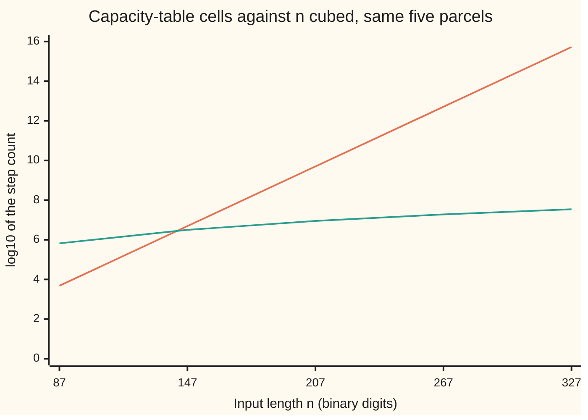

# Pseudo-polynomial time: fast only while the numbers stay small

[Syllabus](../../../SYLLABUS.md) → [Computability and complexity](../README.md) → [Time Complexity](../README.md#s03) → Pseudo-polynomial time

---

## General Overview

A courier van can carry 800 kg tonight. Five parcels wait at the depot, and each one goes whole or stays for tomorrow:

| Parcel | tiles | timber | boiler | piano | fridge |
| --- | ---: | ---: | ---: | ---: | ---: |
| Weight, kg | 300 | 400 | 200 | 500 | 100 |
| Delivery fee, £ | 90 | 110 | 70 | 150 | 40 |

The depot fills a **capacity table**: for each amount of free room, the best fee that fits. [Dynamic programming](../../14-Applied%20and%20computational/01-Algorithms%20and%20Growth/07-dynamic-programming.md) shows how, one row per parcel and one column per unit of room. In steps of 100 kg the table has 6 rows and 9 columns: 54 cells. Its last cell says **£260: boiler, piano and fridge, exactly 800 kg**.

Now weigh the same parcels to the kilogram. Nothing about the problem changes, and the answer is still £260. But the table now needs 801 columns: 4,806 cells. Weighed to the gram, it needs 4,800,006 cells.

The input hardly grew. Written in binary (base 2, digits 0 and 1), the whole list of numbers went from 50 binary digits to 147. Going from kilograms to grams adds three decimal digits to each weight and multiplies the work by about 1,000.

That is the gap this card is about. Complexity theory measures an input by its **length**: the number of symbols it takes to write down. A number's length is its count of digits, not its size. The capacity table's cost follows the van's capacity as a quantity, so it can be exponential in the length.

**A method runs in pseudo-polynomial time when its step count is bounded by a polynomial in the input's length and its largest number; each extra binary digit can double a number, so such a method, like the capacity table, can still be exponential in the length.**

**What kind of fact this is:** definitions (pseudo-polynomial time, weak and strong NP-completeness) and a theorem proved on this card in Why it works: the capacity table runs in pseudo-polynomial time and not in polynomial time. Whether any method solves every knapsack input in polynomial time is the P versus NP question, a conjecture unproved as of 2026-11-11. That 3-PARTITION is strongly NP-complete is stated with a named source.

### The picture: one more digit per number, twice the table

The code doubles every weight and the van's capacity again and again. Each doubling adds one binary digit to each of the six weight numbers, so the length $`n`$ grows by 6. The table's cell count doubles each time. The chart plots both counts on a log10 scale (each step up on the vertical axis is ten times more).



The orange line is the capacity table: a straight line on this scale, which means exponential growth. The green line is $`n^3`$, a polynomial: it bends over and flattens. The table starts below $`n^3`$ and passes it by $`n`$ = 147. At $`n`$ = 327 it needs 5,277,655,813,324,806 cells against 34,965,783.

---

## The formula

Names first, in words. The van takes $`k`$ parcels to choose from. Parcel $`i`$ weighs $`w_i`$ units and pays $`v_i`$ pounds. The van holds $`W`$ units. The unit is whatever the weights are written in: 100 kg, 1 kg or 1 g.

The input's **length** $`n`$ is the total number of binary digits needed to write all its numbers. (Separators between numbers add the same small amount at every unit, so the code leaves them out.) $`M`$ is the largest number in the input. $`T`$ is the number of table cells filled, one comparison each.

```math
T = (k+1)(W+1) \;\le\; (n+1)(M+1), \qquad \text{while} \qquad M < 2^{n}
```

**Read it aloud:** the table fills one cell for every parcel row and every unit of room, which is at most a polynomial in the length and in the largest number; but the largest number can be close to 2 to the power of the length.

The two kinds of bound, side by side, for some fixed polynomial $`p`$:

```math
\text{polynomial time: } T \le p(n), \qquad \text{pseudo-polynomial time: } T \le p(n, M)
```

**Read it aloud:** a polynomial-time method has a step count bounded by the length alone; a pseudo-polynomial one may also use the size of the largest number.

| Symbol | Plain meaning | In our example | Push it up and the answer… |
| --- | --- | --- | --- |
| $`k`$ | number of parcels | 5 | the table gains a row per parcel |
| $`W`$ | van's capacity, in the chosen unit | 8, 800 or 800,000 | the table gains a column per unit |
| $`w_i`$ | weight of parcel $`i`$, in the same unit | piano: 500 at 1 kg | — |
| $`v_i`$ | fee for parcel $`i`$, pounds | piano: 150 | — |
| $`K(i, c)`$ | best fee from parcels 1 to $`i`$ in $`c`$ units of room | $`K(5, 8)`$ = 260 | — |
| $`n`$ | input length: binary digits of every number | 50, 87 or 147 | grows by 1 per weight number per doubling |
| $`b`$ | binary digits of one number | 800 has 10 | the number can double per extra digit |
| $`M`$ | largest number in the input | 800 at 1 kg | pseudo-polynomial cost can grow with it |
| $`T`$ | cells the capacity table fills | 54, 4,806 or 4,800,006 | — |
| $`p`$ | a fixed polynomial, such as $`n^3`$ | $`87^3`$ = 658,503 | — |
| $`j`$ | how many times every weight and $`W`$ are doubled | 0 to 40 | $`T`$ about doubles, $`n`$ grows by 6 |

Notation differs from the dynamic-programming card. There $`n`$ counts the items. Here, as across this wing, $`n`$ is the input's length, and $`k`$ counts the parcels. The table's $`K(i, c)`$ is a best fee, not the $`K(x)`$ of [Kolmogorov complexity](../02-Computability%20and%20Logic/05-kolmogorov-complexity.md).

A capacity $`W`$ written with $`b`$ binary digits satisfies $`2^{b-1} \le W < 2^b`$. This is [Place value](../../01-Foundations/01-Everyday%20Arithmetic/01-place-value.md) in base 2: each column is worth twice the one to its right. So the van's 800 kg takes 10 binary digits, and 10 more digits allow a van about 1,000 times bigger.

### When it holds

- **Numbers are written in a positional system.** Binary, decimal or any base from 2 up give lengths within a fixed factor of each other: 87 binary digits at 1 kg are 30 decimal digits. Written in **unary** (one mark per unit, like a tally), the length is at least $`W`$ and the table is polynomial. The gap exists only because digits are compact.
- **Weights are whole numbers of one unit.** The table has one column per unit. A weight of 312.5 kg forces a half-kilogram unit and doubles $`W`$. Rounding weights to a coarse unit to shrink the table gives wrong packings (see What breaks).
- **Each cell costs a fixed number of steps.** In fact adding two numbers of $`b`$ digits takes about $`b`$ digit steps. That multiplies $`T`$ by at most $`n`$, which keeps a polynomial a polynomial and keeps an exponential an exponential.
- **The claim is about this method, not the problem.** The table is not polynomial. Whether some other method is polynomial is open, because the yes-or-no knapsack question is NP-complete (among the hardest problems in NP, defined on [Reductions](03-polynomial-reductions-and-np-completeness.md)).
- **The numbers must be allowed to be big.** When every number in the input is at most a polynomial in $`n`$, the table is polynomial. Sudoku, the shelf's house example, never holds a digit above the grid's side, and the side is less than the input's length, so big numbers cannot be what makes it hard.

---

## Why it works

### Step 0: length counts digits, size counts units

A number's length grows like the logarithm of its size. Writing 800 takes 10 binary digits; writing 800,000 takes 20. A thousand times bigger, only twice as long.

Complexity classes such as P are defined against length, as on [Time and space classes](01-time-and-space-classes.md). So any method whose work follows a number's size, unit by unit, is exposed: its cost is about 2 to the power of that number's length.

### Step 1: what the capacity table costs

The table method is on [Dynamic programming](../../14-Applied%20and%20computational/01-Algorithms%20and%20Growth/07-dynamic-programming.md): the best fee from parcels 1 to $`i`$ in $`c`$ units of room is the better of leaving parcel $`i`$ out, $`K(i-1, c)`$, or taking it, $`v_i + K(i-1, c - w_i)`$.

What matters here is the count. There is one row for each of $`0, 1, \dots, k`$ parcels and one column for each room $`c = 0, 1, \dots, W`$. Each cell takes one comparison. So

```math
T = (k+1)(W+1)
```

For the van: 6 × 9 = 54 cells at 100 kg, 6 × 801 = 4,806 at 1 kg and 6 × 800,001 = 4,800,006 at 1 g. The code counts every cell as it fills it and gets the same three numbers.

### Step 2: the table is pseudo-polynomial

Every parcel contributes at least one digit to the input, so $`k \le n`$. The capacity $`W`$ is one of the input's numbers, so $`W \le M`$. Therefore

```math
T = (k+1)(W+1) \le (n+1)(M+1)
```

That is a polynomial in $`n`$ and $`M`$ together. By definition the capacity table runs in pseudo-polynomial time.

### Step 3: the table is not polynomial

Keep the five parcels and double every weight and the capacity, $`j`$ times. The problem is the same problem drawn on finer graph paper, so the best packing and the £260 do not change.

Each doubling adds one binary digit to each of the six weight numbers (five parcel weights and the van's capacity), and none to the fees. So the length grows by 6 per doubling. The capacity doubles, so the table about doubles:

```math
n_j = 87 + 6j, \qquad T_j = 6\,(800 \cdot 2^{j} + 1) > 2^{j}
```

Solve the first for $`j`$: $`j = (n_j - 87)/6`$. So $`T`$ grows like $`2^{n/6}`$, an exponential in the length. An exponential eventually passes every polynomial ([Polynomial or exponential](../../14-Applied%20and%20computational/01-Algorithms%20and%20Growth/03-polynomial-versus-exponential-time.md)). Against $`n^3`$ the pass comes by $`n`$ = 147, after 10 doublings.

<details>
<summary>Detailed proof: no polynomial bounds the table's cells</summary>

Suppose some polynomial bounds the cells on every input. Then there are constants $`C \ge 1`$ and $`d \ge 1`$ with $`T \le C n^d`$ for every input of length $`n \ge 2`$.

Take the family above. For it,

$`\displaystyle 2^{j} < T_j \le C\,(87 + 6j)^{d} \quad\text{for every } j \ge 0.`$

Take logarithms in base 2:

$`\displaystyle j < \log_2 C + d \log_2 (87 + 6j).`$

The left side grows in step with $`j`$. The right side grows like $`d \log_2 j`$, and $`\log_2 j / j`$ tends to 0. So for large enough $`j`$ the inequality fails, a contradiction.

Hence no polynomial in $`n`$ bounds $`T`$, and the capacity table is not a polynomial-time method. The same argument works for any fixed parcel list: the length grows by $`k + 1`$ per doubling, and $`T`$ grows like $`2^{n/(k+1)}`$.

</details>

### Step 4: unary makes it polynomial, which shows where the hardness lives

Write every number in unary instead. At 1 kg the van's list then takes 2,760 marks, at 1 g 2,300,460. Now the length is at least $`W`$, so

```math
T = (k+1)(W+1) \le (k+1)(n+1) \le (n+1)^2
```

The same table is polynomial. Nothing about the method changed; only the length it is measured against did. Against the binary length the same bound fails: at 1 kg, $`(k+1)(n+1)`$ = 6 × 88 = 528, far below the 4,806 cells.

This splits the NP-complete problems into two kinds.

- **Weakly NP-complete:** NP-complete when numbers are written in binary, but solved by a pseudo-polynomial method. KNAPSACK, SUBSET SUM and PARTITION are of this kind. Their hardness comes entirely from big numbers.
- **Strongly NP-complete:** still NP-complete when every number is at most a polynomial in $`n`$, equivalently when numbers are written in unary. For such a problem, a pseudo-polynomial method would be polynomial on those small-number inputs, and so would prove P = NP.

3-PARTITION is strongly NP-complete, as Garey and Johnson (1978, in Sources) set out from their own earlier proof: split a list of numbers into triples that all have the same sum. Bin packing, the rota problem on [Approximation](../04-Beyond%20Worst%20Case/01-approximation-and-hardness-of-approximation.md), inherits this. So, unless P = NP, bin packing has no pseudo-polynomial method at all, however small its numbers.

### Step 5: a road whose cost ignores the unit

The code also keeps a list of every reachable pair (weight so far, fee so far), and drops any pair that another pair matches or beats on both counts: no heavier, and paying at least as much. For the van the list never exceeds 9 pairs, at 100 kg, at 1 kg and at 1 g alike.

The list never holds more than $`2^k`$ pairs, one per packing, or more than $`W+1`$, one per weight. At 100 kg the 9 pairs fill all $`W+1`$ = 9 weights; at 1 kg they are 9 of 801. With few parcels and big numbers it is far cheaper than the table. But it trades one exponential for another. With weights 1, 2, 4, 8, … and each fee equal to its weight, no pair beats another, so all $`2^k`$ packings stay on the list. Neither road is polynomial on every input, which is what NP-completeness predicts if P ≠ NP.

---

## Worked numbers, by hand

The capacity table's last row, in 100 kg steps: the best fee from all five parcels for each amount of room.

| Room, kg | 0 | 100 | 200 | 300 | 400 | 500 | 600 | 700 | 800 |
| --- | ---: | ---: | ---: | ---: | ---: | ---: | ---: | ---: | ---: |
| Best fee, £ | 0 | 40 | 70 | 110 | 130 | 160 | 200 | 220 | 260 |

At 400 kg the best is tiles and fridge, £130, beating timber alone at £110. The code checks every column against brute force.

The cost of that table, and of the same table in finer units:

| Step | Arithmetic | Value |
| --- | --- | --- |
| length at 100 kg | weights 2 + 3 + 2 + 3 + 1, van 4, fees 7 + 7 + 7 + 8 + 6 | 50 binary digits |
| cells at 100 kg | 6 × (8 + 1) | 54 |
| length at 1 kg | weights 9 + 9 + 8 + 9 + 7, van 10, fees 7 + 7 + 7 + 8 + 6 | 87 binary digits |
| cells at 1 kg | 6 × (800 + 1) | 4,806 |
| length at 1 g | weights 19 + 19 + 18 + 19 + 17, van 20, fees 7 + 7 + 7 + 8 + 6 | 147 binary digits |
| cells at 1 g | 6 × (800,000 + 1) | 4,800,006 |
| growth, 100 kg to 1 g | 147 / 50 = 2.94; 4,800,006 / 54 | length × 2.94, cells × 88,889 |
| one more doubling from 1 kg | 87 + 6 = 93 digits; the table run on the doubled weights | 9,606 cells, × 1.9988 |
| 40 doublings from 1 kg | 87 + 240 = 327 digits; 6 × (800 × 2^40 + 1) | **5,277,655,813,324,806 cells, against 327³ = 34,965,783** |

Making the input under three times as long made the work 88,889 times as large. That is what "not polynomial" looks like at a size a person can check.

### What breaks if you drop a piece

| Mistake | Comes out at | What went wrong |
| --- | --- | --- |
| Size counted as parcels, $`k`$ | $`k`$ = 5 for 54 cells and for 4,800,006 cells | The cost is not a function of $`k`$; the capacity's value sets the width |
| True weights 330, 420, 240, 470, 140 kg rounded to 100 kg to keep the table small | boiler, piano and fridge: truly 850 kg, 50 kg over | Whole numbers of one unit dropped; the exact table, 4,806 cells, gives £240 for tiles and piano, 800 kg |
| $`(k+1)(W+1)`$ called polynomial because it is a product | 40 doublings: 5,277,655,813,324,806 cells at $`n`$ = 327, against $`n^3`$ = 34,965,783 | $`W`$ can be about $`2^b`$; it is not bounded by a power of $`n`$ |

The code prints all three.

---

## Code, from first principles, and it actually runs

The code packs the van by three independent roads at three units: the capacity table, which counts every cell it fills; brute force over all 32 packings; and the list of reachable (weight, fee) pairs. All three must give £260 at 100 kg, 1 kg and 1 g, and the counted cells must equal $`(k+1)(W+1)`$. The list must keep no beaten pair and stay within $`2^k`$ and $`W+1`$. Then it doubles the weights three times, runs the table each time and checks that the cells double while the length grows by 6. It prints the chart points, the unary lengths, the rounding failure and the "Try changing" numbers.

### Python

```python
# Pseudo-polynomial time -- the check behind the card.  Standard library only:
# math for log10.  A van carries at most 800 kg; five parcels, each taken whole
# or left.  Three roads to the best fee: the capacity table (counting cells),
# brute force over all 32 packings, and a list of reachable (weight, fee) pairs.
# Then the same parcels in finer units: the answer stays, the table explodes.
import math
NAMES = ["tiles", "timber", "boiler", "piano", "fridge"]
KG, FEE, VAN = [300, 400, 200, 500, 100], [90, 110, 70, 150, 40], 800

def bits(x):  # binary digits needed to write x (at least 1)
    b = 1
    while x > 1:
        x //= 2
        b += 1
    return b

def table(w, v, cap):  # capacity table K(i, c); returns last row, cells filled
    row, cells = [0] * (cap + 1), cap + 1          # row 0: no parcels, all zero
    for i in range(len(w)):
        new = row[:]
        for c in range(cap + 1):
            cells += 1
            if w[i] <= c and v[i] + row[c - w[i]] > new[c]:
                new[c] = v[i] + row[c - w[i]]
        row = new
    return row, cells

def brute(w, v, cap):  # every one of the 2^k packings
    best, pick = -1, 0
    for s in range(1 << len(w)):
        tw = sum(w[i] for i in range(len(w)) if s >> i & 1)
        tv = sum(v[i] for i in range(len(w)) if s >> i & 1)
        if tw <= cap and tv > best:
            best, pick = tv, s
    return best, pick

def pairs(w, v, cap):  # reachable (weight, fee) pairs, dominated ones dropped
    L, biggest = [(0, 0)], 1
    for i in range(len(w)):
        M = L + [(a + w[i], b + v[i]) for a, b in L if a + w[i] <= cap]
        M.sort(key=lambda p: (p[0], -p[1]))        # by weight; at equal weight, highest fee first
        L = []
        for a, b in M:                             # keep a pair only if it pays more than all lighter ones
            if not L or b > L[-1][1]:
                L.append((a, b))
        assert all(p[0] < q[0] and p[1] < q[1] for p, q in zip(L, L[1:])), "no kept pair is dominated"
        biggest = max(biggest, len(L))
    return L[-1][1], biggest

def size(w, v, cap):  # input length n: binary digits of every number
    return sum(bits(x) for x in w + v) + bits(cap)

print("van " + str(VAN) + " kg; " + ", ".join(f"{NAMES[i]} {KG[i]} kg {FEE[i]}" for i in range(5)))
row, _ = table([x // 100 for x in KG], FEE, VAN // 100)
assert row == [brute([x // 100 for x in KG], FEE, c)[0] for c in range(9)], "table row vs brute force"
print("capacity table, 0 to 800 kg in 100 kg steps:", " ".join(str(x) for x in row))
res = {}
for unit, per in (("100 kg", 1), ("1 kg", 100), ("1 g", 100000)):
    w, cap = [x * per // 100 for x in KG], VAN * per // 100
    row, cells = table(w, FEE, cap)
    bb, pick = brute(w, FEE, cap)
    pp, big = pairs(w, FEE, cap)
    n = size(w, FEE, cap)
    res[unit] = (n, cells)
    print(f"unit {unit:>6}: W {cap:>6}, n {n:>3} bits, cells {cells:>7} = 6 x {cap + 1}; "
          f"table {row[cap]}, brute {bb}, pairs {pp} (list <= {big})")
    print("  binary digits: weights", " ".join(str(bits(x)) for x in w), "| van", bits(cap),
          "| fees", " ".join(str(bits(x)) for x in FEE))
    assert row[cap] == bb == pp == 260, "three roads must agree"
    assert big <= min(1 << len(w), cap + 1), "the list stays within 2^k and W + 1"
    assert cells == (len(w) + 1) * (cap + 1), "counted cells must match (k+1)(W+1)"
print("best packing:", " + ".join(NAMES[i] for i in range(5) if pick >> i & 1), "= 800 kg, 260")
print(f"n grew {res['100 kg'][0]} -> {res['1 g'][0]} bits (x{res['1 g'][0] / res['100 kg'][0]:.2f}); "
      f"cells grew {res['100 kg'][1]} -> {res['1 g'][1]} (x{res['1 g'][1] / res['100 kg'][1]:.0f})")
# doubling every weight and the van: answer fixed, 6 more bits, about twice the cells
prev = 0
for j in range(4):
    w, cap = [x << j for x in KG], VAN << j
    _, cells = table(w, FEE, cap)
    assert brute(w, FEE, cap)[0] == 260 and size(w, FEE, cap) == 87 + 6 * j
    print(f"doubled {j} times: n {size(w, FEE, cap)} bits, cells counted {cells}"
          + (f", ratio {cells / prev:.4f}" if prev else ""))
    assert prev == 0 or 1.99 < cells / prev < 2, "one more bit per number doubles the table"
    prev = cells
print("chart: j, n bits, cells (formula), log10 cells, n^3, log10 n^3")
chart_cells, chart_cube = [], []
cnt = {j: (size([x << j for x in KG], FEE, VAN << j), table([x << j for x in KG], FEE, VAN << j)[1]) for j in (0, 10)}
for j in (0, 10, 20, 30, 40):
    n, cells = 87 + 6 * j, 6 * ((VAN << j) + 1)
    assert j not in cnt or cnt[j] == (n, cells), "chart points 0 and 10 are counted tables"
    chart_cells.append(f"{math.log10(cells):.2f}")
    chart_cube.append(f"{math.log10(n ** 3):.2f}")
    print(f"  {j:>2} {n:>3} {cells:>16} {chart_cells[-1]:>5} {n ** 3:>8} {chart_cube[-1]}")
print("chart line, table:", ", ".join(chart_cells))
print("chart line, n^3:  ", ", ".join(chart_cube))
assert cnt[0][1] < cnt[0][0] ** 3 and cnt[10][1] > cnt[10][0] ** 3, "counted tables: under n^3 at 87 bits, over it at 147"
# unary: one mark per unit, so the length is at least W and the table is polynomial
for unit, per in (("1 kg", 100), ("1 g", 100000)):
    w, cap = [x * per // 100 for x in KG], VAN * per // 100
    nu, (nb, cells) = sum(w) + sum(FEE) + cap, res[unit]      # marks; binary length and cells counted above
    assert cells <= (len(w) + 1) * (nu + 1) <= (nu + 1) ** 2, "unary length bounds the counted table"
    assert cells > (len(w) + 1) * (nb + 1), "the same bound fails against the binary length"
    print(f"unary, unit {unit}: n {nu} marks, cells {cells} <= (k+1)(n+1) = {(len(w) + 1) * (nu + 1)}; "
          f"against binary n {nb}, (k+1)(n+1) = {(len(w) + 1) * (nb + 1)} fails")
# what breaks: rounding true weights to 100 kg to keep the table small
TRUE = [330, 420, 240, 470, 140]
rnd = [(x + 50) // 100 for x in TRUE]
_, pick = brute(rnd, FEE, VAN // 100)
load = sum(TRUE[i] for i in range(5) if pick >> i & 1)
exact, epick = brute(TRUE, FEE, VAN)
row, cells = table(TRUE, FEE, VAN)
assert row[VAN] == exact and load > VAN
print(f"rounded table packs " + " + ".join(NAMES[i] for i in range(5) if pick >> i & 1)
      + f": truly {load} kg, {load - VAN} kg over; exact best {exact} ("
      + " + ".join(NAMES[i] for i in range(5) if epick >> i & 1)
      + f", {sum(TRUE[i] for i in range(5) if epick >> i & 1)} kg) in {cells} cells")
print(f"counting parcels only: k = 5 for both {res['100 kg'][1]} and {res['1 g'][1]} cells")
# try changing: a table by fee instead of weight; ten parcels; decimal digits
v_row, v_cells = [0] + [10 ** 9] * sum(FEE), 0       # least weight for each exact fee
for i in range(5):
    for f in range(sum(FEE), -1, -1):
        v_cells += 1
        if f >= FEE[i] and v_row[f - FEE[i]] + KG[i] < v_row[f]:
            v_row[f] = v_row[f - FEE[i]] + KG[i]
best_by_fee = max(f for f in range(sum(FEE) + 1) if v_row[f] <= VAN)
assert best_by_fee == 260
print(f"try: table by fee: best {best_by_fee}, cells {v_cells + sum(FEE) + 1}; in pence {6 * (100 * sum(FEE) + 1)}")
_, c10 = table(KG * 2, FEE * 2, VAN)
print(f"try: ten parcels (each twice), 1 kg unit: cells {c10}, best {brute(KG * 2, FEE * 2, VAN)[0]}")
dec = lambda x: len(str(x))
print(f"try: decimal digits: n {sum(dec(x) for x in KG + FEE) + dec(VAN)} at 1 kg, "
      f"{sum(dec(x * 1000) for x in KG) + sum(dec(x) for x in FEE) + dec(VAN * 1000)} at 1 g")
print("ALL CHECKS PASS")
```

**Ran 2026-11-19 on macOS, Python 3.14.10, standard library only. All checks passed. Output, pasted from the run:**

```
van 800 kg; tiles 300 kg 90, timber 400 kg 110, boiler 200 kg 70, piano 500 kg 150, fridge 100 kg 40
capacity table, 0 to 800 kg in 100 kg steps: 0 40 70 110 130 160 200 220 260
unit 100 kg: W      8, n  50 bits, cells      54 = 6 x 9; table 260, brute 260, pairs 260 (list <= 9)
  binary digits: weights 2 3 2 3 1 | van 4 | fees 7 7 7 8 6
unit   1 kg: W    800, n  87 bits, cells    4806 = 6 x 801; table 260, brute 260, pairs 260 (list <= 9)
  binary digits: weights 9 9 8 9 7 | van 10 | fees 7 7 7 8 6
unit    1 g: W 800000, n 147 bits, cells 4800006 = 6 x 800001; table 260, brute 260, pairs 260 (list <= 9)
  binary digits: weights 19 19 18 19 17 | van 20 | fees 7 7 7 8 6
best packing: boiler + piano + fridge = 800 kg, 260
n grew 50 -> 147 bits (x2.94); cells grew 54 -> 4800006 (x88889)
doubled 0 times: n 87 bits, cells counted 4806
doubled 1 times: n 93 bits, cells counted 9606, ratio 1.9988
doubled 2 times: n 99 bits, cells counted 19206, ratio 1.9994
doubled 3 times: n 105 bits, cells counted 38406, ratio 1.9997
chart: j, n bits, cells (formula), log10 cells, n^3, log10 n^3
   0  87             4806  3.68   658503 5.82
  10 147          4915206  6.69  3176523 6.50
  20 207       5033164806  9.70  8869743 6.95
  30 267    5153960755206 12.71 19034163 7.28
  40 327 5277655813324806 15.72 34965783 7.54
chart line, table: 3.68, 6.69, 9.70, 12.71, 15.72
chart line, n^3:   5.82, 6.50, 6.95, 7.28, 7.54
unary, unit 1 kg: n 2760 marks, cells 4806 <= (k+1)(n+1) = 16566; against binary n 87, (k+1)(n+1) = 528 fails
unary, unit 1 g: n 2300460 marks, cells 4800006 <= (k+1)(n+1) = 13802766; against binary n 147, (k+1)(n+1) = 888 fails
rounded table packs boiler + piano + fridge: truly 850 kg, 50 kg over; exact best 240 (tiles + piano, 800 kg) in 4806 cells
counting parcels only: k = 5 for both 54 and 4800006 cells
try: table by fee: best 260, cells 2766; in pence 276006
try: ten parcels (each twice), 1 kg unit: cells 8811, best 270
try: decimal digits: n 30 at 1 kg, 48 at 1 g
ALL CHECKS PASS
```

### Rust

```rust
// Pseudo-polynomial time -- the same check as the Python, in Rust with std only.
// A van carries at most 800 kg; five parcels, each taken whole or left.  Three
// roads to the best fee: the capacity table (counting cells), brute force over
// all 32 packings, and a list of reachable (weight, fee) pairs.  Then the same
// parcels in finer units: the answer stays, the table explodes.
const NAMES: [&str; 5] = ["tiles", "timber", "boiler", "piano", "fridge"];
const KG: [u64; 5] = [300, 400, 200, 500, 100];
const FEE: [u64; 5] = [90, 110, 70, 150, 40];
const VAN: u64 = 800;

fn bits(mut x: u64) -> u64 { // binary digits needed to write x (at least 1)
    let mut b = 1;
    while x > 1 { x /= 2; b += 1; }
    b
}
fn table(w: &[u64], v: &[u64], cap: u64) -> (Vec<u64>, u64) { // last row, cells filled
    let cap = cap as usize;
    let (mut row, mut cells) = (vec![0u64; cap + 1], (cap + 1) as u64);
    for i in 0..w.len() {
        let mut new = row.clone();
        for c in 0..=cap {
            cells += 1;
            let wi = w[i] as usize;
            if wi <= c && v[i] + row[c - wi] > new[c] { new[c] = v[i] + row[c - wi]; }
        }
        row = new;
    }
    (row, cells)
}
fn brute(w: &[u64], v: &[u64], cap: u64) -> (u64, usize) { // every one of the 2^k packings
    let (mut best, mut pick, mut found) = (0u64, 0usize, false);
    for s in 0..(1usize << w.len()) {
        let (mut tw, mut tv) = (0, 0);
        for i in 0..w.len() { if s >> i & 1 == 1 { tw += w[i]; tv += v[i]; } }
        if tw <= cap && (!found || tv > best) { best = tv; pick = s; found = true; }
    }
    (best, pick)
}
fn pairs(w: &[u64], v: &[u64], cap: u64) -> (u64, usize) { // reachable pairs, dominated dropped
    let (mut l, mut biggest) = (vec![(0u64, 0u64)], 1usize);
    for i in 0..w.len() {
        let mut m = l.clone();
        for &(a, b) in &l { if a + w[i] <= cap { m.push((a + w[i], b + v[i])); } }
        m.sort_by_key(|&(a, b)| (a, std::cmp::Reverse(b))); // by weight; at equal weight, highest fee first
        l = Vec::new();
        for (a, b) in m { if l.is_empty() || b > l[l.len() - 1].1 { l.push((a, b)); } } // keep a pair only if it pays more
        assert!(l.windows(2).all(|p| p[0].0 < p[1].0 && p[0].1 < p[1].1), "no kept pair is dominated");
        biggest = biggest.max(l.len());
    }
    (l[l.len() - 1].1, biggest)
}
fn size(w: &[u64], v: &[u64], cap: u64) -> u64 { // input length n: binary digits of every number
    w.iter().chain(v.iter()).map(|&x| bits(x)).sum::<u64>() + bits(cap)
}
fn names(pick: usize) -> String {
    (0..5).filter(|i| pick >> i & 1 == 1).map(|i| NAMES[i]).collect::<Vec<_>>().join(" + ")
}
fn join(v: &[String]) -> String { v.join(", ") }

fn main() {
    let list: Vec<String> = (0..5).map(|i| format!("{} {} kg {}", NAMES[i], KG[i], FEE[i])).collect();
    println!("van {} kg; {}", VAN, join(&list));
    let w100: Vec<u64> = KG.iter().map(|x| x / 100).collect();
    let (row, _) = table(&w100, &FEE, VAN / 100);
    for c in 0..9 { assert!(row[c] == brute(&w100, &FEE, c as u64).0, "table row vs brute force"); }
    let r: Vec<String> = row.iter().map(|x| x.to_string()).collect();
    println!("capacity table, 0 to 800 kg in 100 kg steps: {}", r.join(" "));
    let mut res = Vec::new();
    let mut pick = 0;
    for (unit, per) in [("100 kg", 1u64), ("1 kg", 100), ("1 g", 100000)] {
        let w: Vec<u64> = KG.iter().map(|x| x * per / 100).collect();
        let cap = VAN * per / 100;
        let (row, cells) = table(&w, &FEE, cap);
        let (bb, pk) = brute(&w, &FEE, cap);
        let (pp, big) = pairs(&w, &FEE, cap);
        let n = size(&w, &FEE, cap);
        res.push((n, cells));
        pick = pk;
        println!("unit {:>6}: W {:>6}, n {:>3} bits, cells {:>7} = 6 x {}; table {}, brute {}, pairs {} (list <= {})",
                 unit, cap, n, cells, cap + 1, row[cap as usize], bb, pp, big);
        let bw: Vec<String> = w.iter().map(|&x| bits(x).to_string()).collect();
        let bf: Vec<String> = FEE.iter().map(|&x| bits(x).to_string()).collect();
        println!("  binary digits: weights {} | van {} | fees {}", bw.join(" "), bits(cap), bf.join(" "));
        assert!(row[cap as usize] == bb && bb == pp && pp == 260, "three roads must agree");
        assert!(big as u64 <= (1u64 << w.len()).min(cap + 1), "the list stays within 2^k and W + 1");
        assert!(cells == (w.len() as u64 + 1) * (cap + 1), "counted cells must match (k+1)(W+1)");
    }
    println!("best packing: {} = 800 kg, 260", names(pick));
    println!("n grew {} -> {} bits (x{:.2}); cells grew {} -> {} (x{:.0})", res[0].0, res[2].0,
             res[2].0 as f64 / res[0].0 as f64, res[0].1, res[2].1, res[2].1 as f64 / res[0].1 as f64);
    let mut prev = 0u64;
    for j in 0..4 {
        let w: Vec<u64> = KG.iter().map(|x| x << j).collect();
        let cap = VAN << j;
        let (_, cells) = table(&w, &FEE, cap);
        assert!(brute(&w, &FEE, cap).0 == 260 && size(&w, &FEE, cap) == 87 + 6 * j);
        let ratio = cells as f64 / prev as f64;
        assert!(prev == 0 || (1.99 < ratio && ratio < 2.0), "one more bit per number doubles the table");
        let tail = if prev > 0 { format!(", ratio {:.4}", ratio) } else { String::new() };
        println!("doubled {} times: n {} bits, cells counted {}{}", j, size(&w, &FEE, cap), cells, tail);
        prev = cells;
    }
    println!("chart: j, n bits, cells (formula), log10 cells, n^3, log10 n^3");
    let (mut cc, mut cu) = (Vec::new(), Vec::new());
    let cnt: Vec<(u64, u64)> = [0u64, 10].iter().map(|&j| { let w: Vec<u64> = KG.iter().map(|x| x << j).collect(); (size(&w, &FEE, VAN << j), table(&w, &FEE, VAN << j).1) }).collect();
    for j in [0u64, 10, 20, 30, 40] {
        let (n, cells) = (87 + 6 * j, 6 * ((VAN << j) + 1));
        assert!(j > 10 || cnt[(j / 10) as usize] == (n, cells), "chart points 0 and 10 are counted tables");
        cc.push(format!("{:.2}", (cells as f64).log10()));
        cu.push(format!("{:.2}", ((n * n * n) as f64).log10()));
        println!("  {:>2} {:>3} {:>16} {:>5} {:>8} {}", j, n, cells, cc[cc.len() - 1], n * n * n, cu[cu.len() - 1]);
    }
    println!("chart line, table: {}", join(&cc));
    println!("chart line, n^3:   {}", join(&cu));
    assert!(cnt[0].1 < cnt[0].0.pow(3) && cnt[1].1 > cnt[1].0.pow(3), "counted tables: under n^3 at 87 bits, over it at 147");
    for (idx, (unit, per)) in [("1 kg", 100u64), ("1 g", 100000)].into_iter().enumerate() {
        let w: Vec<u64> = KG.iter().map(|x| x * per / 100).collect();
        let cap = VAN * per / 100;
        let (nu, (nb, cells)) = (w.iter().sum::<u64>() + FEE.iter().sum::<u64>() + cap, res[idx + 1]); // marks; binary length and cells counted above
        assert!(cells <= 6 * (nu + 1) && 6 * (nu + 1) <= (nu + 1) * (nu + 1), "unary length bounds the counted table");
        assert!(cells > 6 * (nb + 1), "the same bound fails against the binary length");
        println!("unary, unit {}: n {} marks, cells {} <= (k+1)(n+1) = {}; against binary n {}, (k+1)(n+1) = {} fails", unit, nu, cells, 6 * (nu + 1), nb, 6 * (nb + 1));
    }
    let tru = [330u64, 420, 240, 470, 140];
    let rnd: Vec<u64> = tru.iter().map(|x| (x + 50) / 100).collect();
    let (_, pk) = brute(&rnd, &FEE, VAN / 100);
    let load: u64 = (0..5).filter(|i| pk >> i & 1 == 1).map(|i| tru[i]).sum();
    let (exact, ep) = brute(&tru, &FEE, VAN);
    let (row, cells) = table(&tru, &FEE, VAN);
    assert!(row[VAN as usize] == exact && load > VAN);
    let ew: u64 = (0..5).filter(|i| ep >> i & 1 == 1).map(|i| tru[i]).sum();
    println!("rounded table packs {}: truly {} kg, {} kg over; exact best {} ({}, {} kg) in {} cells",
             names(pk), load, load - VAN, exact, names(ep), ew, cells);
    println!("counting parcels only: k = 5 for both {} and {} cells", res[0].1, res[2].1);
    let total: u64 = FEE.iter().sum();
    let (mut vr, mut vc) = (vec![1_000_000_000u64; total as usize + 1], 0u64); // least weight per exact fee
    vr[0] = 0;
    for i in 0..5 {
        for f in (0..=total as usize).rev() {
            vc += 1;
            let fi = FEE[i] as usize;
            if f >= fi && vr[f - fi] + KG[i] < vr[f] { vr[f] = vr[f - fi] + KG[i]; }
        }
    }
    let best_by_fee = (0..=total as usize).filter(|&f| vr[f] <= VAN).max().unwrap();
    assert!(best_by_fee == 260);
    println!("try: table by fee: best {}, cells {}; in pence {}", best_by_fee, vc + total + 1, 6 * (100 * total + 1));
    let (k2, f2): (Vec<u64>, Vec<u64>) = (KG.iter().chain(KG.iter()).cloned().collect(), FEE.iter().chain(FEE.iter()).cloned().collect());
    let (_, c10) = table(&k2, &f2, VAN);
    println!("try: ten parcels (each twice), 1 kg unit: cells {}, best {}", c10, brute(&k2, &f2, VAN).0);
    let dec = |x: u64| x.to_string().len() as u64;
    let d1: u64 = KG.iter().chain(FEE.iter()).map(|&x| dec(x)).sum::<u64>() + dec(VAN);
    let d2: u64 = KG.iter().map(|&x| dec(x * 1000)).sum::<u64>() + FEE.iter().map(|&x| dec(x)).sum::<u64>() + dec(VAN * 1000);
    println!("try: decimal digits: n {} at 1 kg, {} at 1 g", d1, d2);
    println!("ALL CHECKS PASS");
}
```

**Ran 2026-11-19 on macOS, rustc 1.98.1, no crates. All checks passed. Output, pasted from the run:**

```
van 800 kg; tiles 300 kg 90, timber 400 kg 110, boiler 200 kg 70, piano 500 kg 150, fridge 100 kg 40
capacity table, 0 to 800 kg in 100 kg steps: 0 40 70 110 130 160 200 220 260
unit 100 kg: W      8, n  50 bits, cells      54 = 6 x 9; table 260, brute 260, pairs 260 (list <= 9)
  binary digits: weights 2 3 2 3 1 | van 4 | fees 7 7 7 8 6
unit   1 kg: W    800, n  87 bits, cells    4806 = 6 x 801; table 260, brute 260, pairs 260 (list <= 9)
  binary digits: weights 9 9 8 9 7 | van 10 | fees 7 7 7 8 6
unit    1 g: W 800000, n 147 bits, cells 4800006 = 6 x 800001; table 260, brute 260, pairs 260 (list <= 9)
  binary digits: weights 19 19 18 19 17 | van 20 | fees 7 7 7 8 6
best packing: boiler + piano + fridge = 800 kg, 260
n grew 50 -> 147 bits (x2.94); cells grew 54 -> 4800006 (x88889)
doubled 0 times: n 87 bits, cells counted 4806
doubled 1 times: n 93 bits, cells counted 9606, ratio 1.9988
doubled 2 times: n 99 bits, cells counted 19206, ratio 1.9994
doubled 3 times: n 105 bits, cells counted 38406, ratio 1.9997
chart: j, n bits, cells (formula), log10 cells, n^3, log10 n^3
   0  87             4806  3.68   658503 5.82
  10 147          4915206  6.69  3176523 6.50
  20 207       5033164806  9.70  8869743 6.95
  30 267    5153960755206 12.71 19034163 7.28
  40 327 5277655813324806 15.72 34965783 7.54
chart line, table: 3.68, 6.69, 9.70, 12.71, 15.72
chart line, n^3:   5.82, 6.50, 6.95, 7.28, 7.54
unary, unit 1 kg: n 2760 marks, cells 4806 <= (k+1)(n+1) = 16566; against binary n 87, (k+1)(n+1) = 528 fails
unary, unit 1 g: n 2300460 marks, cells 4800006 <= (k+1)(n+1) = 13802766; against binary n 147, (k+1)(n+1) = 888 fails
rounded table packs boiler + piano + fridge: truly 850 kg, 50 kg over; exact best 240 (tiles + piano, 800 kg) in 4806 cells
counting parcels only: k = 5 for both 54 and 4800006 cells
try: table by fee: best 260, cells 2766; in pence 276006
try: ten parcels (each twice), 1 kg unit: cells 8811, best 270
try: decimal digits: n 30 at 1 kg, 48 at 1 g
ALL CHECKS PASS
```

### Lean

Lean proves the table's two bounds for every parcel list and capacity, and the doubling family for every $`j`$. It checks the van's numbers.

- Take any parcel list and any capacity $`W`$. Then $`T = (k+1)(W+1)`$ is at most $`(n+1)(M+1)`$, and $`M < 2^n`$.
- Take any polynomial $`p`$. Then some input has $`T > p(n)`$, so the capacity table is not polynomial.
- Take the five parcels with every weight and the capacity doubled $`j`$ times. Then $`n_j = 87 + 6j`$ and $`T_j = 6\,(800 \cdot 2^{j} + 1) > 2^{j}`$.
- At 100 kg, 1 kg and 1 g the input takes 50, 87 and 147 binary digits, and 800 kg takes 10.
- The three tables fill 54, 4,806 and 4,800,006 cells, and each gives the best fee, £260.
- The last row in 100 kg steps reads 0, 40, 70, 110, 130, 160, 200, 220, 260.
- One doubling from 1 kg gives 93 digits and 9,606 cells.
- Take the van at 1 kg, 87 digits. Then its 4,806 cells are below $`87^3`$.
- Take ten doublings, 147 digits. Then the table's 4,915,206 cells pass $`147^3`$ = 3,176,523.
- Take forty doublings, 327 digits. Then the table fills 5,277,655,813,324,806 cells, against $`327^3`$ = 34,965,783.
- With the true weights 330, 420, 240, 470 and 140 kg, the exact best fee is £240.
- Rounded to 100 kg, the table's best fee is £260. Boiler, piano and fridge truly weigh 240 + 470 + 140 = 850 kg.
- Ten parcels, each of the five twice, fill 8,811 cells at 1 kg, with best fee £270.

Brute force, the list of pairs, counted cells, unary lengths, the fee table and decimal digits are left to the Python and Rust checks.

```lean
-- Pseudo-polynomial time: the knapsack capacity table fills (k + 1)(W + 1) cells, which is at most a polynomial in the input's length and its largest number, but no polynomial in the length alone bounds it.
import Mathlib.Data.Nat.Log
import Mathlib.Algebra.Polynomial.Eval.Defs
import Mathlib.Algebra.Order.BigOperators.Group.List
import Mathlib.Algebra.Polynomial.Eval.Degree

open Polynomial

/-- Binary digits needed to write the whole number `x` (at least 1, so 0 takes one digit):
800 takes 10. -/
def bits (x : ℕ) : ℕ := Nat.log 2 x + 1

/-- The input's length `n`: binary digits of every parcel weight, every fee and the van's
capacity `W` (separators left out, as on the card). A parcel is a pair (weight, fee). -/
def inputLength (parcels : List (ℕ × ℕ)) (W : ℕ) : ℕ :=
  (parcels.map fun p => bits p.1 + bits p.2).sum + bits W

/-- `M`, the largest number in the input: the biggest weight, fee or capacity. -/
def maxNumber (parcels : List (ℕ × ℕ)) (W : ℕ) : ℕ :=
  (parcels.map fun p => max p.1 p.2).foldr max W

/-- `T`, the cells the capacity table fills: one row for each of 0, 1, ..., k parcels and one
column for each room 0, 1, ..., W, one comparison per cell. -/
def tableCells (parcels : List (ℕ × ℕ)) (W : ℕ) : ℕ :=
  (parcels.length + 1) * (W + 1)

/-- The capacity table's entry `K(i, c)`: the best fee from the parcels in the list with `c`
units of room, each parcel taken whole or left: the better of leaving the first parcel out or
taking it when it fits. -/
def bestFee : List (ℕ × ℕ) → ℕ → ℕ
  | [], _ => 0
  | (w, v) :: rest, c =>
      if w ≤ c then max (bestFee rest c) (v + bestFee rest (c - w)) else bestFee rest c

theorem lt_two_pow_bits (x : ℕ) : x < 2 ^ bits x :=
  Nat.lt_pow_succ_log_self (by norm_num) x

theorem bits_mul_two_pow (x j : ℕ) (hx : x ≠ 0) : bits (x * 2 ^ j) = bits x + j := by
  induction j with
  | zero => simp
  | succ j ih =>
    have h0 : x * 2 ^ j ≠ 0 := by positivity
    unfold bits at *
    rw [pow_succ, ← mul_assoc, Nat.log_mul_base (by norm_num) h0]
    omega

theorem length_le_inputLength (parcels : List (ℕ × ℕ)) (W : ℕ) :
    parcels.length ≤ inputLength parcels W := by
  induction parcels with
  | nil => simp [inputLength]
  | cons p rest ih =>
    simp only [inputLength, List.map_cons, List.sum_cons, List.length_cons] at *
    have : 1 ≤ bits p.1 := by unfold bits; omega
    omega

theorem le_maxNumber (parcels : List (ℕ × ℕ)) (W : ℕ) : W ≤ maxNumber parcels W := by
  induction parcels with
  | nil => simp [maxNumber]
  | cons p rest ih =>
    simp only [maxNumber, List.map_cons, List.foldr_cons] at *
    omega

theorem maxNumber_lt (parcels : List (ℕ × ℕ)) (W : ℕ) :
    maxNumber parcels W < 2 ^ inputLength parcels W := by
  induction parcels with
  | nil => simpa [maxNumber, inputLength] using lt_two_pow_bits W
  | cons p rest ih =>
    simp only [maxNumber, inputLength, List.map_cons, List.foldr_cons, List.sum_cons] at *
    have h1 := lt_two_pow_bits p.1
    have h2 := lt_two_pow_bits p.2
    set R := (List.map (fun p => bits p.1 + bits p.2) rest).sum
    have e1 : 2 ^ bits p.1 ≤ 2 ^ (bits p.1 + bits p.2 + R + bits W) :=
      Nat.pow_le_pow_right (by norm_num) (by omega)
    have e2 : 2 ^ bits p.2 ≤ 2 ^ (bits p.1 + bits p.2 + R + bits W) :=
      Nat.pow_le_pow_right (by norm_num) (by omega)
    have e3 : 2 ^ (R + bits W) ≤ 2 ^ (bits p.1 + bits p.2 + R + bits W) :=
      Nat.pow_le_pow_right (by norm_num) (by omega)
    omega

theorem eval_le (p : ℕ[X]) (x : ℕ) : p.eval x ≤ p.eval 1 * (x + 1) ^ p.natDegree := by
  rw [eval_eq_sum_range, eval_eq_sum_range, Finset.sum_mul]
  apply Finset.sum_le_sum
  intro i hi
  rw [Finset.mem_range] at hi
  rw [one_pow, mul_one]
  apply Nat.mul_le_mul_left
  calc x ^ i ≤ (x + 1) ^ i := Nat.pow_le_pow_left (by omega) i
    _ ≤ (x + 1) ^ p.natDegree := Nat.pow_le_pow_right (by omega) (by omega)

theorem sq_le_two_pow (s : ℕ) (hs : 4 ≤ s) : s * s ≤ 2 ^ s := by
  induction s, hs using Nat.le_induction with
  | base => norm_num
  | succ s hs ih =>
    rw [pow_succ]
    nlinarith

theorem exists_poly_lt_two_pow (C d : ℕ) : ∃ x : ℕ, C * (x + 2) ^ d < 2 ^ x := by
  obtain ⟨s, hsdef⟩ : ∃ s, s = C + d + 4 := ⟨_, rfl⟩
  refine ⟨2 ^ s, ?_⟩
  have hx : 2 ^ s + 2 ≤ 2 ^ (s + 1) := by
    have e : 2 ^ (s + 1) = 2 ^ s * 2 := pow_succ 2 s
    have : 2 ≤ 2 ^ s := by
      calc 2 = 2 ^ 1 := by norm_num
        _ ≤ 2 ^ s := Nat.pow_le_pow_right (by norm_num) (by omega)
    clear hsdef
    generalize 2 ^ (s + 1) = a at *
    generalize 2 ^ s = b at *
    omega
  have h1 : (2 ^ s + 2) ^ d ≤ 2 ^ ((s + 1) * d) := by
    rw [pow_mul]; exact Nat.pow_le_pow_left hx d
  have h2 : C < 2 ^ C := Nat.lt_two_pow_self
  have h3 : C + (s + 1) * d ≤ 2 ^ s := by
    have := sq_le_two_pow s (by omega)
    nlinarith
  calc C * (2 ^ s + 2) ^ d ≤ C * 2 ^ ((s + 1) * d) := Nat.mul_le_mul_left C h1
    _ < 2 ^ C * 2 ^ ((s + 1) * d) := Nat.mul_lt_mul_of_pos_right h2 (by positivity)
    _ = 2 ^ (C + (s + 1) * d) := by rw [pow_add]
    _ ≤ 2 ^ 2 ^ s := Nat.pow_le_pow_right (by norm_num) h3

#print axioms lt_two_pow_bits
#print axioms bits_mul_two_pow
#print axioms length_le_inputLength
#print axioms le_maxNumber
#print axioms maxNumber_lt
#print axioms eval_le
#print axioms sq_le_two_pow
#print axioms exists_poly_lt_two_pow

/-- Pseudo-polynomial time. For any parcel list and any capacity, the capacity table's cell count
`T = (k + 1)(W + 1)` is at most `(n + 1)(M + 1)`, a polynomial in the input's length `n` and its
largest number `M`; while the largest number can be nearly 2 to the power of the length,
`M < 2 ^ n`. -/
theorem table_cells_pseudo_polynomial (parcels : List (ℕ × ℕ)) (W : ℕ) :
    tableCells parcels W ≤ (inputLength parcels W + 1) * (maxNumber parcels W + 1) ∧
      maxNumber parcels W < 2 ^ inputLength parcels W := by
  refine ⟨?_, maxNumber_lt parcels W⟩
  unfold tableCells
  exact Nat.mul_le_mul (by have := length_le_inputLength parcels W; omega)
    (by have := le_maxNumber parcels W; omega)

/-- The capacity table is not a polynomial-time method: no polynomial `p` bounds its cell count
by the input's length alone, `T ≤ p(n)` for every input. -/
theorem table_cells_not_polynomial :
    ¬ ∃ p : ℕ[X], ∀ (parcels : List (ℕ × ℕ)) (W : ℕ),
      tableCells parcels W ≤ p.eval (inputLength parcels W) := by
  rintro ⟨p, hp⟩
  obtain ⟨x, hx⟩ := exists_poly_lt_two_pow (p.eval 1) p.natDegree
  have h := hp [] (2 ^ x)
  have hb : inputLength [] (2 ^ x) = x + 1 := by
    simp [inputLength, bits, Nat.log_pow (by norm_num : 1 < 2)]
  rw [hb] at h
  have h2 : p.eval (x + 1) ≤ p.eval 1 * (x + 2) ^ p.natDegree := eval_le p (x + 1)
  simp [tableCells] at h
  omega

/-- The van's five parcels at 1 kg (tiles 300 kg £90, timber 400 kg £110, boiler 200 kg £70,
piano 500 kg £150, fridge 100 kg £40; van 800 kg). -/
def van : List (ℕ × ℕ) := [(300, 90), (400, 110), (200, 70), (500, 150), (100, 40)]

/-- The same parcels with every weight doubled `j` times. -/
def vanDoubled (j : ℕ) : List (ℕ × ℕ) := van.map fun p => (p.1 * 2 ^ j, p.2)

/-- Doubling every weight and the van's capacity `j` times adds 6 binary digits per doubling,
`n_j = 87 + 6j`, while the table fills `T_j = 6 (800 · 2^j + 1)` cells, more than `2^j`. -/
theorem van_doubling_length_and_cells (j : ℕ) :
    inputLength (vanDoubled j) (800 * 2 ^ j) = 87 + 6 * j ∧
      tableCells (vanDoubled j) (800 * 2 ^ j) = 6 * (800 * 2 ^ j + 1) ∧
      2 ^ j < tableCells (vanDoubled j) (800 * 2 ^ j) := by
  have hb : ∀ x : ℕ, x ≠ 0 → bits (x * 2 ^ j) = bits x + j := fun x hx => bits_mul_two_pow x j hx
  refine ⟨?_, ?_, ?_⟩
  · simp only [inputLength, vanDoubled, van, List.map_cons, List.map_nil, List.sum_cons,
      List.sum_nil]
    rw [hb 300 (by norm_num), hb 400 (by norm_num), hb 200 (by norm_num), hb 500 (by norm_num),
      hb 100 (by norm_num), hb 800 (by norm_num)]
    have e : bits 300 = 9 ∧ bits 400 = 9 ∧ bits 200 = 8 ∧ bits 500 = 9 ∧ bits 100 = 7 ∧
        bits 800 = 10 ∧ bits 90 = 7 ∧ bits 110 = 7 ∧ bits 70 = 7 ∧ bits 150 = 8 ∧
        bits 40 = 6 := by decide
    omega
  · simp [tableCells, vanDoubled, van]
  · simp only [tableCells, vanDoubled, van, List.length_map, List.length_cons, List.length_nil]
    have := Nat.one_le_two_pow (n := j)
    generalize 2 ^ j = t at *
    omega

-- The van in 100 kg units, in kilograms, and in grams.
def van100 : List (ℕ × ℕ) := van.map fun p => (p.1 / 100, p.2)
def vanGram : List (ℕ × ℕ) := van.map fun p => (p.1 * 1000, p.2)

-- 800 kg takes 10 binary digits.
example : bits 800 = 10 := by decide
-- Lengths 50, 87 and 147 binary digits.
example : inputLength van100 8 = 50 := by decide
example : inputLength van 800 = 87 := by decide
example : inputLength vanGram 800000 = 147 := by decide
-- Cells 54, 4,806 and 4,800,006.
example : tableCells van100 8 = 54 := by decide
example : tableCells van 800 = 4806 := by decide
example : tableCells vanGram 800000 = 4800006 := by decide
-- The best fee is £260 at every unit.
example : bestFee van100 8 = 260 := by decide
example : bestFee van 800 = 260 := by decide
example : bestFee vanGram 800000 = 260 := by decide
-- The capacity table's last row in 100 kg steps.
example : (List.range 9).map (bestFee van100) = [0, 40, 70, 110, 130, 160, 200, 220, 260] := by
  decide
-- One doubling from 1 kg: 93 digits, 9,606 cells.
example : inputLength (vanDoubled 1) 1600 = 93 := by decide
example : tableCells (vanDoubled 1) 1600 = 9606 := by decide
-- 40 doublings: 327 digits, 5,277,655,813,324,806 cells against 327 ^ 3 = 34,965,783.
example : tableCells (vanDoubled 40) (800 * 2 ^ 40) = 5277655813324806 := by decide
example : 327 ^ 3 = 34965783 := by norm_num
-- The table passes n ^ 3 by n = 147 (10 doublings): 4,915,206 cells against 3,176,523.
example : tableCells (vanDoubled 10) (800 * 2 ^ 10) = 4915206 ∧ 147 ^ 3 = 3176523 := by decide
example : tableCells van 800 < 87 ^ 3 := by decide
-- What breaks: true weights 330, 420, 240, 470, 140 kg; the exact best fee is £240.
example : bestFee [(330, 90), (420, 110), (240, 70), (470, 150), (140, 40)] 800 = 240 := by decide
-- Rounded to 100 kg, the table picks boiler + piano + fridge (fee 260 in 8 units), truly 850 kg.
example : bestFee [(3, 90), (4, 110), (2, 70), (5, 150), (1, 40)] 8 = 260 ∧ 240 + 470 + 140 = 850 := by
  decide
-- Ten parcels (each twice) at 1 kg: 8,811 cells, best £270.
example : tableCells (van ++ van) 800 = 8811 := by decide
example : bestFee (van ++ van) 800 = 270 := by decide

#print axioms table_cells_pseudo_polynomial
#print axioms table_cells_not_polynomial
#print axioms van_doubling_length_and_cells
```

**Checked 2026-11-19 on macOS, Lean 4.36.0-rc2, Mathlib v4.36.0-rc2. Every proof is complete and uses only Lean's standard axioms. Output, pasted from the run:**

```
'lt_two_pow_bits' depends on axioms: [propext, Classical.choice, Quot.sound]
'bits_mul_two_pow' depends on axioms: [propext, Classical.choice, Quot.sound]
'length_le_inputLength' depends on axioms: [propext, Quot.sound]
'le_maxNumber' depends on axioms: [propext, Quot.sound]
'maxNumber_lt' depends on axioms: [propext, Classical.choice, Quot.sound]
'eval_le' depends on axioms: [propext, Classical.choice, Quot.sound]
'sq_le_two_pow' depends on axioms: [propext, Classical.choice, Quot.sound]
'exists_poly_lt_two_pow' depends on axioms: [propext, Classical.choice, Quot.sound]
'table_cells_pseudo_polynomial' depends on axioms: [propext, Classical.choice, Quot.sound]
'table_cells_not_polynomial' depends on axioms: [propext, Classical.choice, Quot.sound]
'van_doubling_length_and_cells' depends on axioms: [propext, Classical.choice, Quot.sound]
```

> [!TIP]
> **Try changing**
> - Guess first: index the table by fee instead of weight, recording the least weight for each exact fee. Cells: 2,766, best still £260, and the weight unit no longer matters. Write the fees in pence and it needs 276,006 cells: the cost now follows the fees' size.
> - Guess first: give the depot ten parcels, each of the five twice, at 1 kg. Cells: 8,811, against 4,806. More parcels add rows, so the cost grows in step with $`k`$; only the numbers' size hurts.
> - Guess first: count decimal digits instead of binary ones. The length is 30 at 1 kg and 48 at 1 g: 18 more digits, about a thousand times the cells. The base changes the length by a fixed factor, never the verdict.
> - Guess first: write the numbers in unary. At 1 g the input has 2,300,460 marks, and the 4,800,006 cells sit under the bound $`(k+1)(n+1)`$ = 13,802,766.

---

## The usual mistake

> [!warning]
> **Reading $`O(kW)`$ as polynomial because it looks like a product of two inputs.** $`k`$ is a count, but $`W`$ is a value, and a value can be exponential in its own length. The van's table grows from 4,806 cells to 5,277,655,813,324,806 while the input grows from 87 to 327 binary digits. Polynomial time is measured against length, and $`W`$ is not bounded by any power of the length.
>
> - **Measuring input size by the number of parcels.** Five parcels need 54 cells or 4,800,006, depending only on the unit.
> - **Shrinking the table by rounding the weights.** Rounding 330, 420, 240, 470 and 140 kg to the nearest 100 kg packs boiler, piano and fridge: 850 kg in an 800 kg van.
> - **Thinking a pseudo-polynomial method refutes NP-completeness.** KNAPSACK is NP-complete and has the table. There is no contradiction: the table is not polynomial, so P versus NP is untouched.
> - **Hoping for a table for every hard problem.** For a strongly NP-complete problem such as 3-PARTITION, a pseudo-polynomial method would prove P = NP.

---

## Where you meet it in real life

- **Freight and courier loading.** A planner packing vans, pallets or containers with a capacity table keeps it small by booking weights in coarse bands. Weighing to the kilogram multiplies the table by the band width.
- **Budgets in pence.** Choosing projects under a fixed budget with a table over the money needs 100 times as many columns in pence as in pounds. Planners round costs to a coarse unit for this reason, and then check the chosen plan against the true costs.
- **Knapsack cryptography.** The Merkle–Hellman scheme of 1978 hid messages in subset sums of numbers hundreds of binary digits long, exactly so that no capacity table could fit in any computer. It was broken in 1982, by a different attack that used its hidden structure, not by the table.
- **Rotas in whole hours.** Splitting shifts into two equal halves is PARTITION; with whole-hour shifts, the reachable-totals table on [Approximation](../04-Beyond%20Worst%20Case/01-approximation-and-hardness-of-approximation.md) settles a care-home week in a few hundred cells.
- **Approximation by rounding.** Ibarra and Kim (1975, in Sources) round the fees on purpose, then run a fee table. The answer is within any chosen percentage of the best, in steps polynomial in $`k`$ and in one over that percentage.

> **Say it back**
> An input's length is the number of digits it takes to write, so a number's length grows like the logarithm of its size. The capacity table fills one cell per parcel and per unit of room, $`(k+1)(W+1)`$ cells. That is polynomial in the length and the largest number together, which is called pseudo-polynomial time. But each extra binary digit can double $`W`$, so the table is exponential in the length: the van's table grows 88,889 times while the input grows under three times. Problems that stay hard with small numbers, the strongly NP-complete ones, have no such table unless P = NP.

---

## What this builds on

- [Karp's list](05-karps-problems-and-hardness-recipes.md): puts KNAPSACK, SUBSET SUM and PARTITION among the NP-complete problems; this card shows why a fast-looking table does not contradict that.
- [Place value](../../01-Foundations/01-Everyday%20Arithmetic/01-place-value.md): each column is worth a fixed multiple of the one to its right, so a few digits write a huge number; that is why length and size part ways.
- [Dynamic programming](../../14-Applied%20and%20computational/01-Algorithms%20and%20Growth/07-dynamic-programming.md): fills the knapsack table for a trader's rucksack and gives the cell count $`n(W+1)`$, leaving out the all-zero row 0; this card counts that row too, as $`(k+1)(W+1)`$, and reads the count against the input's length.

Also used: [Time and space classes](01-time-and-space-classes.md) for the input length $`n`$ and the class P, and [Reductions](03-polynomial-reductions-and-np-completeness.md) for NP-complete.

## Where this goes next

- [SAT solvers](07-sat-solvers-and-hard-problems-in-practice.md): the next card. Another way an NP-complete problem can be easy in practice: solvers that crack real instances with millions of variables, while the worst case stays exponential.
- [Parameterised complexity](../04-Beyond%20Worst%20Case/05-parameterised-complexity.md): the same move made general. Name one number, let the cost be exponential in it alone, and keep the rest polynomial.
- [Approximation](../04-Beyond%20Worst%20Case/01-approximation-and-hardness-of-approximation.md): guaranteed near-answers, and limits on them, where the gap reductions need exactly the big numbers this card describes.

The question left open: when the numbers are big and the table is out of reach, how close to the best packing can a polynomial-time method promise to get?

---

## Sources

Verified 2026-11-19: every link below resolves to the publisher's page.

- Karp, Richard M. "Reducibility among Combinatorial Problems." In *Complexity of Computer Computations*, Springer, 1972, 85–103. [doi:10.1007/978-1-4684-2001-2_9](https://doi.org/10.1007/978-1-4684-2001-2_9). KNAPSACK and PARTITION among the 21 NP-complete problems, with numbers written in binary.
- Garey, M. R., and D. S. Johnson. "'Strong' NP-Completeness Results: Motivation, Examples, and Implications." *Journal of the ACM* 25(3), 1978, 499–508. [doi:10.1145/322077.322090](https://doi.org/10.1145/322077.322090). Defines pseudo-polynomial algorithms and strong NP-completeness, and presents 3-PARTITION as strongly NP-complete.
- Ibarra, Oscar H., and Chul E. Kim. "Fast Approximation Algorithms for the Knapsack and Sum of Subset Problems." *Journal of the ACM* 22(4), 1975, 463–468. [doi:10.1145/321906.321909](https://doi.org/10.1145/321906.321909). Rounding the fees to turn the table into a method within any chosen fraction of the best.
- Kellerer, Hans, Ulrich Pferschy, and David Pisinger. *Knapsack Problems*. Springer, 2004. [doi:10.1007/978-3-540-24777-7](https://doi.org/10.1007/978-3-540-24777-7). The capacity table, the list of undominated pairs, and their costs, in one reference.
