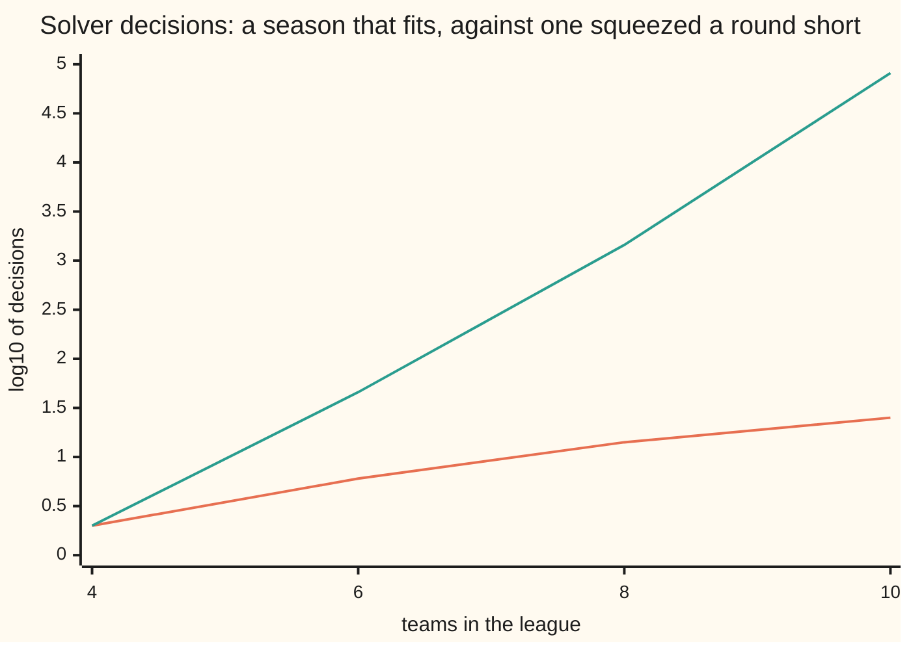

# SAT solvers: hard in theory, often easy on the instance in hand

[Syllabus](../../../SYLLABUS.md) → [Computability and complexity](../README.md) → [Time Complexity](../README.md#s03) → SAT solvers

---

## General Overview

A five-a-side league has six teams, A to F, and plays on Monday nights. Every team meets every other once, so the season has 15 matches. With six teams, three matches fit in a night, so the season needs five rounds.

The basic fixture list is a solved problem: [Edge colouring](../../04-Combinatorics%20and%20graphs/12-Planarity%20and%20Colouring/06-edge-colouring-and-round-robin.md) builds one by pinning one team and rotating the rest. Real leagues add rules. This league's secretary has four:

1. **The derby.** A against B is the last match of the season, in round 5.
2. **The rematch.** C against F, last season's cup final, opens the season in round 1.
3. **The referee.** The one referee who can handle D against E is free only in rounds 3 and 4.
4. **The fair run.** B never meets C and D, the two strongest teams, in back-to-back rounds.

The rotation knows nothing of these rules. So this card writes the whole question as one logic formula, made of 75 yes-or-no questions such as "does A meet C in round 2?". A **SAT solver** is a program that finds yes-or-no answers that make such a formula true, or proves that none exist. Here it finds a valid fixture list after 4 guesses.

That is surprising. SAT is NP-complete ([Cook-Levin](04-cook-levin-theorem.md)), so no known method is fast on every formula. A blind search over 75 questions faces 2^75, about 3.78 × 10^22, combinations. The solver wins because NP-completeness is a statement about the worst formula of each size, and this formula is not the worst.

**A SAT solver guesses one answer at a time and lets each guess force every answer it implies; on a formula with strong structure, a few guesses settle everything, even though some other formulas of the same size need exponentially many.**

**What kind of fact this is:** a method (DPLL search with unit propagation), proved correct on this card in Why it works. That SAT is NP-complete is a theorem proved on [Cook-Levin](04-cook-levin-theorem.md). That some formulas force this method into exponentially many steps is a theorem stated with its source (pigeonhole formulas, 1985). That the league is easy is a measurement of decisions on these instances, not a theorem. P ≠ NP and the exponential time hypothesis are conjectures, unproved as of 2026-11-11.

### The picture: easy and hard at the same sizes



The orange line is a full season of n − 1 rounds: 2, 6, 14 and 25 decisions. The green line is the same league squeezed into n − 2 rounds, which is impossible: 2, 46, 1,438 and 80,638 decisions to prove it. Both checks print every point.

---

## The formula

Notation first. From [Cook-Levin](04-cook-levin-theorem.md): a **literal** is a yes-or-no variable or its negation (¬, "not"); a **clause** is literals joined by ∨ ("or"); a formula in **CNF** (conjunctive normal form) is clauses joined by ∧ ("and"). SAT asks whether some assignment of true and false makes every clause true. Such an assignment is a **model**.

This card introduces one variable family. For a pair of teams $`p`$ and a round $`r`$, $`x_{p,r}`$ is true when pair $`p`$ meets in round $`r`$. Write $`x_{tu,r}`$ for the pair of teams $`t`$ and $`u`$. The league is this formula:

```math
F = \bigwedge_{p} \Big( \bigvee_{r=1}^{R} x_{p,r} \Big) \;\wedge \bigwedge_{p,\; r < s} \big( \neg x_{p,r} \vee \neg x_{p,s} \big) \;\wedge \bigwedge_{t,\; r,\; u \ne v} \big( \neg x_{tu,r} \vee \neg x_{tv,r} \big) \;\wedge \bigwedge_{t,\; r} \Big( \bigvee_{u \ne t} x_{tu,r} \Big) \;\wedge\; \text{(the four rules)}
```

**Read it aloud:** every pair meets in some round, no pair meets in two rounds, no team plays two matches in one round, every team plays in every round, and the secretary's rules hold.

The rules become clauses too. The derby is the one-literal clause $`x_{AB,5}`$, and the rematch is $`x_{CF,1}`$. The referee rule is three clauses $`\neg x_{DE,1}`$, $`\neg x_{DE,2}`$ and $`\neg x_{DE,5}`$. The fair run is $`\neg x_{BC,r} \vee \neg x_{BD,r+1}`$ and the same with C and D swapped, for rounds 1 to 4.

The solver lives on one rule, **unit propagation**. A **unit clause** is a clause whose literals are all false but one, which is still unset. That last literal must be true:

```math
(\ell_1 \vee \ell_2 \vee \cdots \vee \ell_k) \;\text{ with } \ell_1, \ldots, \ell_{k-1} \text{ all false} \implies \ell_k \text{ true}
```

**Read it aloud:** when a clause has only one way left to be true, take it.

| Symbol | Plain meaning | In our example | Push it up and the answer… |
| --- | --- | --- | --- |
| $`n`$ | teams in the league (on this card only; elsewhere in the wing $`n`$ is input length) | 6 | more pairs, more variables |
| $`R`$ | rounds in the season | 5 | below $`n - 1`$, no schedule exists |
| $`p`$ | a pair of teams, one possible match | 15 pairs, A-B to E-F | — |
| $`t`$, $`u`$, $`v`$; $`r`$, $`s`$ | single teams; single rounds | A to F; 1 to 5 | — |
| $`x_{p,r}`$ | "pair $`p`$ meets in round $`r`$" | 15 × 5 = 75 variables | 2^75 assignments for a blind search |
| $`\neg`$, $`\vee`$, $`\wedge`$ | not, or, and | — | — |
| $`\ell_1, \ldots, \ell_k`$ | the literals of one clause | $`\neg x_{AC,2} \vee \neg x_{AD,2}`$ has $`k = 2`$ | longer clauses force less |
| $`F`$ | the whole formula, in CNF | 508 clauses | more rules, fewer models |
| model | an assignment making $`F`$ true | 9 fixture lists | — |
| decision | one guess the solver makes | 4 to find a fixture list | — |
| $`N`$ | variables in a formula | 75 | worst-case search up to $`2^{N}`$ |
| $`m`$ | holes in the pigeonhole formula | team A's 4 rounds when squeezed | proof size grows exponentially |

### When it holds

- **The encoding must say everything.** Drop the 330 clauses saying a team plays at most once a round and plays every round, and the solver returns a "season" with 13 matches in round 1. Either family alone is enough here: a team has five matches and five rounds, so each family forces the other.
- **A solver's speed is measured, never promised.** The same program needs 80,638 decisions to show 10 teams cannot fit in 8 rounds. No method is known to be fast on every formula, and P ≠ NP would mean none exists.
- **A stopped run decides nothing.** Capped at 100,000 decisions, the solver leaves 12 teams in 10 rounds undecided. That is "still undecided", never "no schedule".
- **The answer is only as good as the rules.** The solver proves the formula, not the league. A rule the secretary forgot to write is a rule the fixtures may break.

---

## Why it works

### Step 0: hardness is about the worst formula, a solver meets one formula

NP-complete means every problem in NP converts fast into SAT ([Reductions](03-polynomial-reductions-and-np-completeness.md)). So a method fast on *every* formula would prove P = NP. Nothing in that statement says *this* formula is hard. A solver can be fast on the formulas that arise and still be slow on the worst ones. The league shows both halves, with counted decisions.

### Step 1: the league becomes 508 clauses

Each kind of clause in $`F`$ has a count:

- **Each pair meets.** One clause of 5 literals per pair: 15 clauses.
- **Each pair meets once.** One clause per pair and per two rounds: 15 × 10 = 150.
- **Each team plays at most once a round.** One clause per team, round and two opponents: 6 × 5 × 10 = 300.
- **Each team plays every round.** One clause of 5 literals per team and round: 30. This one is implied by the others, but it helps the solver.
- **The four rules.** 1 + 1 + 3 + 8 = 13.

The total is 508. Building them takes time polynomial in the number of teams.

### Step 2: one guess forces many answers

The derby, the rematch and the three referee clauses are unit clauses at the start, so 5 variables are set before any guess. Those 5 force 24 more. A-B in round 5 rules out A-B in rounds 1 to 4, and every other round-5 match of A and of B: 4 + 4 + 4 = 12. C-F in round 1 does the same for round 1: 12 more. Then the solver looks at the clauses of three or more literals and picks the unsatisfied one with the fewest unset literals. That is "D-E meets in some round", with only rounds 3 and 4 left. It guesses round 3.

That guess forces 9 answers. D-E is not in round 4. D does not meet A, B, C or F in round 3, and neither does E. Each of these is a unit clause, such as $`\neg x_{DE,3} \vee \neg x_{AD,3}`$ with its first literal now false.

Three more guesses finish the job. They force 7, 5 and 21 more answers. Propagation forced 24 + 9 + 7 + 5 + 21 = 66 answers in all. So 5 + 4 + 66 = 75: every variable is set, with no wrong guess and no backtracking.

### Step 3: guess, propagate, back up

The method is **DPLL**, named after its four authors (1960 to 1962):

1. Apply unit propagation until no unit clause is left.
2. If a clause has every literal false, this branch has a **conflict**: undo back to the last guess.
3. If every clause is true, stop: the assignment is a model.
4. Otherwise pick an unset literal, guess it true, and go to step 1. If that branch fails, guess it false.

<details>
<summary>Detailed proof: DPLL answers correctly on every formula</summary>

**It never claims a false model.** It stops with "model" only when every clause has a true literal. That is the definition of satisfying $`F`$.

**Propagation loses no model.** A unit clause has one unset literal and the rest false. Any model that agrees with the current answers must make that literal true. So forcing it removes no model.

**A conflict loses no model.** A clause with every literal false cannot be true under any extension of the current answers. So no model lies below this branch.

**It never misses a model.** Every guess tries a literal true and then false. Each model agrees with one of the two branches. By the two facts above, that branch is never cut while the model is still possible. So if a model exists, DPLL reaches one.

**It always stops.** Each guess sets one more of finitely many variables, and each branch is tried at most once. So the search tree is finite, with at most $`2^{N}`$ leaves for $`N`$ variables.

The method is therefore correct on every formula. Only its running time depends on the formula.

</details>

### Step 4: why this instance is easy

Three things make the league easy, and each can be counted.

- **Strong propagation.** Saying yes to one match says no to that pair in every other round, and no to every other match of both teams that night.
- **Many targets.** Without the four rules, 720 fixture lists exist. With them, 9 survive, and the solver needs to find only one. Counting all 9 costs 26 decisions.
- **A good order.** Picking the long clause with the fewest unset literals tries the most forced choice first. The referee rule leaves D-E only two rounds, so it goes first.

The same holds as the league grows. A full season for 12 teams has 726 variables and 11,088 clauses, and the solver finds one in 39 decisions. At 20 teams it has 3,610 variables, 98,040 clauses and needs 147 decisions.

### Step 5: where the same solver drowns

Squeeze the league into one round fewer. Six teams have 15 matches but 4 rounds hold only 12. So no schedule exists, and a person sees it by counting.

The solver cannot count. It can only guess and propagate. To prove "no", it must close every branch of its search, and the branches multiply: 2, 46, 1,438 and 80,638 decisions for 4, 6, 8 and 10 teams. Each step of 2 more teams multiplies the count by a larger factor than the step before.

This is a theorem in its pure form. The **pigeonhole formula** says $`m + 1`$ pigeons sit in $`m`$ holes, no two sharing. Inside the squeezed league, team A's five matches are the pigeons and the four rounds are the holes. A 1985 theorem shows that every **resolution** proof of the pigeonhole formula has exponentially many steps in $`m`$. Resolution is a proof system that combines two clauses into one. A DPLL run that answers "no" can be turned into a resolution proof of about the same size. So DPLL needs exponential time on pigeonhole formulas. The squeezed league adds more clauses, and its counts are measured here, not proved.

### Step 6: what real solvers add

Real solvers keep DPLL's core and add four tools. None is run on this card.

- **Clause learning.** After a conflict, the solver writes down a new clause that blocks the cause, so the same mistake never repeats. The method is called CDCL (conflict-driven clause learning) and dates from 1996 (journal version 1999).
- **Restarts.** The solver starts the search again often, keeping what it learned.
- **Watched literals.** A bookkeeping trick checks only two literals per clause on each step.
- **Branching scores.** The solver prefers variables that took part in recent conflicts.

None of these escapes the pigeonhole theorem, because CDCL is still a form of resolution. They make the common, structured case much faster. The exponential time hypothesis (a conjecture, unproved as of 2026-11-11) says the worst 3-SAT formulas need time that grows exponentially in their number of variables $`N`$.

---

## Worked numbers, by hand

| Step | Arithmetic | Value |
| --- | --- | --- |
| variables | 15 pairs × 5 rounds | 75 |
| clauses | 15 + 150 + 300 + 30 + 13 | 508 |
| blind search | 2^75 | about 3.78 × 10^22 |
| set by unit clauses | derby, rematch, 3 referee clauses | 5 |
| forced by those 5 | 2 fixed matches × (4 other rounds + 4 + 4 rival matches) | 24 |
| guess 1: D-E in round 3 | D-E's other round; D's and E's other round-3 matches | forces 9 |
| guesses 2 to 4 | A-D round 1, A-E round 2, A-C round 3 | force 7, 5, 21 |
| every variable set | 5 set + 4 guessed + (24 + 9 + 7 + 5 + 21 = 66 forced) | 75 |
| **the fixture list** | rounds 1 to 5 below | **found in 4 decisions** |

| Round | Matches |
| --- | --- |
| 1 | A-D, B-E, C-F |
| 2 | A-E, B-C, D-F |
| 3 | A-C, B-F, D-E |
| 4 | A-F, B-D, C-E |
| 5 | A-B, C-D, E-F |

The rematch opens the season, the derby closes it, and D-E is in round 3. B meets C in round 2 and D in round 4, not back to back. Four guesses replaced a search of about 3.78 × 10^22 combinations.

### What breaks if you drop a piece

| Mistake | Comes out at | What went wrong |
| --- | --- | --- |
| The once-a-round and every-round clauses, 330 of them, dropped as "obvious" | 178 clauses; 13 matches in round 1, then 0, 1, 0, 1 | the formula no longer says a team plays once a night |
| A capped run on 12 teams in 10 rounds read as "no" | still undecided after 100,000 decisions | a stopped search proves nothing |
| 2^75 taken as the cost | about 3.78 × 10^22, against 4 decisions | propagation cuts almost all of the space |

The code prints all three.

---

## Code, from first principles, and it actually runs

Nothing is imported that knows SAT. The code builds the league's clauses and runs a DPLL solver written out in full. It takes two independent roads to the count of valid fixture lists. Road one is the solver, counting every model. Road two builds fixture lists directly, one round at a time from unused pairs, and checks each against the rules. Both find 720 lists in all and 9 that keep the rules. A separate verifier reads the rules, not the clauses, and checks the solver's answer. Then the code counts decisions on full and squeezed leagues of 4 to 20 teams, and runs the three mistakes.

### Python

```python
# SAT solvers: a five-a-side league's fixtures as clauses, solved by DPLL.
# Standard library only. Road 1: the solver. Road 2: a direct search over
# fixture lists that knows nothing of clauses. A verifier checks the rules.
import itertools, math
def solve(nv, clauses, count_all=False, cap=None):
    occ = {}
    for i, c in enumerate(clauses):
        for l in c: occ.setdefault(l, []).append(i)
    longc = [c for c in clauses if len(c) > 2]; shortc = [c for c in clauses if len(c) <= 2]
    val = [0] * (nv + 1); trail = []
    st = {'dec': 0, 'prop': 0, 'units': 0, 'init': 0, 'models': 0, 'first': None, 'capped': False, 'log': []}
    def tv(l): v = val[abs(l)]; return v if l > 0 else -v
    def assign(l): val[abs(l)] = 1 if l > 0 else -1; trail.append(abs(l))
    def prop(queue):  # unit propagation: a clause with one free literal forces it
        while queue:
            l = queue.pop()
            for i in occ.get(-l, []):
                free, nfree, sat = None, 0, False
                for m in clauses[i]:
                    t = tv(m)
                    if t == 1: sat = True; break
                    if t == 0: nfree += 1; free = m
                if sat: continue
                if nfree == 0: return False
                if nfree == 1: assign(free); st['prop'] += 1; queue.append(free)
        return True
    def pick():  # the unsatisfied clause with fewest free literals, long clauses first
        best = None
        for c in longc + shortc:
            if best is not None and len(c) == 2: break
            if any(tv(m) == 1 for m in c): continue
            fr = [m for m in c if tv(m) == 0]
            if best is None or len(fr) < len(best): best = fr
        return best
    def rec():
        b = pick()
        if b is None:
            st['models'] += 2 ** (nv - len(trail))
            if st['first'] is None: st['first'] = val[:]
            return not count_all
        for l in (b[0], -b[0]):
            if cap is not None and st['dec'] >= cap: st['capped'] = True; return True
            st['dec'] += 1; mark = len(trail); assign(l); before = st['prop']
            ok = prop([l])
            if not count_all: st['log'].append((l, st['prop'] - before, ok))
            if ok and rec(): return True
            while len(trail) > mark: val[trail.pop()] = 0
        return False
    q = [c[0] for c in clauses if len(c) == 1]; st['units'] = len(q)
    for l in q: assign(l)
    if prop(q): st['init'] = st['prop']; rec()
    return st
T = "ABCDEF"
def league(n, R, rules=True, clash=True):
    pairs = list(itertools.combinations(range(n), 2)); P = {p: i for i, p in enumerate(pairs)}
    x = lambda a, b, r: P[(min(a, b), max(a, b))] * R + r + 1
    cl = []
    for a, b in pairs:  # every pair meets in some round, and in only one
        cl.append([x(a, b, r) for r in range(R)])
        cl += [[-x(a, b, r), -x(a, b, s)] for r, s in itertools.combinations(range(R), 2)]
    for t in range(n):
        o = [u for u in range(n) if u != t]
        for r in range(R):
            if clash: cl += [[-x(t, u, r), -x(t, v, r)] for u, v in itertools.combinations(o, 2)]
            if clash and R >= n - 1: cl.append([x(t, u, r) for u in o])  # plays every round
    if rules:
        cl.append([x(0, 1, 4)])                       # A-B, the derby, in round 5
        cl.append([x(2, 5, 0)])                       # C-F, last season's cup final, in round 1
        cl += [[-x(3, 4, r)] for r in (0, 1, 4)]      # D-E only in round 3 or 4
        for r in range(R - 1):                        # B never meets C and D back to back
            cl += [[-x(1, 2, r), -x(1, 3, r + 1)], [-x(1, 3, r), -x(1, 2, r + 1)]]
    return len(pairs) * R, cl, pairs, x
def fixtures(val, pairs, R):
    return [[p for i, p in enumerate(pairs) if val[i * R + r + 1] == 1] for r in range(R)]
def obeys(rounds):  # the verifier: reads the rules, never the clauses
    rd = {p: r for r, ms in enumerate(rounds) for p in ms}
    once = all(sorted(t for p in ms for t in p) == list(range(6)) for ms in rounds) and len(rd) == 15
    btb = any({rd[(1, 2)], rd[(1, 3)]} == {r, r + 1} for r in range(4))
    return once and rd[(0, 1)] == 4 and rd[(2, 5)] == 0 and rd[(3, 4)] in (2, 3) and not btb
def all_schedules(left, rounds):  # road 2: build fixture lists match by match
    if not left: yield rounds; return
    def matchings(free):
        if not free: yield []; return
        a = free[0]
        for b in free[1:]:
            if (a, b) in left:
                for m in matchings([t for t in free if t not in (a, b)]): yield [(a, b)] + m
    for m in matchings(list(range(6))):
        yield from all_schedules(left - set(m), rounds + [m])
name = lambda p: T[p[0]] + "-" + T[p[1]]
nv, cl, pairs, x = league(6, 5)
print(f"league: 6 teams, 5 rounds, {nv} yes-or-no variables, {len(cl)} clauses")
print(f"assignments a blind search would face: 2^{nv} = {2 ** nv:,}")
base = league(6, 5, rules=False)[1]; fam = lambda c: (len(c), c[0] > 0, len({(abs(l) - 1) // 5 for l in c}))  # size, sign, pairs
parts = [sum(fam(c) == k for c in base) for k in ((5, True, 1), (2, False, 1), (2, False, 2), (5, True, 5))] + [len(cl) - len(base)]
print("clauses: pair meets", parts[0], "| pair once", parts[1], "| once a round", parts[2], "| every round", parts[3], "| rules", parts[4])
s = solve(nv, cl)
print(f"unit clauses set {s['units']} variables before any guess, and these force {s['init']} more")
for k, (l, f, ok) in enumerate(s['log']):
    p, r = pairs[(abs(l) - 1) // 5], (abs(l) - 1) % 5 + 1
    print(f"  decision {k + 1}: {name(p)} in round {r} {'yes' if l > 0 else 'no'}, forces {f} more")
print(f"decisions {s['dec']}, forced {s['prop']}, total {s['units'] + s['dec'] + s['prop']} of {nv}")
rounds = fixtures(s['first'], pairs, 5)
for r, ms in enumerate(rounds): print(f"  round {r + 1}: " + " ".join(name(p) for p in ms))
print("verifier, reading the rules not the clauses: every rule kept:", "yes" if obeys(rounds) else "no")
assert obeys(rounds)
c = solve(nv, cl, count_all=True)
every = list(all_schedules(set(pairs), []))
good = [sc for sc in every if obeys(sc)]
print(f"road 2, fixture lists built directly: {len(every)} in all, {len(good)} keep the rules")
print(f"road 1, the solver counting every model: {c['models']} models in {c['dec']} decisions")
assert len(every) == 6 * math.factorial(5) and c['models'] == len(good) == 9
assert s['init'] == 2 * (4 + 4 + 4)  # A-B and C-F each rule out 4 other rounds and 4 + 4 rival matches
free = solve(*league(6, 5, rules=False)[:2], count_all=True)['models']; print(f"no extra rules: the solver counts {free} models")
assert free == len(every)
pts = []; print("teams | variables | clauses | in n - 1 rounds: decisions | in n - 2 rounds: decisions, answer")
for n in (4, 6, 8, 10):
    a = league(n, n - 1, rules=False); sa = solve(a[0], a[1])
    b = league(n, n - 2, rules=False); sb = solve(b[0], b[1])
    assert sa['models'] == 1 and sb['models'] == 0
    print(f"{n} | {a[0]} | {len(a[1])} | {sa['dec']} | {sb['dec']}, no schedule "
          f"({n * (n - 1) // 2} matches, {n // 2 * (n - 2)} slots)")
    pts.append((math.log10(sa['dec']), math.log10(sb['dec'])))
print("chart, log10 decisions:", " ".join(f"{a:.2f}/{b:.2f}" for a, b in pts))
for n in (12, 16, 20):
    a = league(n, n - 1, rules=False); sa = solve(a[0], a[1]); assert sa['models'] == 1
    print(f"{n} teams in {n - 1} rounds: {a[0]} variables, {len(a[1])} clauses, {sa['dec']} decisions, found")
mc = league(6, 5, clash=False)[1]; bad = fixtures(solve(nv, mc)['first'], pairs, 5); per = [len(ms) for ms in bad]
print(f"mistake 1, the once-a-round and every-round clauses dropped: {len(mc)} clauses, {len(cl) - len(mc)} fewer; "
      f"matches per round {' '.join(map(str, per))}; rules kept: {'yes' if obeys(bad) else 'no'}")
assert max(per) > 3 and not obeys(bad) and len(cl) - len(mc) == parts[2] + parts[3]
b = league(12, 10, rules=False); cp = solve(b[0], b[1], cap=100000)
print("mistake 2, 12 teams in 10 rounds, capped at 100,000 decisions:",
      "still undecided after 100,000 decisions" if cp['capped'] else "decided")
assert cp['capped']
print(f"mistake 3, blind search: 2^75 is about {2 ** 75 / 1e22:.2f}e22 assignments, against {s['dec']} decisions")
print(f"sudoku on an n by n grid as SAT: one variable per cell and digit, {4 ** 3} for 4 by 4, {9 ** 3} for 9 by 9")
assert sum(parts) == len(cl) and parts == [15, 15 * math.comb(5, 2), 6 * 5 * math.comb(5, 2), 6 * 5, 1 + 1 + 3 + 2 * 4]  # counted, against formulas
print("ALL CHECKS PASS")
```

**Ran 2026-11-19 on macOS, Python 3.14.10, standard library only. All checks passed. Output, pasted from the run:**

```
league: 6 teams, 5 rounds, 75 yes-or-no variables, 508 clauses
assignments a blind search would face: 2^75 = 37,778,931,862,957,161,709,568
clauses: pair meets 15 | pair once 150 | once a round 300 | every round 30 | rules 13
unit clauses set 5 variables before any guess, and these force 24 more
  decision 1: D-E in round 3 yes, forces 9 more
  decision 2: A-D in round 1 yes, forces 7 more
  decision 3: A-E in round 2 yes, forces 5 more
  decision 4: A-C in round 3 yes, forces 21 more
decisions 4, forced 66, total 75 of 75
  round 1: A-D B-E C-F
  round 2: A-E B-C D-F
  round 3: A-C B-F D-E
  round 4: A-F B-D C-E
  round 5: A-B C-D E-F
verifier, reading the rules not the clauses: every rule kept: yes
road 2, fixture lists built directly: 720 in all, 9 keep the rules
road 1, the solver counting every model: 9 models in 26 decisions
no extra rules: the solver counts 720 models
teams | variables | clauses | in n - 1 rounds: decisions | in n - 2 rounds: decisions, answer
4 | 18 | 72 | 2 | 2, no schedule (6 matches, 4 slots)
6 | 75 | 495 | 6 | 46, no schedule (15 matches, 12 slots)
8 | 196 | 1848 | 14 | 1438, no schedule (28 matches, 24 slots)
10 | 405 | 4995 | 25 | 80638, no schedule (45 matches, 40 slots)
chart, log10 decisions: 0.30/0.30 0.78/1.66 1.15/3.16 1.40/4.91
12 teams in 11 rounds: 726 variables, 11088 clauses, 39 decisions, found
16 teams in 15 rounds: 1800 variables, 38160 clauses, 85 decisions, found
20 teams in 19 rounds: 3610 variables, 98040 clauses, 147 decisions, found
mistake 1, the once-a-round and every-round clauses dropped: 178 clauses, 330 fewer; matches per round 13 0 1 0 1; rules kept: no
mistake 2, 12 teams in 10 rounds, capped at 100,000 decisions: still undecided after 100,000 decisions
mistake 3, blind search: 2^75 is about 3.78e22 assignments, against 4 decisions
sudoku on an n by n grid as SAT: one variable per cell and digit, 64 for 4 by 4, 729 for 9 by 9
ALL CHECKS PASS
```

### Rust

Same numbers, same labels, built with `rustc --edition 2021 -O`.

```rust
// SAT solvers: a five-a-side league's fixtures as clauses, solved by DPLL.
// std only. Road 1: the solver. Road 2: a direct search over fixture lists
// that knows nothing of clauses. A verifier checks the rules.
use std::collections::HashSet;
struct S { nv: usize, cl: Vec<Vec<i32>>, occ: Vec<Vec<usize>>, order: Vec<usize>, val: Vec<i32>,
    trail: Vec<usize>, dec: u64, prop: u64, units: usize, models: u128, first: Option<Vec<i32>>,
    capped: bool, log: Vec<(i32, u64)>, all: bool, cap: u64, init: u64 }
impl S {
    fn ix(&self, l: i32) -> usize { if l > 0 { l as usize } else { self.nv + (-l) as usize } }
    fn tv(&self, l: i32) -> i32 { let v = self.val[l.unsigned_abs() as usize]; if l > 0 { v } else { -v } }
    fn assign(&mut self, l: i32) { let a = l.unsigned_abs() as usize; self.val[a] = if l > 0 { 1 } else { -1 }; self.trail.push(a); }
    fn propagate(&mut self, mut q: Vec<i32>) -> bool { // a clause with one free literal forces it
        while let Some(l) = q.pop() {
            let k = self.ix(-l);
            for j in 0..self.occ[k].len() {
                let i = self.occ[k][j];
                let (mut free, mut nfree, mut sat) = (0, 0, false);
                for &m in &self.cl[i] { let t = self.tv(m); if t == 1 { sat = true; break; } if t == 0 { nfree += 1; free = m; } }
                if sat { continue; }
                if nfree == 0 { return false; }
                if nfree == 1 { self.assign(free); self.prop += 1; q.push(free); }
            }
        }
        true
    }
    fn pick(&self) -> Option<Vec<i32>> { // unsatisfied clause, fewest free literals, long clauses first
        let mut best: Option<Vec<i32>> = None;
        for &i in &self.order {
            let c = &self.cl[i];
            if best.is_some() && c.len() == 2 { break; }
            if c.iter().any(|&m| self.tv(m) == 1) { continue; }
            let fr: Vec<i32> = c.iter().cloned().filter(|&m| self.tv(m) == 0).collect();
            if best.as_ref().map_or(true, |b| fr.len() < b.len()) { best = Some(fr); }
        }
        best
    }
    fn rec(&mut self) -> bool {
        let b = match self.pick() { None => {
            self.models += 1u128 << (self.nv - self.trail.len());
            if self.first.is_none() { self.first = Some(self.val.clone()); }
            return !self.all; } Some(b) => b };
        for l in [b[0], -b[0]] {
            if self.dec >= self.cap { self.capped = true; return true; }
            self.dec += 1; let mark = self.trail.len(); self.assign(l); let before = self.prop;
            let ok = self.propagate(vec![l]);
            if !self.all { self.log.push((l, self.prop - before)); }
            if ok && self.rec() { return true; }
            while self.trail.len() > mark { let v = self.trail.pop().unwrap(); self.val[v] = 0; }
        }
        false
    }
}
fn solve(nv: usize, cl: &Vec<Vec<i32>>, all: bool, cap: u64) -> S {
    let mut occ = vec![Vec::new(); 2 * nv + 1];
    let mut s = S { nv, cl: cl.clone(), occ: vec![], order: vec![], val: vec![0; nv + 1], trail: vec![], dec: 0, prop: 0,
        units: 0, models: 0, first: None, capped: false, log: vec![], all, cap, init: 0 };
    for (i, c) in cl.iter().enumerate() { for &l in c { occ[s.ix(l)].push(i); } } s.occ = occ;
    s.order = (0..cl.len()).filter(|&i| cl[i].len() > 2).chain((0..cl.len()).filter(|&i| cl[i].len() <= 2)).collect();
    let q: Vec<i32> = cl.iter().filter(|c| c.len() == 1).map(|c| c[0]).collect();
    for &l in &q { s.assign(l); } s.units = q.len();
    if s.propagate(q) { s.init = s.prop; s.rec(); }
    s
}
fn league(n: usize, r_: usize, rules: bool, clash: bool) -> (usize, Vec<Vec<i32>>, Vec<(usize, usize)>) {
    let mut pairs = vec![];
    for a in 0..n { for b in a + 1..n { pairs.push((a, b)); } }
    let pi = |a: usize, b: usize| pairs.iter().position(|&p| p == (a.min(b), a.max(b))).unwrap();
    let x = |a: usize, b: usize, r: usize| (pi(a, b) * r_ + r + 1) as i32;
    let mut cl: Vec<Vec<i32>> = vec![];
    for &(a, b) in &pairs { // every pair meets in some round, and in only one
        cl.push((0..r_).map(|r| x(a, b, r)).collect());
        for r in 0..r_ { for s in r + 1..r_ { cl.push(vec![-x(a, b, r), -x(a, b, s)]); } }
    }
    for t in 0..n {
        let o: Vec<usize> = (0..n).filter(|&u| u != t).collect();
        for r in 0..r_ {
            if clash { for i in 0..o.len() { for j in i + 1..o.len() { cl.push(vec![-x(t, o[i], r), -x(t, o[j], r)]); } } }
            if clash && r_ >= n - 1 { cl.push(o.iter().map(|&u| x(t, u, r)).collect()); } // plays every round
        }
    }
    if rules {
        cl.push(vec![x(0, 1, 4)]); // A-B, the derby, in round 5
        cl.push(vec![x(2, 5, 0)]); // C-F, last season's cup final, in round 1
        for r in [0, 1, 4] { cl.push(vec![-x(3, 4, r)]); } // D-E only in round 3 or 4
        for r in 0..r_ - 1 { cl.push(vec![-x(1, 2, r), -x(1, 3, r + 1)]); cl.push(vec![-x(1, 3, r), -x(1, 2, r + 1)]); }
    }
    (pairs.len() * r_, cl, pairs)
}
type Rounds = Vec<Vec<(usize, usize)>>;
fn fixtures(val: &[i32], pairs: &[(usize, usize)], r_: usize) -> Rounds {
    (0..r_).map(|r| (0..pairs.len()).filter(|&i| val[i * r_ + r + 1] == 1).map(|i| pairs[i]).collect()).collect()
}
fn obeys(rounds: &Rounds) -> bool { // the verifier: reads the rules, never the clauses
    let mut rd = std::collections::HashMap::new();
    for (r, ms) in rounds.iter().enumerate() { for &p in ms { rd.insert(p, r); } }
    let once = rounds.iter().all(|ms| { let mut t: Vec<usize> = ms.iter().flat_map(|p| [p.0, p.1]).collect(); t.sort(); t == (0..6).collect::<Vec<_>>() }) && rd.len() == 15;
    if !once { return false; }
    let (bc, bd) = (rd[&(1, 2)], rd[&(1, 3)]);
    rd[&(0, 1)] == 4 && rd[&(2, 5)] == 0 && (rd[&(3, 4)] == 2 || rd[&(3, 4)] == 3) && bc.abs_diff(bd) != 1
}
fn matchings(free: &[usize], left: &HashSet<(usize, usize)>) -> Rounds {
    if free.is_empty() { return vec![vec![]]; }
    let a = free[0]; let mut out = vec![];
    for &b in &free[1..] { if left.contains(&(a, b)) {
        let rest: Vec<usize> = free.iter().cloned().filter(|&t| t != a && t != b).collect();
        for m in matchings(&rest, left) { let mut v = vec![(a, b)]; v.extend(m); out.push(v); } } }
    out
}
fn all_schedules(left: &HashSet<(usize, usize)>, rounds: &Rounds, out: &mut Vec<Rounds>) { // road 2
    if left.is_empty() { out.push(rounds.clone()); return; }
    for m in matchings(&(0..6).collect::<Vec<_>>(), left) {
        let mut l2 = left.clone(); for p in &m { l2.remove(p); }
        let mut r2 = rounds.clone(); r2.push(m); all_schedules(&l2, &r2, out);
    }
}
fn commas(v: u128) -> String { let s = v.to_string(); let mut o = String::new();
    for (i, ch) in s.chars().enumerate() { if i > 0 && (s.len() - i) % 3 == 0 { o.push(','); } o.push(ch); } o }
fn name(p: (usize, usize)) -> String { let t = b"ABCDEF"; format!("{}-{}", t[p.0] as char, t[p.1] as char) }
fn line(ms: &[(usize, usize)]) -> String { ms.iter().map(|&p| name(p)).collect::<Vec<_>>().join(" ") }
fn main() { const NO: u64 = u64::MAX; // no decision cap
    let (nv, cl, pairs) = league(6, 5, true, true);
    println!("league: 6 teams, 5 rounds, {} yes-or-no variables, {} clauses", nv, cl.len());
    println!("assignments a blind search would face: 2^{} = {}", nv, commas(1u128 << nv));
    let base = league(6, 5, false, true).1; let fam = |c: &Vec<i32>| (c.len(), c[0] > 0, c.iter().map(|&l| (l.abs() - 1) / 5).collect::<HashSet<_>>().len()); // size, sign, pairs
    let parts: Vec<usize> = [(5, true, 1), (2, false, 1), (2, false, 2), (5, true, 5)].iter().map(|k| base.iter().filter(|&c| fam(c) == *k).count()).chain([cl.len() - base.len()]).collect();
    println!("clauses: pair meets {} | pair once {} | once a round {} | every round {} | rules {}", parts[0], parts[1], parts[2], parts[3], parts[4]); let s = solve(nv, &cl, false, NO);
    println!("unit clauses set {} variables before any guess, and these force {} more", s.units, s.init);
    for (k, &(l, f)) in s.log.iter().enumerate() {
        let a = l.unsigned_abs() as usize - 1;
        println!("  decision {}: {} in round {} {}, forces {} more", k + 1, name(pairs[a / 5]), a % 5 + 1, if l > 0 { "yes" } else { "no" }, f);
    }
    println!("decisions {}, forced {}, total {} of {}", s.dec, s.prop, s.units as u64 + s.dec + s.prop, nv);
    let rounds = fixtures(s.first.as_ref().unwrap(), &pairs, 5); for (r, ms) in rounds.iter().enumerate() { println!("  round {}: {}", r + 1, line(ms)); }
    println!("verifier, reading the rules not the clauses: every rule kept: {}", if obeys(&rounds) { "yes" } else { "no" });
    assert!(obeys(&rounds));
    let c = solve(nv, &cl, true, NO);
    let mut every = vec![]; all_schedules(&pairs.iter().cloned().collect(), &vec![], &mut every);
    let good = every.iter().filter(|sc| obeys(sc)).count();
    println!("road 2, fixture lists built directly: {} in all, {} keep the rules", every.len(), good);
    println!("road 1, the solver counting every model: {} models in {} decisions", c.models, c.dec);
    assert!(every.len() == 6 * 120 && c.models == good as u128 && good == 9);
    assert!(s.init == 2 * (4 + 4 + 4)); // A-B and C-F each rule out 4 other rounds and 4 + 4 rival matches
    let (nf, clf, _) = league(6, 5, false, true); let free = solve(nf, &clf, true, NO).models; println!("no extra rules: the solver counts {} models", free);
    assert!(free == every.len() as u128);
    let mut pts = vec![]; println!("teams | variables | clauses | in n - 1 rounds: decisions | in n - 2 rounds: decisions, answer");
    for n in [4usize, 6, 8, 10] {
        let a = league(n, n - 1, false, true); let sa = solve(a.0, &a.1, false, NO);
        let b = league(n, n - 2, false, true); let sb = solve(b.0, &b.1, false, NO);
        assert!(sa.models == 1 && sb.models == 0);
        println!("{} | {} | {} | {} | {}, no schedule ({} matches, {} slots)", n, a.0, a.1.len(), sa.dec, sb.dec, n * (n - 1) / 2, n / 2 * (n - 2));
        pts.push(((sa.dec as f64).log10(), (sb.dec as f64).log10()));
    }
    println!("chart, log10 decisions: {}", pts.iter().map(|(a, b)| format!("{:.2}/{:.2}", a, b)).collect::<Vec<_>>().join(" "));
    for n in [12usize, 16, 20] {
        let a = league(n, n - 1, false, true); let sa = solve(a.0, &a.1, false, NO); assert!(sa.models == 1);
        println!("{} teams in {} rounds: {} variables, {} clauses, {} decisions, found", n, n - 1, a.0, a.1.len(), sa.dec);
    }
    let (nm, clm, _) = league(6, 5, true, false); let m = solve(nm, &clm, false, NO);
    let bad = fixtures(m.first.as_ref().unwrap(), &pairs, 5); let per: Vec<usize> = bad.iter().map(|ms| ms.len()).collect();
    println!("mistake 1, the once-a-round and every-round clauses dropped: {} clauses, {} fewer; matches per round {}; rules kept: {}", clm.len(), cl.len() - clm.len(),
        per.iter().map(|v| v.to_string()).collect::<Vec<_>>().join(" "), if obeys(&bad) { "yes" } else { "no" });
    assert!(*per.iter().max().unwrap() > 3 && !obeys(&bad) && cl.len() - clm.len() == parts[2] + parts[3]);
    let b = league(12, 10, false, true); let cp = solve(b.0, &b.1, false, 100000);
    println!("mistake 2, 12 teams in 10 rounds, capped at 100,000 decisions: {}", if cp.capped { "still undecided after 100,000 decisions" } else { "decided" });
    assert!(cp.capped);
    println!("mistake 3, blind search: 2^75 is about {:.2}e22 assignments, against {} decisions", (1u128 << 75) as f64 / 1e22, s.dec);
    println!("sudoku on an n by n grid as SAT: one variable per cell and digit, {} for 4 by 4, {} for 9 by 9", 4u32.pow(3), 9u32.pow(3));
    assert!(parts.iter().sum::<usize>() == cl.len() && parts == [15, 15 * 10, 6 * 5 * 10, 6 * 5, 1 + 1 + 3 + 2 * 4]); // counted, against formulas
    println!("ALL CHECKS PASS");
}
```

**Ran 2026-11-19 on macOS, rustc 1.98.1, no crates. All checks passed. Output, pasted from the run:**

```
league: 6 teams, 5 rounds, 75 yes-or-no variables, 508 clauses
assignments a blind search would face: 2^75 = 37,778,931,862,957,161,709,568
clauses: pair meets 15 | pair once 150 | once a round 300 | every round 30 | rules 13
unit clauses set 5 variables before any guess, and these force 24 more
  decision 1: D-E in round 3 yes, forces 9 more
  decision 2: A-D in round 1 yes, forces 7 more
  decision 3: A-E in round 2 yes, forces 5 more
  decision 4: A-C in round 3 yes, forces 21 more
decisions 4, forced 66, total 75 of 75
  round 1: A-D B-E C-F
  round 2: A-E B-C D-F
  round 3: A-C B-F D-E
  round 4: A-F B-D C-E
  round 5: A-B C-D E-F
verifier, reading the rules not the clauses: every rule kept: yes
road 2, fixture lists built directly: 720 in all, 9 keep the rules
road 1, the solver counting every model: 9 models in 26 decisions
no extra rules: the solver counts 720 models
teams | variables | clauses | in n - 1 rounds: decisions | in n - 2 rounds: decisions, answer
4 | 18 | 72 | 2 | 2, no schedule (6 matches, 4 slots)
6 | 75 | 495 | 6 | 46, no schedule (15 matches, 12 slots)
8 | 196 | 1848 | 14 | 1438, no schedule (28 matches, 24 slots)
10 | 405 | 4995 | 25 | 80638, no schedule (45 matches, 40 slots)
chart, log10 decisions: 0.30/0.30 0.78/1.66 1.15/3.16 1.40/4.91
12 teams in 11 rounds: 726 variables, 11088 clauses, 39 decisions, found
16 teams in 15 rounds: 1800 variables, 38160 clauses, 85 decisions, found
20 teams in 19 rounds: 3610 variables, 98040 clauses, 147 decisions, found
mistake 1, the once-a-round and every-round clauses dropped: 178 clauses, 330 fewer; matches per round 13 0 1 0 1; rules kept: no
mistake 2, 12 teams in 10 rounds, capped at 100,000 decisions: still undecided after 100,000 decisions
mistake 3, blind search: 2^75 is about 3.78e22 assignments, against 4 decisions
sudoku on an n by n grid as SAT: one variable per cell and digit, 64 for 4 by 4, 729 for 9 by 9
ALL CHECKS PASS
```

The two outputs match line for line.

### Lean

Lean proves DPLL correct on every CNF formula, the round bound for every league size, and the counts for this league.

- DPLL never claims a false model. Every assignment that agrees with its answer makes every clause true.
- DPLL returns an answer exactly when the formula has a model. One step per variable, plus one, is always enough.
- Propagation loses no model. Suppose every literal of a clause but one is false. Then every model that agrees with the current answers makes that last literal true.
- Suppose each pair of n teams gets one round, and no team plays twice in a round. Then the season has at least n − 1 rounds.
- The league has 75 variables and 508 clauses, counted as 15 + 150 + 300 + 30 + 13.
- The fixture list in the table above makes all 508 clauses true.
- 2^75 lies between 3.775 × 10^22 and 3.785 × 10^22.
- The variable and clause counts for full seasons of 4 to 20 teams match the code's lines.
- Lean's DPLL picks its guesses more simply than the code. It answers "no schedule" for 4 teams squeezed into 2 rounds, and finds a fixture list for the league.

The decision counts, the 9 and 720 fixture lists and the capped run are left to the Python and Rust checks.

```lean
-- SAT solvers: DPLL with unit propagation answers every CNF formula correctly within one guess per variable, a forced answer loses no model, a season of n teams needs n - 1 rounds, and the league's own fixture list satisfies its 508 clauses.
import Mathlib.Data.List.Defs
import Mathlib.Data.Sym.Sym2
import Mathlib.Data.Fintype.Card
import Mathlib.Data.Nat.Choose.Basic

/-! Formulas, answers and the solver.

A literal is a variable with a sign: `(v, true)` is `v` and `(v, false)` is `¬v`. A clause is a
list of literals joined by "or"; a CNF formula is a list of clauses joined by "and". A full
assignment `a` gives every variable true or false; a partial one `ρ` may leave a variable unset
(`none`). `dpll` is the card's method: stop at a conflict, stop with a model when every clause is
true, otherwise force a unit clause's last literal, otherwise guess the first unset literal of the
first unsatisfied clause true and, if that branch fails, false. Its first argument is a budget of
steps, so the function always stops; the theorem says a budget of one step per variable, plus one,
is always enough. -/

/-- A literal: a variable and a sign. -/
abbrev Lit (V : Type*) := V × Bool
/-- A clause: literals joined by "or". -/
abbrev Clause (V : Type*) := List (Lit V)
/-- A formula in conjunctive normal form: clauses joined by "and". -/
abbrev CNF (V : Type*) := List (Clause V)
/-- A partial assignment: each variable is true, false or still unset. -/
abbrev Partial (V : Type*) := V → Option Bool

variable {V : Type*}

/-- The full assignment `a` makes the clause true: some literal of it is true. -/
def Clause.Holds (a : V → Bool) (c : Clause V) : Prop := ∃ l ∈ c, a l.1 = l.2

/-- The full assignment `a` is a model of `F`: it makes every clause true. -/
def CNF.Holds (a : V → Bool) (F : CNF V) : Prop := ∀ c ∈ F, c.Holds a

/-- SAT: some assignment makes every clause true. -/
def Satisfiable (F : CNF V) : Prop := ∃ a : V → Bool, F.Holds a

/-- The full assignment `a` agrees with every answer the partial assignment `ρ` has set. -/
def Extends (a : V → Bool) (ρ : Partial V) : Prop := ∀ v b, ρ v = some b → a v = b

instance [DecidableEq V] (a : V → Bool) (c : Clause V) : Decidable (c.Holds a) := by
  unfold Clause.Holds; infer_instance

instance [DecidableEq V] (a : V → Bool) (F : CNF V) : Decidable (F.Holds a) := by
  unfold CNF.Holds; infer_instance

/-- The literal is true under the partial answers. -/
def litTrue (ρ : Partial V) (l : Lit V) : Bool := ρ l.1 == some l.2
/-- The literal is false under the partial answers. -/
def litFalse (ρ : Partial V) (l : Lit V) : Bool := ρ l.1 == some (!l.2)
/-- The literal's variable is still unset. -/
def litFree (ρ : Partial V) (l : Lit V) : Bool := (ρ l.1).isNone

/-- Set the literal true: its variable gets the literal's sign. -/
def setLit [DecidableEq V] (ρ : Partial V) (l : Lit V) : Partial V :=
  fun w => if w = l.1 then some l.2 else ρ w

/-- The clause already has a true literal. -/
def clauseSat (ρ : Partial V) (c : Clause V) : Bool := c.any (litTrue ρ)
/-- Conflict: every literal of the clause is false. -/
def clauseConflict (ρ : Partial V) (c : Clause V) : Bool := c.all (litFalse ρ)

/-- A unit clause: not yet true, and exactly one literal is unset (so all the others are false).
Returns that last literal. -/
def unitOf (ρ : Partial V) (c : Clause V) : Option (Lit V) :=
  if clauseSat ρ c then none else
    match c.filter (litFree ρ) with
    | [l] => some l
    | _ => none

/-- The first unit clause's forced literal, if any. -/
def findUnit (ρ : Partial V) (F : CNF V) : Option (Lit V) := F.findSome? (unitOf ρ)

/-- The guess: the first unset literal of the first clause not yet true. -/
def pickLit (ρ : Partial V) (F : CNF V) : Option (Lit V) :=
  (F.find? fun c => !clauseSat ρ c).bind fun c => c.find? (litFree ρ)

/-- DPLL with a budget of steps: conflict, model, forced literal, or guess true then false. -/
def dpll [DecidableEq V] (F : CNF V) : ℕ → Partial V → Option (Partial V)
  | 0, _ => none
  | n + 1, ρ =>
    if F.any (clauseConflict ρ) then none
    else if F.all (clauseSat ρ) then some ρ
    else match findUnit ρ F with
      | some l => dpll F n (setLit ρ l)
      | none => match pickLit ρ F with
        | some l => match dpll F n (setLit ρ l) with
          | some σ => some σ
          | none => dpll F n (setLit ρ (l.1, !l.2))
        | none => none

/-- `N`, the number of different variables in the formula. -/
def numVars [DecidableEq V] (F : CNF V) : ℕ := ((F.flatten).map Prod.fst).dedup.length

/-- A literal that is neither true nor unset is false. -/
theorem litFalse_of_not_true_not_free (ρ : Partial V) (l : Lit V)
    (ht : litTrue ρ l = false) (hf : litFree ρ l = false) : litFalse ρ l = true := by
  unfold litTrue litFree litFalse at *
  rcases h : ρ l.1 with _ | b
  · rw [h] at hf; simp at hf
  · rw [h] at ht; cases b <;> cases hb : l.2 <;> simp_all

/-- Setting a literal that the full assignment makes true keeps agreement. -/
theorem extends_setLit [DecidableEq V] {a : V → Bool} {ρ : Partial V} {l : Lit V}
    (ha : Extends a ρ) (hl : a l.1 = l.2) : Extends a (setLit ρ l) := by
  intro v b h
  unfold setLit at h
  split_ifs at h with hv
  · subst hv; cases h; exact hl
  · exact ha v b h

/-- A clause true under the partial answers holds for every agreeing full assignment. -/
theorem clause_holds_of_sat {a : V → Bool} {ρ : Partial V} {c : Clause V}
    (h : clauseSat ρ c = true) (ha : Extends a ρ) : c.Holds a := by
  unfold clauseSat at h
  rw [List.any_eq_true] at h
  obtain ⟨l, hl, hlt⟩ := h
  exact ⟨l, hl, ha _ _ (by simpa [litTrue] using hlt)⟩

/-- A clause that holds for an agreeing full assignment is not a conflict. -/
theorem not_conflict_of_holds {a : V → Bool} {ρ : Partial V} {c : Clause V}
    (ha : Extends a ρ) (hc : c.Holds a) : clauseConflict ρ c = false := by
  obtain ⟨l, hl, hal⟩ := hc
  unfold clauseConflict
  rw [List.all_eq_false]
  refine ⟨l, hl, ?_⟩
  intro h
  have h' : ρ l.1 = some (!l.2) := by simpa [litFalse] using h
  have := ha _ _ h'
  rw [hal] at this
  exact absurd this (by cases l.2 <;> decide)

/-- DPLL only returns answers that make every clause true. -/
theorem dpll_sound [DecidableEq V] (F : CNF V) :
    ∀ n ρ σ, dpll F n ρ = some σ → ∀ c ∈ F, clauseSat σ c = true := by
  intro n
  induction n with
  | zero => intro ρ σ h; simp [dpll] at h
  | succ n ih =>
    intro ρ σ h
    simp only [dpll] at h
    split_ifs at h with h1 h2
    · rw [List.all_eq_true] at h2; cases h; exact h2
    · split at h
      · exact ih _ _ h
      · split at h
        · split at h
          · cases h; exact ih _ _ (by assumption)
          · exact ih _ _ h
        · cases h

/-- Forcing a unit clause's literal: it is in the clause, unset, and true in every model that
agrees with the answers. -/
theorem unitOf_spec {a : V → Bool} {ρ : Partial V} {c : Clause V} {l : Lit V}
    (h : unitOf ρ c = some l) (hc : c.Holds a) (ha : Extends a ρ) :
    l ∈ c ∧ litFree ρ l = true ∧ a l.1 = l.2 := by
  unfold unitOf at h
  split_ifs at h with hs
  generalize hf : List.filter (litFree ρ) c = L at h
  rcases L with _ | ⟨l', _ | ⟨x, L⟩⟩ <;> simp at h
  subst h
  have hmem : l' ∈ c.filter (litFree ρ) := by rw [hf]; simp
  rw [List.mem_filter] at hmem
  refine ⟨hmem.1, hmem.2, ?_⟩
  obtain ⟨m, hm, ham⟩ := hc
  by_cases hmf : litFree ρ m = true
  · have : m ∈ c.filter (litFree ρ) := List.mem_filter.mpr ⟨hm, hmf⟩
    rw [hf] at this
    simp at this
    subst this
    exact ham
  · exfalso
    rcases hρ : ρ m.1 with _ | b
    · simp [litFree, hρ] at hmf
    · have hab := ha _ _ hρ
      apply hs
      unfold clauseSat
      rw [List.any_eq_true]
      refine ⟨m, hm, ?_⟩
      simp [litTrue, hρ, ← hab, ham]

/-- The guess is an unset literal of a clause of the formula. -/
theorem pickLit_spec {ρ : Partial V} {F : CNF V} {l : Lit V} (h : pickLit ρ F = some l) :
    ∃ c ∈ F, l ∈ c ∧ litFree ρ l = true := by
  unfold pickLit at h
  rw [Option.bind_eq_some_iff] at h
  obtain ⟨c, hc1, hc2⟩ := h
  exact ⟨c, List.mem_of_find?_eq_some hc1, List.mem_of_find?_eq_some hc2, List.find?_some hc2⟩

/-- With no conflict and some clause not yet true, there is a literal to guess. -/
theorem pickLit_isSome {ρ : Partial V} {F : CNF V} (h1 : ¬ F.any (clauseConflict ρ) = true)
    (h2 : ¬ F.all (clauseSat ρ) = true) (h : pickLit ρ F = none) : False := by
  unfold pickLit at h
  rcases hc : F.find? (fun c => !clauseSat ρ c) with _ | c
  · rw [List.find?_eq_none] at hc
    apply h2
    rw [List.all_eq_true]
    intro x hx
    simpa using hc x hx
  · rw [hc] at h
    simp only [Option.bind_some] at h
    rw [List.find?_eq_none] at h
    have hcs : clauseSat ρ c = false := by simpa using List.find?_some hc
    apply h1
    rw [List.any_eq_true]
    refine ⟨c, List.mem_of_find?_eq_some hc, ?_⟩
    unfold clauseConflict
    rw [List.all_eq_true]
    intro x hx
    apply litFalse_of_not_true_not_free
    · unfold clauseSat at hcs
      rw [List.any_eq_false] at hcs
      simpa using hcs x hx
    · simpa using h x hx

/-- Setting an unset variable of the formula lowers the number of unset variables. -/
theorem free_card_lt [DecidableEq V] (F : CNF V) (ρ : Partial V) (l : Lit V)
    (hv : l.1 ∈ (F.flatten).map Prod.fst) (hn : ρ l.1 = none) :
    (((F.flatten).map Prod.fst).toFinset.filter fun v => setLit ρ l v = none).card <
      (((F.flatten).map Prod.fst).toFinset.filter fun v => ρ v = none).card := by
  apply Finset.card_lt_card
  rw [Finset.ssubset_iff_of_subset]
  · refine ⟨l.1, ?_, ?_⟩
    · simp only [Finset.mem_filter, List.mem_toFinset]; exact ⟨hv, hn⟩
    · simp [setLit]
  · intro x hx
    simp only [Finset.mem_filter, List.mem_toFinset] at hx ⊢
    refine ⟨hx.1, ?_⟩
    have h2 := hx.2
    unfold setLit at h2
    split_ifs at h2 with hxl
    exact h2

/-- DPLL finds an answer whenever a model agrees with the current answers and the budget is
larger than the number of unset variables. -/
theorem dpll_complete [DecidableEq V] (F : CNF V) :
    ∀ n (ρ : Partial V),
      (((F.flatten).map Prod.fst).toFinset.filter fun v => ρ v = none).card < n →
      (∃ a, Extends a ρ ∧ F.Holds a) → (dpll F n ρ).isSome = true := by
  intro n
  induction n with
  | zero => intro ρ h; simp at h
  | succ n ih =>
    rintro ρ hcard ⟨a, ha, hF⟩
    have hle : (((F.flatten).map Prod.fst).toFinset.filter fun v => ρ v = none).card ≤ n :=
      Nat.lt_succ_iff.mp hcard
    have hmem : ∀ c ∈ F, ∀ l ∈ c, l.1 ∈ (F.flatten).map Prod.fst := fun c hc l hl =>
      List.mem_map.mpr ⟨l, List.mem_flatten.mpr ⟨c, hc, hl⟩, rfl⟩
    have hnc : ¬ F.any (clauseConflict ρ) = true := by
      rw [List.any_eq_true]
      rintro ⟨c, hc, hcc⟩
      rw [not_conflict_of_holds ha (hF c hc)] at hcc
      exact Bool.false_ne_true hcc
    simp only [dpll]
    split_ifs with hall
    · rfl
    · split
      · next l hu =>
        obtain ⟨c, hc, hcu⟩ := List.exists_of_findSome?_eq_some hu
        obtain ⟨hlc, hfree, hal⟩ := unitOf_spec hcu (hF c hc) ha
        have hn : ρ l.1 = none := Option.isNone_iff_eq_none.mp hfree
        exact ih _ (lt_of_lt_of_le (free_card_lt F ρ l (hmem c hc l hlc) hn) hle)
          ⟨a, extends_setLit ha hal, hF⟩
      · split
        · next l hp =>
          obtain ⟨c, hc, hlc, hfree⟩ := pickLit_spec hp
          have hn : ρ l.1 = none := Option.isNone_iff_eq_none.mp hfree
          split
          · rfl
          · next hnone =>
            by_cases hal : a l.1 = l.2
            · have := ih _ (lt_of_lt_of_le (free_card_lt F ρ l (hmem c hc l hlc) hn) hle)
                ⟨a, extends_setLit ha hal, hF⟩
              rw [hnone] at this
              cases this
            · have hal' : a (l.1, !l.2).1 = (l.1, !l.2).2 := by
                cases h : a l.1 <;> cases h2 : l.2 <;> simp_all
              exact ih _ (lt_of_lt_of_le
                (free_card_lt F ρ (l.1, !l.2) (hmem c hc l hlc) hn) hle)
                ⟨a, extends_setLit ha hal', hF⟩
        · next hp => exact (pickLit_isSome hnc hall hp).elim

/-- DPLL answers correctly on every formula. Started with no answers set and a budget of one step
per variable plus one, it never claims a false model (every full assignment that agrees with the
answers it returns makes every clause true), and it returns an answer exactly when the formula is
satisfiable, so it never misses a model and always stops. -/
theorem dpll_answers_correctly [DecidableEq V] (F : CNF V) :
    (∀ ρ, dpll F (numVars F + 1) (fun _ => none) = some ρ → ∀ a, Extends a ρ → F.Holds a) ∧
    ((dpll F (numVars F + 1) (fun _ => none)).isSome = true ↔ Satisfiable F) := by
  have sound : ∀ ρ, dpll F (numVars F + 1) (fun _ => none) = some ρ →
      ∀ a, Extends a ρ → F.Holds a := fun ρ h a ha c hc =>
    clause_holds_of_sat (dpll_sound F _ _ _ h c hc) ha
  refine ⟨sound, ⟨fun h => ?_, fun ⟨a, ha⟩ => ?_⟩⟩
  · obtain ⟨σ, hσ⟩ := Option.isSome_iff_exists.mp h
    refine ⟨fun v => (σ v).getD false, sound σ hσ _ ?_⟩
    intro v b hv
    simp [hv]
  · apply dpll_complete
    · apply Nat.lt_succ_of_le
      refine le_trans (Finset.card_filter_le _ _) ?_
      rw [List.card_toFinset]
      rfl
    · exact ⟨a, (fun _ _ h => by simp at h), ha⟩

/-- Propagation loses no model: if every literal of a clause of `F` other than `l` is false under
the current answers, then every model of `F` that agrees with the current answers also makes `l`
true, so forcing `l` removes no model. -/
theorem unit_propagation_loses_no_model [DecidableEq V] (F : CNF V) (ρ : Partial V)
    (c : Clause V) (l : Lit V) (hc : c ∈ F) (hl : l ∈ c)
    (hrest : ∀ m ∈ c, m ≠ l → ρ m.1 = some (!m.2))
    (a : V → Bool) (ha : Extends a ρ) (hF : F.Holds a) :
    Extends a (setLit ρ l) := by
  apply extends_setLit ha
  obtain ⟨m, hm, ham⟩ := hF c hc
  by_cases hml : m = l
  · subst hml; exact ham
  · have := ha _ _ (hrest m hm hml)
    rw [this] at ham
    cases hb : m.2 <;> simp_all

/-- No schedule below n - 1 rounds: if every pair of the `n` teams is given one of `R` rounds and
no team plays two matches in one round, then `R ≥ n - 1`. Team A's `n - 1` matches are the
pigeons and the rounds are the holes. -/
theorem season_needs_n_sub_one_rounds {n R : ℕ} (round : Sym2 (Fin n) → Fin R)
    (honce : ∀ t u v : Fin n, u ≠ t → v ≠ t → round s(t, u) = round s(t, v) → u = v) :
    n - 1 ≤ R := by
  rcases n with _ | k
  · exact Nat.zero_le _
  · have hinj : Function.Injective (fun i : Fin k => round s((0 : Fin (k + 1)), i.succ)) := by
      intro i j hij
      exact Fin.succ_injective _
        (honce 0 i.succ j.succ (Fin.succ_ne_zero i) (Fin.succ_ne_zero j) hij)
    simpa using Fintype.card_le_of_injective _ hinj

/-! The league as clauses. A variable `(t, u, r)` with `t < u` says "teams t and u meet in round
r". Teams A to F are 0 to 5 and rounds 1 to 5 are 0 to 4. -/

/-- The pairs `(i, j)` with `i < j`. -/
def pairsOf (k : ℕ) : List (Fin k × Fin k) :=
  ((List.finRange k).product (List.finRange k)).filter fun p => p.1 < p.2

/-- The literal "t and u meet in round r" (sign true) or its negation (sign false). -/
def meet {n R : ℕ} (t u : Fin n) (r : Fin R) (b : Bool) : Lit (Fin n × Fin n × Fin R) :=
  ((min t u, max t u, r), b)

/-- Every pair meets, no pair meets twice, no team plays twice a round, every team plays every
round. -/
def leagueBase (n R : ℕ) : CNF (Fin n × Fin n × Fin R) :=
  (pairsOf n).map (fun p => (List.finRange R).map fun r => meet p.1 p.2 r true)
  ++ (pairsOf n).flatMap (fun p => (pairsOf R).map fun rs =>
        [meet p.1 p.2 rs.1 false, meet p.1 p.2 rs.2 false])
  ++ (List.finRange n).flatMap (fun t => (List.finRange R).flatMap fun r =>
        ((pairsOf n).filter fun uv => uv.1 ≠ t ∧ uv.2 ≠ t).map fun uv =>
          [meet t uv.1 r false, meet t uv.2 r false])
  ++ (List.finRange n).flatMap (fun t => (List.finRange R).map fun r =>
        ((List.finRange n).filter (· ≠ t)).map fun u => meet t u r true)

/-- The secretary's four rules: the derby, the rematch, the referee and the fair run. -/
def rules : CNF (Fin 6 × Fin 6 × Fin 5) :=
  [[meet 0 1 4 true], [meet 2 5 0 true],
    [meet 3 4 0 false], [meet 3 4 1 false], [meet 3 4 4 false]]
  ++ (List.finRange 4).flatMap fun r =>
    [[meet 1 2 r.castSucc false, meet 1 3 r.succ false],
      [meet 1 3 r.castSucc false, meet 1 2 r.succ false]]

/-- The league formula `F`. -/
def league : CNF (Fin 6 × Fin 6 × Fin 5) := leagueBase 6 5 ++ rules

/-- The card's fixture list, rounds 1 to 5. -/
def cardRounds : List (List (Fin 6 × Fin 6)) :=
  [[(0, 3), (1, 4), (2, 5)], [(0, 4), (1, 2), (3, 5)], [(0, 2), (1, 5), (3, 4)],
    [(0, 5), (1, 3), (2, 4)], [(0, 1), (2, 3), (4, 5)]]

/-- The fixture list read as answers to the 75 questions. -/
def cardAnswers : Fin 6 × Fin 6 × Fin 5 → Bool :=
  fun x => (cardRounds.getD x.2.2.val []).contains (x.1, x.2.1)

-- 75 variables and 15 + 150 + 300 + 30 + 13 = 508 clauses.
example : Nat.choose 6 2 * 5 = 75 := by decide
example : 15 + 15 * Nat.choose 5 2 + 6 * 5 * Nat.choose 5 2 + 6 * 5 + (1 + 1 + 3 + 8) = 508 := by
  decide
set_option maxRecDepth 20000 in
example : numVars league = 75 := by decide +kernel
example : league.length = 508 := by decide +kernel
example : (leagueBase 6 5).length = 495 := by decide +kernel
-- The fixture list satisfies every one of the 508 clauses.
example : league.Holds cardAnswers := by decide +kernel
-- 2^75 is about 3.78 × 10^22: it lies between 3.775 × 10^22 and 3.785 × 10^22.
example : 3775 * 10 ^ 19 < 2 ^ 75 ∧ 2 ^ 75 < 3785 * 10 ^ 19 := by decide
-- 5 set by unit clauses, 4 guesses, 24 + 9 + 7 + 5 + 21 = 66 forced: all 75.
example : 24 + 9 + 7 + 5 + 21 = 66 ∧ 5 + 4 + 66 = 75 := by decide
-- Variables and clauses for a full season of n - 1 rounds, at 4, 6, 8, 10, 12, 16 and 20 teams.
example : [4, 6, 8, 10, 12, 16, 20].map (fun n => Nat.choose n 2 * (n - 1)) =
    [18, 75, 196, 405, 726, 1800, 3610] := by decide
example : [4, 6, 8, 10, 12, 16, 20].map (fun n => Nat.choose n 2 + Nat.choose n 2 * Nat.choose (n - 1) 2
      + n * (n - 1) * Nat.choose (n - 1) 2 + n * (n - 1)) =
    [72, 495, 1848, 4995, 11088, 38160, 98040] := by decide
-- Squeezed into n - 2 rounds: 6 > 4, 15 > 12, 28 > 24, 45 > 40 matches against slots.
example : [4, 6, 8, 10].map (fun n => (Nat.choose n 2, (n - 2) * (n / 2))) =
    [(6, 4), (15, 12), (28, 24), (45, 40)] := by decide
-- DPLL on 4 teams squeezed into 2 rounds answers "no schedule".
example : (dpll (leagueBase 4 2) (numVars (leagueBase 4 2) + 1) (fun _ => none)).isSome = false := by
  decide +kernel
-- DPLL, with the budget the theorem gives, finds a fixture list for the league.
set_option maxRecDepth 20000 in
example : (dpll league (numVars league + 1) (fun _ => none)).isSome = true := by
  decide +kernel

#print axioms litFalse_of_not_true_not_free
#print axioms extends_setLit
#print axioms clause_holds_of_sat
#print axioms not_conflict_of_holds
#print axioms dpll_sound
#print axioms unitOf_spec
#print axioms pickLit_spec
#print axioms pickLit_isSome
#print axioms free_card_lt
#print axioms dpll_complete
#print axioms dpll_answers_correctly
#print axioms unit_propagation_loses_no_model
#print axioms season_needs_n_sub_one_rounds
```

**Checked 2026-11-19 on macOS, Lean 4.36.0-rc2, Mathlib v4.36.0-rc2. Every proof is complete and uses only Lean's standard axioms. Output, pasted from the run:**

```
'litFalse_of_not_true_not_free' depends on axioms: [propext, Classical.choice, Quot.sound]
'extends_setLit' does not depend on any axioms
'clause_holds_of_sat' depends on axioms: [propext, Classical.choice, Quot.sound]
'not_conflict_of_holds' depends on axioms: [propext, Classical.choice, Quot.sound]
'dpll_sound' depends on axioms: [propext, Quot.sound]
'unitOf_spec' depends on axioms: [propext, Classical.choice, Quot.sound]
'pickLit_spec' depends on axioms: [propext, Quot.sound]
'pickLit_isSome' depends on axioms: [propext, Classical.choice, Quot.sound]
'free_card_lt' depends on axioms: [propext, Classical.choice, Quot.sound]
'dpll_complete' depends on axioms: [propext, Classical.choice, Quot.sound]
'dpll_answers_correctly' depends on axioms: [propext, Classical.choice, Quot.sound]
'unit_propagation_loses_no_model' depends on axioms: [propext]
'season_needs_n_sub_one_rounds' depends on axioms: [propext, Classical.choice, Quot.sound]
```

> [!TIP]
> **Try changing**
> Guess first, then run it. The asserts are pinned to the league as given, so some changes stop the program.
> - **A stricter referee.** Make D-E possible only in round 4: change `for r in (0, 1, 4)` to `for r in (0, 1, 2, 4)`. Guess: how many of the 9 fixture lists survive? 4, counted in 12 decisions. The count assert stops the run, since it expects 9.
> - **Drop the fair run.** Change `for r in range(R - 1):` on the fair-run line to `for r in range(0):`. Guess: how many lists now? 16, counted in 30 decisions; the first one is still found in 4. The count assert stops the run.
> - **Drop the implied clauses.** Change `if clash and R >= n - 1:` to `if clash and R > n:`, removing "each team plays every round". Guess: does the answer change? No: 478 clauses, still 9 models and 4 decisions to the first. Counting all 9 now takes 30 decisions instead of 26. Only the clause-count assert at the end stops the run: it counts 0 every-round clauses and expects 30.

---

## The usual mistake

> [!warning]
> **Reading NP-completeness as a verdict on one instance.** NP-complete says the worst formula of each size is hard, unless P = NP. It says nothing about the formula in hand. The league is SAT, yet 4 decisions solve it. And one fast run proves nothing about the worst case either: the same solver needs 80,638 decisions on 10 teams in 8 rounds.
>
> - **Taking 2^N as the cost.** A blind search over 75 variables faces about 3.78 × 10^22 assignments. Propagation sets 66 of the 75 here without a guess.
> - **Reading a timeout as "no".** Capped at 100,000 decisions, 12 teams in 10 rounds is still undecided. Only a finished search, or a separate argument, says "no".
> - **Dropping clauses that look obvious.** Without "a team plays at most once a round" and "a team plays every round", the solver puts 13 matches in round 1. A solver obeys the formula, not the intent.
> - **Leaving a counting argument to the solver.** 15 matches cannot fit in 12 slots. A person sees it at once; the solver spends 46 decisions. Add the reasoning a solver lacks before calling it.

---

## Where you meet it in real life

- **Sports leagues.** Professional fixture lists add home and away balance, shared grounds and broadcast slots, and are built with integer programming and constraint solvers (Sources).
- **Chip design.** Hardware makers turn "can this circuit reach a bad state within a fixed number of clock steps?" into one very large SAT formula, and solvers settle it.
- **Software installers.** Choosing package versions that all fit together is SAT: one variable per package and version, one clause per conflict.
- **Sudoku.** A sudoku on an n by n grid becomes SAT with one variable per cell and digit: 64 for 4 by 4, and 729 for 9 by 9. Its clauses say each cell holds one digit, and each row, column and box holds each digit once.

> **Say it back**
> SAT is NP-complete, so no known method is fast on every formula. A SAT solver guesses one variable at a time, lets unit propagation force every answer the guess implies, and backs up on a conflict. The five-a-side league becomes 75 variables and 508 clauses, and the solver finds a valid fixture list in 4 guesses, because each guess forces many answers and many fixture lists exist. The same solver needs exponentially many guesses to prove that a league cannot fit one round short. Hardness is a statement about the worst formula, and a solver is judged on the formula in hand.

---

## What this builds on

- [Pseudo-polynomial time](06-pseudo-polynomial-time-and-numbers-in-the-input.md): how input length is measured. The league has no large numbers in it, so its cost depends on the shape of the clauses, not on the size of a number.
- [Edge colouring](../../04-Combinatorics%20and%20graphs/12-Planarity%20and%20Colouring/06-edge-colouring-and-round-robin.md): the basic fixture list by rotation, and the fact that six teams need five rounds.
- [Cook-Levin](04-cook-levin-theorem.md): SAT and CNF, and the proof that SAT is NP-complete.
- [Reductions](03-polynomial-reductions-and-np-completeness.md): why a fast method for SAT would give a fast method for every problem in NP.
- [Karp's list](05-karps-problems-and-hardness-recipes.md): 3-SAT and the other problems that SAT solvers are used on through reductions.

## Where this goes next

- [Above NP](08-conp-pspace-and-the-polynomial-hierarchy.md): the next card. A "no schedule" answer is a coNP question, and its proofs can be long, as the squeezed league shows.
- [Hierarchy and Ladner](09-time-hierarchy-and-ladners-theorem.md): proved limits on what more time can buy.

The question this card leaves open: the squeezed league has a one-line counting proof, yet the solver's proof grows exponentially, so how short can a proof of "no" be?

---

## Sources

Verified 2026-11-19: every link below resolves to the publisher's page.

- Davis, Martin, George Logemann, and Donald Loveland. "A Machine Program for Theorem-Proving." *Communications of the ACM* 5, no. 7 (1962): 394–397. [doi:10.1145/368273.368557](https://doi.org/10.1145/368273.368557). The guess, propagate and back up search run on this card.
- Haken, Armin. "The Intractability of Resolution." *Theoretical Computer Science* 39 (1985): 297–308. [doi:10.1016/0304-3975(85)90144-6](https://doi.org/10.1016/0304-3975(85)90144-6). Every resolution proof of the pigeonhole formula has exponential size.
- Marques-Silva, João P., and Karem A. Sakallah. "GRASP: A Search Algorithm for Propositional Satisfiability." *IEEE Transactions on Computers* 48, no. 5 (1999): 506–521. [doi:10.1109/12.769433](https://doi.org/10.1109/12.769433). Clause learning from conflicts, the core of modern solvers.
- Impagliazzo, Russell, and Ramamohan Paturi. "On the Complexity of k-SAT." *Journal of Computer and System Sciences* 62, no. 2 (2001): 367–375. [doi:10.1006/jcss.2000.1727](https://doi.org/10.1006/jcss.2000.1727). The exponential time hypothesis for 3-SAT.
- Rasmussen, Rasmus V., and Michael A. Trick. "Round Robin Scheduling – A Survey." *European Journal of Operational Research* 188, no. 3 (2008): 617–636. [doi:10.1016/j.ejor.2007.05.046](https://doi.org/10.1016/j.ejor.2007.05.046). How real leagues add rules to the round robin and solve them.
