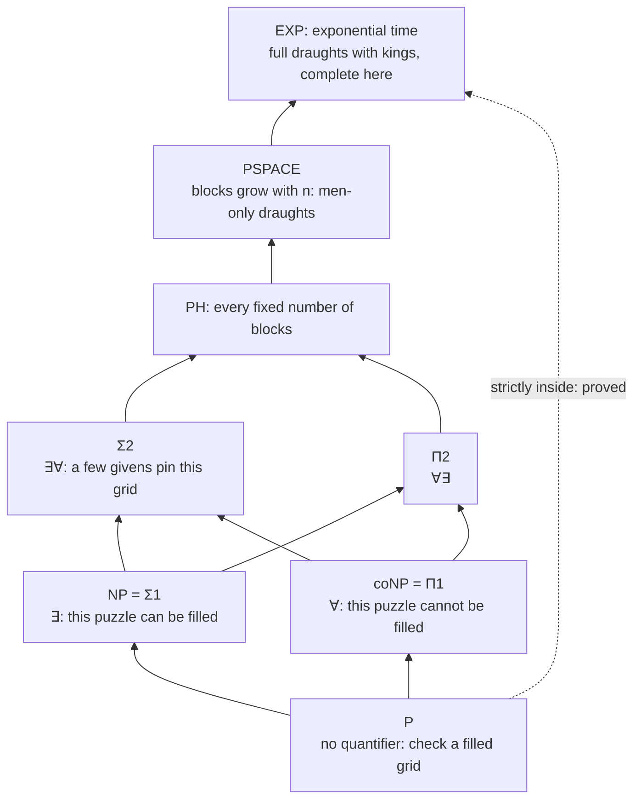

# Above NP: alternating there-exists and for-all, and memory instead of time

[Syllabus](../../../SYLLABUS.md) → [Computability and complexity](../README.md) → [Time Complexity](../README.md#s03) → Above NP

---

## General Overview

Take a draughts endgame on a small 6 by 6 board. White has men on b2 and b4. Black has men on a5 and e3. White is to move. Who wins?

|   | a | b | c | d | e | f |
| --- | --- | --- | --- | --- | --- | --- |
| **6** | | | | | | |
| **5** | B | | | | | |
| **4** | | W | | | | |
| **3** | | | | | B | |
| **2** | | W | | | | |
| **1** | | | | | | |

The game is draughts cut down so that a short program can play every line:

- A man moves one square diagonally forward. White moves up the board, Black moves down.
- A man captures by jumping diagonally forward over an enemy man to the empty square behind it. A capture is compulsory, and a jump continues while another jump is possible.
- A man that reaches the far row wins the game at once. (Full draughts crowns it as a king instead.)
- A side with no legal move loses.

White wins by b4–c5. That claim has three parts, in order. **There is** a White move, such that **for every** Black reply (there are three), **there is** a White move that reaches row 6. In symbols: $`\exists\,\forall\,\exists`$, there-exists, for-all, there-exists.

"This sudoku can be completed" needs only one there-exists: a filled grid to check. That is NP, from [P and NP](02-p-and-np.md). A game alternates, one quantifier per **ply** (one move by one side). From a 6 by 6 opening position, White a1 c1 e1 against Black b6 d6 f6, White wins in 17 plies: 17 alternating quantifiers.

Complexity theory sorts questions by that count. A **block** is a run of quantifiers of one kind in a row. One there-exists block is NP; one for-all block is coNP. Two alternating blocks is the second rung of a ladder, the **polynomial hierarchy**, and so on up. When the count grows with the board, no fixed rung is guaranteed to hold the question any more, but it still lands in **PSPACE**: questions answered in a polynomial amount of memory. Depth-first search (follow one line of play to its end, then back up and try the next) solves the opening holding 24 positions at once; a full table stores 78,763.

**Count the alternating blocks of there-exists and for-all in a question, each over strings of polynomial length: one block is NP or coNP, k blocks is the k-th rung of the polynomial hierarchy, and a number of blocks that grows with the input is PSPACE, where memory is reused and time is not.**

**What kind of fact this is:** definitions (coNP, the rungs, PSPACE), with theorems proved in Why it works: complements swap the quantifiers, the rungs nest, and the ladder and every game of polynomial length fit in PSPACE. Three theorems are stated with key steps and a source: TQBF is PSPACE-complete, Savitch's theorem, and full draughts is EXP-complete. NP ≠ coNP, an endless ladder and PH ≠ PSPACE are conjectures, unproved as of 2026-11-11.

### The picture: the ladder above NP



Schematic. An arrow means "is contained in". The one strict containment that is proved is P inside EXP, so full n by n draughts is provably not in P. Every other arrow might be an equality, as far as anyone has proved.

---

## The formula

Notation first, in words. As on [P and NP](02-p-and-np.md), an input is a string x of length $`n = \lvert x\rvert`$, a problem is the set L of yes-inputs, and a **verifier** V is a polynomial-time machine that reads x and extra strings and answers 1 or 0. The **complement** $`L^c`$ holds every input that is not in L.

Rung k has two halves. $`\Sigma_k^{\mathrm{p}}`$ (sigma k) holds problems whose sentence has k alternating blocks starting with there-exists; $`\Pi_k^{\mathrm{p}}`$ (pi k) starts with for-all. The p is for polynomial.

```math
L \in \Sigma_k^{\mathrm{p}} \iff \text{for some } V, d:\ x \in L \Leftrightarrow \exists y_1\, \forall y_2\, \exists y_3 \cdots Q_k\, y_k :\ V(x, y_1, \ldots, y_k) = 1, \text{ every } \lvert y_i\rvert \le n^d
```

**Read it aloud:** a problem is on rung k when an input is a yes exactly if a first player can pick a short string, such that for every short string a second player picks, the first can pick another, and so on for k turns, and a fast referee then says 1.

$`Q_k`$ is $`\exists`$ when k is odd and $`\forall`$ when k is even. The first two rungs have their own names:

```math
\mathrm{NP} = \Sigma_1^{\mathrm{p}}, \qquad \mathrm{coNP} = \{\, L : L^c \in \mathrm{NP} \,\} = \Pi_1^{\mathrm{p}}, \qquad \mathrm{PH} = \bigcup_{k \ge 1} \Sigma_k^{\mathrm{p}}
```

**Read it aloud:** NP is one there-exists; coNP holds the complements of NP problems, which is one for-all; the polynomial hierarchy PH is every rung together.

Memory gets its own class. $`\mathrm{SPACE}(s(n))`$, from [Time and space classes](01-time-and-space-classes.md), holds the problems a machine decides while visiting about s(n) tape cells.

```math
\mathrm{PSPACE} = \bigcup_{d \ge 1} \mathrm{SPACE}(n^d), \qquad \mathrm{P} \subseteq \mathrm{NP} \cup \mathrm{coNP} \subseteq \Sigma_2^{\mathrm{p}} \cap \Pi_2^{\mathrm{p}} \subseteq \cdots \subseteq \mathrm{PH} \subseteq \mathrm{PSPACE} \subseteq \mathrm{EXP}
```

**Read it aloud:** PSPACE is every problem decided in polynomial memory; the ladder climbs from P through every rung into PSPACE, which sits inside exponential time.

| Symbol | Plain meaning | In our example | Push it up and the answer… |
| --- | --- | --- | --- |
| $`x`$, $`n = \lvert x\rvert`$ | the input and its length in symbols | the position, one symbol per square: n = 36 | every bound below is measured against n |
| $`y_1, y_2, \ldots`$; $`b_i`$ | the strings picked in turn; in TQBF, single bits | the moves: b4–c5, then a Black reply, then c5–b6 | — |
| $`\lvert y_i\rvert \le n^d`$, $`d`$ | each pick is short: at most $`n^d`$ symbols | a move is two square names | longer picks leave the class |
| $`V`$, $`\varphi`$ | the referee: a polynomial-time check, answers 1 or 0; in TQBF, a formula | "is a White man on row 6?" | — |
| $`k`$ | the number of alternating blocks | 3 in the endgame; 17 from the opening | one rung higher per block |
| $`\exists`$, $`\forall`$, $`Q_k`$ | there exists; for every; the k-th one | White's moves; Black's replies | — |
| $`L^c`$, coNP | the complement, the no-inputs; the class of complements of NP problems, one for-all | "this puzzle has no completion" | — |
| $`\Sigma_k^{\mathrm{p}}`$, $`\Pi_k^{\mathrm{p}}`$, PH | rung k, starting with $`\exists`$ or with $`\forall`$; every fixed rung together | some 4 givens pin this sudoku grid: $`\Sigma_2^{\mathrm{p}}`$ | — |
| $`\mathrm{SPACE}(s(n))`$, $`\mathrm{NSPACE}(s(n))`$, PSPACE | decided in about s(n) cells; the same for a guessing machine; in polynomially many cells | who wins men-only draughts on an n-square board | — |
| P, NP, EXP | decided in polynomial time; checked in polynomial time; decided in about $`2^{n^d}`$ steps | check a filled grid; fill a puzzle; full n by n draughts | — |
| C, C′, M, $`2^j`$ | machine configurations (snapshots of state, head and tape): start, end, midpoint; a step budget | — | — |

### When it holds

- **Each quantifier ranges over strings of polynomial length.** There are exponentially many such strings, which is what makes a block costly. When every position has polynomially many moves, as with one-square steps, "White wins within 3 plies" costs polynomially many lines on any board and stays in P. Chained captures break that: a man may turn left or right at each hop, so its capture routes can grow exponentially in number as the board grows. Each route is still a short string, so the 3 blocks then put the question on rung 3 at most.
- **The number of blocks is fixed.** Rung k uses one k for every input size. If the count grows with n, as in a game whose length grows with the board, the count no longer places the question on any rung; it is still in PSPACE.
- **The referee runs in polynomial time.** If V needs exponential time, the picks no longer carry the work, and the count says nothing.
- **A count gives an upper bound.** Two blocks put a question on rung 2 or lower. Showing it is no lower needs a reduction ([Reductions](03-polynomial-reductions-and-np-completeness.md)).
- **The game has polynomial length.** Men-only draughts ends within (men) × (rows) plies, since every move pushes a man forward. With kings a game can last exponentially long, and the problem moves up to EXP.

---

## Why it works

### Step 0: a quantifier is a player

Read $`\exists y`$ as "I pick y" and $`\forall y`$ as "my opponent picks y". The sentence is true exactly when the first player has a way to answer every pick of the second and still satisfy the referee. In the endgame: I pick b4–c5, Black picks any of three replies, I pick c5–b6 or c5–d6, and the referee sees a White man on row 6.

Order matters, as on [Quantifiers](../../01-Foundations/05-Logic/04-quantifiers.md): what is picked second may depend on what was picked first. Here c5–b6 is chosen after Black's reply is known. Every rung of the ladder is a game of this kind with a fixed number of turns.

### Step 1: a complement swaps the players

"Not (there is a move such that for every reply …)" is "for every move there is a reply such that not …". The rule on [Negating a quantifier](../../01-Foundations/05-Logic/05-negating-quantifiers-and-counterexamples.md) moves "not" past each quantifier and swaps it. So the complement of a $`\Sigma_k^{\mathrm{p}}`$ problem is a $`\Pi_k^{\mathrm{p}}`$ problem, with the referee's answer flipped.

At k = 1 this is coNP. "This puzzle has a completion" is $`\exists`$ grid. "This puzzle has no completion" is $`\forall`$ grid: every filling breaks a rule. No short certificate for that is known; the 4 by 4 no-puzzle on [P and NP](02-p-and-np.md) is settled by checking every filling.

P is closed under complement: flip a fast decider's answer. So P = NP would give NP = coNP, and NP ≠ coNP would prove P ≠ NP. Both are conjectures, unproved as of 2026-11-11.

### Step 2: only alternations count

Two quantifiers of the same kind in a row merge. "There is a y and there is a z" is "there is a pair (y, z)", one string of length $`\lvert y\rvert + \lvert z\rvert`$, still polynomial. So $`\exists\exists\forall\forall\exists`$ has three blocks, not five, and sits on rung 3.

The opening sentence, "White wins within 17 plies", has 17 quantifiers: 9 there-exists and 8 for-all. They alternate, so there are 17 blocks.

### Step 3: the rungs nest

Add a quantifier over a string the referee ignores. The sentence keeps its truth and gains a block, at the start or the end. So every rung-k problem is on rung k + 1 of both kinds:

```math
\Sigma_k^{\mathrm{p}} \cup \Pi_k^{\mathrm{p}} \subseteq \Sigma_{k+1}^{\mathrm{p}} \cap \Pi_{k+1}^{\mathrm{p}}
```

**Read it aloud:** anything with k blocks also has k + 1 blocks, whichever quantifier comes first.

At k = 0 the rung is P itself, with no quantifier, which gives $`\mathrm{P} \subseteq \mathrm{NP} \cap \mathrm{coNP}`$.

### Step 4: the whole ladder fits in polynomial memory

Evaluate the sentence depth first. Try the first string for $`y_1`$. Under it, try every $`y_2`$, and so on down to the referee. Then erase and move to the next string. At any moment the machine holds one string per level plus the referee's work. That is at most $`k \cdot n^d`$ cells for the picks and a polynomial number for V. Time can be enormous, about $`2^{k n^d}`$ branches, but the same cells are reused for each.

The opening shows the trade. Depth-first search held the longest line, 23 plies, so at most 24 positions of 36 squares: 864 cells, plus a note at each level of which move it is trying. It visited 57,334 positions and kept none of them once its line moved on. A table of every position reached, with its plies to a win, stores 78,763 positions: 2,835,468 cells. Memory is reused; time is not.

<details>
<summary>Detailed proof: every rung, and every game of polynomial length, is in PSPACE</summary>

Fix a sentence $`\exists y_1 \forall y_2 \cdots Q_k y_k : V(x, y_1, \ldots, y_k) = 1`$. Choose one power d so large that every $`\lvert y_i\rvert \le n^d`$, the number of blocks $`k \le n^d`$, and V runs within $`n^d`$ steps. A fixed k is allowed, and so is a k that grows with n.

Define the procedure eval(i), run with $`y_1, \ldots, y_{i-1}`$ already written on the tape. If $`i > k`$, run V and return its answer. Otherwise loop through every string $`y_i`$ of length at most $`n^d`$, in order, writing each over the last one. Return 1 when some value of eval(i + 1) is 1 (for $`\exists`$) or when all are 1 (for $`\forall`$).

Level i keeps its current $`y_i`$ and one bit of answer so far. The levels nest, so the space used is

$`\displaystyle \sum_{i=1}^{k} (n^d + 1) + n^d \le n^d(n^d + 1) + n^d,`$

a polynomial in n. The answer of eval(1) is the sentence's truth, by induction on k − i. So the problem is in $`\mathrm{SPACE}(n^{2d})`$, up to a constant factor, inside PSPACE.

A game of polynomial length is the case where $`y_i`$ is the i-th ply. V finds the first illegal ply, if any. If it is the second player's, V answers 1, since a for-all must not be broken by a move the rules forbid; if it is the first player's, V answers 0. With every ply legal, V answers 1 exactly when the first player has won by the end.

</details>

### Step 5: unbounded alternation is exactly PSPACE

The converse holds too. **TQBF** (true quantified Boolean formulas) asks whether $`\exists b_1 \forall b_2 \exists b_3 \cdots \varphi`$ is true, where each $`b_i`$ is one bit and $`\varphi`$ is a formula with and, or and not. It is PSPACE-complete: in PSPACE by Step 4, and every PSPACE problem reduces to it (Stockmeyer and Meyer, 1973). It is stated here with its key step, not proved.

The key step: configuration C reaches configuration C′ within $`2^j`$ steps exactly when some midpoint M is reached from C, and reaches C′, within $`2^{j-1}`$ steps each. A for-all folds the two halves into one: for every pair among (C, M) and (M, C′), that pair connects within $`2^{j-1}`$ steps. Each fold adds one there-exists and one for-all, each over polynomially many bits, so the formula stays polynomial while the run is exponentially long.

TQBF is a game: one player sets the odd bits, the other the even bits. Through it, many polynomial-length games are PSPACE-complete. Robson proved in 1984 that full draughts on an n by n board, with kings, is complete for EXP. Kings can move back and forth, so a game can run exponentially long. Since P ≠ EXP is proved, no machine decides n by n draughts in polynomial time.

### Step 6: guessing buys little memory

A guessing machine ([Guessing machines](../01-Models%20of%20Computation/02-nondeterminism-and-the-subset-construction.md)) takes every allowed move at once and accepts when any branch accepts. For time, whether guessing helps is the P versus NP question. For memory it helps little, by Savitch's theorem of 1970:

```math
\mathrm{NSPACE}(s(n)) \subseteq \mathrm{SPACE}(s(n)^2) \quad \text{for } s(n) \ge \log_2 n
```

**Read it aloud:** whatever a guessing machine decides in s cells, an ordinary machine decides in the square of s cells.

$`\mathrm{NSPACE}(s(n))`$ is the guessing machine's version of $`\mathrm{SPACE}(s(n))`$. The proof runs the midpoint step on an ordinary machine: try every midpoint M, check each half recursively, and reuse the cells. The run has at most $`2^{O(s)}`$ steps, so the recursion is about s levels deep, each storing one configuration of O(s) cells. So guessing adds nothing to PSPACE.

### Step 7: what is known and what is not

Proved: $`\mathrm{P} \subseteq \mathrm{NP} \subseteq \mathrm{PH} \subseteq \mathrm{PSPACE} \subseteq \mathrm{EXP}`$, and P ≠ EXP ([Hierarchy and Ladner](09-time-hierarchy-and-ladners-theorem.md)). So at least one of those containments is strict, and no one knows which.

Proved too: the ladder **collapses** if the two halves of one rung meet. If $`\Sigma_k^{\mathrm{p}} = \Pi_k^{\mathrm{p}}`$ for some k, every higher rung equals rung k (Stockmeyer, 1976). In particular P = NP would bring the whole ladder down to P.

Open: whether NP ≠ coNP, whether the ladder has infinitely many distinct rungs, and whether PH ≠ PSPACE. All three are believed, none proved, as of 2026-11-11.

---

## Worked numbers, by hand

The endgame, White b2 b4 against Black a5 e3, White to move:

| Step | Arithmetic | Value |
| --- | --- | --- |
| White's choices | b2–a3, b2–c3, b4–c5 | 3 moves |
| b2–a3 | Black's only reply is a5 jumping b4, forced | no White win |
| b2–c3 | Black has 2 replies; neither lets White through | no White win |
| b4–c5, Black's replies | e3–d2, e3–f2, a5–b4 | 3 replies |
| White's answer to each | c5–b6 or c5–d6 | reaches row 6 |
| the sentence | there is a move, for every reply, there is a move | $`\exists\forall\exists`$, 3 blocks |
| plies to the win | White, Black, White | **3** |

White wins, and only by b4–c5: the "there is" finds one move, and the "for every" holds for all three replies.

The opening, White a1 c1 e1 against Black b6 d6 f6, run by the code:

| Step | Arithmetic | Value |
| --- | --- | --- |
| forced win | 9 White moves, 8 Black replies | 17 plies |
| depth-first memory | 24 positions × 36 squares | 864 cells |
| table memory | 78,763 positions × 36 squares | 2,835,468 cells |
| White's plan | positions where White must choose | 666 |

The opening is a first-player win in 17 plies, a sentence with 17 alternating blocks.

A block count places a family of questions, one for each board size; one fixed board is a single finite question. So the 3 and the 17 place a question only once the board is allowed to grow:

| Question | Blocks | Place on the ladder |
| --- | --- | --- |
| who wins one fixed position, such as the 6 by 6 opening | — | finite: one stored answer settles it |
| "White wins within k plies" on n squares, k fixed, such as 3 or 17 | k | rung k at most, $`\Sigma_k^{\mathrm{p}}`$; in P when every position has polynomially many moves |
| who wins men-only draughts on n squares | grows with n, up to (men) × (rows) plies | PSPACE, by Step 4 |
| who wins full draughts with kings on n squares | unbounded: a game can run exponentially long | complete for EXP (Step 5), so not in P |

### What breaks if you drop a piece

| Mistake | Comes out at | What went wrong |
| --- | --- | --- |
| Black's replies read as "there exists", after b2–a3 | White wins: True; truly False | One friendly line of play is not a forced win: $`\exists\exists\exists`$ is an NP question, not the game |
| Search capped at 16 plies from the opening | White wins: False, after 50,883 positions | The win needs 17 alternations; a cap below the count misses it |
| "For every" dropped from "3 givens pin this sudoku grid" | 560 of 560 choices "work" | The grid fits every set of 3 givens, but each set fits at least 3 grids |

The code prints all three.

---

## Code, from first principles, and it actually runs

The code plays the cut-down draughts and solves both positions by three independent roads. Road one is depth-first search, the PSPACE method: there-exists for White, for-every for Black, one line held at a time. Road two is a table of every reachable position with its plies to a White win. Road three takes one White plan, read from the table, and plays it against every Black reply. The sudoku part counts the 288 grids two ways, by backtracking and by stacking rows under 1 2 3 4, and settles the $`\exists\forall`$ question "do some 3 or 4 givens pin the grid 1234/3412/2143/4321?" by checking every choice against every grid.

### Python

```python
# Above NP: alternating there-exists and for-all -- the check behind the card.
# Draughts cut down to a 6 by 6 board, men only: a man steps or jumps diagonally
# forward, a capture is compulsory and a jump continues while it can, and a man
# reaching the far row wins.  A side with no legal move loses.  Squares are a1..f6.
from itertools import combinations, permutations, product
N, INF, COLS = 6, 99, "abcdef"
TOP, BOTTOM = sum(1 << (N * (N - 1) + c) for c in range(N)), (1 << N) - 1

def board(names):                                # "b2 b4" -> one bit per square
    return sum(1 << (int(s[1]) - 1) * N + COLS.index(s[0]) for s in names.split())
def name(bits):                                  # one bit per square -> "b2 b4"
    return " ".join(COLS[s % N] + str(s // N + 1) for s in range(N * N) if bits >> s & 1)
def moves(w, b, white):                          # every legal move, as the new (w, b)
    me, op, dr, out = (w, b, 1, []) if white else (b, w, -1, [])
    def jump(s, me, op, jumped):
        r, c, more = s // N, s % N, False
        for dc in (-1, 1):
            m, t = (r + dr) * N + c + dc, (r + 2 * dr) * N + c + 2 * dc
            if 0 <= r + 2 * dr < N and 0 <= c + 2 * dc < N and op >> m & 1 and not (me | op) >> t & 1:
                more = True
                jump(t, me & ~(1 << s) | 1 << t, op & ~(1 << m), True)
        if jumped and not more:
            out.append((me, op))
    for s in range(N * N):
        if me >> s & 1:
            jump(s, me, op, False)
    for s in range(N * N) if not out else []:
        r, c = s // N, s % N
        for dc in (-1, 1):
            t = (r + dr) * N + c + dc
            if me >> s & 1 and 0 <= r + dr < N and 0 <= c + dc < N and not (me | op) >> t & 1:
                out.append((me & ~(1 << s) | 1 << t, op))
    return [(m, o) if white else (o, m) for m, o in out]
def over(w, b, white):                           # None while play goes on, else "White won"
    if w & TOP or b & BOTTOM:
        return bool(w & TOP)
    return None if moves(w, b, white) else not white
count = {"visited": 0, "deepest": 0}
def search(w, b, white, depth=0, cap=INF, black=all):   # road one: depth first, one line held
    count["visited"] += 1
    count["deepest"] = max(count["deepest"], depth)
    end = over(w, b, white)
    if end is not None or depth == cap:
        return bool(end)
    pick = any if white else black               # White: there exists; Black: for every
    return pick(search(x, y, not white, depth + 1, cap, black) for x, y in moves(w, b, white))
table = {}
def plies(w, b, white):                          # road two: every position stored, with plies to a win
    key = (w, b, white)
    if key not in table:
        end = over(w, b, white)
        if end is not None:
            table[key] = 0 if end else INF
        else:
            vals = [plies(x, y, not white) for x, y in moves(w, b, white)]
            v = min(vals) if white else max(vals)
            table[key] = v + 1 if v < INF else INF
    return table[key]
def plan_wins(w, b, white, left, plan):          # road three: one White plan, every Black reply
    end = over(w, b, white)
    if end is not None or left == 0:
        return bool(end)
    if white:
        plan.add((w, b))
        x, y = min(moves(w, b, True), key=lambda m: plies(m[0], m[1], False))
        return plan_wins(x, y, False, left - 1, plan)
    return all(plan_wins(x, y, True, left - 1, plan) for x, y in moves(w, b, False))
def runs(*args, **kw):                           # one search, with fresh counters
    count.update(visited=0, deepest=0)
    return search(*args, **kw), count["visited"], count["deepest"]
def step(old, new):                              # a move as "from-to"
    return name(old & ~new) + "-" + name(new & ~old)

w0, b0 = board("b2 b4"), board("a5 e3")          # the endgame worked by hand
print(f"endgame: White {name(w0)}, Black {name(b0)}, White to move")
agree = []
for x, y in moves(w0, b0, True):
    p, replies = plies(x, y, False), moves(x, y, False)
    agree.append(runs(x, y, False)[0] == (p < INF))
    print(f"  White {step(w0, x)}: Black replies {len(replies)}; plies to a White win "
          f"{p + 1 if p < INF else 'none'}; depth-first search says {runs(x, y, False)[0]}")
    for u, v in replies if p < INF else []:
        answers = [step(u, s) for s, t in moves(u, v, True) if s & TOP]
        print(f"    Black {step(y, v)}: White reaches row 6 by {' or '.join(answers)}")
pe = plies(w0, b0, True)
print(f"endgame value: White wins in {pe} plies; the sentence reads {'∃∀' * (pe // 2) + '∃' * (pe % 2)}")
bad = moves(w0, b0, True)[0]
print(f"mistake 1, Black's replies read as there-exists after {step(w0, bad[0])}: "
      f"White wins {runs(*bad, False, black=any)[0]}, truly {runs(*bad, False)[0]}")

table.clear()
ws, bs = board("a1 c1 e1"), board("b6 d6 f6")
win, seen, deep = runs(ws, bs, True)
p0, plan = plies(ws, bs, True), set()
ok, plan_short = plan_wins(ws, bs, True, p0, plan), plan_wins(ws, bs, True, p0 - 1, set())
capped = runs(ws, bs, True, cap=(cut := p0 - 1))
print(f"start: White {name(ws)}, Black {name(bs)}, White to move")
print(f"road one, depth first: White wins {win}; positions visited {seen:,}; longest line {deep} plies")
print(f"road one memory: {deep + 1} positions x {N * N} squares = {(deep + 1) * N * N:,} cells")
print(f"road two, table: positions stored {len(table):,} = {len(table) * N * N:,} cells; "
      f"White wins in {p0} plies")
print(f"road three, one White plan against every Black reply: wins within {p0} plies {ok}; "
      f"within {p0 - 1} {plan_short}; the plan answers {len(plan):,} positions")
print(f"the sentence 'White wins within {p0} plies' has {p0} quantifiers, {p0 // 2 + 1} ∃ and {p0 // 2} ∀")
print(f"mistake 2, search capped at {cut} plies: White wins {capped[0]}, after {capped[1]:,} positions")

G, grid = [], [0] * 16                           # every 4 by 4 sudoku grid, by backtracking
def fill(i):
    if i == 16:
        return G.append(tuple(grid))
    for d in range(1, 5):
        if all(grid[j] != d for j in range(i) if j // 4 == i // 4 or j % 4 == i % 4
               or (j // 8 == i // 8 and j % 4 // 2 == i % 4 // 2)):
            grid[i] = d
            fill(i + 1)
fill(0)
T = (1, 2, 3, 4, 3, 4, 1, 2, 2, 1, 4, 3, 4, 3, 2, 1)
def fits(cells):                                 # grids that agree with T on these cells
    return sum(all(g[i] == T[i] for i in cells) for g in G)
three = [fits(s) for s in combinations(range(16), 3)]
four = [fits(s) for s in combinations(range(16), 4)]
rows = list(permutations((1, 2, 3, 4)))          # road two: stack three rows under 1 2 3 4
def legal(q):                                    # every column and 2 by 2 box holds 1 to 4
    return all(len({q[r][c] for r in range(4)}) == 4 for c in range(4)) and all(
        len({q[a + i][b + j] for i in (0, 1) for j in (0, 1)}) == 4 for a in (0, 2) for b in (0, 2))
first_row = sum(legal(q) for q in product([(1, 2, 3, 4)], rows, rows, rows))
print(f"sudoku: {len(G)} grids; {first_row} start 1 2 3 4, times 24 relabellings = {first_row * 24}")
print(f"3 givens from 1234/3412/2143/4321: {len(three)} choices, pinning the grid {three.count(1)}, "
      f"fewest grids fitting {min(three)}")
print(f"4 givens: {len(four)} choices, pinning the grid {four.count(1)}; "
      f"grid checks made {len(four) * len(G):,}")
print(f"mistake 3, for-every dropped: 3-given choices the grid fits {sum(f >= 1 for f in three)} of {len(three)}")
assert win and p0 < INF and all(agree)                    # roads one and two agree
assert ok and not plan_short                              # the plan wins in exactly p0 plies
assert not capped[0] and runs(ws, bs, True, cap=p0)[0]    # a cap below p0 misses the win
assert runs(*bad, False, black=any)[0] and not runs(*bad, False)[0]
assert first_row * 24 == len(G)                           # backtracking against stacked rows
assert [len(moves(x, y, False)) for x, y in moves(w0, b0, True)] == [1, 2, 3] and pe == 3  # by hand
assert min(three) >= 2 and four.count(1) > 0              # 3 givens never pin it; 4 can
print("ALL CHECKS PASS")
```

**Ran 2026-11-19 on macOS, Python 3.14.10, standard library only. All checks passed. Output, pasted from the run:**

```
endgame: White b2 b4, Black e3 a5, White to move
  White b2-a3: Black replies 1; plies to a White win none; depth-first search says False
  White b2-c3: Black replies 2; plies to a White win none; depth-first search says False
  White b4-c5: Black replies 3; plies to a White win 3; depth-first search says True
    Black e3-d2: White reaches row 6 by c5-b6 or c5-d6
    Black e3-f2: White reaches row 6 by c5-b6 or c5-d6
    Black a5-b4: White reaches row 6 by c5-b6 or c5-d6
endgame value: White wins in 3 plies; the sentence reads ∃∀∃
mistake 1, Black's replies read as there-exists after b2-a3: White wins True, truly False
start: White a1 c1 e1, Black b6 d6 f6, White to move
road one, depth first: White wins True; positions visited 57,334; longest line 23 plies
road one memory: 24 positions x 36 squares = 864 cells
road two, table: positions stored 78,763 = 2,835,468 cells; White wins in 17 plies
road three, one White plan against every Black reply: wins within 17 plies True; within 16 False; the plan answers 666 positions
the sentence 'White wins within 17 plies' has 17 quantifiers, 9 ∃ and 8 ∀
mistake 2, search capped at 16 plies: White wins False, after 50,883 positions
sudoku: 288 grids; 12 start 1 2 3 4, times 24 relabellings = 288
3 givens from 1234/3412/2143/4321: 560 choices, pinning the grid 0, fewest grids fitting 3
4 givens: 1820 choices, pinning the grid 12; grid checks made 524,160
mistake 3, for-every dropped: 3-given choices the grid fits 560 of 560
ALL CHECKS PASS
```

### Rust

Same numbers, same labels, built with `rustc --edition 2021 -O`.

```rust
// Above NP: alternating there-exists and for-all -- the same check as the Python.
// No crates.  Draughts cut down to a 6 by 6 board, men only: a man steps or jumps
// diagonally forward, a capture is compulsory and a jump continues while it can,
// and a man reaching the far row wins.  A side with no legal move loses.
use std::collections::{HashMap, HashSet};
const N: i64 = 6; const INF: u32 = 99; const COLS: &[u8] = b"abcdef";
const TOP: u64 = 0b111111 << 30; const BOTTOM: u64 = 0b111111;            // the far rows, 6 and 1
type Pos = (u64, u64);
fn board(names: &str) -> u64 {                       // "b2 b4" -> one bit per square
    names.split(' ').map(|s| 1u64 << ((s.as_bytes()[1] - b'1') as i64 * N + (s.as_bytes()[0] - b'a') as i64)).sum()
}
fn name(bits: u64) -> String {                       // one bit per square -> "b2 b4"
    (0..N * N).filter(|s| bits >> s & 1 == 1)
        .map(|s| format!("{}{}", COLS[(s % N) as usize] as char, s / N + 1)).collect::<Vec<_>>().join(" ")
}
fn jump(s: i64, me: u64, op: u64, dr: i64, jumped: bool, out: &mut Vec<Pos>) {
    let (r, c) = (s / N, s % N);
    let mut more = false;
    for dc in [-1, 1] {
        let (m, t) = ((r + dr) * N + c + dc, (r + 2 * dr) * N + c + 2 * dc);
        if (0..N).contains(&(r + 2 * dr)) && (0..N).contains(&(c + 2 * dc))
            && op >> m & 1 == 1 && (me | op) >> t & 1 == 0 {
            more = true;
            jump(t, me & !(1 << s) | 1 << t, op & !(1 << m), dr, true, out);
        }
    }
    if jumped && !more { out.push((me, op)) }
}
fn moves(w: u64, b: u64, white: bool) -> Vec<Pos> {  // every legal move, as the new (w, b)
    let (me, op, dr) = if white { (w, b, 1) } else { (b, w, -1) };
    let mut out = Vec::new();
    for s in 0..N * N { if me >> s & 1 == 1 { jump(s, me, op, dr, false, &mut out) } }
    if out.is_empty() {
        for s in 0..N * N {
            let (r, c) = (s / N, s % N);
            for dc in [-1, 1] {
                let t = (r + dr) * N + c + dc;
                if me >> s & 1 == 1 && (0..N).contains(&(r + dr)) && (0..N).contains(&(c + dc))
                    && (me | op) >> t & 1 == 0 { out.push((me & !(1 << s) | 1 << t, op)) }
            }
        }
    }
    out.into_iter().map(|(m, o)| if white { (m, o) } else { (o, m) }).collect()
}
fn over(w: u64, b: u64, white: bool) -> Option<bool> { // None while play goes on, else "White won"
    if w & TOP != 0 || b & BOTTOM != 0 { return Some(w & TOP != 0) }
    if moves(w, b, white).is_empty() { Some(!white) } else { None }
}
// road one: depth first, one line held; White: there exists; Black: for every (or "any")
fn search(w: u64, b: u64, white: bool, depth: u32, cap: u32, black_any: bool, k: &mut (u64, u32)) -> bool {
    *k = (k.0 + 1, k.1.max(depth));
    let end = over(w, b, white);
    if end.is_some() || depth == cap { return end == Some(true) }
    let mut ms = moves(w, b, white).into_iter();
    if white || black_any { ms.any(|(x, y)| search(x, y, !white, depth + 1, cap, black_any, k)) }
    else { ms.all(|(x, y)| search(x, y, !white, depth + 1, cap, black_any, k)) }
}
fn runs(w: u64, b: u64, white: bool, cap: u32, black_any: bool) -> (bool, u64, u32) {
    let mut k = (0, 0); (search(w, b, white, 0, cap, black_any, &mut k), k.0, k.1) }
// road two: every position stored, with plies to a win
fn plies(w: u64, b: u64, white: bool, t: &mut HashMap<(u64, u64, bool), u32>) -> u32 {
    if let Some(&v) = t.get(&(w, b, white)) { return v }
    let v = match over(w, b, white) {
        Some(end) => if end { 0 } else { INF },
        None => {
            let vals: Vec<u32> = moves(w, b, white).into_iter().map(|(x, y)| plies(x, y, !white, t)).collect();
            let v = if white { *vals.iter().min().unwrap() } else { *vals.iter().max().unwrap() };
            if v < INF { v + 1 } else { INF }
        }
    };
    t.insert((w, b, white), v); v
}
// road three: one White plan, every Black reply
fn plan_wins(w: u64, b: u64, white: bool, left: u32, plan: &mut HashSet<Pos>,
             t: &mut HashMap<(u64, u64, bool), u32>) -> bool {
    let end = over(w, b, white);
    if end.is_some() || left == 0 { return end == Some(true) }
    if white {
        plan.insert((w, b));
        let (x, y) = moves(w, b, true).into_iter().min_by_key(|m| plies(m.0, m.1, false, t)).unwrap();
        return plan_wins(x, y, false, left - 1, plan, t);
    }
    moves(w, b, false).into_iter().all(|(x, y)| plan_wins(x, y, true, left - 1, plan, t))
}
fn step(old: u64, new: u64) -> String { format!("{}-{}", name(old & !new), name(new & !old)) }
fn commas(n: u64) -> String {                        // 57334 -> "57,334"
    let s = n.to_string();
    s.chars().enumerate().map(|(i, ch)| format!("{}{}", if i > 0 && (s.len() - i) % 3 == 0 { "," } else { "" }, ch)).collect()
}
fn py(v: bool) -> &'static str { if v { "True" } else { "False" } }
fn fill(i: usize, grid: &mut [u8; 16], g: &mut Vec<[u8; 16]>) { // every 4 by 4 sudoku grid
    if i == 16 { g.push(*grid); return }
    for d in 1..=4u8 {
        if (0..i).filter(|&j| j / 4 == i / 4 || j % 4 == i % 4 || (j / 8 == i / 8 && j % 4 / 2 == i % 4 / 2))
            .all(|j| grid[j] != d) { grid[i] = d; fill(i + 1, grid, g) }
    }
}
fn combos(k: usize, start: usize, cur: &mut Vec<usize>, out: &mut Vec<Vec<usize>>) {
    if cur.len() == k { out.push(cur.clone()); return }
    for i in start..16 { cur.push(i); combos(k, i + 1, cur, out); cur.pop(); }
}
fn main() {
    let mut t: HashMap<(u64, u64, bool), u32> = HashMap::new();
    let (w0, b0) = (board("b2 b4"), board("a5 e3"));
    println!("endgame: White {}, Black {}, White to move", name(w0), name(b0));
    let mut agree = Vec::new();
    for (x, y) in moves(w0, b0, true) {
        let (p, replies) = (plies(x, y, false, &mut t), moves(x, y, false));
        let s = runs(x, y, false, INF, false).0; agree.push(s == (p < INF));
        let pw = if p < INF { (p + 1).to_string() } else { "none".to_string() };
        println!("  White {}: Black replies {}; plies to a White win {}; depth-first search says {}",
                 step(w0, x), replies.len(), pw, py(s));
        for &(u, v) in if p < INF { &replies[..] } else { &[] } {
            let answers: Vec<String> = moves(u, v, true).into_iter().filter(|m| m.0 & TOP != 0)
                .map(|m| step(u, m.0)).collect();
            println!("    Black {}: White reaches row 6 by {}", step(y, v), answers.join(" or "));
        }
    }
    let pe = plies(w0, b0, true, &mut t);
    println!("endgame value: White wins in {} plies; the sentence reads {}{}", pe,
             "∃∀".repeat((pe / 2) as usize), "∃".repeat((pe % 2) as usize));
    let bad = moves(w0, b0, true)[0];
    let (coop, truly) = (runs(bad.0, bad.1, false, INF, true).0, runs(bad.0, bad.1, false, INF, false).0);
    println!("mistake 1, Black's replies read as there-exists after {}: White wins {}, truly {}",
             step(w0, bad.0), py(coop), py(truly));
    t.clear();
    let (ws, bs) = (board("a1 c1 e1"), board("b6 d6 f6"));
    let (win, seen, deep) = runs(ws, bs, true, INF, false);
    let (p0, mut plan) = (plies(ws, bs, true, &mut t), HashSet::new());
    let ok = plan_wins(ws, bs, true, p0, &mut plan, &mut t);
    let plan_short = plan_wins(ws, bs, true, p0 - 1, &mut HashSet::new(), &mut t);
    let (capped, cells) = (runs(ws, bs, true, p0 - 1, false), (N * N) as u64);
    println!("start: White {}, Black {}, White to move", name(ws), name(bs));
    println!("road one, depth first: White wins {}; positions visited {}; longest line {} plies", py(win), commas(seen), deep);
    println!("road one memory: {} positions x {} squares = {} cells", deep + 1, cells, commas((deep as u64 + 1) * cells));
    println!("road two, table: positions stored {} = {} cells; White wins in {} plies",
             commas(t.len() as u64), commas(t.len() as u64 * cells), p0);
    println!("road three, one White plan against every Black reply: wins within {} plies {}; within {} {}; the plan answers {} positions",
             p0, py(ok), p0 - 1, py(plan_short), commas(plan.len() as u64));
    println!("the sentence 'White wins within {} plies' has {} quantifiers, {} ∃ and {} ∀", p0, p0, p0 / 2 + 1, p0 / 2);
    println!("mistake 2, search capped at {} plies: White wins {}, after {} positions", p0 - 1, py(capped.0), commas(capped.1));
    let (mut g, mut grid) = (Vec::new(), [0u8; 16]);                     // every 4 by 4 sudoku grid
    fill(0, &mut grid, &mut g);
    let tg: [u8; 16] = [1, 2, 3, 4, 3, 4, 1, 2, 2, 1, 4, 3, 4, 3, 2, 1];
    let fits = |cells: &Vec<usize>| g.iter().filter(|x| cells.iter().all(|&i| x[i] == tg[i])).count();
    let (mut c3, mut c4) = (Vec::new(), Vec::new());
    (combos(3, 0, &mut Vec::new(), &mut c3), combos(4, 0, &mut Vec::new(), &mut c4));
    let three: Vec<usize> = c3.iter().map(|s| fits(s)).collect();
    let four: Vec<usize> = c4.iter().map(|s| fits(s)).collect();
    let distinct = |v: [u8; 4]| (0..4).all(|i| (0..i).all(|j| v[i] != v[j]));     // road two: stack rows
    let rows: Vec<[u8; 4]> = (0..256u32).map(|k| [0, 2, 4, 6].map(|s| 1 + (k >> s & 3) as u8)).filter(|&p| distinct(p)).collect();
    let legal = |q: [[u8; 4]; 4]| (0..4).all(|c| distinct([q[0][c], q[1][c], q[2][c], q[3][c]]))
        && [(0, 0), (0, 2), (2, 0), (2, 2)].iter().all(|&(a, b)| distinct([q[a][b], q[a][b + 1], q[a + 1][b], q[a + 1][b + 1]]));
    let mut first_row = 0;                                                 // three rows under 1 2 3 4
    for a in &rows { for b in &rows { for c in &rows { if legal([[1, 2, 3, 4], *a, *b, *c]) { first_row += 1 } } } }
    let (pin3, pin4) = (three.iter().filter(|&&f| f == 1).count(), four.iter().filter(|&&f| f == 1).count());
    let min3 = *three.iter().min().unwrap();
    println!("sudoku: {} grids; {} start 1 2 3 4, times 24 relabellings = {}", g.len(), first_row, first_row * 24);
    println!("3 givens from 1234/3412/2143/4321: {} choices, pinning the grid {}, fewest grids fitting {}", three.len(), pin3, min3);
    println!("4 givens: {} choices, pinning the grid {}; grid checks made {}", four.len(), pin4, commas((four.len() * g.len()) as u64));
    println!("mistake 3, for-every dropped: 3-given choices the grid fits {} of {}", three.iter().filter(|&&f| f >= 1).count(), three.len());
    assert!(win && p0 < INF && agree.iter().all(|&a| a));         // roads one and two agree
    assert!(ok && !plan_short);                                    // the plan wins in exactly p0 plies
    assert!(!capped.0 && runs(ws, bs, true, p0, false).0);        // a cap below p0 misses the win
    assert!(coop && !truly);
    assert!(first_row * 24 == g.len());                           // backtracking against stacked rows
    assert!(moves(w0, b0, true).iter().map(|m| moves(m.0, m.1, false).len()).collect::<Vec<_>>() == [1, 2, 3] && pe == 3); // by hand
    assert!(min3 >= 2 && pin4 > 0);                               // 3 givens never pin it; 4 can
    println!("ALL CHECKS PASS");
}
```

**Ran 2026-11-19 on macOS, rustc 1.98.1, no crates. All checks passed. Output, pasted from the run:**

```
endgame: White b2 b4, Black e3 a5, White to move
  White b2-a3: Black replies 1; plies to a White win none; depth-first search says False
  White b2-c3: Black replies 2; plies to a White win none; depth-first search says False
  White b4-c5: Black replies 3; plies to a White win 3; depth-first search says True
    Black e3-d2: White reaches row 6 by c5-b6 or c5-d6
    Black e3-f2: White reaches row 6 by c5-b6 or c5-d6
    Black a5-b4: White reaches row 6 by c5-b6 or c5-d6
endgame value: White wins in 3 plies; the sentence reads ∃∀∃
mistake 1, Black's replies read as there-exists after b2-a3: White wins True, truly False
start: White a1 c1 e1, Black b6 d6 f6, White to move
road one, depth first: White wins True; positions visited 57,334; longest line 23 plies
road one memory: 24 positions x 36 squares = 864 cells
road two, table: positions stored 78,763 = 2,835,468 cells; White wins in 17 plies
road three, one White plan against every Black reply: wins within 17 plies True; within 16 False; the plan answers 666 positions
the sentence 'White wins within 17 plies' has 17 quantifiers, 9 ∃ and 8 ∀
mistake 2, search capped at 16 plies: White wins False, after 50,883 positions
sudoku: 288 grids; 12 start 1 2 3 4, times 24 relabellings = 288
3 givens from 1234/3412/2143/4321: 560 choices, pinning the grid 0, fewest grids fitting 3
4 givens: 1820 choices, pinning the grid 12; grid checks made 524,160
mistake 3, for-every dropped: 3-given choices the grid fits 560 of 560
ALL CHECKS PASS
```

The two outputs match line for line.

### Lean

Lean proves Steps 1, 3 and 4 for every referee and pick length, though not Step 4's memory count, and checks the sudoku counts.

- Take a sentence of k alternating blocks, each pick at most $`n^d`$ bits. Then depth-first search answers 1 exactly when the sentence is true.
- That holds for a fixed k and for a k that grows with n.
- Take the same sentence. Then its complement is the sentence with every quantifier swapped and the referee's answer flipped.
- At one there-exists block, this makes the complement of an NP problem one for-all block: coNP.
- Add a block whose pick the referee ignores, at the front or the end. Then the sentence keeps its truth.
- So every problem on rung k is on rung k + 1 of both kinds.
- Exactly 12 legal 4 by 4 sudoku grids start 1 2 3 4, and relabelling them gives 288 different legal grids.
- Among those 288 grids, no choice of 3 givens from 1234/3412/2143/4321 pins the grid, and each fits at least 3.
- Exactly 12 of the 1,820 choices of 4 givens pin it.
- The arithmetic also checks: 17 plies, 864 cells, 2,835,468 cells and 524,160 grid checks.

Draughts play, and the fact that those 288 grids are every legal grid, are left to the Python and Rust checks.

```lean
-- Above NP: a sentence of alternating there-exists and for-all blocks over short bit strings is decided by depth-first search that holds one pick per level, its complement is the sentence with every quantifier swapped and the referee flipped, a sentence with k blocks also has k + 1 blocks of either starting kind, and the card's 4 by 4 sudoku counts hold.
import Mathlib.Data.List.Nodup
import Mathlib.Data.Nat.Choose.Basic
import Mathlib.Order.SetNotation
import Mathlib.Tactic.NormNum

namespace AboveNP

/-! ### Alternating sentences

A pick y is a bit string, `List Bool`. The referee V reads the picks made so far, in order, and
answers 1 (`true`) or 0 (`false`). The Boolean `q` names the first quantifier: `true` is
there-exists, `false` is for-all. Each pick has at most N bits. For a problem, N is |x|^d and the
referee is `V x`; the card also asks V to run in polynomial time, which these statements do not
need: every referee built below from V (flipped, or ignoring one pick) is as fast as V. -/

/-- The sentence Q₁ y₁ Q₂ y₂ ⋯ Q_k y_k : V(ys, y₁, …, y_k) = 1, with k alternating quantifiers
starting with there-exists when `q = true`, each over bit strings of at most N bits, after the
picks `ys` already made. -/
def Sentence (N : ℕ) (V : List (List Bool) → Bool) : ℕ → Bool → List (List Bool) → Prop
  | 0, _, ys => V ys = true
  | k + 1, true, ys => ∃ y : List Bool, y.length ≤ N ∧ Sentence N V k false (ys ++ [y])
  | k + 1, false, ys => ∀ y : List Bool, y.length ≤ N → Sentence N V k true (ys ++ [y])

/-- Every bit string of at most N bits, in a fixed order: the empty string, then each shorter
string with one bit put in front. -/
def shortStrings : ℕ → List (List Bool)
  | 0 => [[]]
  | N + 1 => [] :: (shortStrings N).flatMap fun y => [false :: y, true :: y]

/-- The card's procedure eval(i), depth first: at a there-exists level, try every short string
in turn and answer 1 when some branch answers 1; at a for-all level, answer 1 when every branch
does; with no quantifier left, ask the referee. The only thing kept from level to level is the
list of current picks, one string per level, which each new try overwrites. -/
def eval (N : ℕ) (V : List (List Bool) → Bool) : ℕ → Bool → List (List Bool) → Bool
  | 0, _, ys => V ys
  | k + 1, true, ys => (shortStrings N).any fun y => eval N V k false (ys ++ [y])
  | k + 1, false, ys => (shortStrings N).all fun y => eval N V k true (ys ++ [y])

/-- A string is in `shortStrings N` exactly when it has at most N bits. -/
theorem mem_shortStrings (N : ℕ) (y : List Bool) : y ∈ shortStrings N ↔ y.length ≤ N := by
  induction N generalizing y with
  | zero =>
    cases y with
    | nil => simp [shortStrings]
    | cons b z => simp [shortStrings]
  | succ N ih =>
    cases y with
    | nil => simp [shortStrings]
    | cons b z =>
      cases b <;> simp [shortStrings, ih]

/-- Depth-first evaluation agrees with the sentence after any picks. -/
theorem sentence_iff_eval (N : ℕ) (V : List (List Bool) → Bool) (k : ℕ) :
    ∀ (q : Bool) (ys : List (List Bool)), Sentence N V k q ys ↔ eval N V k q ys = true := by
  induction k with
  | zero => intro q ys; cases q <;> simp [Sentence, eval]
  | succ k ih =>
    intro q ys
    cases q <;> simp [Sentence, eval, List.any_eq_true, List.all_eq_true, mem_shortStrings, ih]

/-- Negating a sentence swaps every quantifier and flips the referee. -/
theorem not_sentence_iff (N : ℕ) (V : List (List Bool) → Bool) (k : ℕ) :
    ∀ (q : Bool) (ys : List (List Bool)),
      ¬ Sentence N V k q ys ↔ Sentence N (fun ys => !V ys) k (!q) ys := by
  induction k with
  | zero => intro q ys; cases q <;> simp [Sentence]
  | succ k ih =>
    intro q ys
    cases q
    · simp only [Sentence, Bool.not_false]
      push Not
      constructor
      · rintro ⟨y, hy, h⟩; exact ⟨y, hy, (ih true _).1 h⟩
      · rintro ⟨y, hy, h⟩; exact ⟨y, hy, (ih true _).2 h⟩
    · simp only [Sentence, Bool.not_true]
      push Not
      constructor
      · intro h y hy; exact (ih false _).1 (h y hy)
      · intro h y hy; exact (ih false _).2 (h y hy)

/-- A last block whose pick the referee drops changes nothing. -/
theorem sentence_dropLast_succ (N : ℕ) (V : List (List Bool) → Bool) (k : ℕ) :
    ∀ (q : Bool) (ys : List (List Bool)),
      Sentence N (fun ys => V ys.dropLast) (k + 1) q ys ↔ Sentence N V k q ys := by
  induction k with
  | zero =>
    intro q ys
    cases q
    · simp only [Sentence, List.dropLast_concat]
      exact ⟨fun h => h [] (Nat.zero_le _), fun h _ _ => h⟩
    · simp only [Sentence, List.dropLast_concat]
      exact ⟨fun ⟨_, _, h⟩ => h, fun h => ⟨[], Nat.zero_le _, h⟩⟩
  | succ k ih =>
    intro q ys
    cases q
    · simp only [Sentence] at ih ⊢
      exact forall_congr' fun y => imp_congr_right fun _ => ih true _
    · simp only [Sentence] at ih ⊢
      exact exists_congr fun y => and_congr_right fun _ => ih false _

/-- A first pick that the referee drops changes nothing. -/
theorem sentence_tail_cons (N : ℕ) (V : List (List Bool) → Bool) (y : List Bool) (k : ℕ) :
    ∀ (q : Bool) (ys : List (List Bool)),
      Sentence N (fun ys => V ys.tail) k q (y :: ys) ↔ Sentence N V k q ys := by
  induction k with
  | zero => intro q ys; cases q <;> simp [Sentence]
  | succ k ih =>
    intro q ys
    cases q
    · simp only [Sentence, List.cons_append]
      exact forall_congr' fun z => imp_congr_right fun _ => ih true _
    · simp only [Sentence, List.cons_append]
      exact exists_congr fun z => and_congr_right fun _ => ih false _

#print axioms mem_shortStrings
#print axioms sentence_iff_eval
#print axioms not_sentence_iff
#print axioms sentence_dropLast_succ
#print axioms sentence_tail_cons

/-- Step 4 of the card (every rung, and every count of blocks that grows with the input, fits in
polynomial memory): if a problem L is given by alternating blocks over picks of at most |x|^d bits,
with a number of blocks `blocks x` that may be fixed or may grow with x, then depth-first
evaluation, holding one pick per level, decides L exactly: x is a yes-input when eval answers 1. -/
theorem depth_first_search_decides_alternating_sentence (L : Set (List Bool))
    (V : List Bool → List (List Bool) → Bool) (d : ℕ) (blocks : List Bool → ℕ) (q : Bool)
    (hL : ∀ x, x ∈ L ↔ Sentence (x.length ^ d) (V x) (blocks x) q []) (x : List Bool) :
    x ∈ L ↔ eval (x.length ^ d) (V x) (blocks x) q [] = true := by
  rw [hL x]
  exact sentence_iff_eval _ _ _ _ _

/-- Step 1 of the card (a complement swaps the players): if k alternating blocks starting with
quantifier q define L, then the complement Lᶜ is defined by k alternating blocks starting with the
other quantifier, over the same short picks, with the referee's answer flipped. At k = 1 with
q = there-exists this is coNP: the complement of an NP problem is one for-all block. -/
theorem complement_swaps_every_quantifier (L : Set (List Bool))
    (V : List Bool → List (List Bool) → Bool) (d k : ℕ) (q : Bool)
    (hL : ∀ x, x ∈ L ↔ Sentence (x.length ^ d) (V x) k q []) :
    ∀ x, x ∈ Lᶜ ↔ Sentence (x.length ^ d) (fun ys => !V x ys) k (!q) [] := by
  intro x
  rw [Set.mem_compl_iff, hL x]
  exact not_sentence_iff _ _ _ _ _

/-- Step 3 of the card (the rungs nest): add a quantifier over a pick the referee ignores. If k
alternating blocks starting with q define L, then so do k + 1 blocks starting with q (the new
block at the end, its pick dropped by the referee) and k + 1 blocks starting with the other
quantifier (the new block at the front, its pick dropped by the referee). So every problem on
rung k, of either kind, is on rung k + 1 of both kinds. -/
theorem rung_k_lies_on_rung_k_succ_of_both_kinds (L : Set (List Bool))
    (V : List Bool → List (List Bool) → Bool) (d k : ℕ) (q : Bool)
    (hL : ∀ x, x ∈ L ↔ Sentence (x.length ^ d) (V x) k q []) :
    (∀ x, x ∈ L ↔ Sentence (x.length ^ d) (fun ys => V x ys.dropLast) (k + 1) q []) ∧
    (∀ x, x ∈ L ↔ Sentence (x.length ^ d) (fun ys => V x ys.tail) (k + 1) (!q) []) := by
  refine ⟨fun x => ?_, fun x => ?_⟩
  · rw [hL x]
    exact (sentence_dropLast_succ _ _ _ _ _).symm
  · rw [hL x]
    cases q
    · simp only [Bool.not_false, Sentence, List.nil_append, sentence_tail_cons]
      exact ⟨fun h => ⟨[], Nat.zero_le _, h⟩, fun ⟨_, _, h⟩ => h⟩
    · simp only [Bool.not_true, Sentence, List.nil_append, sentence_tail_cons]
      exact ⟨fun h _ _ => h, fun h => h [] (Nat.zero_le _)⟩

/-! ### The card's 4 by 4 sudoku

A grid is four rows of four digits from 1 to 4, read as cells 0 to 15 row by row. -/

/-- The digits 1 to 4. -/
def digits : List ℕ := [1, 2, 3, 4]

/-- The 24 orderings of 1 2 3 4: every row of a legal grid is one of them. -/
def rows4 : List (List ℕ) :=
  (digits.flatMap fun a => digits.flatMap fun b => digits.flatMap fun c =>
    digits.map fun e => [a, b, c, e]).filter fun r => decide r.Nodup

/-- Cell i of a grid, counting row by row from 0. -/
def cell (g : List (List ℕ)) (i : ℕ) : ℕ := (g.getD (i / 4) []).getD (i % 4) 0

/-- Every column and every 2 by 2 box holds four different digits. -/
def legalGrid (g : List (List ℕ)) : Bool :=
  (List.range 4).all (fun c => decide ((List.range 4).map fun r => cell g (4 * r + c)).Nodup) &&
  [0, 2, 8, 10].all (fun s => decide [cell g s, cell g (s + 1), cell g (s + 4), cell g (s + 5)].Nodup)

/-- The code's road two: stack three orderings under the first row 1 2 3 4 and keep the legal
grids. -/
def gridsFrom1234 : List (List (List ℕ)) :=
  rows4.flatMap fun a => rows4.flatMap fun b =>
    (rows4.map fun c => [[1, 2, 3, 4], a, b, c]).filter legalGrid

/-- Each grid starting 1 2 3 4, relabelled by each of the 24 orderings (digit d becomes the d-th
entry of the ordering). Every legal grid relabels to one starting 1 2 3 4, so this lists them all. -/
def allGrids : List (List (List ℕ)) :=
  rows4.flatMap fun a => gridsFrom1234.map fun g => g.map (List.map fun d => a.getD (d - 1) 0)

/-- The grid 1234 / 3412 / 2143 / 4321. -/
def T : List (List ℕ) := [[1, 2, 3, 4], [3, 4, 1, 2], [2, 1, 4, 3], [4, 3, 2, 1]]

/-- The number of grids that agree with T on the given cells. -/
def fits (cells : List ℕ) : ℕ :=
  (allGrids.filter fun g => cells.all fun i => cell g i == cell T i).length

/-- Every choice of 3 of the 16 cells, in increasing order. -/
def choose3 : List (List ℕ) :=
  (List.range 16).flatMap fun i => (List.range 16).flatMap fun j =>
    (List.range 16).filterMap fun l => if i < j ∧ j < l then some [i, j, l] else none

/-- Every choice of 4 of the 16 cells, in increasing order. -/
def choose4 : List (List ℕ) :=
  (List.range 16).flatMap fun i => (List.range 16).flatMap fun j =>
    (List.range 16).flatMap fun l => (List.range 16).filterMap fun m =>
      if i < j ∧ j < l ∧ l < m then some [i, j, l, m] else none

-- 12 legal grids start 1 2 3 4; times 24 relabellings gives 288 distinct legal grids.
example : rows4.length = 24 := by decide +kernel
example : gridsFrom1234.length = 12 := by decide +kernel
example : 12 * 24 = 288 := by norm_num
example : (allGrids.filter legalGrid).length = 288 ∧ allGrids.Nodup := by decide +kernel
-- T is a legal grid.
example : legalGrid T = true ∧ T ∈ allGrids := by decide +kernel
-- 3 givens: 560 choices, none pins T, and the fewest grids fitting a choice is 3. So mistake 3,
-- the for-every dropped, finds T fitting all 560 choices.
example : choose3.length = 560 ∧ Nat.choose 16 3 = 560 := by decide +kernel
example : choose3.all (fun s => 3 ≤ fits s) = true ∧ choose3.any (fun s => fits s == 3) = true := by
  decide +kernel
-- 4 givens: 1820 choices, 12 of them pin T; 1820 × 288 = 524,160 grid checks.
example : choose4.length = 1820 ∧ Nat.choose 16 4 = 1820 := by decide +kernel
example : (choose4.filter fun s => fits s == 1).length = 12 := by decide +kernel
example : 1820 * 288 = 524160 := by norm_num

-- The draughts opening: 17 plies are 9 White moves and 8 Black replies; depth-first memory is
-- 24 positions of 36 squares, the table 78,763 positions of 36 squares.
example : 9 + 8 = 17 ∧ 17 / 2 + 1 = 9 ∧ 17 / 2 = 8 := by norm_num
example : (23 + 1) * (6 * 6) = 864 := by norm_num
example : 78763 * 36 = 2835468 := by norm_num

#print axioms depth_first_search_decides_alternating_sentence
#print axioms complement_swaps_every_quantifier
#print axioms rung_k_lies_on_rung_k_succ_of_both_kinds

end AboveNP
```

**Checked 2026-11-19 on macOS, Lean 4.36.0-rc2, Mathlib v4.36.0-rc2. Every proof is complete and uses only Lean's standard axioms. Output, pasted from the run:**

```
'AboveNP.mem_shortStrings' depends on axioms: [propext, Classical.choice, Quot.sound]
'AboveNP.sentence_iff_eval' depends on axioms: [propext, Classical.choice, Quot.sound]
'AboveNP.not_sentence_iff' depends on axioms: [propext, Classical.choice, Quot.sound]
'AboveNP.sentence_dropLast_succ' depends on axioms: [propext, Quot.sound]
'AboveNP.sentence_tail_cons' depends on axioms: [propext]
'AboveNP.depth_first_search_decides_alternating_sentence' depends on axioms: [propext, Classical.choice, Quot.sound]
'AboveNP.complement_swaps_every_quantifier' depends on axioms: [propext, Classical.choice, Quot.sound]
'AboveNP.rung_k_lies_on_rung_k_succ_of_both_kinds' depends on axioms: [propext, Quot.sound]
```

> [!TIP]
> **Try changing**
> - Guess first: who wins the opening if Black moves first? Change `True` to `False` in `win, seen, deep = runs(ws, bs, True)`. Black wins: road one prints False after 141,134 positions, and the first assert fails, as it should.
> - Guess first: does a cap of exactly 17 plies find the win? Change `cut := p0 - 1` to `cut := p0`. It does: the mistake 2 line prints True after 56,911 positions, and the third assert fails, as it should.
> - Guess first: add one man each, b2 to White's list and e5 to Black's in the start line. White still wins, now in 19 plies. The table grows to 496,239 positions, while depth-first search holds a line of 26 plies, 972 cells.
> - Guess first: how many sets of 5 givens pin the grid? Add a `five` line like `four`. 400 of 4,368 do.

---

## The usual mistake

> [!warning]
> **Counting moves instead of costly blocks.** "White wins within 3 plies" has three quantifiers. When each ranges over polynomially many moves, as one-square steps do, the question is in P on any board. A block costs something only when it ranges over exponentially many strings, as chained captures can on a big board, or when the number of blocks grows with n. Count those, and merge neighbours of the same kind.
>
> Smaller traps:
> - **Treating coNP as "not NP".** coNP is the class of complements, and it shares all of P with NP. "This puzzle has no completion" is in coNP; whether it is in NP is open.
> - **Reading the opponent's turn as a there-exists.** After b2–a3 that reading says White wins, but Black wins. A forced win must hold against every reply.
> - **Taking a search cap as an answer.** A 16-ply search of the opening says no win, after 50,883 positions. The win is 17 plies deep. A capped run proves only what it found.
> - **Taking a quantifier count as hardness.** Writing a question as $`\exists\forall`$ puts it on rung 2 or lower. Hardness for rung 2 needs a reduction.

---

## Where you meet it in real life

- **Game solving.** English draughts on the 8 by 8 board was solved in 2007: with perfect play it is a draw. One fixed board is a finite problem; the class results speak about boards that grow.
- **Chip verification.** Model checkers ask "for every input sequence, the circuit never reaches a bad state". Checks over a bounded number of steps are coNP questions handed to [SAT solvers](07-sat-solvers-and-hard-problems-in-practice.md); unbounded ones live in PSPACE.
- **Planning.** "Is there a plan that works for every way the weather turns out?" is $`\exists\forall`$. Planners for robots and deliveries with uncertain outcomes land on these rungs.
- **Puzzle setting.** A setter wants a sudoku with a unique completion and few givens: there exist givens such that every other filling breaks a rule. The code counts 12 sets of 4 givens that pin one 4 by 4 grid, and no set of 3.

> **Say it back**
> A game question reads "there is a move such that for every reply there is a move…". Count the alternating blocks, each over strings of polynomial length: one there-exists is NP, one for-all is coNP, k blocks is rung k of the polynomial hierarchy. When the count grows with the input, as in a game of polynomial length, the question is in PSPACE, solved by depth-first search that reuses its memory. Full draughts with kings is complete for EXP and provably not in P. Whether the rungs really differ is open.

---

## What this builds on

- [P and NP](02-p-and-np.md): NP as one there-exists over a short certificate, checked by a fast verifier. This card adds more blocks.
- [Karp's list](05-karps-problems-and-hardness-recipes.md): the NP-complete problems and the reduction recipes that also prove hardness on higher rungs.
- [Negating a quantifier](../../01-Foundations/05-Logic/05-negating-quantifiers-and-counterexamples.md): "not" swaps there-exists and for-all, which is why coNP is one for-all.
- [Quantifiers](../../01-Foundations/05-Logic/04-quantifiers.md): for-all and there-exists, and why their order matters.

## Where this goes next

- [Hierarchy and Ladner](09-time-hierarchy-and-ladners-theorem.md): the proof that more time buys more, so P ≠ EXP and n by n draughts is provably hard.
- [Interactive proofs](../05-Algebraic%2C%20Interactive%20and%20Quantum/04-interactive-proofs-ip-pspace-and-the-pcp-theorem.md): a verifier that may ask questions of a prover, a two-player game whose power turns out to equal PSPACE.

The question this card leaves open: is any rung of the ladder strictly bigger than the one below it?

---

## Sources

Verified 2026-11-19: every link below resolves to the publisher's page.

- Stockmeyer, Larry J. "The Polynomial-Time Hierarchy." *Theoretical Computer Science* 3, no. 1 (1976): 1–22. [doi:10.1016/0304-3975(76)90061-X](https://doi.org/10.1016/0304-3975%2876%2990061-X). Defines the rungs by alternating quantifiers and proves the collapse result.
- Stockmeyer, Larry J., and Albert R. Meyer. "Word Problems Requiring Exponential Time (Preliminary Report)." *Proceedings of the Fifth Annual ACM Symposium on Theory of Computing* (1973): 1–9. [doi:10.1145/800125.804029](https://doi.org/10.1145/800125.804029). TQBF is PSPACE-complete.
- Savitch, Walter J. "Relationships between Nondeterministic and Deterministic Tape Complexities." *Journal of Computer and System Sciences* 4, no. 2 (1970): 177–192. [doi:10.1016/S0022-0000(70)80006-X](https://doi.org/10.1016/S0022-0000%2870%2980006-X). Guessing in s cells costs at most s squared cells without guessing.
- Robson, J. M. "N by N Checkers is Exptime Complete." *SIAM Journal on Computing* 13, no. 2 (1984): 252–267. [doi:10.1137/0213018](https://doi.org/10.1137/0213018). Full draughts on a growing board is complete for EXP.
- Schaeffer, Jonathan, et al. "Checkers Is Solved." *Science* 317, no. 5844 (2007): 1518–1522. [doi:10.1126/science.1144079](https://doi.org/10.1126/science.1144079). The 8 by 8 game is a draw with perfect play.
