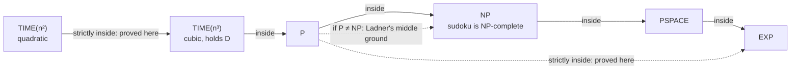

# Hierarchy and Ladner: more time really helps, and middle ground must exist

[Syllabus](../../../SYLLABUS.md) → [Computability and complexity](../README.md) → [Time Complexity](../README.md#s03) → Hierarchy and Ladner

---

## General Overview

Give a machine an input of 1,000 symbols. A quadratic budget allows 1,000 × 1,000 = 1,000,000 steps. A cubic budget allows 1,000,000,000 steps, a thousand times more. Does that extra time let the machine answer questions that no quadratic machine can answer?

It seems obvious, but it needs proof. [Time and space classes](01-time-and-space-classes.md) put brute-force sudoku inside exponential time. It could not show that sudoku is outside polynomial time, because a cleverer machine might exist. Showing that a problem is *not* in a class means beating every machine, including ones nobody has written.

The **time hierarchy theorem** does exactly that. It builds one problem, called D here, that a machine solves in cubic time and no machine solves in quadratic time. The method is Cantor's diagonal: list every quadratic machine, then make D disagree with each machine on that machine's own description.

The second result, **Ladner's theorem**, is about the gap between P and the hardest problems in NP, such as sudoku on grids of any size. If P ≠ NP, that gap is not empty. Some problems in NP are neither easy nor as hard as sudoku.

**A machine with more time can run every slower machine on its own description and then answer the opposite, so more time solves strictly more problems; and if P ≠ NP, then NP holds problems strictly between P and the NP-complete ones.**

**What kind of fact this is:** two theorems. The hierarchy theorem is proved on this card in Why it works. Ladner's theorem is stated with its key steps and a named source, and it is conditional on P ≠ NP, which is a conjecture, unproved as of 2026-11-11.

### The picture: which inclusions are proved strict



Schematic, not to scale. A solid arrow means "is contained in". A dotted arrow is a result about a pair of classes that are not next to each other. The two arrows marked "proved here" are strict containments that this card proves. Whether P ≠ NP, NP ≠ PSPACE or PSPACE ≠ EXP is unknown. Because P ≠ EXP, at least one of those three must be strict.

---

## The formula

Notation first, in words. TIME(t(n)) is the set of problems some one-tape machine solves in at most a constant times t(n) steps on inputs of length n ([Time and space classes](01-time-and-space-classes.md)). The sign ⊊ means "is contained in, and is not equal to". The little-o sign means "grows strictly slower": $`f(n) = o(h(n))`$ says that $`f(n)/h(n)`$ falls to 0 as n grows.

A bound g is **time-constructible** when some machine can write the number g(n) in binary within O(g(n)) steps. Every bound on this card, such as n³ or 2ⁿ, qualifies. The hierarchy theorem for one-tape machines is:

```math
f(n) = o\!\left(\frac{g(n)}{\log g(n)}\right) \;\Longrightarrow\; \mathrm{TIME}(f(n)) \subsetneq \mathrm{TIME}(g(n))
```

**Read it aloud:** if the smaller bound f grows slower than the bigger bound g divided by its logarithm, then some problem is solvable within g steps and not within f steps.

The worked example takes f(n) = n² and g(n) = n³. Then $`g/\log_2 g = n^3/(3\log_2 n)`$, and $`n^2`$ divided by that is $`3\log_2 n / n`$, which falls to 0. So:

```math
\mathrm{TIME}(n^2) \subsetneq \mathrm{TIME}(n^3), \qquad \mathrm{P} \subsetneq \mathrm{EXP}
```

**Read it aloud:** some problem needs cubic time and cannot be done in quadratic time; and some problem in exponential time is outside polynomial time.

Ladner's theorem, with NP the problems whose yes-answers can be checked quickly ([P and NP](02-p-and-np.md)) and NP-complete the hardest of them ([Reductions](03-polynomial-reductions-and-np-completeness.md)):

```math
\mathrm{P} \neq \mathrm{NP} \;\Longrightarrow\; \text{some } L \in \mathrm{NP} \text{ is neither in } \mathrm{P} \text{ nor NP-complete}
```

**Read it aloud:** if P and NP differ, some problem in NP is not easy and not among the hardest. Such a problem is called **NP-intermediate**.

| Symbol | Plain meaning | In our example | Push it up and the answer… |
| --- | --- | --- | --- |
| $`w`$, $`n`$ | the input string, and its length in symbols | 16 for a bare two-state code; 1,024 padded | every budget grows |
| $`f(n)`$, $`g(n)`$ | the smaller and the bigger time bound | $`n^2`$ and $`n^3`$ | a bigger g makes room for more problems |
| $`\mathrm{TIME}(t(n))`$ | problems solved within a constant times t(n) steps | D is in $`\mathrm{TIME}(n^3)`$ | a bigger class |
| $`o(\,)`$, $`\subsetneq`$ | grows strictly slower (ratio falls to 0); contained in and not equal | $`n^2 = o(n^3/\log n)`$ | — |
| $`M`$, $`\langle M\rangle`$ | a machine, and its code: its rule table written as a string | the 16-bit code 7E77 in hexadecimal | — |
| $`D`$ | the diagonal problem: inputs whose coded machine does not accept them within the clock | D accepts 39,226 of the 65,536 two-state codes | — |
| $`t(n)`$ | D's clock: $`n^2 \log_2 n`$, with $`\log_2 n`$ rounded down | 1,024 steps at n = 16 | beats machines with bigger constants |
| $`k`$ | bits in D's step counter | 11 at n = 16 | D's cost per step grows |
| $`c`$ | a machine's constant: it runs within $`c\,n^2`$ steps | any fixed number | the padding must be longer |
| $`\mathrm{P}`$, $`\mathrm{NP}`$, $`\mathrm{EXP}`$ | polynomial time; quickly checkable; exponential time | sudoku is in NP and in EXP | — |
| $`L`$ | a language: the inputs whose answer is yes | Ladner's padded sudoku | — |
| $`\psi`$, $`m`$, $`H`$ | a formula or puzzle; its length in bits; Ladner's padding power | 48 bits; a tail of $`m^H`$ bits | longer padding, easier-looking problem |

### When it holds

- **The bigger bound must be time-constructible.** D sets its clock to g(n) and must compute it in time. For strange, hard-to-compute bounds, the gap theorem of Borodin shows that more time can buy nothing at all.
- **The gap must beat the logarithm.** One tape pays about log₂ g(n) extra steps per simulated step, to carry a step counter. So the theorem does not separate n² from n² log₂ n on one tape. With f equal to g it fails outright: D itself costs far more than the bound it diagonalises against.
- **Both classes use the same model.** The proof runs machines of the class on one universal simulator. Comparing one-tape time against random-access time is a different question.
- **Classes are worst-case.** Each quadratic machine fails on D at some inputs, its padded codes, not at all of them. A machine may agree with D on most inputs.
- **Ladner needs P ≠ NP.** If P = NP, every problem in P, except the empty set and the set of all strings, is NP-complete, and there is no middle.

---

## Why it works

### Step 0: Cantor's table, with machines for rows

Write every machine as a row and every machine code as a column. The cell holds "yes" if the row machine accepts the column code within the clock. Then read down the diagonal and flip every answer. The flipped diagonal differs from every row at that row's own column, so it is no row. That is [Cantor's diagonal](../../01-Foundations/09-Sizes%20of%20Infinity/03-cantors-diagonal-argument.md) with machines in place of decimals.

The flipped diagonal is a problem, D. If every quadratic machine is a row, then no quadratic machine solves D. The rest of the proof only checks two things: every quadratic machine really is a row, and D itself can be solved in cubic time.

Here is a real corner of the table. The rows are five two-state machines from the code's family, described below. Each column is one of their codes.

| Row machine | Code | on 7E77 | on 5D7E | on 6E66 | on 0000 | on 6F77 |
| --- | --- | --- | --- | --- | --- | --- |
| accept if first bit is 1 | 7E77 | **0** | 0 | 0 | 0 | 0 |
| accept if second bit is 1 | 5D7E | 1 | **1** | 1 | 0 | 1 |
| always accept | 6E66 | 1 | 1 | **1** | 1 | 1 |
| walk left forever | 0000 | 0 | 0 | 0 | **0** | 0 |
| accept if first bit is 0 | 6F77 | 1 | 1 | 1 | 1 | **1** |
| **D** | — | 1 | 0 | 0 | 1 | 0 |

The diagonal reads 0 1 1 0 1, so D reads 1 0 0 1 0. Every row disagrees with D in its bold cell.

### Step 1: build D, a machine with a clock

On input w of length n, D does this:

1. Read the front of w as the code $`\langle M\rangle`$ of a machine M. The rest of w is padding. If the code is longer than $`\log_2 n`$ symbols, reject.
2. Compute the clock $`t(n) = n^2 \log_2 n`$, with the logarithm rounded down.
3. Run M on the whole of w, as a universal machine (one machine that runs any other from its code) does ([Universal machines](../01-Models%20of%20Computation/09-universal-machines-and-the-halting-problem.md)), for at most t(n) steps.
4. If M accepted within the clock, reject. Otherwise accept.

The clock is what makes D a decider: a machine that halts on every input with a yes or a no. Without it, D would have to wait for machines that never stop, and no program can tell in general which ones those are. With it, D halts on every input.

### Step 2: no quadratic machine solves D

Suppose a machine M solves D and runs within $`c\,n^2`$ steps on every input, for some constant c. M has a fixed code. Pad it with enough symbols that two things hold: the code is at most $`\log_2 n`$ symbols long, and $`\log_2 n`$, rounded down, is at least c.

On that padded input, D's clock $`n^2\log_2 n`$ is at least $`c\,n^2`$, so M finishes inside it. D then answers the opposite of M. So M gets this input wrong, and M does not solve D after all. No quadratic machine solves D.

The $`\log_2 n`$ in the clock is the reason padding works. It outgrows every constant c, so every quadratic machine, however slow its constant, is caught on long enough padded codes.

<details>
<summary>Detailed proof: every machine in TIME(n²) disagrees with D</summary>

Let M decide a language A in at most $`c\,n^2`$ steps for every input length n at least some $`n_1`$. Choose a length n with $`n \ge n_1`$, $`\lfloor\log_2 n\rfloor \ge c`$ and $`\lvert\langle M\rangle\rvert \le \log_2 n`$. All three hold for every large n. Let w be $`\langle M\rangle`$ followed by padding up to length n.

On w, M halts within $`c\,n^2 \le n^2 \lfloor\log_2 n\rfloor`$ steps. So D's simulation of M on w runs to completion inside the clock.

If w is in A, then M accepts w within the clock, and D rejects w. If w is not in A, then M rejects w within the clock, and D accepts w. Either way, w is in exactly one of A and D. So A is not D. Since M was any machine in $`\mathrm{TIME}(n^2)`$, D is not in $`\mathrm{TIME}(n^2)`$.

</details>

### Step 3: D itself runs in cubic time

D simulates at most $`t(n) = n^2\log_2 n`$ steps of M. On one tape, D keeps M's code and a binary step counter beside the simulated head, and drags both along. The counter holds numbers up to t(n), so it has $`k = \lceil\log_2(t(n)+1)\rceil`$ bits, about $`2\log_2 n`$. M's code has at most $`\log_2 n`$ symbols by Step 1.

So each simulated step costs a pass over $`O(\log n)`$ cells, and D's whole run costs:

```math
O\!\left(n^2 \log n \cdot \log n\right) = O\!\left(n^2 \log^2 n\right) \subseteq O(n^3)
```

**Read it aloud:** n² log n simulated steps, each costing about log n moves, is less than a constant times n³.

So D is in TIME(n³) and not in TIME(n²): a problem needing cubic but not quadratic time. The same argument with any f and g that satisfy the formula's condition proves the general theorem.

### Step 4: P is strictly inside EXP

Every polynomial is eventually below 2ⁿ. For example, 2ⁿ passes n³ for good at n = 10, and passes n¹⁰ for good at n = 59. So P sits inside TIME(2ⁿ).

Now take f(n) = 2ⁿ and g(n) = 2²ⁿ. Then $`f/(g/\log g) = 2n/2^n`$, which falls to 0. So TIME(2ⁿ) is strictly inside TIME(2²ⁿ), which is inside EXP. Putting the two together, P ⊊ EXP.

This does not say which problems in EXP are outside P. Brute-force sudoku is in EXP, but sudoku is not shown outside P. The problem it places outside P is the exponential-time version of D, also built for the proof.

### Step 5: Ladner's middle ground, in outline

Ladner's proof also diagonalises, but slowly. It takes SAT (does a logical formula have a true assignment?) and pads each formula ψ of length m with a long tail of 1s, of length $`m^{H(m)}`$. Call the result $`\mathrm{SAT}_H`$. The power H(m) is computed by a slow procedure: it tests the first few machines on short inputs, and stops at the first one that has decided $`\mathrm{SAT}_H`$ correctly and quickly so far.

- If $`\mathrm{SAT}_H`$ were in P, H would stay at some fixed value. Then $`\mathrm{SAT}_H`$ is SAT with only polynomial padding, so SAT would be in P. That contradicts P ≠ NP.
- If $`\mathrm{SAT}_H`$ were NP-complete, it would be outside P, so no machine passes the tests for long and H would grow without bound. Then the padding outgrows every polynomial, and a reduction from SAT to $`\mathrm{SAT}_H`$ would shrink long formulas into short ones. Repeating it would solve SAT in polynomial time, again contradicting P ≠ NP.

So $`\mathrm{SAT}_H`$ is in NP, outside P, and not NP-complete. This is a theorem, stated here with key steps; the full proof is in Ladner (1975) and in Arora and Barak, chapter 3.

The padding lengths make the idea concrete. Padding any NP-complete problem works the same way, so take sudoku. The 4 by 4 sudoku of [Time and space classes](01-time-and-space-classes.md) is m = 48 bits. Its tail of $`m^H`$ bits is 48 bits for H = 1, 2,304 for H = 2, 110,592 for H = 3 and 5,308,416 for H = 4. The puzzle is the same; only its length changes. Since a class measures cost against input length, the longer the padding, the easier the same puzzle looks.

Which natural problems are NP-intermediate, if P ≠ NP? Nobody knows for certain. The usual candidates are graph isomorphism (are two networks the same up to renaming?) and factoring large numbers. Graph isomorphism (planned) gets its own card.

---

## Worked numbers, by hand

The code builds D for one finite family: all 65,536 two-state machines, each written as a 16-bit code. At n = 16 the clock is $`16^2 \times 4 = 1{,}024`$ steps.

| Step | Arithmetic | Value |
| --- | --- | --- |
| machines in the family | 4 rules × 4 bits = 16 bits | 2¹⁶ = 65,536 |
| on own code within 1,024 steps | run each machine on its own code | accept 26,310, reject 26,336, still running 12,890 |
| D accepts | reject + still running | 26,336 + 12,890 = 39,226 |
| latest halt on own code | machine 41,424 | step 111, inside the clock |
| D agrees with its own machine | the diagonal flips every answer | **0 of 65,536** |
| D's cost at n = 1,024 | clock 10,485,760 × 2(16 + 24) | 838,860,800 |
| n³ at n = 1,024 | 1,024 × 1,024 × 1,024 | 1,073,741,824 |
| cost at most n³ | 2(16 + k) × log₂ n ≤ n | from **n = 702** on |

The cost is computed from a model of one-tape D, not counted from a running one-tape machine: each simulated step sweeps over the 16-cell rule block and the k-bit counter and back, 2(16 + k) moves.

Every two-state machine loses to D on its own code, and D's cost fits under n³ once inputs are 702 symbols long. Below that, the constant 16 for the code dominates; classes ignore constants, so D is in TIME(n³).

### What breaks if you drop a piece

| Mistake | Comes out at | What went wrong |
| --- | --- | --- |
| Clock of n steps instead of $`n^2\log_2 n`$ | 6 machines accept their own code after step 16; machine 41,424 accepts at step 111, and D agrees with each | D beats only machines that finish inside its clock |
| No clock at all | machine 0 on its own code is still running after 10,000 steps | D would wait forever; it would have to solve HALT |
| Hoping D itself runs in n² steps | at n = 64, D costs 1,523,712 steps, against n² = 4,096 | Simulation costs extra per step, so g must beat f by more than a logarithm |

The code prints every row.

---

## Code, from first principles, and it actually runs

The code runs D on a real machine family, never on "every machine", which no program can list and run in full. A machine is a 16-bit code: one 4-bit rule for each of state A or B and symbol 0 or 1. Each rule gives the symbol to write, the move (1 means right) and the next state (A, B, accept or reject). Blank cells read 0. In the family every code has exactly 16 symbols, so Step 1's code-length rule is dropped and the rule block is a fixed 16 cells. The code takes **two independent roads** to D's answers, plus a cost model.

- **Road 1, direct.** A simulator decodes each code as a number and runs the machine on its own code.
- **Road 2, universal.** D, written apart, reads the rules from the input string at every step, as a universal machine does. Its yes-count must equal road 1's reject plus still-running count, and it must disagree with every machine on that machine's own code.
- **The cost model.** D runs on a never-halting padded code at four sizes and uses its whole clock each time. Its cost is then computed, as simulated steps × 2(16 + k), and compared with n³.

The checks also print the five-machine table above, the crossings of 2ⁿ with n³ and n¹⁰, the three "what breaks" rows and Ladner's padding lengths.

### Python

```python
# Hierarchy and Ladner: the diagonal language D, run on every two-state machine.
# Standard library only. A machine is a 16-bit code: four rules, one per
# (state, symbol), each 4 bits = write, move (1 = right), next (0 A, 1 B, 2 accept, 3 reject).
# The tape is binary and blank cells read 0. The tape machine itself is explained
# on the Turing machines card; this file copies only the stepping rule.

def c(x):                                    # integers with commas, as on the card
    return f"{x:,}"

def run_direct(i, w, budget):
    """Road 1: rules decoded from the integer i; returns (1 accept, 0 reject, 2 still running), steps."""
    rules = [(i >> (12 - 4 * e)) & 15 for e in range(4)]
    tape = {k: int(ch) for k, ch in enumerate(w)}
    head, state = 0, 0
    for step in range(1, budget + 1):
        r = rules[2 * state + tape.get(head, 0)]
        tape[head] = r >> 3
        head += 1 if (r >> 2) & 1 else -1
        if r & 3 >= 2:
            return (1 if r & 3 == 2 else 0), step
        state = r & 3
    return 2, budget

def run_universal(w, budget):
    """Road 2: the machine D runs. It reads the rules from the first 16 symbols of
    its own input, every step, and keeps a clock. Returns (outcome, simulated steps)."""
    n = len(w)
    tape = [0] * (n + 2 * budget + 2)
    for k in range(n):
        tape[budget + 1 + k] = 1 if w[k] == "1" else 0
    head, state, steps = budget + 1, 0, 0
    while steps < budget:
        steps += 1
        at = 4 * (2 * state + tape[head])
        tape[head] = 1 if w[at] == "1" else 0
        head += 1 if w[at + 1] == "1" else -1
        nxt = 2 * (w[at + 2] == "1") + (w[at + 3] == "1")
        if nxt >= 2:
            return (1 if nxt == 2 else 0), steps
        state = nxt
    return 2, steps

def D(w, clock):
    """Accept w exactly when the machine coded by w's first 16 symbols does NOT accept w within clock(n) steps."""
    if len(w) < 16:
        return 0, 0
    out, steps = run_universal(w, clock(len(w)))
    return (0 if out == 1 else 1), steps

tt = lambda n: n * n * (n.bit_length() - 1)   # D's clock: n^2 times log2 n, rounded down
print("family: every two-state machine, 16-bit codes, blank reads 0; D's clock n^2 log2 n")
tally, latest, late_accepts = [0, 0, 0], (0, 0), []
d_yes = agree = 0
for i in range(65536):
    w = format(i, "016b")
    out, steps = run_direct(i, w, tt(16))
    tally[out] += 1
    if out != 2 and steps > latest[0]:
        latest = (steps, i)
    if out == 1 and steps > 16:
        late_accepts.append((i, steps))
    d, _ = D(w, tt)
    d_yes += d
    agree += (d == 1) == (out == 1)
print(f"road 1, direct: on its own code within 1,024 steps: accept {c(tally[1])}, reject {c(tally[0])}, still running {c(tally[2])}")
print(f"road 1, latest halt on its own code: step {latest[0]}, machine {c(latest[1])}")
print(f"road 2, universal: D accepts {c(d_yes)} codes; reject + still running = {c(tally[0] + tally[2])}")
print(f"road 2, D agrees with the coded machine on {agree} of {c(65536)} codes")
assert d_yes == tally[0] + tally[2]         # two simulators, written apart, must match
assert agree == 0                            # the diagonal: every machine loses on its own code
assert latest[0] < tt(16)                      # every halting run fits inside the clock

names = [("first bit 1", 0x7E77), ("second bit 1", 0x5D7E), ("always yes", 0x6E66),
         ("walks left", 0x0000), ("first bit 0", 0x6F77)]
print("table: row machine run on column code, 1 = accepts within the clock, 0 = not")
codes = [format(k, "016b") for _, k in names]
diag = []
for r, (name, k) in enumerate(names):
    row = [1 if run_direct(k, w, tt(16))[0] == 1 else 0 for w in codes]
    diag.append(row[r])
    print(f"  {name:<13} {format(k, '04X')}  " + " ".join(str(x) for x in row))
drow = [D(w, tt)[0] for w in codes]
print("  D            flips diagonal " + " ".join(str(x) for x in diag) + " -> " + " ".join(str(x) for x in drow))
assert drow == [1 - x for x in diag]

print("cost model of D on a never-halting code: n, clock n^2 log2 n, counter bits k, simulated steps, cost clock x 2(16 + k), n^3")
for n in (16, 64, 256, 1024):
    _, steps = D("0" * n, tt)
    k = tt(n).bit_length()
    cost = steps * 2 * (16 + k)
    assert steps == n * n * (n.bit_length() - 1)                   # the never-halting code uses its whole clock
    print(f"  n {n:>5}  clock {c(tt(n)):>10}  k {k:>2}  steps {c(steps):>10}  cost {c(cost):>11}  n^3 {c(n ** 3):>13}")
n0 = next(n for n in range(16, 10 ** 4) if all(2 * (16 + tt(m).bit_length()) * (m.bit_length() - 1) <= m for m in range(n, 10 ** 4)))
print(f"cost <= n^3 for every n from {n0} on, though D's clock outgrows c n^2 for every constant c")
assert n0 == 702
for kk in (3, 10):
    x = next(n for n in range(2, 120) if all(2 ** m > m ** kk for m in range(n, 120)))
    print(f"P inside TIME(2^n): 2^n passes n^{kk} for good at n = {x}: 2^{x} = {c(2 ** x)} > {x}^{kk} = {c(x ** kk)}")

print(f"wrong: clock of n steps, not n^2 log2 n: {len(late_accepts)} machines accept their own code after step 16; D agrees with each")
lin_agree = sum(1 for i, _ in late_accepts if D(format(i, '016b'), lambda n: n)[0] == 1)
assert lin_agree == len(late_accepts) == 6
last = max(late_accepts, key=lambda t: t[1])
print(f"  latest: machine {c(last[0])}, accepts at step {last[1]}")
out, steps = run_direct(0, "0" * 16, 10000)
assert out == 2
print(f"wrong: no clock: machine 0 on its own code is still running after {c(steps)} steps")
cost64 = tt(64) * 2 * (16 + tt(64).bit_length())
print(f"wrong: hoping D itself fits in n^2 steps: at n = 64, D costs {c(cost64)} steps, against n^2 = {c(64 * 64)}")
assert cost64 > 64 * 64
m = 48
print(f"Ladner padding, a 4 by 4 sudoku of m = {m} bits, padding tail of m^H bits: "
      + ", ".join(f"H {h}: {c(m ** h)}" for h in (1, 2, 3, 4)))
n32 = next(n for n in range(16, 10 ** 4) if all(2 * (32 + tt(m).bit_length()) * (m.bit_length() - 1) <= m for m in range(n, 10 ** 4)))
x5 = next(n for n in range(2, 120) if all(2 ** m > m ** 5 for m in range(n, 120)))
print(f"try: clock 100 at n = 16: {sum(1 for _, s in late_accepts if s > 100)} machine accepts after it; 32-cell rule block: cost <= n^3 from n = {n32}")
print(f"try: 2^n passes n^5 for good at n = {x5}: 2^{x5} = {c(2 ** x5)} > {x5}^5 = {c(x5 ** 5)}; H 5: {c(m ** 5)}")
print(f"budgets at n = 1,000: n^2 = {c(1000 ** 2)}, n^3 = {c(1000 ** 3)}")
print("ALL CHECKS PASS")
```

**Ran 2026-11-19 on macOS, Python 3.14.10, standard library only. All checks passed. Output, pasted from the run:**

```text
family: every two-state machine, 16-bit codes, blank reads 0; D's clock n^2 log2 n
road 1, direct: on its own code within 1,024 steps: accept 26,310, reject 26,336, still running 12,890
road 1, latest halt on its own code: step 111, machine 41,424
road 2, universal: D accepts 39,226 codes; reject + still running = 39,226
road 2, D agrees with the coded machine on 0 of 65,536 codes
table: row machine run on column code, 1 = accepts within the clock, 0 = not
  first bit 1   7E77  0 0 0 0 0
  second bit 1  5D7E  1 1 1 0 1
  always yes    6E66  1 1 1 1 1
  walks left    0000  0 0 0 0 0
  first bit 0   6F77  1 1 1 1 1
  D            flips diagonal 0 1 1 0 1 -> 1 0 0 1 0
cost model of D on a never-halting code: n, clock n^2 log2 n, counter bits k, simulated steps, cost clock x 2(16 + k), n^3
  n    16  clock      1,024  k 11  steps      1,024  cost      55,296  n^3         4,096
  n    64  clock     24,576  k 15  steps     24,576  cost   1,523,712  n^3       262,144
  n   256  clock    524,288  k 20  steps    524,288  cost  37,748,736  n^3    16,777,216
  n  1024  clock 10,485,760  k 24  steps 10,485,760  cost 838,860,800  n^3 1,073,741,824
cost <= n^3 for every n from 702 on, though D's clock outgrows c n^2 for every constant c
P inside TIME(2^n): 2^n passes n^3 for good at n = 10: 2^10 = 1,024 > 10^3 = 1,000
P inside TIME(2^n): 2^n passes n^10 for good at n = 59: 2^59 = 576,460,752,303,423,488 > 59^10 = 511,116,753,300,641,401
wrong: clock of n steps, not n^2 log2 n: 6 machines accept their own code after step 16; D agrees with each
  latest: machine 41,424, accepts at step 111
wrong: no clock: machine 0 on its own code is still running after 10,000 steps
wrong: hoping D itself fits in n^2 steps: at n = 64, D costs 1,523,712 steps, against n^2 = 4,096
Ladner padding, a 4 by 4 sudoku of m = 48 bits, padding tail of m^H bits: H 1: 48, H 2: 2,304, H 3: 110,592, H 4: 5,308,416
try: clock 100 at n = 16: 1 machine accepts after it; 32-cell rule block: cost <= n^3 from n = 1120
try: 2^n passes n^5 for good at n = 23: 2^23 = 8,388,608 > 23^5 = 6,436,343; H 5: 254,803,968
budgets at n = 1,000: n^2 = 1,000,000, n^3 = 1,000,000,000
ALL CHECKS PASS
```

### Rust

```rust
// Hierarchy and Ladner: the diagonal language D, run on every two-state machine.
// std only. A machine is a 16-bit code: four rules, one per (state, symbol),
// each 4 bits = write, move (1 = right), next (0 A, 1 B, 2 accept, 3 reject).
// The tape is binary and blank cells read 0. The tape machine itself is explained
// on the Turing machines card; this file copies only the stepping rule.
use std::collections::HashMap;

fn c(x: u128) -> String {
    // integers with commas, as on the card
    let s = x.to_string();
    let mut out = String::new();
    for (k, ch) in s.chars().enumerate() {
        if k > 0 && (s.len() - k) % 3 == 0 {
            out.push(',');
        }
        out.push(ch);
    }
    out
}

fn bits(i: u32, width: usize) -> String {
    format!("{:0width$b}", i, width = width)
}

// Road 1: rules decoded from the integer i; returns (1 accept, 0 reject, 2 still running), steps.
fn run_direct(i: u32, w: &str, budget: usize) -> (u8, usize) {
    let rules: Vec<u32> = (0..4).map(|e| (i >> (12 - 4 * e)) & 15).collect();
    let mut tape: HashMap<i64, u32> = HashMap::new();
    for (k, ch) in w.chars().enumerate() {
        tape.insert(k as i64, if ch == '1' { 1 } else { 0 });
    }
    let (mut head, mut state) = (0i64, 0u32);
    for step in 1..=budget {
        let sym = *tape.get(&head).unwrap_or(&0);
        let r = rules[(2 * state + sym) as usize];
        tape.insert(head, r >> 3);
        head += if (r >> 2) & 1 == 1 { 1 } else { -1 };
        if r & 3 >= 2 {
            return (if r & 3 == 2 { 1 } else { 0 }, step);
        }
        state = r & 3;
    }
    (2, budget)
}

// Road 2: the machine D runs. It reads the rules from the first 16 symbols of
// its own input, every step, and keeps a clock. Returns (outcome, simulated steps).
fn run_universal(w: &[u8], budget: usize) -> (u8, usize) {
    let n = w.len();
    let mut tape = vec![0u8; n + 2 * budget + 2];
    for k in 0..n {
        tape[budget + 1 + k] = if w[k] == b'1' { 1 } else { 0 };
    }
    let (mut head, mut state, mut steps) = (budget + 1, 0usize, 0usize);
    while steps < budget {
        steps += 1;
        let at = 4 * (2 * state + tape[head] as usize);
        tape[head] = if w[at] == b'1' { 1 } else { 0 };
        if w[at + 1] == b'1' { head += 1 } else { head -= 1 }
        let nxt = 2 * (w[at + 2] == b'1') as usize + (w[at + 3] == b'1') as usize;
        if nxt >= 2 {
            return (if nxt == 2 { 1 } else { 0 }, steps);
        }
        state = nxt;
    }
    (2, steps)
}

// Accept w exactly when the machine coded by w's first 16 symbols does NOT accept w within clock(n) steps.
fn d(w: &str, clock: fn(usize) -> usize) -> (u8, usize) {
    if w.len() < 16 {
        return (0, 0);
    }
    let (out, steps) = run_universal(w.as_bytes(), clock(w.len()));
    (if out == 1 { 0 } else { 1 }, steps)
}

// D's clock: n^2 times log2 n, rounded down
fn tt(n: usize) -> usize { n * n * (usize::BITS - 1 - n.leading_zeros()) as usize }
fn lin(n: usize) -> usize { n }

fn main() {
    println!("family: every two-state machine, 16-bit codes, blank reads 0; D's clock n^2 log2 n");
    let (mut tally, mut latest, mut late) = ([0u128; 3], (0usize, 0u32), Vec::new());
    let (mut d_yes, mut agree) = (0u128, 0u128);
    for i in 0..65536u32 {
        let w = bits(i, 16);
        let (out, steps) = run_direct(i, &w, tt(16));
        tally[out as usize] += 1;
        if out != 2 && steps > latest.0 {
            latest = (steps, i);
        }
        if out == 1 && steps > 16 {
            late.push((i, steps));
        }
        let (dv, _) = d(&w, tt);
        d_yes += dv as u128;
        agree += ((dv == 1) == (out == 1)) as u128;
    }
    println!("road 1, direct: on its own code within 1,024 steps: accept {}, reject {}, still running {}", c(tally[1]), c(tally[0]), c(tally[2]));
    println!("road 1, latest halt on its own code: step {}, machine {}", latest.0, c(latest.1 as u128));
    println!("road 2, universal: D accepts {} codes; reject + still running = {}", c(d_yes), c(tally[0] + tally[2]));
    println!("road 2, D agrees with the coded machine on {} of {} codes", agree, c(65536));
    assert!(d_yes == tally[0] + tally[2]); // two simulators, written apart, must match
    assert!(agree == 0); // the diagonal: every machine loses on its own code
    assert!(latest.0 < tt(16)); // every halting run fits inside the clock

    let names = [("first bit 1", 0x7E77u32), ("second bit 1", 0x5D7E), ("always yes", 0x6E66), ("walks left", 0x0000), ("first bit 0", 0x6F77)];
    println!("table: row machine run on column code, 1 = accepts within the clock, 0 = not");
    let codes: Vec<String> = names.iter().map(|&(_, k)| bits(k, 16)).collect();
    let mut diag = Vec::new();
    for (r, &(name, k)) in names.iter().enumerate() {
        let row: Vec<u8> = codes.iter().map(|w| if run_direct(k, w, tt(16)).0 == 1 { 1 } else { 0 }).collect();
        diag.push(row[r]);
        let cells: Vec<String> = row.iter().map(|x| x.to_string()).collect();
        println!("  {:<13} {:04X}  {}", name, k, cells.join(" "));
    }
    let drow: Vec<u8> = codes.iter().map(|w| d(w, tt).0).collect();
    let js = |v: &Vec<u8>| v.iter().map(|x| x.to_string()).collect::<Vec<_>>().join(" ");
    println!("  D            flips diagonal {} -> {}", js(&diag), js(&drow));
    assert!(drow == diag.iter().map(|x| 1 - x).collect::<Vec<u8>>());

    println!("cost model of D on a never-halting code: n, clock n^2 log2 n, counter bits k, simulated steps, cost clock x 2(16 + k), n^3");
    let bitlen = |x: usize| (usize::BITS - x.leading_zeros()) as usize;
    for &n in &[16usize, 64, 256, 1024] {
        let (_, steps) = d(&"0".repeat(n), tt);
        let k = bitlen(tt(n));
        let cost = steps * 2 * (16 + k);
        assert!(steps == n * n * (bitlen(n) - 1)); // the never-halting code uses its whole clock
        println!("  n {:>5}  clock {:>10}  k {:>2}  steps {:>10}  cost {:>11}  n^3 {:>13}",
            n, c(tt(n) as u128), k, c(steps as u128), c(cost as u128), c((n * n * n) as u128));
    }
    let n0 = (16..10000usize).find(|&n| (n..10000).all(|m| 2 * (16 + bitlen(tt(m))) * (bitlen(m) - 1) <= m)).unwrap();
    println!("cost <= n^3 for every n from {} on, though D's clock outgrows c n^2 for every constant c", n0);
    assert!(n0 == 702);
    for &kk in &[3u32, 10] {
        let x = (2..120u32).find(|&n| (n..120).all(|m| 2u128.pow(m) > (m as u128).pow(kk))).unwrap();
        println!("P inside TIME(2^n): 2^n passes n^{} for good at n = {}: 2^{} = {} > {}^{} = {}",
            kk, x, x, c(2u128.pow(x)), x, kk, c((x as u128).pow(kk)));
    }

    println!("wrong: clock of n steps, not n^2 log2 n: {} machines accept their own code after step 16; D agrees with each", late.len());
    let lin_agree = late.iter().filter(|&&(i, _)| d(&bits(i, 16), lin).0 == 1).count();
    assert!(lin_agree == late.len() && late.len() == 6);
    let last = late.iter().fold((0u32, 0usize), |b, &(i, s)| if s > b.1 { (i, s) } else { b });
    println!("  latest: machine {}, accepts at step {}", c(last.0 as u128), last.1);
    let (out, steps) = run_direct(0, &"0".repeat(16), 10000);
    assert!(out == 2);
    println!("wrong: no clock: machine 0 on its own code is still running after {} steps", c(steps as u128));
    let cost64 = tt(64) * 2 * (16 + bitlen(tt(64)));
    println!("wrong: hoping D itself fits in n^2 steps: at n = 64, D costs {} steps, against n^2 = {}", c(cost64 as u128), c(64 * 64));
    assert!(cost64 > 64 * 64);
    let m: u128 = 48;
    let pads: Vec<String> = (1..=4u32).map(|h| format!("H {}: {}", h, c(m.pow(h)))).collect();
    println!("Ladner padding, a 4 by 4 sudoku of m = {} bits, padding tail of m^H bits: {}", m, pads.join(", "));
    let n32 = (16..10000usize).find(|&n| (n..10000).all(|m| 2 * (32 + bitlen(tt(m))) * (bitlen(m) - 1) <= m)).unwrap();
    let x5 = (2..120u32).find(|&n| (n..120).all(|m| 2u128.pow(m) > (m as u128).pow(5))).unwrap();
    println!("try: clock 100 at n = 16: {} machine accepts after it; 32-cell rule block: cost <= n^3 from n = {}", late.iter().filter(|&&(_, s)| s > 100).count(), n32);
    println!("try: 2^n passes n^5 for good at n = {}: 2^{} = {} > {}^5 = {}; H 5: {}", x5, x5, c(2u128.pow(x5)), x5, c((x5 as u128).pow(5)), c(m.pow(5)));
    println!("budgets at n = 1,000: n^2 = {}, n^3 = {}", c(1000u128.pow(2)), c(1000u128.pow(3)));
    println!("ALL CHECKS PASS");
}
```

**Ran 2026-11-19 on macOS, rustc 1.98.1, no crates. All checks passed. Output, pasted from the run:**

```text
family: every two-state machine, 16-bit codes, blank reads 0; D's clock n^2 log2 n
road 1, direct: on its own code within 1,024 steps: accept 26,310, reject 26,336, still running 12,890
road 1, latest halt on its own code: step 111, machine 41,424
road 2, universal: D accepts 39,226 codes; reject + still running = 39,226
road 2, D agrees with the coded machine on 0 of 65,536 codes
table: row machine run on column code, 1 = accepts within the clock, 0 = not
  first bit 1   7E77  0 0 0 0 0
  second bit 1  5D7E  1 1 1 0 1
  always yes    6E66  1 1 1 1 1
  walks left    0000  0 0 0 0 0
  first bit 0   6F77  1 1 1 1 1
  D            flips diagonal 0 1 1 0 1 -> 1 0 0 1 0
cost model of D on a never-halting code: n, clock n^2 log2 n, counter bits k, simulated steps, cost clock x 2(16 + k), n^3
  n    16  clock      1,024  k 11  steps      1,024  cost      55,296  n^3         4,096
  n    64  clock     24,576  k 15  steps     24,576  cost   1,523,712  n^3       262,144
  n   256  clock    524,288  k 20  steps    524,288  cost  37,748,736  n^3    16,777,216
  n  1024  clock 10,485,760  k 24  steps 10,485,760  cost 838,860,800  n^3 1,073,741,824
cost <= n^3 for every n from 702 on, though D's clock outgrows c n^2 for every constant c
P inside TIME(2^n): 2^n passes n^3 for good at n = 10: 2^10 = 1,024 > 10^3 = 1,000
P inside TIME(2^n): 2^n passes n^10 for good at n = 59: 2^59 = 576,460,752,303,423,488 > 59^10 = 511,116,753,300,641,401
wrong: clock of n steps, not n^2 log2 n: 6 machines accept their own code after step 16; D agrees with each
  latest: machine 41,424, accepts at step 111
wrong: no clock: machine 0 on its own code is still running after 10,000 steps
wrong: hoping D itself fits in n^2 steps: at n = 64, D costs 1,523,712 steps, against n^2 = 4,096
Ladner padding, a 4 by 4 sudoku of m = 48 bits, padding tail of m^H bits: H 1: 48, H 2: 2,304, H 3: 110,592, H 4: 5,308,416
try: clock 100 at n = 16: 1 machine accepts after it; 32-cell rule block: cost <= n^3 from n = 1120
try: 2^n passes n^5 for good at n = 23: 2^23 = 8,388,608 > 23^5 = 6,436,343; H 5: 254,803,968
budgets at n = 1,000: n^2 = 1,000,000, n^3 = 1,000,000,000
ALL CHECKS PASS
```

### Lean

Lean proves the diagonal half of the hierarchy theorem for any machine model that counts steps, and checks the card's numbers.

- Suppose halted answers stay fixed, codes pad to any length, and D's clock eventually passes $`c\,f(n)`$ for every constant c. Then no machine within $`c\,f(n)`$ steps solves D.
- Take D's clock $`n^2 \lfloor\log_2 n\rfloor`$ and any constant c. Then no machine within $`c\,n^2`$ steps solves D, so D is not in TIME(n²).
- Take n at least 702, and k the bits in D's step counter. Then D's cost, clock × 2(16 + k), is at most n³.
- At n = 16 the clock is 1,024 steps, and the five-machine table comes out as shown.
- The diagonal reads 0 1 1 0 1, so D reads 1 0 0 1 0.
- Machine 41,424 accepts its own code at step 111, not before. Machine 0 is still running after 10,000 steps.
- D's cost at n = 16, 64, 256 and 1,024 matches the cost table. At n = 701 it is still above n³.
- At n = 64, D's 1,523,712 steps are above n² = 4,096.
- 2¹⁰ is above 10³ while 2⁹ is below 9³. 2⁵⁹ is above 59¹⁰ while 2⁵⁸ is below 58¹⁰.
- The sudoku padding lengths for H = 1 to 4 and the budgets at n = 1,000 are right.

The runs of all 65,536 machines, the universal road 2 and the 6 escapes under a clock of n are left to the Python and Rust checks.

```lean
-- Hierarchy and Ladner: the clocked diagonal problem D beats every machine whose time bound its clock outgrows, so no machine within c · n² steps solves D with clock n² · ⌊log₂ n⌋, while D's one-tape cost stays under n³ from n = 702 on.
import Mathlib.Data.Nat.Log
import Mathlib.Data.Nat.Size
import Mathlib.Order.Filter.AtTopBot.Basic
import Mathlib.Tactic.NormNum
import Mathlib.Tactic.Ring
import Mathlib.Tactic.Linarith

/-! ### The machine model

A step-counted machine model is a function `run`: `run e w s = some b` means machine `e`, started
on input `w`, has halted within `s` steps with answer `b` (`true` = accept), and `run e w s = none`
means it is still running after `s` steps. Halting is final, so a longer budget sees the same
answer. Inputs are strings of bits. `decode w` is the machine whose code is the front of `w`; the
rest of `w` is padding. -/

/-- Machine `e` decides the language `A` within the time bound `T`: on every input `w` of length
at least some `n₁`, it halts within `T |w|` steps, and its answer is yes exactly when `w ∈ A`. -/
def DecidesInTime {C : Type*} (run : C → List Bool → ℕ → Option Bool) (e : C)
    (A : Set (List Bool)) (T : ℕ → ℕ) : Prop :=
  ∃ n₁, ∀ w : List Bool, n₁ ≤ w.length →
    ∃ b, run e w (T w.length) = some b ∧ (b = true ↔ w ∈ A)

/-- The diagonal problem D with clock `t`: accept `w` exactly when the machine coded by the front
of `w` does not accept `w` within `t |w|` steps. -/
def diagonalD {C : Type*} (decode : List Bool → C) (run : C → List Bool → ℕ → Option Bool)
    (t : ℕ → ℕ) : Set (List Bool) :=
  {w | run (decode w) w (t w.length) ≠ some true}

/-- The time hierarchy, diagonal half: in any machine model where halting is final and every
machine's code can be padded to inputs as long as we like, if D's clock `t` eventually outgrows
every constant multiple of the bound `f`, then no machine that runs within `c · f(n)` steps
solves D. Each such machine gets D wrong on its own long padded code. -/
theorem no_machine_within_smaller_time_solves_diagonal {C : Type*}
    (run : C → List Bool → ℕ → Option Bool)
    (hfinal : ∀ e w s s' b, run e w s = some b → s ≤ s' → run e w s' = some b)
    (decode : List Bool → C) (hpad : ∀ e N, ∃ w : List Bool, N ≤ w.length ∧ decode w = e)
    (f t : ℕ → ℕ) (hgap : ∀ c : ℕ, ∀ᶠ n in Filter.atTop, c * f n ≤ t n)
    (e : C) (c : ℕ) :
    ¬ DecidesInTime run e (diagonalD decode run t) (fun n => c * f n) := by
  rintro ⟨n₁, h⟩
  obtain ⟨N, hN⟩ := Filter.eventually_atTop.1 (hgap c)
  obtain ⟨w, hw, hdec⟩ := hpad e (max n₁ N)
  obtain ⟨b, hb, hiff⟩ := h w (le_trans (le_max_left _ _) hw)
  have ht : run e w (t w.length) = some b :=
    hfinal e w _ _ b hb (hN _ (le_trans (le_max_right _ _) hw))
  have hmem : w ∈ diagonalD decode run t ↔ run e w (t w.length) ≠ some true := by
    simp [diagonalD, hdec]
  rw [hmem, ht] at hiff
  cases b <;> simp at hiff

/-- The card's case: with D's clock `n² · ⌊log₂ n⌋`, no machine that runs within `c · n²` steps,
for any constant `c`, solves D. So D is not in TIME(n²). -/
theorem diagonal_with_clock_n_sq_log_not_in_quadratic_time {C : Type*}
    (run : C → List Bool → ℕ → Option Bool)
    (hfinal : ∀ e w s s' b, run e w s = some b → s ≤ s' → run e w s' = some b)
    (decode : List Bool → C) (hpad : ∀ e N, ∃ w : List Bool, N ≤ w.length ∧ decode w = e)
    (e : C) (c : ℕ) :
    ¬ DecidesInTime run e (diagonalD decode run (fun n => n ^ 2 * Nat.log 2 n))
      (fun n => c * n ^ 2) := by
  refine no_machine_within_smaller_time_solves_diagonal run hfinal decode hpad
    (fun n => n ^ 2) (fun n => n ^ 2 * Nat.log 2 n) ?_ e c
  intro c'
  refine Filter.eventually_atTop.2 ⟨2 ^ c', fun n hn => ?_⟩
  have : c' ≤ Nat.log 2 n := Nat.le_log_of_pow_le (by norm_num) hn
  calc c' * n ^ 2 = n ^ 2 * c' := Nat.mul_comm _ _
    _ ≤ n ^ 2 * Nat.log 2 n := Nat.mul_le_mul_left _ this

/-- The card's one-tape cost model of D: `n² · ⌊log₂ n⌋` simulated steps, each a sweep of
`2(16 + k)` moves over the 16-cell rule block and the `k`-bit step counter, where `k` is the bit
length of the clock. This cost is at most `n³` for every input length `n` from 702 on. -/
theorem diagonal_cost_le_cube_from_702 (n : ℕ) (hn : 702 ≤ n) :
    n ^ 2 * Nat.log 2 n * (2 * (16 + Nat.size (n ^ 2 * Nat.log 2 n))) ≤ n ^ 3 := by
  have hn0 : n ≠ 0 := by omega
  set L := Nat.log 2 n with hL
  have hlo : 2 ^ L ≤ n := Nat.pow_log_le_self 2 hn0
  have hhi : n < 2 ^ (L + 1) := Nat.lt_pow_succ_log_self (by norm_num) n
  have hL9 : 9 ≤ L := Nat.le_log_of_pow_le (by norm_num) (by omega)
  have key : ∀ K, n ^ 2 * L < 2 ^ K → 2 * L * (16 + K) ≤ n →
      n ^ 2 * L * (2 * (16 + Nat.size (n ^ 2 * L))) ≤ n ^ 3 := by
    intro K hK hle
    have hs : Nat.size (n ^ 2 * L) ≤ K := Nat.size_le.2 hK
    calc n ^ 2 * L * (2 * (16 + Nat.size (n ^ 2 * L)))
        ≤ n ^ 2 * L * (2 * (16 + K)) := Nat.mul_le_mul_left _ (by omega)
      _ = n ^ 2 * (2 * L * (16 + K)) := by ring
      _ ≤ n ^ 2 * n := Nat.mul_le_mul_left _ hle
      _ = n ^ 3 := by ring
  by_cases hsmall : n ≤ 965
  · have hL' : L = 9 := by
      have : L < 10 := by
        by_contra hc
        have : 2 ^ 10 ≤ 2 ^ L := Nat.pow_le_pow_right (by norm_num) (by omega)
        omega
      omega
    refine key 23 ?_ (by rw [hL']; omega)
    rw [hL']
    have : n ^ 2 ≤ 965 ^ 2 := Nat.pow_le_pow_left hsmall 2
    norm_num at this ⊢
    omega
  · refine key (3 * L + 2) ?_ ?_
    · have hLlt : L < 2 ^ L := Nat.lt_two_pow_self
      have hsq : n ^ 2 < (2 ^ (L + 1)) ^ 2 := Nat.pow_lt_pow_left hhi (by norm_num)
      calc n ^ 2 * L < (2 ^ (L + 1)) ^ 2 * 2 ^ L :=
            Nat.mul_lt_mul_of_lt_of_lt hsq hLlt
        _ = 2 ^ (3 * L + 2) := by rw [← pow_mul, ← pow_add]; ring_nf
    · rcases Nat.eq_or_lt_of_le hL9 with h9 | h10
      · rw [← h9]; omega
      · have aux : ∀ m, 10 ≤ m → 2 * m * (16 + (3 * m + 2)) ≤ 2 ^ m := by
          intro m hm
          induction m, hm using Nat.le_induction with
          | base => norm_num
          | succ k hk ih =>
            rw [pow_succ]
            nlinarith
        exact le_trans (aux L h10) hlo

/-! ### The card's two-state machines

A machine is a 16-bit code: four 4-bit rules, one per (state, symbol), in the order (A, 0),
(A, 1), (B, 0), (B, 1). Each rule's bits are write, move (1 = right), and two bits of next state
(0 A, 1 B, 2 accept, 3 reject). The tape is binary and blank cells read 0. -/

/-- The 4-bit rule of machine `i` for state `s` reading symbol `a`. -/
def rule (i s a : ℕ) : ℕ := i / 2 ^ (12 - 4 * (2 * s + a)) % 16

/-- Run machine `i` for at most `k` more steps from the configuration with cells `l` left of the
head (nearest first), symbol `x` under the head, cells `r` right of the head, and state `s`.
Returns 1 = accepted, 0 = rejected, 2 = still running. -/
def runTM (i : ℕ) : ℕ → List ℕ → ℕ → List ℕ → ℕ → ℕ
  | 0, _, _, _, _ => 2
  | k + 1, l, x, r, s =>
    match rule i s x with
    | ru =>
      if ru % 4 = 2 then 1 else if ru % 4 = 3 then 0
      else if ru / 4 % 2 = 1 then
        match r with
        | [] => runTM i k (ru / 8 :: l) 0 [] (ru % 4)
        | y :: r' => runTM i k (ru / 8 :: l) y r' (ru % 4)
      else
        match l with
        | [] => runTM i k [] 0 (ru / 8 :: r) (ru % 4)
        | y :: l' => runTM i k l' y (ru / 8 :: r) (ru % 4)

/-- The 16 bits of code `j`, most significant first: the input string. -/
def codeBits (j : ℕ) : List ℕ := (List.range 16).reverse.map fun p => j / 2 ^ p % 2

/-- Run machine `i` on input `w` for at most `k` steps, head on the first symbol, in state A. -/
def runOn (i : ℕ) (w : List ℕ) (k : ℕ) : ℕ :=
  match w with
  | [] => runTM i k [] 0 [] 0
  | x :: r => runTM i k [] x r 0

/-- Row machine `i` on column code `j`: 1 if it accepts within D's clock of 1,024 steps, else 0. -/
def cell (i j : ℕ) : ℕ := if runOn i (codeBits j) 1024 = 1 then 1 else 0

/-- The five machines of the card's table: 7E77, 5D7E, 6E66, 0000, 6F77 in hexadecimal. -/
def five : List ℕ := [0x7E77, 0x5D7E, 0x6E66, 0x0000, 0x6F77]

-- D's clock at n = 16 is 16² × 4 = 1,024 steps, and the family has 2¹⁶ = 65,536 machines.
example : 16 ^ 2 * Nat.log 2 16 = 1024 ∧ 2 ^ 16 = 65536 := by decide +kernel
-- The table, rows on columns: first bit 1, second bit 1, always yes, walks left, first bit 0.
example : five.map (fun i => five.map (cell i)) =
    [[0, 0, 0, 0, 0], [1, 1, 1, 0, 1], [1, 1, 1, 1, 1], [0, 0, 0, 0, 0], [1, 1, 1, 1, 1]] := by
  decide +kernel
-- The diagonal reads 0 1 1 0 1, so D reads 1 0 0 1 0.
example : (List.range 5).map (fun r => 1 - cell (five.getD r 0) (five.getD r 0)) =
    [1, 0, 0, 1, 0] := by
  decide +kernel
-- Machine 41,424 accepts its own code at step 111, inside the clock and not before.
example : runOn 41424 (codeBits 41424) 110 = 2 ∧
    runOn 41424 (codeBits 41424) 111 = 1 := by
  decide +kernel
-- No clock: machine 0 on its own code is still running after 10,000 steps.
example : runOn 0 (codeBits 0) 10000 = 2 := by decide +kernel
-- The counts on own codes: accept 26,310, reject 26,336, still running 12,890; D accepts 39,226.
example : 26310 + 26336 + 12890 = 65536 ∧ 26336 + 12890 = 39226 := by norm_num
-- The cost model at n = 16, 64, 256, 1,024: clock, counter bits k, cost clock × 2(16 + k), n³.
example : [16, 64, 256, 1024].map (fun n => n ^ 2 * Nat.log 2 n) =
    [1024, 24576, 524288, 10485760] := by decide +kernel
example : [16, 64, 256, 1024].map (fun n => Nat.size (n ^ 2 * Nat.log 2 n)) = [11, 15, 20, 24] := by
  decide +kernel
example : [16, 64, 256, 1024].map
      (fun n => n ^ 2 * Nat.log 2 n * (2 * (16 + Nat.size (n ^ 2 * Nat.log 2 n)))) =
    [55296, 1523712, 37748736, 838860800] := by decide +kernel
example : 1024 ^ 3 = 1073741824 ∧ 838860800 ≤ 1024 ^ 3 := by norm_num
-- At n = 701 the cost is still above n³; at n = 702 it meets n³ exactly.
example : 701 ^ 2 * Nat.log 2 701 * (2 * (16 + Nat.size (701 ^ 2 * Nat.log 2 701))) > 701 ^ 3 ∧
    702 ^ 2 * Nat.log 2 702 * (2 * (16 + Nat.size (702 ^ 2 * Nat.log 2 702))) = 702 ^ 3 := by
  decide +kernel
-- Hoping D fits in n² steps: at n = 64 D costs 1,523,712 steps, against 64² = 4,096.
example : 64 ^ 2 = 4096 ∧ 4096 < 1523712 := by norm_num
-- 2ⁿ passes n³ at n = 10 (2⁹ = 512 < 729 = 9³), and n¹⁰ at n = 59 (2⁵⁸ < 58¹⁰).
example : 2 ^ 10 = 1024 ∧ 10 ^ 3 = 1000 ∧ 2 ^ 9 < 9 ^ 3 := by norm_num
example : 2 ^ 59 = 576460752303423488 ∧ 59 ^ 10 = 511116753300641401 ∧ 59 ^ 10 < 2 ^ 59 ∧
    2 ^ 58 < 58 ^ 10 := by norm_num
-- Ladner padding of a 4 by 4 sudoku, m = 48 bits: tails of m^H bits for H = 1 to 4.
example : [1, 2, 3, 4].map (fun H => 48 ^ H) = [48, 2304, 110592, 5308416] := by decide +kernel
-- Budgets at n = 1,000: n² = 1,000,000 and n³ = 1,000,000,000.
example : 1000 ^ 2 = 1000000 ∧ 1000 ^ 3 = 1000000000 := by norm_num

#print axioms no_machine_within_smaller_time_solves_diagonal
#print axioms diagonal_with_clock_n_sq_log_not_in_quadratic_time
#print axioms diagonal_cost_le_cube_from_702
```

**Checked 2026-11-19 on macOS, Lean 4.36.0-rc2, Mathlib v4.36.0-rc2. Every proof is complete and uses only Lean's standard axioms. Output, pasted from the run:**

```
'no_machine_within_smaller_time_solves_diagonal' depends on axioms: [propext, Classical.choice, Quot.sound]
'diagonal_with_clock_n_sq_log_not_in_quadratic_time' depends on axioms: [propext, Classical.choice, Quot.sound]
'diagonal_cost_le_cube_from_702' depends on axioms: [propext, Classical.choice, Quot.sound]
```

> [!TIP]
> **Try changing**
> - Guess first: if D's clock at n = 16 were cut to 100 steps, would any machine escape the diagonal? Change `D(w, tt)` in the main loop to `D(w, lambda n: 100)`. Answer: 1 machine escapes. Machine 41,424 accepts its own code at step 111, after the clock runs out, so D agrees with it and the asserts fail.
> - Guess first: from what length is D's cost below n³ if its rule block had 32 cells instead of 16? The try line prints it. Answer: from n = 1,120, not 702. A bigger constant delays the crossing but cannot stop it, because n outgrows every constant times log n.
> - Guess first: where does 2ⁿ pass n⁵ for good? The try line prints it. Answer: at n = 23, where 2²³ = 8,388,608 is above 23⁵ = 6,436,343.
> - Guess first: how long is card 01's sudoku with H = 5? The try line prints it. Answer: 48⁵ = 254,803,968 bits.

---

## The usual mistake

> [!warning]
> **Thinking the hierarchy theorem shows that sudoku, or any natural problem, needs more than polynomial time.** It does not. The problem it separates is D, built for the proof. For sudoku and every other NP-complete problem, no super-polynomial lower bound is proved; that would settle P ≠ NP, unproved as of 2026-11-11.
>
> Smaller traps, each with the wrong number it produces:
> - **Dropping the clock.** Without it D is not a decider: machine 0 is still running after 10,000 steps, and no program can tell in general whether such a run ever stops.
> - **Clocking too tightly.** A clock of n steps lets 6 machines escape, the latest accepting at step 111.
> - **Ignoring the simulation cost.** D costs 1,523,712 steps at n = 64, not n² = 4,096. That is why the theorem needs g to beat f by more than a logarithm.
> - **Reading Ladner as a proof that NP-intermediate problems exist.** It is conditional. If P = NP there are none, and graph isomorphism is only a candidate.

---

## Where you meet it in real life

- **Algorithm design.** The theorem guarantees that a budget that grows faster is not pointless: for every time-constructible budget, some problem needs that rate of growth, and no budget slower by more than a logarithm solves it. A faster computer is no such budget: it gains a constant factor, which the classes ignore.
- **Lower-bound research.** The known strict separations of time classes, such as P ⊊ EXP, come from diagonalisation. Its limits are one reason P versus NP needs other methods.
- **Cryptography.** Factoring is a candidate NP-intermediate problem. Its assumed hardness, short of NP-completeness, underpins the RSA scheme.
- **Graph matching software.** Tools that test whether two chemical structures or two circuits are the same up to relabelling solve graph isomorphism, another candidate for Ladner's middle ground.

> **Say it back**
> A machine with more time can simulate every slower machine on its own code and answer the opposite. With a clock of n² log₂ n, that diagonal problem D defeats every quadratic machine, and D itself runs in cubic time. The same argument shows that P is strictly inside EXP. The clock and the extra logarithm are both needed: without the clock D never halts, and without the gap D cannot pay for its own simulation. Ladner's theorem says that if P ≠ NP, padding SAT just enough gives a problem in NP that is neither in P nor NP-complete.

---

## What this builds on

- [Time and space classes](01-time-and-space-classes.md): TIME(t(n)), P and EXP, and the brute-force sudoku that sits in EXP without being shown outside P.
- [Above NP](08-conp-pspace-and-the-polynomial-hierarchy.md): PSPACE between NP and EXP, which turns P ⊊ EXP into "at least one inclusion in that chain is strict".
- [Cantor's diagonal](../../01-Foundations/09-Sizes%20of%20Infinity/03-cantors-diagonal-argument.md): the flipped diagonal that differs from every row of a list, here a list of machines.

## Where this goes next

- [P versus NP](../04-Beyond%20Worst%20Case/08-p-versus-np-what-is-known.md): why diagonalisation alone cannot settle P versus NP, since it works the same for machines given an oracle (a black box that answers one fixed problem in a single step).
- Graph isomorphism (planned): the leading candidate for Ladner's middle ground, and the quasi-polynomial algorithm (slower than any polynomial, far faster than exponential) found in 2015.

On this shelf, the classes sit beside [P and NP](02-p-and-np.md), [Reductions](03-polynomial-reductions-and-np-completeness.md), [Cook-Levin](04-cook-levin-theorem.md) and [Karp's list](05-karps-problems-and-hardness-recipes.md).

The question this card leaves open: diagonalisation proves that P differs from EXP, so why can it not tell whether P differs from NP?

---

## Sources

Verified 2026-11-19: every link below resolves to the publisher's page.

- Hartmanis, Juris, and Richard E. Stearns. "On the Computational Complexity of Algorithms." *Transactions of the American Mathematical Society* 117 (1965): 285–306. [doi:10.1090/S0002-9947-1965-0170805-7](https://doi.org/10.1090/S0002-9947-1965-0170805-7). The first time hierarchy theorem, proved by a clocked diagonal.
- Hennie, F. C., and Richard E. Stearns. "Two-Tape Simulation of Multitape Turing Machines." *Journal of the ACM* 13, no. 4 (1966): 533–546. [doi:10.1145/321356.321362](https://doi.org/10.1145/321356.321362). The two-tape simulation with a logarithmic overhead, which gives the many-tape form of the theorem, with f log₂ f = o(g) as its gap.
- Ladner, Richard E. "On the Structure of Polynomial Time Reducibility." *Journal of the ACM* 22, no. 1 (1975): 155–171. [doi:10.1145/321864.321877](https://doi.org/10.1145/321864.321877). Proves that if P ≠ NP, NP-intermediate problems exist.
- Sipser, Michael. *Introduction to the Theory of Computation*, 3rd ed. Cengage. [Publisher page](https://www.cengage.com/c/introduction-to-the-theory-of-computation-3e-sipser/9781133187790/). The one-tape hierarchy theorem in the form used here, with the g/log g gap, chapter 9.
- Arora, Sanjeev, and Boaz Barak. *Computational Complexity: A Modern Approach*. Cambridge University Press, 2009. [doi:10.1017/CBO9780511804090](https://doi.org/10.1017/CBO9780511804090). Ladner's theorem by padding SAT, the version outlined in Step 5, chapter 3.
