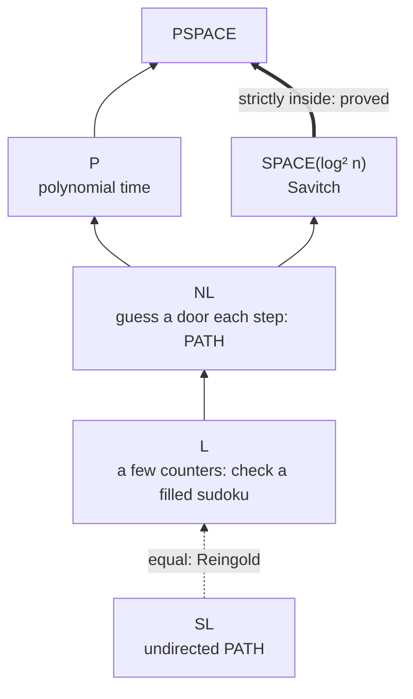
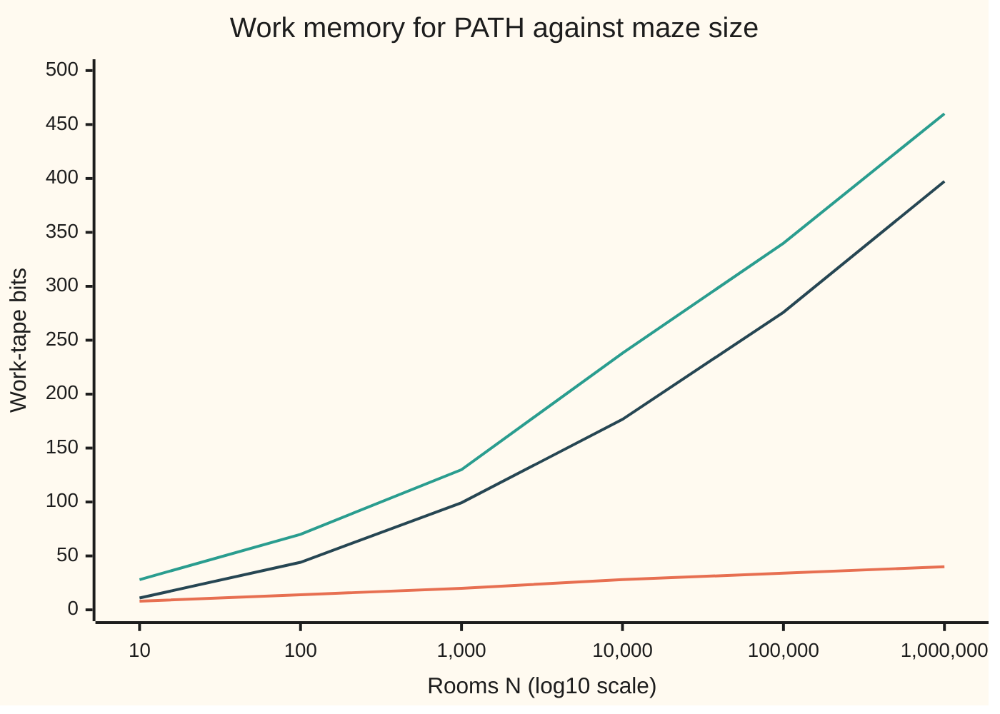

# Logarithmic space: L and NL, where a few counters are all the memory you get

[Syllabus](../../../SYLLABUS.md) → [Computability and complexity](../README.md) → [Time Complexity](../README.md#s03) → Logarithmic space

---

## General Overview

A filled 9 by 9 sudoku arrives for checking: 81 cells of 4 bits each, 324 bits. The obvious checker copies each row into a list and looks for repeats.

A thriftier one copies nothing. It keeps three counters: which row (or column, or box), which digit it is hunting, and which place in the row it is reading. Each counts to 9, so it needs $`\lceil \log_2 9\rceil = 4`$ bits ($`\log_2 9`$ is about 3.17). With a row-column-box marker, a found flag and a cell address (the read head takes in one whole cell, one digit, at a time), the whole memory is 22 bits.

The grid sits on a **read-only input tape**: the machine may read any cell as often as it likes, but never write there. Only the separate **work tape** counts as memory, so memory can be far smaller than the input. A problem that some machine solves with $`O(\log n)`$ work bits, for input length n, is in the class **L**, for logarithmic space. The sudoku checker puts "is this filled grid correct?" in L.

Now a harder question. A maze has 1,000 rooms and one-way doors. Is there a route from room 0 to room 999? A **guessing machine** (one that takes every allowed move at once and accepts if any branch accepts) needs tiny memory. It guesses a door at every step, and stores only its room (10 bits) and a step count (10 bits). That puts PATH, the route question, in **NL**: nondeterministic logarithmic space.

PATH is the hardest problem in NL: every NL problem converts into a PATH question, in logarithmic memory. Savitch's theorem removes the guessing at a price: an ordinary machine needs about $`(\log_2 1000)^2 = 99.3`$ bits, 130 in this card's layout.

**L is what a machine decides with a read-only input and a work tape of O(log n) bits, which is room for a few counters and pointers; NL is the same for a guessing machine; PATH, "is there a route from a to b?", is NL-complete under log-space reductions, so L = NL exactly when PATH is in L.**

**What kind of fact this is:** L, NL and log-space reductions are definitions. Four theorems are proved on this card in Why it works: the sudoku checker is in L, PATH is in NL, PATH is NL-complete, and NL sits inside P. Savitch's theorem is proved in its PATH form here, and stated in general with its key steps on [Above NP](08-conp-pspace-and-the-polynomial-hierarchy.md). Reingold's theorem, that undirected PATH is in L, is stated with its key steps and source. Whether L = NL, and whether NL = P, are open as of 2026-11-24.

### The picture: where L and NL sit



Schematic. A solid arrow means "is contained in". The thick arrow is a proved strict containment: $`\mathrm{SPACE}(\log^2 n)`$ is strictly inside PSPACE, by the [Space hierarchy](12-space-hierarchy-theorem.md), so NL is strictly smaller than PSPACE. The dotted arrow is a proved equality, Reingold's theorem (Step 6). Every other solid arrow might be an equality, as far as anyone has proved. Whether L, NL and P differ is open.

---

## The formula

Notation first. The machine has a **read-only input tape**, holding the input of n symbols, and a **work tape**. Space $`s(n)`$ counts only work-tape cells, here bits. $`\mathrm{NSPACE}(s(n))`$ is the guessing machine's version of $`\mathrm{SPACE}(s(n))`$ ([Time and space classes](01-time-and-space-classes.md)).

```math
\mathrm{L} = \mathrm{SPACE}(\log n), \qquad \mathrm{NL} = \mathrm{NSPACE}(\log n)
```

**Read it aloud:** L is everything an ordinary machine decides with a work tape of a constant times log n bits; NL is the same for a guessing machine.

The problem that carries NL:

```math
\mathrm{PATH} = \{\, \langle G, a, b \rangle : G \text{ is a directed graph with a path from room } a \text{ to room } b \,\}
```

**Read it aloud:** PATH is the set of mazes with a named start room a and target room b where some chain of one-way doors leads from a to b. The brackets ⟨ ⟩ mean "written out as one input string".

A **log-space reduction** from A to B, written $`A \le_{\mathrm{L}} B`$, converts every instance of A into an instance of B with the same answer. It runs on a machine with a read-only input, a work tape of $`O(\log n)`$ bits, and a write-only output tape that moves one way. It is the log-space version of $`A \le_{\mathrm{p}} B`$ on [Reductions](03-polynomial-reductions-and-np-completeness.md). The four results:

```math
\mathrm{PATH} \in \mathrm{NL}, \qquad A \in \mathrm{NL} \Rightarrow A \le_{\mathrm{L}} \mathrm{PATH}, \qquad \mathrm{NL} \subseteq \mathrm{SPACE}(\log^2 n), \qquad \mathrm{NL} \subseteq \mathrm{P}
```

**Read it aloud:** PATH has a guessing log-space machine; every NL problem converts to PATH in log space; guessing in log space costs at most log squared without guessing; and everything in NL runs in polynomial time.

The memory a machine has decides how many snapshots it can be in. A **configuration** is one snapshot: state, input head position, work tape and work head. With s work bits there are at most

```math
\lvert Q\rvert \cdot (n + 2) \cdot s \cdot 2^{s}
```

configurations. With $`s = c \log_2 n`$ the last factor is $`n^c`$, so the count is a polynomial in n. That single fact drives the completeness proof, Savitch's bound for all of NL, and $`\mathrm{NL} \subseteq \mathrm{P}`$ (Steps 3, 5 and 6).

| Symbol | Plain meaning | In our example | Push it up and the answer… |
| --- | --- | --- | --- |
| $`w`$, $`n`$ | an input string, and its length in bits | a 9 by 9 grid, n = 324 | work memory grows only as $`\log_2 n`$ |
| $`s(n)`$, $`c`$ | work-tape bits allowed at input length n; the constant in $`c \log_2 n`$ | 22 bits for the checker | a bigger class |
| $`O(\,)`$ | up to a constant multiple, for large n | 22 bits is $`O(\log n)`$ | — |
| $`d`$ | the grid's side: digits 1 to d | 9 | counters of $`\lceil \log_2 d\rceil`$ bits each |
| $`\mathrm{L}`$, $`\mathrm{NL}`$, $`\mathrm{NSPACE}(s(n))`$ | log space, ordinary and guessing; the guessing class for bound s(n) | the checker is in L; PATH is in NL | a bigger class as s grows |
| $`G`$, $`a`$, $`b`$ | the maze, its start room and its target room | 1,000 rooms; room 0; room 999 | — |
| $`r_0, \ldots, r_\ell`$ | a route: the rooms it passes, $`\ell`$ doors in all | the shortest has $`\ell = 11`$ | — |
| $`N`$, $`m`$ | the number of rooms; bits to name one, $`\lceil \log_2 N\rceil`$ | 1,000; 10 | m grows by 1 each time N doubles |
| $`k`$ | Savitch's levels: routes of at most $`2^k`$ doors | 10, since $`2^{10} \ge 999`$ | $`m + 1`$ more bits per level |
| $`u`$, $`v`$, $`x`$ | the two ends and the midpoint room in Savitch's recursion | u = 0, v = 999 at the top | — |
| $`A \le_{\mathrm{L}} B`$ | problem A converts to problem B in log space, answers kept | the row-repeat question to PATH | — |
| $`Q`$, $`C`$, $`C'`$ | the machine's states, bars counting them; two configurations | 4 states in road D | more configurations |

### When it holds

- **The input is read-only and is not counted.** Count the input as memory and every machine that reads its whole input uses at least n cells, so nothing would fit below linear space. Copying the grid costs 324 bits against the checker's 22.
- **A pointer costs log n bits.** Remembering one input position, one room or one count up to n takes $`\lceil \log_2 n\rceil`$ bits. So logarithmic space allows a fixed number of pointers, never a list of them.
- **The guessing walker needs its step counter.** A path in N rooms can always be cut to at most N − 1 doors. The counter lets each branch stop after N − 1 steps. Cap it below the true distance, 11 doors here, and every branch fails.
- **Completeness inside NL needs log-space reductions.** A polynomial-time reduction could solve any NL problem outright and print a fixed yes or no instance. Then every problem in NL with a yes and a no instance would be NL-complete, which says nothing.
- **Reingold's theorem needs undirected doors.** It handles mazes where every door works both ways. For one-way doors, PATH in L would mean L = NL, which is open.

---

## Why it works

### Step 0: memory is reused, and a counter is cheap

The input stays where it is, and the machine rereads it as often as it wants. It only has to remember where it is in its own plan: a few indices. An index up to n costs $`\lceil \log_2 n\rceil`$ bits, and doubling the input adds one bit. So log space is the natural floor for a machine that must know where it is in its input.

### Step 1: the sudoku checker is in L

The checker runs this plan, for each kind of unit (rows, columns, boxes):

1. For each unit (1 to d), and each digit (1 to d):
2. Set a found flag to 0. For each place in the unit (1 to d), read the cell at that place.
3. If the cell holds the digit and the flag is already 1, reject. If it holds the digit, set the flag to 1.
4. After the last place, if the flag is still 0, reject.

If no step rejects, every digit appears exactly once in every unit, so the grid is correct. The work tape holds six counters: kind (3 values, 2 bits), unit, digit and place ($`d`$ values each), the flag (1 bit), and the cell address ($`d^2`$ values), which tells the read head where to go. For d = 9 that is 2 + 4 + 4 + 4 + 1 + 7 = 22 bits.

The input tape's symbols here are the digits, one per cell, so the head reads a whole cell at a time. The card measures n in bits, 4 per digit, a constant factor that $`O(\log n)`$ ignores. A head that read single bits would also need an offset inside each 4-bit cell: a few more bits, still $`O(\log n)`$.

The input has $`n = d^2 \lceil \log_2(d+1)\rceil`$ bits, so $`\log_2 n`$ is at least $`2\log_2 d`$. Each counter needs at most $`2\log_2 d + 1`$ bits. Six counters is $`O(\log n)`$. The checks measure the ratio of work bits to $`\log_2 n`$: it stays between 2.23 and 2.64 from d = 4 to d = 49.

The price is time: the checker reads the input $`3d^3`$ times, 2,187 for d = 9.

### Step 2: PATH is in NL

The guessing walker starts in room a with a step count of 0. At each step it guesses one door out of its current room, reads that door's target off the input, and moves there. It accepts on reaching b. It rejects when the count reaches N − 1.

If a route exists, the shortest one has at most N − 1 doors, so some branch guesses it and accepts. If no route exists, no branch can accept. Memory is one room name and one count: $`2\lceil \log_2 N\rceil`$ bits, 20 for 1,000 rooms.

<details>
<summary>Detailed proof: any route in N rooms can be cut to at most N − 1 doors</summary>

Take a route $`r_0, r_1, \ldots, r_\ell`$ from $`r_0 = a`$ to $`r_\ell = b`$, each step through a door.

If some room appears twice, $`r_i = r_j`$ with $`i < j`$, delete $`r_{i+1}, \ldots, r_j`$. Every remaining step is still a door, and the route is shorter.

Repeat until no room appears twice. The route then visits at most N different rooms, so it has at most N − 1 doors.

The code does exactly this to a blind random walk: 1,575 doors shrink to 37, and BFS (breadth-first search) confirms the shortest route is 11.

</details>

### Step 3: every NL problem converts to PATH

Take any problem A in NL, decided by a guessing machine M with $`c \log_2 n`$ work bits. On input w, build a maze:

- **Rooms** are M's configurations on w. By the count in The formula, there are polynomially many.
- **Doors** go from each configuration to each configuration M can move to in one step.
- **Start** is M's starting configuration; **target** is its accepting one. (M can wipe its work tape and park its heads before accepting, so there is one accepting configuration.)

Then w is in A exactly when some run of M accepts, which is exactly when the maze has a route from start to target.

The conversion runs in log space: it loops over pairs of configurations, each $`O(\log n)`$ bits, and prints a door when M's rules allow that one step.

<details>
<summary>Detailed proof: the configuration maze is polynomial and is printed in log space</summary>

A configuration of M on w is a state (|Q| choices), an input head position (n + 2 choices, counting the end markers), a work head position (s choices) and a work tape ($`2^s`$ choices). With $`s = c \log_2 n`$,

$`\displaystyle |Q| \cdot (n+2) \cdot s \cdot 2^{s} = |Q| \cdot (n+2) \cdot c\log_2 n \cdot n^{c},`$

a polynomial in n. Each configuration is written in $`O(\log n)`$ bits.

The converter keeps two such configurations, C and C′, on its work tape, and loops over all pairs. For each pair it moves its input head to C's input position, by counting, and reads that symbol. It then checks whether one of M's rules turns C into C′, and if so prints the door (C, C′). Its work tape holds C, C′ and a position counter: $`O(\log n)`$ bits.

A route from the start configuration to the accepting one is an accepting run of M, and an accepting run is such a route, read step by step. So the answer is kept.

</details>

Road D in the code runs this on a small machine that decides "some row of a 4 by 4 grid repeats a digit": it guesses a row and two columns, walks the input head to each cell and compares. Its configurations number 4 states × 16 head positions × 4 × 4 × 4 register values × 5 digit values = 20,480, each named in 15 bits. On 73 grids, the machine's answer and the PATH answer agree every time.

### Step 4: log-space reductions chain, so PATH carries NL

If $`A \le_{\mathrm{L}} B`$ and $`B \le_{\mathrm{L}} C`$, then $`A \le_{\mathrm{L}} C`$. The catch is that the middle string may be polynomially long, too long to store. The fix: never store it. When the second conversion asks for symbol i of the middle string, rerun the first conversion from the start, count its output symbols, and keep only symbol i. That costs time and saves memory.

So if PATH were in L, every NL problem would be too: convert to PATH and solve it, recomputing on demand. PATH carries the whole L versus NL question.

### Step 5: Savitch removes the guessing for log² of memory

A route of at most $`2^k`$ doors from u to v exists exactly when some midpoint room x has routes of at most $`2^{k-1}`$ doors from u to x and from x to v. An ordinary machine tries every x in turn and checks each half the same way, reusing the memory after each try.

The recursion has $`k = \lceil \log_2(N-1)\rceil`$ levels, 10 for 1,000 rooms. Each level stores its midpoint (m bits) and one bit for which half it is checking; the ends u and v are recovered from the levels above. With a and b at the top, memory is $`2m + k(m+1)`$ bits: 20 + 10 × 11 = 130 for 1,000 rooms. That is $`O(\log^2 N)`$, against $`(\log_2 1000)^2 = 99.3`$.

The same recursion on any NL machine's configuration maze gives $`\mathrm{NL} \subseteq \mathrm{SPACE}(\log^2 n)`$. The general statement, for any $`s(n) \ge \log_2 n`$, is on [Above NP](08-conp-pspace-and-the-polynomial-hierarchy.md).

The price is time. Each level tries N midpoints and makes two calls, so the call count can reach $`(2N)^k`$: about $`10^{33.0}`$ for 1,000 rooms. The code runs it on an 8-room maze instead.

### Step 6: NL is inside P, and what Reingold adds

The configuration maze has polynomially many rooms, and breadth-first search finds a route in time polynomial in the maze. So $`\mathrm{NL} \subseteq \mathrm{P}`$. BFS pays in memory: one mark per room, 1,000 bits for the maze.

Reingold's theorem (2005; journal version 2008) settles the undirected case: PATH for mazes whose doors work both ways is in L. It is stated here without proof. Its key steps:

- Make the maze **regular**: every room gets the same number of doors.
- Turn it into an **expander**, a maze where every set of rooms has many doors leading out. Repeated squaring grows the doors; the zig-zag product cuts them back to a constant number. After $`O(\log N)`$ rounds the maze is an expander.
- In an expander with a constant number of doors, every connected pair of rooms is within $`O(\log N)`$ doors. So try every door sequence of that length, each written in $`O(\log N)`$ bits.

Undirected PATH is complete for SL (symmetric log space: guessing machines whose every move can be undone), so the theorem reads SL = L.

---

## Worked numbers, by hand

The 9 by 9 grid on rows: `123456789 / 456789123 / 789123456 / 234567891 / 567891234 / 891234567 / 345678912 / 678912345 / 912345678`.

| Step | Arithmetic | Value |
| --- | --- | --- |
| input length | 81 cells × 4 bits (0 to 9 needs 4 bits) | n = 324 bits |
| one counter | $`\lceil \log_2 9\rceil`$, with $`\log_2 9 = 3.17`$ | 4 bits |
| checker's memory | kind 2 + unit 4 + digit 4 + flag 1 + place 4 + address 7 | 22 bits |
| checker's reads | 3 kinds × 9 units × 9 digits × 9 places | 2,187 |
| maze room name | $`\lceil \log_2 1000\rceil`$ | 10 bits |
| walker's memory | room 10 + step count 10 | 20 bits |
| guessed routes of 11 doors | 3 of $`2^{11}`$ = 2,048 door sequences reach room 999 | 3 |
| Savitch's levels | $`\lceil \log_2 999\rceil`$ | k = 10 |
| Savitch's memory | 2 × 10 + 10 × (10 + 1) | 130 bits |
| the order of it | $`(\log_2 1000)^2`$ | 99.3 |
| BFS memory | one mark per room | **1,000 bits, against the walker's 20 and Savitch's 130** |

The grid is checked in 22 bits, 2.64 times $`\log_2 n`$. The maze needs 20 bits with guessing and 130 without; BFS uses 1,000.

The memory at growing maze sizes, from the checks:

| Rooms N | Walker 2m | Savitch 2m + k(m + 1) | $`(\log_2 N)^2`$ | BFS marks | log10 of Savitch's call bound |
| ---: | ---: | ---: | ---: | ---: | ---: |
| 10 | 8 | 28 | 11.0 | 10 | 5.2 |
| 100 | 14 | 70 | 44.1 | 100 | 16.1 |
| 1,000 | 20 | 130 | 99.3 | 1,000 | 33.0 |
| 10,000 | 28 | 238 | 176.6 | 10,000 | 60.2 |
| 100,000 | 34 | 340 | 275.9 | 100,000 | 90.1 |
| 1,000,000 | 40 | 460 | 397.3 | 1,000,000 | 126.0 |



The orange line is the guessing walker, $`2\lceil \log_2 N\rceil`$ bits. The green line is Savitch in this card's layout. The dark line is $`(\log_2 N)^2`$, the order Savitch achieves. BFS needs N bits, a million at the last point, so it is far off the top of this chart.

### What breaks if you drop a piece

| Mistake | Comes out at | What went wrong |
| --- | --- | --- |
| Copying the grid to the work tape | 324 bits, against 22 | Memory counts only the work tape; a copy turns log space into linear space |
| Capping the walker at 10 steps | 0 branches reach room 999 | The shortest route is 11 doors; the cap must be N − 1 |
| Walking without guessing: always the first door | room 867 repeats at step 57 (first seen at step 42); room 999 is never reached | A deterministic walk with no memory of where it has been cycles; this is not a proof that no route exists |
| Savitch with 1 level, rooms 5 to 6 of the small maze | False, though they are 4 doors apart | One level covers only 2 doors; k must reach $`\lceil \log_2(N-1)\rceil`$ |

The code prints every row.

---

## Code, from first principles, and it actually runs

The code counts work-tape bits, never a stopwatch. It takes **two roads to the sudoku answer and four to the maze answers**. Road 1 is the log-space checker, which declares a range for every counter and records its bits; road 2 holds each unit as a set. They agree on the solved grid and on all 648 one-cell changes. For the maze, road A is BFS. Road B runs every guess sequence of the walker, up to the cap. Road C is Savitch, checked against BFS on all 64 pairs of an 8-room maze. Road D builds the configuration maze of a small guessing machine and checks that PATH there matches the machine's direct answer on 73 grids. Randomness comes from SplitMix64, written out, seed 2029, so Python and Rust print the same.

### Python

```python
# Logarithmic space -- the check behind the card.  Standard library only.  Space is work-tape bits; the input is read-only.
import math
def bits(k): return max(1, (k - 1).bit_length())   # bits to hold any one of k values
def grid(d):                                   # a valid d by d sudoku, d a square
    s = math.isqrt(d)
    return [(s * (r % s) + r // s + c) % d + 1 for r in range(d) for c in range(d)]
# ---- road 1: the log-space checker; it sees the grid only through one read per step ----
def logspace_check(cells, d):
    s, size, val, reads, ok = math.isqrt(d), {}, {}, 0, True
    def put(name, v, k):                       # one counter on the work tape, range k
        assert 0 <= v < k; size[name], val[name] = bits(k), v
    for kind in range(3):                      # rows, columns, boxes
        put("kind", kind, 3)
        for u in range(d):
            put("unit", u, d)
            for v in range(d):
                put("digit", v, d); put("count", 0, 2)
                for p in range(d):
                    put("pos", p, d)
                    r, c = [(u, p), (p, u), ((u // s) * s + p // s, (u % s) * s + p % s)][kind]
                    put("addr", r * d + c, d * d); reads += 1
                    if cells[val["addr"]] == v + 1:          # the one read of the input
                        ok = ok and val["count"] == 0; put("count", 1, 2)
                ok = ok and val["count"] == 1
    return ok, size, reads
def set_check(cells, d):                       # road 2: hold each row, column and box as a set
    s, R = math.isqrt(d), range(d)
    units = [[r * d + c for c in R] for r in R] + [[r * d + c for r in R] for c in R] + [
        [(br + i) * d + bc + j for i in range(s) for j in range(s)] for br in range(0, d, s) for bc in range(0, d, s)]
    return all(sorted(cells[i] for i in u) == list(range(1, d + 1)) for u in units)
g = grid(9)
ok, size, reads = logspace_check(g, 9)
W9 = sum(size.values())
print("9 x 9 grid by rows: " + " / ".join("".join(str(x) for x in g[r * 9:r * 9 + 9]) for r in range(9)))
print(f"input n = 81 cells x {bits(10)} bits = {81 * bits(10)} bits; log2 81 = {math.log2(81):.2f}, log2 9 = {math.log2(9):.2f}")
print("work counters: " + ", ".join(f"{k} {b}" for k, b in size.items()) + f"; total {W9} bits")
print(f"verdict {ok}, input reads {reads:,} = 3 x 9^3")
assert ok and set_check(g, 9) and reads == 3 * 9 ** 3
changed = [g[:i] + [v] + g[i + 1:] for i in range(81) for v in range(1, 10) if v != g[i]]
bad = sum(not logspace_check(h, 9)[0] for h in changed)
agree = sum(logspace_check(h, 9)[0] == set_check(h, 9) for h in changed)
print(f"one-cell changes: {bad} of {len(changed)} rejected; roads 1 and 2 agree on {agree}")
assert bad == agree == len(changed) == 648
print("sizes: d, input bits n, log2 n, work bits, work / log2 n, input reads")
for d in (4, 9, 16, 25, 36, 49):
    ok, size, reads = logspace_check(grid(d), d)
    n, w = d * d * bits(d + 1), sum(size.values())
    print(f"  d {d:>2}  n {n:>6,}  log2 n {math.log2(n):5.2f}  work {w:>2}  ratio {w / math.log2(n):.2f}  reads {reads:>7,}")
    assert ok and w <= 3 * math.log2(n)       # logarithmic in n, not linear
# ---- the 1,000-room maze: two one-way doors per room, SplitMix64 seed 2029 ----
MASK = (1 << 64) - 1
class Rng:
    def __init__(self, seed): self.s = seed
    def next(self):
        self.s = (self.s + 0x9E3779B97F4A7C15) & MASK; z = ((self.s ^ (self.s >> 30)) * 0xBF58476D1CE4E5B9) & MASK
        z = ((z ^ (z >> 27)) * 0x94D049BB133111EB) & MASK
        return z ^ (z >> 31)
def maze(rng, rooms): return [[rng.next() % rooms, rng.next() % rooms] for _ in range(rooms)]
def bfs(adj, s):                               # road A: breadth-first search, one mark per room
    dist, queue = {s: 0}, [s]
    for u in queue:
        for v in adj[u]:
            if v not in dist:
                dist[v] = dist[u] + 1; queue.append(v)
    return dist
def branches(adj, s, t, cap):                  # road B: run every guess sequence of the walker
    count, level = 0, [s]
    for _ in range(cap):
        level = [v for u in level for v in adj[u]]; count += level.count(t)
    return count
rng, N, T = Rng(2029), 1000, 999
adj = maze(rng, N)
dist = bfs(adj, 0)
t_no = min(x for x in range(N) if x not in dist)
print(f"maze: {N:,} rooms; room {T} is {dist[T]} doors from room 0; {len(dist)} rooms reachable; room {t_no} is not")
hits = branches(adj, 0, T, dist[T])
print(f"walker: {hits} of the 2^{dist[T]} = {2 ** dist[T]:,} guess sequences of {dist[T]} doors reach room {T}")
print(f"walker stores room ({bits(N)} bits) + steps ({bits(N)} bits) = {2 * bits(N)} bits; BFS marks {N:,} bits")
assert hits > 0 and branches(adj, 0, T, dist[T] - 1) == 0 and branches(adj, 0, t_no, 14) == 0
walk, cur, short = [0], 0, []                  # a blind walk, then cut out its loops
while cur != T:
    cur = adj[cur][rng.next() % 2]; walk.append(cur)
for r in walk:
    short = (short[:short.index(r)] if r in short else short) + [r]
print(f"a random walk reaches room {T} in {len(walk) - 1:,} doors; cutting loops leaves {len(short) - 1} doors")
assert all(b in adj[a] for a, b in zip(short, short[1:])) and dist[T] <= len(short) - 1 <= N - 1
# ---- road C: Savitch: a path of at most 2^k doors splits at a midpoint ----
def reach(adj, u, v, k, depth, st):
    st[0], st[1] = st[0] + 1, max(st[1], depth)
    if k == 0:
        return u == v or v in adj[u]
    return any(reach(adj, u, w, k - 1, depth + 1, st) and reach(adj, w, v, k - 1, depth + 1, st) for w in range(len(adj)))
small, K, st = maze(rng, 8), bits(7), [0, 0]
pairs = [(bfs(small, s).get(e, -1), s, e) for s in range(8) for e in range(8)]
agree, far = sum(reach(small, s, e, K, 0, st) == (d >= 0) for d, s, e in pairs), max(pairs)
print(f"small maze {small}: Savitch with {K} levels agrees with BFS on {agree} of 64 pairs")
print(f"  {st[0]:,} calls in all, at most {st[1]} levels below the top; farthest pair: rooms {far[1]} to {far[2]}, {far[0]} doors")
assert agree == 64 and st[1] == K
print("bits: rooms, walker 2m, Savitch layout 2m + k(m + 1), (log2 rooms)^2, BFS marks; log10 of Savitch call bound (2N)^k")
for r in [10 ** e for e in range(1, 7)]:
    m, k = bits(r), bits(r - 1)
    print(f"  rooms {r:>9,}  walker {2 * m:>2}  savitch {2 * m + k * (m + 1):>3}  square {math.log2(r) ** 2:6.1f}  bfs {r:>9,}  calls {k * math.log10(2 * r):6.1f}")
assert 2 * bits(N) + bits(N - 1) * (bits(N) + 1) == 130 and abs(math.log2(N) ** 2 - 99.3) < 0.05
# ---- road D: an NL machine on a 4 by 4 grid, turned into a PATH question ----
D = 4                                          # "some row repeats a digit": guess a row and two columns
def moves(cfg, sym):                           # cfg = (state, head, row, col1, col2, digit)
    q, h, r, a, b, v = cfg
    if q == 0:
        return [(1, h, r2, a2, b2, 0) for r2 in range(D) for a2 in range(D) for b2 in range(a2 + 1, D)]
    if q == 3:
        return []
    goal = r * D + (a if q == 1 else b)
    if h != goal:                              # walk the input head one cell
        return [(q, h + (1 if h < goal else -1), r, a, b, v)]
    return [(2, h, r, a, b, sym)] if q == 1 else [(3, 0, 0, 0, 0, 0)] if sym == v else []
ALL = [(q, h, r, a, b, v) for q in range(4) for h in range(D * D) for r in range(D) for a in range(D) for b in range(D) for v in range(D + 1)]
def to_path(cells):                            # the reduction: list every edge, one at a time
    return {c: moves(c, cells[c[1]]) for c in ALL}
base = [1, 2, 3, 4, 3, 4, 1, 2, 2, 1, 4, 3, 4, 3, 2, 1]
tests = [base] + [base[:i] + [v] + base[i + 1:] for i in range(16) for v in range(1, 5) if v != base[i]]
tests += [base[:r * 4] + [base[r * 4 + (b if j == a else a if j == b else j)] for j in range(4)] + base[r * 4 + 4:]
          for r in range(4) for a in range(4) for b in range(a + 1, 4)]
yes = agree = 0
for cells in tests:
    direct = any(cells[r * D + a] == cells[r * D + b] for r in range(D) for a in range(D) for b in range(a + 1, D))
    yes, agree = yes + direct, agree + (direct == ((3, 0, 0, 0, 0, 0) in bfs(to_path(cells), ALL[0])))
print(f"reduction: {len(ALL):,} configurations = 4 x 16 x 4 x 4 x 4 x 5, index {bits(len(ALL))} bits; {sum(len(x) for x in to_path(base).values()):,} edges for the solved grid")
print(f"  {len(tests)} grids, {yes} with a repeated digit in a row; machine and PATH agree on {agree}")
assert agree == len(tests) and yes == 48
# ---- what breaks ----
print(f"wrong: copying the 9 x 9 grid to the work tape: {81 * bits(10)} bits, against {W9}")
print(f"wrong: walker capped at {dist[T] - 1} steps: {branches(adj, 0, T, dist[T] - 1)} branches reach room {T}")
seen, cur, step = {}, 0, 0
while cur not in seen and cur != T:
    seen[cur], cur, step = step, adj[cur][0], step + 1
print(f"wrong: always the first door: room {cur} repeats at step {step} (first seen at step {seen[cur]}), so room {T} is never reached")
assert cur != T
print(f"wrong: Savitch with 1 level, rooms {far[1]} to {far[2]}: {reach(small, far[1], far[2], 1, 0, [0, 0])}")
assert far[0] > 2 and not reach(small, far[1], far[2], 1, 0, [0, 0])
print("ALL CHECKS PASS")
```

**Ran 2026-11-24 on macOS, Python 3.14.10, standard library only. All checks passed. Output, pasted from the run:**

```text
9 x 9 grid by rows: 123456789 / 456789123 / 789123456 / 234567891 / 567891234 / 891234567 / 345678912 / 678912345 / 912345678
input n = 81 cells x 4 bits = 324 bits; log2 81 = 6.34, log2 9 = 3.17
work counters: kind 2, unit 4, digit 4, count 1, pos 4, addr 7; total 22 bits
verdict True, input reads 2,187 = 3 x 9^3
one-cell changes: 648 of 648 rejected; roads 1 and 2 agree on 648
sizes: d, input bits n, log2 n, work bits, work / log2 n, input reads
  d  4  n     48  log2 n  5.58  work 13  ratio 2.33  reads     192
  d  9  n    324  log2 n  8.34  work 22  ratio 2.64  reads   2,187
  d 16  n  1,280  log2 n 10.32  work 23  ratio 2.23  reads  12,288
  d 25  n  3,125  log2 n 11.61  work 28  ratio 2.41  reads  46,875
  d 36  n  7,776  log2 n 12.92  work 32  ratio 2.48  reads 139,968
  d 49  n 14,406  log2 n 13.81  work 33  ratio 2.39  reads 352,947
maze: 1,000 rooms; room 999 is 11 doors from room 0; 778 rooms reachable; room 5 is not
walker: 3 of the 2^11 = 2,048 guess sequences of 11 doors reach room 999
walker stores room (10 bits) + steps (10 bits) = 20 bits; BFS marks 1,000 bits
a random walk reaches room 999 in 1,575 doors; cutting loops leaves 37 doors
small maze [[2, 0], [3, 0], [2, 6], [5, 1], [0, 0], [1, 1], [0, 0], [2, 3]]: Savitch with 3 levels agrees with BFS on 64 of 64 pairs
  28,200 calls in all, at most 3 levels below the top; farthest pair: rooms 5 to 6, 4 doors
bits: rooms, walker 2m, Savitch layout 2m + k(m + 1), (log2 rooms)^2, BFS marks; log10 of Savitch call bound (2N)^k
  rooms        10  walker  8  savitch  28  square   11.0  bfs        10  calls    5.2
  rooms       100  walker 14  savitch  70  square   44.1  bfs       100  calls   16.1
  rooms     1,000  walker 20  savitch 130  square   99.3  bfs     1,000  calls   33.0
  rooms    10,000  walker 28  savitch 238  square  176.6  bfs    10,000  calls   60.2
  rooms   100,000  walker 34  savitch 340  square  275.9  bfs   100,000  calls   90.1
  rooms 1,000,000  walker 40  savitch 460  square  397.3  bfs 1,000,000  calls  126.0
reduction: 20,480 configurations = 4 x 16 x 4 x 4 x 4 x 5, index 15 bits; 132,864 edges for the solved grid
  73 grids, 48 with a repeated digit in a row; machine and PATH agree on 73
wrong: copying the 9 x 9 grid to the work tape: 324 bits, against 22
wrong: walker capped at 10 steps: 0 branches reach room 999
wrong: always the first door: room 867 repeats at step 57 (first seen at step 42), so room 999 is never reached
wrong: Savitch with 1 level, rooms 5 to 6: False
ALL CHECKS PASS
```

### Rust

```rust
// Logarithmic space -- the check behind the card.  Rust std only, no crates.  Space is work-tape bits; the input is read-only.
use std::collections::HashMap;
fn bits(k: usize) -> usize { if k <= 2 { 1 } else { 64 - (k as u64 - 1).leading_zeros() as usize } }
fn commas(v: usize) -> String {                    // 65536 -> "65,536"
    let s = v.to_string();
    s.chars().enumerate().map(|(i, ch)| if i > 0 && (s.len() - i) % 3 == 0 { format!(",{}", ch) } else { ch.to_string() }).collect()
}
fn tf(b: bool) -> &'static str { if b { "True" } else { "False" } }
fn isqrt(d: usize) -> usize { (1..=d).take_while(|s| s * s <= d).last().unwrap() }
fn grid(d: usize) -> Vec<usize> {                    // a valid d by d sudoku, d a square
    (0..d * d).map(|i| (isqrt(d) * (i / d % isqrt(d)) + i / d / isqrt(d) + i % d) % d + 1).collect()
}
// ---- road 1: the log-space checker; it sees the grid only through one read per step ----
const NAMES: [&str; 6] = ["kind", "unit", "digit", "count", "pos", "addr"];
struct Work { size: [usize; 6], val: [usize; 6] }   // the work tape: six counters
impl Work { fn put(&mut self, i: usize, v: usize, k: usize) { assert!(v < k); self.size[i] = bits(k); self.val[i] = v; } }
fn logspace_check(cells: &[usize], d: usize) -> (bool, [usize; 6], usize) {
    let (s, mut w, mut reads, mut ok) = (isqrt(d), Work { size: [0; 6], val: [0; 6] }, 0, true);
    for kind in 0..3 {                              // rows, columns, boxes
        w.put(0, kind, 3);
        for u in 0..d {
            w.put(1, u, d);
            for v in 0..d {
                w.put(2, v, d); w.put(3, 0, 2);
                for p in 0..d {
                    w.put(4, p, d);
                    let (r, c) = [(u, p), (p, u), ((u / s) * s + p / s, (u % s) * s + p % s)][kind];
                    w.put(5, r * d + c, d * d); reads += 1;
                    if cells[w.val[5]] == v + 1 {             // the one read of the input
                        ok = ok && w.val[3] == 0; w.put(3, 1, 2);
                    }
                }
                ok = ok && w.val[3] == 1;
            }
        }
    }
    (ok, w.size, reads)
}
fn set_check(cells: &[usize], d: usize) -> bool { // road 2: hold each row, column and box as a set
    let s = isqrt(d);
    let mut units: Vec<Vec<usize>> = (0..d).map(|r| (0..d).map(|c| r * d + c).collect()).collect();
    units.extend((0..d).map(|c| (0..d).map(|r| r * d + c).collect::<Vec<_>>()));
    for b in 0..d { units.push((0..d).map(|k| (b / s * s + k / s) * d + b % s * s + k % s).collect()); }
    units.iter().all(|u| { let mut x: Vec<usize> = u.iter().map(|&i| cells[i]).collect(); x.sort(); x == (1..=d).collect::<Vec<_>>() })
}
// ---- SplitMix64, mazes and breadth-first search ----
struct Rng(u64);
impl Rng {
    fn next(&mut self) -> u64 {
        self.0 = self.0.wrapping_add(0x9E3779B97F4A7C15); let mut z = (self.0 ^ (self.0 >> 30)).wrapping_mul(0xBF58476D1CE4E5B9);
        z = (z ^ (z >> 27)).wrapping_mul(0x94D049BB133111EB);
        z ^ (z >> 31)
    }
}
fn maze(rng: &mut Rng, rooms: usize) -> Vec<Vec<usize>> {
    (0..rooms).map(|_| { let a = (rng.next() % rooms as u64) as usize; vec![a, (rng.next() % rooms as u64) as usize] }).collect()
}
fn bfs(adj: &[Vec<usize>], s: usize) -> Vec<i64> {  // road A: one mark per room
    let (mut dist, mut queue, mut i) = (vec![-1i64; adj.len()], vec![s], 0);
    dist[s] = 0;
    while i < queue.len() {
        let u = queue[i]; i += 1;
        for &v in &adj[u] { if dist[v] < 0 { dist[v] = dist[u] + 1; queue.push(v); } }
    }
    dist
}
fn branches(adj: &[Vec<usize>], s: usize, t: usize, cap: usize) -> usize { // road B: every guess sequence
    let (mut count, mut level) = (0, vec![s]);
    for _ in 0..cap { level = level.iter().flat_map(|&u| adj[u].iter().copied()).collect(); count += level.iter().filter(|&&v| v == t).count(); }
    count
}
// ---- road C: Savitch: a path of at most 2^k doors splits at a midpoint ----
fn reach(adj: &[Vec<usize>], u: usize, v: usize, k: usize, depth: usize, st: &mut [usize; 2]) -> bool {
    st[0] += 1; st[1] = st[1].max(depth);
    if k == 0 { return u == v || adj[u].contains(&v); }
    (0..adj.len()).any(|w| reach(adj, u, w, k - 1, depth + 1, st) && reach(adj, w, v, k - 1, depth + 1, st))
}
// ---- road D: an NL machine on a 4 by 4 grid, turned into a PATH question ----
const D: usize = 4;                                  // "some row repeats a digit": guess a row and two columns
fn idx(c: [usize; 6]) -> usize { ((((c[0] * 16 + c[1]) * 4 + c[2]) * 4 + c[3]) * 4 + c[4]) * 5 + c[5] }
fn moves(cfg: [usize; 6], sym: usize) -> Vec<[usize; 6]> {  // cfg = (state, head, row, col1, col2, digit)
    let [q, h, r, a, b, v] = cfg;
    if q == 0 { return (0..D).flat_map(|r2| (0..D).flat_map(move |a2| (a2 + 1..D).map(move |b2| [1, h, r2, a2, b2, 0]))).collect(); }
    if q == 3 { return vec![]; }
    let goal = r * D + if q == 1 { a } else { b };
    if h != goal { return vec![[q, if h < goal { h + 1 } else { h - 1 }, r, a, b, v]]; } // walk the head one cell
    if q == 1 { vec![[2, h, r, a, b, sym]] } else if sym == v { vec![[3, 0, 0, 0, 0, 0]] } else { vec![] }
}
fn to_path(all: &[[usize; 6]], cells: &[usize]) -> Vec<Vec<usize>> { // the reduction: every edge, one at a time
    all.iter().map(|&c| moves(c, cells[c[1]]).into_iter().map(idx).collect()).collect()
}
fn main() {
    let g = grid(9);
    let (ok, size, reads) = logspace_check(&g, 9);
    let w9: usize = size.iter().sum();
    let rows: Vec<String> = (0..9).map(|r| g[r * 9..r * 9 + 9].iter().map(|x| x.to_string()).collect()).collect();
    println!("9 x 9 grid by rows: {}", rows.join(" / "));
    println!("input n = 81 cells x {} bits = {} bits; log2 81 = {:.2}, log2 9 = {:.2}", bits(10), 81 * bits(10), 81f64.log2(), 9f64.log2());
    let parts: Vec<String> = (0..6).map(|i| format!("{} {}", NAMES[i], size[i])).collect();
    println!("work counters: {}; total {} bits", parts.join(", "), w9);
    println!("verdict {}, input reads {} = 3 x 9^3", tf(ok), commas(reads));
    assert!(ok && set_check(&g, 9) && reads == 3 * 9usize.pow(3));
    let mut changed = vec![];
    for i in 0..81 { for v in 1..10 { if v != g[i] { let mut h = g.clone(); h[i] = v; changed.push(h); } } }
    let bad = changed.iter().filter(|h| !logspace_check(h, 9).0).count();
    let agree = changed.iter().filter(|h| logspace_check(h, 9).0 == set_check(h, 9)).count();
    println!("one-cell changes: {} of {} rejected; roads 1 and 2 agree on {}", bad, changed.len(), agree);
    assert!(bad == 648 && agree == 648 && changed.len() == 648);
    println!("sizes: d, input bits n, log2 n, work bits, work / log2 n, input reads");
    for d in [4, 9, 16, 25, 36, 49] {
        let (ok, size, reads) = logspace_check(&grid(d), d);
        let (n, w, l) = (d * d * bits(d + 1), size.iter().sum::<usize>(), ((d * d * bits(d + 1)) as f64).log2());
        println!("  d {:>2}  n {:>6}  log2 n {:5.2}  work {:>2}  ratio {:.2}  reads {:>7}", d, commas(n), l, w, w as f64 / l, commas(reads));
        assert!(ok && (w as f64) <= 3.0 * l);       // logarithmic in n, not linear
    }
    let (mut rng, n, t) = (Rng(2029), 1000usize, 999usize);
    let adj = maze(&mut rng, n);
    let dist = bfs(&adj, 0);
    let (t_no, dt) = ((0..n).find(|&x| dist[x] < 0).unwrap(), dist[t] as usize);
    println!("maze: {} rooms; room {} is {} doors from room 0; {} rooms reachable; room {} is not", commas(n), t, dt, dist.iter().filter(|&&x| x >= 0).count(), t_no);
    let hits = branches(&adj, 0, t, dt);
    println!("walker: {} of the 2^{} = {} guess sequences of {} doors reach room {}", hits, dt, commas(1 << dt), dt, t);
    println!("walker stores room ({} bits) + steps ({} bits) = {} bits; BFS marks {} bits", bits(n), bits(n), 2 * bits(n), commas(n));
    assert!(hits > 0 && branches(&adj, 0, t, dt - 1) == 0 && branches(&adj, 0, t_no, 14) == 0);
    let (mut walk, mut cur, mut short) = (vec![0usize], 0usize, Vec::<usize>::new()); // a blind walk, then cut its loops
    while cur != t { cur = adj[cur][(rng.next() % 2) as usize]; walk.push(cur); }
    for &r in &walk { if let Some(p) = short.iter().position(|&x| x == r) { short.truncate(p); } short.push(r); }
    println!("a random walk reaches room {} in {} doors; cutting loops leaves {} doors", t, commas(walk.len() - 1), short.len() - 1);
    assert!(short.windows(2).all(|p| adj[p[0]].contains(&p[1])) && dt <= short.len() - 1 && short.len() - 1 <= n - 1);
    let (small, k, mut st) = (maze(&mut rng, 8), bits(7), [0usize; 2]);
    let mut pairs = vec![];
    for s in 0..8 { let ds = bfs(&small, s); for e in 0..8 { pairs.push((ds[e], s, e)); } }
    let (agree, far) = (pairs.iter().filter(|&&(d, s, e)| reach(&small, s, e, k, 0, &mut st) == (d >= 0)).count(), *pairs.iter().max().unwrap());
    println!("small maze {:?}: Savitch with {} levels agrees with BFS on {} of 64 pairs", small, k, agree);
    println!("  {} calls in all, at most {} levels below the top; farthest pair: rooms {} to {}, {} doors", commas(st[0]), st[1], far.1, far.2, far.0);
    assert!(agree == 64 && st[1] == k);
    println!("bits: rooms, walker 2m, Savitch layout 2m + k(m + 1), (log2 rooms)^2, BFS marks; log10 of Savitch call bound (2N)^k");
    for r in (1..7).map(|e| 10usize.pow(e)) {
        let (m, kk) = (bits(r), bits(r - 1));
        println!("  rooms {:>9}  walker {:>2}  savitch {:>3}  square {:6.1}  bfs {:>9}  calls {:6.1}", commas(r), 2 * m, 2 * m + kk * (m + 1), (r as f64).log2().powi(2), commas(r), kk as f64 * ((2 * r) as f64).log10());
    }
    assert!(2 * bits(n) + bits(n - 1) * (bits(n) + 1) == 130 && ((n as f64).log2().powi(2) - 99.3).abs() < 0.05);
    let mut all = vec![];
    for q in 0..4 { for h in 0..D * D { for r in 0..D { for a in 0..D { for b in 0..D { for v in 0..D + 1 { all.push([q, h, r, a, b, v]); } } } } } }
    let base = vec![1, 2, 3, 4, 3, 4, 1, 2, 2, 1, 4, 3, 4, 3, 2, 1];
    let mut tests = vec![base.clone()];
    for i in 0..16 { for v in 1..5 { if v != base[i] { let mut h = base.clone(); h[i] = v; tests.push(h); } } }
    for r in 0..4 { for a in 0..4 { for b in a + 1..4 { let mut h = base.clone(); h.swap(r * 4 + a, r * 4 + b); tests.push(h); } } }
    let (mut yes, mut agree, accept) = (0, 0, idx([3, 0, 0, 0, 0, 0]));
    for cells in &tests {
        let direct = (0..D).any(|r| (0..D).any(|a| (a + 1..D).any(|b| cells[r * D + a] == cells[r * D + b])));
        yes += direct as usize;
        agree += (direct == (bfs(&to_path(&all, cells), 0)[accept] >= 0)) as usize;
    }
    let edges: usize = to_path(&all, &base).iter().map(|x| x.len()).sum();
    println!("reduction: {} configurations = 4 x 16 x 4 x 4 x 4 x 5, index {} bits; {} edges for the solved grid", commas(all.len()), bits(all.len()), commas(edges));
    println!("  {} grids, {} with a repeated digit in a row; machine and PATH agree on {}", tests.len(), yes, agree);
    assert!(agree == tests.len() && yes == 48);
    // ---- what breaks ----
    println!("wrong: copying the 9 x 9 grid to the work tape: {} bits, against {}", 81 * bits(10), w9);
    println!("wrong: walker capped at {} steps: {} branches reach room {}", dt - 1, branches(&adj, 0, t, dt - 1), t);
    let (mut seen, mut cur, mut step) = (HashMap::new(), 0usize, 0usize);
    while !seen.contains_key(&cur) && cur != t { seen.insert(cur, step); cur = adj[cur][0]; step += 1; }
    println!("wrong: always the first door: room {} repeats at step {} (first seen at step {}), so room {} is never reached", cur, step, seen[&cur], t);
    assert!(cur != t);
    let one = reach(&small, far.1, far.2, 1, 0, &mut [0, 0]);
    println!("wrong: Savitch with 1 level, rooms {} to {}: {}", far.1, far.2, tf(one));
    assert!(far.0 > 2 && !one);
    println!("ALL CHECKS PASS");
}
```

**Ran 2026-11-24 on macOS, rustc 1.98.1, no crates. All checks passed. Output, pasted from the run:**

```text
9 x 9 grid by rows: 123456789 / 456789123 / 789123456 / 234567891 / 567891234 / 891234567 / 345678912 / 678912345 / 912345678
input n = 81 cells x 4 bits = 324 bits; log2 81 = 6.34, log2 9 = 3.17
work counters: kind 2, unit 4, digit 4, count 1, pos 4, addr 7; total 22 bits
verdict True, input reads 2,187 = 3 x 9^3
one-cell changes: 648 of 648 rejected; roads 1 and 2 agree on 648
sizes: d, input bits n, log2 n, work bits, work / log2 n, input reads
  d  4  n     48  log2 n  5.58  work 13  ratio 2.33  reads     192
  d  9  n    324  log2 n  8.34  work 22  ratio 2.64  reads   2,187
  d 16  n  1,280  log2 n 10.32  work 23  ratio 2.23  reads  12,288
  d 25  n  3,125  log2 n 11.61  work 28  ratio 2.41  reads  46,875
  d 36  n  7,776  log2 n 12.92  work 32  ratio 2.48  reads 139,968
  d 49  n 14,406  log2 n 13.81  work 33  ratio 2.39  reads 352,947
maze: 1,000 rooms; room 999 is 11 doors from room 0; 778 rooms reachable; room 5 is not
walker: 3 of the 2^11 = 2,048 guess sequences of 11 doors reach room 999
walker stores room (10 bits) + steps (10 bits) = 20 bits; BFS marks 1,000 bits
a random walk reaches room 999 in 1,575 doors; cutting loops leaves 37 doors
small maze [[2, 0], [3, 0], [2, 6], [5, 1], [0, 0], [1, 1], [0, 0], [2, 3]]: Savitch with 3 levels agrees with BFS on 64 of 64 pairs
  28,200 calls in all, at most 3 levels below the top; farthest pair: rooms 5 to 6, 4 doors
bits: rooms, walker 2m, Savitch layout 2m + k(m + 1), (log2 rooms)^2, BFS marks; log10 of Savitch call bound (2N)^k
  rooms        10  walker  8  savitch  28  square   11.0  bfs        10  calls    5.2
  rooms       100  walker 14  savitch  70  square   44.1  bfs       100  calls   16.1
  rooms     1,000  walker 20  savitch 130  square   99.3  bfs     1,000  calls   33.0
  rooms    10,000  walker 28  savitch 238  square  176.6  bfs    10,000  calls   60.2
  rooms   100,000  walker 34  savitch 340  square  275.9  bfs   100,000  calls   90.1
  rooms 1,000,000  walker 40  savitch 460  square  397.3  bfs 1,000,000  calls  126.0
reduction: 20,480 configurations = 4 x 16 x 4 x 4 x 4 x 5, index 15 bits; 132,864 edges for the solved grid
  73 grids, 48 with a repeated digit in a row; machine and PATH agree on 73
wrong: copying the 9 x 9 grid to the work tape: 324 bits, against 22
wrong: walker capped at 10 steps: 0 branches reach room 999
wrong: always the first door: room 867 repeats at step 57 (first seen at step 42), so room 999 is never reached
wrong: Savitch with 1 level, rooms 5 to 6: False
ALL CHECKS PASS
```

### Lean

Lean proves the route-cutting and midpoint facts for every maze, the work-tape bound for every n and c, and the card's worked numbers.

- Take a maze of one-way doors with N rooms and a route from a to b. Then some route from a to b repeats no room and has at most N − 1 doors.
- Take any maze, rooms u and v, and any whole number k. Then u reaches v within $`2^{k+1}`$ doors exactly when some midpoint x splits the route into halves within $`2^k`$ doors each.
- Take whole numbers n ≥ 1 and c, and let s be c times $`\log_2 n`$ rounded down. Then the $`2^s`$ possible work tapes number at most $`n^c`$.
- The card's 9 by 9 grid has every digit 1 to 9 once in each row, column and box.
- The hand counts hold: 324 input bits, 4 bits per counter, 22 checker bits and 2,187 reads.
- So do the maze counts: 10-bit room names, a 20-bit walker, 2,048 guess sequences of 11 doors, k = 10 and Savitch's 130 bits.
- The walker and Savitch columns of the memory table hold at all six maze sizes.
- Road D has 20,480 configurations, each named in 15 bits.

The maze runs, the logarithm columns, Savitch's agreement with BFS and road D's 73 grids are left to the Python and Rust checks.

```lean
-- Logarithmic space: a route in a finite maze of one-way doors can be cut to at most N − 1 doors, Savitch's midpoint split is exact, a log-space configuration count is polynomial, and the card's bit counts are right.
import Mathlib.Combinatorics.Digraph.Basic
import Mathlib.Data.List.Chain
import Mathlib.Data.Nat.Log
import Mathlib.Data.Fintype.Card

open List

/-- A route from room `u` to room `v` of at most `n` doors in the maze `G`: a list of rooms
starting at `u`, each step through a one-way door of `G`, ending at `v`, with at most `n` steps. -/
def RouteWithin {V : Type*} (G : Digraph V) (n : ℕ) (u v : V) : Prop :=
  ∃ l : List V, IsChain G.Adj (u :: l) ∧ (u :: l).getLast (cons_ne_nil _ _) = v ∧ l.length ≤ n

theorem route_nodup_aux {V : Type*} (G : Digraph V) (a b : V)
    (h : Relation.ReflTransGen G.Adj a b) :
    ∃ l : List V, IsChain G.Adj (a :: l) ∧ (a :: l).getLast (cons_ne_nil _ _) = b ∧
      (a :: l).Nodup := by
  induction h using Relation.ReflTransGen.head_induction_on with
  | refl => exact ⟨[], .singleton _, rfl, nodup_singleton _⟩
  | @head a c hac _ ih =>
    obtain ⟨l, hch, hl, hnd⟩ := ih
    by_cases ha : a ∈ c :: l
    · obtain ⟨s, t, hst⟩ := List.append_of_mem ha
      refine ⟨t, ?_, ?_, ?_⟩
      · exact hch.suffix (hst ▸ suffix_append s (a :: t))
      · rw [← hl]
        simp only [hst, getLast_append_of_ne_nil _ (cons_ne_nil a t)]
      · rw [hst] at hnd
        exact hnd.sublist (sublist_append_right s (a :: t))
    · exact ⟨c :: l, hch.cons_cons hac, by rw [getLast_cons_cons]; exact hl, nodup_cons.2 ⟨ha, hnd⟩⟩

theorem getLast_cons_getLast_append {V : Type*} (A B : List V) (hA : A ≠ []) :
    (A.getLast hA :: B).getLast (cons_ne_nil _ _) = (A ++ B).getLast (by simp [hA]) := by
  cases B with
  | nil => simp
  | cons b B => simp [getLast_append_of_ne_nil]

theorem isChain_cons_getLast_of_append {V : Type*} (R : V → V → Prop) (A B : List V)
    (hA : A ≠ []) (h : IsChain R (A ++ B)) : IsChain R (A.getLast hA :: B) := by
  rw [isChain_append] at h
  obtain ⟨_, h2, h3⟩ := h
  rw [isChain_cons]
  exact ⟨fun y hy => h3 _ (by simp [getLast?_eq_some_getLast hA]) y hy, h2⟩

theorem routeWithin_add {V : Type*} (G : Digraph V) (m n : ℕ) (u v : V) :
    RouteWithin G (m + n) u v ↔ ∃ x, RouteWithin G m u x ∧ RouteWithin G n x v := by
  constructor
  · rintro ⟨l, hch, hl, hlen⟩
    refine ⟨(u :: l.take m).getLast (cons_ne_nil _ _), ⟨l.take m, ?_, rfl, ?_⟩, ⟨l.drop m, ?_, ?_, ?_⟩⟩
    · exact hch.take (m + 1)
    · simp
    · have e : u :: l = (u :: l.take m) ++ l.drop m := by simp
      rw [e] at hch
      exact isChain_cons_getLast_of_append _ _ _ (cons_ne_nil _ _) hch
    · rw [getLast_cons_getLast_append, ← hl]
      simp
    · simp; omega
  · rintro ⟨x, ⟨l₁, h₁, e₁, n₁⟩, ⟨l₂, h₂, e₂, n₂⟩⟩
    refine ⟨l₁ ++ l₂, ?_, ?_, ?_⟩
    · have h := h₁.append h₂.tail (by
        intro a ha y hy
        rw [getLast?_eq_some_getLast (cons_ne_nil _ _), Option.mem_some_iff] at ha
        rw [← ha, e₁]
        exact h₂.rel_head? (by simpa using hy))
      simpa using h
    · have h := getLast_cons_getLast_append (u :: l₁) l₂ (cons_ne_nil _ _)
      rw [e₁] at h
      rw [← e₂, h]
      simp
    · simp; omega

/-- In a maze of one-way doors with N rooms, if some route leads from room `a` to room `b`,
then a route with no repeated room leads from `a` to `b`, and it has at most N − 1 doors.
This is the cap that the guessing walker's step counter enforces. -/
theorem route_cut_to_at_most_card_sub_one {V : Type*} [Fintype V] (G : Digraph V) (a b : V)
    (h : Relation.ReflTransGen G.Adj a b) :
    ∃ l : List V, IsChain G.Adj (a :: l) ∧ (a :: l).getLast (cons_ne_nil _ _) = b ∧
      (a :: l).Nodup ∧ l.length ≤ Fintype.card V - 1 := by
  obtain ⟨l, hch, hl, hnd⟩ := route_nodup_aux G a b h
  refine ⟨l, hch, hl, hnd, ?_⟩
  have := hnd.length_le_card
  simp only [length_cons] at this
  omega

/-- Savitch's midpoint split: a route of at most 2^(k+1) doors from `u` to `v` exists exactly
when some midpoint room `x` has routes of at most 2^k doors from `u` to `x` and from `x` to `v`. -/
theorem savitch_midpoint_split {V : Type*} (G : Digraph V) (k : ℕ) (u v : V) :
    RouteWithin G (2 ^ (k + 1)) u v ↔ ∃ x, RouteWithin G (2 ^ k) u x ∧ RouteWithin G (2 ^ k) x v := by
  rw [pow_succ, Nat.mul_two]
  exact routeWithin_add G _ _ u v

/-- With s = c · log₂ n work bits, the number of work-tape contents 2^s is at most n^c, so the
configuration count |Q| · (n + 2) · s · 2^s is a polynomial in the input length n. -/
theorem work_tape_contents_le_pow (n c : ℕ) (hn : 0 < n) :
    2 ^ (c * Nat.log 2 n) ≤ n ^ c := by
  rw [mul_comm, pow_mul]
  exact Nat.pow_le_pow_left (Nat.pow_log_le_self 2 hn.ne') c

/-! Worked numbers from the card. A counter for k values takes ⌈log₂ k⌉ = `Nat.clog 2 k` bits. -/

-- The card's filled 9 by 9 grid, row by row.
def cardGrid : List (List ℕ) :=
  [[1,2,3,4,5,6,7,8,9], [4,5,6,7,8,9,1,2,3], [7,8,9,1,2,3,4,5,6],
   [2,3,4,5,6,7,8,9,1], [5,6,7,8,9,1,2,3,4], [8,9,1,2,3,4,5,6,7],
   [3,4,5,6,7,8,9,1,2], [6,7,8,9,1,2,3,4,5], [9,1,2,3,4,5,6,7,8]]

-- Every row, column and 3 by 3 box of the grid holds each digit 1 to 9 exactly once.
example : ∀ i : Fin 9,
    ((cardGrid.getD i []).Perm (List.range' 1 9)) ∧
    ((cardGrid.map (fun row => row.getD i 0)).Perm (List.range' 1 9)) ∧
    (((List.range 9).map (fun p =>
        (cardGrid.getD (3 * (i / 3) + p / 3) []).getD (3 * (i % 3) + p % 3) 0)).Perm
      (List.range' 1 9)) := by
  decide

-- Input length: 81 cells of 4 bits (digits 0 to 9 need ⌈log₂ 10⌉ = 4 bits); a copy on the
-- work tape would cost these 324 bits, against the checker's 22.
example : 81 * Nat.clog 2 10 = 324 := by decide
-- One counter up to 9 takes 4 bits.
example : Nat.clog 2 9 = 4 := by decide
-- Checker's memory: kind 2 + unit 4 + digit 4 + place 4 + flag 1 + address 7 = 22 bits.
example : Nat.clog 2 3 + 3 * Nat.clog 2 9 + Nat.clog 2 2 + Nat.clog 2 81 = 22 := by decide
-- Checker's reads: 3 kinds × 9 units × 9 digits × 9 places.
example : 3 * 9 * 9 * 9 = 2187 := by decide
-- Maze room name 10 bits; walker's memory room + step count = 20 bits.
example : Nat.clog 2 1000 = 10 ∧ 2 * Nat.clog 2 1000 = 20 := by decide
-- Guess sequences of 11 doors, two doors per room.
example : 2 ^ 11 = 2048 := by decide
-- Savitch: k = ⌈log₂ 999⌉ = 10 levels, memory 2m + k(m + 1) = 130 bits.
example : Nat.clog 2 999 = 10 ∧
    2 * Nat.clog 2 1000 + Nat.clog 2 999 * (Nat.clog 2 1000 + 1) = 130 := by decide
-- The table of memory at growing maze sizes: walker 2m and Savitch 2m + k(m + 1).
example : [10, 100, 1000, 10000, 100000, 1000000].map (fun N => 2 * Nat.clog 2 N) =
    [8, 14, 20, 28, 34, 40] := by decide
example : [10, 100, 1000, 10000, 100000, 1000000].map
    (fun N => 2 * Nat.clog 2 N + Nat.clog 2 (N - 1) * (Nat.clog 2 N + 1)) =
    [28, 70, 130, 238, 340, 460] := by decide
-- Road D: 4 states × 16 head positions × 4 × 4 × 4 register values × 5 digit values
-- = 20,480 configurations, each named in 15 bits.
example : 4 * 16 * 4 * 4 * 4 * 5 = 20480 ∧ Nat.clog 2 20480 = 15 := by decide

#print axioms route_cut_to_at_most_card_sub_one
#print axioms savitch_midpoint_split
#print axioms work_tape_contents_le_pow
#print axioms route_nodup_aux
#print axioms getLast_cons_getLast_append
#print axioms isChain_cons_getLast_of_append
#print axioms routeWithin_add
```

**Checked 2026-11-24 on macOS, Lean 4.36.0-rc2, Mathlib v4.36.0-rc2. Every proof is complete and uses only Lean's standard axioms. Output, pasted from the run:**

```
'route_cut_to_at_most_card_sub_one' depends on axioms: [propext, Classical.choice, Quot.sound]
'savitch_midpoint_split' depends on axioms: [propext, Classical.choice, Quot.sound]
'work_tape_contents_le_pow' depends on axioms: [propext, Classical.choice, Quot.sound]
'route_nodup_aux' depends on axioms: [propext, Classical.choice, Quot.sound]
'getLast_cons_getLast_append' depends on axioms: [propext, Quot.sound]
'isChain_cons_getLast_of_append' depends on axioms: [propext, Classical.choice, Quot.sound]
'routeWithin_add' depends on axioms: [propext, Classical.choice, Quot.sound]
```

> [!TIP]
> **Try changing**
> Guess first, then run the edited check. Each answer below comes from a run with that one change; the unedited output above does not print it.
> - Guess first: how many work bits does a 64 by 64 grid need? Change the sizes loop to `for d in (4, 9, 16, 25, 36, 49, 64)`. Answer: 33 bits for 28,672 input bits, a ratio of 2.23 to $`\log_2 n = 14.81`$, with 786,432 reads. Every assert passes.
> - Guess first: does Savitch still agree with BFS on the small maze with only 2 levels? Change `bits(7)` in the `small, K, st` line to `2`. Answer: yes, 64 of 64, because the farthest pair is 4 = $`2^2`$ doors apart. Calls drop from 28,200 to 3,611. Every assert passes.
> - Guess first: does always taking the second door reach room 999? Change `adj[cur][0]` in the first-door loop to `adj[cur][1]`. Answer: no; room 955 repeats at step 60, first seen at step 6.
> - Guess first: change the seed from 2029 to 2027. Answer: room 999 is now 9 doors away, 2 of the 512 guess sequences of 9 doors reach it, and 799 rooms are reachable. Every assert passes.

---

## The usual mistake

> [!warning]
> **Counting the input as memory.** A machine that must hold its input can never use less than n cells, so log space would be impossible. The model gives the input its own read-only tape, and memory means the work tape only. The checker's 22 bits sit beside 324 bits of input that it reads 2,187 times but never copies.
>
> Smaller traps, each with the wrong number it produces:
> - **Reading "guessing" as luck.** NL accepts when *some* branch accepts. Only 3 of 2,048 door sequences of 11 doors reach room 999, and that is enough.
> - **Taking a failed walk as a no.** The first-door walker cycles from step 42 to step 57 and never sees room 999, though a route of 11 doors exists. Only BFS, Savitch, or every branch of the walker can prove a no.
> - **Thinking Savitch is fast.** It saves memory, 130 bits against BFS's 1,000, but its calls can reach about $`10^{33.0}`$ on 1,000 rooms.
> - **Quoting Reingold for one-way doors.** His theorem covers undirected mazes. PATH with one-way doors in L would prove L = NL, which is open as of 2026-11-24.

---

## Where you meet it in real life

- **Checking data too big to copy.** A validator scanning a huge read-only file with a few counters and an offset is a log-space machine. [Streaming](../06-Data%2C%20Learning%20and%20Fine-Grained%20Complexity/01-streaming-and-sketching.md) goes further and allows only one pass.
- **Reachability in software.** Can this state of a program reach an error state? Can package X end up depending on package Y? Each is PATH on a large directed graph. Because PATH is NL-complete, a log-space method for it would put all of NL in L, and none is known.
- **Small devices.** A smart card or sensor can check a record far larger than its working memory by keeping pointers into it, never a copy.
- **Puzzle apps.** Checking a finished sudoku needs a row, a digit and a place counter, as in Step 1. Completing a partly filled one is NP-complete for growing grids ([P and NP](02-p-and-np.md)).

> **Say it back**
> Log space gives the machine a read-only input and a work tape of O(log n) bits, room for a fixed number of counters and pointers. A filled sudoku is checked in L with counters for unit, digit and place: 22 bits for a 9 by 9 grid. PATH is in NL: guess a door each step, storing only the room and a step count. Every NL problem converts to PATH in log space through its configuration maze, so PATH is NL-complete and L = NL exactly when PATH is in L. Savitch answers PATH without guessing in O(log² n) bits, and Reingold showed undirected PATH is in L.

---

## What this builds on

- [Time and space classes](01-time-and-space-classes.md): SPACE(s(n)) and the configuration count; its "When it holds" notes that classes below n need the separate read-only input used here.
- [Above NP](08-conp-pspace-and-the-polynomial-hierarchy.md): Savitch's theorem in general and the midpoint recursion, applied here to PATH with exact bit counts.
- [Reductions](03-polynomial-reductions-and-np-completeness.md): reductions that keep the answer and carry hardness forward; this card shrinks the converter to log space.
- [Cook-Levin](04-cook-levin-theorem.md): the first completeness proof by writing a machine's run as a structure, a formula there and a configuration maze here.
- [Guessing machines](../01-Models%20of%20Computation/02-nondeterminism-and-the-subset-construction.md): a machine that takes every allowed move at once and accepts if any branch does.
- [Connected or not](../../04-Combinatorics%20and%20graphs/09-Graphs%20-%20Dots%20and%20Lines/04-connectivity-and-breadth-first-search.md): breadth-first search, road A, which decides PATH in linear memory.

## Where this goes next

- [NL = coNL](11-immerman-szelepcsenyi-theorem.md): the next card. A guessing log-space machine can also certify that there is *no* route, by counting the rooms it can reach.
- [Space hierarchy](12-space-hierarchy-theorem.md): more memory buys strictly more, so $`\mathrm{SPACE}(\log^2 n)`$, and with it NL, is strictly inside PSPACE.
- [Pseudorandomness](../04-Beyond%20Worst%20Case/04-derandomisation-and-pseudorandomness.md): fake coins that remove randomness from algorithms, the way Reingold's theorem removes guessing from undirected mazes.

The question this card leaves open: can the route question for one-way doors be answered with a few counters and no guessing, or is L strictly smaller than NL?

---

## Sources

Verified 2026-11-24: every link below resolves to the publisher's page.

- Savitch, Walter J. "Relationships between Nondeterministic and Deterministic Tape Complexities." *Journal of Computer and System Sciences* 4, no. 2 (1970): 177–192. [doi:10.1016/S0022-0000(70)80006-X](https://doi.org/10.1016/S0022-0000%2870%2980006-X). Guessing in s cells costs at most s squared cells without guessing, through the midpoint recursion.
- Jones, Neil D. "Space-Bounded Reducibility among Combinatorial Problems." *Journal of Computer and System Sciences* 11, no. 1 (1975): 68–85. [doi:10.1016/S0022-0000(75)80050-X](https://doi.org/10.1016/S0022-0000%2875%2980050-X). Log-space reductions, and the reachability problem complete for nondeterministic log space.
- Reingold, Omer. "Undirected Connectivity in Log-Space." *Journal of the ACM* 55, no. 4 (2008): 1–24. [doi:10.1145/1391289.1391291](https://doi.org/10.1145/1391289.1391291). Undirected PATH is in L, by expanders and the zig-zag product.
- Sipser, Michael. *Introduction to the Theory of Computation*, 3rd ed. Cengage. [Publisher page](https://www.cengage.com/c/introduction-to-the-theory-of-computation-3e-sipser/9781133187790/). The read-only input model, L, NL and PATH's NL-completeness, sections 8.4 and 8.5.
- Arora, Sanjeev, and Boaz Barak. *Computational Complexity: A Modern Approach*. Cambridge University Press, 2009. [Publisher page](https://www.cambridge.org/core/books/computational-complexity/3453CAFDEB0B4820B186FE69A64E1086). Log space, configuration graphs and the composition of log-space reductions, chapter 4.
