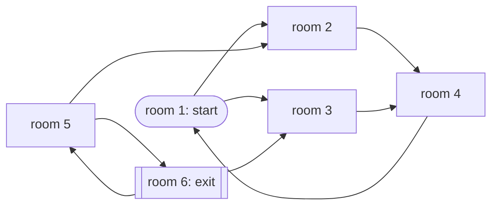
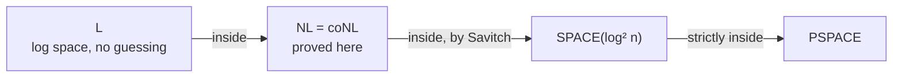

# NL = coNL: a guessing machine can certify that no path exists, by counting

[Syllabus](../../../SYLLABUS.md) → [Computability and complexity](../README.md) → [Time Complexity](../README.md#s03) → NL = coNL

---

## General Overview

A small building has 6 rooms joined by 9 one-way doors. A visitor starts in room 1. The exit is room 6. Can the visitor get out?

A "yes" is easy to prove: show the route, door by door. A "no" looks harder. Ruling out every route seems to need a list of rooms already visited, one bit per room, so its memory grows with the building.

The **Immerman–Szelepcsényi theorem** says the "no" costs no more memory than the "yes". The trick is to count. A guessing machine (one that may guess at each step and accepts when some run of guesses accepts) works out how many rooms are reachable within 0, 1, 2 and 3 doors. For this building the counts are 1, 3, 4 and 4. The count stopped growing, so exactly 4 rooms are reachable.

Then the machine finds 4 reachable rooms again, one at a time, each with a route. None of them is room 6. Since there are only 4 reachable rooms and it has seen all of them, room 6 is not reachable. The machine accepts "no path". At every moment it holds only a few room numbers and counts, never the list.

**Knowing exactly how many rooms are reachable turns "the exit cannot be reached" into something a guessing machine can prove, by producing that many reachable rooms and showing that none is the exit; and the count itself can be built up, one door at a time, with the same trick.**

**What kind of fact this is:** a theorem, proved on this card in Why it works. It was found independently by Neil Immerman and Róbert Szelepcsényi and published in 1988.

### The picture: the building



Each arrow is a one-way door. Rooms 5 and 6 have doors *into* the start's side, but no door leads from rooms 1 to 4 out to rooms 5 or 6. So the exit is unreachable.

---

## The formula

Notation first, in words. A **directed graph** $`G`$ is a set of points, here rooms, joined by one-way arrows, here doors; $`u \to v`$ means there is a door from room u to room v. The graph has $`n`$ rooms. **PATH** is the problem "given G, a start s and a target t, is there a route from s to t?" Its **complement** $`\mathrm{PATH}^c`$ asks "is there no route?"

**NL** is the class of problems a guessing machine solves using about $`\log_2 n`$ cells of working memory, with the input on a separate tape it can only read. **L** is the same without guessing. [Logarithmic space](10-logarithmic-space-l-and-nl.md) defines both and shows that PATH is **NL-complete**: every problem in NL turns into PATH using log space. **coNL** is the class of complements of NL problems: the "no" side of each.

The theorem:

```math
\mathrm{NL} = \mathrm{coNL}, \qquad \text{and} \qquad \mathrm{NSPACE}(s(n)) = \mathrm{coNSPACE}(s(n)) \ \text{ for every } s(n) \ge \log_2 n
```

**Read it aloud:** whatever a guessing machine can confirm in logarithmic memory, it can also refute in logarithmic memory; and the same holds for any memory budget of at least $`\log_2 n`$ cells.

Here $`\mathrm{NSPACE}(s(n))`$ is the class of problems a guessing machine solves within s(n) cells, and coNSPACE is the class of their complements.

The engine of the proof is one recursion. Let $`R_k`$ be the set of rooms reachable from s by at most k doors, and $`c_k`$ its size:

```math
R_0 = \{s\}, \qquad R_{k+1} = R_k \cup \{\, v : u \to v \text{ for some } u \in R_k \,\}, \qquad c_k = \lvert R_k \rvert
```

**Read it aloud:** at first only the start is reachable; a room is reachable within k + 1 doors if it was already reachable within k, or has a door from a room that was; and $`c_k`$ counts those rooms.

In the building, $`c_0, c_1, c_2, c_3 = 1, 3, 4, 4`$. Once $`c_{k+1} = c_k`$, the set has stopped growing for good, so $`R_k`$ is every reachable room.

| Symbol | Plain meaning | In our example | Push it up and the answer… |
| --- | --- | --- | --- |
| $`G`$, $`u \to v`$ | the graph; a one-way door from room u to room v | 6 rooms, 9 doors | more doors, more rooms reachable |
| $`n`$ | the number of rooms; the input, the list of doors, is longer, but its length grows only polynomially with n | 6 | registers grow as $`\log_2 n`$ |
| $`s`$, $`t`$ | the start and the target | room 1 and room 6 | — |
| $`k`$ | the number of doors allowed so far | 0, 1, 2, 3 | $`R_k`$ can only grow |
| $`R_k`$; $`R`$ | rooms reachable within k doors; R is the settled set, every reachable room | $`R_2 = \{1, 2, 3, 4\}`$ | — |
| $`c_k`$; $`c`$ | the size of $`R_k`$: the count the machine keeps; c is the settled count | 1, 3, 4, 4 | at most n |
| $`X`$ | the set of rooms a branch guesses are in $`R_k`$ | must be exactly $`\{1, 2, 3, 4\}`$ to survive | — |
| $`\mathrm{PATH}`$, $`\mathrm{PATH}^c`$ | is there a route? is there none? | no route; yes, none | — |
| $`\mathrm{L}`$, $`\mathrm{NL}`$, $`\mathrm{coNL}`$ | log space without guessing; with guessing; complements of NL | $`\mathrm{PATH}^c`$ is in NL | — |
| $`\mathrm{NSPACE}(s(n))`$, coNSPACE | problems a guessing machine solves in s(n) cells, and their complements; the budget s(n) is unrelated to the start s | s(n) = $`\log_2 n`$ gives NL | a bigger class |

### When it holds

- **The theorem is about guessing machines.** An ordinary machine has nothing to prove: it swaps its yes and no answers, so L = coL at once. A guessing machine cannot swap, because one rejecting branch proves nothing. Whether guessing adds any power, L = NL, is open as of 2026-11-24.
- **The memory budget must be at least $`\log_2 n`$.** The machine must write down one room number, which needs $`\log_2 n`$ bits. Below that it cannot even name a room, and the argument says nothing.
- **The doors are one-way.** For two-way doors, Reingold proved in 2005 (journal version 2008) that PATH is already in L, with no guessing at all. The theorem matters for directed graphs.
- **Space, not time.** The counting runs over every configuration of the machine being complemented. Its memory grows only with the bits that name one configuration; its running time grows with how many configurations there are. A log-space machine has polynomially many, so both stay small. A machine in NP can have exponentially many, so the same counting would take exponentially many steps. Whether NP = coNP is open as of 2026-11-24.
- **The count must be exact.** A branch that lists fewer rooms, or a count stopped too early, accepts "no path" when a path exists (below).

---

## Why it works

### Step 0: a count turns absence into presence

A guessing machine proves "yes" by guessing a witness and checking it. A branch that fails to find a route proves nothing: it may have guessed badly.

A count changes this. Suppose the machine knows that exactly 4 rooms are reachable. If it then produces 4 distinct reachable rooms, each with a checked route, it has found all of them. If room 6 is not among them, room 6 is not reachable. "Not reachable" has become "here are 4 reachable rooms, and none is the exit", which a guess can prove.

So the proof has two parts. Step 1 uses the count. Step 2 computes the count, using the same trick round by round.

### Step 1: given the count, certify "no path"

Suppose the machine already holds $`c = 4`$, the number of rooms reachable within $`k = 3`$ doors. It runs this pass:

1. Set a tally to 0.
2. For each room v from 1 to 6, guess "v is reachable" or "v is not".
3. If it guessed "reachable", guess a route of at most k doors from room 1 to v, one room at a time, checking each door. A wrong door ends this branch with a reject. If v is the exit, reject. Otherwise add 1 to the tally.
4. At the end, accept "no path" only if the tally equals c.

In the building, only one guessed list survives: rooms 1, 2, 3 and 4. Several branches produce it, because they may guess different routes; room 4 alone has two, 1 → 2 → 4 and 1 → 3 → 4. Each such branch's tally reaches 4, which equals c, and room 6 was never listed.

Why no branch can cheat: a branch can only count a room it routed to, so its tally is at most the true count. To reach c, it must list every reachable room. If the exit were reachable, it would have to list it, and reject.

### Step 2: compute the count, round by round

The count $`c_{k+1}`$ comes from $`c_k`$. For each room v, the machine decides "is v in $`R_{k+1}`$?" by the same pass as Step 1:

1. For each room u, guess whether u is in $`R_k`$. If yes, guess and check a route of at most k doors to u, and add 1 to a tally.
2. While doing so, note whether some listed u equals v or has a door $`u \to v`$.
3. At the end, if the tally is not $`c_k`$, reject this branch.

A surviving branch has listed all of $`R_k`$, so its answer "v is in $`R_{k+1}`$" is correct. Add 1 to $`c_{k+1}`$ for each v answered yes. Then throw away $`c_k`$ and keep $`c_{k+1}`$.

Here is round 2 in the building, which uses $`c_1 = 3`$ to find $`c_2`$.

| Room v | Surviving branch lists $`R_1`$ | Has v, or a door into v? | In $`R_2`$? |
| --- | --- | --- | --- |
| 1 | {1, 2, 3} | 1 itself | yes |
| 2 | {1, 2, 3} | door 1 → 2 | yes |
| 3 | {1, 2, 3} | door 1 → 3 | yes |
| 4 | {1, 2, 3} | doors 2 → 4 and 3 → 4 | yes |
| 5 | {1, 2, 3} | none | no |
| 6 | {1, 2, 3} | none | no |

So $`c_2 = 4`$. Round 3 repeats this with $`c_2 = 4`$ and finds $`c_3 = 4`$. The count stopped growing.

### Step 3: why the count settles, and why it is enough

If $`R_{k+1} = R_k`$, then $`R_{k+2}`$ is built from the same set by the same rule, so it is $`R_k`$ again, and so on forever. Since $`R_k`$ only grows and holds at most n rooms, it settles within n − 1 rounds. A one-way corridor of 6 rooms needs all 5.

Because $`R_k`$ only grows, equal counts mean equal sets. So $`c_{k+1} = c_k`$ tells the machine that $`R_k`$ is every reachable room. Step 1 then runs with that count.

<details>
<summary>Detailed proof: every surviving branch computes the true count</summary>

Claim: suppose a branch enters round k + 1 holding the true value $`c_k = \lvert R_k \rvert`$. Then every surviving branch computes the true $`c_{k+1}`$, and at least one branch survives.

Fix a room v. A branch lists rooms $`X`$ and checks a route of at most k doors to each, so $`X \subseteq R_k`$. It survives only if $`\lvert X \rvert = c_k = \lvert R_k \rvert`$. A subset of a finite set with the same size is the whole set, so $`X = R_k`$. The branch says yes exactly when some u in X equals v or has a door to v, which by the recursion means

$`\displaystyle v \in R_{k+1} \iff \exists\, u \in R_k : u = v \ \text{or}\ u \to v`$

So the answer is correct. The branch that guesses $`X = R_k`$ with real routes survives, so some branch survives.

Adding over all v, every surviving branch reaches the true $`c_{k+1}`$. By induction from $`c_0 = 1`$, every surviving branch holds the true count at every round.

In the final pass, the same argument with the settled count c gives $`X = R`$, the full reachable set. The branch accepts only if t is not in X. So some branch accepts if t is unreachable, and no branch accepts if t is reachable. This is a guessing machine for $`\mathrm{PATH}^c`$.

</details>

### Step 4: the memory bill

At any moment the machine holds a fixed list of numbers, each at most n:

- the round k, the old count $`c_k`$ and the new count $`c_{k+1}`$;
- the room v being decided and the room u being guessed;
- the tally of rooms listed so far;
- the length of the route being guessed, and the room the route has reached;
- one flag: "v has been found".

That is 8 numbers, each with enough bits to write any number up to n (about $`\log_2 n`$), plus 1 bit. For 6 rooms it is 25 bits; for 1,000,000 rooms it is 161 bits. A list with one bit per room costs 1,000,000 bits. The count is a register-by-register model, not a measured run.

The guesses are never stored: each guessed room is checked against the door list, then overwritten. So the machine needs only $`O(\log n)`$ cells.

### Step 5: what this does to the space classes

**NL = coNL.** Steps 1 to 4 put $`\mathrm{PATH}^c`$ in NL. Every problem in NL turns into PATH using log space ([Logarithmic space](10-logarithmic-space-l-and-nl.md)), so every problem in coNL turns into $`\mathrm{PATH}^c`$, which is in NL. So coNL ⊆ NL. Taking complements of both sides gives NL ⊆ coNL.

**Any space budget.** A machine that uses s(n) cells has at most $`2^{O(s(n))}`$ configurations (a configuration is the state, the head positions and the tape contents). Treat each configuration as a room and each allowed move as a door. Rejecting means "no accepting configuration is reachable", and the counting machine checks that in $`O(s(n))`$ cells, because each room name is $`O(s(n))`$ bits.

**Context-sensitive languages.** Kuroda showed in 1964 that context-sensitive languages are exactly $`\mathrm{NSPACE}(n)`$: guessing machines kept inside the input's own cells. So the complement of a context-sensitive language is context-sensitive. This settles Kuroda's second question, open since 1964. His first, whether guessing helps in linear space at all, is still open as of 2026-11-24 ([The language ladder](../01-Models%20of%20Computation/06-chomsky-hierarchy-and-the-language-ladder.md)).



Schematic. A solid arrow means "is contained in". Savitch's theorem ([Above NP](08-conp-pspace-and-the-polynomial-hierarchy.md)) gives the second arrow. The strict third arrow is the [Space hierarchy](12-space-hierarchy-theorem.md). Whether L = NL is open as of 2026-11-24.

---

## Worked numbers, by hand

| Step | Arithmetic | Value |
| --- | --- | --- |
| round 0 | only the start | $`c_0 = 1`$ |
| round 1 | $`R_0 = \{1\}`$, doors 1 → 2, 1 → 3 | $`c_1 = 3`$ |
| round 2 | $`R_1 = \{1, 2, 3\}`$, doors 2 → 4, 3 → 4 | $`c_2 = 4`$ |
| round 3 | $`R_2 = \{1, 2, 3, 4\}`$, door 4 → 1 adds nothing | $`c_3 = 4`$, count settled |
| branches per room per round | 64 guessed sets, only $`X = R_k`$ survives | 1 survivor |
| final pass | 64 guessed sets; only those listing exactly 4 rooms count; routes of at most 3 doors | 1 set survives: {1, 2, 3, 4} |
| exit in the list? | 6 is not in {1, 2, 3, 4} | **accept "no path"** |
| memory | 8 × 3 bits + 1 flag | 25 bits |

The machine has proved, without ever holding a list of rooms, that room 6 cannot be reached from room 1.

The counts as bars, four marks per room:

```text
c_0 ####                     1
c_1 ############             3
c_2 ################         4
c_3 ################         4
```

### What breaks if you drop a piece

Maze B is the same building with one more door, 4 → 5. Now the exit is reachable: 1 → 2 → 4 → 5 → 6, four doors. The honest machine counts 1, 3, 4, 5, 6, 6 and no branch accepts "no path".

| Mistake | Comes out at | What went wrong |
| --- | --- | --- |
| Drop the final check "tally equals c" | maze B: 32 branches accept "no path" | a branch can skip rooms 5 and 6 and still accept |
| Stop counting after 2 rounds | maze B: counts 1, 3, 4; 1 branch accepts "no path" | $`R_2`$ is not every reachable room; the exit is 4 doors away |
| Drop the check "tally equals $`c_k`$" in round 2 | maze A: rooms 1, 2, 3 and 4 each get both answers | branches disagree, so there is no single count |
| Keep a list of rooms instead of counts | 1,000,000 bits at 1,000,000 rooms, against 161 | correct, but the memory is no longer logarithmic |

The code prints every row.

---

## Code, from first principles, and it actually runs

The code runs the guessing machine on the building by trying every guess it could make: all 64 guessed sets of rooms, and every guessed route of at most k doors. It takes **two independent roads** to the counts and the answer, plus an invariant.

- **Road 1, no guessing.** Build $`R_0, R_1, \ldots`$ directly as sets, one door at a time.
- **Road 2, the guessing machine.** Keep only counts. In every round, for every room, try all 64 guessed sets, and check that exactly one branch survives. A branch here is one guessed set: guesses of the same set with different routes give the same answer, so the code merges them. Its counts must equal road 1's set sizes, and it must accept "no path" exactly when road 1 says the exit is unreachable.
- **The invariant.** On maze B, where the exit is reachable, no branch accepts. On a 6-room corridor, the count takes exactly n − 1 = 5 rounds to settle.

### Python

```python
# NL = coNL: a guessing machine certifies "no path" by inductive counting.
# Standard library only. Rooms 1 to 6, start room 1, exit room 6, one-way doors.
# The guessing machine is simulated by trying every guess it could make: every guessed
# set of rooms (a 6-bit mask, 64 of them) and every guessed walk of at most k doors.
N, START, EXIT = 6, 1, 6
MAZE_A = [(1, 2), (1, 3), (2, 4), (3, 4), (4, 1), (5, 6), (6, 5), (5, 2), (6, 3)]
MAZE_B = MAZE_A + [(4, 5)]                      # one extra door: now the exit is reachable
CORRIDOR = [(r, r + 1) for r in range(1, N)]   # 1 -> 2 -> 3 -> 4 -> 5 -> 6

def layers(doors, rounds):
    """Road 1, no guessing: the sets R_0, R_1, ... built explicitly, one door at a time."""
    sets = [{START}]
    for _ in range(rounds):
        sets.append(sets[-1] | {b for a, b in doors if a in sets[-1]})
    return sets

def walks(door, u, k):
    """The machine's walk guess, every guess tried: room sequences of at most k doors
    from START that end at u. A guess that is not a real door kills that branch."""
    good, seqs = 0, [[START]]
    for _ in range(k + 1):
        good += sum(1 for s in seqs if s[-1] == u)
        seqs = [s + [r] for s in seqs for r in range(1, N + 1) if (s[-1], r) in door]
    return good

def members(g):
    return [u for u in range(1, N + 1) if g >> (u - 1) & 1]

def round_answers(door, v, c, k, check=True):
    """One counting round, for room v: each branch guesses a set G of rooms 'within k doors',
    proves each member by a walk, and (if check) must have exactly c members.
    Returns the answers 'v is within k + 1 doors' given by surviving branches, and their number."""
    answers, alive = set(), 0
    for g in range(2 ** N):
        G = members(g)
        if (check and len(G) != c) or not all(walks(door, u, k) for u in G):
            continue                                          # this branch rejects
        alive += 1
        answers.add(any(u == v or (u, v) in door for u in G))
    return answers, alive

def machine(doors, final_check=True, max_rounds=99):
    """Road 2: the guessing machine, every branch tried. Counts c_k until the count
    repeats, then re-finds c rooms one by one and accepts 'no path' if none is the exit."""
    door, c, k, counts = set(doors), 1, 0, [1]
    while k < max_rounds:
        new = 0
        for v in range(1, N + 1):
            answers, alive = round_answers(door, v, c, k)
            assert alive == 1 and len(answers) == 1           # exactly one branch survives
            new += answers.pop()
        k += 1
        counts.append(new)
        if new == c:
            break
        c = new
    acc = sum(1 for g in range(2 ** N)
              if (not final_check or len(members(g)) == c)
              and all(walks(door, u, k) for u in members(g)) and EXIT not in members(g))
    return counts, acc, k

def names(s):
    return "{" + ", ".join(str(r) for r in sorted(s)) + "}"

print("maze A: rooms 1-6, start 1, exit 6, doors " + " ".join(f"{a}>{b}" for a, b in MAZE_A))
counts, acc, k = machine(MAZE_A)
sets = layers(MAZE_A, len(counts) - 1)
for j, s in enumerate(sets):
    print(f"road 1, k {j}: R_{j} = {names(s):<14} size {len(s)}   road 2, c_{j} = {counts[j]}")
assert counts == [len(s) for s in sets] == [1, 3, 4, 4]       # guessing count = explicit sets
print(f"road 2: count stops growing at round {k}; 6 rooms x 64 guessed sets per round, 1 branch survives per room")
print(f"road 2: final pass, 64 guessed sets, only those listing exactly {counts[-1]} rooms count: {acc} branch accepts 'no path'")
assert acc == 1 and EXIT not in sets[-1]
for j, c in enumerate(counts):
    print(f"bar c_{j} " + "####" * c + " " * (4 * (N - c)) + f" {c}")
w4 = walks(set(MAZE_A), 4, 2)
print(f"walk guesses: room 4 within 2 doors has {w4} proofs (1>2>4, 1>3>4); room 5 within 3 doors has {walks(set(MAZE_A), 5, 3)}")
assert w4 == 2

cb, ab, kb = machine(MAZE_B)
sb = layers(MAZE_B, len(cb) - 1)
print(f"maze B (add door 4>5): counts {cb}, R = {names(sb[-1])}, accepting branches {ab}")
assert cb == [len(s) for s in sb] and ab == 0 and EXIT in sb[-1]
cc, ac, kc = machine(CORRIDOR)
print(f"corridor 1>2>3>4>5>6: counts {cc}, growth stops at round {kc - 1} = n - 1, accepting branches {ac}")
assert cc == [len(s) for s in layers(CORRIDOR, len(cc) - 1)] and kc - 1 == N - 1

_, wrong1, _ = machine(MAZE_B, final_check=False)
print(f"wrong: drop the final count check, maze B: {wrong1} branches accept 'no path'")
assert wrong1 == 32
_, a2, _ = machine(MAZE_A, final_check=False)
c2, wrong2, _ = machine(MAZE_B, max_rounds=2)
print(f"wrong: stop after 2 rounds, maze B: counts {c2}, {wrong2} branch accepts 'no path'; exit is 4 doors away")
assert wrong2 == 1 and EXIT in layers(MAZE_B, 4)[4] and EXIT not in layers(MAZE_B, 3)[3]
mixed = [v for v in range(1, N + 1) if len(round_answers(set(MAZE_A), v, 3, 1, check=False)[0]) == 2]
print(f"wrong: drop the count check in round 2, maze A: rooms {mixed} get both answers")
assert mixed == [1, 2, 3, 4]

def reg_bits(n):        # 8 registers of a room number or count, plus one 'found' flag
    return 8 * n.bit_length() + 1
print("memory: rooms n, counting registers (8 numbers up to n in binary + 1 flag), one-bit-per-room list")
for n in (6, 1000, 1000000):
    print(f"  n {n:>9,}  registers {reg_bits(n):>4} bits  list {n:>9,} bits")
cross = next(n for n in range(2, 10 ** 4) if all(reg_bits(m) < m for m in range(n, 10 ** 4)))
print(f"registers beat the list for every n from {cross} on (checked to 9,999)")
assert cross == 50 and reg_bits(10 ** 6) == 161
print(f"try: drop the final count check, maze A: {a2} branches accept, all happen to be right")
print(f"try: n = 10^9 rooms: registers {reg_bits(10 ** 9)} bits")
print("ALL CHECKS PASS")
```

**Ran 2026-11-24 on macOS, Python 3.14.10, standard library only. All checks passed. Output, pasted from the run:**

```text
maze A: rooms 1-6, start 1, exit 6, doors 1>2 1>3 2>4 3>4 4>1 5>6 6>5 5>2 6>3
road 1, k 0: R_0 = {1}            size 1   road 2, c_0 = 1
road 1, k 1: R_1 = {1, 2, 3}      size 3   road 2, c_1 = 3
road 1, k 2: R_2 = {1, 2, 3, 4}   size 4   road 2, c_2 = 4
road 1, k 3: R_3 = {1, 2, 3, 4}   size 4   road 2, c_3 = 4
road 2: count stops growing at round 3; 6 rooms x 64 guessed sets per round, 1 branch survives per room
road 2: final pass, 64 guessed sets, only those listing exactly 4 rooms count: 1 branch accepts 'no path'
bar c_0 ####                     1
bar c_1 ############             3
bar c_2 ################         4
bar c_3 ################         4
walk guesses: room 4 within 2 doors has 2 proofs (1>2>4, 1>3>4); room 5 within 3 doors has 0
maze B (add door 4>5): counts [1, 3, 4, 5, 6, 6], R = {1, 2, 3, 4, 5, 6}, accepting branches 0
corridor 1>2>3>4>5>6: counts [1, 2, 3, 4, 5, 6, 6], growth stops at round 5 = n - 1, accepting branches 0
wrong: drop the final count check, maze B: 32 branches accept 'no path'
wrong: stop after 2 rounds, maze B: counts [1, 3, 4], 1 branch accepts 'no path'; exit is 4 doors away
wrong: drop the count check in round 2, maze A: rooms [1, 2, 3, 4] get both answers
memory: rooms n, counting registers (8 numbers up to n in binary + 1 flag), one-bit-per-room list
  n         6  registers   25 bits  list         6 bits
  n     1,000  registers   81 bits  list     1,000 bits
  n 1,000,000  registers  161 bits  list 1,000,000 bits
registers beat the list for every n from 50 on (checked to 9,999)
try: drop the final count check, maze A: 16 branches accept, all happen to be right
try: n = 10^9 rooms: registers 241 bits
ALL CHECKS PASS
```

### Rust

```rust
// NL = coNL: a guessing machine certifies "no path" by inductive counting.
// std only. Rooms 1 to 6, start room 1, exit room 6, one-way doors.
// The guessing machine is simulated by trying every guess it could make: every guessed
// set of rooms (a 6-bit mask, 64 of them) and every guessed walk of at most k doors.
use std::collections::BTreeSet;

const N: usize = 6;
const START: usize = 1;
const EXIT: usize = 6;
type Doors = Vec<(usize, usize)>;

// Road 1, no guessing: the sets R_0, R_1, ... built explicitly, one door at a time.
fn layers(doors: &Doors, rounds: usize) -> Vec<BTreeSet<usize>> {
    let mut sets = vec![BTreeSet::from([START])];
    for _ in 0..rounds {
        let mut next = sets.last().unwrap().clone();
        for &(a, b) in doors {
            if sets.last().unwrap().contains(&a) { next.insert(b); }
        }
        sets.push(next);
    }
    sets
}

// The machine's walk guess, every guess tried: room sequences of at most k doors
// from START that end at u. A guess that is not a real door kills that branch.
fn walks(door: &Doors, u: usize, k: usize) -> usize {
    let (mut good, mut seqs) = (0, vec![vec![START]]);
    for _ in 0..=k {
        good += seqs.iter().filter(|s| *s.last().unwrap() == u).count();
        let mut next = Vec::new();
        for s in &seqs {
            for r in 1..=N {
                if door.contains(&(*s.last().unwrap(), r)) {
                    let mut t = s.clone();
                    t.push(r);
                    next.push(t);
                }
            }
        }
        seqs = next;
    }
    good
}

fn members(g: usize) -> Vec<usize> { (1..=N).filter(|&u| g >> (u - 1) & 1 == 1).collect() }

// One counting round, for room v: each branch guesses a set G of rooms 'within k doors',
// proves each member by a walk, and (if check) must have exactly c members.
// Returns the answers 'v is within k + 1 doors' given by surviving branches, and their number.
fn round_answers(door: &Doors, v: usize, c: usize, k: usize, check: bool) -> (BTreeSet<bool>, usize) {
    let (mut answers, mut alive) = (BTreeSet::new(), 0);
    for g in 0..(1usize << N) {
        let gs = members(g);
        if (check && gs.len() != c) || !gs.iter().all(|&u| walks(door, u, k) > 0) {
            continue; // this branch rejects
        }
        alive += 1;
        answers.insert(gs.iter().any(|&u| u == v || door.contains(&(u, v))));
    }
    (answers, alive)
}

// Road 2: the guessing machine, every branch tried. Counts c_k until the count
// repeats, then re-finds c rooms one by one and accepts 'no path' if none is the exit.
fn machine(door: &Doors, final_check: bool, max_rounds: usize) -> (Vec<usize>, usize, usize) {
    let (mut c, mut k, mut counts) = (1usize, 0usize, vec![1usize]);
    while k < max_rounds {
        let mut new = 0;
        for v in 1..=N {
            let (answers, alive) = round_answers(door, v, c, k, true);
            assert!(alive == 1 && answers.len() == 1); // exactly one branch survives
            new += *answers.iter().next().unwrap() as usize;
        }
        k += 1;
        counts.push(new);
        if new == c { break; }
        c = new;
    }
    let acc = (0..(1usize << N)).filter(|&g| {
        let gs = members(g);
        (!final_check || gs.len() == c) && gs.iter().all(|&u| walks(door, u, k) > 0) && !gs.contains(&EXIT)
    }).count();
    (counts, acc, k)
}

fn names(s: &BTreeSet<usize>) -> String {
    format!("{{{}}}", s.iter().map(|r| r.to_string()).collect::<Vec<_>>().join(", "))
}

fn reg_bits(n: u64) -> u64 { 8 * (64 - n.leading_zeros() as u64) + 1 } // 8 registers + 1 flag

fn commas(x: u64) -> String {
    let s = x.to_string();
    let mut out = String::new();
    for (k, ch) in s.chars().enumerate() {
        if k > 0 && (s.len() - k) % 3 == 0 { out.push(','); }
        out.push(ch);
    }
    out
}

fn main() {
    let maze_a: Doors = vec![(1, 2), (1, 3), (2, 4), (3, 4), (4, 1), (5, 6), (6, 5), (5, 2), (6, 3)];
    let mut maze_b = maze_a.clone();
    maze_b.push((4, 5)); // one extra door: now the exit is reachable
    let corridor: Doors = (1..N).map(|r| (r, r + 1)).collect();
    let ds: Vec<String> = maze_a.iter().map(|(a, b)| format!("{}>{}", a, b)).collect();
    println!("maze A: rooms 1-6, start 1, exit 6, doors {}", ds.join(" "));
    let (counts, acc, k) = machine(&maze_a, true, 99);
    let sets = layers(&maze_a, counts.len() - 1);
    for (j, s) in sets.iter().enumerate() {
        println!("road 1, k {}: R_{} = {:<14} size {}   road 2, c_{} = {}", j, j, names(s), s.len(), j, counts[j]);
    }
    assert!(counts == sets.iter().map(|s| s.len()).collect::<Vec<_>>() && counts == vec![1, 3, 4, 4]);
    println!("road 2: count stops growing at round {}; 6 rooms x 64 guessed sets per round, 1 branch survives per room", k);
    println!("road 2: final pass, 64 guessed sets, only those listing exactly {} rooms count: {} branch accepts 'no path'", counts[counts.len() - 1], acc);
    assert!(acc == 1 && !sets[sets.len() - 1].contains(&EXIT));
    for (j, &c) in counts.iter().enumerate() {
        println!("bar c_{} {}{} {}", j, "####".repeat(c), " ".repeat(4 * (N - c)), c);
    }
    let w4 = walks(&maze_a, 4, 2);
    println!("walk guesses: room 4 within 2 doors has {} proofs (1>2>4, 1>3>4); room 5 within 3 doors has {}", w4, walks(&maze_a, 5, 3));
    assert!(w4 == 2);

    let (cb, ab, _) = machine(&maze_b, true, 99);
    let sb = layers(&maze_b, cb.len() - 1);
    println!("maze B (add door 4>5): counts {:?}, R = {}, accepting branches {}", cb, names(&sb[sb.len() - 1]), ab);
    assert!(cb == sb.iter().map(|s| s.len()).collect::<Vec<_>>() && ab == 0 && sb[sb.len() - 1].contains(&EXIT));
    let (cc, ac, kc) = machine(&corridor, true, 99);
    println!("corridor 1>2>3>4>5>6: counts {:?}, growth stops at round {} = n - 1, accepting branches {}", cc, kc - 1, ac);
    assert!(cc == layers(&corridor, cc.len() - 1).iter().map(|s| s.len()).collect::<Vec<_>>() && kc - 1 == N - 1);

    let (_, wrong1, _) = machine(&maze_b, false, 99);
    println!("wrong: drop the final count check, maze B: {} branches accept 'no path'", wrong1);
    assert!(wrong1 == 32);
    let (_, a2, _) = machine(&maze_a, false, 99);
    let (c2, wrong2, _) = machine(&maze_b, true, 2);
    println!("wrong: stop after 2 rounds, maze B: counts {:?}, {} branch accepts 'no path'; exit is 4 doors away", c2, wrong2);
    assert!(wrong2 == 1 && layers(&maze_b, 4)[4].contains(&EXIT) && !layers(&maze_b, 3)[3].contains(&EXIT));
    let mixed: Vec<usize> = (1..=N).filter(|&v| round_answers(&maze_a, v, 3, 1, false).0.len() == 2).collect();
    println!("wrong: drop the count check in round 2, maze A: rooms {:?} get both answers", mixed);
    assert!(mixed == vec![1, 2, 3, 4]);

    println!("memory: rooms n, counting registers (8 numbers up to n in binary + 1 flag), one-bit-per-room list");
    for &n in &[6u64, 1000, 1000000] {
        println!("  n {:>9}  registers {:>4} bits  list {:>9} bits", commas(n), reg_bits(n), commas(n));
    }
    let cross = (2..10000u64).find(|&n| (n..10000).all(|m| reg_bits(m) < m)).unwrap();
    println!("registers beat the list for every n from {} on (checked to 9,999)", cross);
    assert!(cross == 50 && reg_bits(1000000) == 161);
    println!("try: drop the final count check, maze A: {} branches accept, all happen to be right", a2);
    println!("try: n = 10^9 rooms: registers {} bits", reg_bits(1000000000));
    println!("ALL CHECKS PASS");
}
```

**Ran 2026-11-24 on macOS, rustc 1.98.1, no crates. All checks passed. Output, pasted from the run:**

```text
maze A: rooms 1-6, start 1, exit 6, doors 1>2 1>3 2>4 3>4 4>1 5>6 6>5 5>2 6>3
road 1, k 0: R_0 = {1}            size 1   road 2, c_0 = 1
road 1, k 1: R_1 = {1, 2, 3}      size 3   road 2, c_1 = 3
road 1, k 2: R_2 = {1, 2, 3, 4}   size 4   road 2, c_2 = 4
road 1, k 3: R_3 = {1, 2, 3, 4}   size 4   road 2, c_3 = 4
road 2: count stops growing at round 3; 6 rooms x 64 guessed sets per round, 1 branch survives per room
road 2: final pass, 64 guessed sets, only those listing exactly 4 rooms count: 1 branch accepts 'no path'
bar c_0 ####                     1
bar c_1 ############             3
bar c_2 ################         4
bar c_3 ################         4
walk guesses: room 4 within 2 doors has 2 proofs (1>2>4, 1>3>4); room 5 within 3 doors has 0
maze B (add door 4>5): counts [1, 3, 4, 5, 6, 6], R = {1, 2, 3, 4, 5, 6}, accepting branches 0
corridor 1>2>3>4>5>6: counts [1, 2, 3, 4, 5, 6, 6], growth stops at round 5 = n - 1, accepting branches 0
wrong: drop the final count check, maze B: 32 branches accept 'no path'
wrong: stop after 2 rounds, maze B: counts [1, 3, 4], 1 branch accepts 'no path'; exit is 4 doors away
wrong: drop the count check in round 2, maze A: rooms [1, 2, 3, 4] get both answers
memory: rooms n, counting registers (8 numbers up to n in binary + 1 flag), one-bit-per-room list
  n         6  registers   25 bits  list         6 bits
  n     1,000  registers   81 bits  list     1,000 bits
  n 1,000,000  registers  161 bits  list 1,000,000 bits
registers beat the list for every n from 50 on (checked to 9,999)
try: drop the final count check, maze A: 16 branches accept, all happen to be right
try: n = 10^9 rooms: registers 241 bits
ALL CHECKS PASS
```

### Lean

Lean proves the counting facts on every finite one-way graph, not NL = coNL itself, and checks the building's numbers.

- Take any directed graph, a start s and a target t. Then t is unreachable exactly when some list of reachable rooms has c rooms and leaves out t.
- Suppose a branch's list X holds only rooms in $`R_k`$, and has $`c_k`$ rooms. Then v is in $`R_{k+1}`$ exactly when some room in X is v or has a door into v.
- Suppose $`c_{k+1} = c_k`$. Then $`R_k`$ is every reachable room.
- Take a graph with n rooms. Then $`R_{n-1}`$ is every reachable room.
- In the building, the counts are 1, 3, 4, 4, $`R_2 = \{1, 2, 3, 4\}`$, and room 6 is not in $`R_3`$.
- In maze B, the counts are 1, 3, 4, 5, 6, 6, and room 6 is in $`R_4`$.
- In maze B, $`R_2`$ has 4 rooms and leaves out room 6, so stopping after 2 rounds goes wrong.
- The corridor counts 1, 2, 3, 4, 5, 6, 6, so it needs all 5 rounds.
- The hand numbers are right: 64 guessed sets, and 25, 161 and 241 register bits for 6, 1,000,000 and 1,000,000,000 rooms.

The guessing machine's branches, the broken versions and the memory table are left to the Python and Rust checks.

```lean
-- NL = coNL: on any finite directed graph, an exact count of the reachable rooms lets a guesser certify that no path exists, and that count is built round by round from the previous one.
import Mathlib.Combinatorics.Digraph.Basic
import Mathlib.Data.Fintype.Card
import Mathlib.SetTheory.Cardinal.Finite
import Mathlib.Logic.Relation
import Mathlib.Tactic.NormNum

open Finset

/-- `reachWithin G s k` is the card's `R_k`: the rooms reachable from `s` by at most `k` doors.
`R_0 = {s}` and `R_{k+1} = R_k ∪ {v : u → v for some u ∈ R_k}`. -/
def reachWithin {V : Type*} [Fintype V] [DecidableEq V] (G : Digraph V) [DecidableRel G.Adj]
    (s : V) : ℕ → Finset V
  | 0 => {s}
  | k + 1 => reachWithin G s k ∪ univ.filter (fun v => ∃ u ∈ reachWithin G s k, G.Adj u v)


section helpers
variable {V : Type*} [Fintype V] [DecidableEq V] (G : Digraph V) [DecidableRel G.Adj] (s : V)

theorem reachWithin_succ_eq (k : ℕ) :
    reachWithin G s (k + 1) =
      reachWithin G s k ∪ univ.filter (fun v => ∃ u ∈ reachWithin G s k, G.Adj u v) := rfl

theorem mem_reachWithin_succ (k : ℕ) (v : V) :
    v ∈ reachWithin G s (k + 1) ↔
      v ∈ reachWithin G s k ∨ ∃ u ∈ reachWithin G s k, G.Adj u v := by
  rw [reachWithin_succ_eq]; simp

theorem reachWithin_subset_succ (k : ℕ) : reachWithin G s k ⊆ reachWithin G s (k + 1) := by
  rw [reachWithin_succ_eq]; exact Finset.subset_union_left

theorem reachWithin_mono {k m : ℕ} (h : k ≤ m) : reachWithin G s k ⊆ reachWithin G s m := by
  induction m, h using Nat.le_induction with
  | base => exact Finset.Subset.refl _
  | succ m _ ih => exact ih.trans (reachWithin_subset_succ G s m)

theorem reachWithin_sound (k : ℕ) (v : V) (hv : v ∈ reachWithin G s k) :
    Relation.ReflTransGen G.Adj s v := by
  induction k generalizing v with
  | zero =>
    have : v = s := by simpa [reachWithin] using hv
    subst this; exact Relation.ReflTransGen.refl
  | succ k ih =>
    rcases (mem_reachWithin_succ G s k v).1 hv with h | ⟨u, hu, huv⟩
    · exact ih v h
    · exact (ih u hu).tail huv

theorem reachWithin_complete (v : V) (hv : Relation.ReflTransGen G.Adj s v) :
    ∃ k, v ∈ reachWithin G s k := by
  induction hv with
  | refl => exact ⟨0, by simp [reachWithin]⟩
  | tail _ hbc ih =>
    obtain ⟨k, hk⟩ := ih
    exact ⟨k + 1, (mem_reachWithin_succ G s k _).2 (Or.inr ⟨_, hk, hbc⟩)⟩

theorem reachWithin_stable (k : ℕ)
    (h : (reachWithin G s (k + 1)).card = (reachWithin G s k).card) :
    ∀ j, reachWithin G s (k + j) = reachWithin G s k := by
  have heq : reachWithin G s (k + 1) = reachWithin G s k :=
    (Finset.eq_of_subset_of_card_le (reachWithin_subset_succ G s k) h.le).symm
  intro j
  induction j with
  | zero => rfl
  | succ j ih =>
    rw [← Nat.add_assoc, reachWithin_succ_eq, ih, ← reachWithin_succ_eq, heq]

end helpers

/-- Counting certifies absence: on a finite directed graph, the target `t` is unreachable from `s`
exactly when there is a list `X` of rooms, each reachable from `s`, whose size equals the number
of reachable rooms, and which does not contain `t`. -/
theorem no_path_iff_count_certificate {V : Type*} [Fintype V] (G : Digraph V) (s t : V) :
    ¬ Relation.ReflTransGen G.Adj s t ↔
      ∃ X : Finset V, (∀ u ∈ X, Relation.ReflTransGen G.Adj s u) ∧
        X.card = Nat.card {v // Relation.ReflTransGen G.Adj s v} ∧ t ∉ X := by
  classical
  constructor
  · intro ht
    refine ⟨univ.filter (fun v => Relation.ReflTransGen G.Adj s v), ?_, ?_, ?_⟩
    · intro u hu; simpa using hu
    · rw [Nat.card_eq_fintype_card, Fintype.card_subtype]
    · simpa using ht
  · rintro ⟨X, hX, hcard, htX⟩ ht
    have hsub : X ⊆ univ.filter (fun v => Relation.ReflTransGen G.Adj s v) := by
      intro u hu; simpa using hX u hu
    have hc : (univ.filter (fun v => Relation.ReflTransGen G.Adj s v)).card ≤ X.card := by
      rw [hcard, Nat.card_eq_fintype_card, Fintype.card_subtype]
    have := Finset.eq_of_subset_of_card_le hsub hc
    apply htX
    rw [this]; simpa using ht

/-- One counting round is correct: if a branch lists rooms `X`, each within `k` doors of `s`,
and the list has exactly `c_k = |R_k|` rooms, then a room `v` is within `k + 1` doors exactly
when some listed room is `v` itself or has a door into `v`. -/
theorem counting_round_correct {V : Type*} [Fintype V] [DecidableEq V] (G : Digraph V)
    [DecidableRel G.Adj] (s : V) (k : ℕ) (X : Finset V)
    (hsub : ∀ u ∈ X, u ∈ reachWithin G s k) (hcard : X.card = (reachWithin G s k).card) (v : V) :
    v ∈ reachWithin G s (k + 1) ↔ ∃ u ∈ X, u = v ∨ G.Adj u v := by
  have hX : X = reachWithin G s k :=
    Finset.eq_of_subset_of_card_le (fun u hu => hsub u hu) hcard.ge
  subst hX
  rw [mem_reachWithin_succ]
  constructor
  · rintro (h | ⟨u, hu, huv⟩)
    · exact ⟨v, h, Or.inl rfl⟩
    · exact ⟨u, hu, Or.inr huv⟩
  · rintro ⟨u, hu, rfl | huv⟩
    · exact Or.inl hu
    · exact Or.inr ⟨u, hu, huv⟩

/-- The count settles: once `c_{k+1} = c_k`, the set `R_k` is every room reachable from `s`;
and on a graph with `n` rooms this has happened by round `n - 1`. -/
theorem count_settles {V : Type*} [Fintype V] [DecidableEq V] (G : Digraph V)
    [DecidableRel G.Adj] (s : V) :
    (∀ k, (reachWithin G s (k + 1)).card = (reachWithin G s k).card →
      ∀ v, v ∈ reachWithin G s k ↔ Relation.ReflTransGen G.Adj s v) ∧
    (∀ v, v ∈ reachWithin G s (Fintype.card V - 1) ↔ Relation.ReflTransGen G.Adj s v) := by
  have part1 : ∀ k, (reachWithin G s (k + 1)).card = (reachWithin G s k).card →
      ∀ v, v ∈ reachWithin G s k ↔ Relation.ReflTransGen G.Adj s v := by
    intro k hk v
    refine ⟨reachWithin_sound G s k v, fun hv => ?_⟩
    obtain ⟨m, hm⟩ := reachWithin_complete G s v hv
    have hst := reachWithin_stable G s k hk (m)
    rw [← hst]
    exact reachWithin_mono G s (Nat.le_add_left m k) hm
  refine ⟨part1, ?_⟩
  set n := Fintype.card V with hn
  have hn1 : 1 ≤ n := Fintype.card_pos_iff.2 ⟨s⟩
  have hex : ∃ k ≤ n - 1, (reachWithin G s (k + 1)).card = (reachWithin G s k).card := by
    by_contra hcon
    push Not at hcon
    have grow : ∀ k ≤ n, k + 1 ≤ (reachWithin G s k).card := by
      intro k
      induction k with
      | zero => intro _; simp [reachWithin]
      | succ k ih =>
        intro hk
        have h1 := ih (by omega)
        have h2 := Finset.card_le_card (reachWithin_subset_succ G s k)
        have h3 := hcon k (by omega)
        omega
    have := grow n le_rfl
    have := Finset.card_le_univ (reachWithin G s n)
    omega
  obtain ⟨k, hk, hc⟩ := hex
  intro v
  refine ⟨reachWithin_sound G s _ v, fun hv => ?_⟩
  exact reachWithin_mono G s hk ((part1 k hc v).2 hv)

/-! The card's building. Room `i + 1` on the card is `i : Fin 6` here: start room 1 is `0`,
exit room 6 is `5`. -/

/-- Maze A: the 9 one-way doors of the card's building. -/
abbrev mazeA : Digraph (Fin 6) := Digraph.mk' fun u v =>
  decide ((u.val + 1, v.val + 1) ∈
    [(1, 2), (1, 3), (2, 4), (3, 4), (4, 1), (5, 6), (6, 5), (5, 2), (6, 3)])

/-- Maze B: maze A plus the door 4 → 5, which makes the exit reachable. -/
abbrev mazeB : Digraph (Fin 6) := Digraph.mk' fun u v =>
  decide ((u.val + 1, v.val + 1) ∈
    [(1, 2), (1, 3), (2, 4), (3, 4), (4, 1), (5, 6), (6, 5), (5, 2), (6, 3), (4, 5)])

/-- The corridor 1 → 2 → 3 → 4 → 5 → 6. -/
abbrev corridor : Digraph (Fin 6) := Digraph.mk' fun u v => decide (v.val = u.val + 1)

-- Maze A: the counts c_0, c_1, c_2, c_3 are 1, 3, 4, 4.
example : (List.range 4).map (fun k => (reachWithin mazeA 0 k).card) = [1, 3, 4, 4] := by
  decide

-- Maze A: R_2 = {1, 2, 3, 4}, and the exit (room 6) is not in the settled set R_3.
example : reachWithin mazeA 0 2 = {0, 1, 2, 3} := by decide
example : (5 : Fin 6) ∉ reachWithin mazeA 0 3 := by decide

-- Maze B: the honest machine counts 1, 3, 4, 5, 6, 6, and the exit is reachable.
example : (List.range 6).map (fun k => (reachWithin mazeB 0 k).card) = [1, 3, 4, 5, 6, 6] := by
  decide
example : (5 : Fin 6) ∈ reachWithin mazeB 0 4 := by decide

-- Maze B, stopped after 2 rounds: the count is 4 and the exit is missing.
example : (reachWithin mazeB 0 2).card = 4 ∧ (5 : Fin 6) ∉ reachWithin mazeB 0 2 := by decide

-- The corridor needs all n - 1 = 5 rounds: counts 1, 2, 3, 4, 5, 6, 6.
example : (List.range 7).map (fun k => (reachWithin corridor 0 k).card) =
    [1, 2, 3, 4, 5, 6, 6] := by
  decide

-- 6 rooms give 2^6 = 64 guessed sets.
example : 2 ^ 6 = 64 := by norm_num

-- Memory: 8 registers of 3 bits plus 1 flag for 6 rooms (2^2 ≤ 6 < 2^3).
example : 2 ^ 2 ≤ 6 ∧ 6 < 2 ^ 3 ∧ 8 * 3 + 1 = 25 := by norm_num

-- Memory: 20-bit registers for 1,000,000 rooms give 161 bits (2^19 ≤ 1,000,000 < 2^20).
example : 2 ^ 19 ≤ 1000000 ∧ 1000000 < 2 ^ 20 ∧ 8 * 20 + 1 = 161 := by norm_num

-- Memory: 30-bit registers for 1,000,000,000 rooms give 241 bits.
example : 2 ^ 29 ≤ 1000000000 ∧ 1000000000 < 2 ^ 30 ∧ 8 * 30 + 1 = 241 := by norm_num

#print axioms reachWithin_succ_eq
#print axioms mem_reachWithin_succ
#print axioms reachWithin_subset_succ
#print axioms reachWithin_mono
#print axioms reachWithin_sound
#print axioms reachWithin_complete
#print axioms reachWithin_stable
#print axioms no_path_iff_count_certificate
#print axioms counting_round_correct
#print axioms count_settles
```

**Checked 2026-11-24 on macOS, Lean 4.36.0-rc2, Mathlib v4.36.0-rc2. Every proof is complete and uses only Lean's standard axioms. Output, pasted from the run:**

```
'reachWithin_succ_eq' depends on axioms: [propext, Classical.choice, Quot.sound]
'mem_reachWithin_succ' depends on axioms: [propext, Classical.choice, Quot.sound]
'reachWithin_subset_succ' depends on axioms: [propext, Classical.choice, Quot.sound]
'reachWithin_mono' depends on axioms: [propext, Classical.choice, Quot.sound]
'reachWithin_sound' depends on axioms: [propext, Classical.choice, Quot.sound]
'reachWithin_complete' depends on axioms: [propext, Classical.choice, Quot.sound]
'reachWithin_stable' depends on axioms: [propext, Classical.choice, Quot.sound]
'no_path_iff_count_certificate' depends on axioms: [propext, Classical.choice, Quot.sound]
'counting_round_correct' depends on axioms: [propext, Classical.choice, Quot.sound]
'count_settles' depends on axioms: [propext, Classical.choice, Quot.sound]
```

> [!TIP]
> **Try changing**
> - Guess first: add the door 4 → 5 (that is maze B). Does the count still stop at 4? The maze B line prints it. Answer: no. It grows 1, 3, 4, 5, 6, 6, the exit is in the set, and 0 branches accept "no path".
> - Guess first: in maze A, does dropping the final tally check change the answer? The first try line prints it. Answer: 16 branches accept, and here "no path" happens to be true. Maze B shows the same machine accepting falsely.
> - Guess first: how many rounds does the corridor 1 → 2 → 3 → 4 → 5 → 6 need before its count stops growing? The corridor line prints it. Answer: 5, which is n − 1, the most any 6-room graph can need.
> - Guess first: how many bits do the registers need for 1,000,000,000 rooms? The second try line prints it. Answer: 241 bits.

---

## The usual mistake

> [!warning]
> **Reading NL = coNL as a sign that NP = coNP.** It is not. The counting visits every configuration of the machine it complements. A log-space machine has polynomially many, so the visits are cheap. A machine in NP can have exponentially many, so the same counting would take exponentially many steps. Whether NP = coNP is open as of 2026-11-24.
>
> Smaller traps, each with the wrong number it produces:
> - **Trusting a branch that lists fewer rooms.** Without the final tally check, 32 branches accept "no path" on maze B, where the exit is 4 doors away.
> - **Counting for a fixed number of rounds.** Stopping after 2 rounds on maze B gives a count of 4 and a false "no path". The count must run until it repeats: at most n − 1 rounds of growth, plus one round that shows no change.
> - **Skipping the tally check inside a round.** In round 2 of maze A, rooms 1, 2, 3 and 4 each get both answers, so the count is not defined.
> - **Thinking the machine stores the reachable set.** That costs 1,000,000 bits at 1,000,000 rooms, against 161 bits of counters.

---

## Where you meet it in real life

- **Program verification.** A model checker proves a safety property, such as "the program never reaches the crash state", by showing that a state is unreachable in a huge directed graph of program states. The theorem says such a "no" has a proof as cheap in memory as a "yes".
- **Network audits.** "No packet can travel from the public internet to the payroll server" is unreachability in a graph of one-way firewall rules.
- **Logic.** 2-SAT (does a formula of two-literal clauses have a true assignment?) is NL-complete. Unsatisfiability reduces to finding paths in its implication graph, and NL = coNL puts both sides in NL.
- **Formal languages.** The complement of a context-sensitive language is context-sensitive. So "this string is not in the language" can be checked by a guessing machine in the string's own cells.

> **Say it back**
> A guessing machine proves "yes" by producing a witness, and the count lets it prove "no" the same way. It counts the rooms reachable within 0, 1, 2, … doors, each round trusting only branches that re-find exactly the previous count. When the count stops growing, it re-finds that many rooms and checks that none is the exit. It stores only a few room numbers and counters, so it runs in logarithmic memory, and NL = coNL. The same argument shows every guessing space class of at least $`\log_2 n`$ is closed under complement, so context-sensitive languages are too.

---

## What this builds on

- [Logarithmic space](10-logarithmic-space-l-and-nl.md): the classes L and NL, the read-only input tape, and PATH as the NL-complete problem that this card complements.
- [The language ladder](../01-Models%20of%20Computation/06-chomsky-hierarchy-and-the-language-ladder.md): context-sensitive languages, linear bounded automata and Kuroda's LBA question; this card settles his other 1964 question, closure under complement.
- [Above NP](08-conp-pspace-and-the-polynomial-hierarchy.md): coNP as the class of complements, and Savitch's theorem, which bounds NL inside $`\mathrm{SPACE}(\log^2 n)`$.

## Where this goes next

- [Space hierarchy](12-space-hierarchy-theorem.md): more memory solves strictly more problems, which gives the strict arrow from $`\mathrm{SPACE}(\log^2 n)`$ to PSPACE.
- [P versus NP](../04-Beyond%20Worst%20Case/08-p-versus-np-what-is-known.md): why the time analogues, NP = coNP and P = NP, resist every known method.

The question this card leaves open: guessing does not help memory refute, but does it help at all, that is, is L = NL?

---

## Sources

Verified 2026-11-24: every link below resolves to the publisher's page.

- Immerman, Neil. "Nondeterministic Space is Closed under Complementation." *SIAM Journal on Computing* 17, no. 5 (1988): 935–938. [doi:10.1137/0217058](https://doi.org/10.1137/0217058). The theorem by inductive counting, and its consequences for space classes.
- Szelepcsényi, Róbert. "The Method of Forced Enumeration for Nondeterministic Automata." *Acta Informatica* 26, no. 3 (1988): 279–284. [doi:10.1007/BF00299636](https://doi.org/10.1007/BF00299636). The same result, found independently and published the same year.
- Sipser, Michael. *Introduction to the Theory of Computation*, 3rd ed. Cengage. [Publisher page](https://www.cengage.com/c/introduction-to-the-theory-of-computation-3e-sipser/9781133187790/). The textbook proof that NL = coNL, section 8.6.
- Kuroda, S.-Y. "Classes of Languages and Linear-Bounded Automata." *Information and Control* 7, no. 2 (1964): 207–223. [doi:10.1016/S0019-9958(64)90120-2](https://doi.org/10.1016/S0019-9958(64)90120-2). Context-sensitive languages equal guessing machines in linear space, and the two questions about them.
- Reingold, Omer. "Undirected Connectivity in Log-Space." *Journal of the ACM* 55, no. 4 (2008): 1–24. [doi:10.1145/1391289.1391291](https://doi.org/10.1145/1391289.1391291). Paths in two-way graphs need no guessing, which is why the theorem is about one-way doors.
