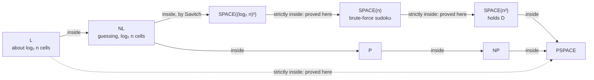

# Space hierarchy: more memory really helps, and L is strictly smaller than PSPACE

[Syllabus](../../../SYLLABUS.md) → [Computability and complexity](../README.md) → [Time Complexity](../README.md#s03) → Space hierarchy

---

## General Overview

Give a machine an input of 1,024 symbols. A linear memory budget allows 1,024 tape cells. A quadratic budget allows 1,024 × 1,024 = 1,048,576 cells, a thousand times more. Does the extra memory let a machine answer questions that no linear-memory machine can answer?

[Time and space classes](01-time-and-space-classes.md) showed that brute-force sudoku, on a grid of any size, needs only memory linear in its input length, because it reuses the grid's own cells for every filling. It could not show that any problem needs *more* than linear memory. Showing that a problem is not in a class means beating every machine in the class, including ones nobody has written.

The **space hierarchy theorem** does that. It builds one problem, called D here, that a machine solves with n² cells and that no machine solves with n cells. The method is the diagonal of [Hierarchy and Ladner](09-time-hierarchy-and-ladners-theorem.md): run each small-memory machine on its own description, then answer the opposite.

Space is kinder to this argument than time. Memory is reused, so the step counter costs its cells once, not extra moves at every step, and the time theorem's extra logarithm is not needed.

The payoff is a fact about famous classes. **L** is the problems solved with about log₂ n cells of working memory, and **NL** is the same for guessing machines ([Logarithmic space](10-logarithmic-space-l-and-nl.md)). Both are strictly smaller than **PSPACE**, the problems solved with polynomial memory. At n = 1,024 the budgets read about 10 cells for L, about 100 for NL after Savitch's theorem, and 1,048,576 for quadratic space, each times a constant.

**A machine with more memory can run every machine with less memory on its own description, catch its loops with a step counter that fits in the extra memory, and answer the opposite, so any asymptotically bigger memory budget that a machine can mark off for itself solves strictly more problems; in particular L and NL are strictly inside PSPACE.**

**What kind of fact this is:** theorems. The space hierarchy theorem and the separations of L and NL from PSPACE are proved on this card in Why it works; Savitch's theorem is used as stated on [Above NP](08-conp-pspace-and-the-polynomial-hierarchy.md). Blum's speedup theorem and Borodin's gap theorem are stated with key steps and named sources. Whether L = P is open as of 2026-11-24.

### The picture: which inclusions are proved strict



Schematic, not to scale. A solid arrow means "is contained in". The dotted arrow joins two classes that are not next to each other. Three arrows are proved strict on this card. Whether L ≠ NL, NL ≠ P, P ≠ NP or NP ≠ PSPACE is unknown. Because L ≠ PSPACE, at least one of those four must be strict.

---

## The formula

Notation first, in words. SPACE(s(n)) is the set of problems some deterministic tape machine decides while visiting at most a constant times s(n) cells on inputs of length n ([Time and space classes](01-time-and-space-classes.md)). For bounds below n, the input sits on a read-only tape and only the work tape counts ([Logarithmic space](10-logarithmic-space-l-and-nl.md)). The sign ⊊ means "is contained in, and is not equal to". The little-o sign means "grows strictly slower": $`f(n) = o(g(n))`$ says that $`f(n)/g(n)`$ falls to 0 as n grows.

A bound g is **space-constructible** when g(n) is at least log₂ n and some machine can write the number g(n) in binary using O(g(n)) cells. Every bound on this card, such as log₂ n, (log₂ n)², n and n², qualifies. The card also takes the smaller bound f(n) to be at least log₂ n, so a machine's input-head position fits in its configuration count. The theorem is:

```math
f(n) = o(g(n)) \;\Longrightarrow\; \mathrm{SPACE}(f(n)) \subsetneq \mathrm{SPACE}(g(n))
```

**Read it aloud:** if the smaller memory bound f grows strictly slower than the bigger bound g, then some problem is solvable in g cells and not in f cells.

The worked example takes f(n) = n and g(n) = n². Then n/n² = 1/n falls to 0, so SPACE(n) ⊊ SPACE(n²). The separations of the famous classes follow:

```math
\mathrm{L} \subseteq \mathrm{NL} \subseteq \mathrm{SPACE}\big((\log_2 n)^2\big) \subsetneq \mathrm{SPACE}(n) \subseteq \mathrm{PSPACE}
```

**Read it aloud:** log-space problems sit inside guessing log-space problems, which by Savitch's theorem need at most the square of log₂ n cells, which is strictly less than linear memory, which is inside polynomial memory. So L ⊊ PSPACE and NL ⊊ PSPACE.

| Symbol | Plain meaning | In our example | Push it up and the answer… |
| --- | --- | --- | --- |
| $`w`$, $`n`$ | the input string, and its length in symbols | a 16-bit machine code, n = 16 | every budget grows |
| $`f(n)`$, $`g(n)`$ | the smaller and the bigger memory bound | n and n² | a bigger g makes room for more problems |
| $`\mathrm{SPACE}(s(n))`$ | problems decided within a constant times s(n) cells | D is in $`\mathrm{SPACE}(n^2)`$ | a bigger class |
| $`o(\,)`$, $`\subsetneq`$ | grows strictly slower; contained in and not equal | $`n = o(n^2)`$ | — |
| $`M`$, $`\langle M\rangle`$, $`A`$ | a machine; its code, its rule table written as a string; the problem it decides | the code 508D in hexadecimal | — |
| $`D`$ | the diagonal problem: inputs whose coded machine does not accept them inside D's cells | D accepts 43,344 of the 65,536 two-state codes | — |
| $`s`$ | the number of cells a run is confined to | 16 or 20 in the code; 256 in the theorem at n = 16 | allowed runs get exponentially longer |
| $`k`$ | bits in D's step counter; the code's model counts to the configuration count | 266 at g = 256 | grows like g, not faster |
| $`c`$, $`d`$ | a machine's memory constant: it uses at most c f(n) cells; D's cells per symbol of that machine | any fixed numbers | the padding must be longer |
| $`\lvert Q\rvert`$, $`\lvert\Gamma\rvert`$, $`N(n)`$ | a machine's number of states and tape symbols; its configuration count on inputs of length n | 2 states, symbols 0 and 1 | more configurations to count |
| L, NL, P, NP, PSPACE, EXPSPACE | log space; log space with guessing; polynomial time; quickly checkable; polynomial space; exponential space | about 10, 100 (Savitch) and 1,048,576 cells at n = 1,024 | — |
| $`r`$, $`t(n)`$, $`t'(n)`$ | a computable "how much more" function in Blum's and Borodin's theorems; a machine's cost; the faster machine's cost | $`r(x) = 2^x`$ | a wider gap or a bigger speedup |

### When it holds

- **The bigger bound must be space-constructible.** D marks off g(n) cells before it starts, so it must compute g(n) within g(n) cells. For strange, hard-to-compute bounds, Borodin's gap theorem (Step 6) shows that more memory can buy nothing at all.
- **D must catch loops.** A machine in a small space can run for ever without leaving it. Without a step counter, D would wait for ever on machine 18,780, which repeats a configuration at step 23. The counter needs about g(n) bits, which is why it fits.
- **The smaller bound must really be smaller.** With f equal to g it fails: D needs cells for its own counter and for the code it reads. Squeezed into the machines' own 16 cells, D would need 54.
- **Both classes use the same kind of machine.** The flip works for deterministic machines directly. For guessing machines it needs [NL = coNL](11-immerman-szelepcsenyi-theorem.md), which lets a guessing machine answer the opposite without extra space.
- **Classes are worst-case.** Each n-cell machine fails on D at some inputs, its own padded codes, not at all of them.

---

## Why it works

### Step 0: the diagonal, with memory in place of time

The idea is the one from [Hierarchy and Ladner](09-time-hierarchy-and-ladners-theorem.md), which comes from [Cantor's diagonal](../../01-Foundations/09-Sizes%20of%20Infinity/03-cantors-diagonal-argument.md). Write every small-memory machine as a row of a table and every machine code as a column. Read down the diagonal, where each machine meets its own code, and flip every answer. The flipped diagonal differs from every row, so no row computes it.

Two things change for memory.

- **The clock becomes a fence.** D marks off g(n) cells. A machine that steps outside them is cut off, and D answers yes.
- **Loops need a proof, not a stopwatch.** A machine fenced into s cells can only be in so many situations. Once it repeats one, it is stuck in a cycle for ever. D counts steps up to that number and then knows.

### Step 1: a fenced machine has few configurations

A **configuration** is a snapshot of the run: the state, the head position and the tape contents ([Time and space classes](01-time-and-space-classes.md), Step 2). A machine with $`\lvert Q\rvert`$ states and $`\lvert\Gamma\rvert`$ tape symbols, fenced into s cells, has at most

```math
\lvert Q\rvert \cdot s \cdot \lvert\Gamma\rvert^{s}
```

configurations. **Read it aloud:** the number of states, times the head positions, times every way of filling the s cells.

The machine is deterministic: each configuration fixes the next one. So if a run lasts longer than that count, two moments share a configuration by the pigeonhole principle, and the run repeats the same cycle for ever. For the code's two-state machines in 16 cells the count is 2 × 16 × 2¹⁶ = 2,097,152.

The step counter that holds this number needs only its bit length, about $`s \log_2\lvert\Gamma\rvert + \log_2 s`$ bits. That is a constant times s. Memory to count is memory D can afford.

The bound is not slack. Machine 508D is a binary counter. Fenced into 16 cells it runs 40,422 steps before it steps out; in 21 cells, 4,103,649 steps. Each extra cell adds $`2^s - 1`$ steps, so its run grows exponentially while its memory grows by one cell.

### Step 2: build D, a machine with a fence and a counter

On input w of length n, D does this:

1. Mark off g(n) cells. Because g is space-constructible, this costs no more than g(n) cells.
2. Read the front of w as the code $`\langle M\rangle`$ of a machine M; the rest of w is padding. If the front is not a valid code, reject.
3. Run M on w, as a universal machine (one machine that runs any other from its code) does ([Universal machines](../01-Models%20of%20Computation/09-universal-machines-and-the-halting-problem.md)), inside the marked cells. Keep a binary step counter beside them.
4. If M tries to leave the marked cells, accept. If the counter passes $`2^{g(n)}`$, accept: by Step 1, a machine using far fewer than g(n) cells has fewer configurations than that, so it is looping. The counter needs g(n) bits.
5. If M accepts, reject. If M rejects, accept.

So D accepts w exactly when M does not accept w inside D's memory. D halts on every input, because the counter stops every run.

### Step 3: no machine in SPACE(f) solves D

Suppose a machine M solves D using at most $`c\,f(n)`$ cells, for some constant c. D writes each of M's tape symbols in some fixed number d of its own cells, so simulating M costs $`d\,c\,f(n)`$ cells.

Because f = o(g), for large n this fits inside the fence, and M's configuration count falls below D's counter limit $`2^{g(n)}`$. Pad M's code to such a length n. On that input D runs M to the end inside its fence and answers the opposite. So M gets this input wrong, and M does not solve D.

<details>
<summary>Detailed proof: every machine in SPACE(f) disagrees with D</summary>

Let M decide a language A using at most $`c\,f(n)`$ work cells on every input of length n at least some fixed length $`n_1`$. Let M have $`\lvert Q\rvert`$ states and $`\lvert\Gamma\rvert`$ tape symbols, with each symbol written in d of D's cells.

A configuration of M on an input of length n is its state, its input-head position, its work-head position and its work tape, so the count is at most

$`\displaystyle N(n) = \lvert Q\rvert \cdot n \cdot c f(n) \cdot \lvert\Gamma\rvert^{c f(n)} = 2^{O(f(n))},`$

using f(n) ≥ log₂ n to absorb the factor n. Since f = o(g), for large n this is below $`2^{g(n)}`$, the limit of D's g(n)-bit counter, and $`d\,c\,f(n)`$ is below g(n).

Choose a length $`n \ge n_1`$ at which both hold and M's code fits in the input. Let w be $`\langle M\rangle`$ padded to that length.

On w, M decides, so it halts within N(n) steps without leaving $`c\,f(n)`$ cells. D's fence and counter therefore never cut it off, and D simulates the whole run. If w is in A, M accepts and D rejects; if w is not in A, M rejects and D accepts. Either way w is in exactly one of A and D, so A is not D. Since M was any machine in $`\mathrm{SPACE}(f(n))`$, D is not in that class.

</details>

### Step 4: D itself fits in a constant times g cells, with no log factor

D's memory is its fence of g(n) cells, the counter of about g(n) bits, and M's code. That is a constant times g(n). The code's memory model keeps the counter beside the fence and lets it count to the configuration count of a two-state machine filling the fence, $`2 \times g \times 2^{g}`$, which is above Step 2's limit $`2^{g(n)}`$; that takes a few bits more than g, 266 at g = 256. With a 16-cell rule block, the model gives D 2.102 × g cells at n = 16 and 2.000 × g at n = 1,024. The ratio settles at 2; it does not grow.

Compare time. The time-hierarchy machine had to carry its counter along the tape at every simulated step, so each step cost about log n extra moves. That forced the gap $`f = o(g/\log g)`$. A memory counter sits still and is reused. It adds cells once, not work per step.

So D is in SPACE(n²) and not in SPACE(n): a problem that needs quadratic memory and cannot be done in linear memory.

### Step 5: L and NL are strictly inside PSPACE

Take f(n) = (log₂ n)² and g(n) = n. Then $`(\log_2 n)^2 / n`$ falls to 0. At n = 2¹⁰ it is 100 against 1,024; at n = 2²⁰, 400 against 1,048,576. From n = 16 on, (log₂ n)² never exceeds n again. So SPACE((log₂ n)²) ⊊ SPACE(n).

- **L.** L is SPACE(log₂ n), which sits inside SPACE((log₂ n)²). So L ⊊ SPACE(n) ⊆ PSPACE.
- **NL.** Savitch's theorem says a guessing machine using s(n) cells can be replaced by an ordinary one using s(n)² cells ([Above NP](08-conp-pspace-and-the-polynomial-hierarchy.md)). So NL ⊆ SPACE((log₂ n)²) ⊊ SPACE(n) ⊆ PSPACE.

Both separations are proved. The links between them are not. L ⊆ NL ⊆ P ⊆ NP ⊆ PSPACE is known, and at least one of the four inclusions is strict, because the two ends differ. Whether L = P, NL = P, or P = PSPACE is open as of 2026-11-24.

The same theorem with $`f(n) = n^{\log_2 n}`$, which outgrows every polynomial, and g(n) = 2ⁿ gives PSPACE ⊊ EXPSPACE, the problems solved with exponential memory.

### Step 6: Blum's speedup and Borodin's gap, stated

Both results apply to time and to space alike. They show what the hierarchy theorem's hypothesis, space-constructibility, protects against.

- **Blum's speedup theorem (1967).** For every computable function r, there is a decidable problem A with no best machine. Whenever a machine decides A at cost t(n), another decides it at a cost t′(n) with $`r(t'(n)) \le t(n)`$ for all but finitely many n. With $`r(x) = 2^x`$: every machine for A can be replaced by one exponentially cheaper. So "the cost of A" has no meaning for such problems. The proof builds A by a diagonal that rules out, one at a time, every machine that runs too cheaply.
- **Borodin's gap theorem (1972).** For every computable r with $`r(x) \ge x`$, there is a computable bound g with $`\mathrm{SPACE}(g(n)) = \mathrm{SPACE}(r(g(n)))`$, and the same for time. With $`r(x) = 2^x`$: a bound g at which exponentially more memory buys nothing. The proof picks each value g(n) so that none of the first n machines has a cost between g(n) and r(g(n)) on inputs of length n. So g is computable. For $`r(x) = 2^x`$, the hierarchy theorem then forces g to be non-constructible: for a constructible g it would make $`\mathrm{SPACE}(2^{g(n)})`$ strictly bigger than $`\mathrm{SPACE}(g(n))`$.

Both are theorems, stated here with key steps; the proofs are in Blum (1967) and Borodin (1972). Together they say that the hierarchy theorem needs well-behaved bounds. For constructible bounds like n and n², more memory always helps.

---

## Worked numbers, by hand

The code builds D for one finite family: all 65,536 two-state machines, each written as a 16-bit code and run on its own code, so n = 16. The theorem gives D a fence of n² = 256 cells. The code fences at 20 cells instead, so that every run ends in under a minute; the reason is the counter machine 508D below.

| Step | Arithmetic | Value |
| --- | --- | --- |
| machines in the family | 4 rules × 4 bits = 16 bits | 2¹⁶ = 65,536 |
| on own code, inside 20 cells | run each machine on its own code | accept 22,192, reject 22,217, leave 20,180, loop 947 |
| widest run that stays inside | every machine that stays inside | 16 cells: its own input |
| latest loop proof | machine 18,780 | at step 23 it is back in its step-21 configuration |
| D accepts | reject + leave + loop | 22,217 + 20,180 + 947 = 43,344 |
| D agrees with its own machine | the diagonal flips every answer | **0 of 65,536** |
| configurations in 16 cells | 2 × 16 × 2¹⁶ | 2,097,152 |
| machine 508D leaves 16 cells | counted run | step 40,422 |
| machine 508D leaves 21 cells | counted run | step 4,103,649 |
| D's memory at n = 1,024 | 16 + 1,048,576 + 1,048,598 | 2,097,190 cells, 2.000 × g |

So every two-state machine loses to D on its own code, and D's memory stays within about twice its fence at every size. Machine 508D shows why the fence is 20 cells in the code: each extra cell adds $`2^s - 1`$ steps, and carried to 256 cells that pattern gives more than 2²⁵⁶ steps. That is an extrapolation of the pattern checked for 16 to 21 cells, not a run.

The four outcomes on own codes, inside 20 cells:

```
accept  ##############                           22,192
reject  ##############                           22,217
leave   ############                             20,180
loop    #                                        947
```

### What breaks if you drop a piece

| Mistake | Comes out at | What went wrong |
| --- | --- | --- |
| D squeezed into the machines' own n = 16 cells | needs 16 + 16 + 22 = 54 cells | f equal to g: D has no room for its counter and the code it reads |
| No loop check | machine 18,780 still running after 1,000,000 steps inside 16 cells | D would wait for ever; the repeat at step 23 is the proof it never stops |
| Counter capped at n = 16 steps, not the configuration count | 4 machines accept after step 16; the capped D calls them loops and agrees with all 4 | a cap below the configuration count cuts off machines that would still halt |

The code prints every row.

---

## Code, from first principles, and it actually runs

The code runs D on a real machine family, never on "every machine", which no program can list and run in full. A machine is a 16-bit code: one 4-bit rule for each of state A or B and symbol 0 or 1. Each rule gives the symbol to write, the move (1 means right) and the next state (A, B, accept or reject). Blank cells read 0. A run is fenced into the first cells of the tape, starting at the input's first symbol; stepping left of it or past the fence counts as leaving. The code takes **two independent roads** to D's answers and compares them code by code.

- **Road 1, every configuration remembered.** A simulator decodes each code as a number and stores every configuration it reaches. A repeat is a proof of a loop.
- **Road 2, two configurations only.** D, written apart, reads the rules from the input string at every step, as a universal machine does. It keeps just a slow copy and a fast copy of the run (Floyd's tortoise and hare: the fast copy takes two steps for each of the slow copy's one, and they meet exactly when the run cycles). That is how D catches loops within its own memory. Its yes-count must equal road 1's reject, leave and loop counts together, and it must disagree with every machine on that machine's own code.
- **The cross-check.** On every one of the 65,536 codes, road 2's outcome (accept, reject, leave or loop) must equal road 1's, not just its yes-or-no answer. A road that called a loop a rejection would pass the yes-count and fail here.

The checks also print machine 508D's exit steps, D's memory model, the ladder of budgets and the "what breaks" rows.

### Python

```python
# Space hierarchy: the diagonal language D with a memory budget, run on every two-state machine.
# Standard library only. A machine is a 16-bit code: four rules, one per (state, symbol),
# each 4 bits = write, move (1 = right), next (0 A, 1 B, 2 accept, 3 reject). Blank cells read 0.
# The stepping rule is copied from the Hierarchy and Ladner card. New here: a run is confined
# to the first `cells` tape cells, and a run that repeats a configuration is proved to loop.
from math import log2
ACC, REJ, OUT, LOOP, RUN = 1, 0, 2, 3, 4      # accept, reject, left the cells, loops, still running

def c(x):                                      # integers with commas, as on the card
    return f"{x:,}"

def run_direct(i, w, cells, cap=None, detect=True):
    """Road 1: rules decoded from the integer i, tape held as one integer, every configuration
    (state, head, tape) remembered. Returns (outcome, steps, cells used, step first seen)."""
    rules = [(i >> (12 - 4 * e)) & 15 for e in range(4)]
    tape = sum(1 << k for k, ch in enumerate(w) if ch == "1")
    head = state = step = 0
    far, seen = len(w) - 1, {}
    while cap is None or step < cap:
        if detect:
            key = (state, head, tape)
            if key in seen:
                return LOOP, step, far + 1, seen[key]
            seen[key] = step
        far = max(far, head)
        r = rules[2 * state + ((tape >> head) & 1)]
        tape = (tape & ~(1 << head)) | ((r >> 3) << head)
        head += 1 if (r >> 2) & 1 else -1
        step += 1
        if r & 3 >= 2:
            return (ACC if r & 3 == 2 else REJ), step, far + 1, 0
        if head < 0 or head >= cells:
            return OUT, step, far + 1, 0
        state = r & 3
    return RUN, step, far + 1, 0

def floyd(w, cells):
    """Road 2: the machine D runs. It reads the rules from the first 16 symbols of its input
    at every step and keeps only two configurations, a slow copy and a fast copy (Floyd's
    tortoise and hare), so its memory stays at two windows of `cells` cells."""
    def step(cfg):
        state, head, tape = cfg
        at = 4 * (2 * state + tape[head])
        tape[head] = 1 if w[at] == "1" else 0
        head += 1 if w[at + 1] == "1" else -1
        nxt = 2 * (w[at + 2] == "1") + (w[at + 3] == "1")
        if nxt >= 2:
            return ACC if nxt == 2 else REJ
        if head < 0 or head >= cells:
            return OUT
        cfg[0], cfg[1] = nxt, head
        return None
    start = [1 if ch == "1" else 0 for ch in w] + [0] * (cells - len(w))
    slow, fast = [0, 0, start[:]], [0, 0, start[:]]
    while True:
        for _ in range(2):
            out = step(fast)
            if out is not None:
                return out
        step(slow)
        if slow == fast:
            return LOOP

def D(w, cells):
    """Accept w exactly when the coded machine does NOT accept w inside the first `cells` cells."""
    return 0 if floyd(w, cells) == ACC else 1

W = 20                                         # D's window in this run: 20 cells, so every run ends
print(f"family: every two-state machine, 16-bit codes, run on its own code; D's window {W} cells")
tally, used_max, rep_max, d_yes, agree, late_acc, same = [0] * 4, 0, (0, 0, 0), 0, 0, [], 0
for i in range(65536):
    w = format(i, "016b")
    out, steps, used, first = run_direct(i, w, W)
    tally[out] += 1
    if out != OUT:
        used_max = max(used_max, used)
    if out == LOOP:
        rep_max = max(rep_max, (steps, i, first))
    if out == ACC and steps > 16:
        late_acc.append(i)
    d = D(w, W)
    d_yes += d
    agree += (d == 1) == (out == ACC)
    same += floyd(w, W) == out                 # road 2's full outcome, not just yes or no
print(f"road 1, every configuration remembered: accept {c(tally[ACC])}, reject {c(tally[REJ])}, "
      f"leave the {W} cells {c(tally[OUT])}, loop inside {c(tally[LOOP])}")
print(f"road 1, every run that stays inside uses at most {used_max} cells; latest first repeat: "
      f"step {rep_max[0]}, machine {c(rep_max[1])}, back to its step-{rep_max[2]} configuration")
print(f"road 2, two configurations only: D accepts {c(d_yes)}; reject + leave + loop = "
      f"{c(tally[REJ] + tally[OUT] + tally[LOOP])}")
print(f"road 2, D agrees with the coded machine on {agree} of {c(65536)} codes; "
      f"its outcome (accept, reject, leave or loop) equals road 1's on {c(same)}")
assert d_yes == tally[REJ] + tally[OUT] + tally[LOOP]      # two simulators, written apart, must match
assert agree == 0                                          # the diagonal: every machine loses on its own code
assert same == 65536                                       # all four outcomes match, code by code
for name, v in [("accept", tally[ACC]), ("reject", tally[REJ]), ("leave", tally[OUT]), ("loop", tally[LOOP])]:
    print(f"  {name:<7} {'#' * round(40 * v / 65536):<40} {c(v)}")

print("the counter machine 508D (20,621): steps until it steps out of the first s cells")
prev = None
for s in range(16, 22):
    out, steps, used, _ = run_direct(0x508D, format(0x508D, "016b"), s, detect=False)
    assert out == OUT and (prev is None or steps == prev + 2 ** s - 1)   # pattern: each cell adds 2^s - 1 steps
    print(f"  s {s}: {c(steps)} steps, {c(2 * s * 2 ** s)} configurations")
    prev = steps
big = 40422 + sum(2 ** s - 1 for s in range(17, 257))
print(f"  the pattern carried to 256 cells: more than 2^{big.bit_length() - 1} steps (an extrapolation, not a run)")

print("D's memory model: rule block 16 + window g + step counter k bits, k = bits of 2 g 2^g")
for n in (16, 64, 256, 1024):
    g = n * n
    k = (2 * g * 2 ** g).bit_length()
    total = 16 + g + k
    print(f"  n {n:>5}  g = n^2 {c(g):>9}  k {c(k):>9}  cells {c(total):>9}  cells / g {total / g:.3f}")

print("the ladder at three input lengths: log2 n, (log2 n)^2, n, n^2")
for e in (10, 20, 30):
    n = 2 ** e
    print(f"  n = 2^{e}: {e}, {c(e * e)}, {c(n)}, {c(n * n)}")
cross = next(n for n in range(2, 10 ** 4) if all(log2(m) ** 2 <= m for m in range(n, 10 ** 4)))
print(f"(log2 n)^2 <= n for every n from {cross} on; at n = 15 it is {log2(15) ** 2:.3f}")
assert cross == 16

k16 = (2 * 16 * 2 ** 16).bit_length()
print(f"wrong: D squeezed into the machines' own n = 16 cells: it needs 16 + 16 + {k16} = {32 + k16} cells")
i, r, f = rep_max[1], rep_max[0], rep_max[2]
out, steps, used, _ = run_direct(i, format(i, "016b"), W, cap=10 ** 6, detect=False)
assert out == RUN
print(f"wrong: no loop check: machine {c(i)} is still running after {c(steps)} steps inside {used} cells")
print(f"  proof that it never stops: at step {r} it is back in its step-{f} configuration")
late_cap = sum(1 for i in late_acc if run_direct(i, format(i, "016b"), W, cap=16)[0] == RUN)
print(f"wrong: counter capped at n = 16 steps: {len(late_acc)} machines accept after step 16; "
      f"the capped D cuts off {late_cap}, calls them loops and agrees with them")
assert late_cap == len(late_acc) == 4
t16 = [0] * 4
for i in range(65536):
    t16[run_direct(i, format(i, "016b"), 16)[0]] += 1
print(f"try: window 16 cells: accept {c(t16[ACC])}, reject {c(t16[REJ])}, leave {c(t16[OUT])}, loop {c(t16[LOOP])}")
print(f"budgets at n = 1,024: log2 n = 10, (log2 n)^2 = 100, n = 1,024, n^2 = {c(1024 * 1024)}")
print("ALL CHECKS PASS")
```

**Ran 2026-11-24 on macOS, Python 3.14.10, standard library only. All checks passed. Output, pasted from the run:**

```text
family: every two-state machine, 16-bit codes, run on its own code; D's window 20 cells
road 1, every configuration remembered: accept 22,192, reject 22,217, leave the 20 cells 20,180, loop inside 947
road 1, every run that stays inside uses at most 16 cells; latest first repeat: step 23, machine 18,780, back to its step-21 configuration
road 2, two configurations only: D accepts 43,344; reject + leave + loop = 43,344
road 2, D agrees with the coded machine on 0 of 65,536 codes; its outcome (accept, reject, leave or loop) equals road 1's on 65,536
  accept  ##############                           22,192
  reject  ##############                           22,217
  leave   ############                             20,180
  loop    #                                        947
the counter machine 508D (20,621): steps until it steps out of the first s cells
  s 16: 40,422 steps, 2,097,152 configurations
  s 17: 171,493 steps, 4,456,448 configurations
  s 18: 433,636 steps, 9,437,184 configurations
  s 19: 957,923 steps, 19,922,944 configurations
  s 20: 2,006,498 steps, 41,943,040 configurations
  s 21: 4,103,649 steps, 88,080,384 configurations
  the pattern carried to 256 cells: more than 2^256 steps (an extrapolation, not a run)
D's memory model: rule block 16 + window g + step counter k bits, k = bits of 2 g 2^g
  n    16  g = n^2       256  k       266  cells       538  cells / g 2.102
  n    64  g = n^2     4,096  k     4,110  cells     8,222  cells / g 2.007
  n   256  g = n^2    65,536  k    65,554  cells   131,106  cells / g 2.001
  n  1024  g = n^2 1,048,576  k 1,048,598  cells 2,097,190  cells / g 2.000
the ladder at three input lengths: log2 n, (log2 n)^2, n, n^2
  n = 2^10: 10, 100, 1,024, 1,048,576
  n = 2^20: 20, 400, 1,048,576, 1,099,511,627,776
  n = 2^30: 30, 900, 1,073,741,824, 1,152,921,504,606,846,976
(log2 n)^2 <= n for every n from 16 on; at n = 15 it is 15.264
wrong: D squeezed into the machines' own n = 16 cells: it needs 16 + 16 + 22 = 54 cells
wrong: no loop check: machine 18,780 is still running after 1,000,000 steps inside 16 cells
  proof that it never stops: at step 23 it is back in its step-21 configuration
wrong: counter capped at n = 16 steps: 4 machines accept after step 16; the capped D cuts off 4, calls them loops and agrees with them
try: window 16 cells: accept 22,192, reject 22,217, leave 20,180, loop 947
budgets at n = 1,024: log2 n = 10, (log2 n)^2 = 100, n = 1,024, n^2 = 1,048,576
ALL CHECKS PASS
```

### Rust

```rust
// Space hierarchy: the diagonal language D with a memory budget, run on every two-state machine.
// std only. A machine is a 16-bit code: four rules, one per (state, symbol),
// each 4 bits = write, move (1 = right), next (0 A, 1 B, 2 accept, 3 reject). Blank cells read 0.
// The stepping rule is copied from the Hierarchy and Ladner card. New here: a run is confined
// to the first `cells` tape cells, and a run that repeats a configuration is proved to loop.
use std::collections::HashMap;
const ACC: usize = 1; const REJ: usize = 0; const OUT: usize = 2; const LOOP: usize = 3; const RUN: usize = 4;

fn c(x: u128) -> String {
    // integers with commas, as on the card
    let s = x.to_string();
    let mut out = String::new();
    for (k, ch) in s.chars().enumerate() {
        if k > 0 && (s.len() - k) % 3 == 0 { out.push(','); }
        out.push(ch);
    }
    out
}

fn bits(i: u32) -> String { format!("{:016b}", i) }
fn bitlen(x: u64) -> u64 { (64 - x.leading_zeros()) as u64 }

// Road 1: rules decoded from the integer i, tape held as one integer, every configuration
// (state, head, tape) remembered. Returns (outcome, steps, cells used, step first seen).
fn run_direct(i: u32, w: &str, cells: i64, cap: Option<u64>, detect: bool) -> (usize, u64, i64, u64) {
    let rules: Vec<u32> = (0..4).map(|e| (i >> (12 - 4 * e)) & 15).collect();
    let mut tape: u64 = 0;
    for (k, ch) in w.chars().enumerate() { if ch == '1' { tape |= 1 << k; } }
    let (mut head, mut state, mut step) = (0i64, 0u32, 0u64);
    let mut far = w.len() as i64 - 1;
    let mut seen: HashMap<u64, u64> = HashMap::new();
    while cap.map_or(true, |m| step < m) {
        if detect {
            let key = ((state as u64) << 40) | ((head as u64) << 32) | tape;
            if let Some(&f) = seen.get(&key) { return (LOOP, step, far + 1, f); }
            seen.insert(key, step);
        }
        far = far.max(head);
        let r = rules[(2 * state + ((tape >> head) & 1) as u32) as usize];
        tape = (tape & !(1u64 << head)) | (((r >> 3) as u64) << head);
        head += if (r >> 2) & 1 == 1 { 1 } else { -1 };
        step += 1;
        if r & 3 >= 2 { return (if r & 3 == 2 { ACC } else { REJ }, step, far + 1, 0); }
        if head < 0 || head >= cells { return (OUT, step, far + 1, 0); }
        state = r & 3;
    }
    (RUN, step, far + 1, 0)
}

// Road 2: the machine D runs. It reads the rules from the first 16 symbols of its input
// at every step and keeps only two configurations, a slow copy and a fast copy (Floyd's
// tortoise and hare), so its memory stays at two windows of `cells` cells.
#[derive(Clone, PartialEq)]
struct Cfg { state: usize, head: i64, tape: Vec<u8> }

fn step(w: &[u8], cfg: &mut Cfg, cells: i64) -> Option<usize> {
    let at = 4 * (2 * cfg.state + cfg.tape[cfg.head as usize] as usize);
    cfg.tape[cfg.head as usize] = if w[at] == b'1' { 1 } else { 0 };
    let head = cfg.head + if w[at + 1] == b'1' { 1 } else { -1 };
    let nxt = 2 * (w[at + 2] == b'1') as usize + (w[at + 3] == b'1') as usize;
    if nxt >= 2 { return Some(if nxt == 2 { ACC } else { REJ }); }
    if head < 0 || head >= cells { return Some(OUT); }
    cfg.state = nxt;
    cfg.head = head;
    None
}

fn floyd(w: &str, cells: i64) -> usize {
    let wb = w.as_bytes();
    let mut start: Vec<u8> = wb.iter().map(|&b| if b == b'1' { 1 } else { 0 }).collect();
    start.resize(cells as usize, 0);
    let mut slow = Cfg { state: 0, head: 0, tape: start.clone() };
    let mut fast = slow.clone();
    loop {
        for _ in 0..2 {
            if let Some(out) = step(wb, &mut fast, cells) { return out; }
        }
        step(wb, &mut slow, cells);
        if slow == fast { return LOOP; }
    }
}

// Accept w exactly when the coded machine does NOT accept w inside the first `cells` cells.
fn d(w: &str, cells: i64) -> u128 { if floyd(w, cells) == ACC { 0 } else { 1 } }

fn main() {
    let ww: i64 = 20; // D's window in this run: 20 cells, so every run ends
    println!("family: every two-state machine, 16-bit codes, run on its own code; D's window {} cells", ww);
    let (mut tally, mut used_max, mut rep_max) = ([0u128; 4], 0i64, (0u64, 0u32, 0u64));
    let (mut d_yes, mut agree, mut late_acc, mut same) = (0u128, 0u128, Vec::new(), 0u128);
    for i in 0..65536u32 {
        let w = bits(i);
        let (out, steps, used, first) = run_direct(i, &w, ww, None, true);
        tally[out] += 1;
        if out != OUT { used_max = used_max.max(used); }
        if out == LOOP {
            if (steps, i, first) > rep_max { rep_max = (steps, i, first); }
        }
        if out == ACC && steps > 16 { late_acc.push(i); }
        let dv = d(&w, ww);
        d_yes += dv;
        agree += ((dv == 1) == (out == ACC)) as u128;
        same += (floyd(&w, ww) == out) as u128; // road 2's full outcome, not just yes or no
    }
    println!("road 1, every configuration remembered: accept {}, reject {}, leave the {} cells {}, loop inside {}",
        c(tally[ACC]), c(tally[REJ]), ww, c(tally[OUT]), c(tally[LOOP]));
    println!("road 1, every run that stays inside uses at most {} cells; latest first repeat: step {}, machine {}, back to its step-{} configuration",
        used_max, rep_max.0, c(rep_max.1 as u128), rep_max.2);
    println!("road 2, two configurations only: D accepts {}; reject + leave + loop = {}", c(d_yes), c(tally[REJ] + tally[OUT] + tally[LOOP]));
    println!("road 2, D agrees with the coded machine on {} of {} codes; its outcome (accept, reject, leave or loop) equals road 1's on {}",
        agree, c(65536), c(same));
    assert!(d_yes == tally[REJ] + tally[OUT] + tally[LOOP]); // two simulators, written apart, must match
    assert!(agree == 0); // the diagonal: every machine loses on its own code
    assert!(same == 65536); // all four outcomes match, code by code
    for (name, v) in [("accept", tally[ACC]), ("reject", tally[REJ]), ("leave", tally[OUT]), ("loop", tally[LOOP])] {
        let bar = "#".repeat((40.0 * v as f64 / 65536.0).round() as usize);
        println!("  {:<7} {:<40} {}", name, bar, c(v));
    }

    println!("the counter machine 508D (20,621): steps until it steps out of the first s cells");
    let mut prev: Option<u64> = None;
    for s in 16..22i64 {
        let (out, steps, _, _) = run_direct(0x508D, &bits(0x508D), s, None, false);
        assert!(out == OUT && prev.map_or(true, |p| steps == p + (1u64 << s) - 1)); // pattern: each cell adds 2^s - 1 steps
        println!("  s {}: {} steps, {} configurations", s, c(steps as u128), c((2 * s as u128) << s));
        prev = Some(steps);
    }
    let mut big = [40422u64 - 240, 0, 0, 0, 0]; // 40,422 minus the 240 ones, then add 2^s for s = 17..256
    for s in 17..257usize {
        let (mut l, mut add) = (s / 64, 1u64 << (s % 64));
        loop { let (v, o) = big[l].overflowing_add(add); big[l] = v; if !o { break; } add = 1; l += 1; }
    }
    let top = (0..5).rev().find(|&l| big[l] != 0).unwrap();
    println!("  the pattern carried to 256 cells: more than 2^{} steps (an extrapolation, not a run)", 64 * top as u64 + bitlen(big[top]) - 1);

    println!("D's memory model: rule block 16 + window g + step counter k bits, k = bits of 2 g 2^g");
    for n in [16u64, 64, 256, 1024] {
        let g = n * n;
        let k = bitlen(2 * g) + g; // 2g times 2^g is 2g shifted left by g places
        let total = 16 + g + k;
        println!("  n {:>5}  g = n^2 {:>9}  k {:>9}  cells {:>9}  cells / g {:.3}",
            n, c(g as u128), c(k as u128), c(total as u128), total as f64 / g as f64);
    }

    println!("the ladder at three input lengths: log2 n, (log2 n)^2, n, n^2");
    for e in [10u32, 20, 30] {
        let n = 1u128 << e;
        println!("  n = 2^{}: {}, {}, {}, {}", e, e, c((e * e) as u128), c(n), c(n * n));
    }
    let cross = (2..10000u32).find(|&n| (n..10000).all(|m| (m as f64).log2().powi(2) <= m as f64)).unwrap();
    println!("(log2 n)^2 <= n for every n from {} on; at n = 15 it is {:.3}", cross, 15f64.log2().powi(2));
    assert!(cross == 16);

    let k16 = bitlen(2 * 16 * 65536);
    println!("wrong: D squeezed into the machines' own n = 16 cells: it needs 16 + 16 + {} = {} cells", k16, 32 + k16);
    let (i, r, f) = (rep_max.1, rep_max.0, rep_max.2);
    let (out, steps, used, _) = run_direct(i, &bits(i), ww, Some(1_000_000), false);
    assert!(out == RUN);
    println!("wrong: no loop check: machine {} is still running after {} steps inside {} cells", c(i as u128), c(steps as u128), used);
    println!("  proof that it never stops: at step {} it is back in its step-{} configuration", r, f);
    let late_cap = late_acc.iter().filter(|&&i| run_direct(i, &bits(i), ww, Some(16), true).0 == RUN).count();
    println!("wrong: counter capped at n = 16 steps: {} machines accept after step 16; the capped D cuts off {}, calls them loops and agrees with them",
        late_acc.len(), late_cap);
    assert!(late_cap == late_acc.len() && late_cap == 4);
    let mut t16 = [0u128; 4];
    for i in 0..65536u32 { t16[run_direct(i, &bits(i), 16, None, true).0] += 1; }
    println!("try: window 16 cells: accept {}, reject {}, leave {}, loop {}", c(t16[ACC]), c(t16[REJ]), c(t16[OUT]), c(t16[LOOP]));
    println!("budgets at n = 1,024: log2 n = 10, (log2 n)^2 = 100, n = 1,024, n^2 = {}", c(1024 * 1024));
    println!("ALL CHECKS PASS");
}
```

**Ran 2026-11-24 on macOS, rustc 1.98.1, no crates. All checks passed. Output, pasted from the run:**

```text
family: every two-state machine, 16-bit codes, run on its own code; D's window 20 cells
road 1, every configuration remembered: accept 22,192, reject 22,217, leave the 20 cells 20,180, loop inside 947
road 1, every run that stays inside uses at most 16 cells; latest first repeat: step 23, machine 18,780, back to its step-21 configuration
road 2, two configurations only: D accepts 43,344; reject + leave + loop = 43,344
road 2, D agrees with the coded machine on 0 of 65,536 codes; its outcome (accept, reject, leave or loop) equals road 1's on 65,536
  accept  ##############                           22,192
  reject  ##############                           22,217
  leave   ############                             20,180
  loop    #                                        947
the counter machine 508D (20,621): steps until it steps out of the first s cells
  s 16: 40,422 steps, 2,097,152 configurations
  s 17: 171,493 steps, 4,456,448 configurations
  s 18: 433,636 steps, 9,437,184 configurations
  s 19: 957,923 steps, 19,922,944 configurations
  s 20: 2,006,498 steps, 41,943,040 configurations
  s 21: 4,103,649 steps, 88,080,384 configurations
  the pattern carried to 256 cells: more than 2^256 steps (an extrapolation, not a run)
D's memory model: rule block 16 + window g + step counter k bits, k = bits of 2 g 2^g
  n    16  g = n^2       256  k       266  cells       538  cells / g 2.102
  n    64  g = n^2     4,096  k     4,110  cells     8,222  cells / g 2.007
  n   256  g = n^2    65,536  k    65,554  cells   131,106  cells / g 2.001
  n  1024  g = n^2 1,048,576  k 1,048,598  cells 2,097,190  cells / g 2.000
the ladder at three input lengths: log2 n, (log2 n)^2, n, n^2
  n = 2^10: 10, 100, 1,024, 1,048,576
  n = 2^20: 20, 400, 1,048,576, 1,099,511,627,776
  n = 2^30: 30, 900, 1,073,741,824, 1,152,921,504,606,846,976
(log2 n)^2 <= n for every n from 16 on; at n = 15 it is 15.264
wrong: D squeezed into the machines' own n = 16 cells: it needs 16 + 16 + 22 = 54 cells
wrong: no loop check: machine 18,780 is still running after 1,000,000 steps inside 16 cells
  proof that it never stops: at step 23 it is back in its step-21 configuration
wrong: counter capped at n = 16 steps: 4 machines accept after step 16; the capped D cuts off 4, calls them loops and agrees with them
try: window 16 cells: accept 22,192, reject 22,217, leave 20,180, loop 947
budgets at n = 1,024: log2 n = 10, (log2 n)^2 = 100, n = 1,024, n^2 = 1,048,576
ALL CHECKS PASS
```

### Lean

Lean proves that no small-memory machine solves D, for any machines whose codes can be padded and whose answers survive a bigger fence.

- Suppose f grows strictly slower than g, so $`f(n) = o(g(n))`$. Then no machine using at most $`c\,f(n)`$ cells solves D with fence g, for any constant c.
- Take a deterministic machine with $`\lvert Q\rvert`$ states and $`\lvert\Gamma\rvert`$ tape symbols, fenced into s cells. Then a run that does not halt within $`\lvert Q\rvert \cdot s \cdot \lvert\Gamma\rvert^{s}`$ steps never halts.
- Take D with fence n, and round log₂ n down to a whole number. Then no machine using at most $`c\,(\log_2 n)^2`$ cells solves D, for any constant c.
- The card's arithmetic checks out, such as 22,217 + 20,180 + 947 = 43,344 and 2 × 16 × 2¹⁶ = 2,097,152.

Running the 65,536 machines, the count of D's own memory and the three mistakes are left to the Python and Rust checks.

```lean
-- Space hierarchy: the fenced diagonal problem D beats every machine whose memory bound grows strictly slower than D's fence, a fenced run that outlasts its configuration count never halts, and with fence n no machine within c · (log₂ n)² cells solves D.
import Mathlib.Analysis.Asymptotics.Defs
import Mathlib.Data.Fintype.BigOperators
import Mathlib.Data.Nat.Log
import Mathlib.Data.Nat.Size
import Mathlib.Logic.Function.Iterate
import Mathlib.Order.Filter.AtTopBot.Basic
import Mathlib.Tactic.NormNum
import Mathlib.Tactic.Ring
import Mathlib.Tactic.Linarith
import Mathlib.Data.Fintype.Pigeonhole

/-! ### The machine model

A memory-fenced machine model is a function `res`: `res e w s = some b` means machine `e`, started
on input `w` and confined to `s` work cells, halts inside those cells with answer `b`
(`true` = accept); `res e w s = none` means it steps outside the `s` cells or repeats a
configuration, so it never answers inside them. A run that halts inside `s` cells is the same run
inside any bigger fence, so a bigger fence sees the same answer. Inputs are strings of bits.
`decode w` is the machine whose code is the front of `w`; the rest of `w` is padding. -/

/-- Machine `e` decides the language `A` within the memory bound `S`: on every input `w` of length
at least some `n₁`, it halts without leaving `S |w|` cells, and its answer is yes exactly when
`w ∈ A`. -/
def DecidesInSpace {C : Type*} (res : C → List Bool → ℕ → Option Bool) (e : C)
    (A : Set (List Bool)) (S : ℕ → ℕ) : Prop :=
  ∃ n₁, ∀ w : List Bool, n₁ ≤ w.length →
    ∃ b, res e w (S w.length) = some b ∧ (b = true ↔ w ∈ A)

/-- The diagonal problem D with fence `g`: accept `w` exactly when the machine coded by the front
of `w` does not accept `w` inside `g |w|` cells (leaving the cells or looping counts as not
accepting). -/
def diagonalD {C : Type*} (decode : List Bool → C) (res : C → List Bool → ℕ → Option Bool)
    (g : ℕ → ℕ) : Set (List Bool) :=
  {w | res (decode w) w (g w.length) ≠ some true}

/-- Helper: if the memory bound `S` is eventually at most D's fence `g`, no machine within `S`
solves D. -/
theorem not_decides_diagonal_of_eventually_le {C : Type*}
    (res : C → List Bool → ℕ → Option Bool)
    (hmono : ∀ e w s s' b, res e w s = some b → s ≤ s' → res e w s' = some b)
    (decode : List Bool → C) (hpad : ∀ e N, ∃ w : List Bool, N ≤ w.length ∧ decode w = e)
    (g S : ℕ → ℕ) (hSg : ∃ N, ∀ n, N ≤ n → S n ≤ g n) (e : C) :
    ¬ DecidesInSpace res e (diagonalD decode res g) S := by
  rintro ⟨n₁, h⟩
  obtain ⟨N, hN⟩ := hSg
  obtain ⟨w, hw, hdec⟩ := hpad e (max n₁ N)
  obtain ⟨b, hb, hiff⟩ := h w (le_trans (le_max_left _ _) hw)
  have hg : res e w (g w.length) = some b :=
    hmono e w _ _ b hb (hN _ (le_trans (le_max_right _ _) hw))
  have hmem : w ∈ diagonalD decode res g ↔ b ≠ true := by
    show res (decode w) w (g w.length) ≠ some true ↔ _
    rw [hdec, hg]; simp
  have hcon := hiff.trans hmem
  cases b <;> simp at hcon

/-- Helper: `k ^ 3 ≤ 2 ^ k` from `k = 10` on. -/
theorem cube_le_two_pow (k : ℕ) (hk : 10 ≤ k) : k ^ 3 ≤ 2 ^ k := by
  induction k, hk using Nat.le_induction with
  | base => norm_num
  | succ k hk ih =>
    have : (k + 1) ^ 3 ≤ 2 * k ^ 3 := by nlinarith [sq_nonneg k]
    rw [pow_succ 2 k]; linarith

/-- The space hierarchy, diagonal half: in any memory-fenced machine model where a bigger fence
keeps every answer and every machine's code can be padded to inputs as long as we like, if the
smaller memory bound `f` grows strictly slower than D's fence `g` (`f(n) = o(g(n))`), then no
machine that uses at most `c · f(n)` cells, for any constant `c`, solves D. Each such machine gets
D wrong on its own long padded code. -/
theorem no_machine_within_smaller_space_solves_diagonal {C : Type*}
    (res : C → List Bool → ℕ → Option Bool)
    (hmono : ∀ e w s s' b, res e w s = some b → s ≤ s' → res e w s' = some b)
    (decode : List Bool → C) (hpad : ∀ e N, ∃ w : List Bool, N ≤ w.length ∧ decode w = e)
    (f g : ℕ → ℕ)
    (hfg : Asymptotics.IsLittleO Filter.atTop (fun n => (f n : ℝ)) (fun n => (g n : ℝ)))
    (e : C) (c : ℕ) :
    ¬ DecidesInSpace res e (diagonalD decode res g) (fun n => c * f n) := by
  apply not_decides_diagonal_of_eventually_le res hmono decode hpad g _ _ e
  have hpos : (0 : ℝ) < 1 / ((c : ℝ) + 1) := by positivity
  obtain ⟨N, hN⟩ := Filter.eventually_atTop.1 (hfg.def hpos)
  refine ⟨N, fun n hn => ?_⟩
  have h1 := hN n hn
  simp only [Real.norm_natCast] at h1
  have hc : (0 : ℝ) ≤ c := Nat.cast_nonneg c
  have hg0 : (0 : ℝ) ≤ g n := Nat.cast_nonneg _
  have h2 : ((c : ℝ) + 1) * (f n : ℝ) ≤ g n := by
    rw [div_mul_eq_mul_div, one_mul, le_div_iff₀ (by positivity)] at h1
    linarith
  have h3 : ((c * f n : ℕ) : ℝ) ≤ g n := by
    push_cast
    nlinarith [Nat.cast_nonneg (α := ℝ) (f n)]
  exact_mod_cast h3

/-- A fenced run has few configurations: a deterministic machine with state set `Q` and tape
symbols `Γ`, confined to `s` cells, has configurations (state, head position, tape contents), at
most `|Q| · s · |Γ|^s` of them. If its run has not reached a halting configuration in its first
`|Q| · s · |Γ|^s` steps, it repeats a configuration and never halts. -/
theorem fenced_run_past_configuration_count_never_halts {Q Γ : Type*} [Fintype Q] [Fintype Γ]
    {s : ℕ} (step : Q × Fin s × (Fin s → Γ) → Q × Fin s × (Fin s → Γ))
    (H : Set (Q × Fin s × (Fin s → Γ))) (x : Q × Fin s × (Fin s → Γ))
    (hrun : ∀ t < Fintype.card Q * s * Fintype.card Γ ^ s, step^[t] x ∉ H) :
    ∀ t, step^[t] x ∉ H := by
  set N := Fintype.card Q * s * Fintype.card Γ ^ s with hNdef
  have hcard : Fintype.card (Q × Fin s × (Fin s → Γ)) = N := by
    simp [Fintype.card_prod, Fintype.card_fin, hNdef, mul_assoc]
  obtain ⟨a, b, hab, heq⟩ := Fintype.exists_ne_map_eq_of_card_lt
    (fun i : Fin (N + 1) => step^[(i : ℕ)] x) (by simp [hcard])
  -- get i < j ≤ N with equal iterates
  obtain ⟨i, j, hij, hjN, hiter⟩ : ∃ i j : ℕ, i < j ∧ j ≤ N ∧ step^[i] x = step^[j] x := by
    rcases lt_or_gt_of_ne (Fin.val_ne_of_ne hab) with h | h
    · exact ⟨a, b, h, Nat.lt_succ_iff.1 b.2, heq⟩
    · exact ⟨b, a, h, Nat.lt_succ_iff.1 a.2, heq.symm⟩
  have key : ∀ t, ∃ t' < N, step^[t] x = step^[t'] x := by
    intro t
    induction t using Nat.strong_induction_on with
    | _ t ih =>
      by_cases ht : t < j
      · exact ⟨t, lt_of_lt_of_le ht hjN, rfl⟩
      · replace ht : j ≤ t := Nat.le_of_not_lt ht
        have e1 : step^[t] x = step^[t - j + i] x := by
          rw [show t = (t - j) + j by omega, Function.iterate_add_apply, ← hiter,
            ← Function.iterate_add_apply]
          congr 1; omega
        obtain ⟨t', ht', he⟩ := ih (t - j + i) (by omega)
        exact ⟨t', ht', e1.trans he⟩
  intro t
  obtain ⟨t', ht', he⟩ := key t
  rw [he]; exact hrun t' ht'

/-- The card's separation of L and NL from PSPACE, diagonal half: with D's fence at `n` cells, no
machine that uses at most `c · (log₂ n)²` cells, for any constant `c`, solves D. So D is in no
SPACE((log₂ n)²) class, the class that holds NL by Savitch's theorem. -/
theorem diagonal_with_fence_n_not_in_log_squared_space {C : Type*}
    (res : C → List Bool → ℕ → Option Bool)
    (hmono : ∀ e w s s' b, res e w s = some b → s ≤ s' → res e w s' = some b)
    (decode : List Bool → C) (hpad : ∀ e N, ∃ w : List Bool, N ≤ w.length ∧ decode w = e)
    (e : C) (c : ℕ) :
    ¬ DecidesInSpace res e (diagonalD decode res (fun n => n))
      (fun n => c * Nat.log 2 n ^ 2) := by
  apply not_decides_diagonal_of_eventually_le res hmono decode hpad _ _ _ e
  refine ⟨2 ^ max 10 c, fun n hn => ?_⟩
  have hn0 : n ≠ 0 := by
    intro h; subst h; simp at hn
  have hK : max 10 c ≤ Nat.log 2 n := Nat.le_log_of_pow_le (by norm_num) hn
  set k := Nat.log 2 n
  have h1 : c * k ^ 2 ≤ k ^ 3 := by
    rw [pow_succ, mul_comm]; exact Nat.mul_le_mul_left _ (le_trans (le_max_right _ _) hK)
  have h2 : k ^ 3 ≤ 2 ^ k := cube_le_two_pow k (le_trans (le_max_left _ _) hK)
  have h3 : 2 ^ k ≤ n := Nat.pow_log_le_self 2 hn0
  omega

-- The family: 4 rules × 4 bits = 16-bit codes, 2¹⁶ = 65,536 two-state machines; 508D is 20,621.
example : 4 * 4 = 16 ∧ 2 ^ 16 = 65536 ∧ 0x508D = 20621 := by norm_num
-- On own codes inside 20 cells: accept 22,192, reject 22,217, leave 20,180, loop 947.
example : 22192 + 22217 + 20180 + 947 = 65536 := by norm_num
-- D accepts reject + leave + loop = 43,344.
example : 22217 + 20180 + 947 = 43344 := by norm_num
-- Configurations of a two-state machine in s cells, 2 · s · 2^s, for s = 16 to 21.
example : [16, 17, 18, 19, 20, 21].map (fun s => 2 * s * 2 ^ s) =
    [2097152, 4456448, 9437184, 19922944, 41943040, 88080384] := by decide +kernel
-- Machine 508D's exit steps for s = 16 to 21: each extra cell adds 2^s - 1 steps.
example : 40422 + (2 ^ 17 - 1) = 171493 ∧ 171493 + (2 ^ 18 - 1) = 433636 ∧
    433636 + (2 ^ 19 - 1) = 957923 ∧ 957923 + (2 ^ 20 - 1) = 2006498 ∧
    2006498 + (2 ^ 21 - 1) = 4103649 := by norm_num
-- Machine 508D runs 4,103,649 steps in 21 cells, inside its 88,080,384 configurations.
example : 4103649 < 2 * 21 * 2 ^ 21 := by norm_num
-- D's memory model at n = 16: g = 256, counter k = bits of 2 · 256 · 2^256 = 2^265, so k = 266,
-- and 16 + 256 + 266 = 538 cells.
example : 16 ^ 2 = 256 ∧ 2 * 256 * 2 ^ 256 = 2 ^ 265 ∧ Nat.size (2 ^ 265) = 266 ∧
    16 + 256 + 266 = 538 := by
  decide +kernel
-- The model at n = 64 and 256: 16 + 4,096 + 4,110 = 8,222 and 16 + 65,536 + 65,554 = 131,106.
example : 64 ^ 2 = 4096 ∧ 16 + 4096 + 4110 = 8222 ∧ 256 ^ 2 = 65536 ∧
    16 + 65536 + 65554 = 131106 := by norm_num
-- At n = 1,024: g = 1,048,576 = 2^20, so 2 · g · 2^g = 2^(g + 21), k = g + 22 = 1,048,598,
-- and D uses 16 + 1,048,576 + 1,048,598 = 2,097,190 cells.
example : 1024 ^ 2 = 2 ^ 20 ∧ 2 ^ 20 + 22 = 1048598 ∧ 16 + 1048576 + 1048598 = 2097190 := by
  norm_num
-- D squeezed into 16 cells: counter bits of 2 · 16 · 2^16 = 2^21 is 22, so 16 + 16 + 22 = 54.
example : 2 * 16 * 2 ^ 16 = 2 ^ 21 ∧ Nat.size (2 ^ 21) = 22 ∧ 16 + 16 + 22 = 54 := by
  refine ⟨by norm_num, by decide +kernel, by norm_num⟩
-- The ladder: log₂ n, (log₂ n)², n, n² at n = 2^10, 2^20, 2^30.
example : [10, 20, 30].map (fun e => (Nat.log 2 (2 ^ e), Nat.log 2 (2 ^ e) ^ 2, 2 ^ e, (2 ^ e) ^ 2)) =
    [(10, 100, 1024, 1048576), (20, 400, 1048576, 1099511627776),
     (30, 900, 1073741824, 1152921504606846976)] := by decide +kernel
-- At n = 16, (log₂ n)² = 16 = n, the first point from which it never exceeds n again.
example : Nat.log 2 16 ^ 2 = 16 := by decide +kernel

#print axioms not_decides_diagonal_of_eventually_le
#print axioms cube_le_two_pow
#print axioms no_machine_within_smaller_space_solves_diagonal
#print axioms fenced_run_past_configuration_count_never_halts
#print axioms diagonal_with_fence_n_not_in_log_squared_space
```

**Checked 2026-11-24 on macOS, Lean 4.36.0-rc2, Mathlib v4.36.0-rc2. Every proof is complete and uses only Lean's standard axioms. Output, pasted from the run:**

```
'not_decides_diagonal_of_eventually_le' depends on axioms: [propext]
'cube_le_two_pow' depends on axioms: [propext, Classical.choice, Quot.sound]
'no_machine_within_smaller_space_solves_diagonal' depends on axioms: [propext, Classical.choice, Quot.sound]
'fenced_run_past_configuration_count_never_halts' depends on axioms: [propext, Classical.choice, Quot.sound]
'diagonal_with_fence_n_not_in_log_squared_space' depends on axioms: [propext, Classical.choice, Quot.sound]
```

> [!TIP]
> **Try changing**
> - Guess first: if D's fence shrinks from 20 cells to 16, the machines' own input length, do any counts change? The try line prints the tally at 16 cells. Answer: none. Accept 22,192, reject 22,217, leave 20,180, loop 947, the same as at 20. No machine that stays inside uses more than its 16 input cells; only exit steps change, such as machine 508D's, from 2,006,498 to 40,422.
> - Guess first: what happens if `W = 20` becomes `W = 256`, the theorem's n²? Answer: the run never finishes in practice. Machine 508D keeps counting, and by its pattern it needs more than 2²⁵⁶ steps to leave. Memory of 256 cells allows a run far longer than any computer can carry out.
> - Guess first: how many configurations does a two-state machine have in 21 cells? The 508D table prints it. Answer: 88,080,384. Machine 508D uses 4,103,649 of them before it leaves.
> - Guess first: at n = 2²⁰, how far is NL's Savitch budget below linear memory? The ladder prints it. Answer: (log₂ n)² = 400 cells against n = 1,048,576.

---

## The usual mistake

> [!warning]
> **Thinking the space hierarchy separates L from P, or P from PSPACE.** It does neither. It separates classes defined by memory alone: L ⊊ PSPACE and NL ⊊ PSPACE. Both P and NP sit between them, and every link of L ⊆ NL ⊆ P ⊆ NP ⊆ PSPACE is still open as of 2026-11-24. The theorem says one of them is strict, and not which.
>
> Smaller traps, each with the wrong number it produces:
> - **Copying the time theorem's log factor.** The space gap needs only f = o(g). D's memory is 2.000 × g at n = 1,024, a constant factor, not a log factor.
> - **Treating a fenced machine as a fast one.** Machine 508D uses 21 cells and runs 4,103,649 steps. Memory bounds time only through the configuration count, 88,080,384 here, which is exponential in the cells.
> - **Dropping the loop check.** Machine 18,780 is still running after 1,000,000 steps inside 16 cells. Without the counter D never answers.
> - **Capping the counter below the configuration count.** A cap of 16 steps wrongly calls 4 halting machines loops, and D agrees with all 4.

---

## Where you meet it in real life

- **Streaming and logging tools.** Programs that read a huge log once with a few counters work in about log₂ n bits of memory. The theorem guarantees that some tasks need more than that: L is strictly smaller than PSPACE.
- **Hardware model checking.** A circuit with b bits of state has at most 2ᵇ states, so any run longer than that repeats one. Checkers that explore every reachable state rely on that bound, and machine 508D shows how long such runs can be.
- **Puzzle and game solvers.** Brute-force sudoku fits in linear memory and search over games of polynomial length fits in polynomial memory ([Above NP](08-conp-pspace-and-the-polynomial-hierarchy.md)). The theorem says these memory classes really differ, though it does not place sudoku itself above any of them.

> **Say it back**
> A machine fenced into s cells has at most |Q| · s · |Γ|ˢ configurations, so a counter of about s bits proves any longer run is a loop. D marks off g(n) cells, runs the machine coded on its input inside them with that counter, and answers the opposite. Every machine using o(g(n)) cells is beaten on its own padded code, and D's own memory stays a constant times g(n), so no log factor is needed. That gives SPACE(n) ⊊ SPACE(n²), and with Savitch's theorem, L and NL strictly inside PSPACE. For strange bounds, Borodin's gap theorem shows more memory may buy nothing, and Blum's speedup theorem shows some problems have no best machine.

---

## What this builds on

- [Hierarchy and Ladner](09-time-hierarchy-and-ladners-theorem.md): the clocked diagonal for time, reused here with a memory fence in place of the clock.
- [Logarithmic space](10-logarithmic-space-l-and-nl.md): the classes L and NL, and the read-only input tape that makes bounds below n meaningful.
- [NL = coNL](11-immerman-szelepcsenyi-theorem.md): guessing machines can answer the opposite within the same memory, so the theorem holds for guessing machines too.
- [Universal machines](../01-Models%20of%20Computation/09-universal-machines-and-the-halting-problem.md): one machine that runs any other from its code, which D does inside its fence.
- [Time and space classes](01-time-and-space-classes.md): SPACE(s(n)), the configuration count, and brute-force sudoku in linear space.
- [Above NP](08-conp-pspace-and-the-polynomial-hierarchy.md): PSPACE and Savitch's theorem, which puts NL inside SPACE((log₂ n)²).
- [P and NP](02-p-and-np.md): the classes P and NP, which sit between NL and PSPACE in the picture.

## Where this goes next

- [P versus NP](../04-Beyond%20Worst%20Case/08-p-versus-np-what-is-known.md): why diagonalisation, which proves these separations, cannot by itself settle P versus NP.
- [Interactive proofs](../05-Algebraic%2C%20Interactive%20and%20Quantum/04-interactive-proofs-ip-pspace-and-the-pcp-theorem.md): PSPACE seen again, as exactly what a verifier can check by questioning a prover.

The question this card leaves open: L ⊊ PSPACE is proved, so which of the four inclusions between them is strict, starting with whether L = P?

---

## Sources

Verified 2026-11-24: every link below resolves to the publisher's page.

- Stearns, Richard E., Juris Hartmanis, and Philip M. Lewis II. "Hierarchies of Memory Limited Computations." *6th Annual Symposium on Switching Circuit Theory and Logical Design* (1965): 179–190. [doi:10.1109/FOCS.1965.11](https://doi.org/10.1109/FOCS.1965.11). The first space hierarchy theorem, for memory-limited machines.
- Blum, Manuel. "A Machine-Independent Theory of the Complexity of Recursive Functions." *Journal of the ACM* 14, no. 2 (1967): 322–336. [doi:10.1145/321386.321395](https://doi.org/10.1145/321386.321395). Complexity measures that cover time and space alike, and the speedup theorem.
- Borodin, Allan. "Computational Complexity and the Existence of Complexity Gaps." *Journal of the ACM* 19, no. 1 (1972): 158–174. [doi:10.1145/321679.321691](https://doi.org/10.1145/321679.321691). The gap theorem: for badly behaved bounds, more resource can buy nothing.
- Sipser, Michael. *Introduction to the Theory of Computation*, 3rd ed. Cengage. [Publisher page](https://www.cengage.com/c/introduction-to-the-theory-of-computation-3e-sipser/9781133187790/). The space hierarchy theorem with space-constructible bounds and the step-counter proof, and the corollaries NL ⊊ PSPACE and PSPACE ⊊ EXPSPACE, section 9.1.
- Arora, Sanjeev, and Boaz Barak. *Computational Complexity: A Modern Approach*. Cambridge University Press, 2009. [doi:10.1017/CBO9780511804090](https://doi.org/10.1017/CBO9780511804090). Space classes, configuration counting and the space hierarchy theorem, chapter 4.
