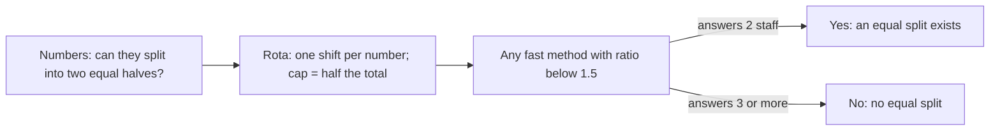

# Approximation: a guaranteed near-answer, and limits on the guarantee

[Syllabus](../../../SYLLABUS.md) → [Computability and complexity](../README.md) → [Beyond Worst Case](../README.md#s04) → Approximation

---

## General Overview

A small care home plans next week's rota. It has 8 shifts: three 12-hour nights, three 10-hour days, one 8-hour shift and one 6-hour shift. That is 80 hours. Each staff contract caps the week at 40 hours, and a shift cannot be split between two people. The manager asks: how few staff can cover every shift?

A quick rule gives a plan at once. Take the longest shift first, and give it to the first person who still has room. This rule is called **First Fit Decreasing**, FFD for short. Here it uses 3 staff, with loads of 36, 38 and 6 hours. The true fewest is 2: one person works 12 + 10 + 10 + 8 and the other 12 + 12 + 10 + 6, exactly 40 hours each.

So FFD was 1.5 times the fewest on this week. A proof says it can never do worse than that, on any rota. That proved worst-case multiple is the method's **approximation ratio**.

This card asks the next question. Could a cleverer fast method promise better than 1.5? The answer is no, unless every problem whose answers can be checked fast can also be solved fast: the claim written P = NP, which is widely doubted. The tool that shows this is a **gap reduction**: a way to turn a hard yes-or-no question into rotas whose fewest staff is either 2 or at least 3, never in between.

**A fast method's ratio is a proved ceiling on how far it can miss, and a gap reduction proves a floor under every such ceiling: here no fast method promises better than 1.5 unless P = NP.**

**What kind of fact this is:** two theorems. FFD's ratio is proved here in part (a ratio of 2) and stated with a named source (1.5). The limit of 1.5 is proved on this card in Why it works, but it is conditional: it holds if P ≠ NP, a conjecture unproved as of 2026-11-11.

### The picture: how a gap reduction catches a fast method



Schematic. If a fast method with ratio below 1.5 existed, this chain would answer a problem known to be among the hardest in NP, fast.

---

## The formula

Some names first. **OPT** is the fewest staff any plan can use. **ALG** is the number a method uses. A method has **ratio ρ** ("rho") when ALG ≤ ρ × OPT on every possible input. The [Approximation](../../14-Applied%20and%20computational/02-Randomised%20and%20Approximate%20Algorithms/06-approximation-algorithms.md) card proves such ratios: 2 for vertex cover, and the harmonic sum H(n), about ln n, for greedy set cover.

The rule that limits every ratio is the gap rule:

```math
\text{yes} \Rightarrow \text{OPT} \le a, \quad \text{no} \Rightarrow \text{OPT} \ge b \quad\Longrightarrow\quad \text{no fast method has } \rho < \tfrac{b}{a} \text{ unless P = NP}
```

**Read it aloud:** if a fast conversion turns every yes-instance of a hard question into an input whose best is at most a, and every no-instance into one whose best is at least b, then no fast method can promise a ratio below b divided by a.

For staff with a 40-hour cap the two sides meet:

```math
\text{ALG}_{\text{FFD}} \;\le\; \left\lfloor \tfrac{11\,\text{OPT} + 6}{9} \right\rfloor \;\le\; \tfrac{3}{2}\,\text{OPT}, \qquad a = 2,\; b = 3 \;\Rightarrow\; \tfrac{b}{a} = \tfrac{3}{2}
```

**Read it aloud:** FFD never uses more than (11 × OPT + 6)/9 people, rounded down, which is never more than 1.5 times the fewest staff, and the gap between 2 and 3 staff shows no fast method can promise less than 1.5.

| Symbol | Plain meaning | In our example | Push it up and the answer… |
| --- | --- | --- | --- |
| OPT | fewest staff any plan can use | 2 | every method's allowance grows with it |
| ALG | staff a method actually uses | FFD: 3 | the ratio ALG/OPT worsens |
| ρ | the promised ratio, on every input | FFD: 1.5 | a weaker promise |
| C | the hours cap on one person's week | 40 | fewer staff needed |
| T | total hours of all shifts | 80 | more staff needed |
| ⌈T/C⌉, ⌊·⌋ | total over cap, rounded up: a floor under OPT; ⌊·⌋ rounds down | ⌈80/40⌉ = 2; ⌊28/9⌋ = 3 | the floor rises |
| a, b | the best on yes-inputs is at most a; on no-inputs at least b | 2 and 3 | a wider gap rules out more ratios |
| n | number of shifts, or of items to cover | 8 | H(n) and ln n grow slowly |
| H(n), ln n | the harmonic sum 1 + 1/2 + … + 1/n, and the natural log | for 30 shifts: 3.995 and 3.401 | greedy set cover's allowance grows |
| ε | any small positive allowance ("epsilon") | for example 0.1 | a looser promise, a faster method |
| P, NP | problems solved fast; problems whose answers are checked fast | — | — |
| $`x_1, \dots, x_n`$ | the numbers of a PARTITION list, made into shift lengths | 12, 12, 12, 10, 10, 10, 8, 6 | a larger total, a larger cap |

Here "fast" means **polynomial time**: the steps grow at most like a fixed power of the input's length in symbols, as the [P and NP](../03-Time%20Complexity/02-p-and-np.md) card defines. P is the class of yes-or-no problems solved that fast. NP is the class whose yes-answers can be checked that fast, given a certificate (a proposed answer to check).

### When it holds

- **Worst case over every input.** The limit says some rotas defeat every fast method by 1.5. A given rota can be easy: FFD found the fewest on 386 of 400 random weeks in the check.
- **Huge numbers allowed.** The hard yes-or-no question needs numbers with many digits. With shifts in whole hours, a table of reachable totals settles our week in 248 steps, so this 2-or-3 gap gives no barrier for it. Bin packing with many shifts stays NP-hard even with small numbers; only the 1.5 limit needs big ones.
- **Tiny answers.** The gap is between 2 and 3 staff. On big rotas it fades: for ten copies of our week FFD uses 22 staff against 20, a ratio of 1.1.
- **P ≠ NP.** If P = NP, the limit vanishes and an exact fast method exists. Every hardness result on this card is conditional in this way.
- **A fast conversion.** The conversion itself must run in polynomial time. A slow one proves nothing about fast methods.

---

## Why it works

### Step 0: box the method's answer, then catch it with a gap

A ratio boxes the answer: OPT ≤ ALG ≤ ρ × OPT. Suppose the inputs from yes-instances all have OPT ≤ a and those from no-instances all have OPT ≥ b. If ρ × a < b, the two boxes cannot overlap.

So the method's answer alone says which side the input came from. A ratio method that is fast then answers the yes-or-no question fast. If that question is NP-complete (among the hardest in NP, as the [Reductions](../03-Time%20Complexity/03-polynomial-reductions-and-np-completeness.md) card defines), every NP problem would then be fast: P = NP.

This is how a limit on ratios is proved without listing methods. No one tests every possible program. The proof shows that any program beating the ratio would also do something believed impossible.

### Step 1: FFD's ratio is at most 2

First Fit gives each shift, in a fixed order, to the first person with room. FFD is First Fit with the longest shift first.

**Claim:** at most one person ends with a load of half the cap or less.

Suppose two people, the earlier one i and a later one j, both end at 20 hours or less. Every shift that went to j is at most 20 hours long. When it was placed, i held at most 20 hours, so it would have fit with i. First Fit would have given it to i or someone earlier, never to j. That is a contradiction.

So if First Fit uses ALG people, at least ALG − 1 of them carry more than 20 hours. The total is then more than (ALG − 1) × 20. Each person in any plan carries at most 40, so OPT ≥ T/40. Together:

```math
(\text{ALG} - 1) \times \tfrac{C}{2} \;<\; T \;\le\; \text{OPT} \times C \quad\Longrightarrow\quad \text{ALG} < 2\,\text{OPT} + 1
```

ALG and OPT are whole numbers, so ALG ≤ 2 × OPT. On our week, 3 ≤ 4. The check confirms this ceiling on 400 random weeks against the exact fewest. In the order drawn, First Fit's worst there was 1.5.

### Step 2: the sharper ceiling, 1.5

Sorting longest-first helps. A 2007 theorem proves FFD never uses more than 11/9 × OPT + 6/9 people, and that this ceiling is exact (Dósa, in Sources). The proof runs to several pages of case analysis, so this card states it without proof.

Whole numbers turn it into 1.5. With OPT = 1 the ceiling is 17/9, about 1.889, so 1 person. With OPT = 2 it is 28/9, about 3.111, so 3 people: exactly 1.5 × 2. From OPT = 3 on, the ceiling is under 1.5 × OPT even before rounding down (4.333 against 4.5 at OPT = 3), and the difference grows with OPT. The check confirms the whole-number ceiling stays at or under 1.5 × OPT for every OPT from 1 to 1,000.

Our week sits right on the ceiling: OPT 2, FFD 3. Step 3 shows no fast method can push the ceiling lower.

### Step 3: the gap reduction from PARTITION

**PARTITION** asks: can a list of whole numbers be split into two groups with equal totals? It is on [Karp's list](../03-Time%20Complexity/05-karps-problems-and-hardness-recipes.md) of NP-complete problems, so a fast method for it would give P = NP.

**The conversion.** Turn each number into a shift of that length, and set the cap C to half the total. This takes one pass over the numbers, so it is fast.

**Yes goes to 2.** If an equal split exists, each group fills one person to exactly C. So OPT = 2. (OPT is never 1, since the total is 2C.)

**No goes to at least 3.** Suppose 2 people sufficed. Together they hold the whole total, 2C, and each holds at most C. So each holds exactly C, which is an equal split. When no split exists, 2 people cannot suffice, so OPT ≥ 3.

So a = 2 and b = 3. A fast method with ratio ρ < 3/2 answers at most ρ × 2 < 3 on every yes-input, so it answers 2. On every no-input it answers at least OPT ≥ 3. Its answer decides PARTITION.

The check runs this conversion on 300 random lists of 7 numbers. Each list is settled two ways: by trying every group, and by a table of reachable totals. The exact fewest staff was 2 on all 208 yes-lists and at least 3 on all 92 no-lists.

<details>
<summary>Detailed proof: the limit of 3/2, written out</summary>

Let A be a method that runs in polynomial time and has ratio ρ < 3/2 for bin packing (shifts of given lengths, people with cap C, fewest people).

Given a PARTITION list $`x_1, \dots, x_n`$ with total T: if T is odd, answer no. Otherwise build the rota with shifts $`x_1, \dots, x_n`$ and cap $`C = T/2`$. If some $`x_i > C`$, answer no. Run A and answer yes exactly when A uses 2 people.

If a split exists, OPT = 2, so A uses at most

$`\displaystyle \rho \times 2 < \tfrac{3}{2} \times 2 = 3`$

people. A whole number below 3 and at least OPT = 2 is 2, so the answer is yes.

If no split exists, any 2-person plan would put exactly C on each person, which is a split. So OPT ≥ 3, and A uses at least 3. The answer is no.

Every step is polynomial, so PARTITION is in P. PARTITION is NP-complete, so P = NP. Hence, if P ≠ NP, no such A exists.

</details>

FFD's ratio is exactly 3/2 at these sizes, and it cannot decide anything: its 3 on our week fits OPT = 2 (since 3 ≤ 1.5 × 2) and OPT = 3 alike. A ratio exactly at the gap gives no information. Only a ratio strictly below it would.

### Step 4: what the limit does not say

The limit needs three things, and each one can fail on a real rota.

1. **Large numbers.** PARTITION is hard only when its numbers have many digits, so the 2-or-3 question is too. With small whole numbers, a table of every reachable total settles it. For our week the table has 248 cells, and it finds the 40-hour split. That is the subject of the [Pseudo-polynomial time](../03-Time%20Complexity/06-pseudo-polynomial-time-and-numbers-in-the-input.md) card.
2. **A tiny answer.** The gap compares 2 with 3. On a large rota one extra person is a small fraction of the staff, so the gap stops mattering. For every ε > 0 there is a fast method using at most (1 + ε) × OPT + 1 people (de la Vega and Lueker, in Sources). For ten copies of our week, FFD uses 22 against 20, already a ratio of 1.1.
3. **P ≠ NP.** Every limit here is "unless P = NP". The P versus NP question is open.

### Step 5: bigger gaps, and the classes PTAS and APX

The rota gap is one person. Other problems have gaps that grow with the input. Those gaps need a deep tool, the PCP theorem (from the [Interactive proofs](../05-Algebraic%2C%20Interactive%20and%20Quantum/04-interactive-proofs-ip-pspace-and-the-pcp-theorem.md) card): every NP certificate can be rewritten so that a checker reading only a few of its bits, at random places, catches any false claim with good chance. The last two rows of the table below rest on it and are stated here with sources.

Two class names sort the answers. A **PTAS** (polynomial-time approximation scheme) is a family of fast methods, one for each ε > 0, each with ratio 1 + ε. **APX** is the class of optimisation problems with some fast method of constant ratio.

| Problem, as a rota | Best fast ratio known | No fast method beats, unless P = NP | Class |
| --- | --- | --- | --- |
| Shifts and 40-hour caps (bin packing) | 1.5, FFD | 1.5 | in APX; no PTAS |
| Each shift needs one of its two named people (vertex cover) | 2 | √2 − ε, about 1.414 | in APX; no PTAS |
| Each person qualified for some shifts (set cover) | H(n), at most 1 + ln n | (1 − ε) ln n | not in APX |

The class entries "no PTAS" and "not in APX" are conditional too: they hold only if P ≠ NP.

For set cover with 30 shifts, greedy's ceiling H(30) is 3.995, and ln 30 is 3.401. The limit says that, for large n, no fast method can promise below (1 − ε) ln n (Dinur and Steurer). Greedy is within a small slack of the best possible promise.

For vertex cover the gap between √2 and 2 is open. Under the unique games conjecture, unproved as of 2026-11-11, 2 is the exact limit; [The unique games conjecture](../../25-Frontier/06-Algebra%2C%20Logic%20and%20Computation/03-unique-games-conjecture.md) takes it up.

---

## Worked numbers, by hand

| Step | Arithmetic | Value |
| --- | --- | --- |
| total hours | 12 + 12 + 12 + 10 + 10 + 10 + 8 + 6 | 80 |
| floor from hours | 80 / 40, rounded up | at least 2 |
| FFD | 12, 12, 12 to person 1 (36); 10, 10, 10, 8 to person 2 (38); 6 to person 3 | 3 staff |
| fewest, by trying every group | 12 + 10 + 10 + 8 and 12 + 12 + 10 + 6 | 2 staff |
| FFD's ratio here | 3 / 2 | 1.5 |
| First Fit ceiling | 2 × OPT | 4 |
| FFD ceiling | 11/9 × 2 + 6/9 = 28/9, rounded down | 3 |
| gap limit | b / a = 3 / 2 | **1.5** |

The proved ceiling and the gap limit meet at 1.5: FFD is as good a promise as any fast method can give, unless P = NP.

The loads, in hours out of 40:

```
FFD, person 1    ####################################      36
FFD, person 2    ######################################    38
FFD, person 3    ######                                     6
best, person 1   ########################################  40
best, person 2   ########################################  40
```

### What breaks if you drop a piece

| Mistake | Comes out at | What went wrong |
| --- | --- | --- |
| Hours over cap read as the fewest, on a week of five 12s and two 10s | 2 claimed; truly 3 | 80/40 is a floor; no 40-hour group exists |
| FFD's answer read as the fewest | 3 claimed; truly 2 | The ratio bounds the miss; it does not remove it |
| The limit applied to whole-hour shifts | "hard"; the table settles it in 248 steps | The 2-or-3 gap needs huge numbers; with small ones the table settles it |
| The limit applied to a big rota | 1.5 feared; FFD gets 22/20 = 1.1 | The gap is between 2 and 3 staff; it fades as OPT grows |

The code prints all four.

---

## Code, from first principles, and it actually runs

The code builds the rota and finds the fewest staff by three independent roads: trying every grouping of shifts, trying all 256 subsets for a 40-hour half, and a table of reachable totals. It runs FFD and plain First Fit and checks both proved ceilings against the exact fewest on 400 random weeks. Then it runs the gap reduction on 300 random lists and checks that yes goes to 2 and no to at least 3. Random numbers come from SplitMix64 with seed 2026, written out in both languages.

### Python

```python
# Approximation and its limits -- the check behind the card.  Standard library
# only: math for ln and sqrt.  A care home's week has 8 shifts, lengths in hours;
# a staff member works at most CAP = 40.  Fewest staff covering every shift is
# bin packing.  Three roads to the exact answer, then the gap reduction.
import math
WEEK, NOSPLIT, CAP = [12, 12, 12, 10, 10, 10, 8, 6], [12, 12, 12, 12, 12, 10, 10], 40
M64 = (1 << 64) - 1

def first_fit(shifts, cap):  # each shift goes to the first person with room
    rows = []
    for s in shifts:
        for r in rows:
            if sum(r) + s <= cap:
                r.append(s)
                break
        else:
            rows.append([s])
    return rows

def ffd(shifts, cap):  # first fit, longest shift first
    return first_fit(sorted(shifts, reverse=True), cap)

def fewest_exact(xs, cap):  # road 1: best plan over every group of shifts
    n = len(xs)
    full = (1 << n) - 1
    tot = [0] * (full + 1)
    for m in range(1, full + 1):
        low = m & -m
        tot[m] = tot[m ^ low] + xs[low.bit_length() - 1]
    best = [0] + [n + 1] * full
    for m in range(1, full + 1):
        low = m & -m
        rest = m ^ low
        sub = rest
        while True:  # every group holding the lowest shift left
            g = sub | low
            if tot[g] <= cap and best[m ^ g] + 1 < best[m]:
                best[m] = best[m ^ g] + 1
            if sub == 0:
                break
            sub = (sub - 1) & rest
    return best[full]

def split_by_subsets(xs):  # road 2: try all 2^n groups for exactly half
    for m in range(1 << len(xs)):
        if 2 * sum(x for i, x in enumerate(xs) if m >> i & 1) == sum(xs):
            return [x for i, x in enumerate(xs) if m >> i & 1]
    return None

def split_by_table(xs):  # road 3: which totals can a group reach? counts cells
    t = sum(xs)
    if t % 2:
        return False, 0
    reach, cells = [True] + [False] * (t // 2), 0
    for x in xs:
        for s in range(t // 2, x - 1, -1):
            cells += 1
            reach[s] = reach[s] or reach[s - x]
    return reach[t // 2], cells

def ffd_ceiling(k):  # proved ceiling on FFD's staff when the fewest is k
    return (11 * k + 6) // 9

def splitmix(state):
    state = (state + 0x9E3779B97F4A7C15) & M64
    z = ((state ^ (state >> 30)) * 0xBF58476D1CE4E5B9) & M64
    z = ((z ^ (z >> 27)) * 0x94D049BB133111EB) & M64
    return state, z ^ (z >> 31)

def draw(state, n, lo, hi):
    out = []
    for _ in range(n):
        state, z = splitmix(state)
        out.append(lo + z % (hi - lo + 1))
    return state, out

rows, opt = ffd(WEEK, CAP), fewest_exact(WEEK, CAP)
half = split_by_subsets(WEEK)
yes, cells = split_by_table(WEEK)
print("week, hours", " ".join(map(str, WEEK)), "total", sum(WEEK))
print("floor: total / cap, rounded up", -(-sum(WEEK) // CAP))
print("FFD staff loads", " ".join(str(sum(r)) for r in rows), "-> staff", len(rows))
for i, r in enumerate(rows):
    print(f"  FFD person {i + 1}", " ".join(map(str, r)))
other = list(WEEK)
for x in half:
    other.remove(x)
print("exact fewest, all groups", opt)
print("split by all 256 subsets", " ".join(map(str, half)), "|", " ".join(map(str, other)))
print("split by table", yes, "cells", cells)
assert opt == 2 and yes and 2 * sum(half) == sum(WEEK) and len(rows) == 3
assert [sum(r) for r in rows] == [36, 38, 6]  # by hand: 12+12+12, 10+10+10+8, 6
assert len(ffd([12, 12, 12, 10, 10, 10, 8, 4], CAP)) == 2  # a 4h shift fills 36 to exactly 40
assert len(rows) <= 2 * opt and len(rows) <= ffd_ceiling(opt)
print("FFD/fewest", f"{len(rows) / opt:.3f}", "First Fit ceiling 2*OPT", 2 * opt, "FFD ceiling", ffd_ceiling(opt))
assert all(2 * ffd_ceiling(k) <= 3 * k for k in range(1, 1001))
print("FFD ceiling <= 1.5*OPT for OPT 1 to 1000: True")
print("FFD ceiling before rounding down, OPT 1 2 3:",
      " ".join(f"{(11 * k + 6) / 9:.3f}" for k in (1, 2, 3)), "| 1.5*OPT 1.5 3.0 4.5")
n_opt, n_yes, n_cells = fewest_exact(NOSPLIT, CAP), split_by_subsets(NOSPLIT), split_by_table(NOSPLIT)
print("no-split week", " ".join(map(str, NOSPLIT)), "total", sum(NOSPLIT))
print("  floor", -(-sum(NOSPLIT) // CAP), "exact fewest", n_opt, "FFD", len(ffd(NOSPLIT, CAP)),
      "split", n_yes is not None, n_cells[0])
assert n_opt == 3 and n_yes is None and not n_cells[0]
state, seen = 2026, [0, 0]
for _ in range(300):  # gap reduction: numbers -> rota with cap = half the total
    state, xs = draw(state, 7, 1, 30)
    xs[-1] += sum(xs) % 2
    k = fewest_exact(xs, sum(xs) // 2)
    by_table, by_subsets = split_by_table(xs)[0], split_by_subsets(xs) is not None
    assert by_table == by_subsets and (k == 2) == by_table and k >= 2
    seen[by_table] += 1
print("reduction, 300 number lists: yes -> fewest 2:", seen[1], "no -> fewest >= 3:", seen[0])
worst_ff = worst_ffd = 0.0
ffd_miss = 0
for _ in range(400):  # random weeks: the ratios proved, against the exact fewest
    state, xs = draw(state, 8, 4, 12)
    k, a, b = fewest_exact(xs, CAP), len(first_fit(xs, CAP)), len(ffd(xs, CAP))
    assert a <= 2 * k and b <= ffd_ceiling(k) and b >= k
    worst_ff, worst_ffd, ffd_miss = max(worst_ff, a / k), max(worst_ffd, b / k), ffd_miss + (b > k)
print("400 random weeks: worst First Fit", f"{worst_ff:.3f}", "worst FFD", f"{worst_ffd:.3f}",
      "FFD above fewest", ffd_miss)
big = ffd(WEEK * 10, CAP)
plan = [half, other] * 10  # ten copies of the two-person split
assert sorted(x for r in plan for x in r) == sorted(WEEK * 10) and all(sum(r) <= CAP for r in plan)
print("ten weeks: floor", sum(WEEK) * 10 // CAP, "split plan", len(plan), "FFD", len(big),
      "ratio", f"{len(big) / len(plan):.3f}", "FFD ceiling", ffd_ceiling(len(plan)))
h30 = sum(1 / j for j in range(1, 31))
print("set cover, 30 shifts: H(30)", f"{h30:.3f}", "ln 30", f"{math.log(30):.3f}",
      "vertex cover floor sqrt 2", f"{math.sqrt(2):.3f}")
for name, xs, cap in [("try 6h -> 4h", [12, 12, 12, 10, 10, 10, 8, 4], CAP),
                      ("try cap 41", WEEK, 41), ("try 12h -> 11h", [11, 12, 12, 10, 10, 10, 8, 6], CAP)]:
    print(name, "total", sum(xs), "exact fewest", fewest_exact(xs, cap), "FFD", len(ffd(xs, cap)))
print("ALL CHECKS PASS")
```

**Ran 2026-11-19 on macOS, Python 3.14.10, standard library only. All checks passed. Output, pasted from the run:**

```
week, hours 12 12 12 10 10 10 8 6 total 80
floor: total / cap, rounded up 2
FFD staff loads 36 38 6 -> staff 3
  FFD person 1 12 12 12
  FFD person 2 10 10 10 8
  FFD person 3 6
exact fewest, all groups 2
split by all 256 subsets 12 10 10 8 | 12 12 10 6
split by table True cells 248
FFD/fewest 1.500 First Fit ceiling 2*OPT 4 FFD ceiling 3
FFD ceiling <= 1.5*OPT for OPT 1 to 1000: True
FFD ceiling before rounding down, OPT 1 2 3: 1.889 3.111 4.333 | 1.5*OPT 1.5 3.0 4.5
no-split week 12 12 12 12 12 10 10 total 80
  floor 2 exact fewest 3 FFD 3 split False False
reduction, 300 number lists: yes -> fewest 2: 208 no -> fewest >= 3: 92
400 random weeks: worst First Fit 1.500 worst FFD 1.500 FFD above fewest 14
ten weeks: floor 20 split plan 20 FFD 22 ratio 1.100 FFD ceiling 25
set cover, 30 shifts: H(30) 3.995 ln 30 3.401 vertex cover floor sqrt 2 1.414
try 6h -> 4h total 78 exact fewest 2 FFD 2
try cap 41 total 80 exact fewest 2 FFD 3
try 12h -> 11h total 79 exact fewest 2 FFD 3
ALL CHECKS PASS
```

### Rust

```rust
// Approximation and its limits -- the check behind the card.  std only.
// A care home's week has 8 shifts, lengths in hours; a staff member works at
// most CAP = 40.  Fewest staff covering every shift is bin packing.  Three roads
// to the exact answer, then the gap reduction.
const WEEK: [u64; 8] = [12, 12, 12, 10, 10, 10, 8, 6];
const NOSPLIT: [u64; 7] = [12, 12, 12, 12, 12, 10, 10];
const CAP: u64 = 40;

fn first_fit(shifts: &[u64], cap: u64) -> Vec<Vec<u64>> {
    let mut rows: Vec<Vec<u64>> = Vec::new(); // each shift to the first person with room
    for &s in shifts {
        match rows.iter_mut().find(|r| r.iter().sum::<u64>() + s <= cap) {
            Some(r) => r.push(s),
            None => rows.push(vec![s]),
        }
    }
    rows
}

fn ffd(shifts: &[u64], cap: u64) -> Vec<Vec<u64>> {
    let mut v = shifts.to_vec(); // first fit, longest shift first
    v.sort_by(|a, b| b.cmp(a));
    first_fit(&v, cap)
}

fn fewest_exact(xs: &[u64], cap: u64) -> usize {
    let n = xs.len(); // road 1: best plan over every group of shifts
    let full = (1usize << n) - 1;
    let mut tot = vec![0u64; full + 1];
    for m in 1..=full {
        let low = m & m.wrapping_neg();
        tot[m] = tot[m ^ low] + xs[low.trailing_zeros() as usize];
    }
    let mut best = vec![n + 1; full + 1];
    best[0] = 0;
    for m in 1..=full {
        let low = m & m.wrapping_neg();
        let rest = m ^ low;
        let mut sub = rest;
        loop {
            let g = sub | low; // every group holding the lowest shift left
            if tot[g] <= cap && best[m ^ g] + 1 < best[m] {
                best[m] = best[m ^ g] + 1;
            }
            if sub == 0 { break; }
            sub = (sub - 1) & rest;
        }
    }
    best[full]
}

fn split_by_subsets(xs: &[u64]) -> Option<Vec<u64>> {
    let t: u64 = xs.iter().sum(); // road 2: try all 2^n groups for exactly half
    for m in 0..(1usize << xs.len()) {
        let g: Vec<u64> = (0..xs.len()).filter(|i| m >> i & 1 == 1).map(|i| xs[i]).collect();
        if 2 * g.iter().sum::<u64>() == t { return Some(g); }
    }
    None
}

fn split_by_table(xs: &[u64]) -> (bool, u64) {
    let t: u64 = xs.iter().sum(); // road 3: which totals can a group reach?
    if t % 2 == 1 { return (false, 0); }
    let h = (t / 2) as usize;
    let (mut reach, mut cells) = (vec![false; h + 1], 0u64);
    reach[0] = true;
    for &x in xs {
        let x = x as usize;
        let mut s = h;
        while s >= x && s >= 1 {
            cells += 1;
            reach[s] = reach[s] || reach[s - x];
            s -= 1;
        }
    }
    (reach[h], cells)
}

fn ffd_ceiling(k: usize) -> usize { (11 * k + 6) / 9 } // proved ceiling on FFD's staff

fn splitmix(state: &mut u64) -> u64 {
    *state = state.wrapping_add(0x9E3779B97F4A7C15);
    let mut z = (*state ^ (*state >> 30)).wrapping_mul(0xBF58476D1CE4E5B9);
    z = (z ^ (z >> 27)).wrapping_mul(0x94D049BB133111EB);
    z ^ (z >> 31)
}

fn draw(state: &mut u64, n: usize, lo: u64, hi: u64) -> Vec<u64> {
    (0..n).map(|_| lo + splitmix(state) % (hi - lo + 1)).collect()
}

fn join(v: &[u64]) -> String { v.iter().map(|x| x.to_string()).collect::<Vec<_>>().join(" ") }
fn py(b: bool) -> &'static str { if b { "True" } else { "False" } }
fn ceil_div(a: u64, b: u64) -> u64 { (a + b - 1) / b }

fn main() {
    let rows = ffd(&WEEK, CAP);
    let opt = fewest_exact(&WEEK, CAP);
    let half = split_by_subsets(&WEEK).unwrap();
    let (yes, cells) = split_by_table(&WEEK);
    let total: u64 = WEEK.iter().sum();
    println!("week, hours {} total {}", join(&WEEK), total);
    println!("floor: total / cap, rounded up {}", ceil_div(total, CAP));
    let loads: Vec<u64> = rows.iter().map(|r| r.iter().sum()).collect();
    println!("FFD staff loads {} -> staff {}", join(&loads), rows.len());
    for (i, r) in rows.iter().enumerate() { println!("  FFD person {} {}", i + 1, join(r)); }
    let mut other = WEEK.to_vec();
    for x in &half { let p = other.iter().position(|y| y == x).unwrap(); other.remove(p); }
    println!("exact fewest, all groups {}", opt);
    println!("split by all 256 subsets {} | {}", join(&half), join(&other));
    println!("split by table {} cells {}", py(yes), cells);
    assert!(opt == 2 && yes && 2 * half.iter().sum::<u64>() == total && rows.len() == 3 && loads == vec![36, 38, 6]);
    assert!(ffd(&[12, 12, 12, 10, 10, 10, 8, 4], CAP).len() == 2); // a 4h shift fills 36 to exactly 40
    assert!(rows.len() <= 2 * opt && rows.len() <= ffd_ceiling(opt));
    println!("FFD/fewest {:.3} First Fit ceiling 2*OPT {} FFD ceiling {}",
             rows.len() as f64 / opt as f64, 2 * opt, ffd_ceiling(opt));
    assert!((1..=1000).all(|k| 2 * ffd_ceiling(k) <= 3 * k));
    println!("FFD ceiling <= 1.5*OPT for OPT 1 to 1000: True");
    let raw: Vec<String> = [1.0f64, 2.0, 3.0].iter().map(|k| format!("{:.3}", (11.0 * k + 6.0) / 9.0)).collect();
    println!("FFD ceiling before rounding down, OPT 1 2 3: {} | 1.5*OPT 1.5 3.0 4.5", raw.join(" "));
    let (n_opt, n_yes) = (fewest_exact(&NOSPLIT, CAP), split_by_subsets(&NOSPLIT));
    let n_cells = split_by_table(&NOSPLIT);
    let ntot: u64 = NOSPLIT.iter().sum();
    println!("no-split week {} total {}", join(&NOSPLIT), ntot);
    println!("  floor {} exact fewest {} FFD {} split {} {}", ceil_div(ntot, CAP), n_opt,
             ffd(&NOSPLIT, CAP).len(), py(n_yes.is_some()), py(n_cells.0));
    assert!(n_opt == 3 && n_yes.is_none() && !n_cells.0);
    let mut state: u64 = 2026;
    let mut seen = [0u32; 2];
    for _ in 0..300 { // gap reduction: numbers -> rota with cap = half the total
        let mut xs = draw(&mut state, 7, 1, 30);
        let s: u64 = xs.iter().sum();
        xs[6] += s % 2;
        let t: u64 = xs.iter().sum();
        let k = fewest_exact(&xs, t / 2);
        let (by_table, by_subsets) = (split_by_table(&xs).0, split_by_subsets(&xs).is_some());
        assert!(by_table == by_subsets && (k == 2) == by_table && k >= 2);
        seen[by_table as usize] += 1;
    }
    println!("reduction, 300 number lists: yes -> fewest 2: {} no -> fewest >= 3: {}", seen[1], seen[0]);
    let (mut worst_ff, mut worst_ffd, mut ffd_miss) = (0.0f64, 0.0f64, 0);
    for _ in 0..400 { // random weeks: the ratios proved, against the exact fewest
        let xs = draw(&mut state, 8, 4, 12);
        let (k, a, b) = (fewest_exact(&xs, CAP), first_fit(&xs, CAP).len(), ffd(&xs, CAP).len());
        assert!(a <= 2 * k && b <= ffd_ceiling(k) && b >= k);
        worst_ff = worst_ff.max(a as f64 / k as f64);
        worst_ffd = worst_ffd.max(b as f64 / k as f64);
        if b > k { ffd_miss += 1; }
    }
    println!("400 random weeks: worst First Fit {:.3} worst FFD {:.3} FFD above fewest {}",
             worst_ff, worst_ffd, ffd_miss);
    let ten: Vec<u64> = (0..10).flat_map(|_| WEEK.iter().copied()).collect();
    let big = ffd(&ten, CAP);
    let plan: Vec<Vec<u64>> = (0..20).map(|i| if i % 2 == 0 { half.clone() } else { other.clone() }).collect();
    let mut a: Vec<u64> = plan.iter().flatten().copied().collect();
    let mut b = ten.clone(); a.sort(); b.sort();
    assert!(a == b && plan.iter().all(|r| r.iter().sum::<u64>() <= CAP));
    println!("ten weeks: floor {} split plan {} FFD {} ratio {:.3} FFD ceiling {}", total * 10 / CAP,
             plan.len(), big.len(), big.len() as f64 / plan.len() as f64, ffd_ceiling(plan.len()));
    let h30: f64 = (1..=30).map(|j| 1.0 / j as f64).sum();
    println!("set cover, 30 shifts: H(30) {:.3} ln 30 {:.3} vertex cover floor sqrt 2 {:.3}",
             h30, 30f64.ln(), 2f64.sqrt());
    let tries: [(&str, Vec<u64>, u64); 3] = [("try 6h -> 4h", vec![12, 12, 12, 10, 10, 10, 8, 4], CAP),
        ("try cap 41", WEEK.to_vec(), 41), ("try 12h -> 11h", vec![11, 12, 12, 10, 10, 10, 8, 6], CAP)];
    for (name, xs, cap) in tries.iter() {
        println!("{} total {} exact fewest {} FFD {}", name, xs.iter().sum::<u64>(),
                 fewest_exact(xs, *cap), ffd(xs, *cap).len());
    }
    println!("ALL CHECKS PASS");
}
```

**Ran 2026-11-19 on macOS, rustc 1.98.1, no crates. All checks passed. Output, pasted from the run:**

```
week, hours 12 12 12 10 10 10 8 6 total 80
floor: total / cap, rounded up 2
FFD staff loads 36 38 6 -> staff 3
  FFD person 1 12 12 12
  FFD person 2 10 10 10 8
  FFD person 3 6
exact fewest, all groups 2
split by all 256 subsets 12 10 10 8 | 12 12 10 6
split by table True cells 248
FFD/fewest 1.500 First Fit ceiling 2*OPT 4 FFD ceiling 3
FFD ceiling <= 1.5*OPT for OPT 1 to 1000: True
FFD ceiling before rounding down, OPT 1 2 3: 1.889 3.111 4.333 | 1.5*OPT 1.5 3.0 4.5
no-split week 12 12 12 12 12 10 10 total 80
  floor 2 exact fewest 3 FFD 3 split False False
reduction, 300 number lists: yes -> fewest 2: 208 no -> fewest >= 3: 92
400 random weeks: worst First Fit 1.500 worst FFD 1.500 FFD above fewest 14
ten weeks: floor 20 split plan 20 FFD 22 ratio 1.100 FFD ceiling 25
set cover, 30 shifts: H(30) 3.995 ln 30 3.401 vertex cover floor sqrt 2 1.414
try 6h -> 4h total 78 exact fewest 2 FFD 2
try cap 41 total 80 exact fewest 2 FFD 3
try 12h -> 11h total 79 exact fewest 2 FFD 3
ALL CHECKS PASS
```

The two outputs are identical. The exact fewest, the subset search and the table agree on every week and every list.

### Lean

Lean proves the gap reduction and the gap rule for every input, and rounds Dósa's ceiling to 1.5 × OPT.

- Take any list of whole numbers, with the cap C set to half the total. Then 2 or fewer staff cover every shift exactly when the list has an equal split.
- Take a method with ratio ρ and ρ × a < b, with OPT ≤ a on yes-inputs, OPT ≥ b on no-inputs. Then its answer ALG is below b exactly on the yes-inputs.
- Suppose a whole number of staff ALG is at most 11/9 × OPT + 6/9. Then ALG ≤ 1.5 × OPT.
- The care home's week totals 80 hours, and 80/40 rounded up gives the floor of 2.
- The split 12 + 10 + 10 + 8 against 12 + 12 + 10 + 6 gives 40 hours each. The best 2-person plan and FFD's 3-person plan both stay within 40 hours.
- Five 12-hour and two 10-hour shifts total 80 hours, but no group of them makes 40.
- At OPT = 2, First Fit's ceiling is 4 and FFD's is 3. For ten copies of the week, FFD's ceiling is 25, and 22/20 is 1.1.

Running FFD, the exact fewest, the random weeks and the 300 lists are left to the Python and Rust checks.

```lean
-- Approximation: splitting numbers into two equal halves is the same as covering their shifts with two people capped at half the total, so the fewest staff is at most 2 or at least 3, and that gap lets any method with ratio below 3/2 decide the split question.
import Mathlib.Algebra.BigOperators.Fin
import Mathlib.Algebra.Order.BigOperators.Group.Finset
import Mathlib.Data.Real.Basic
import Mathlib.Tactic.NormNum
import Mathlib.Tactic.Linarith
import Mathlib.Tactic.FinCases
import Mathlib.Tactic.IntervalCases

open Finset

/-- A plan with k people for shifts of lengths x and an hours cap C: a person f i for every
shift i, such that the shifts given to each person j total at most C hours. -/
def IsPlan {n : ℕ} (x : Fin n → ℕ) (C k : ℕ) (f : Fin n → Fin k) : Prop :=
  ∀ j : Fin k, ∑ i ∈ univ.filter (fun i => f i = j), x i ≤ C

/-- The gap reduction from PARTITION. Turn each number x_i into a shift of that length and set
the cap C to half the total. Then the shifts can be covered by at most 2 people exactly when the
numbers split into two groups with equal totals. So a yes-list gives a rota whose fewest staff is
at most 2, and a no-list gives one whose fewest staff is at least 3. -/
theorem two_staff_iff_equal_split {n : ℕ} (x : Fin n → ℕ) (C : ℕ) (hC : ∑ i, x i = 2 * C) :
    (∃ k ≤ 2, ∃ f : Fin n → Fin k, IsPlan x C k f) ↔
      ∃ S : Finset (Fin n), ∑ i ∈ S, x i = ∑ i ∈ Sᶜ, x i := by
  constructor
  · rintro ⟨k, hk, f, hf⟩
    have key : ∀ j : ℕ, ∑ i ∈ univ.filter (fun i => (f i).val = j), x i ≤ C := by
      intro j
      by_cases hj : j < k
      · have : univ.filter (fun i => (f i).val = j) = univ.filter (fun i => f i = ⟨j, hj⟩) := by
          ext i; simp [Fin.ext_iff]
        rw [this]; exact hf ⟨j, hj⟩
      · have : univ.filter (fun i => (f i).val = j) = ∅ := by
          ext i; simp only [mem_filter, mem_univ, true_and, Finset.notMem_empty, iff_false]
          have := (f i).isLt; omega
        rw [this]; simp
    refine ⟨univ.filter (fun i => (f i).val = 0), ?_⟩
    have hc : (univ.filter (fun i => (f i).val = 0))ᶜ = univ.filter (fun i => (f i).val = 1) := by
      ext i; simp only [mem_compl, mem_filter, mem_univ, true_and]
      have := (f i).isLt; omega
    have hsplit := Finset.sum_add_sum_compl (univ.filter (fun i => (f i).val = 0)) x
    rw [hc] at hsplit ⊢
    have h0 := key 0
    have h1 := key 1
    omega
  · rintro ⟨S, hS⟩
    refine ⟨2, le_refl _, fun i => if i ∈ S then 0 else 1, ?_⟩
    have hsplit := Finset.sum_add_sum_compl S x
    intro j
    fin_cases j
    · have : univ.filter (fun i => (if i ∈ S then (0 : Fin 2) else 1) = 0) = S := by
        ext i; by_cases hi : i ∈ S <;> simp [hi]
      simp only [Fin.zero_eta, Fin.isValue]
      rw [this]; omega
    · have : univ.filter (fun i => (if i ∈ S then (0 : Fin 2) else 1) = 1) = Sᶜ := by
        ext i; by_cases hi : i ∈ S <;> simp [hi]
      simp only [Fin.mk_one, Fin.isValue]
      rw [this]; omega

/-- The gap rule. Suppose every yes-input has fewest OPT ≤ a and every no-input has OPT ≥ b, and
a method with ratio ρ always answers ALG with OPT ≤ ALG ≤ ρ × OPT. If ρ × a < b, the method's
answer alone decides the question: it answers below b exactly on the yes-inputs. -/
theorem gap_rule_decides (yes : Prop) (a b OPT ALG : ℕ) (ρ : ℝ) (hρ : 0 ≤ ρ)
    (hgap : ρ * a < b) (hlow : OPT ≤ ALG) (hhigh : (ALG : ℝ) ≤ ρ * OPT)
    (hyes : yes → OPT ≤ a) (hno : ¬ yes → b ≤ OPT) :
    ALG < b ↔ yes := by
  by_cases hy : yes
  · simp only [hy, iff_true]
    have h1 : (OPT : ℝ) ≤ a := by exact_mod_cast hyes hy
    have h2 : (ALG : ℝ) < b := by nlinarith
    exact_mod_cast h2
  · simp only [hy, iff_false, not_lt]
    exact le_trans (hno hy) hlow

/-- FFD's ceiling, rounded to whole people, is at most 1.5 times the fewest: if a whole number of
staff ALG is at most 11/9 × OPT + 6/9, then ALG ≤ 3/2 × OPT. -/
theorem ffd_ceiling_le_three_halves (ALG OPT : ℕ)
    (h : (ALG : ℝ) ≤ 11 / 9 * OPT + 6 / 9) :
    (ALG : ℝ) ≤ 3 / 2 * OPT := by
  have h9 : 9 * ALG ≤ 11 * OPT + 6 := by
    have : (9 * ALG : ℝ) ≤ 11 * OPT + 6 := by linarith
    exact_mod_cast this
  have h2 : 2 * ALG ≤ 3 * OPT := by
    rcases Nat.lt_or_ge OPT 3 with hO | hO
    · interval_cases OPT <;> omega
    · omega
  have : (2 * ALG : ℝ) ≤ 3 * OPT := by exact_mod_cast h2
  linarith

-- The care home's week: shifts of 12, 12, 12, 10, 10, 10, 8 and 6 hours, 80 hours in all.
example : ∑ i, (![12, 12, 12, 10, 10, 10, 8, 6] : Fin 8 → ℕ) i = 80 := by decide

-- The floor from hours: 80 / 40, rounded up, is 2.
example : (80 + 40 - 1) / 40 = 2 := by norm_num

-- The equal split: 12 + 10 + 10 + 8 against 12 + 12 + 10 + 6, 40 hours each.
example : ∑ i ∈ ({0, 3, 4, 6} : Finset (Fin 8)), (![12, 12, 12, 10, 10, 10, 8, 6] : Fin 8 → ℕ) i
    = ∑ i ∈ ({0, 3, 4, 6} : Finset (Fin 8))ᶜ, (![12, 12, 12, 10, 10, 10, 8, 6] : Fin 8 → ℕ) i := by
  decide +kernel

-- The best plan: 2 people, each exactly within the 40-hour cap.
example : IsPlan (![12, 12, 12, 10, 10, 10, 8, 6] : Fin 8 → ℕ) 40 2 ![0, 1, 1, 0, 0, 1, 0, 1] := by
  unfold IsPlan; decide

-- FFD's plan: 12, 12, 12 to person 1 (36); 10, 10, 10, 8 to person 2 (38); 6 to person 3.
example : IsPlan (![12, 12, 12, 10, 10, 10, 8, 6] : Fin 8 → ℕ) 40 3 ![0, 0, 0, 1, 1, 1, 1, 2] := by
  unfold IsPlan; decide

-- The no-split week: five 12s and two 10s, 80 hours, but no group makes 40, so 2 staff cannot do.
example : ∑ i, (![12, 12, 12, 12, 12, 10, 10] : Fin 7 → ℕ) i = 80 := by decide
example : ¬ ∃ S : Finset (Fin 7), ∑ i ∈ S, (![12, 12, 12, 12, 12, 10, 10] : Fin 7 → ℕ) i
    = ∑ i ∈ Sᶜ, (![12, 12, 12, 12, 12, 10, 10] : Fin 7 → ℕ) i := by
  decide +kernel

-- The ceilings at OPT = 2: First Fit 2 × 2 = 4, FFD (11 × 2 + 6) / 9 = 28/9 rounded down = 3.
example : 2 * 2 = 4 := by norm_num
example : (11 * 2 + 6) / 9 = 3 := by norm_num
example : 3 * 2 = 2 * 3 := by norm_num

-- Ten copies of the week: fewest 20, FFD 22, ceiling (11 × 20 + 6) / 9 rounded down = 25.
example : (11 * 20 + 6) / 9 = 25 := by norm_num
example : (22 : ℚ) / 20 = 11 / 10 := by norm_num

#print axioms two_staff_iff_equal_split
#print axioms gap_rule_decides
#print axioms ffd_ceiling_le_three_halves
```

**Checked 2026-11-19 on macOS, Lean 4.36.0-rc2, Mathlib v4.36.0-rc2. Every proof is complete and uses only Lean's standard axioms. Output, pasted from the run:**

```
'two_staff_iff_equal_split' depends on axioms: [propext, Classical.choice, Quot.sound]
'gap_rule_decides' depends on axioms: [propext, Classical.choice, Quot.sound]
'ffd_ceiling_le_three_halves' depends on axioms: [propext, Classical.choice, Quot.sound]
```

> [!TIP]
> **Try changing**
> - Guess first: cut the 6-hour shift to 4 hours. Does FFD still need a third person? Setting: the `try 6h -> 4h` line at the end of the code. Answer: no. The total is 78, and FFD finds 2, the fewest.
> - Guess first: raise the cap to 41 hours. Does the spare hour rescue FFD? Setting: the `try cap 41` line. Answer: no. FFD still uses 3; the fewest stays 2.
> - Guess first: cut one 12-hour night to 11 hours. Setting: the `try 12h -> 11h` line. Answer: the fewest stays 2 (40 and 39 hours), but FFD still uses 3.
> - Guess first: of 400 random weeks, how many does FFD miss? Setting: the `range(400)` loop. Answer: 14. It finds the fewest on 386, and its worst ratio is exactly 1.5.

---

## The usual mistake

> [!warning]
> **Reading the limit as "every fast method misses by half on every rota".** The limit is about the worst case over all inputs, and it holds only if P ≠ NP. On our week FFD misses by 1.5. On 386 of 400 random weeks it finds the fewest, and on ten weeks at once it is within 1.1.
>
> - **Dividing hours by the cap.** For five 12-hour and two 10-hour shifts, 80/40 says 2, but no group makes 40 hours. The truth is 3.
> - **Taking FFD's 3 as the fewest.** On our week it is 3 against a true 2.
> - **Calling the whole-hour rota hard.** The table of reachable totals settles it in 248 steps. The 2-or-3 gap is hard only with numbers of many digits.
> - **Calling a hardness result unconditional.** "No ratio below 1.5" is "unless P = NP". If P = NP, an exact fast method exists.

---

## Where you meet it in real life

- **Rostering.** When only an hours cap matters, filling a rota with the fewest staff is bin packing. A greedy rule such as FFD gives a quick plan, and the floor ⌈T/C⌉ tells the planner how far it could still be from the best.
- **Cloud servers.** Placing virtual machines onto servers of fixed memory is bin packing. FFD-style rules are a standard starting point, with a proved worst case.
- **Cutting stock.** Cutting orders from standard rolls of paper or steel with least waste is the same problem with lengths in place of hours.
- **Software tests.** Choosing the fewest tests that run every line is set cover. The ln n limit says no fast method can promise much better than greedy.

> **Say it back**
> A fast method's ratio is a proved ceiling on how far its answer can miss the best, on every input. FFD gives each shift, longest first, to the first person with room, and never uses more than 1.5 times the fewest staff. A gap reduction turns a hard yes-or-no question into inputs whose best is either at most a or at least b. Any fast method with ratio below b/a would then answer the hard question, so it cannot exist unless P = NP. For staff with an hours cap the gap is 2 against 3, so 1.5 is the best possible promise, and FFD meets it.

---

## What this builds on

- [Karp's list](../03-Time%20Complexity/05-karps-problems-and-hardness-recipes.md): PARTITION is on it, which makes the 2-or-3 gap a proof of hardness.
- [Approximation](../../14-Applied%20and%20computational/02-Randomised%20and%20Approximate%20Algorithms/06-approximation-algorithms.md): the ratio idea, the factor 2 for vertex cover and greedy set cover's H(n), proved by comparing with a floor.

## Where this goes next

- [Relaxation and rounding](02-relaxation-and-rounding.md): the next card. Fractional versions give floors and ratios, and their gaps show where rounding must lose.
- [Parameterised complexity](05-parameterised-complexity.md): a second measure, such as the number of staff, under which some hard problems become fast.
- [The unique games conjecture](../../25-Frontier/06-Algebra%2C%20Logic%20and%20Computation/03-unique-games-conjecture.md): the conjecture that would make 2 the exact limit for vertex cover.

The question left open: for vertex cover, is the limit √2, 2, or something between?

---

## Sources

Verified 2026-11-19: every link below resolves to the publisher's page.

- Williamson, David P., and David B. Shmoys. *The Design of Approximation Algorithms*. Cambridge University Press, 2011. [doi:10.1017/CBO9780511921735](https://doi.org/10.1017/CBO9780511921735). The 3/2 limit for bin packing from PARTITION, PTAS, and the hardness results in outline.
- Dósa, György. "The tight bound of First Fit Decreasing bin-packing algorithm is FFD(I) ≤ 11/9 OPT(I) + 6/9." In *Combinatorics, Algorithms, Probabilistic and Experimental Methodologies*, Lecture Notes in Computer Science 4614, Springer, 2007, 1–11. [doi:10.1007/978-3-540-74450-4_1](https://doi.org/10.1007/978-3-540-74450-4_1). FFD's exact ceiling, used in Step 2.
- Fernandez de la Vega, W., and G. S. Lueker. "Bin packing can be solved within 1 + ε in linear time." *Combinatorica* 1(4), 1981, 349–355. [doi:10.1007/BF02579456](https://doi.org/10.1007/BF02579456). Ratio 1 + ε plus one spare bin for large inputs, used in Step 4.
- Dinur, Irit, and David Steurer. "Analytical approach to parallel repetition." *Proceedings of the 46th Annual ACM Symposium on Theory of Computing*, 2014, 624–633. [doi:10.1145/2591796.2591884](https://doi.org/10.1145/2591796.2591884). Set cover cannot be approximated within (1 − ε) ln n unless P = NP.
- Khot, Subhash, Dor Minzer, and Muli Safra. "Pseudorandom sets in Grassmann graph have near-perfect expansion." *Annals of Mathematics* 198(1), 2023, 1–92. [doi:10.4007/annals.2023.198.1.1](https://doi.org/10.4007/annals.2023.198.1.1). Completes the proof that vertex cover cannot be approximated within √2 − ε unless P = NP.
