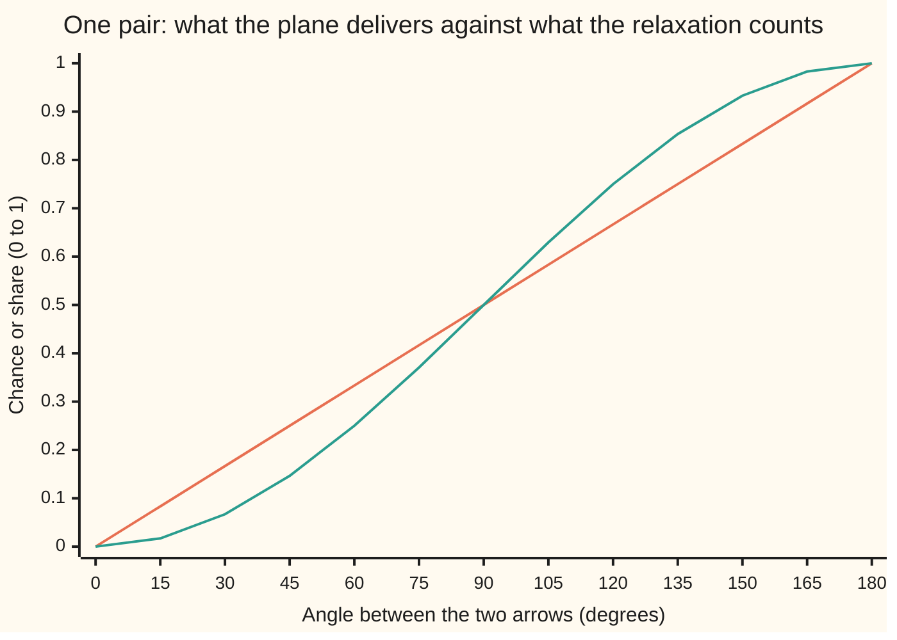

# Relaxation and rounding: solve a fractional version, then round it back

[Syllabus](../../../SYLLABUS.md) → [Computability and complexity](../README.md) → [Beyond Worst Case](../README.md#s04) → Relaxation and rounding

---

## General Overview

A hospital ward needs 12 nurses on Monday, 11 on Tuesday and Wednesday, 10 on Thursday, 12 on Friday, 8 on Saturday and 7 on Sunday. Every nurse works five days in a row, then has two days off. How few nurses cover the week?

Whole people make this hard. So loosen one rule: allow a fraction of a nurse on each five-day pattern. The loosened problem is a linear program (a linear goal under linear limits), and it solves quickly. Its answer is 14.33 nurses.

Nobody hires a third of a nurse. But no whole rota can beat 14.33, so every real rota needs at least 15. That **floor** is the yardstick for rounding back:

- **Round every fraction up.** 17 nurses. Every day is covered, and a proof caps the cost at 18.33.
- **Round to the nearest whole number.** 13 nurses, and Monday to Saturday are each one nurse short.
- **Round up, then take nurses off while every day stays covered.** 15 nurses. That meets the floor, so 15 is the fewest, proved without a search.

Coin flips can do the rounding too, and so can a random plane when each choice becomes a direction in space. The card does both on the same ward.

**Relax the whole-number rule, solve the fractional problem to get a floor no whole answer can beat, then round the fractions back by a rule whose loss against that floor is proved.**

**What kind of fact this is:** relax-solve-round is a method. Three theorems ride with it, all proved on this card in Why it works: rounding up loses at most one per fractional value; coin-flip rounding costs the floor on average, and its proved bound on failure shrinks by a factor e per round; random-plane rounding keeps, on average, at least 0.878567 of a semidefinite relaxation. The ward is invented for the example.

### The picture: the floor, the answers and the proved ceiling

```
round to nearest      █████████████          13     short Mon to Sat
fractional floor      ██████████████▎        14.33  cannot be hired
best whole rota       ███████████████        15     proved fewest
round up, then trim   ███████████████        15     covers every day
round up              █████████████████      17     covers every day
proved ceiling        ██████████████████▎    18.33  floor + 4 fractional patterns
```

One block is one nurse. Every covering rota sits at or above the floor; the rota from rounding up is proved to sit at or below the ceiling. Rounding to nearest falls below the floor, which is how it shows it is broken.

---

## The formula

Number the seven five-day patterns $`j`$ = 1 to 7 by their first day (Mon–Fri, Tue–Sat, and so on). Let $`x_j`$ be the nurses on pattern $`j`$ and $`d_i`$ the nurses needed on day $`i`$. Let $`a_{ij}`$ be 1 if pattern $`j`$ works day $`i`$, and 0 if not. The relaxation drops "whole" from the rota problem:

```math
\mathrm{LP} = \min \sum_{j} x_j \quad \text{subject to} \quad \sum_{j} a_{ij}\,x_j \ge d_i \ \text{ for every day } i, \qquad x_j \ge 0
```

**Read it aloud:** the fewest nurses, fractions allowed, such that every day gets at least the nurses it needs.

Here $`\lceil \cdot \rceil`$ means "round up to a whole number" and $`k`$ counts the patterns whose $`x_j`$ is a fraction. Rounding up lands in a proved band:

```math
\lceil \mathrm{LP} \rceil \;\le\; \mathrm{OPT} \;\le\; \mathrm{ALG}_{\text{up}} \;\le\; \mathrm{LP} + k
```

**Read it aloud:** the fewest whole nurses is at least the floor rounded up, and rounding up costs at most the floor plus one nurse per fractional pattern.

For the weekend teams of Step 4, where each nurse becomes a unit vector, a random plane splits on average:

```math
E[\text{pairs split}] = \sum_{\text{pairs } ab} \frac{\theta_{ab}}{\pi} \;\ge\; \alpha \sum_{\text{pairs } ab} \frac{1 - \cos\theta_{ab}}{2} = \alpha \cdot \mathrm{SDP} \;\ge\; \alpha \cdot \text{best split}
```

**Read it aloud:** on average the random plane splits at least 0.878567 times as many pairs as the relaxation promises, and so at least that share of the best possible split.

| Symbol | Plain meaning | In our example | Push it up and the answer… |
| --- | --- | --- | --- |
| $`x_j`$ | nurses on five-day pattern $`j`$, fractions allowed | Mon–Fri 6.33, Sat–Wed 2.33 | covers more days |
| $`d_i`$ | nurses needed on day $`i`$ | Mon 12, Sun 7 | the floor rises |
| $`a_{ij}`$ | 1 if pattern $`j`$ works day $`i`$, else 0 | Mon–Fri works Wed: 1 | — |
| LP; OPT | fewest nurses with fractions allowed; fewest whole nurses | 14.33; 15 | — |
| $`\mathrm{ALG}_{\text{up}}`$ | nurses after rounding every $`x_j`$ up | 17 | — |
| $`k`$; $`f`$ | patterns whose $`x_j`$ is a fraction; the most patterns that can cover one day | 4; 5 | the rounding bound rises |
| $`y_i`$; $`u_a`$; $`L`$ | dual prices: on one nurse-day of day $`i`$; on nurse $`a`$ in the team split, set on a table's diagonal as $`\mathrm{Diag}(u)`$; the links table, each nurse's number of pairs on the diagonal and −1 for each linked pair | $`\tfrac13`$ on Mon, Wed, Fri, Sat; sum 7.368034; 6 by 6 | — |
| $`p_m`$ | a pattern's leftover fraction, its chance of being raised | 1/3 | fewer short days |
| $`t`$; $`n`$ | rounds of coin-flip rounding; number of limits | 1 to 4; 7 days | coverage up, cost up |
| $`v_a`$, $`\theta_{ab}`$, $`r`$ | nurse $`a`$'s unit vector; the angle between two of them; the random plane's direction | ring neighbours 132.13° | the pair is split more often |
| SDP | the semidefinite relaxation's best for the team split | 7.368034 | — |
| $`\alpha`$ | the proved ratio of random-plane rounding | 0.878567 | — |

$`E[\cdot]`$ is the expected value (the long-run average); $`\Pr[\cdot]`$ is a probability, since P names a class on this wing.

### When it holds

- **The limits must be "at least" limits with no negative coefficients.** Then raising any $`x_j`$ only helps. Add a payroll cap of 15 nurses, an "at most" limit, and rounding up hires 17: two over the cap.
- **The loss is added, not multiplied.** Rounding up can add $`k`$ nurses: a lot on a ward of 15, little on a hospital of hundreds. For yes-or-no choices, rounding up can multiply the cost, so other rules are needed (Steps 3 and 4).
- **Coin-flip rounding gives averages, not promises.** One round costs 14.33 nurses on average, but covers every day only 40.74% of the time.
- **The 0.878567 guarantee needs pair weights of zero or more.** The proof compares pair by pair, which fails if a pair counts against the total.

---

## Why it works

### Step 0: measure the loss against the floor, not against the unknown best

The best whole rota is what nobody can compute quickly in general, so a rounding rule cannot be judged against it. Judge it against the relaxation instead.

Every whole rota is also a fractional rota, so the relaxation's best is a floor: LP ≤ OPT. [Integer programs](../../15-Optimization/05-Integer%20and%20Combinatorial%20Optimisation/01-integer-programs-and-relaxations.md) proves this and calls the distance the integrality gap.

So any proved bound against LP is also a bound against OPT. The rest of this section is three rounding rules and their bounds.

### Step 1: solve the relaxation and certify the floor

A linear goal over a region cut out by flat limits is best at a corner. A **basis** is a choice of seven limits held exactly tight; solving those seven equations gives a corner. The check tries all 3,432 ways to pick 7 of the 14 limits (7 days, 7 "no negative nurses"). 145 give a rota that fits. More than one corner ties for cheapest at 43/3; the search keeps the first it meets:

| Pattern | Mon–Fri | Tue–Sat | Wed–Sun | Thu–Mon | Fri–Tue | Sat–Wed | Sun–Thu |
| --- | ---: | ---: | ---: | ---: | ---: | ---: | ---: |
| nurses, fractions allowed | 6.33 | 0.33 | 2.00 | 1.33 | 2.00 | 2.33 | 0.00 |

The total is 14.33, exactly 43/3.

A second road needs no search. Look at Monday, Wednesday, Friday and Saturday. Any five days in a row contain at most three of them. Those four days need 12 + 11 + 12 + 8 = 43 nurse-days, and each nurse supplies at most 3 of them. So any rota, fractional or whole, has at least 43/3 = 14.33 nurses.

That argument is a set of **dual prices** $`y_i`$, one per day: a third of a nurse on each of those four days, nothing on the others. The check finds them by a corner search on the price problem, best of 1,227 bases, and both roads land on 14.33. The cruder count, 71 nurse-days over 5 days a nurse, gives only 14.20.

Nurses come whole, so the floor rounds up: at least **15**.

### Step 2: round up, and count the loss

Rounding every $`x_j`$ up never uncovers a day: each $`a_{ij}`$ is 0 or 1 and each limit says "at least", so more nurses on any pattern only adds cover.

A whole $`x_j`$ does not move, and a fractional one rises by less than 1. Adding over patterns:

```math
\mathrm{ALG}_{\text{up}} = \sum_j \lceil x_j \rceil \;\le\; \sum_j x_j + k = \mathrm{LP} + k \;\le\; \mathrm{OPT} + k
```

On the ward, four values are fractions, so the ceiling is 14.33 + 4 = 18.33. Rounding up gives 7 + 1 + 2 + 2 + 2 + 3 + 0 = 17 nurses, under the ceiling.

Then trim: go through the patterns and take a nurse off whenever every day stays covered. Trimming only removes nurses, so it keeps the guarantee. It takes Mon–Fri from 7 to 5, giving 15, which meets the floor, so 15 is the fewest. Brute force agrees: all 38,760 ways to place 14 nurses leave some day short; 105 ways to place 15 cover every day.

Reaching the floor is luck, not a theorem. The theorem is the ceiling of 18.33.

[Approximation](../../14-Applied%20and%20computational/02-Randomised%20and%20Approximate%20Algorithms/06-approximation-algorithms.md) does the yes-or-no version of this step: when each limit can be met by at most $`f`$ choices, take every choice whose fraction is at least $`1/f`$, and the answer is within $`f`$ times the floor.

### Step 3: round with coins, and repeat to make it safe

Rounding down gives 13 nurses: Sunday is covered, and Monday to Saturday are each one nurse short. Four patterns carry a leftover fraction of 1/3: Mon–Fri, Tue–Sat, Thu–Mon and Sat–Wed.

**Coin-flip rounding** raises each of those patterns by one nurse with a chance equal to its leftover fraction. The expected cost is the floor exactly: 13 + 4 × 1/3 = 14.33. That is linearity of expectation: the average of a sum is the sum of the averages.

The catch is coverage. In one round, every day is covered only 40.74% of the time. The fix is to flip again: run $`t`$ rounds and raise a pattern if any round says so.

| Rounds $`t`$ | Expected nurses | Every day covered | Union bound on failure, $`6e^{-t}`$ |
| ---: | ---: | ---: | ---: |
| 1 | 14.3333 | 0.4074 | 2.2073 |
| 2 | 15.2222 | 0.7659 | 0.8120 |
| 3 | 15.8148 | 0.9191 | 0.2987 |
| 4 | 16.2099 | 0.9737 | 0.1099 |

The last column is a proved bound, and the exact chances sit inside it. The proof needs one fact: on each short day, the leftover fractions of the patterns covering it add up to at least 1, because the relaxation covers that day.

<details>
<summary>Detailed proof: each round cuts a day's failure chance by a factor e</summary>

Take one short day, say Monday. Its fractional patterns have leftover fractions $`p_1, p_2, \dots`$ adding to at least 1 (here three patterns of 1/3 each). Monday stays short in one round only if none of them is raised. The coins are independent, so that chance is a product. Use $`1 - p \le e^{-p}`$, true for every $`p`$:

$`\displaystyle \Pr[\text{Monday short after one round}] = \prod_m (1 - p_m) \;\le\; \prod_m e^{-p_m} = e^{-\sum_m p_m} \;\le\; e^{-1}.`$

The $`t`$ rounds are independent, so the chance Monday is still short after all of them is at most $`e^{-t}`$. Six days start short. The chance that at least one stays short is at most the sum of their chances, the union bound: $`6e^{-t}`$.

Each round adds at most the leftover fractions on average, 4/3 nurses, so the expected total is at most $`13 + t \times 4/3`$. The exact expected totals in the table are smaller, because a pattern raised twice still counts once.

For yes-or-no choices with $`n`$ limits (on the ward, $`n`$ = 7 days), the same proof with $`t = \ln(4n)`$ rounds gives failure at most 1/4 and expected cost at most $`\ln(4n)`$ times the floor. That is Raghavan and Thompson's randomised rounding, and for set cover the logarithm cannot be improved much by any fast method unless P = NP.

</details>

On this ward, coins lose to trimming: three rounds cost 15.81 nurses on average and still cover every day only 91.91% of the time. Coins earn their place on large yes-or-no problems. A simulation of 100,000 one-round draws (SplitMix64, seed 20261119) gives mean 14.3320 nurses and full cover in 0.4084 of draws, close to the exact 14.3333 and 0.4074.

### Step 4: round directions with a random plane

The ward's six senior nurses form two weekend teams that alternate. Ten pairs can stand in for each other: five nurses sit in a ring, each covering the two beside her, and the charge nurse covers all five. A pair on opposite teams means one of the two works every weekend, so split as many pairs as possible. This is **max-cut**, NP-hard in general.

Brute force over all 64 ways to label six nurses finds the best split: 7 of the 10 pairs.

**The relaxation.** [Semidefinite programs](../../15-Optimization/06-Conic%2C%20Quadratic%20and%20Stochastic%20Programs/05-semidefinite-programs-and-relaxations.md) replaces each team label, +1 or −1, by a unit vector $`v_a`$ (an arrow of length 1) in six dimensions. A pair's score becomes $`(1 - \cos\theta_{ab})/2`$: 1 for opposite arrows, 0 for equal ones, so every real split is still allowed. The check solves it by turning each arrow, again and again, away from its partners. The best total is **7.368034**, above 7, as a relaxation must be.

Dual prices $`u_a`$, one per nurse, are built to add up to 7.368034: each nurse takes half the score of each of her pairs. That sum alone proves nothing. Put the prices on the diagonal of a 6 by 6 table, $`\mathrm{Diag}(u)`$, and subtract a quarter of the links table $`L`$, which has each nurse's number of pairs on its diagonal and −1 for each linked pair. The result is positive-semidefinite: it gives no direction a negative score. The check confirms this by a Cholesky factorisation (splitting the table into a triangle times its mirror image), which succeeds only for such a table. That test is the whole certificate: it proves no arrangement of arrows, and so no split, beats the prices' sum.

**The rounding.** [Semidefinite programs](../../15-Optimization/06-Conic%2C%20Quadratic%20and%20Stochastic%20Programs/05-semidefinite-programs-and-relaxations.md) already rounds a ring of five this way, with the same θ/π chance and α; the wheel is the new case, where the plane falls short of the best split. Draw a random plane through the centre. Put each nurse on the team her arrow points to. Two arrows at angle $`\theta`$ land on opposite sides with chance exactly $`\theta / \pi`$.

<details>
<summary>Detailed proof: a random plane splits two arrows with chance θ/π</summary>

Draw the plane by its normal, a direction $`r`$ made of six independent bell-curve numbers. Such a direction has no favourite heading, so its shadow on the flat sheet that holds $`v_a`$ and $`v_b`$ points every way with equal chance.

The plane meets that sheet in a line through the centre, at right angles to the shadow. So the line's heading is uniform over the half-turn, $`\pi`$ radians. The two arrows fall on opposite sides exactly when that line passes between them, and the headings that do so fill an angle $`\theta_{ab}`$:

$`\displaystyle \Pr[a \text{ and } b \text{ on opposite teams}] = \frac{\theta_{ab}}{\pi}.`$

Adding over pairs, by linearity of expectation, gives the expected split.

</details>

**The ratio, pair by pair.** Compare each pair's split chance with its share of the relaxation. For every angle between 0 and $`\pi`$:

```math
\frac{\theta / \pi}{(1 - \cos\theta)/2} \;\ge\; \alpha = 0.878567
```

The worst angle is 133.56°. No algebra finds $`\alpha`$ in closed form; the check finds it as the smallest value over a fine grid of angles, and it matches the published constant. Since every pair keeps at least $`\alpha`$ of its share, the total keeps at least $`\alpha`$ of 7.368034.



The orange line is the chance a random plane splits the pair, $`\theta/\pi`$: a straight line. The teal line is the pair's share in the relaxation, $`(1 - \cos\theta)/2`$. Past 90° the teal line is higher, so rounding loses there. The orange line never falls below 0.878567 times the teal line, and it comes closest at 133.56°.

---

## Worked numbers, by hand

| Step | Arithmetic | Value |
| --- | --- | --- |
| priced days' needs, Mon + Wed + Fri + Sat | 12 + 11 + 12 + 8 | 43 nurse-days |
| each nurse covers at most 3 of them | 43 / 3 | floor 14.33 |
| relaxed rota total | 6⅓ + ⅓ + 2 + 1⅓ + 2 + 2⅓ + 0 | 14⅓ = 14.33 |
| whole nurses, floor rounded up | ⌈14.33⌉ | 15 |
| round every pattern up | 7 + 1 + 2 + 2 + 2 + 3 + 0 | 17 |
| proved ceiling, 4 fractional patterns | 14.33 + 4 | 18.33 |
| trim Mon–Fri from 7 to 5 | 17 − 2 | **15, the fewest** |
| coin flips, one round, on average | 13 + 4 × 1/3 | 14.33 |
| ring neighbours at 132.13°: split chance | 132.13 / 180 | 0.7341 |
| ring neighbours: share, cos 132.13° = −0.6708 | (1 + 0.6708) / 2 | 0.8354 |
| charge nurse to ring at 106.05°: chance, share | 106.05 / 180; (1 + 0.2764) / 2 | 0.5891; 0.6382 |
| expected pairs split | 5 × 0.7341 + 5 × 0.5891 | 6.616 (unrounded: 6.615985) |
| guaranteed | 0.878567 × 7.368034 | 6.473313 |

The ward needs **15 nurses**, and the relaxation proves no rota does better. The weekend split from a random plane averages 6.615985 of 10 pairs, 0.945141 of the best split of 7 and well above the 6.473313 the theorem promises. The ring-neighbour pairs, at 132.13°, keep 0.8787 of their share, almost exactly the worst case $`\alpha`$.

### What breaks if you drop a piece

| Mistake | Comes out at | What went wrong |
| --- | --- | --- |
| Round each fraction to the nearest whole number | 13 nurses; Mon to Sat each one short | Every leftover was 1/3, so all rounded down; "at least" limits need rounding up |
| Round up under a payroll cap of 15 | 17 nurses, 2 over the cap | Rounding up is safe only for "at least" limits; an "at most" limit can break |
| One coin-flip round, used as the rota | 14.33 nurses on average; every day covered in 40.74% of draws | Expectation is right on average; coverage needs repeated rounds or a repair |
| Read the relaxation as a team split | 7.368034 pairs | No split of whole nurses splits 7.37 pairs; the best is 7 |

---

## Code, from first principles, and it actually runs

Every headline number has two independent roads or more. The floor: a search over every basis, and a separate search over dual prices. The rounded rotas: a brute-force check of every rota of 14 and 15. Coin-flip rounding: exact over every outcome of the four coins, and 100,000 simulated draws. The teams: brute force for the best split; turning arrows for the relaxation, certified by dual prices and a Cholesky test; the exact expected split against 100,000 simulated planes. Random numbers come from SplitMix64, written out in both languages.

### Python

```python
# Relaxation and rounding -- the check behind the card.  Standard library only.
# Part 1: a ward rota.  Each nurse works 5 days in a row, then has 2 off.
# Part 2: two weekend teams, split by a semidefinite relaxation and a random plane.
import math, itertools
DAYS = "Mon Tue Wed Thu Fri Sat Sun".split()
NEED = [12, 11, 11, 10, 12, 8, 7]                             # nurses needed each day
PAT = [DAYS[j] + "-" + DAYS[(j + 4) % 7] for j in range(7)]   # pattern j starts on day j
A = [[1 if (i - j) % 7 < 5 else 0 for j in range(7)] for i in range(7)]  # day i, pattern j
cover = lambda x: [sum(A[i][j] * x[j] for j in range(7)) for i in range(7)]
short = lambda x: [DAYS[i] for i in range(7) if cover(x)[i] < NEED[i] - 1e-9]

def solve(M, b):                                  # Gaussian elimination; None if singular
    M = [r[:] + [c] for r, c in zip(M, b)]; n = len(M)
    for c in range(n):
        p = max(range(c, n), key=lambda r: abs(M[r][c]))
        if abs(M[p][c]) < 1e-12: return None
        M[c], M[p] = M[p], M[c]
        for r in range(n):
            if r != c: M[r] = [a - M[r][c] / M[c][c] * e for a, e in zip(M[r], M[c])]
    return [M[i][n] / M[i][i] for i in range(n)]

def corners(rows, rhs, fits, score):              # every point where 7 of 14 limits are tight
    best, seen = None, 0
    for S in itertools.combinations(range(14), 7):
        x = solve([rows[s] for s in S], [rhs[s] for s in S])
        if x is not None and fits(x):
            seen += 1
            if best is None or score(x) < score(best) - 1e-9: best = x
    return best, seen

I = [[1 if i == j else 0 for j in range(7)] for i in range(7)]
x, nx = corners(A + I, NEED + [0] * 7,            # road 1: fewest nurses, fractions allowed
    lambda x: min(x) > -1e-9 and not short(x), lambda x: sum(x))
AT = [list(r) for r in zip(*A)]
y, ny = corners(AT + I, [1] * 7 + [0] * 7,        # road 2: dual prices, most demand per nurse
    lambda y: min(y) > -1e-9 and all(sum(r[i] * y[i] for i in range(7)) < 1 + 1e-9 for r in AT),
    lambda y: -sum(n * p for n, p in zip(NEED, y)))
LP, DUAL = sum(x), sum(n * p for n, p in zip(NEED, y))
print("days:", " ".join(DAYS)); print("need:", " ".join(map(str, NEED)))
print(f"nurse-days needed {sum(NEED)}; divided by 5 days a nurse: {sum(NEED) / 5:.2f}")
print(f"LP rota, best of {nx} bases in {math.comb(14, 7)} tries: " + ", ".join(f"{p} {v:.2f}" for p, v in zip(PAT, x)))
print(f"LP total {LP:.4f} = {round(3 * LP)}/3; dual prices, best of {ny} bases: " + ", ".join(f"{d} {v:.2f}" for d, v in zip(DAYS, y)))
print(f"dual total {DUAL:.4f}; floor on whole rotas: {math.ceil(LP - 1e-9)}")
assert abs(LP - DUAL) < 1e-9 and abs(LP - 43 / 3) < 1e-9          # two roads, one floor

up = [math.ceil(v - 1e-9) for v in x]; frac = sum(1 for v in x if abs(v - round(v)) > 1e-9)
near = [round(v) for v in x]
trim = up[:]
for j in range(7):                                # take nurses off while every day stays covered
    while trim[j] > 0 and not short([t - (k == j) for k, t in enumerate(trim)]): trim[j] -= 1
print(f"round up: {up} = {sum(up)} nurses; bound LP + {frac} fractional = {LP + frac:.2f}")
print(f"round to nearest: {near} = {sum(near)} nurses; short on {' '.join(short(near))}")
print(f"payroll cap of 15: round up hires {sum(up)}, {sum(up) - 15} over; the trimmed rota fits")
print(f"round up then trim: {trim} = {sum(trim)} nurses; short on {short(trim) or 'none'}")
assert not short(up) and sum(up) <= LP + frac and short(near) and not short(trim)

def rotas(total, k=7):                            # every way to share total nurses over k patterns
    if k == 1: yield (total,); return
    for v in range(total + 1):
        for rest in rotas(total - v, k - 1): yield (v,) + rest
r14 = list(rotas(14)); r15 = [r for r in rotas(15) if not short(r)]
print(f"brute force: {len(r14)} rotas of 14, {sum(not short(r) for r in r14)} cover; "
      f"{len(r15)} rotas of 15 cover")
assert not any(not short(r) for r in r14) and len(r15) > 0 and sum(trim) == 15  # OPT = 15

base = [math.floor(v + 1e-9) for v in x]; fr = [j for j in range(7) if x[j] - base[j] > 1e-9]
p = x[fr[0]] - base[fr[0]]
print(f"random rounding: base {sum(base)}, patterns {' '.join(PAT[j] for j in fr)} each up with chance {p:.4f}")
for t in (1, 2, 3, 4):                            # t independent rounds; up if any round says up
    q, cov, staff = 1 - (1 - p) ** t, 0.0, 0.0
    for bits in itertools.product((0, 1), repeat=len(fr)):
        z = base[:]; pr = 1.0
        for b, j in zip(bits, fr): z[j] += b; pr *= q if b else 1 - q
        staff += pr * sum(z); cov += pr * (not short(z))
    print(f"  rounds {t}: expected nurses {staff:.4f}, all days covered {cov:.4f}, "
          f"union bound on failure {6 * math.exp(-t):.4f}")
    assert 1 - cov <= 6 * math.exp(-t) and staff <= sum(base) + t * (LP - sum(base)) + 1e-9
    if t == 1: one = (staff, cov)
s = 20261119                                      # SplitMix64, written out, for the simulations
def rnd():
    global s; s = (s + 0x9E3779B97F4A7C15) % 2**64; z = s
    z = ((z ^ (z >> 30)) * 0xBF58476D1CE4E5B9) % 2**64; z = ((z ^ (z >> 27)) * 0x94D049BB133111EB) % 2**64
    return ((z ^ (z >> 31)) >> 11) / 2**53
N = 100000; hit = tot = 0
for _ in range(N):
    z = [b + (rnd() < p) if j in fr else b for j, b in enumerate(base)]; hit += not short(z); tot += sum(z)
print(f"  simulated, {N} draws of 1 round, seed 20261119: mean nurses {tot / N:.4f}, all covered {hit / N:.4f}")
assert abs(tot / N - one[0]) < 4 * math.sqrt(4 * p * (1 - p) / N) and abs(hit / N - one[1]) < 4 * math.sqrt(one[1] * (1 - one[1]) / N)

dot = lambda u, v: sum(a * b for a, b in zip(u, v))
alpha, tha = min((2 * th / (math.pi * (1 - math.cos(th))), th) for th in (k * math.pi / 200000 for k in range(1, 200001)))
def relax(E, n):                                  # brute-force best split, relaxation, dual check
    cut = lambda side: sum(side[a] != side[b] for a, b in E)
    cuts = [cut([(m >> i) & 1 for i in range(n)]) for m in range(2 ** n)]
    V = [[math.cos(1.0 * i + 0.7 * t * (i + 1)) for t in range(n)] for i in range(n)]
    for _ in range(3000):                         # each vector turns to point away from its partners
        for i in range(n):
            g = [-sum(V[b if a == i else a][k] for a, b in E if i in (a, b)) for k in range(n)]
            V[i] = [c / math.sqrt(dot(g, g)) for c in g]
    X = [[dot(u, v) for v in V] for u in V]
    u = [sum((1 - X[a][b]) / 4 for a, b in E if i in (a, b)) for i in range(n)]  # dual prices
    M = [[u[i] - sum(i in e for e in E) / 4 + 1e-9 if i == j else ((i, j) in E or (j, i) in E) / 4
          for j in range(n)] for i in range(n)]
    Lc = [[0.0] * n for _ in range(n)]; psd = True    # Cholesky of Diag(u) - L/4: works iff PSD
    for i in range(n):
        for j in range(i + 1):
            v = M[i][j] - sum(Lc[i][k] * Lc[j][k] for k in range(j))
            if i == j: psd = psd and v > 0; Lc[i][i] = math.sqrt(max(v, 1e-300))
            else: Lc[i][j] = v / Lc[j][j]
    sdp = sum((1 - X[a][b]) / 2 for a, b in E)
    expct = sum(math.acos(max(-1, min(1, X[a][b]))) / math.pi for a, b in E)
    assert psd and max(cuts) <= sdp + 1e-9 and expct >= alpha * sdp - 1e-9
    return V, X, cuts, sdp, expct, cut
E = [(0, 1), (1, 2), (2, 3), (3, 4), (4, 0), (5, 0), (5, 1), (5, 2), (5, 3), (5, 4)]  # stand-in pairs
V, X, cuts, SDP, expct, cut = relax(E, 6); best = max(cuts)
print(f"teams: {len(E)} pairs, best split {best} (brute force over {2 ** 6} splits, {cuts.count(best)} reach it)")
print(f"relaxation {SDP:.6f}, certified: Diag(u) - L/4 is PSD, for dual prices u built to sum to it")
for name, (a, b) in (("ring neighbours", (0, 1)), ("hub to ring", (5, 0))):
    th = math.acos(X[a][b])
    print(f"  {name}: angle {math.degrees(th):.2f} deg, cos {X[a][b]:.4f}, split chance {th / math.pi:.4f}, "
          f"share {(1 - X[a][b]) / 2:.4f}, ratio {th / math.pi / ((1 - X[a][b]) / 2):.4f}")
print(f"expected split {expct:.6f} >= alpha x relaxation {alpha * SDP:.6f}; alpha {alpha:.6f} at {math.degrees(tha):.2f} deg")
print(f"ratio to relaxation {expct / SDP:.6f}, to best split {expct / best:.6f}")
assert abs(alpha - 0.878567) < 1e-6 and best == 7
_, _, cr, s5, e5, _ = relax(E[:5], 5)
print(f"ring of five only: best {max(cr)}, relaxation {s5:.6f}, expected split {e5:.6f}")
assert max(cr) == 4 and abs(s5 - 2.5 * (1 - math.cos(0.8 * math.pi))) < 1e-6   # vectors 144 deg apart
hist = [0] * (len(E) + 1)
for _ in range(N):                                # road 2: random planes through the origin
    gv = [math.sqrt(-2 * math.log(1 - rnd())) * math.cos(2 * math.pi * rnd()) for _ in range(6)]
    hist[cut([dot(v, gv) > 0 for v in V])] += 1
sim = sum(k * h for k, h in enumerate(hist)) / N
print(f"simulated, {N} planes: mean split {sim:.4f}; " + ", ".join(f"{k}: {h}" for k, h in enumerate(hist) if h))
assert abs(sim - expct) < 4 * math.sqrt(sum(h * (k - sim) ** 2 for k, h in enumerate(hist)) / N / N)
for deg in range(0, 181, 15):
    th = math.radians(deg)
    print(f"chart, {deg:3d} deg: split chance {th / math.pi:.4f}, relaxation share {(1 - math.cos(th)) / 2:.4f}")
print("ALL CHECKS PASS")
```

**Ran 2026-11-19 on macOS, Python 3.14.10, standard library only. All checks passed. Output, pasted from the run:**

```
days: Mon Tue Wed Thu Fri Sat Sun
need: 12 11 11 10 12 8 7
nurse-days needed 71; divided by 5 days a nurse: 14.20
LP rota, best of 145 bases in 3432 tries: Mon-Fri 6.33, Tue-Sat 0.33, Wed-Sun 2.00, Thu-Mon 1.33, Fri-Tue 2.00, Sat-Wed 2.33, Sun-Thu 0.00
LP total 14.3333 = 43/3; dual prices, best of 1227 bases: Mon 0.33, Tue 0.00, Wed 0.33, Thu 0.00, Fri 0.33, Sat 0.33, Sun 0.00
dual total 14.3333; floor on whole rotas: 15
round up: [7, 1, 2, 2, 2, 3, 0] = 17 nurses; bound LP + 4 fractional = 18.33
round to nearest: [6, 0, 2, 1, 2, 2, 0] = 13 nurses; short on Mon Tue Wed Thu Fri Sat
payroll cap of 15: round up hires 17, 2 over; the trimmed rota fits
round up then trim: [5, 1, 2, 2, 2, 3, 0] = 15 nurses; short on none
brute force: 38760 rotas of 14, 0 cover; 105 rotas of 15 cover
random rounding: base 13, patterns Mon-Fri Tue-Sat Thu-Mon Sat-Wed each up with chance 0.3333
  rounds 1: expected nurses 14.3333, all days covered 0.4074, union bound on failure 2.2073
  rounds 2: expected nurses 15.2222, all days covered 0.7659, union bound on failure 0.8120
  rounds 3: expected nurses 15.8148, all days covered 0.9191, union bound on failure 0.2987
  rounds 4: expected nurses 16.2099, all days covered 0.9737, union bound on failure 0.1099
  simulated, 100000 draws of 1 round, seed 20261119: mean nurses 14.3320, all covered 0.4084
teams: 10 pairs, best split 7 (brute force over 64 splits, 10 reach it)
relaxation 7.368034, certified: Diag(u) - L/4 is PSD, for dual prices u built to sum to it
  ring neighbours: angle 132.13 deg, cos -0.6708, split chance 0.7341, share 0.8354, ratio 0.8787
  hub to ring: angle 106.05 deg, cos -0.2764, split chance 0.5891, share 0.6382, ratio 0.9231
expected split 6.615985 >= alpha x relaxation 6.473313; alpha 0.878567 at 133.56 deg
ratio to relaxation 0.897931, to best split 0.945141
ring of five only: best 4, relaxation 4.522542, expected split 4.000000
simulated, 100000 planes: mean split 6.6146; 5: 4442, 6: 29654, 7: 65904
chart,   0 deg: split chance 0.0000, relaxation share 0.0000
chart,  15 deg: split chance 0.0833, relaxation share 0.0170
chart,  30 deg: split chance 0.1667, relaxation share 0.0670
chart,  45 deg: split chance 0.2500, relaxation share 0.1464
chart,  60 deg: split chance 0.3333, relaxation share 0.2500
chart,  75 deg: split chance 0.4167, relaxation share 0.3706
chart,  90 deg: split chance 0.5000, relaxation share 0.5000
chart, 105 deg: split chance 0.5833, relaxation share 0.6294
chart, 120 deg: split chance 0.6667, relaxation share 0.7500
chart, 135 deg: split chance 0.7500, relaxation share 0.8536
chart, 150 deg: split chance 0.8333, relaxation share 0.9330
chart, 165 deg: split chance 0.9167, relaxation share 0.9830
chart, 180 deg: split chance 1.0000, relaxation share 1.0000
ALL CHECKS PASS
```

### Rust

```rust
// Relaxation and rounding -- the check behind the card.  std only, no crates.
// Part 1: a ward rota.  Each nurse works 5 days in a row, then has 2 off.
// Part 2: two weekend teams, split by a semidefinite relaxation and a random plane.
use std::f64::consts::PI;
const DAYS: [&str; 7] = ["Mon", "Tue", "Wed", "Thu", "Fri", "Sat", "Sun"];
const NEED: [f64; 7] = [12.0, 11.0, 11.0, 10.0, 12.0, 8.0, 7.0]; // nurses needed each day
type V = Vec<f64>;
fn a(i: usize, j: usize) -> f64 { if (i + 7 - j) % 7 < 5 { 1.0 } else { 0.0 } } // day i, pattern j
fn pat(j: usize) -> String { format!("{}-{}", DAYS[j], DAYS[(j + 4) % 7]) }
fn cover(x: &[f64]) -> V { (0..7).map(|i| (0..7).map(|j| a(i, j) * x[j]).sum()).collect() }
fn short(x: &[f64]) -> Vec<&'static str> {
    let c = cover(x); (0..7).filter(|&i| c[i] < NEED[i] - 1e-9).map(|i| DAYS[i]).collect() }
fn ints(x: &[f64]) -> String { format!("[{}]", x.iter().map(|v| format!("{}", *v as i64)).collect::<Vec<_>>().join(", ")) }
fn solve(m0: &[V], b: &[f64]) -> Option<V> {          // Gaussian elimination; None if singular
    let n = m0.len();
    let mut m: Vec<V> = m0.iter().zip(b).map(|(r, &c)| { let mut r = r.clone(); r.push(c); r }).collect();
    for c in 0..n {
        let mut p = c;
        for r in c..n { if m[r][c].abs() > m[p][c].abs() { p = r; } }
        if m[p][c].abs() < 1e-12 { return None; }
        m.swap(c, p);
        for r in 0..n { if r != c { let f = m[r][c] / m[c][c];
            for k in 0..=n { m[r][k] = m[r][k] - f * m[c][k]; } } }
    }
    Some((0..n).map(|i| m[i][n] / m[i][i]).collect())
}
fn corners(rows: &[V], rhs: &[f64], fits: &dyn Fn(&V) -> bool, score: &dyn Fn(&V) -> f64) -> (V, usize) {
    let (mut best, mut seen): (Option<V>, usize) = (None, 0);
    let mut s: Vec<usize> = (0..7).collect();        // every 7 of 14, in Python's order
    loop {
        let m: Vec<V> = s.iter().map(|&k| rows[k].clone()).collect();
        let b: V = s.iter().map(|&k| rhs[k]).collect();
        if let Some(x) = solve(&m, &b) { if fits(&x) { seen += 1;
            if best.as_ref().map_or(true, |bb| score(&x) < score(bb) - 1e-9) { best = Some(x); } } }
        let mut i = 7;
        while i > 0 && s[i - 1] == i - 1 + 7 { i -= 1; }
        if i == 0 { break; }
        s[i - 1] += 1; for k in i..7 { s[k] = s[k - 1] + 1; }
    }
    (best.unwrap(), seen)
}
fn rotas(total: usize, k: usize, pre: &mut V, out: &mut Vec<V>) {
    if k == 1 { pre.push(total as f64); out.push(pre.clone()); pre.pop(); return; }
    for v in 0..=total { pre.push(v as f64); rotas(total - v, k - 1, pre, out); pre.pop(); }
}
struct Rng(u64);
impl Rng { fn next(&mut self) -> f64 {                // SplitMix64, written out
    self.0 = self.0.wrapping_add(0x9E3779B97F4A7C15); let mut z = self.0;
    z = (z ^ (z >> 30)).wrapping_mul(0xBF58476D1CE4E5B9); z = (z ^ (z >> 27)).wrapping_mul(0x94D049BB133111EB);
    ((z ^ (z >> 31)) >> 11) as f64 / 9007199254740992.0 } }
fn dot(u: &[f64], v: &[f64]) -> f64 { u.iter().zip(v).map(|(a, b)| a * b).sum() }
fn relax(e: &[(usize, usize)], n: usize, alpha: f64) -> (Vec<V>, Vec<V>, Vec<usize>, f64, f64) {
    let cut = |side: &[bool]| e.iter().filter(|&&(a, b)| side[a] != side[b]).count();
    let cuts: Vec<usize> = (0..1usize << n).map(|m| cut(&(0..n).map(|i| (m >> i) & 1 == 1).collect::<Vec<_>>())).collect();
    let mut v: Vec<V> = (0..n).map(|i| (0..n).map(|t| (1.0 * i as f64 + 0.7 * t as f64 * (i + 1) as f64).cos()).collect()).collect();
    for _ in 0..3000 { for i in 0..n {                  // each vector turns away from its partners
        let g: V = (0..n).map(|k| -e.iter().filter(|&&(a, b)| a == i || b == i)
            .map(|&(a, b)| v[if a == i { b } else { a }][k]).sum::<f64>()).collect();
        let nr = dot(&g, &g).sqrt(); v[i] = g.iter().map(|c| c / nr).collect(); } }
    let xm: Vec<V> = v.iter().map(|uu| v.iter().map(|w| dot(uu, w)).collect()).collect();
    let inc = |i: usize| e.iter().filter(move |&&(a, b)| a == i || b == i);
    let u: V = (0..n).map(|i| inc(i).map(|&(a, b)| (1.0 - xm[a][b]) / 4.0).sum()).collect(); // dual prices
    let m: Vec<V> = (0..n).map(|i| (0..n).map(|j| if i == j { u[i] - inc(i).count() as f64 / 4.0 + 1e-9 }
        else if e.contains(&(i, j)) || e.contains(&(j, i)) { 0.25 } else { 0.0 }).collect()).collect();
    let mut lc = vec![vec![0.0; n]; n]; let mut psd = true;   // Cholesky of Diag(u) - L/4: works iff PSD
    for i in 0..n { for j in 0..=i {
        let s = m[i][j] - (0..j).map(|k| lc[i][k] * lc[j][k]).sum::<f64>();
        if i == j { psd = psd && s > 0.0; lc[i][i] = s.max(1e-300).sqrt(); } else { lc[i][j] = s / lc[j][j]; } } }
    let sdp: f64 = e.iter().map(|&(a, b)| (1.0 - xm[a][b]) / 2.0).sum();
    let expct: f64 = e.iter().map(|&(a, b)| xm[a][b].max(-1.0).min(1.0).acos() / PI).sum();
    assert!(psd && *cuts.iter().max().unwrap() as f64 <= sdp + 1e-9 && expct >= alpha * sdp - 1e-9);
    (v, xm, cuts, sdp, expct)
}
fn main() {
    let (mut alpha, mut tha) = (f64::INFINITY, 0.0);
    for k in 1..=200000 { let th = k as f64 * PI / 200000.0; let r = 2.0 * th / (PI * (1.0 - th.cos()));
        if r < alpha { alpha = r; tha = th; } }
    let am: Vec<V> = (0..7).map(|i| (0..7).map(|j| a(i, j)).collect()).collect();
    let id: Vec<V> = (0..7).map(|i| (0..7).map(|j| if i == j { 1.0 } else { 0.0 }).collect()).collect();
    let mut rows = am.clone(); rows.extend(id.clone());
    let mut rhs = NEED.to_vec(); rhs.extend([0.0; 7]);
    let fits = |x: &V| x.iter().cloned().fold(f64::INFINITY, f64::min) > -1e-9 && short(x).is_empty();
    let (x, nx) = corners(&rows, &rhs, &fits, &|x: &V| x.iter().sum());    // road 1
    let at: Vec<V> = (0..7).map(|j| (0..7).map(|i| am[i][j]).collect()).collect();
    let mut rows2 = at.clone(); rows2.extend(id.clone());
    let mut rhs2 = vec![1.0; 7]; rhs2.extend([0.0; 7]);
    let fits2 = |y: &V| y.iter().cloned().fold(f64::INFINITY, f64::min) > -1e-9
        && at.iter().all(|r| (0..7).map(|i| r[i] * y[i]).sum::<f64>() < 1.0 + 1e-9);
    let (y, ny) = corners(&rows2, &rhs2, &fits2, &|y: &V| -NEED.iter().zip(y).map(|(n, p)| n * p).sum::<f64>()); // road 2
    let lp: f64 = x.iter().sum(); let dual: f64 = NEED.iter().zip(&y).map(|(n, p)| n * p).sum();
    println!("days: {}", DAYS.join(" ")); println!("need: 12 11 11 10 12 8 7");
    println!("nurse-days needed 71; divided by 5 days a nurse: {:.2}", NEED.iter().sum::<f64>() / 5.0);
    println!("LP rota, best of {} bases in {} tries: {}", nx, (8..=14).product::<u64>() / (1..=7).product::<u64>(), (0..7).map(|j| format!("{} {:.2}", pat(j), x[j])).collect::<Vec<_>>().join(", "));
    println!("LP total {:.4} = {}/3; dual prices, best of {} bases: {}", lp, (3.0 * lp).round(), ny,
        (0..7).map(|i| format!("{} {:.2}", DAYS[i], y[i])).collect::<Vec<_>>().join(", "));
    println!("dual total {:.4}; floor on whole rotas: {}", dual, (lp - 1e-9).ceil());
    assert!((lp - dual).abs() < 1e-9 && (lp - 43.0 / 3.0).abs() < 1e-9);
    let up: V = x.iter().map(|v| (v - 1e-9).ceil()).collect();
    let frac = x.iter().filter(|v| (*v - v.round()).abs() > 1e-9).count();
    let near: V = x.iter().map(|v| v.round()).collect();
    let mut trim = up.clone();
    for j in 0..7 { loop { if trim[j] <= 0.0 { break; } let mut t = trim.clone(); t[j] -= 1.0;
        if short(&t).is_empty() { trim[j] -= 1.0; } else { break; } } }
    let sum = |v: &V| v.iter().sum::<f64>();
    println!("round up: {} = {} nurses; bound LP + {} fractional = {:.2}", ints(&up), sum(&up), frac, lp + frac as f64);
    println!("round to nearest: {} = {} nurses; short on {}", ints(&near), sum(&near), short(&near).join(" "));
    let st = short(&trim);
    println!("payroll cap of 15: round up hires {}, {} over; the trimmed rota fits", sum(&up), sum(&up) - 15.0);
    println!("round up then trim: {} = {} nurses; short on {}", ints(&trim), sum(&trim), if st.is_empty() { "none".to_string() } else { st.join(" ") });
    assert!(short(&up).is_empty() && sum(&up) <= lp + frac as f64 && !short(&near).is_empty() && short(&trim).is_empty());
    let (mut r14, mut r15) = (vec![], vec![]);
    rotas(14, 7, &mut vec![], &mut r14); rotas(15, 7, &mut vec![], &mut r15);
    let c14 = r14.iter().filter(|r| short(r).is_empty()).count(); let c15 = r15.iter().filter(|r| short(r).is_empty()).count();
    println!("brute force: {} rotas of 14, {} cover; {} rotas of 15 cover", r14.len(), c14, c15);
    assert!(c14 == 0 && c15 > 0 && sum(&trim) == 15.0);
    let base: V = x.iter().map(|v| (v + 1e-9).floor()).collect();
    let fr: Vec<usize> = (0..7).filter(|&j| x[j] - base[j] > 1e-9).collect();
    let p = x[fr[0]] - base[fr[0]];
    println!("random rounding: base {}, patterns {} each up with chance {:.4}", sum(&base), fr.iter().map(|&j| pat(j)).collect::<Vec<_>>().join(" "), p);
    let mut one = (0.0, 0.0);
    for t in 1..=4 {
        let q = 1.0 - (1.0 - p).powf(t as f64); let (mut cov, mut staff) = (0.0, 0.0);
        for m in 0..(1usize << fr.len()) {
            let mut z = base.clone(); let mut pr = 1.0;
            for (k, &j) in fr.iter().enumerate() { let b = (m >> (fr.len() - 1 - k)) & 1;
                z[j] += b as f64; pr *= if b == 1 { q } else { 1.0 - q }; }
            staff += pr * sum(&z); if short(&z).is_empty() { cov += pr; }
        }
        println!("  rounds {}: expected nurses {:.4}, all days covered {:.4}, union bound on failure {:.4}", t, staff, cov, 6.0 * (-(t as f64)).exp());
        assert!(1.0 - cov <= 6.0 * (-(t as f64)).exp() && staff <= sum(&base) + t as f64 * (lp - sum(&base)) + 1e-9);
        if t == 1 { one = (staff, cov); }
    }
    let mut rng = Rng(20261119); let n_draw = 100000; let (mut hit, mut tot) = (0usize, 0.0);
    for _ in 0..n_draw {
        let z: V = (0..7).map(|j| if fr.contains(&j) { base[j] + if rng.next() < p { 1.0 } else { 0.0 } } else { base[j] }).collect();
        if short(&z).is_empty() { hit += 1; } tot += sum(&z);
    }
    let nd = n_draw as f64;
    println!("  simulated, {} draws of 1 round, seed 20261119: mean nurses {:.4}, all covered {:.4}", n_draw, tot / nd, hit as f64 / nd);
    assert!((tot / nd - one.0).abs() < 4.0 * (4.0 * p * (1.0 - p) / nd).sqrt() && (hit as f64 / nd - one.1).abs() < 4.0 * (one.1 * (1.0 - one.1) / nd).sqrt());

    let e: Vec<(usize, usize)> = vec![(0, 1), (1, 2), (2, 3), (3, 4), (4, 0), (5, 0), (5, 1), (5, 2), (5, 3), (5, 4)]; // stand-in pairs
    let (v, xm, cuts, sdp, expct) = relax(&e, 6, alpha); let best = *cuts.iter().max().unwrap();
    let cut = |side: &[bool]| e.iter().filter(|&&(a, b)| side[a] != side[b]).count();
    println!("teams: {} pairs, best split {} (brute force over {} splits, {} reach it)", e.len(), best, 64, cuts.iter().filter(|&&c| c == best).count());
    println!("relaxation {:.6}, certified: Diag(u) - L/4 is PSD, for dual prices u built to sum to it", sdp);
    for (name, a, b) in [("ring neighbours", 0, 1), ("hub to ring", 5, 0)] {
        let th = xm[a][b].acos();
        println!("  {}: angle {:.2} deg, cos {:.4}, split chance {:.4}, share {:.4}, ratio {:.4}", name, th.to_degrees(), xm[a][b],
            th / PI, (1.0 - xm[a][b]) / 2.0, th / PI / ((1.0 - xm[a][b]) / 2.0)); }
    println!("expected split {:.6} >= alpha x relaxation {:.6}; alpha {:.6} at {:.2} deg", expct, alpha * sdp, alpha, tha.to_degrees());
    println!("ratio to relaxation {:.6}, to best split {:.6}", expct / sdp, expct / best as f64);
    assert!((alpha - 0.878567).abs() < 1e-6 && best == 7);
    let (_, _, cr, s5, e5) = relax(&e[..5], 5, alpha); let b5 = *cr.iter().max().unwrap();
    println!("ring of five only: best {}, relaxation {:.6}, expected split {:.6}", b5, s5, e5);
    assert!(b5 == 4 && (s5 - 2.5 * (1.0 - (0.8 * PI).cos())).abs() < 1e-6);
    let mut hist = vec![0usize; e.len() + 1];
    for _ in 0..n_draw {                               // road 2: random planes through the origin
        let gv: V = (0..6).map(|_| { let r1 = rng.next(); let r2 = rng.next();
            (-2.0 * (1.0 - r1).ln()).sqrt() * (2.0 * PI * r2).cos() }).collect();
        hist[cut(&v.iter().map(|w| dot(w, &gv) > 0.0).collect::<Vec<_>>())] += 1;
    }
    let sim = hist.iter().enumerate().map(|(k, &h)| (k * h) as f64).sum::<f64>() / nd;
    println!("simulated, {} planes: mean split {:.4}; {}", n_draw, sim,
        hist.iter().enumerate().filter(|(_, &h)| h > 0).map(|(k, h)| format!("{}: {}", k, h)).collect::<Vec<_>>().join(", "));
    let var = hist.iter().enumerate().map(|(k, &h)| h as f64 * (k as f64 - sim).powi(2)).sum::<f64>() / nd; assert!((sim - expct).abs() < 4.0 * (var / nd).sqrt());
    for deg in (0..=180).step_by(15) { let th = (deg as f64).to_radians();
        println!("chart, {:3} deg: split chance {:.4}, relaxation share {:.4}", deg, th / PI, (1.0 - th.cos()) / 2.0); }
    println!("ALL CHECKS PASS");
}
```

**Ran 2026-11-19 on macOS, rustc 1.98.1, no crates. All checks passed. Output, pasted from the run:**

```
days: Mon Tue Wed Thu Fri Sat Sun
need: 12 11 11 10 12 8 7
nurse-days needed 71; divided by 5 days a nurse: 14.20
LP rota, best of 145 bases in 3432 tries: Mon-Fri 6.33, Tue-Sat 0.33, Wed-Sun 2.00, Thu-Mon 1.33, Fri-Tue 2.00, Sat-Wed 2.33, Sun-Thu 0.00
LP total 14.3333 = 43/3; dual prices, best of 1227 bases: Mon 0.33, Tue 0.00, Wed 0.33, Thu 0.00, Fri 0.33, Sat 0.33, Sun 0.00
dual total 14.3333; floor on whole rotas: 15
round up: [7, 1, 2, 2, 2, 3, 0] = 17 nurses; bound LP + 4 fractional = 18.33
round to nearest: [6, 0, 2, 1, 2, 2, 0] = 13 nurses; short on Mon Tue Wed Thu Fri Sat
payroll cap of 15: round up hires 17, 2 over; the trimmed rota fits
round up then trim: [5, 1, 2, 2, 2, 3, 0] = 15 nurses; short on none
brute force: 38760 rotas of 14, 0 cover; 105 rotas of 15 cover
random rounding: base 13, patterns Mon-Fri Tue-Sat Thu-Mon Sat-Wed each up with chance 0.3333
  rounds 1: expected nurses 14.3333, all days covered 0.4074, union bound on failure 2.2073
  rounds 2: expected nurses 15.2222, all days covered 0.7659, union bound on failure 0.8120
  rounds 3: expected nurses 15.8148, all days covered 0.9191, union bound on failure 0.2987
  rounds 4: expected nurses 16.2099, all days covered 0.9737, union bound on failure 0.1099
  simulated, 100000 draws of 1 round, seed 20261119: mean nurses 14.3320, all covered 0.4084
teams: 10 pairs, best split 7 (brute force over 64 splits, 10 reach it)
relaxation 7.368034, certified: Diag(u) - L/4 is PSD, for dual prices u built to sum to it
  ring neighbours: angle 132.13 deg, cos -0.6708, split chance 0.7341, share 0.8354, ratio 0.8787
  hub to ring: angle 106.05 deg, cos -0.2764, split chance 0.5891, share 0.6382, ratio 0.9231
expected split 6.615985 >= alpha x relaxation 6.473313; alpha 0.878567 at 133.56 deg
ratio to relaxation 0.897931, to best split 0.945141
ring of five only: best 4, relaxation 4.522542, expected split 4.000000
simulated, 100000 planes: mean split 6.6146; 5: 4442, 6: 29654, 7: 65904
chart,   0 deg: split chance 0.0000, relaxation share 0.0000
chart,  15 deg: split chance 0.0833, relaxation share 0.0170
chart,  30 deg: split chance 0.1667, relaxation share 0.0670
chart,  45 deg: split chance 0.2500, relaxation share 0.1464
chart,  60 deg: split chance 0.3333, relaxation share 0.2500
chart,  75 deg: split chance 0.4167, relaxation share 0.3706
chart,  90 deg: split chance 0.5000, relaxation share 0.5000
chart, 105 deg: split chance 0.5833, relaxation share 0.6294
chart, 120 deg: split chance 0.6667, relaxation share 0.7500
chart, 135 deg: split chance 0.7500, relaxation share 0.8536
chart, 150 deg: split chance 0.8333, relaxation share 0.9330
chart, 165 deg: split chance 0.9167, relaxation share 0.9830
chart, 180 deg: split chance 1.0000, relaxation share 1.0000
ALL CHECKS PASS
```

The simulated planes, as counts of pairs split out of 100,000 draws:

```
7 pairs split  █████████████████████████████████  65,904
6 pairs split  ███████████████                    29,654
5 pairs split  ██                                  4,442
```

### Lean

Lean proves the round-up band, the coin-flip failure bound and the dual-price floor in general, and checks the ward's numbers.

- Take "at least" limits with no negative coefficients, and a best fractional solution $`x_j`$. Then rounding every $`x_j`$ up still meets every limit.
- Take the same limits and solution. Then $`\lceil \mathrm{LP} \rceil \le \mathrm{OPT} \le \mathrm{ALG}_{\text{up}}`$.
- Take the same limits and solution, with $`k`$ fractional values. Then $`\mathrm{ALG}_{\text{up}} \le \mathrm{LP} + k`$.
- Take leftover fractions $`p_m`$, each between 0 and 1, adding up to at least 1. Then $`(\prod_m (1 - p_m))^t`$, the chance a day stays short after $`t`$ rounds, is at most $`e^{-t}`$.
- Take dual prices $`y_i \ge 0`$ that charge each pattern at most 1 per nurse. Then every rota meeting the limits, fractional or whole, has at least $`\sum_i d_i y_i`$ nurses.
- The relaxed rota 6⅓, ⅓, 2, 1⅓, 2, 2⅓, 0 covers every day and totals exactly 43/3.
- Rounding it up gives 7, 1, 2, 2, 2, 3, 0: 17 nurses, with every day covered.
- Trimming Mon–Fri from 7 to 5 gives 15 nurses, with every day still covered.
- Rounding to nearest gives 13 nurses, with Monday to Saturday each exactly one short.
- Any five days in a row hold at most three of Monday, Wednesday, Friday and Saturday, which need 43 nurse-days.
- So every whole rota that covers the ward has at least 15 nurses, and 15 is the fewest.
- The search sizes are right: 3,432 bases tried, and 38,760 ways to place 14 nurses.

The searches, the coin-flip chances, the simulations and the weekend-team split with its 0.878567 are left to the Python and Rust checks.

```lean
-- Relaxation and rounding: rounding a fractional covering solution up keeps every limit met and costs at most the floor plus one per fractional value, coin-flip rounding fails each limit with chance at most e^(-t) after t rounds, and dual prices certify the floor.
import Mathlib.Algebra.Order.Floor.Ring
import Mathlib.Algebra.BigOperators.Fin
import Mathlib.Analysis.SpecialFunctions.Exp
import Mathlib.Data.Nat.Choose.Basic
import Mathlib.Tactic.FinCases

open Finset

/-- Round-up band. Take "at least" limits `∑ j, a i j * x j ≥ d i` with no negative
coefficients `a i j`. Let `x` be a best fractional solution, with cost `LP = ∑ j, x j`, and let
`OPT` be the fewest whole units that meet every limit. Then rounding every `x j` up still meets
every limit, and `⌈LP⌉ ≤ OPT ≤ ALG_up ≤ LP + k`, where `ALG_up = ∑ j, ⌈x j⌉` and `k` counts the
`x j` that are not whole numbers. -/
theorem round_up_band {ι κ : Type*} [Fintype ι] [Fintype κ]
    (a : ι → κ → ℝ) (d : ι → ℝ) (ha : ∀ i j, 0 ≤ a i j)
    (x : κ → ℝ) (hx0 : ∀ j, 0 ≤ x j) (hxcov : ∀ i, d i ≤ ∑ j, a i j * x j)
    (hxopt : ∀ x' : κ → ℝ, (∀ j, 0 ≤ x' j) → (∀ i, d i ≤ ∑ j, a i j * x' j) →
      ∑ j, x j ≤ ∑ j, x' j)
    (OPT : ℕ)
    (hopt : IsLeast {c : ℕ | ∃ z : κ → ℕ, (∀ i, d i ≤ ∑ j, a i j * (z j : ℝ)) ∧ ∑ j, z j = c} OPT) :
    (∀ i, d i ≤ ∑ j, a i j * (⌈x j⌉ : ℝ)) ∧
    ⌈∑ j, x j⌉ ≤ (OPT : ℤ) ∧
    (OPT : ℤ) ≤ ∑ j, ⌈x j⌉ ∧
    ((∑ j, ⌈x j⌉ : ℤ) : ℝ) ≤ ∑ j, x j + (univ.filter (fun j => Int.fract (x j) ≠ 0)).card := by
  have hceil0 : ∀ j, (0 : ℤ) ≤ ⌈x j⌉ := fun j => Int.ceil_nonneg (hx0 j)
  obtain ⟨⟨z, hzcov, hzsum⟩, hlow⟩ := hopt
  refine ⟨?_, ?_, ?_, ?_⟩
  · intro i
    refine (hxcov i).trans (Finset.sum_le_sum fun j _ => ?_)
    exact mul_le_mul_of_nonneg_left (Int.le_ceil (x j)) (ha i j)
  · rw [Int.ceil_le]
    have h := hxopt (fun j => (z j : ℝ)) (fun j => Nat.cast_nonneg _) hzcov
    have hz : (∑ j, (z j : ℝ)) = (OPT : ℝ) := by rw [← hzsum]; push_cast; rfl
    rw [hz] at h
    exact_mod_cast h
  · have hmem : (∑ j, (⌈x j⌉).toNat) ∈
        {c : ℕ | ∃ z : κ → ℕ, (∀ i, d i ≤ ∑ j, a i j * (z j : ℝ)) ∧ ∑ j, z j = c} := by
      refine ⟨fun j => (⌈x j⌉).toNat, fun i => ?_, rfl⟩
      refine (hxcov i).trans (Finset.sum_le_sum fun j _ => ?_)
      refine mul_le_mul_of_nonneg_left ?_ (ha i j)
      have h1 : (((⌈x j⌉).toNat : ℤ) : ℝ) = ((⌈x j⌉ : ℤ) : ℝ) := by
        rw [Int.toNat_of_nonneg (hceil0 j)]
      have h2 : (((⌈x j⌉).toNat : ℕ) : ℝ) = (((⌈x j⌉).toNat : ℤ) : ℝ) := by push_cast; rfl
      rw [h2, h1]
      exact Int.le_ceil (x j)
    have h := hlow hmem
    have h' : ((∑ j, (⌈x j⌉).toNat : ℕ) : ℤ) = ∑ j, ⌈x j⌉ := by
      push_cast
      exact Finset.sum_congr rfl fun j _ => Int.toNat_of_nonneg (hceil0 j)
    rw [← h']
    exact_mod_cast h
  · rw [Finset.card_filter]
    push_cast
    rw [← Finset.sum_add_distrib]
    refine Finset.sum_le_sum fun j _ => ?_
    by_cases hf : Int.fract (x j) = 0
    · simp only [hf, ne_eq, not_true_eq_false, ite_false, add_zero]
      rw [Int.fract_eq_iff] at hf
      obtain ⟨_, _, n, hn⟩ := hf
      have hxn : x j = (n : ℝ) := by linarith
      rw [hxn, Int.ceil_intCast]
    · simp only [hf, ne_eq, not_false_eq_true, ite_true]
      exact (Int.ceil_lt_add_one (x j)).le

/-- Coin-flip rounding, one limit. If the leftover fractions `p m` (each a chance between 0 and 1)
of the patterns that can meet a limit add up to at least 1, then the chance that `t` independent
rounds all leave the limit unmet, `(∏ m, (1 - p m)) ^ t`, is at most `e^(-t)`. -/
theorem coin_rounds_failure_le_exp {ι : Type*} (s : Finset ι) (p : ι → ℝ)
    (hp0 : ∀ m ∈ s, 0 ≤ p m) (hp1 : ∀ m ∈ s, p m ≤ 1) (hsum : 1 ≤ ∑ m ∈ s, p m) (t : ℕ) :
    (∏ m ∈ s, (1 - p m)) ^ t ≤ Real.exp (-(t : ℝ)) := by
  have hprod0 : 0 ≤ ∏ m ∈ s, (1 - p m) :=
    Finset.prod_nonneg fun m hm => by linarith [hp1 m hm]
  have hle : ∏ m ∈ s, (1 - p m) ≤ Real.exp (-1) := by
    calc ∏ m ∈ s, (1 - p m) ≤ ∏ m ∈ s, Real.exp (-p m) := by
          refine Finset.prod_le_prod₀ (fun m hm => by linarith [hp1 m hm]) fun m _ => ?_
          have := Real.add_one_le_exp (-p m)
          linarith
      _ = Real.exp (-∑ m ∈ s, p m) := by
          rw [← Real.exp_sum, Finset.sum_neg_distrib]
      _ ≤ Real.exp (-1) := Real.exp_le_exp.mpr (by linarith)
  calc (∏ m ∈ s, (1 - p m)) ^ t ≤ Real.exp (-1) ^ t := pow_le_pow_left₀ hprod0 hle t
    _ = Real.exp (-(t : ℝ)) := by rw [← Real.exp_nat_mul]; ring_nf

/-- Dual prices certify the floor. For "at least" limits, if prices `y i ≥ 0` charge at most 1
per unit of every pattern (`∑ i, a i j * y i ≤ 1`), then every solution meeting the limits,
fractional or whole, costs at least `∑ i, d i * y i`. -/
theorem dual_prices_bound_floor {ι κ : Type*} [Fintype ι] [Fintype κ]
    (a : ι → κ → ℝ) (d : ι → ℝ) (y : ι → ℝ) (hy0 : ∀ i, 0 ≤ y i)
    (hy : ∀ j, ∑ i, a i j * y i ≤ 1)
    (x : κ → ℝ) (hx0 : ∀ j, 0 ≤ x j) (hxcov : ∀ i, d i ≤ ∑ j, a i j * x j) :
    ∑ i, d i * y i ≤ ∑ j, x j := by
  calc ∑ i, d i * y i ≤ ∑ i, (∑ j, a i j * x j) * y i :=
        Finset.sum_le_sum fun i _ => mul_le_mul_of_nonneg_right (hxcov i) (hy0 i)
    _ = ∑ j, x j * ∑ i, a i j * y i := by
        simp_rw [Finset.sum_mul, Finset.mul_sum]
        rw [Finset.sum_comm]
        refine Finset.sum_congr rfl fun j _ => Finset.sum_congr rfl fun i _ => by ring
    _ ≤ ∑ j, x j * 1 :=
        Finset.sum_le_sum fun j _ => mul_le_mul_of_nonneg_left (hy j) (hx0 j)
    _ = ∑ j, x j := by simp

/-! The ward: days and patterns are numbered 0 = Mon to 6 = Sun; pattern `j` starts on day `j`
and works five days in a row, so it works day `i` exactly when `(i - j) mod 7 < 5`. -/

/-- 1 if the pattern starting on day `j` works day `i`, else 0. -/
def works (i j : Fin 7) : ℕ := if (i.val + 7 - j.val) % 7 < 5 then 1 else 0

/-- Nurses needed, Mon to Sun. -/
def need : Fin 7 → ℕ := ![12, 11, 11, 10, 12, 8, 7]

/-- Nurses on duty on day `i` under the whole rota `z`. -/
def onDuty (z : Fin 7 → ℕ) (i : Fin 7) : ℕ := ∑ j, works i j * z j

-- Rounding every pattern up: 7 + 1 + 2 + 2 + 2 + 3 + 0 = 17 nurses, every day covered.
example : (∀ i, need i ≤ onDuty ![7, 1, 2, 2, 2, 3, 0] i) ∧ ∑ j, (![7, 1, 2, 2, 2, 3, 0] : Fin 7 → ℕ) j = 17 := by
  decide

-- Trimming Mon–Fri from 7 to 5: 15 nurses, every day covered.
example : (∀ i, need i ≤ onDuty ![5, 1, 2, 2, 2, 3, 0] i) ∧ ∑ j, (![5, 1, 2, 2, 2, 3, 0] : Fin 7 → ℕ) j = 15 := by
  decide

-- Rounding to nearest (here, down): 13 nurses, Mon to Sat each exactly one short, Sunday covered.
example : (∀ i : Fin 7, i.val < 6 → onDuty ![6, 0, 2, 1, 2, 2, 0] i + 1 = need i) ∧
    need 6 ≤ onDuty ![6, 0, 2, 1, 2, 2, 0] 6 ∧ ∑ j, (![6, 0, 2, 1, 2, 2, 0] : Fin 7 → ℕ) j = 13 := by
  decide

-- Any five days in a row contain at most three of Mon, Wed, Fri, Sat (days 0, 2, 4, 5),
-- and those four days need 12 + 11 + 12 + 8 = 43 nurse-days.
example : (∀ j : Fin 7, works 0 j + works 2 j + works 4 j + works 5 j ≤ 3) ∧
    need 0 + need 2 + need 4 + need 5 = 43 := by
  decide

-- Hence no whole rota of 14 nurses covers the ward: every covering rota has at least 15.
example (z : Fin 7 → ℕ) (hz : ∀ i, need i ≤ onDuty z i) : 15 ≤ ∑ j, z j := by
  have h0 := hz 0; have h2 := hz 2; have h4 := hz 4; have h5 := hz 5
  simp [onDuty, works, need, Fin.sum_univ_succ] at h0 h2 h4 h5 ⊢
  omega

-- The relaxed rota 19/3, 1/3, 2, 4/3, 2, 7/3, 0 covers every day and costs exactly 43/3.
example : (∀ i : Fin 7, (need i : ℚ) ≤ ∑ j, (works i j : ℚ) * (![19/3, 1/3, 2, 4/3, 2, 7/3, 0] : Fin 7 → ℚ) j) ∧
    ∑ j, (![19/3, 1/3, 2, 4/3, 2, 7/3, 0] : Fin 7 → ℚ) j = 43 / 3 := by
  refine ⟨fun i => ?_, ?_⟩
  · fin_cases i <;> simp [works, need, Fin.sum_univ_succ] <;> norm_num
  · simp [Fin.sum_univ_succ]; norm_num

-- Rounding it up gives 7, 1, 2, 2, 2, 3, 0, with four fractional patterns: ceiling 43/3 + 4.
example : (fun j => ⌈(![19/3, 1/3, 2, 4/3, 2, 7/3, 0] : Fin 7 → ℚ) j⌉) = ![7, 1, 2, 2, 2, 3, 0] := by
  funext j; fin_cases j <;> simp <;> norm_num [Int.ceil_eq_iff]

-- Bases tried in the corner search, and placements of 14 nurses on 7 patterns.
example : Nat.choose 14 7 = 3432 ∧ Nat.choose 20 6 = 38760 := by
  decide

#print axioms round_up_band
#print axioms coin_rounds_failure_le_exp
#print axioms dual_prices_bound_floor
```

**Checked 2026-11-19 on macOS, Lean 4.36.0-rc2, Mathlib v4.36.0-rc2. Every proof is complete and uses only Lean's standard axioms. Output, pasted from the run:**

```
'round_up_band' depends on axioms: [propext, Classical.choice, Quot.sound]
'coin_rounds_failure_le_exp' depends on axioms: [propext, Classical.choice, Quot.sound]
'dual_prices_bound_floor' depends on axioms: [propext, Classical.choice, Quot.sound]
```

> [!TIP]
> **Try changing**
> - Guess first: how many coin-flip rounds cover every day at least 90% of the time? Read the `rounds` lines. Three rounds: 0.9191, at 15.81 expected nurses, already more than the trimmed 15.
> - Guess first: drop the charge nurse, keeping only the ring of five. Read the `ring of five only` line: best split 4, relaxation 4.522542, expected split 4.000000, the same numbers [Semidefinite programs](../../15-Optimization/06-Conic%2C%20Quadratic%20and%20Stochastic%20Programs/05-semidefinite-programs-and-relaxations.md) prints, so the two cards cross-check. The plane loses nothing against the best split there.
> - Guess first: which pairs pull the ratio down? The ring neighbours, at 132.13°, keep 0.8787 of their share, close to the worst angle 133.56°. The charge nurse's pairs, at 106.05°, keep 0.9231.

---

## The usual mistake

> [!warning]
> **Rounding a fractional answer to the nearest whole number and assuming the limits still hold.** On the ward every leftover fraction is 1/3, so every one rounds down: 13 nurses, below the floor of 14.33, with Monday to Saturday each one short. A rounding rule needs two proofs: that it keeps the limits, and what it costs.
>
> Smaller traps:
> - **Hiring the floor.** 14.33 nurses is a bound, not a rota. The fewest whole nurses is 15.
> - **Rounding up past an "at most" limit.** Under a payroll cap of 15, rounding up hires 17.
> - **One coin-flip round as the answer.** It costs 14.33 nurses on average and covers every day in only 40.74% of draws.
> - **Promising 0.878567 on every draw.** The promise is for the average. In 4,442 of 100,000 draws the plane split only 5 of the 10 pairs.

---

## Where you meet it in real life

- **Hospital and call-centre rotas.** Shift patterns that wrap round the week are this card's model. For this circular shape an exact method also exists.
- **Airline crew scheduling.** Each crew pairing is a yes-or-no choice covering some flights. Planners solve the fractional version, then round and repair.
- **Routing wires on a chip.** Raghavan and Thompson used randomised rounding to route connections so that no channel is overloaded.
- **Splitting a network in two.** Max-cut appears in circuit layout and in models of magnets; the random plane has the best guarantee known for a fast method.

> **Say it back**
> A whole-number problem is hard, so drop the whole-number rule and solve the fractional version. Its answer is a floor no whole answer can beat: 14.33 nurses means at least 15. Round back by a rule with a proof: rounding up keeps every "at least" limit and adds less than one per fractional value, here 17 under a ceiling of 18.33, and trimming reaches 15. Coin flips cost the floor on average and get safer with each round. A random plane rounds a semidefinite relaxation and keeps at least 0.878567 of it, on average.

---

## What this builds on

- [Approximation](01-approximation-and-hardness-of-approximation.md): the approximation ratio, and why a guarantee is measured against a floor when the best is out of reach.
- [Convex functions](../../06-Calculus%20and%20analysis/07-Several%20Variables/09-convex-functions.md): a linear or convex goal over a convex region has no false dips, which is why the relaxations on this card can be solved and certified.
- [Integer programs](../../15-Optimization/05-Integer%20and%20Combinatorial%20Optimisation/01-integer-programs-and-relaxations.md): the relaxation as a floor, the integrality gap and the dual prices that certify a floor.
- [Approximation](../../14-Applied%20and%20computational/02-Randomised%20and%20Approximate%20Algorithms/06-approximation-algorithms.md): threshold rounding of a fractional cover to within $`f`$ times the floor, and a first look at rounding with coins.
- [Semidefinite programs](../../15-Optimization/06-Conic%2C%20Quadratic%20and%20Stochastic%20Programs/05-semidefinite-programs-and-relaxations.md): the max-cut relaxation itself, with labels replaced by unit vectors, and the random plane on a ring of five, with its θ/π chance and α.

## Where this goes next

- [BPP](03-randomised-complexity-and-bpp.md): the next card. It treats coin flips as a resource of the machine and asks what problems they let a fast machine decide.
- [Pseudorandomness](04-derandomisation-and-pseudorandomness.md): how a short seed can replace the coins, and what that swap costs.
- [P versus NP](08-p-versus-np-what-is-known.md): why the whole-number problems on this card are believed to be hard at all.

The question this card leaves open: for max-cut, is the random plane's 0.878567 the best any fast method can promise?

---

## Sources

Verified 2026-11-19: every link below resolves to the publisher's page.

- Raghavan, Prabhakar, and Clark D. Thompson. "Randomized Rounding: A Technique for Provably Good Algorithms and Algorithmic Proofs." *Combinatorica* 7, no. 4 (1987): 365–374. [doi:10.1007/BF02579324](https://doi.org/10.1007/BF02579324). Coin-flip rounding and its failure bound, as in Step 3.
- Goemans, Michel X., and David P. Williamson. "Improved Approximation Algorithms for Maximum Cut and Satisfiability Problems Using Semidefinite Programming." *Journal of the ACM* 42, no. 6 (1995): 1115–1145. [doi:10.1145/227683.227684](https://doi.org/10.1145/227683.227684). The random-plane rounding and the 0.878 guarantee of Step 4.
- Bartholdi, John J., James B. Orlin, and H. Donald Ratliff. "Cyclic Scheduling via Integer Programs with Circular Ones." *Operations Research* 28, no. 5 (1980): 1074–1085. [doi:10.1287/opre.28.5.1074](https://doi.org/10.1287/opre.28.5.1074). The five-days-on rota as an integer program with circular ones, and an exact method for it.
- Williamson, David P., and David B. Shmoys. *The Design of Approximation Algorithms*. Cambridge University Press, 2011. [doi:10.1017/CBO9780511921735](https://doi.org/10.1017/CBO9780511921735). Relax-solve-round in general: deterministic, randomised and semidefinite rounding, with proofs.
