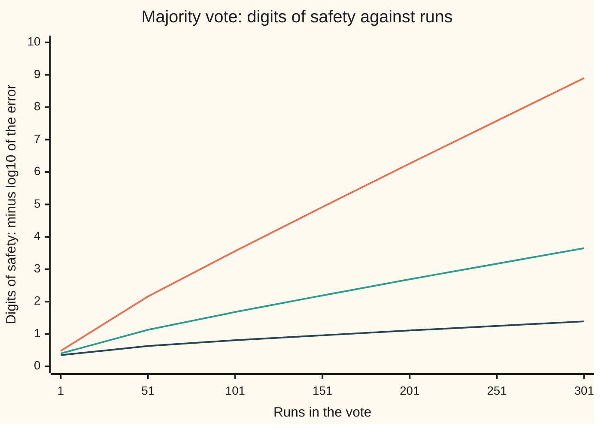
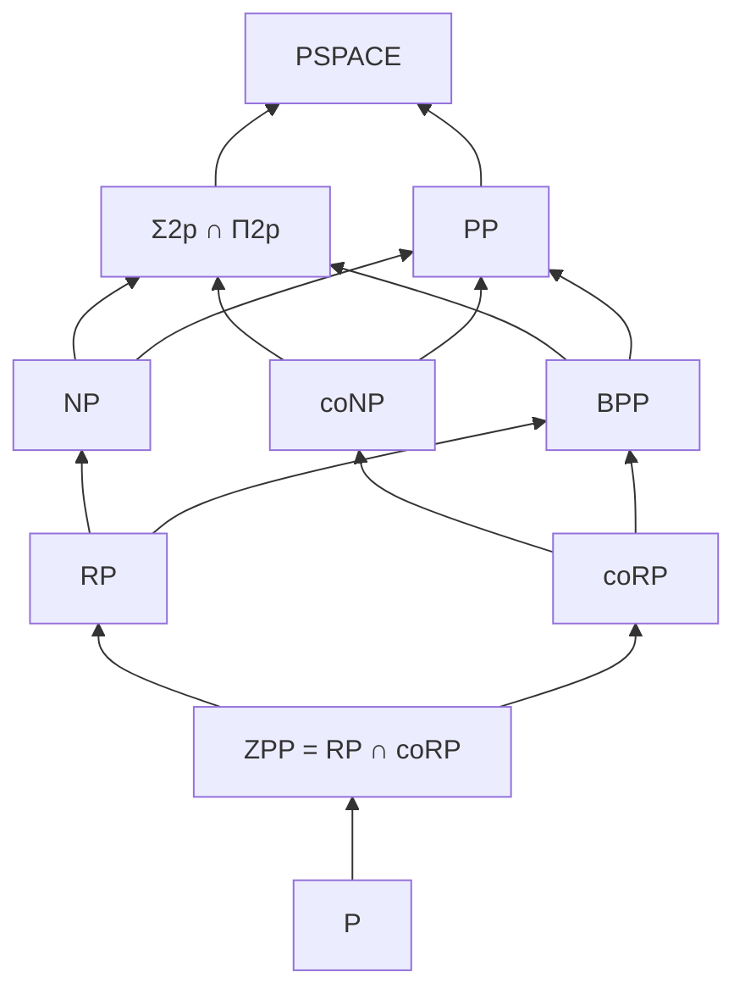

# BPP: coin flips that buy speed at a controlled error rate

[Syllabus](../../../SYLLABUS.md) → [Computability and complexity](../README.md) → [Beyond Worst Case](../README.md#s04) → BPP

---

## General Overview

A hospital plans next week's rota. Three wards, W1 to W3, each put a set number of staff on the early, late and night shifts. Each shift type lasts a set number of hours on each day. Multiply the two tables and you get the staff-hours each ward is covered for on Monday, Saturday and Sunday.

The planning software prints that table with one entry wrong: ward W2 on Saturday reads 36 staff-hours, where the truth is 38. Redoing the product would find it. A cheaper test picks a random list of zeros and ones, one per day, pushes it through both input tables and through the claimed table, and compares. A right table always passes; a wrong one fails at least half the time. On the rota, 4 of the 8 possible lists catch the mistyped 36.

So the test can be wrong, but only one way, and only with a known chance. Two runs miss with chance 0.25. [Tail bounds](../../14-Applied%20and%20computational/02-Randomised%20and%20Approximate%20Algorithms/02-tail-bounds-and-repeated-trials.md) works this test out at scale: on tables 1,000 by 1,000, twenty runs miss with chance under one in a million and cost 6% of a redo.

This card turns that trade into a definition. **BPP** (bounded-error probabilistic polynomial time) is the set of yes-or-no problems that a coin-flipping program solves fast (in a number of steps bounded by a polynomial in the input length), right with chance at least 2/3 on every input. Repeating the run and taking the majority answer pushes the error as low as anyone wants, which is why the 2/3 is not special.

**BPP is the set of problems a fast program with coin flips answers correctly with chance at least 2/3 on every input, and because independent repeats with a majority vote shrink the error exponentially, any fixed margin above one half defines the same set.**

**What kind of fact this is:** definitions (BPP and its cousins RP, coRP, ZPP and PP), and two theorems proved on this card in Why it works: the random-list test misses a wrong table with chance at most one over the number of values a list entry can take, and amplification makes any fixed margin equivalent. Where BPP sits among the other classes is stated with sources. P = BPP is a conjecture, unproved as of 2026-11-11.

### The picture: what one extra run buys, for three error rates

Each line is a test that is right with chance $`p`$ on every input, repeated and decided by majority vote. The height is the "digits of safety": minus the base-10 log of the chance that the vote is wrong, so 6 digits means one in a million.



Orange, top: right with chance 2/3, BPP's own number; it passes one in a million near 200 runs. Green, middle: right with chance 0.6. Dark, bottom: right with chance 0.55. All three climb along nearly straight lines. A smaller margin gives a shallower line, but every line keeps climbing, so every fixed margin reaches any target.

---

## The formula

Some words first. A **language** $`L`$ is a set of strings: the inputs whose answer is "yes" (shelf 01). An input is a string $`w`$, and $`n = |w|`$ is its length in symbols. $`\Pr[\cdot]`$ is the probability of the event in the brackets. It is written Pr, never P, because P is a class.

A **probabilistic machine** $`M`$ is a Turing machine that also reads a string of fair coin flips $`r`$, one fresh bit at a time. It must halt within $`n^c`$ steps for some fixed $`c`$, on every input and every coin string. The definition of BPP:

```math
L \in \mathrm{BPP} \iff \text{some such } M \text{ has, for every input } w:\quad w \in L \Rightarrow \Pr_r[M \text{ accepts } w] \ge \tfrac23, \qquad w \notin L \Rightarrow \Pr_r[M \text{ accepts } w] \le \tfrac13
```

**Read it aloud:** a problem is in BPP when a fast coin-flipping machine says "yes" to yes-inputs at least two times in three, and says "yes" to no-inputs at most one time in three, whatever the input.

The second formula says why the 2/3 does not matter. Run the machine $`k`$ times with fresh coins and take the majority answer. If one run is right with chance $`p = \frac12 + \varepsilon`$ on every input, then:

```math
\Pr[\text{majority of } k \text{ runs is wrong}] \le e^{-2k\varepsilon^2}, \qquad\text{so}\qquad k = \left\lceil \frac{\ln(1/\delta)}{2\varepsilon^2} \right\rceil \text{ runs reach error } \delta
```

**Read it aloud:** the vote is wrong with a chance that falls exponentially in the number of runs, at a rate set by the square of the margin; the runs needed grow with the log of the target and with one over the margin squared.

For BPP's own numbers, $`\varepsilon = \frac16`$, so the bound is $`e^{-k/18}`$, and one in a million needs 249 runs by this bound.

| Symbol | Plain meaning | In our example | Push it up and the answer… |
| --- | --- | --- | --- |
| $`L`$ | a language: the set of yes-inputs | PRODUCT, the inputs $`\langle A, B, C\rangle`$ with $`AB = C`$ | — |
| $`w`$, $`n`$ | an input string, and its length in symbols | the three tables, written out | the time bound $`n^c`$ grows |
| $`M`$, $`r`$ | the probabilistic machine, and its string of coin flips | the random-list test; $`r`$ is the list | — |
| $`c`$ | the exponent in the time bound $`n^c`$ | the test runs in about $`3m^2`$ steps | slower, but still polynomial |
| $`\Pr_r[\cdot]`$ | probability over the coins only, with the input fixed | $`\Pr_r[\text{test passes the wrong table}] = 0.5`$ | — |
| $`p`$ | chance one run answers correctly, on the worst input | 2/3 in the definition | fewer runs needed |
| $`\varepsilon`$ | the margin $`p - \frac12`$ | 1/6 | runs needed fall like $`1/\varepsilon^2`$ |
| $`k`$ | runs in the majority vote | 193 exact, 249 by the bound, for one in a million | the error falls exponentially |
| $`\delta`$ | the error allowed after amplification | one in a million | runs needed fall like $`\ln(1/\delta)`$ |
| $`D`$ | Chernoff's rate: how fast the vote's error bound falls per run | 0.058892 for $`p = \frac23`$ | fewer runs: 235 for one in a million |
| $`A`$, $`B`$, $`C`$, $`E`$, $`m`$ | staff per shift, hours per shift and day, the claimed staff-hours; $`E = AB - C`$ is the table of errors; $`m`$ is the side of a square table | 3 by 3 on the rota; $`m`$ = 1,000 at scale | the redo grows like $`m^3`$, the test like $`m^2`$ |
| $`x`$, $`S`$ | the random list, and the set its entries are drawn from | $`S = \{0, 1\}`$ or $`\{0, \dots, 9\}`$ | a bigger $`S`$ means a miss chance of at most $`1/\lvert S\rvert`$ |

### When it holds

- **The bound on the error holds for every input.** An error of 1/3 on average over inputs is not BPP. A rare bad input then fails every time, and repeats do not help it.
- **The coins are fresh on every run.** One list reused for two runs misses the wrong rota table with chance 0.5, not 0.25. The doubts multiply only when the runs are independent.
- **The margin is fixed, or shrinks no faster than one over a polynomial.** Any fixed margin, however small, gives BPP. A margin that shrinks exponentially in $`n`$ does not: right with chance $`\frac12 + 2^{-n}`$, at $`n`$ = 20 a majority of 101 runs is still wrong with chance 0.499992. Such margins are allowed in the class PP, below, which contains NP.
- **Every run halts in polynomial time on every coin string.** A program that is always right but fast only on average is a ZPP program, below; it needs a cut-off before it fits the other classes.

---

## Why it works

### Step 0: the idea

A coin-flipping program answers each input with some chance of being right. If that chance stays above one half by a fixed margin on every input, independent repeats behave like a crowd of voters each leaning the right way. A wrong majority then needs an unlikely pile-up of wrong runs, and Chernoff's bound shows that this chance falls exponentially in the number of runs.

Exponential decay against a polynomial cost is the whole trade. The class does not care whether one run is right 2/3 or 0.51 of the time. It only cares that the margin does not vanish.

### Step 1: the rota test, a one-sided coin-flip program

The tables, with rows for wards and columns for shift types (early, late, night):

- $`A`$ is the staff on each shift: W1 `4, 3, 2`; W2 `2, 2, 1`; W3 `5, 4, 3`.
- $`B`$ is the hours of each shift on Monday, Saturday and Sunday: early `8, 6, 6`; late `8, 8, 6`; night `10, 10, 12`.
- $`C = AB`$ is the staff-hours: W1 `76, 68, 66`; W2 `42, 38, 36`; W3 `102, 92, 90`.

The claimed table matches $`C`$ except for W2 on Saturday, which reads 36.

The test, known as Freivalds' check, draws a list $`x`$, one entry per day, and compares $`A(Bx)`$ with $`Cx`$. Each side is a table times a list, so the test costs $`3m^2`$ multiplications against $`m^3`$ for a redo. That is 30,000 against 1,000,000 at $`m = 100`$, and 3,000,000 against 1,000,000,000 at $`m = 1{,}000`$.

The [Tail bounds](../../14-Applied%20and%20computational/02-Randomised%20and%20Approximate%20Algorithms/02-tail-bounds-and-repeated-trials.md) card proves that a 0/1 list catches a wrong product at least half the time. The same argument gives more when the list's entries come from a bigger set $`S`$:

- Let $`E = AB - C`$, the table of errors. If the claim is wrong, some entry $`E_{ij}`$ is not zero.
- Entry $`i`$ of $`Ex`$ is $`E_{ij}x_j`$ plus terms that do not involve $`x_j`$.
- Fix every other entry of the list. Then only one value of $`x_j`$ can make the total zero, because the total changes by $`E_{ij} \ne 0`$ for each step in $`x_j`$.
- So at most one of the $`\lvert S\rvert`$ values of $`x_j`$ hides the error, and the test misses with chance at most $`1/\lvert S\rvert`$.

On the rota, the error row for W2 is `0, 2, 0`, so the test misses exactly when $`x_{\text{Sat}} = 0`$. The check tries every list: 4 of the 8 0/1 lists miss, and 100 of the 1,000 lists with entries 0 to 9 miss. A right table passes all 8.

The language PRODUCT, the inputs $`\langle A, B, C\rangle`$ with $`AB = C`$, is already in P: redo the product. The coins do not move it into a new class. They buy speed: counting bit operations (steps on single binary digits), no method without coins is known to check a product in about $`m^2`$ steps.

### Step 2: the classes, by which way the error may fall

Programs with coins differ in which answers may be wrong. Each row below is a class of languages. Every machine halts in polynomial time, except in ZPP, where only the average time is polynomial.

| Class | Yes-input is accepted with chance | No-input is accepted with chance | Example |
| --- | --- | --- | --- |
| P | 1 | 0 | redoing the product |
| RP | at least 1/2 | 0 | COMPOSITE, by Miller-Rabin witnesses |
| coRP | 1 | at most 1/2 | PRODUCT, by the rota test |
| ZPP | answers are never wrong; the time is polynomial on average | | RP and coRP together |
| BPP | at least 2/3 | at most 1/3 | any of the above |
| PP | more than 1/2 | at most 1/2 | the margin may be tiny |

RP is randomised polynomial time; coRP holds the complements of RP languages. ZPP, zero-error probabilistic polynomial time, holds the Las Vegas programs: always right, random running time. The rest are Monte Carlo: fixed time, sometimes wrong ([Randomised algorithms](../../14-Applied%20and%20computational/02-Randomised%20and%20Approximate%20Algorithms/01-randomised-algorithms-and-expectation.md)).

The rota test is a coRP program for PRODUCT: a right table is always accepted, and a wrong table is accepted with chance at most 1/2. [The Miller-Rabin test](../../02-Number%20theory/06-Codes%20and%20Secrets/05-miller-rabin.md) has the same shape: a witness proves "composite" for certain. So COMPOSITE is in RP and PRIME is in coRP.

### Step 3: one-sided error shrinks without a vote

For a one-sided program a single objection is proof, so the rule is "reject if any run objects". With fresh lists the misses multiply: of all 64 coin strings for two runs, 16 miss, which is $`0.5^2 = 0.25`$.

Two runs already bring the rota test inside BPP's limit of 1/3. That is why RP and coRP sit inside BPP: run twice, and the one-sided 1/2 becomes a one-sided 1/4, within the two-sided limit of 1/3.

### Step 4: two-sided error shrinks by majority vote

A two-sided program can be wrong either way, so one objection proves nothing. Run it an odd number $`k`$ of times and take the majority, which is wrong only when more than half the runs are.

[Tail bounds](../../14-Applied%20and%20computational/02-Randomised%20and%20Approximate%20Algorithms/02-tail-bounds-and-repeated-trials.md) sizes such a vote for one algorithm, the exact binomial count against Chernoff's bound. At BPP's own 2/3 the check repeats that count once: one in a million needs 193 runs exactly, 235 by Chernoff's bound and 249 by Hoeffding's, both from [Concentration](../../09-Probability%20and%20statistics/06-Limit%20Theorems%20in%20Practice/06-concentration-inequalities-hoeffding-and-chernoff.md), and the exact error sits under both bounds at every $`k`$ tried. A seeded simulation of 100,000 votes of 21 runs comes out wrong 0.05585 of the time, against the exact 0.05572.

What is new is the reading for the class. The runs needed grow only with the log of the target error, so a target that shrinks with the input, $`2^{-n}`$, costs a number of runs that grows only in step with $`n`$, and the time stays a polynomial. The fold proves it: asking for a right answer with chance 2/3, or 0.51, or an error below $`2^{-n}`$, defines the same class each time.

<details>
<summary>Detailed proof: amplification keeps the class the same</summary>

Let $`M`$ decide $`L`$ with chance at least $`\frac12 + \varepsilon`$ of being right on every input, in time $`n^c`$. Build $`M'`$: run $`M`$ on $`w`$ with $`k`$ fresh coin strings and output the majority answer.

Let $`X_i = 1`$ when run $`i`$ is right and 0 otherwise. The $`X_i`$ are independent, because the coins are fresh, and each has mean at least $`\frac12 + \varepsilon`$. The vote is wrong only if $`X_1 + \dots + X_k \le k/2`$. That is at least $`\varepsilon k`$ below the mean. Hoeffding's inequality bounds this by

$`\displaystyle \Pr\Big[\sum_{i=1}^{k} X_i \le \tfrac{k}{2}\Big] \le e^{-2k\varepsilon^2}.`$

Take $`k = \lceil n \ln 2 / (2\varepsilon^2) \rceil`$. Then the vote is wrong with chance at most $`2^{-n}`$. If $`\varepsilon`$ is a fixed number, or at least $`n^{-a}`$ for a fixed $`a`$, then $`k`$ is at most a polynomial in $`n`$. So $`M'`$ runs in time $`k \cdot n^c`$, still a polynomial.

Hence a language with any such margin is in BPP, and a language in BPP has a machine with error at most $`2^{-n}`$. Each version of the definition gives the same class.

</details>

### Step 5: why the margin must not vanish

The runs needed grow like $`1/\varepsilon^2`$. For one in a million, Hoeffding's bound asks for:

| Margin $`\varepsilon`$ | Runs for one in a million |
| --- | ---: |
| 1/6 | 249 |
| 1/10 | 691 |
| 1/100 | 69,078 |
| $`2^{-n}`$ at $`n`$ = 20 | $`7.60 \times 10^{12}`$ |
| $`2^{-n}`$ at $`n`$ = 40 | $`8.35 \times 10^{24}`$ |

A margin of one over a polynomial costs a polynomial number of runs. A margin of $`2^{-n}`$ costs about $`4^n`$ runs, which is exponential: the last two rows are that margin at $`n`$ = 20 and $`n`$ = 40. At $`n`$ = 20, a majority of 101 runs is still wrong with chance 0.499992. A fixed margin, however small, is different. A margin of $`2^{-20}`$ at every input length needs the same $`7.60 \times 10^{12}`$ runs at every $`n`$: a huge number, but a constant, so the class is still BPP.

The class PP allows such vanishing margins. It contains NP, which BPP is not known to contain: guess a certificate at random, accept if it checks, and otherwise accept with a chance a shade below one half. That is why the "B" in BPP, for bounded error, matters.

### Step 6: where BPP sits

These facts follow from the definitions:

- **P is inside ZPP, and ZPP = RP ∩ coRP.** One way: a Las Vegas program stopped at twice its average time has finished at least half the time, by Markov's inequality ([Markov and Chebyshev](../../09-Probability%20and%20statistics/02-Random%20Variables/08-markov-and-chebyshev-inequalities.md)), so answering "no" when it has not finished gives an RP program. The other way: run the RP and coRP programs in turn until one of them gives proof.
- **RP is inside NP.** A coin string that makes the machine accept is a certificate (a short proof a verifier can check).
- **BPP is closed under complement.** Swap "accept" and "reject" and the 2/3 and 1/3 swap too.
- **BPP is inside PSPACE**, the problems solvable with a polynomial amount of memory. Run the machine on every coin string in turn, reusing the same memory, and count the acceptances. The check does exactly this on the rota: all 8 lists for one run, all 64 coin strings for two. The time is $`2^{n^c}`$ runs, which is why counting is no substitute for coins.

One deeper fact is stated, not proved here. BPP is inside $`\Sigma_2^p \cap \Pi_2^p`$, the second level of the hierarchy above NP (from [shelf 03](../README.md#s03)). The proof is Lautemann's 1983 shortening of a result of Sipser and Gács.

What is open: nobody knows whether BPP is inside NP, or whether BPP = P. Most researchers expect P = BPP, and [Pseudorandomness](04-derandomisation-and-pseudorandomness.md) shows why: hard functions would let a program replace its coins by a short seed. PRIME is one problem that moved. It was in coRP from the 1970s and was shown to be in P in 2002 (published 2004).



Schematic. An arrow from one class to another means "is contained in". No inclusion in this picture is proved strict as of 2026-11-19.

---

## Worked numbers, by hand

Two runs of the rota test on the claimed table, with lists over Monday, Saturday and Sunday.

| Step | Arithmetic | Value |
| --- | --- | --- |
| list 1 | $`x = (1, 0, 1)`$: Monday and Sunday | — |
| $`Bx`$ | early 8 + 6, late 8 + 6, night 10 + 12 | 14, 14, 22 |
| $`A(Bx)`$ | W1 4×14 + 3×14 + 2×22; W2 2×14 + 2×14 + 1×22; W3 5×14 + 4×14 + 3×22 | 142, 78, 192 |
| claimed $`Cx`$ | W1 76 + 66; W2 42 + 36; W3 102 + 90 | 142, 78, 192: pass, a miss |
| list 2 | $`x = (0, 1, 1)`$: Saturday and Sunday | — |
| $`Bx`$ | early 6 + 6, late 8 + 6, night 10 + 12 | 12, 14, 22 |
| $`A(Bx)`$ | W1 48 + 42 + 44; W2 24 + 28 + 22; W3 60 + 56 + 66 | 134, 74, 182 |
| claimed $`Cx`$ | W1 68 + 66; W2 36 + 36; W3 92 + 90 | 134, 72, 182: **caught**, 74 ≠ 72 |
| miss chance, one run | lists with $`x_{\text{Sat}} = 0`$: 4 of 8 | 0.5 |
| miss chance, two runs | $`0.5 \times 0.5`$; all coin strings: 16 of 64 | **0.25**, inside BPP's 1/3 |

The first list skipped Saturday, so it could not see the Saturday mistake. The second included it and caught a 2-hour gap on ward W2.

### What breaks if you drop a piece

| Mistake | Comes out at | What went wrong |
| --- | --- | --- |
| Drop the coins: always check with the list `1, 1, 1`, the weekly totals | a table with W2 Monday 44 and Saturday 36 is missed every time | errors of +2 and −2 in one row cancel in the total; a fixed list has a blind spot an input can sit in |
| Reuse one list for both runs | misses 4 of 8 = 0.5, not 0.25 | the runs are not independent, so the doubts do not multiply |
| Let the margin vanish: right with chance $`\frac12 + 2^{-n}`$, at $`n`$ = 20 | a majority of 101 runs is wrong 0.499992 of the time; one in a million needs $`7.60 \times 10^{12}`$ runs, growing like $`4^n`$ | amplification costs $`1/\varepsilon^2`$ runs; a margin shrinking exponentially in $`n`$ is allowed in PP, not BPP, while a fixed $`2^{-20}`$ would still be BPP |
| Use the test on small tables, $`m = 100`$ | 20 runs cost 60.00% of a redo | the speed-up is a factor of about $`m/3`$, so coins pay only at scale: 6.00% at $`m`$ = 1,000, 0.60% at 10,000 |

---

## Code, from first principles, and it actually runs

The script runs the rota test and takes **four independent roads**. Exhaustive counting over every list and all 64 two-run coin strings, the PSPACE simulation of Step 6 in miniature. The proof's bound $`1/\lvert S\rvert`$ on the miss chance. A seeded simulation: SplitMix64, a small random-number generator written out in both languages, drives 100,000 tests and 100,000 votes, which must land within four standard errors (four times the scatter expected from chance). Exact vote errors, summed two ways, held under the Chernoff and Hoeffding bounds.

### Python

```python
# BPP card check: the rota product check (one-sided), all coin strings, a seeded simulation,
# and the majority vote that amplifies a two-sided test. Standard library only.
from fractions import Fraction
from math import comb, log, ceil, exp

MASK = (1 << 64) - 1
class SplitMix64:  # small seeded generator, explained on wing 09's simulation cards
    def __init__(self, seed): self.s = seed
    def next(self):
        self.s = (self.s + 0x9E3779B97F4A7C15) & MASK
        z = self.s
        z = ((z ^ (z >> 30)) * 0xBF58476D1CE4E5B9) & MASK
        z = ((z ^ (z >> 27)) * 0x94D049BB133111EB) & MASK
        return z ^ (z >> 31)
    def unit(self): return (self.next() >> 11) / 9007199254740992.0

def mat_mul(X, Y): return [[sum(X[i][t] * Y[t][j] for t in range(3)) for j in range(3)] for i in range(3)]
def mat_vec(X, v): return [sum(X[i][t] * v[t] for t in range(3)) for i in range(3)]
def passes(C, x): return mat_vec(A, mat_vec(B, x)) == mat_vec(C, x)
def lists(values):  # every possible random list of length 3
    out = [[]]
    for _ in range(3): out = [l + [v] for l in out for v in values]
    return out
def sci(x):  # same digits in both languages: scale by tens, then 2 decimals
    m, e = x, 0
    while m >= 10.0: m, e = m / 10.0, e + 1
    while m < 1.0: m, e = m * 10.0, e - 1
    return f"{m:.2f}e{e}"
def vote_error(p, k):  # chance a majority of k runs is wrong, built one run at a time
    dist = [1.0]
    for _ in range(k):
        dist = [(dist[j] * p if j < len(dist) else 0.0) + (dist[j - 1] * (1 - p) if j > 0 else 0.0) for j in range(len(dist) + 1)]
    total = 0.0
    for v in dist[(k + 1) // 2:]: total += v  # plain left-to-right sum, as in the Rust
    return total

A = [[4, 3, 2], [2, 2, 1], [5, 4, 3]]     # staff on wards W1..W3 per early, late, night shift
B = [[8, 6, 6], [8, 8, 6], [10, 10, 12]]  # hours of each shift on Mon, Sat, Sun
C = mat_mul(A, B)                          # staff-hours per ward per day: the true table
wrong = [r[:] for r in C]; wrong[1][1] = 36                    # one entry mistyped: W2 Sat
swap = [r[:] for r in C]; swap[1][0] += 2; swap[1][1] -= 2      # two errors, row total unchanged
print("true table C = AB, staff-hours, columns Mon Sat Sun")
for w in range(3): print(f"W{w + 1} " + " ".join(str(v) for v in C[w]))
for x in ([1, 0, 1], [0, 1, 1]):
    bx = mat_vec(B, x)
    left, right = mat_vec(A, bx), mat_vec(wrong, x)
    print(f"run x={x}: Bx={bx} A(Bx)={left} claimed Cx={right} {'pass' if left == right else 'caught'}")
L01, L10 = lists([0, 1]), lists(list(range(10)))
right_pass = sum(passes(C, x) for x in L01)
miss01, miss10 = sum(passes(wrong, x) for x in L01), sum(passes(wrong, x) for x in L10)
swap01, swap10 = sum(passes(swap, x) for x in L01), sum(passes(swap, x) for x in L10)
two_runs = sum(passes(wrong, x) and passes(wrong, y) for x in L01 for y in L01)
reused = sum(passes(wrong, x) and passes(wrong, x) for x in L01)
print(f"all 0/1 lists, true table: passes {right_pass} of 8")
print(f"all 0/1 lists, one wrong entry: misses {miss01} of 8 = {miss01 / 8:.6f}")
print(f"all 0-9 lists, one wrong entry: misses {miss10} of 1000 = {miss10 / 1000:.6f}")
print(f"all 0/1 lists, two errors: misses {swap01} of 8; all 0-9 lists: misses {swap10} of 1000")
print(f"fixed list [1, 1, 1], two errors: {'missed every time' if passes(swap, [1, 1, 1]) else 'caught'}")
print(f"two runs, all 64 coin strings: misses {two_runs} = {two_runs / 64:.6f}")
print(f"one list reused for both runs: misses {reused} of 8 = {reused / 8:.6f}")
print(f"20 fresh 0/1 runs: miss chance at most {sci(0.5 ** 20)}")
rng, T = SplitMix64(20261119), 100000
draw = lambda vals: [vals[rng.next() % len(vals)] for _ in range(3)]
sim01 = sum(passes(wrong, draw([0, 1])) for _ in range(T)) / T
sim10 = sum(passes(wrong, draw(list(range(10)))) for _ in range(T)) / T
sim2 = sum(passes(wrong, draw([0, 1])) and passes(wrong, draw([0, 1])) for _ in range(T)) / T
print(f"simulated {T} runs: miss 0/1 {sim01:.5f}, 0-9 {sim10:.5f}, two 0/1 runs {sim2:.5f}")
for m in (100, 1000, 10000):
    print(f"side m={m}: one check {3 * m * m}, redo {m ** 3}, 20 checks = {20 * 3 * m * m / m ** 3 * 100:.2f}% of a redo")
p, eps, delta = 2 / 3, 1 / 6, 1e-6
D = 0.5 * log(0.5 / (1 - p)) + 0.5 * log(0.5 / p)
print(f"two-sided test right with chance 2/3: Chernoff rate D = {D:.6f}")
print("runs k, exact vote error, Chernoff bound, Hoeffding bound")
exact_rows = {}
for k in (1, 3, 11, 21, 51, 101, 201):
    e = vote_error(p, k)
    exact_rows[k] = e
    print(f"k={k}: {sci(e)} {sci(exp(-k * D))} {sci(exp(-2 * k * eps * eps))}")
k_exact = next(k for k in range(1, 400, 2) if vote_error(p, k) <= delta)
k_chern, k_hoef = ceil(log(1 / delta) / D), ceil(log(1 / delta) / (2 * eps * eps))
print(f"runs for 1 in a million: exact {k_exact}, Chernoff {k_chern}, Hoeffding {k_hoef}")
votes = sum(sum(rng.unit() < p for _ in range(21)) < 11 for _ in range(T)) / T
print(f"simulated {T} votes of 21 runs: wrong {votes:.5f}, exact {exact_rows[21]:.5f}")
for name, g in (("1/6", 1 / 6), ("1/10", 0.1), ("1/100", 0.01), ("2^-20", 2.0 ** -20), ("2^-40", 2.0 ** -40)):
    runs = ceil(log(1 / delta) / (2 * g * g))
    print(f"gap {name}: Hoeffding runs for 1 in a million {runs if runs < 10 ** 7 else sci(runs)}")
pp = vote_error(0.5 + 2.0 ** -20, 101)
print(f"gap 2^-20, majority of 101 runs: wrong {pp:.6f}")
chart_k = [1, 51, 101, 151, 201, 251, 301]
print("chart, runs " + " ".join(str(k) for k in chart_k))
for name, q in (("2/3", 2 / 3), ("0.6", 0.6), ("0.55", 0.55)):
    print(f"chart, digits p={name} " + " ".join(f"{-log(vote_error(q, k)) / log(10):.2f}" for k in chart_k))

assert C == [[76, 68, 66], [42, 38, 36], [102, 92, 90]], "table by hand, row by row"
assert right_pass == 8 and miss01 * 2 <= 8 and miss10 * 10 <= 1000, "one-sided: never rejects, misses at most 1/|S|"
assert swap01 * 2 <= 8 and swap10 * 10 <= 1000, "bound holds for an error spread over two entries"
assert two_runs == miss01 * miss01, "fresh lists: two-run misses multiply"
assert abs(sim01 - miss01 / 8) < 4 * (0.25 / T) ** 0.5 and abs(sim10 - miss10 / 1000) < 4 * (0.09 / T) ** 0.5
assert abs(sim2 - two_runs / 64) < 4 * (0.1875 / T) ** 0.5, "simulated pairs against all 64 coin strings"
for k, e in exact_rows.items():
    fr = sum(Fraction(comb(k, j) * 2 ** (k - j), 3 ** k) for j in range((k + 1) // 2, k + 1))
    assert abs(e - float(fr)) <= 1e-12 * float(fr), "run-by-run table against the exact binomial sum"
    assert e <= exp(-k * D) * (1 + 1e-12) and exp(-k * D) <= exp(-2 * k * eps * eps), "truth under both bounds"
assert k_exact <= k_chern <= k_hoef
assert abs(votes - exact_rows[21]) < 4 * (exact_rows[21] * (1 - exact_rows[21]) / T) ** 0.5
assert 0.49 < pp < 0.5, "a margin of 2^-n, at n = 20, is not amplified by 101 runs"
print("ALL CHECKS PASS")
```

**Ran 2026-11-19 on macOS, Python 3.14.10, standard library only. All checks passed. Output, pasted from the run:**

```
true table C = AB, staff-hours, columns Mon Sat Sun
W1 76 68 66
W2 42 38 36
W3 102 92 90
run x=[1, 0, 1]: Bx=[14, 14, 22] A(Bx)=[142, 78, 192] claimed Cx=[142, 78, 192] pass
run x=[0, 1, 1]: Bx=[12, 14, 22] A(Bx)=[134, 74, 182] claimed Cx=[134, 72, 182] caught
all 0/1 lists, true table: passes 8 of 8
all 0/1 lists, one wrong entry: misses 4 of 8 = 0.500000
all 0-9 lists, one wrong entry: misses 100 of 1000 = 0.100000
all 0/1 lists, two errors: misses 4 of 8; all 0-9 lists: misses 100 of 1000
fixed list [1, 1, 1], two errors: missed every time
two runs, all 64 coin strings: misses 16 = 0.250000
one list reused for both runs: misses 4 of 8 = 0.500000
20 fresh 0/1 runs: miss chance at most 9.54e-7
simulated 100000 runs: miss 0/1 0.50176, 0-9 0.10046, two 0/1 runs 0.24997
side m=100: one check 30000, redo 1000000, 20 checks = 60.00% of a redo
side m=1000: one check 3000000, redo 1000000000, 20 checks = 6.00% of a redo
side m=10000: one check 300000000, redo 1000000000000, 20 checks = 0.60% of a redo
two-sided test right with chance 2/3: Chernoff rate D = 0.058892
runs k, exact vote error, Chernoff bound, Hoeffding bound
k=1: 3.33e-1 9.43e-1 9.46e-1
k=3: 2.59e-1 8.38e-1 8.46e-1
k=11: 1.22e-1 5.23e-1 5.43e-1
k=21: 5.57e-2 2.90e-1 3.11e-1
k=51: 6.89e-3 4.96e-2 5.88e-2
k=101: 2.72e-4 2.61e-3 3.66e-3
k=201: 5.53e-7 7.23e-6 1.41e-5
runs for 1 in a million: exact 193, Chernoff 235, Hoeffding 249
simulated 100000 votes of 21 runs: wrong 0.05585, exact 0.05572
gap 1/6: Hoeffding runs for 1 in a million 249
gap 1/10: Hoeffding runs for 1 in a million 691
gap 1/100: Hoeffding runs for 1 in a million 69078
gap 2^-20: Hoeffding runs for 1 in a million 7.60e12
gap 2^-40: Hoeffding runs for 1 in a million 8.35e24
gap 2^-20, majority of 101 runs: wrong 0.499992
chart, runs 1 51 101 151 201 251 301
chart, digits p=2/3 0.48 2.16 3.56 4.92 6.26 7.58 8.90
chart, digits p=0.6 0.40 1.13 1.68 2.19 2.69 3.17 3.65
chart, digits p=0.55 0.35 0.63 0.81 0.96 1.11 1.25 1.39
ALL CHECKS PASS
```

### Rust

```rust
// BPP card check: the rota product check (one-sided), all coin strings, a seeded simulation,
// and the majority vote that amplifies a two-sided test. std only.
type M = [[i64; 3]; 3];

struct SplitMix64 { s: u64 } // small seeded generator, explained on wing 09's simulation cards
impl SplitMix64 {
    fn next(&mut self) -> u64 {
        self.s = self.s.wrapping_add(0x9E3779B97F4A7C15);
        let mut z = self.s;
        z = (z ^ (z >> 30)).wrapping_mul(0xBF58476D1CE4E5B9);
        z = (z ^ (z >> 27)).wrapping_mul(0x94D049BB133111EB);
        z ^ (z >> 31)
    }
    fn unit(&mut self) -> f64 { (self.next() >> 11) as f64 / 9007199254740992.0 }
    fn draw(&mut self, vals: &[i64]) -> Vec<i64> {
        (0..3).map(|_| vals[(self.next() % vals.len() as u64) as usize]).collect()
    }
}

fn mat_mul(x: &M, y: &M) -> M {
    let mut c = [[0; 3]; 3];
    for i in 0..3 { for j in 0..3 { for t in 0..3 { c[i][j] += x[i][t] * y[t][j]; } } }
    c
}
fn mat_vec(x: &M, v: &[i64]) -> Vec<i64> { (0..3).map(|i| (0..3).map(|t| x[i][t] * v[t]).sum()).collect() }
fn passes(a: &M, b: &M, c: &M, x: &[i64]) -> bool { mat_vec(a, &mat_vec(b, x)) == mat_vec(c, x) }
fn lists(values: &[i64]) -> Vec<Vec<i64>> { // every possible random list of length 3
    let mut out: Vec<Vec<i64>> = vec![vec![]];
    for _ in 0..3 {
        out = out.iter().flat_map(|l| values.iter().map(move |&v| { let mut n = l.clone(); n.push(v); n })).collect();
    }
    out
}
fn sci(x: f64) -> String { // same digits in both languages: scale by tens, then 2 decimals
    let (mut m, mut e) = (x, 0);
    while m >= 10.0 { m /= 10.0; e += 1; }
    while m < 1.0 { m *= 10.0; e -= 1; }
    format!("{:.2}e{}", m, e)
}
fn vote_error(p: f64, k: usize) -> f64 { // chance a majority of k runs is wrong, built one run at a time
    let mut dist = vec![1.0f64];
    for _ in 0..k {
        let n = dist.len();
        dist = (0..=n).map(|j| (if j < n { dist[j] * p } else { 0.0 }) + (if j > 0 { dist[j - 1] * (1.0 - p) } else { 0.0 })).collect();
    }
    let mut total = 0.0;
    for v in &dist[(k + 1) / 2..] { total += v; }
    total
}
fn binom_sum(k: usize) -> f64 { // second road: the binomial terms written out, wrong chance 1/3
    let mut total = 0.0;
    for j in (k + 1) / 2..=k {
        let mut c = 1.0f64;
        for i in 0..j { c = c * (k - i) as f64 / (i + 1) as f64; }
        total += c * (1.0f64 / 3.0).powi(j as i32) * (2.0f64 / 3.0).powi((k - j) as i32);
    }
    total
}

fn main() {
    let a: M = [[4, 3, 2], [2, 2, 1], [5, 4, 3]];    // staff on wards W1..W3 per early, late, night shift
    let b: M = [[8, 6, 6], [8, 8, 6], [10, 10, 12]]; // hours of each shift on Mon, Sat, Sun
    let c = mat_mul(&a, &b);                         // staff-hours per ward per day: the true table
    let mut wrong = c; wrong[1][1] = 36;                      // one entry mistyped: W2 Sat
    let mut swap = c; swap[1][0] += 2; swap[1][1] -= 2;       // two errors, row total unchanged
    println!("true table C = AB, staff-hours, columns Mon Sat Sun");
    for w in 0..3 { println!("W{} {} {} {}", w + 1, c[w][0], c[w][1], c[w][2]); }
    for x in [vec![1, 0, 1], vec![0, 1, 1]] {
        let bx = mat_vec(&b, &x);
        let (left, right) = (mat_vec(&a, &bx), mat_vec(&wrong, &x));
        println!("run x={:?}: Bx={:?} A(Bx)={:?} claimed Cx={:?} {}", x, bx, left, right, if left == right { "pass" } else { "caught" });
    }
    let ten: Vec<i64> = (0..10).collect();
    let (l01, l10) = (lists(&[0, 1]), lists(&ten));
    let count = |t: &M, l: &Vec<Vec<i64>>| l.iter().filter(|x| passes(&a, &b, t, x)).count();
    let right_pass = count(&c, &l01);
    let (miss01, miss10) = (count(&wrong, &l01), count(&wrong, &l10));
    let (swap01, swap10) = (count(&swap, &l01), count(&swap, &l10));
    let mut two_runs = 0;
    for x in &l01 { for y in &l01 { if passes(&a, &b, &wrong, x) && passes(&a, &b, &wrong, y) { two_runs += 1; } } }
    let reused = l01.iter().filter(|x| passes(&a, &b, &wrong, x) && passes(&a, &b, &wrong, x)).count();
    println!("all 0/1 lists, true table: passes {} of 8", right_pass);
    println!("all 0/1 lists, one wrong entry: misses {} of 8 = {:.6}", miss01, miss01 as f64 / 8.0);
    println!("all 0-9 lists, one wrong entry: misses {} of 1000 = {:.6}", miss10, miss10 as f64 / 1000.0);
    println!("all 0/1 lists, two errors: misses {} of 8; all 0-9 lists: misses {} of 1000", swap01, swap10);
    println!("fixed list [1, 1, 1], two errors: {}", if passes(&a, &b, &swap, &[1, 1, 1]) { "missed every time" } else { "caught" });
    println!("two runs, all 64 coin strings: misses {} = {:.6}", two_runs, two_runs as f64 / 64.0);
    println!("one list reused for both runs: misses {} of 8 = {:.6}", reused, reused as f64 / 8.0);
    println!("20 fresh 0/1 runs: miss chance at most {}", sci(0.5f64.powi(20)));
    let (mut rng, t) = (SplitMix64 { s: 20261119 }, 100000usize);
    let tf = t as f64;
    let sim01 = (0..t).filter(|_| { let x = rng.draw(&[0, 1]); passes(&a, &b, &wrong, &x) }).count() as f64 / tf;
    let sim10 = (0..t).filter(|_| { let x = rng.draw(&ten); passes(&a, &b, &wrong, &x) }).count() as f64 / tf;
    let sim2 = (0..t).filter(|_| { let x = rng.draw(&[0, 1]); passes(&a, &b, &wrong, &x) && { let y = rng.draw(&[0, 1]); passes(&a, &b, &wrong, &y) } }).count() as f64 / tf;
    println!("simulated {} runs: miss 0/1 {:.5}, 0-9 {:.5}, two 0/1 runs {:.5}", t, sim01, sim10, sim2);
    for m in [100u64, 1000, 10000] {
        println!("side m={}: one check {}, redo {}, 20 checks = {:.2}% of a redo", m, 3 * m * m, m * m * m, (60 * m * m) as f64 / (m * m * m) as f64 * 100.0);
    }
    let (p, eps, delta) = (2.0f64 / 3.0, 1.0f64 / 6.0, 1e-6f64);
    let d = 0.5 * (0.5 / (1.0 - p)).ln() + 0.5 * (0.5 / p).ln();
    println!("two-sided test right with chance 2/3: Chernoff rate D = {:.6}", d);
    println!("runs k, exact vote error, Chernoff bound, Hoeffding bound");
    let mut exact_rows = vec![];
    for k in [1usize, 3, 11, 21, 51, 101, 201] {
        let e = vote_error(p, k);
        exact_rows.push((k, e));
        let kf = k as f64;
        println!("k={}: {} {} {}", k, sci(e), sci((-kf * d).exp()), sci((-2.0 * kf * eps * eps).exp()));
    }
    let k_exact = (1..400).step_by(2).find(|&k| vote_error(p, k) <= delta).unwrap();
    let (k_chern, k_hoef) = (((1.0 / delta).ln() / d).ceil() as usize, ((1.0 / delta).ln() / (2.0 * eps * eps)).ceil() as usize);
    println!("runs for 1 in a million: exact {}, Chernoff {}, Hoeffding {}", k_exact, k_chern, k_hoef);
    let e21 = exact_rows[3].1;
    let votes = (0..t).filter(|_| (0..21).filter(|_| rng.unit() < p).count() < 11).count() as f64 / tf;
    println!("simulated {} votes of 21 runs: wrong {:.5}, exact {:.5}", t, votes, e21);
    for (name, g) in [("1/6", 1.0 / 6.0), ("1/10", 0.1), ("1/100", 0.01), ("2^-20", 2f64.powi(-20)), ("2^-40", 2f64.powi(-40))] {
        let runs = ((1.0 / delta).ln() / (2.0 * g * g)).ceil();
        println!("gap {}: Hoeffding runs for 1 in a million {}", name, if runs < 1e7 { format!("{}", runs as u64) } else { sci(runs) });
    }
    let pp = vote_error(0.5 + 2f64.powi(-20), 101);
    println!("gap 2^-20, majority of 101 runs: wrong {:.6}", pp);
    let chart_k = [1usize, 51, 101, 151, 201, 251, 301];
    println!("chart, runs {}", chart_k.iter().map(|k| k.to_string()).collect::<Vec<_>>().join(" "));
    for (name, q) in [("2/3", 2.0 / 3.0), ("0.6", 0.6), ("0.55", 0.55)] {
        let row: Vec<String> = chart_k.iter().map(|&k| format!("{:.2}", -vote_error(q, k).ln() / 10f64.ln())).collect();
        println!("chart, digits p={} {}", name, row.join(" "));
    }

    assert!(c == [[76, 68, 66], [42, 38, 36], [102, 92, 90]], "table by hand, row by row");
    assert!(right_pass == 8 && miss01 * 2 <= 8 && miss10 * 10 <= 1000, "one-sided: never rejects, misses at most 1/|S|");
    assert!(swap01 * 2 <= 8 && swap10 * 10 <= 1000, "bound holds for an error spread over two entries");
    assert!(two_runs == miss01 * miss01, "fresh lists: two-run misses multiply");
    assert!((sim01 - miss01 as f64 / 8.0).abs() < 4.0 * (0.25 / tf).sqrt() && (sim10 - miss10 as f64 / 1000.0).abs() < 4.0 * (0.09 / tf).sqrt());
    assert!((sim2 - two_runs as f64 / 64.0).abs() < 4.0 * (0.1875 / tf).sqrt(), "simulated pairs against all 64 coin strings");
    for &(k, e) in &exact_rows {
        let direct = binom_sum(k);
        assert!((e - direct).abs() <= 1e-12 * direct, "run-by-run table against the binomial terms");
        let kf = k as f64;
        assert!(e <= (-kf * d).exp() * (1.0 + 1e-12) && (-kf * d).exp() <= (-2.0 * kf * eps * eps).exp(), "truth under both bounds");
    }
    assert!(k_exact <= k_chern && k_chern <= k_hoef);
    assert!((votes - e21).abs() < 4.0 * (e21 * (1.0 - e21) / tf).sqrt());
    assert!(0.49 < pp && pp < 0.5, "a margin of 2^-n, at n = 20, is not amplified by 101 runs");
    println!("ALL CHECKS PASS");
}
```

**Ran 2026-11-19 on macOS, rustc 1.98.1, no crates. All checks passed. Output, pasted from the run:**

```
true table C = AB, staff-hours, columns Mon Sat Sun
W1 76 68 66
W2 42 38 36
W3 102 92 90
run x=[1, 0, 1]: Bx=[14, 14, 22] A(Bx)=[142, 78, 192] claimed Cx=[142, 78, 192] pass
run x=[0, 1, 1]: Bx=[12, 14, 22] A(Bx)=[134, 74, 182] claimed Cx=[134, 72, 182] caught
all 0/1 lists, true table: passes 8 of 8
all 0/1 lists, one wrong entry: misses 4 of 8 = 0.500000
all 0-9 lists, one wrong entry: misses 100 of 1000 = 0.100000
all 0/1 lists, two errors: misses 4 of 8; all 0-9 lists: misses 100 of 1000
fixed list [1, 1, 1], two errors: missed every time
two runs, all 64 coin strings: misses 16 = 0.250000
one list reused for both runs: misses 4 of 8 = 0.500000
20 fresh 0/1 runs: miss chance at most 9.54e-7
simulated 100000 runs: miss 0/1 0.50176, 0-9 0.10046, two 0/1 runs 0.24997
side m=100: one check 30000, redo 1000000, 20 checks = 60.00% of a redo
side m=1000: one check 3000000, redo 1000000000, 20 checks = 6.00% of a redo
side m=10000: one check 300000000, redo 1000000000000, 20 checks = 0.60% of a redo
two-sided test right with chance 2/3: Chernoff rate D = 0.058892
runs k, exact vote error, Chernoff bound, Hoeffding bound
k=1: 3.33e-1 9.43e-1 9.46e-1
k=3: 2.59e-1 8.38e-1 8.46e-1
k=11: 1.22e-1 5.23e-1 5.43e-1
k=21: 5.57e-2 2.90e-1 3.11e-1
k=51: 6.89e-3 4.96e-2 5.88e-2
k=101: 2.72e-4 2.61e-3 3.66e-3
k=201: 5.53e-7 7.23e-6 1.41e-5
runs for 1 in a million: exact 193, Chernoff 235, Hoeffding 249
simulated 100000 votes of 21 runs: wrong 0.05585, exact 0.05572
gap 1/6: Hoeffding runs for 1 in a million 249
gap 1/10: Hoeffding runs for 1 in a million 691
gap 1/100: Hoeffding runs for 1 in a million 69078
gap 2^-20: Hoeffding runs for 1 in a million 7.60e12
gap 2^-40: Hoeffding runs for 1 in a million 8.35e24
gap 2^-20, majority of 101 runs: wrong 0.499992
chart, runs 1 51 101 151 201 251 301
chart, digits p=2/3 0.48 2.16 3.56 4.92 6.26 7.58 8.90
chart, digits p=0.6 0.40 1.13 1.68 2.19 2.69 3.17 3.65
chart, digits p=0.55 0.35 0.63 0.81 0.96 1.11 1.25 1.39
ALL CHECKS PASS
```

### Lean

Lean proves the vote's error bound for any margin and any number of runs, and the list test's miss bound for any integer tables.

- Take $`k`$ independent runs, each right with chance at least $`\frac12 + \varepsilon`$, where $`\varepsilon > 0`$. Then the majority vote is wrong with chance at most $`e^{-2k\varepsilon^2}`$.
- Take the same runs and a target error $`\delta > 0`$. Then $`k \ge \ln(1/\delta)/(2\varepsilon^2)`$ runs make the vote wrong with chance at most $`\delta`$.
- Take integer tables $`A`$, $`B`$, $`C`$ with $`AB \ne C`$, and lists with entries from $`S`$. Then at most a fraction $`1/\lvert S\rvert`$ of the lists pass the test.
- Take the rota tables. Then $`AB`$ is the true table, list `1, 0, 1` misses the mistyped 36, and list `0, 1, 1` catches it.
- A right table passes all 8 lists of zeros and ones.
- The mistyped table is missed by 4 of those 8 lists, and by 100 of the 1,000 lists with entries 0 to 9.
- Two fresh runs miss on 16 of the 64 coin strings.
- The two cancelling errors are missed by 4 of 8 lists, and every time by the list `1, 1, 1`.
- At BPP's 2/3, a vote of 193 runs is wrong less than once in a million, and 191 runs are not enough.
- Take side $`m`$ = 1,000. Then 20 checks cost 6% of a redo.

The Chernoff rate, the simulations, the chart's digits and the table of margins are left to the Python and Rust checks.

```lean
-- BPP: a majority vote of k independent runs, each right with chance at least 1/2 + ε, is wrong with chance at most exp(−2kε²), and the random-list check of a matrix product misses a wrong table with chance at most 1/|S|.
import Mathlib.Probability.Moments.SubGaussian
import Mathlib.Data.Matrix.Mul
import Mathlib.Data.Fintype.Pi
import Mathlib.Data.Nat.Choose.Basic

open MeasureTheory ProbabilityTheory Real Matrix

/-- Amplification by majority vote (the card's Detailed proof). Run a test k times with fresh
coins: X i ω = 1 when run i is right and 0 when it is wrong. The runs are independent, and
each one is right with chance at least 1/2 + ε, for a fixed margin ε > 0. Then the majority
vote is wrong (at most half the runs are right) with chance at most exp(−2kε²). -/
theorem majority_vote_error_le_exp
    {Ω : Type*} [MeasurableSpace Ω] {μ : Measure Ω} [IsProbabilityMeasure μ]
    {X : ℕ → Ω → ℝ} (hmeas : ∀ i, Measurable (X i)) (hindep : iIndepFun X μ)
    (h01 : ∀ i ω, X i ω = 0 ∨ X i ω = 1)
    {ε : ℝ} (hε : 0 < ε) (hright : ∀ i, 1 / 2 + ε ≤ μ.real {ω | X i ω = 1}) (k : ℕ) :
    μ.real {ω | ∑ i ∈ Finset.range k, X i ω ≤ (k : ℝ) / 2} ≤ exp (-2 * k * ε ^ 2) := by
  -- the mean of each run is its chance of being right
  have hmean : ∀ i, 1 / 2 + ε ≤ μ[X i] := by
    intro i
    have hX : X i = Set.indicator {ω | X i ω = 1} (fun _ => (1 : ℝ)) := by
      funext ω
      rcases h01 i ω with h | h
      · have : ω ∉ {ω | X i ω = 1} := by simp [h]
        rw [Set.indicator_of_notMem this, h]
      · have : ω ∈ {ω | X i ω = 1} := by simp [h]
        rw [Set.indicator_of_mem this, h]
    have hms : MeasurableSet {ω | X i ω = 1} := hmeas i (measurableSet_singleton 1)
    have hE : μ[X i] = μ.real {ω | X i ω = 1} := by
      conv_lhs => rw [hX]
      rw [integral_indicator_const _ hms, smul_eq_mul, mul_one]
    rw [hE]
    exact hright i
  set Y : ℕ → Ω → ℝ := fun i ω => μ[X i] - X i ω with hYdef
  have hYind : iIndepFun Y μ := by
    have := hindep.comp (fun (i : ℕ) (x : ℝ) => μ[X i] - x) (fun i => by fun_prop)
    exact this
  have hsub : ∀ i < k, HasSubgaussianMGF (Y i) ((‖(1 : ℝ) - 0‖₊ / 2) ^ 2) μ := by
    intro i _
    have hb : ∀ᵐ ω ∂μ, X i ω ∈ Set.Icc (0 : ℝ) 1 := ae_of_all _ fun ω => by
      rcases h01 i ω with h | h <;> simp [h]
    have := (hasSubgaussianMGF_of_mem_Icc (hmeas i).aemeasurable hb).neg
    convert this using 1
    funext ω
    simp [Y]
  have hkε : (0 : ℝ) ≤ k * ε := by positivity
  have hH := HasSubgaussianMGF.measure_sum_range_ge_le_of_iIndepFun hYind hsub hkε
  have hsubset : {ω | ∑ i ∈ Finset.range k, X i ω ≤ (k : ℝ) / 2} ⊆
      {ω | (k : ℝ) * ε ≤ ∑ i ∈ Finset.range k, Y i ω} := by
    intro ω hω
    simp only [Set.mem_ofPred_eq] at hω ⊢
    have h1 : ∑ i ∈ Finset.range k, Y i ω =
        ∑ i ∈ Finset.range k, μ[X i] - ∑ i ∈ Finset.range k, X i ω := by
      simp [Y, Finset.sum_sub_distrib]
    have h2 : ∑ i ∈ Finset.range k, (1 / 2 + ε) ≤ ∑ i ∈ Finset.range k, μ[X i] :=
      Finset.sum_le_sum fun i _ => hmean i
    simp only [Finset.sum_const, Finset.card_range, nsmul_eq_mul] at h2
    rw [h1]
    nlinarith
  calc μ.real {ω | ∑ i ∈ Finset.range k, X i ω ≤ (k : ℝ) / 2}
      ≤ μ.real {ω | (k : ℝ) * ε ≤ ∑ i ∈ Finset.range k, Y i ω} :=
        measureReal_mono hsubset (measure_ne_top _ _)
    _ ≤ _ := hH
    _ = exp (-2 * k * ε ^ 2) := by
        congr 1
        have hc : (((‖(1 : ℝ) - 0‖₊ / 2) ^ 2 : NNReal) : ℝ) = 1 / 4 := by
          simp; norm_num
        rw [hc]
        rcases Nat.eq_zero_or_pos k with hk | hk
        · subst hk; simp
        · have : (k : ℝ) ≠ 0 := by positivity
          field_simp
          ring

/-- How many runs reach a target error δ: under the same hypotheses, any number of runs
k ≥ ln(1/δ)/(2ε²) makes the majority vote wrong with chance at most δ. So the runs needed
grow only with the log of the target and with one over the margin squared. -/
theorem majority_vote_runs_for_error
    {Ω : Type*} [MeasurableSpace Ω] {μ : Measure Ω} [IsProbabilityMeasure μ]
    {X : ℕ → Ω → ℝ} (hmeas : ∀ i, Measurable (X i)) (hindep : iIndepFun X μ)
    (h01 : ∀ i ω, X i ω = 0 ∨ X i ω = 1)
    {ε : ℝ} (hε : 0 < ε) (hright : ∀ i, 1 / 2 + ε ≤ μ.real {ω | X i ω = 1})
    {δ : ℝ} (hδ : 0 < δ) {k : ℕ} (hk : log (1 / δ) / (2 * ε ^ 2) ≤ k) :
    μ.real {ω | ∑ i ∈ Finset.range k, X i ω ≤ (k : ℝ) / 2} ≤ δ := by
  refine (majority_vote_error_le_exp hmeas hindep h01 hε hright k).trans ?_
  have hpos : 0 < 2 * ε ^ 2 := by positivity
  rw [div_le_iff₀ hpos, one_div, Real.log_inv] at hk
  calc exp (-2 * k * ε ^ 2) ≤ exp (log δ) := by
        apply exp_le_exp.mpr; nlinarith
    _ = δ := exp_log hδ

/-- The random-list check of a claimed product (Freivalds' check), Step 1 of the card.
Let A, B, C be integer tables with A * B ≠ C. Draw a list x with every entry from a finite
set S. Of the |S|^(number of entries) possible lists, the ones that miss the error
(A(Bx) = Cx) are at most a fraction 1/|S|: count of missing lists × |S| ≤ |S|^(entries). -/
theorem random_list_check_misses_at_most_one_over_card
    {ι κ τ : Type*} [Fintype ι] [Fintype κ] [Fintype τ] [DecidableEq τ]
    (A : Matrix ι κ ℤ) (B : Matrix κ τ ℤ) (C : Matrix ι τ ℤ) (hwrong : A * B ≠ C)
    (S : Finset ℤ) :
    ((Fintype.piFinset fun _ : τ => S).filter
        (fun x => A *ᵥ (B *ᵥ x) = C *ᵥ x)).card * S.card ≤ S.card ^ Fintype.card τ := by
  classical
  set D := A * B - C with hD
  obtain ⟨i, j, hij⟩ : ∃ i j, D i j ≠ 0 := by
    by_contra h
    apply hwrong
    ext a b
    by_contra hab
    exact h ⟨a, b, by simp only [hD, Matrix.sub_apply, ne_eq, sub_eq_zero]; exact hab⟩
  set M := (Fintype.piFinset fun _ : τ => S).filter (fun x => A *ᵥ (B *ᵥ x) = C *ᵥ x)
  have hMD : ∀ x ∈ M, (D *ᵥ x) i = 0 := by
    intro x hx
    simp only [M, Finset.mem_filter] at hx
    rw [hD, Matrix.sub_mulVec, ← Matrix.mulVec_mulVec, hx.2, sub_self]
    rfl
  have key : ∀ x ∈ M, ∀ y ∈ M, (∀ l, l ≠ j → x l = y l) → x j = y j := by
    intro x hx y hy hxy
    have h0 : (D *ᵥ (x - y)) i = 0 := by
      rw [Matrix.mulVec_sub, Pi.sub_apply, hMD x hx, hMD y hy, sub_self]
    have hs : (D *ᵥ (x - y)) i = D i j * (x j - y j) := by
      simp only [Matrix.mulVec, dotProduct]
      rw [Finset.sum_eq_single j]
      · simp
      · intro l _ hl
        simp [hxy l hl]
      · simp
    rw [hs] at h0
    have := (mul_eq_zero.mp h0).resolve_left hij
    linarith
  have hinj : Set.InjOn (fun p : (τ → ℤ) × ℤ => Function.update p.1 j p.2)
      (M ×ˢ S : Finset _) := by
    rintro ⟨x, s⟩ hp ⟨y, t⟩ hq hxy
    simp only [Finset.coe_product, Set.mem_prod, Finset.mem_coe] at hp hq
    simp only at hxy
    have hst : s = t := by
      have := congrFun hxy j
      simpa using this
    have hoff : ∀ l, l ≠ j → x l = y l := by
      intro l hl
      have := congrFun hxy l
      simpa [Function.update_of_ne hl] using this
    have hj := key x hp.1 y hq.1 hoff
    refine Prod.ext ?_ hst
    funext l
    by_cases hl : l = j
    · subst hl; exact hj
    · exact hoff l hl
  have hmaps : ∀ p ∈ M ×ˢ S, Function.update p.1 j p.2 ∈ Fintype.piFinset fun _ : τ => S := by
    rintro ⟨x, s⟩ hp
    rw [Finset.mem_product] at hp
    have hx := (Finset.mem_filter.mp hp.1).1
    rw [Fintype.mem_piFinset] at hx ⊢
    intro l
    by_cases hl : l = j
    · subst hl; simpa using hp.2
    · rw [Function.update_of_ne hl]; exact hx l
  have := Finset.card_le_card_of_injOn _ hmaps hinj
  rw [Finset.card_product, Fintype.card_piFinset, Finset.prod_const, Finset.card_univ] at this
  exact this

-- The rota: staff per shift A (wards W1..W3 by early, late, night), hours per shift B
-- (by Monday, Saturday, Sunday), the true staff-hours C = AB, and the table with
-- W2 Saturday mistyped as 36.
def rotaA : Matrix (Fin 3) (Fin 3) ℤ := !![4, 3, 2; 2, 2, 1; 5, 4, 3]
def rotaB : Matrix (Fin 3) (Fin 3) ℤ := !![8, 6, 6; 8, 8, 6; 10, 10, 12]
def rotaC : Matrix (Fin 3) (Fin 3) ℤ := !![76, 68, 66; 42, 38, 36; 102, 92, 90]
def rotaWrong : Matrix (Fin 3) (Fin 3) ℤ := !![76, 68, 66; 42, 36, 36; 102, 92, 90]
-- W2 Monday 44 and Saturday 36: two errors that cancel in the weekly total.
def rotaSwap : Matrix (Fin 3) (Fin 3) ℤ := !![76, 68, 66; 44, 36, 36; 102, 92, 90]

def rotaPasses (T : Matrix (Fin 3) (Fin 3) ℤ) (x : Fin 3 → ℤ) : Prop :=
  rotaA *ᵥ (rotaB *ᵥ x) = T *ᵥ x

instance (T : Matrix (Fin 3) (Fin 3) ℤ) : DecidablePred (rotaPasses T) := fun x => by
  unfold rotaPasses; infer_instance

def lists01 : Finset (Fin 3 → ℤ) := Fintype.piFinset fun _ => ({0, 1} : Finset ℤ)
def lists09 : Finset (Fin 3 → ℤ) := Fintype.piFinset fun _ => Finset.Icc (0 : ℤ) 9

-- The true table: C = AB, row by row.
example : rotaA * rotaB = rotaC := by decide
-- The two hand runs: x = (1, 0, 1) misses the mistyped 36, x = (0, 1, 1) catches it (74 ≠ 72).
example : rotaB *ᵥ ![1, 0, 1] = ![14, 14, 22] ∧ rotaA *ᵥ ![14, 14, 22] = ![142, 78, 192] ∧
    rotaWrong *ᵥ ![1, 0, 1] = ![142, 78, 192] := by decide
example : rotaB *ᵥ ![0, 1, 1] = ![12, 14, 22] ∧ rotaA *ᵥ ![12, 14, 22] = ![134, 74, 182] ∧
    rotaWrong *ᵥ ![0, 1, 1] = ![134, 72, 182] := by decide
-- A right table passes all 8 lists; the wrong one is missed by 4 of 8 0/1 lists.
example : (lists01.filter (rotaPasses rotaC)).card = 8 := by decide
example : (lists01.filter (rotaPasses rotaWrong)).card = 4 := by decide
-- Two fresh runs: 16 of the 64 coin strings miss, 0.5 × 0.5 = 0.25.
example : ((lists01 ×ˢ lists01).filter
    (fun p => rotaPasses rotaWrong p.1 ∧ rotaPasses rotaWrong p.2)).card = 16 := by decide
-- Lists with entries 0 to 9: 100 of the 1,000 lists miss, one over |S| = 10.
example : (lists09.filter (rotaPasses rotaWrong)).card = 100 := by decide +kernel
-- The two cancelling errors: 4 of 8 0/1 lists miss them, and the fixed list (1, 1, 1) always does.
example : (lists01.filter (rotaPasses rotaSwap)).card = 4 := by decide
example : rotaPasses rotaSwap ![1, 1, 1] := by decide
-- A vote of runs each right with chance 2/3: 193 runs bring the exact error under one in a
-- million, 191 do not. Wrong means at most half the runs right; j right runs have weight
-- C(k, j) 2^j out of 3^k.
example : 10 ^ 6 * ∑ j ∈ Finset.range 97, Nat.choose 193 j * 2 ^ j ≤ 3 ^ 193 := by decide +kernel
example : ¬ (10 ^ 6 * ∑ j ∈ Finset.range 96, Nat.choose 191 j * 2 ^ j ≤ 3 ^ 191) := by decide +kernel
-- Cost at side m = 1,000: one check is 3m² = 3,000,000 multiplications against m³ for a redo,
-- and 20 checks cost 6% of a redo.
example : 20 * (3 * 1000 ^ 2) * 100 = 6 * 1000 ^ 3 := by norm_num

#print axioms majority_vote_error_le_exp
#print axioms majority_vote_runs_for_error
#print axioms random_list_check_misses_at_most_one_over_card
```

**Checked 2026-11-19 on macOS, Lean 4.36.0-rc2, Mathlib v4.36.0-rc2. Every proof is complete and uses only Lean's standard axioms. Output, pasted from the run:**

```
'majority_vote_error_le_exp' depends on axioms: [propext, Classical.choice, Quot.sound]
'majority_vote_runs_for_error' depends on axioms: [propext, Classical.choice, Quot.sound]
'random_list_check_misses_at_most_one_over_card' depends on axioms: [propext, Classical.choice, Quot.sound]
```

> [!TIP]
> **Try changing**
> Guess first, then run it.
> - **Wider lists.** Guess first: 0/1 lists miss the mistyped 36 in 4 of 8 cases. How often do lists of digits 0 to 9 miss it? Read the `all 0-9 lists` line: 100 of 1,000, a chance of 0.1, one over the size of $`S`$. The simulation agrees at 0.10046.
> - **A thinner margin.** Guess first: how many runs does a margin of 1/100 need for one in a million? Hoeffding says 69,078. Add `("1/1000", 0.001)` to the gap list and the answer grows a hundredfold.
> - **A weaker test.** Guess first: in the chart line for $`p = 0.6`$, how many digits of safety do 301 runs buy? Only 3.65, against 8.90 for $`p = \frac23`$.
> - **Bigger tables.** Guess first: what share of a redo do 20 runs cost at $`m`$ = 10,000? 0.60%. Add 100000 to the list of sides and it falls tenfold again.

---

## The usual mistake

> [!warning]
> **Reading BPP's 1/3 as the error a BPP program lives with.** The 1/3 is only the entry ticket. Majority voting turns a test right 2/3 of the time into one wrong less than once in a million after 193 runs, and wrong less than $`2^{-n}`$ after a polynomial number.
>
> - **Margins that vanish.** Right with chance $`\frac12 + 2^{-n}`$ is not "almost BPP": at $`n`$ = 20 a majority of 101 runs is wrong 0.499992 of the time, and the runs needed grow like $`4^n`$. Any fixed margin, even $`2^{-20}`$, still gives BPP.
> - **Reusing the coins.** One list used twice misses the wrong rota table with chance 0.5, not 0.25.
> - **Checking a fixed list.** The weekly totals never catch two errors that cancel in a row: missed every time.
> - **Thinking the coins solve something P cannot.** PRODUCT is in P anyway; the rota test buys speed: 20 runs cost 6.00% of a redo at $`m`$ = 1,000.

---

## Where you meet it in real life

- **Generating encryption keys.** Key-generation code tests candidate primes with random Miller-Rabin bases. Primality was shown to be in P in 2002 (published 2004), but the random one-sided test is still the fast choice.
- **Checking work done elsewhere.** A product computed on a remote machine, or a staff-hours table from planning software, is checked with a few random lists for a few percent of the cost.
- **Testing whether two formulas are equal.** Two polynomial formulas are compared at random points. A difference that is not zero is rarely zero at a random point, so this is a coRP test with no known fast deterministic replacement.
- **Short proofs of long computations.** Many modern proof systems let a verifier check a claim about a huge polynomial by evaluating it at one random point, the same idea as the rota test.

> **Say it back**
> BPP is the set of yes-or-no problems that a fast program with coin flips answers correctly with chance at least 2/3 on every input. Repeating the run with fresh coins and taking the majority makes the error fall exponentially, so any fixed margin above one half gives the same class. One-sided classes, RP and coRP, need no vote: the rota test never rejects a right table and misses a wrong one at most half the time. The margin must not shrink exponentially, or the class becomes PP. Whether coins add any problem beyond P is open, and most researchers expect they do not.

---

## What this builds on

- [P and NP](../03-Time%20Complexity/02-p-and-np.md): the class P of problems solved in polynomial time and NP with its certificates, which BPP is measured against.
- [Concentration](../../09-Probability%20and%20statistics/06-Limit%20Theorems%20in%20Practice/06-concentration-inequalities-hoeffding-and-chernoff.md): proves the Hoeffding and Chernoff bounds that drive amplification.
- [Randomised algorithms](../../14-Applied%20and%20computational/02-Randomised%20and%20Approximate%20Algorithms/01-randomised-algorithms-and-expectation.md): separates Monte Carlo programs (fixed time, sometimes wrong) from Las Vegas programs (always right, random time), the split behind BPP and ZPP.
- [Tail bounds](../../14-Applied%20and%20computational/02-Randomised%20and%20Approximate%20Algorithms/02-tail-bounds-and-repeated-trials.md): sizes the repeats for one algorithm, and proves the half-chance catch for 0/1 lists that this card extends to bigger lists.
- [The Miller-Rabin test](../../02-Number%20theory/06-Codes%20and%20Secrets/05-miller-rabin.md): the worked one-sided test, which puts COMPOSITE in RP.

## Where this goes next

- [Pseudorandomness](04-derandomisation-and-pseudorandomness.md): replaces the coins by the output of a generator from a short seed, the route by which P = BPP would follow from hard functions.
- [Average-case hardness](06-average-case-and-cryptographic-hardness.md): asks for problems that are hard on random inputs, not only on the worst one, the kind of hardness both cryptography and derandomisation need.
- [Interactive proofs](../05-Algebraic%2C%20Interactive%20and%20Quantum/04-interactive-proofs-ip-pspace-and-the-pcp-theorem.md): gives a coin-flipping verifier a conversation with a prover, and finds it can check far more than NP.

Left open: does every fast coin-flipping program have a fast program without coins, so that P = BPP?

---

## Sources

Verified 2026-11-19: every link below resolves to the publisher's page.

- Gill, John. "Computational Complexity of Probabilistic Turing Machines." *SIAM Journal on Computing* 6, no. 4 (1977): 675–695. [doi:10.1137/0206049](https://doi.org/10.1137/0206049). Defines the probabilistic machine and the classes BPP, ZPP and PP, with their first inclusions.
- Lautemann, Clemens. "BPP and the Polynomial Hierarchy." *Information Processing Letters* 17, no. 4 (1983): 215–217. [doi:10.1016/0020-0190(83)90044-3](https://doi.org/10.1016/0020-0190(83)90044-3). The short proof that BPP lies in the second level of the polynomial hierarchy.
- Schwartz, Jacob T. "Fast Probabilistic Algorithms for Verification of Polynomial Identities." *Journal of the ACM* 27, no. 4 (1980): 701–717. [doi:10.1145/322217.322225](https://doi.org/10.1145/322217.322225). The random-point test for polynomial identities, of which the rota test is the degree-one case.
- Agrawal, Manindra, Neeraj Kayal, and Nitin Saxena. "PRIMES is in P." *Annals of Mathematics* 160, no. 2 (2004): 781–793. [doi:10.4007/annals.2004.160.781](https://doi.org/10.4007/annals.2004.160.781). The problem that moved from coRP into P.
- Arora, Sanjeev, and Boaz Barak. *Computational Complexity: A Modern Approach*. Cambridge University Press, 2009. [doi:10.1017/CBO9780511804090](https://doi.org/10.1017/CBO9780511804090). Probabilistic classes, error reduction and the known inclusions, as one textbook chapter.
