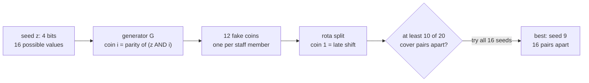
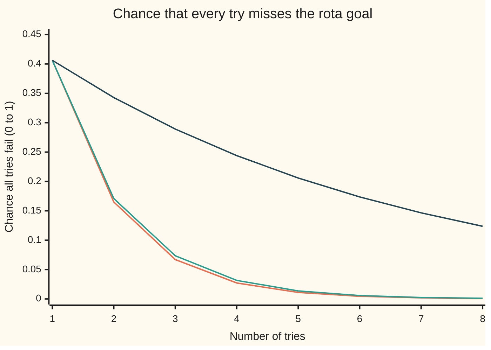

# Pseudorandomness: fake coins that a fast test cannot tell from real ones

[Syllabus](../../../SYLLABUS.md) → [Computability and complexity](../README.md) → [Beyond Worst Case](../README.md#s04) → Pseudorandomness

---

## General Overview

A shop has 12 staff and two shifts, early and late. Twenty **cover pairs** are written on the rota: two people who can stand in for each other. Each pair should work different shifts, so that one of them is always on. The manager's goal is modest: at least 10 of the 20 pairs on different shifts.

Last night the rota program did this the lazy way. It tossed 12 coins, one per person, and put everyone whose coin came up 1 on the late shift. Then it ran a check: count the cover pairs kept apart. Over all 4,096 possible coin strings the average is exactly 10, but 1,664 strings miss the goal.

This morning someone wants to rerun last night's check and get the same split. Storing the seed of a generator does that ([Random numbers from a computer](../../09-Probability%20and%20statistics/11-Simulation/01-pseudo-random-numbers.md) builds one and replays a run from its seed).

Had the coins come from the 4-bit generator below with seed 13, the late shift would be staff 1, 3, 4, 6, 8 and 10, with 15 pairs apart, and those four bits would replay it exactly. This card asks two stronger questions.

1. How short can the seed be while every pair of coins still looks real?
2. If the seed is short enough, why toss coins at all? Try every seed and keep the best.

For 12 coins the answer is 4 bits, and this card's generator meets it. Its 16 seed values stretch into 12 fake coins, and the average count of pairs kept apart comes out at exactly 10, as with real coins. All 16 seeds can be tried. Seed 9 keeps 16 of the 20 pairs apart, with no luck involved.

**A pseudorandom generator stretches a short seed into many fake coins that a chosen class of fast tests cannot tell from real coins; when the seed is short enough to try every value, the randomness can be removed altogether, at the price of one run per seed.**

**What kind of fact this is:** definitions plus theorems. The vote over all seeds and the 4-bit generator on the rota are proved on this card in Why it works. That a hard enough problem would give such a generator for every fast program, and so P = BPP, is a theorem stated with its source; the hardness it needs is unproved as of 2026-11-11, and so is P = BPP.

### The picture: one 4-bit seed becomes a whole rota



---

## The formula

Notation first, in words. A **seed** $`z`$ is a string of $`s`$ bits. A **generator** $`G`$ turns it into $`n`$ bits, written $`G: \{0,1\}^s \to \{0,1\}^n`$. Real coins $`r`$ are $`n`$ bits drawn evenly from all $`2^n`$ strings. A **test** $`T`$ is any program that reads $`n`$ bits and answers 1 or 0. As on [BPP](03-randomised-complexity-and-bpp.md), $`\Pr[\cdot]`$ is a probability, since P is the name of a class.

The generator **fools** a class of tests to within $`\varepsilon`$ when no test in the class answers 1 noticeably more often on fake coins than on real ones:

```math
\bigl|\,\Pr[\,T(G(z)) = 1\,] - \Pr[\,T(r) = 1\,]\,\bigr| \;\le\; \varepsilon \quad \text{for every test } T \text{ in the class}
```

**Read it aloud:** for every allowed test, the chance it says yes on fake coins from a random seed is within epsilon of the chance it says yes on real coins.

Here $`\varepsilon`$ is an allowance, as in wing 14, not the empty string of shelf 01.

Once a generator fools a program's own check, the program needs no coins:

```math
\text{deterministic time} \;=\; 2^{s} \times \bigl(t(n) + \text{time to compute } G\bigr)
```

**Read it aloud:** run the program once on every seed, and the cost is the number of seeds times one run.

The generator on this card is one line. Write the staff number $`i`$ in binary, AND it with the seed bit by bit, and count the 1s:

```math
b_i = \langle z, i \rangle \bmod 2 = \text{parity of } (z \text{ AND } i), \qquad i = 1, 2, \dots, 2^s - 1
```

**Read it aloud:** coin $`i`$ is 1 exactly when the seed and the number $`i`$ share an odd number of 1 bits.

Here $`\langle z, i \rangle`$ is a dot product of bits, taken mod 2, not an encoding like $`\langle M \rangle`$ on shelf 01.

With $`s = 4`$ that makes 15 coins; the rota uses the first 12.

| Symbol | Plain meaning | In our example | Push it up and the answer… |
| --- | --- | --- | --- |
| $`G`$ | the generator: seed in, fake coins out | coin $`i`$ = parity of ($`z`$ AND $`i`$) | — |
| $`z`$, $`s`$ | the seed, and its length in bits | seed 9 = 1001; $`s`$ = 4 | each extra bit doubles the runs |
| $`n`$, $`r`$, $`x`$ | coins the program reads; real coins; the program's input | 12 coins, 4,096 strings; the rota | real coins cost more to store and to try |
| $`T`$, $`\Pr[T = 1]`$ | a test reading the coins; its chance of saying 1 | "are staff 1 and 2 on different shifts?" | a bigger class is harder to fool |
| $`\varepsilon`$ | how far a test's answers may drift on fake coins | 0 for every two-coin test | a looser promise |
| $`b_i`$, $`i`$, $`j`$, $`\langle z, i\rangle \bmod 2`$ | coin number $`i`$ (or $`j`$): count the 1 bits shared by $`z`$ and $`i`$, keep odd or even | $`b_8 = 1`$ for seed 9, since 1000 AND 1001 = 1000 | — |
| $`t(n)`$, $`c`$ | steps of one run; a fixed number in the seed length $`c \log_2 n`$ | one count of 20 pairs | the vote costs $`2^s`$ times more |
| $`\mu`$, $`B`$, $`N`$ | share of coin strings on which a try fails; those strings; all strings | 0.40625; 1,664 of 4,096 | more tries needed |
| $`\lambda`$, $`a`$, $`g`$ | the walk table's largest eigenvalue after the flat 1, in size; a sign pattern; a step pattern | 0.4375 | the walk's tries look more alike |
| $`d`$ | fixed step patterns the walk chooses from | 64, so 6 bits a step | smaller $`\lambda`$, more bits a step |
| $`k`$ | number of tries | 1 to 8 | failure falls about like $`\mu^k`$ |
| $`W`$, $`\Pi`$, $`u`$, $`v`$, $`y`$ | in the proof: the walk table; keep only $`B`$; the even spread; any list of numbers, one per string, with length $`\lVert v \rVert`$ and parts $`v_{\parallel}`$, $`v_{\perp}`$; a coin string | $`W`$ moves $`1/64`$ to each neighbour | — |

### When it holds

- **The test lies inside the class the generator was built for.** The 4-bit generator fools every test that reads two coins. A test reading three coins, staff 1, 2 and 3, sees an even number on lates every time, where real coins give that half the time.
- **The seed is short enough to try every value.** Fooling only helps the vote when $`2^s`$ runs are affordable. Here 16 runs replace 4,096; with 1,000 coins, 1,024 seeds replace $`2^{1000}`$ strings.
- **The program's error plus $`\varepsilon`$ stays below one half.** The vote over seeds is right when most seeds give the right answer. An error of 1/3 on real coins leaves room for any $`\varepsilon`$ below 1/6.
- **For the hardness route, the hardness is real.** Turning a hard problem into a generator for every fast program assumes that problem needs huge circuits. That assumption is unproved as of 2026-11-11.

---

## Why it works

### Step 0: a test can only react to what it reads

A random check does not need random coins. It needs coins that look random **to that check**.

The cover-pair count reads the coins one pair at a time. Each pair asks one question: are these two coins different? If fake coins answer that question exactly as often as real coins do, for every pair, the count cannot tell them apart on average. Only two coins at a time have to look right, not all twelve at once.

A short seed then buys something real coins never can. Its values can all be tried.

### Step 1: a vote over all seeds removes the coins

Take a program in [BPP](03-randomised-complexity-and-bpp.md): it reads coins, runs in polynomial time, and is wrong with chance at most 1/3 on every input. Fix the input $`x`$. The test "does the program answer $`x`$ wrongly with these coins?" is itself a fast program.

Suppose $`G`$ fools that test to within $`\varepsilon`$. Then a random seed gives a wrong answer with chance at most $`1/3 + \varepsilon`$. When $`\varepsilon < 1/6`$, that is below one half. So more than half of all seeds give the right answer, and a majority vote over every seed is right, with no coins at all.

The cost is $`2^s`$ runs. With a seed of $`c \log_2 n`$ bits, for a fixed number $`c`$, that is $`n^c`$ runs: still polynomial. That is the whole route from BPP to P.

The rota needs less than a vote. Its goal is "at least 10 pairs", and the average over seeds is 10, so the best seed must reach 10. Trying all 16 and keeping the best finds it.

### Step 2: the 4-bit generator gets every pair of coins right

Two coins $`b_i`$ and $`b_j`$, with $`i \ne j`$, are a pair of parities of the seed. Their four outcomes 00, 01, 10 and 11 each come from exactly 4 of the 16 seeds. Such coins are **pairwise independent**: any two of them behave exactly like two real coins, though three may not.

The reason is that $`i`$, $`j`$ and $`i \text{ XOR } j`$ are all nonzero.

Four bits is also the least for 12 coins. Write each coin as +1 or −1 and list its value on every seed. When every pair looks real, any two coin lists are at right angles (their products, added over the seeds, come to zero), and so is each coin list with an all-ones list. Lists with one entry per seed have room for only as many such lists as there are seeds, so the seeds must outnumber the coins. Three bits give too few seeds for 12 coins.

<details>
<summary>Detailed proof: every pair of fake coins shows each pattern equally often</summary>

Fix $`i \ne j`$, both nonzero. The map $`z \mapsto (\langle z, i\rangle, \langle z, j\rangle)`$ is linear, with addition taken as XOR. Its image is all of $`\{0,1\}^2`$. If it were not, some nonzero mix of its two rows would vanish: $`i = 0`$, $`j = 0`$ or $`i \text{ XOR } j = 0`$, and none of these holds. A linear map onto $`\{0,1\}^2`$ sends the same number of seeds, $`2^{s-2}`$, to each of the 4 outcomes. With $`s = 4`$, that is 4 seeds each.

</details>

On the rota this settles the average. Each cover pair is split exactly when its two coins show 01 or 10: on 8 of the 16 seeds. So the average over seeds is 20 × 8 / 16 = 10 pairs, exactly as with real coins. The checks find the same by brute force over all 66 coin pairs.

### Step 3: what the short seed costs

A short seed costs three things.

1. **Some tests see through it.** Coin 3 is coin 1 XOR coin 2, since 3 = 1 + 2 in binary. So staff 1, 2 and 3 always put an even number on the late shift: chance 1.0000 on fake coins, 0.5000 on real ones. A test reading three coins tells them apart with gap 0.5000. Any check that depends on triples can fail on these coins. Even the yes-or-no goal test notices, because it reads all 12 coins at once: 8 of the 16 seeds miss the goal, share 0.50000, against 0.40625 for real coins. Only the average count is fooled.
2. **Every seed must be run.** Trying every seed costs $`2^s`$ runs. The pairwise generator needs as many seed bits as $`n`$ has binary digits: 4 bits for 12 coins, 7 bits for 100, 10 bits for 1,000.
3. **Only one goal is guaranteed.** The vote guarantees the average, 10 pairs. Seed 9 happens to reach 16, but no promise covered that.

What it buys: a rerun from a 4-bit seed, a deterministic answer, and 16 runs in place of 4,096.

### Step 4: a hard problem would give a generator for every fast test

The rota's generator fools only two-coin tests. The vote in Step 1 needs a generator that fools **every** fast program, such as a whole BPP algorithm reading its coins in any pattern. A seed of $`c \log_2 n`$ bits would make that vote polynomial.

Nobody knows how to build one outright. The known route trades hardness for randomness:

- Take a function that small circuits cannot compute. A **circuit** here is a wiring of AND, OR and NOT gates with no loops; its **size** is the number of gates.
- Evaluate it on many overlapping chunks of the seed. Each output bit is one evaluation.
- If some fast test could tell these bits from real coins, a hybrid argument (swapping in real coins one bit at a time and watching where the test's answer jumps) turns the test into a small circuit for the hard function. That contradicts the hardness.

This is the Nisan–Wigderson generator. Impagliazzo and Wigderson (1997) proved: if some problem solvable in time $`2^{O(n)}`$ needs circuits of size $`2^{\Omega(n)}`$, then P = BPP. That is a theorem; its hypothesis is unproved as of 2026-11-11.

The street runs both ways. Removing randomness from some specific problems, such as checking whether two formulas are the same polynomial, would itself prove new circuit lower bounds (Kabanets and Impagliazzo, surveyed in Vadhan's monograph in Sources). So unconditional derandomisation is about as hard as the lower bounds on [Circuit lower bounds](07-circuit-complexity-and-lower-bounds.md).

### Step 5: an expander walk saves coins on repeated tries

The 16-seed trick worked because the goal is a sum of pair questions. A check that reads all its coins at once has no such shape. The general fix is repetition: try $`k`$ times, and fail only if every try fails. One try fails on a share $`\mu`$ = 0.40625 of coin strings.

Fresh coins for every try cost 12 bits a try. A walk costs much less.

1. Pick the first coin string at random: 12 bits.
2. For each further try, pick one of $`d`$ = 64 fixed patterns, 6 bits, and flip the coins where that pattern has a 1.

The 64 patterns were drawn once from a seeded generator and then frozen, like a table in a standard. Nothing rides on their luck, because the code computes their quality exactly.

The coin strings and these flips form a graph that is an expander: few links per point, yet no cheap cut ([Expanders](../../14-Applied%20and%20computational/07-Network%20Science%20and%20Spectral%20Graphs/07-expanders-and-mixing.md) defines the spectral gap and shows why such walks sample well). Its quality is one number, $`\lambda`$: the largest eigenvalue of the walk's table of chances, in size, after the 1 that belongs to the flat pattern. A large spectral gap there, with no eigenvalue near −1, means a small $`\lambda`$ here. For these 64 patterns, $`\lambda`$ = 0.4375.

**Theorem.** For a walk with $`k`$ tries, the chance that every try lands among the failing strings is at most $`\mu(\mu + \lambda)^{k-1}`$.

<details>
<summary>Detailed proof: the walk can stay inside a small set only with small chance</summary>

Let $`W`$ be the walk's table: $`W`$ moves chance from each string to its 64 neighbours, $`1/64`$ each. It is symmetric, since flipping a pattern twice undoes it. Let $`B`$ be the failing strings, a share $`\mu`$ of all $`N = 4096`$, and let $`\Pi`$ keep the entries on $`B`$ and zero the rest.

Start with the even spread $`u`$, each entry $`1/N`$. The chance that all $`k`$ tries fail is the total of $`(\Pi W)^{k-1}\Pi u`$.

Write $`\lVert v \rVert`$ for the length of a list: the square root of its sum of squares. Take any $`v`$ that is zero off $`B`$. Split it as $`v = v_{\parallel} + v_{\perp}`$, its flat part plus a part adding to zero. Then:

- $`W v_{\parallel} = v_{\parallel}`$. This flat list has every entry equal to the average of $`v`$, so keeping only $`B`$ leaves length $`\lvert \textstyle\sum v \rvert \sqrt{\mu N}/N`$. By Cauchy–Schwarz, $`\lvert \sum v \rvert \le \sqrt{\mu N}\,\lVert v \rVert`$, because $`v`$ is zero off $`B`$. So the length left is at most $`\mu \lVert v \rVert`$.
- $`\lVert \Pi W v_{\perp} \rVert \le \lVert W v_{\perp} \rVert \le \lambda \lVert v_{\perp} \rVert \le \lambda \lVert v \rVert`$, by the definition of $`\lambda`$.

So $`\lVert \Pi W v \rVert \le (\mu + \lambda)\lVert v \rVert`$. Apply this $`k - 1`$ times. Finish with Cauchy–Schwarz once more: the total of a vector that is zero off $`B`$ is at most $`\sqrt{\mu N}`$ times its length, and $`\lVert \Pi u \rVert = \sqrt{\mu / N}`$. The two square roots multiply to $`\mu`$:

$`\displaystyle \Pr[\text{all } k \text{ tries fail}] \le \sqrt{\mu N}\,(\mu+\lambda)^{k-1}\sqrt{\mu/N} = \mu(\mu+\lambda)^{k-1}.`$

For these flips, $`\lambda`$ is exact. Each pattern of signs $`(-1)^{\langle a, y\rangle}`$, one sign for each coin string $`y`$ and one pattern for each nonzero $`a`$, is an eigenvector of $`W`$, with eigenvalue the average of $`(-1)^{\langle a, g\rangle}`$ over the 64 patterns $`g`$. The code checks the eigenvector equation entry by entry for the worst $`a`$.

</details>

The checks compute the true chance exactly, by pushing chances through the walk, and also simulate 20,000 walks.

| Tries $`k`$ | Bits, fresh coins | Bits, walk | All fail, fresh | All fail, walk | Proved bound |
| ---: | ---: | ---: | ---: | ---: | ---: |
| 1 | 12 | 12 | 0.406250 | 0.406250 | 0.406250 |
| 2 | 24 | 18 | 0.165039 | 0.170914 | 0.342773 |
| 4 | 48 | 30 | 0.027238 | 0.031592 | 0.244025 |
| 8 | 96 | 54 | 0.000742 | 0.001081 | 0.123677 |

The walk fails almost as rarely as fresh coins, on little more than half the bits. The proved bound is loose but true at every row. The saving grows with the coin count. Fresh tries cost $`n`$ bits each. On a constant-degree expander, such as the explicit families surveyed by Hoory, Linial and Wigderson, each extra try costs a fixed number of bits however large $`n`$ is. Flip-pattern walks like this one need more patterns as $`n`$ grows, so they serve here as a small, exactly computable demonstration.



Orange: fresh coins for every try. Green: the expander walk, exact. Dark blue: the proved bound $`\mu(\mu + \lambda)^{k-1}`$. The two lower lines nearly touch.

---

## Worked numbers, by hand

Seed 9 on the rota, then the walk.

| Step | Arithmetic | Value |
| --- | --- | --- |
| seeds to try | 4 bits | 16 |
| seed 9 in binary | 8 + 1 | 1001 |
| coin 8 | 1000 AND 1001 = 1000: one 1, odd | 1, late |
| coin 9 | 1001 AND 1001 = 1001: two 1s, even | 0, early |
| seed 9's late shift | parity for each of staff 1 to 12 | 1, 3, 5, 7, 8, 10, 12 |
| pairs kept apart | ring of 12: 10; six across: 5; two extra: 1 | **16 of 20** |
| average over all seeds | each pair split on 8 of 16 seeds: 20 × 8 / 16 | 10 |
| one try fails, real coins | 1,664 / 4,096 | 0.40625 |
| four tries, bits | fresh 4 × 12; walk 12 + 3 × 6 | 48 and 30 |
| four tries, all fail | fresh 0.40625 to the 4th; walk, exact | 0.027238 and 0.031592 |

Sixteen deterministic runs find a split keeping 16 of the 20 cover pairs on different shifts, and every split the nightly check would ever make can be replayed from a 4-bit seed.

### What breaks if you drop a piece

| Mistake | Comes out at | What went wrong |
| --- | --- | --- |
| A three-coin test against the 4-bit generator | staff 1, 2, 3 even on lates with chance 1.0000, not 0.5000 | the generator fools pairs only; coin 3 = coin 1 XOR coin 2 |
| Running one seed, not all 16 | seed 0: nobody on lates, 0 pairs apart | the guarantee is an average over every seed |
| Reusing one coin string for 4 tries | all fail with chance 0.406250, not 0.027238 | repeats only help when each try moves to new coins |

The code prints all three.

---

## Code, from first principles, and it actually runs

The code imports nothing. It takes four roads. Brute force over all 4,096 real coin strings meets the pair-by-pair count, 20 × 0.5 = 10. The 16 seeds are checked for pairwise independence by counting every coin pair's patterns, then shown to fail a three-coin test. For the walk, the eigenvalue $`\lambda`$ comes from a formula and is checked against the walk table directly; the failure chance is computed exactly and then simulated with SplitMix64, seed 2026, written out in both languages.

### Python

```python
# Pseudorandomness and derandomisation -- the check behind the card.  Standard
# library only.  Twelve staff split into an early and a late shift; 20 cover
# pairs should land on different shifts.  Coin i puts staff member i on lates.
STAFF, MASK = 12, (1 << 64) - 1
PAIRS = [(i, i % 12 + 1) for i in range(1, 13)] + [(i, i + 6) for i in range(1, 7)] + [(1, 4), (7, 10)]

def coin(x, i):                          # coin i of a 12-coin string x, 0 or 1
    return (x >> (i - 1)) & 1

def separated(x):                        # cover pairs split across the two shifts
    return sum(coin(x, a) ^ coin(x, b) for a, b in PAIRS)

def parity(v):                           # 1 if v has an odd number of 1 bits
    p = 0
    while v:
        p ^= v & 1
        v >>= 1
    return p

def fake(seed):                          # the generator: coin i = parity of (seed AND i)
    return sum(parity(seed & i) << (i - 1) for i in range(1, STAFF + 1))

def late(x):
    return [i for i in range(1, STAFF + 1) if coin(x, i)]

class SplitMix64:                        # small seeded generator, written out
    def __init__(self, seed):
        self.s = seed
    def next(self):
        self.s = (self.s + 0x9E3779B97F4A7C15) & MASK
        z = self.s
        z = ((z ^ (z >> 30)) * 0xBF58476D1CE4E5B9) & MASK
        z = ((z ^ (z >> 27)) * 0x94D049BB133111EB) & MASK
        return z ^ (z >> 31)

ALL = 1 << STAFF
scores = [separated(x) for x in range(ALL)]
bad = [s < 10 for s in scores]           # a split fails if it keeps fewer than 10 apart
mu = sum(bad) / ALL
print(f"rota: {STAFF} staff, {len(PAIRS)} cover pairs, goal at least 10 pairs on different shifts")
print(f"real coins: {ALL} strings, average kept apart {sum(scores) / ALL:.4f}, best {max(scores)}")
print(f"real coins: {sum(bad)} of {ALL} strings miss the goal, share {mu:.5f}")
print(f"by pairs: each pair split with chance 0.5, so {len(PAIRS)} x 0.5 = {len(PAIRS) * 0.5:.4f}")
fs = [separated(fake(s)) for s in range(16)]
best = max(range(16), key=lambda s: fs[s])
print(f"fake coins, kept apart for seeds 0 to 15: {fs}")
print(f"fake coins: average {sum(fs) / 16:.4f}; best seed {best}, late shift {late(fake(best))}, kept apart {fs[best]}")
groups = [sum(coin(fake(best), a) ^ coin(fake(best), b) for a, b in g) for g in (PAIRS[:12], PAIRS[12:18], PAIRS[18:])]
print(f"seed {best} by group: ring of 12 {groups[0]}, six across {groups[1]}, two extra {groups[2]}")
counts = {(i, j): [0, 0, 0, 0] for i in range(1, 13) for j in range(i + 1, 13)}
for s in range(16):
    for (i, j), c in counts.items():
        c[2 * coin(fake(s), i) + coin(fake(s), j)] += 1
even = all(c == [4, 4, 4, 4] for c in counts.values())
print(f"every one of {len(counts)} coin pairs shows 00, 01, 10, 11 four times each in 16 seeds: {'yes' if even else 'no'}")
gap2 = max(abs(c[k] / 16 - 0.25) for c in counts.values() for k in range(4))
print(f"largest gap on any two-coin pattern, fake against real: {gap2:.4f}")
pf = sum(parity(fake(s) & 7) == 0 for s in range(16)) / 16
pr = sum(parity(x & 7) == 0 for x in range(ALL)) / ALL
print(f"three-coin test, staff 1, 2, 3 put an even number on lates: fake {pf:.4f}, real {pr:.4f}, gap {pf - pr:.4f}")
miss = sum(f < 10 for f in fs)                 # the yes-or-no goal test reads all 12 coins
print(f"goal test, at least 10 apart: fake coins miss on {miss} of 16 seeds, share {miss / 16:.5f}; real coins {mu:.5f}")
night, stored = fake(13), format(13, "04b")    # last night's seed, kept as 4 bits of text
again = [i for i in range(1, STAFF + 1) if sum(int(stored[3 - k]) * ((i >> k) & 1) for k in range(4)) % 2]
print(f"last night, seed 13: late shift {late(night)}, kept apart {separated(night)}; replayed from stored bits {stored}: {'same' if again == late(night) else 'different'}")
for n in (12, 100, 1000):
    s = (n).bit_length()
    print(f"cost, {n} coins: try every coin string 2^{n}; try every seed {s} bits, {1 << s} runs")
rng = SplitMix64(1)
GENS = [rng.next() >> 52 for _ in range(64)]   # 64 fixed 12-bit steps: 6 random bits per step
lams = [(abs(sum(1 - 2 * parity(a & g) for g in GENS)) / 64, a) for a in range(1, ALL)]
lam, worst = max(lams)
chi = [1 - 2 * parity(worst & x) for x in range(ALL)]
walked = [sum(chi[x ^ g] for g in GENS) / 64 for x in range(ALL)]
sign = 1 if sum(1 - 2 * parity(worst & g) for g in GENS) > 0 else -1
eig = all(abs(walked[x] - sign * lam * chi[x]) < 1e-12 for x in range(ALL))
print(f"walk graph: {ALL} coin strings, 64 steps each, second eigenvalue {lam:.4f} (pattern {worst}); eigenvector check: {'yes' if eig else 'no'}")
dist = [1 / ALL if bad[x] else 0.0 for x in range(ALL)]
walk = [sum(dist)]
for k in range(2, 9):
    new = [0.0] * ALL
    for x in range(ALL):
        if dist[x]:
            for g in GENS:
                new[x ^ g] += dist[x] / 64
    dist = [new[x] if bad[x] else 0.0 for x in range(ALL)]
    walk.append(sum(dist))
print("tries | bits, fresh | bits, walk | all fail, fresh | all fail, walk | bound mu(mu+lam)^(k-1)")
bounds = []
for k in range(1, 9):
    bounds.append(mu * (mu + lam) ** (k - 1))
    print(f"{k} | {12 * k} | {12 + 6 * (k - 1)} | {mu ** k:.6f} | {walk[k - 1]:.6f} | {bounds[-1]:.6f}")
sim, hits, runs = SplitMix64(2026), 0, 20000
for _ in range(runs):
    x = sim.next() >> 52
    fails = bad[x]
    for _ in range(3):
        x ^= GENS[sim.next() >> 58]
        fails = fails and bad[x]
    hits += fails
se = (walk[3] * (1 - walk[3]) / runs) ** 0.5
print(f"simulated walks of 4 tries: {hits} of {runs} all fail, share {hits / runs:.5f}, exact {walk[3]:.5f}, standard error {se:.5f}")
print(f"mistake, seed 0 alone: late shift {late(fake(0))}, kept apart {fs[0]}")
print(f"mistake, one coin string reused 4 times: all fail with chance {mu:.6f}, not {mu ** 4:.6f}")
print("figure, all fail, fresh: " + ", ".join(f"{mu ** k:.4f}" for k in range(1, 9)))
print("figure, all fail, walk: " + ", ".join(f"{w:.4f}" for w in walk))
print("figure, bound: " + ", ".join(f"{b:.4f}" for b in bounds))
assert abs(sum(scores) / ALL - len(PAIRS) * 0.5) < 1e-12       # brute force against linearity
assert sum(fs) == 16 * 10 and even and gap2 == 0               # pairwise independence, two roads
assert pf == 1.0 and pr == 0.5                                 # a three-coin test sees through it
assert again == late(night)                                    # replay from the stored bits, a second route
assert eig and lam < 0.5                                       # characters are eigenvectors
assert all(walk[k] <= bounds[k] + 1e-12 for k in range(8))     # exact walk under the proved bound
assert abs(hits / runs - walk[3]) < 4 * se                     # simulation against exact
print("ALL CHECKS PASS")
```

**Ran 2026-11-19 on macOS, Python 3.14.10, standard library only. All checks passed. Output, pasted from the run:**

```
rota: 12 staff, 20 cover pairs, goal at least 10 pairs on different shifts
real coins: 4096 strings, average kept apart 10.0000, best 18
real coins: 1664 of 4096 strings miss the goal, share 0.40625
by pairs: each pair split with chance 0.5, so 20 x 0.5 = 10.0000
fake coins, kept apart for seeds 0 to 15: [0, 14, 12, 14, 9, 11, 9, 11, 8, 16, 8, 8, 7, 15, 7, 11]
fake coins: average 10.0000; best seed 9, late shift [1, 3, 5, 7, 8, 10, 12], kept apart 16
seed 9 by group: ring of 12 10, six across 5, two extra 1
every one of 66 coin pairs shows 00, 01, 10, 11 four times each in 16 seeds: yes
largest gap on any two-coin pattern, fake against real: 0.0000
three-coin test, staff 1, 2, 3 put an even number on lates: fake 1.0000, real 0.5000, gap 0.5000
goal test, at least 10 apart: fake coins miss on 8 of 16 seeds, share 0.50000; real coins 0.40625
last night, seed 13: late shift [1, 3, 4, 6, 8, 10], kept apart 15; replayed from stored bits 1101: same
cost, 12 coins: try every coin string 2^12; try every seed 4 bits, 16 runs
cost, 100 coins: try every coin string 2^100; try every seed 7 bits, 128 runs
cost, 1000 coins: try every coin string 2^1000; try every seed 10 bits, 1024 runs
walk graph: 4096 coin strings, 64 steps each, second eigenvalue 0.4375 (pattern 3185); eigenvector check: yes
tries | bits, fresh | bits, walk | all fail, fresh | all fail, walk | bound mu(mu+lam)^(k-1)
1 | 12 | 12 | 0.406250 | 0.406250 | 0.406250
2 | 24 | 18 | 0.165039 | 0.170914 | 0.342773
3 | 36 | 24 | 0.067047 | 0.073520 | 0.289215
4 | 48 | 30 | 0.027238 | 0.031592 | 0.244025
5 | 60 | 36 | 0.011065 | 0.013589 | 0.205896
6 | 72 | 42 | 0.004495 | 0.005844 | 0.173725
7 | 84 | 48 | 0.001826 | 0.002514 | 0.146580
8 | 96 | 54 | 0.000742 | 0.001081 | 0.123677
simulated walks of 4 tries: 586 of 20000 all fail, share 0.02930, exact 0.03159, standard error 0.00124
mistake, seed 0 alone: late shift [], kept apart 0
mistake, one coin string reused 4 times: all fail with chance 0.406250, not 0.027238
figure, all fail, fresh: 0.4062, 0.1650, 0.0670, 0.0272, 0.0111, 0.0045, 0.0018, 0.0007
figure, all fail, walk: 0.4062, 0.1709, 0.0735, 0.0316, 0.0136, 0.0058, 0.0025, 0.0011
figure, bound: 0.4062, 0.3428, 0.2892, 0.2440, 0.2059, 0.1737, 0.1466, 0.1237
ALL CHECKS PASS
```

### Rust

Same numbers, same labels, built with `rustc --edition 2021 -O`.

```rust
// Pseudorandomness and derandomisation -- the same check as the Python, in
// Rust.  No crates.  Twelve staff split into an early and a late shift; 20
// cover pairs should land on different shifts.  Coin i puts staff member i on lates.
const STAFF: usize = 12;
const ALL: usize = 1 << STAFF;

fn coin(x: usize, i: usize) -> usize { (x >> (i - 1)) & 1 }   // coin i of a 12-coin string

fn separated(x: usize, pairs: &[(usize, usize)]) -> usize {   // cover pairs split across shifts
    pairs.iter().map(|&(a, b)| coin(x, a) ^ coin(x, b)).sum()
}

fn parity(mut v: usize) -> usize {                             // 1 if v has an odd number of 1 bits
    let mut p = 0;
    while v != 0 { p ^= v & 1; v >>= 1; }
    p
}

fn fake(seed: usize) -> usize {                                // the generator: coin i = parity of (seed AND i)
    (1..=STAFF).map(|i| parity(seed & i) << (i - 1)).sum()
}

fn late(x: usize) -> Vec<usize> { (1..=STAFF).filter(|&i| coin(x, i) == 1).collect() }

struct SplitMix64 { s: u64 }                                   // small seeded generator, written out
impl SplitMix64 {
    fn next(&mut self) -> u64 {
        self.s = self.s.wrapping_add(0x9E3779B97F4A7C15);
        let mut z = self.s;
        z = (z ^ (z >> 30)).wrapping_mul(0xBF58476D1CE4E5B9);
        z = (z ^ (z >> 27)).wrapping_mul(0x94D049BB133111EB);
        z ^ (z >> 31)
    }
}

fn yn(c: bool) -> &'static str { if c { "yes" } else { "no" } }

fn join(v: &[f64]) -> String { v.iter().map(|x| format!("{:.4}", x)).collect::<Vec<_>>().join(", ") }

fn main() {
    let mut pairs: Vec<(usize, usize)> = (1..=12).map(|i| (i, i % 12 + 1)).collect();
    pairs.extend((1..=6).map(|i| (i, i + 6)));
    pairs.extend([(1, 4), (7, 10)]);
    let np = pairs.len();
    let scores: Vec<usize> = (0..ALL).map(|x| separated(x, &pairs)).collect();
    let bad: Vec<bool> = scores.iter().map(|&s| s < 10).collect();   // fewer than 10 kept apart
    let nbad = bad.iter().filter(|&&b| b).count();
    let mu = nbad as f64 / ALL as f64;
    let total: usize = scores.iter().sum();
    println!("rota: {} staff, {} cover pairs, goal at least 10 pairs on different shifts", STAFF, np);
    println!("real coins: {} strings, average kept apart {:.4}, best {}", ALL, total as f64 / ALL as f64, scores.iter().max().unwrap());
    println!("real coins: {} of {} strings miss the goal, share {:.5}", nbad, ALL, mu);
    println!("by pairs: each pair split with chance 0.5, so {} x 0.5 = {:.4}", np, np as f64 * 0.5);
    let fs: Vec<usize> = (0..16).map(|s| separated(fake(s), &pairs)).collect();
    let mut best = 0;
    for s in 0..16 { if fs[s] > fs[best] { best = s } }
    let groups: Vec<usize> = [&pairs[..12], &pairs[12..18], &pairs[18..]].iter().map(|g| separated(fake(best), g)).collect();
    let fsum: usize = fs.iter().sum();
    println!("fake coins, kept apart for seeds 0 to 15: {:?}", fs);
    println!("fake coins: average {:.4}; best seed {}, late shift {:?}, kept apart {}", fsum as f64 / 16.0, best, late(fake(best)), fs[best]);
    println!("seed {} by group: ring of 12 {}, six across {}, two extra {}", best, groups[0], groups[1], groups[2]);
    let mut counts: Vec<[usize; 4]> = Vec::new();
    for i in 1..=12 { for j in (i + 1)..=12 {
        let mut c = [0; 4];
        for s in 0..16 { c[2 * coin(fake(s), i) + coin(fake(s), j)] += 1 }
        counts.push(c);
    } }
    let even = counts.iter().all(|c| *c == [4, 4, 4, 4]);
    println!("every one of {} coin pairs shows 00, 01, 10, 11 four times each in 16 seeds: {}", counts.len(), yn(even));
    let gap2 = counts.iter().flat_map(|c| c.iter().map(|&k| (k as f64 / 16.0 - 0.25).abs())).fold(0.0, f64::max);
    println!("largest gap on any two-coin pattern, fake against real: {:.4}", gap2);
    let pf = (0..16).filter(|&s| parity(fake(s) & 7) == 0).count() as f64 / 16.0;
    let pr = (0..ALL).filter(|&x| parity(x & 7) == 0).count() as f64 / ALL as f64;
    println!("three-coin test, staff 1, 2, 3 put an even number on lates: fake {:.4}, real {:.4}, gap {:.4}", pf, pr, pf - pr);
    let miss = fs.iter().filter(|&&f| f < 10).count();          // the yes-or-no goal test reads all 12 coins
    println!("goal test, at least 10 apart: fake coins miss on {} of 16 seeds, share {:.5}; real coins {:.5}", miss, miss as f64 / 16.0, mu);
    let (night, stored) = (fake(13), format!("{:04b}", 13));   // last night's seed, kept as 4 bits of text
    let again: Vec<usize> = (1..=STAFF).filter(|&i| (0..4).map(|k| (stored.as_bytes()[3 - k] - b'0') as usize * ((i >> k) & 1)).sum::<usize>() % 2 == 1).collect();
    println!("last night, seed 13: late shift {:?}, kept apart {}; replayed from stored bits {}: {}", late(night), separated(night, &pairs), stored, if again == late(night) { "same" } else { "different" });
    for n in [12usize, 100, 1000] {
        let s = (usize::BITS - n.leading_zeros()) as usize;
        println!("cost, {} coins: try every coin string 2^{}; try every seed {} bits, {} runs", n, n, s, 1usize << s);
    }
    let mut rng = SplitMix64 { s: 1 };
    let gens: Vec<usize> = (0..64).map(|_| (rng.next() >> 52) as usize).collect();   // 6 random bits per step
    let bias = |a: usize| gens.iter().map(|&g| 1 - 2 * parity(a & g) as i64).sum::<i64>();
    let (mut lam, mut worst) = (0.0f64, 0usize);
    for a in 1..ALL {
        let l = (bias(a).abs() as f64) / 64.0;
        if l >= lam { lam = l; worst = a; }
    }
    let chi: Vec<f64> = (0..ALL).map(|x| 1.0 - 2.0 * parity(worst & x) as f64).collect();
    let sign = if bias(worst) > 0 { 1.0 } else { -1.0 };
    let eig = (0..ALL).all(|x| {
        let w: f64 = gens.iter().map(|&g| chi[x ^ g]).sum::<f64>() / 64.0;
        (w - sign * lam * chi[x]).abs() < 1e-12
    });
    println!("walk graph: {} coin strings, 64 steps each, second eigenvalue {:.4} (pattern {}); eigenvector check: {}", ALL, lam, worst, yn(eig));
    let mut dist: Vec<f64> = (0..ALL).map(|x| if bad[x] { 1.0 / ALL as f64 } else { 0.0 }).collect();
    let mut walk = vec![dist.iter().sum::<f64>()];
    for _ in 2..=8 {
        let mut new = vec![0.0f64; ALL];
        for x in 0..ALL {
            if dist[x] != 0.0 { for &g in &gens { new[x ^ g] += dist[x] / 64.0 } }
        }
        dist = (0..ALL).map(|x| if bad[x] { new[x] } else { 0.0 }).collect();
        walk.push(dist.iter().sum::<f64>());
    }
    println!("tries | bits, fresh | bits, walk | all fail, fresh | all fail, walk | bound mu(mu+lam)^(k-1)");
    let mut bounds: Vec<f64> = Vec::new();
    for k in 1..=8 {
        bounds.push(mu * (mu + lam).powi(k as i32 - 1));
        println!("{} | {} | {} | {:.6} | {:.6} | {:.6}", k, 12 * k, 12 + 6 * (k - 1), mu.powi(k as i32), walk[k - 1], bounds[k - 1]);
    }
    let (mut sim, mut hits, runs) = (SplitMix64 { s: 2026 }, 0usize, 20000usize);
    for _ in 0..runs {
        let mut x = (sim.next() >> 52) as usize;
        let mut fails = bad[x];
        for _ in 0..3 { x ^= gens[(sim.next() >> 58) as usize]; fails = fails && bad[x]; }
        if fails { hits += 1 }
    }
    let share = hits as f64 / runs as f64;
    let se = (walk[3] * (1.0 - walk[3]) / runs as f64).sqrt();
    println!("simulated walks of 4 tries: {} of {} all fail, share {:.5}, exact {:.5}, standard error {:.5}", hits, runs, share, walk[3], se);
    println!("mistake, seed 0 alone: late shift {:?}, kept apart {}", late(fake(0)), fs[0]);
    println!("mistake, one coin string reused 4 times: all fail with chance {:.6}, not {:.6}", mu, mu.powi(4));
    let fresh: Vec<f64> = (1..=8).map(|k| mu.powi(k)).collect();
    println!("figure, all fail, fresh: {}", join(&fresh));
    println!("figure, all fail, walk: {}", join(&walk));
    println!("figure, bound: {}", join(&bounds));
    assert!((total as f64 / ALL as f64 - np as f64 * 0.5).abs() < 1e-12);   // brute force against linearity
    assert!(fsum == 16 * 10 && even && gap2 == 0.0);                       // pairwise independence, two roads
    assert!(pf == 1.0 && pr == 0.5);                                       // a three-coin test sees through it
    assert!(again == late(night));                                         // replay from the stored bits, a second route
    assert!(eig && lam < 0.5);                                             // characters are eigenvectors
    assert!((0..8).all(|k| walk[k] <= bounds[k] + 1e-12));                 // exact walk under the proved bound
    assert!((share - walk[3]).abs() < 4.0 * se);                           // simulation against exact
    println!("ALL CHECKS PASS");
}
```

**Ran 2026-11-19 on macOS, rustc 1.98.1, no crates. All checks passed. Output, pasted from the run:**

```
rota: 12 staff, 20 cover pairs, goal at least 10 pairs on different shifts
real coins: 4096 strings, average kept apart 10.0000, best 18
real coins: 1664 of 4096 strings miss the goal, share 0.40625
by pairs: each pair split with chance 0.5, so 20 x 0.5 = 10.0000
fake coins, kept apart for seeds 0 to 15: [0, 14, 12, 14, 9, 11, 9, 11, 8, 16, 8, 8, 7, 15, 7, 11]
fake coins: average 10.0000; best seed 9, late shift [1, 3, 5, 7, 8, 10, 12], kept apart 16
seed 9 by group: ring of 12 10, six across 5, two extra 1
every one of 66 coin pairs shows 00, 01, 10, 11 four times each in 16 seeds: yes
largest gap on any two-coin pattern, fake against real: 0.0000
three-coin test, staff 1, 2, 3 put an even number on lates: fake 1.0000, real 0.5000, gap 0.5000
goal test, at least 10 apart: fake coins miss on 8 of 16 seeds, share 0.50000; real coins 0.40625
last night, seed 13: late shift [1, 3, 4, 6, 8, 10], kept apart 15; replayed from stored bits 1101: same
cost, 12 coins: try every coin string 2^12; try every seed 4 bits, 16 runs
cost, 100 coins: try every coin string 2^100; try every seed 7 bits, 128 runs
cost, 1000 coins: try every coin string 2^1000; try every seed 10 bits, 1024 runs
walk graph: 4096 coin strings, 64 steps each, second eigenvalue 0.4375 (pattern 3185); eigenvector check: yes
tries | bits, fresh | bits, walk | all fail, fresh | all fail, walk | bound mu(mu+lam)^(k-1)
1 | 12 | 12 | 0.406250 | 0.406250 | 0.406250
2 | 24 | 18 | 0.165039 | 0.170914 | 0.342773
3 | 36 | 24 | 0.067047 | 0.073520 | 0.289215
4 | 48 | 30 | 0.027238 | 0.031592 | 0.244025
5 | 60 | 36 | 0.011065 | 0.013589 | 0.205896
6 | 72 | 42 | 0.004495 | 0.005844 | 0.173725
7 | 84 | 48 | 0.001826 | 0.002514 | 0.146580
8 | 96 | 54 | 0.000742 | 0.001081 | 0.123677
simulated walks of 4 tries: 586 of 20000 all fail, share 0.02930, exact 0.03159, standard error 0.00124
mistake, seed 0 alone: late shift [], kept apart 0
mistake, one coin string reused 4 times: all fail with chance 0.406250, not 0.027238
figure, all fail, fresh: 0.4062, 0.1650, 0.0670, 0.0272, 0.0111, 0.0045, 0.0018, 0.0007
figure, all fail, walk: 0.4062, 0.1709, 0.0735, 0.0316, 0.0136, 0.0058, 0.0025, 0.0011
figure, bound: 0.4062, 0.3428, 0.2892, 0.2440, 0.2059, 0.1737, 0.1466, 0.1237
ALL CHECKS PASS
```

The two outputs match line for line.

### Lean

Lean proves the card's three theorems for every seed length and coin count, and checks the rota's numbers.

- Suppose a program's error on real coins, plus $`\varepsilon`$, is below one half, and $`G`$ fools its wrong-answer test to within $`\varepsilon`$. Then more than half of all seeds give the right answer, and the vote over every seed is right.
- Take a seed of $`s`$ bits and two different nonzero coin numbers $`i`$ and $`j`$. Then each of 00, 01, 10 and 11 comes from exactly $`2^{s-2}`$ seeds.
- Take any flip patterns and any $`\lambda \ge 0`$ with $`\lVert W v \rVert \le \lambda \lVert v \rVert`$ for every list $`v`$ adding to zero. Then all $`k`$ tries land in $`B`$ with chance at most $`\mu(\mu + \lambda)^{k-1}`$.
- Seeds 0 to 15 keep the printed counts of pairs apart, averaging 10, and 8 seeds miss the goal.
- Seed 9 puts staff 1, 3, 5, 7, 8, 10 and 12 on lates, keeping 16 pairs apart; seed 13 keeps 15.
- All 66 coin pairs show each pattern on 4 of 16 seeds, and staff 1, 2 and 3 are always even on lates.
- Real coins give 4,096 strings, average 10, best 18, and 1,664 strings missing the goal.
- The seed lengths 4, 7 and 10 bits, and the walk's bit counts 48 against 30 and 96 against 54, are right.

The eigenvalue $`\lambda`$ = 0.4375, the walk's exact failure chances and the 20,000 simulated walks are left to the Python and Rust checks.

```lean
-- Pseudorandomness: a majority vote over every seed of a generator that fools the program's error test is right, the parity generator gives every pair of coins each pattern on exactly a quarter of the seeds, an expander walk fails all its tries with chance at most μ(μ + λ)^(k-1), and the card's 12-staff rota numbers come out as printed.
import Mathlib.Data.Matrix.Mul
import Mathlib.Basic.Real.Basic
import Mathlib.Data.ZMod.Basic
import Mathlib.Data.Fintype.Pi
import Mathlib.Data.Fintype.Prod
import Mathlib.Algebra.Order.Field.Basic
import Mathlib.Algebra.BigOperators.Ring.Finset
import Mathlib.Tactic.NormNum
import Mathlib.Algebra.Order.BigOperators.Ring.Finset
import Mathlib.Algebra.BigOperators.Fin
import Mathlib.Tactic.Linarith
import Mathlib.Tactic.Positivity
import Mathlib.Tactic.FieldSimp
import Mathlib.Tactic.Ring

namespace DerandomisationAndPseudorandomness

open Finset

/-! ## The vote over all seeds -/

/-- The majority vote over every seed: answer `true` when more than half of all seeds make the
program `A` answer `true` on the fake coins `G z`. -/
def majorityVote {S R : Type*} [Fintype S] (G : S → R) (A : R → Bool) : Bool :=
  decide (Fintype.card S < 2 * (univ.filter fun z : S => A (G z) = true).card)

/-- **A vote over all seeds removes the coins.** A program `A` reads coins `r` (all of a finite
set `R`, drawn evenly) and should answer `right` on its fixed input; it is wrong on real coins with
chance at most `δ`. A generator `G` from seeds `S` fools the program's own test "is the answer
wrong with these coins?" to within `ε`: the chance of a wrong answer on `G z`, for an even random
seed `z`, is within `ε` of the chance on real coins. If `δ + ε` is below one half, then more
than half of all seeds give the right answer, and the majority vote over every seed is right,
with no coins at all. -/
theorem majority_vote_over_seeds_is_right {S R : Type*} [Fintype S] [Fintype R] [Nonempty S]
    [Nonempty R] (G : S → R) (A : R → Bool) (right : Bool) (δ ε : ℝ)
    (herr : ((univ.filter fun r : R => A r ≠ right).card : ℝ) / Fintype.card R ≤ δ)
    (hfool : |((univ.filter fun z : S => A (G z) ≠ right).card : ℝ) / Fintype.card S
        - ((univ.filter fun r : R => A r ≠ right).card : ℝ) / Fintype.card R| ≤ ε)
    (hhalf : δ + ε < 1 / 2) :
    Fintype.card S < 2 * (univ.filter fun z : S => A (G z) = right).card ∧
      majorityVote G A = right := by
  classical
  have hS : (0:ℝ) < Fintype.card S := by exact_mod_cast Fintype.card_pos
  have hsum : (univ.filter fun z : S => A (G z) = right).card
      + (univ.filter fun z : S => A (G z) ≠ right).card = Fintype.card S := by
    rw [← Finset.card_univ]; exact Finset.card_filter_add_card_filter_not _
  have h1 : ((univ.filter fun z : S => A (G z) ≠ right).card : ℝ) / Fintype.card S < 1 / 2 := by
    have := (abs_le.mp hfool).2
    linarith
  have h2 : 2 * (univ.filter fun z : S => A (G z) ≠ right).card < Fintype.card S := by
    rw [div_lt_iff₀ hS] at h1
    exact_mod_cast (by linarith : (2 * ((univ.filter fun z : S => A (G z) ≠ right).card : ℝ))
      < Fintype.card S)
  refine ⟨by omega, ?_⟩
  unfold majorityVote
  cases right
  · have : (univ.filter fun z : S => A (G z) = true)
        = (univ.filter fun z : S => A (G z) ≠ false) := by
      ext z; simp
    rw [this, decide_eq_false_iff_not, not_lt]; omega
  · rw [decide_eq_true_eq]; omega

/-! ## The parity generator: every pair of coins looks real -/

/-- For two different coin numbers with `j ≠ 0`, some seed gives coin `i` the value 0 and
coin `j` the value 1. -/
lemma exists_dot_zero_one {s : ℕ} (i j : Fin s → ZMod 2) (hj : j ≠ 0) (hij : i ≠ j) :
    ∃ u : Fin s → ZMod 2, u ⬝ᵥ i = 0 ∧ u ⬝ᵥ j = 1 := by
  have h2 : ∀ x : ZMod 2, x = 0 ∨ x = 1 := by decide
  obtain ⟨q, hq⟩ : ∃ q, j q ≠ 0 := by
    by_contra h; push Not at h; exact hj (funext h)
  have hq1 : j q = 1 := (h2 _).resolve_left hq
  rcases h2 (i q) with hiq | hiq
  · exact ⟨Pi.single q 1, by simp [single_dotProduct, hiq], by simp [single_dotProduct, hq1]⟩
  · obtain ⟨k, hk⟩ : ∃ k, i k ≠ j k := by
      by_contra h; push Not at h; exact hij (funext h)
    rcases h2 (i k) with hik | hik <;> rcases h2 (j k) with hjk | hjk
    · exact absurd (hik.trans hjk.symm) hk
    · exact ⟨Pi.single k 1, by simp [single_dotProduct, hik], by simp [single_dotProduct, hjk]⟩
    · refine ⟨Pi.single q 1 + Pi.single k 1, ?_, ?_⟩
      · rw [add_dotProduct, single_dotProduct, single_dotProduct, hiq, hik]; decide
      · rw [add_dotProduct, single_dotProduct, single_dotProduct, hq1, hjk]; decide
    · exact absurd (hik.trans hjk.symm) hk

#print axioms exists_dot_zero_one

/-- **The parity generator is pairwise independent.** A seed `z` is `s` bits; coin number `i` is
written in binary as `s` bits (bit `k` of `i` is entry `k`), and the coin is the parity of
`z AND i`, which is the dot product `z ⬝ᵥ i` taken mod 2. For any two different nonzero coin
numbers `i ≠ j`, each of the four outcomes `(a, b)` = 00, 01, 10, 11 of the two coins comes from
exactly `2^(s-2)` of the `2^s` seeds. -/
theorem parity_generator_pairwise_independent (s : ℕ) (i j : Fin s → ZMod 2) (hi : i ≠ 0)
    (hj : j ≠ 0) (hij : i ≠ j) (a b : ZMod 2) :
    (univ.filter fun z : Fin s → ZMod 2 => z ⬝ᵥ i = a ∧ z ⬝ᵥ j = b).card = 2 ^ (s - 2) := by
  classical
  obtain ⟨u2, hu2i, hu2j⟩ := exists_dot_zero_one i j hj hij
  obtain ⟨u1, hu1j, hu1i⟩ := exists_dot_zero_one j i hi (Ne.symm hij)
  have hfib : ∀ a b : ZMod 2,
      (univ.filter fun z : Fin s → ZMod 2 => z ⬝ᵥ i = a ∧ z ⬝ᵥ j = b).card
        = (univ.filter fun z : Fin s → ZMod 2 => z ⬝ᵥ i = 0 ∧ z ⬝ᵥ j = 0).card := by
    intro a b
    have hui : (a • u1 + b • u2) ⬝ᵥ i = a := by
      simp [add_dotProduct, smul_dotProduct, hu1i, hu2i]
    have huj : (a • u1 + b • u2) ⬝ᵥ j = b := by
      simp [add_dotProduct, smul_dotProduct, hu1j, hu2j]
    symm
    apply Finset.card_bij (fun z _ => z + (a • u1 + b • u2))
    · intro z hz
      simp only [mem_filter, mem_univ, true_and] at hz ⊢
      rw [add_dotProduct z _ i, add_dotProduct z _ j, hz.1, hz.2, hui, huj]; simp
    · intro z1 _ z2 _ h; exact add_right_cancel h
    · intro z hz
      refine ⟨z - (a • u1 + b • u2), ?_, by simp⟩
      simp only [mem_filter, mem_univ, true_and] at hz ⊢
      rw [sub_dotProduct z _ i, sub_dotProduct z _ j, hz.1, hz.2, hui, huj]; simp
  have htot : Fintype.card (Fin s → ZMod 2)
      = 4 * (univ.filter fun z : Fin s → ZMod 2 => z ⬝ᵥ i = 0 ∧ z ⬝ᵥ j = 0).card := by
    rw [← Finset.card_univ, Finset.card_eq_sum_card_fiberwise
      (f := fun z => (z ⬝ᵥ i, z ⬝ᵥ j)) (t := univ) (fun _ _ => mem_univ _)]
    have hc : ∀ ab ∈ (univ : Finset (ZMod 2 × ZMod 2)),
        (univ.filter fun z : Fin s → ZMod 2 => (z ⬝ᵥ i, z ⬝ᵥ j) = ab).card
          = (univ.filter fun z : Fin s → ZMod 2 => z ⬝ᵥ i = 0 ∧ z ⬝ᵥ j = 0).card := by
      intro ab _
      rw [← hfib ab.1 ab.2]
      congr 1
    rw [Finset.sum_congr rfl hc, sum_const, card_univ]
    simp [Fintype.card_prod, ZMod.card]
  have hcard : Fintype.card (Fin s → ZMod 2) = 2 ^ s := by simp
  rw [hfib a b]
  rw [hcard] at htot
  generalize (univ.filter fun z : Fin s → ZMod 2 => z ⬝ᵥ i = 0 ∧ z ⬝ᵥ j = 0).card = c at htot ⊢
  rcases s with _ | _ | s
  · rw [pow_zero] at htot; omega
  · rw [pow_one] at htot; omega
  · rw [show s + 2 - 2 = s by omega]
    rw [pow_add] at htot
    omega

/-! ## The expander walk: repeated tries on few bits -/

/-- One step of the walk's table `W` on a list `v` with one number per coin string: the new
entry at `y` is the average of `v` over the `d` neighbours `y + g c`, each step pattern `g c`
flipping the coins where it has a 1. -/
noncomputable def walkStep {n d : ℕ} (g : Fin d → (Fin n → ZMod 2))
    (v : (Fin n → ZMod 2) → ℝ) : (Fin n → ZMod 2) → ℝ :=
  fun y => (∑ c, v (y + g c)) / d

/-- Where the walk stands at try number `t + 1`: the first coin string `y` with the step patterns
of the first `t` steps flipped in. -/
def walkPosition {n d m : ℕ} (g : Fin d → (Fin n → ZMod 2)) (y : Fin n → ZMod 2)
    (steps : Fin m → Fin d) (t : ℕ) : Fin n → ZMod 2 :=
  y + ∑ l ∈ univ.filter (fun l : Fin m => (l : ℕ) < t), g (steps l)

/-- The share of `r`-step walks from `y` whose `r + 1` spots all lie in `B`. -/
noncomputable def stayTable {n d : ℕ} (g : Fin d → (Fin n → ZMod 2))
    (B : Finset (Fin n → ZMod 2)) : ℕ → (Fin n → ZMod 2) → ℝ
  | 0 => fun y => if y ∈ B then 1 else 0
  | r + 1 => fun y => if y ∈ B then walkStep g (stayTable g B r) y else 0

lemma walkPosition_zero {n d m : ℕ} (g : Fin d → (Fin n → ZMod 2)) (y : Fin n → ZMod 2)
    (steps : Fin m → Fin d) : walkPosition g y steps 0 = y := by
  simp [walkPosition]

#print axioms walkPosition_zero

lemma walkPosition_cons {n d m : ℕ} (g : Fin d → (Fin n → ZMod 2)) (y : Fin n → ZMod 2)
    (c : Fin d) (rest : Fin m → Fin d) (t : ℕ) :
    walkPosition g y (Fin.cons c rest : Fin (m + 1) → Fin d) (t + 1)
      = walkPosition g (y + g c) rest t := by
  simp only [walkPosition, Finset.sum_filter, Fin.sum_univ_succ, Fin.cons_zero, Fin.cons_succ,
    Fin.val_zero, Fin.val_succ]
  simp [add_assoc]

#print axioms walkPosition_cons

lemma stayTable_count {n d : ℕ} (hd : 0 < d) (g : Fin d → (Fin n → ZMod 2))
    (B : Finset (Fin n → ZMod 2)) : ∀ (r : ℕ) (y : Fin n → ZMod 2),
    ((univ.filter fun steps : Fin r → Fin d =>
        ∀ t : Fin (r + 1), walkPosition g y steps t ∈ B).card : ℝ)
      = (d : ℝ) ^ r * stayTable g B r y
  | 0, y => by
    rw [natCast_card_filter]
    simp [walkPosition_zero, stayTable]
  | r + 1, y => by
    have key : ∀ (c : Fin d) (rest : Fin r → Fin d),
        (∀ t : Fin (r + 2), walkPosition g y (Fin.cons c rest : Fin (r + 1) → Fin d) t ∈ B)
          ↔ y ∈ B ∧ ∀ t : Fin (r + 1), walkPosition g (y + g c) rest t ∈ B := by
      intro c rest
      rw [Fin.forall_fin_succ]
      simp only [Fin.val_zero, walkPosition_zero, Fin.val_succ, walkPosition_cons]
    rw [natCast_card_filter, ← (Fin.consEquiv (fun _ : Fin (r + 1) => Fin d)).sum_comp,
      Fintype.sum_prod_type]
    simp only [Fin.consEquiv_apply, key]
    by_cases hy : y ∈ B
    · simp only [hy, true_and]
      have : ∀ c : Fin d, (∑ rest : Fin r → Fin d,
          if ∀ t : Fin (r + 1), walkPosition g (y + g c) rest t ∈ B then (1 : ℝ) else 0)
            = (d : ℝ) ^ r * stayTable g B r (y + g c) := by
        intro c
        rw [← stayTable_count hd g B r (y + g c), natCast_card_filter]
      rw [Finset.sum_congr rfl (fun c _ => this c)]
      have hd' : (d : ℝ) ≠ 0 := by exact_mod_cast hd.ne'
      simp only [stayTable, hy, ite_true, walkStep]
      rw [← Finset.mul_sum]
      field_simp
      ring
    · simp [hy, stayTable]

#print axioms stayTable_count

lemma stayTable_supp {n d : ℕ} (g : Fin d → (Fin n → ZMod 2)) (B : Finset (Fin n → ZMod 2)) :
    ∀ (r : ℕ) (y : Fin n → ZMod 2), y ∉ B → stayTable g B r y = 0
  | 0, y, h => by simp [stayTable, h]
  | r + 1, y, h => by simp [stayTable, h]

#print axioms stayTable_supp

lemma energy_step {n d : ℕ} (hd : 0 < d) (g : Fin d → (Fin n → ZMod 2))
    (B : Finset (Fin n → ZMod 2)) (lam : ℝ) (hlam0 : 0 ≤ lam)
    (hlam : ∀ v : (Fin n → ZMod 2) → ℝ, ∑ y, v y = 0 →
      ∑ y, walkStep g v y ^ 2 ≤ lam ^ 2 * ∑ y, v y ^ 2)
    (f : (Fin n → ZMod 2) → ℝ) (hf : ∀ y, y ∉ B → f y = 0) :
    ∑ y, (if y ∈ B then walkStep g f y else 0) ^ 2
      ≤ ((B.card : ℝ) / 2 ^ n + lam) ^ 2 * ∑ y, f y ^ 2 := by
  classical
  have hN : ((Fintype.card (Fin n → ZMod 2) : ℕ) : ℝ) = 2 ^ n := by simp
  have hNpos : (0 : ℝ) < 2 ^ n := by positivity
  have hd' : (d : ℝ) ≠ 0 := by exact_mod_cast hd.ne'
  obtain ⟨Q, hQ⟩ : ∃ Q, Q = ∑ y, f y ^ 2 := ⟨_, rfl⟩
  obtain ⟨α, hα⟩ : ∃ α : ℝ, α = (∑ y, f y) / 2 ^ n := ⟨_, rfl⟩
  obtain ⟨μ, hμ⟩ : ∃ μ : ℝ, μ = (B.card : ℝ) / 2 ^ n := ⟨_, rfl⟩
  obtain ⟨w, hw⟩ : ∃ w : (Fin n → ZMod 2) → ℝ, w = fun y => f y - α := ⟨_, rfl⟩
  rw [← hμ, ← hQ]
  have hsumf : ∑ y, f y = 2 ^ n * α := by rw [hα]; field_simp
  have hw0 : ∑ y, w y = 0 := by
    simp only [hw, Finset.sum_sub_distrib, sum_const, card_univ, nsmul_eq_mul, hN, hsumf]; ring
  have hQw : ∑ y, w y ^ 2 = Q - 2 ^ n * α ^ 2 := by
    have : ∀ y, w y ^ 2 = f y ^ 2 - 2 * α * f y + α ^ 2 := by intro y; simp only [hw]; ring
    simp only [this, Finset.sum_add_distrib, Finset.sum_sub_distrib, sum_const, card_univ,
      nsmul_eq_mul, hN, ← Finset.mul_sum, hsumf, hQ]
    ring
  have hWf : ∀ y, walkStep g f y = α + walkStep g w y := by
    intro y
    simp only [walkStep, hw, Finset.sum_sub_distrib, sum_const, card_univ, Fintype.card_fin,
      nsmul_eq_mul]
    field_simp
    ring
  -- the two parts
  obtain ⟨a, ha⟩ : ∃ a : (Fin n → ZMod 2) → ℝ, a = fun y => if y ∈ B then α else 0 := ⟨_, rfl⟩
  obtain ⟨b, hb⟩ : ∃ b : (Fin n → ZMod 2) → ℝ,
      b = fun y => if y ∈ B then walkStep g w y else 0 := ⟨_, rfl⟩
  have hsplit : ∀ y, (if y ∈ B then walkStep g f y else 0) = a y + b y := by
    intro y; simp only [ha, hb]; split_ifs <;> simp [hWf]
  have hind : ∀ y, (if y ∈ B then (1 : ℝ) else 0) ^ 2 = if y ∈ B then 1 else 0 := by
    intro y; split_ifs <;> simp
  have hBcard : ∑ y, (if y ∈ B then (1 : ℝ) else 0) = B.card := by
    rw [Finset.sum_boole, Finset.filter_mem_eq_inter, Finset.univ_inter]
  -- Cauchy-Schwarz on B
  have hCS : (∑ y, f y) ^ 2 ≤ B.card * Q := by
    have hfe : ∑ y, f y = ∑ y, (if y ∈ B then (1 : ℝ) else 0) * f y := by
      congr 1; ext y; by_cases hy : y ∈ B
      · simp [hy]
      · simp [hy, hf y hy]
    rw [hfe]
    calc (∑ y, (if y ∈ B then (1 : ℝ) else 0) * f y) ^ 2
        ≤ (∑ y, (if y ∈ B then (1 : ℝ) else 0) ^ 2) * ∑ y, f y ^ 2 :=
          Finset.sum_mul_sq_le_sq_mul_sq _ _ _
      _ = B.card * Q := by simp only [hind, hBcard, hQ]
  have hQ0 : 0 ≤ Q := by rw [hQ]; exact Finset.sum_nonneg (fun y _ => sq_nonneg _)
  have hB0 : (0 : ℝ) ≤ B.card := Nat.cast_nonneg _
  have hμ0 : 0 ≤ μ := by rw [hμ]; exact div_nonneg hB0 hNpos.le
  have hA : ∑ y, a y ^ 2 = B.card * α ^ 2 := by
    have : ∀ y, a y ^ 2 = (if y ∈ B then (1 : ℝ) else 0) * α ^ 2 := by
      intro y; simp only [ha]; split_ifs <;> simp
    simp only [this, ← Finset.sum_mul, hBcard]
  have hAle : ∑ y, a y ^ 2 ≤ μ ^ 2 * Q := by
    rw [hA, hα, hμ, div_pow, div_pow]
    have hN2 : (0 : ℝ) < (2 ^ n) ^ 2 := pow_pos hNpos 2
    rw [mul_div_assoc', div_le_iff₀ hN2, div_mul_eq_mul_div, div_mul_cancel₀ _ hN2.ne']
    calc (B.card : ℝ) * (∑ y, f y) ^ 2 ≤ B.card * (B.card * Q) :=
          mul_le_mul_of_nonneg_left hCS hB0
      _ = (B.card : ℝ) ^ 2 * Q := by ring
  have hBle : ∑ y, b y ^ 2 ≤ lam ^ 2 * Q := by
    calc ∑ y, b y ^ 2 ≤ ∑ y, walkStep g w y ^ 2 := by
          apply Finset.sum_le_sum; intro y _; simp only [hb]; split_ifs
          · exact le_rfl
          · simp only [ne_eq, OfNat.ofNat_ne_zero, not_false_eq_true, zero_pow]
            exact sq_nonneg _
      _ ≤ lam ^ 2 * ∑ y, w y ^ 2 := hlam w hw0
      _ ≤ lam ^ 2 * Q := by
          apply mul_le_mul_of_nonneg_left _ (sq_nonneg _)
          rw [hQw]; nlinarith [sq_nonneg α]
  have hcross : ∑ y, a y * b y ≤ μ * lam * Q := by
    have h1 : (∑ y, a y * b y) ^ 2 ≤ (∑ y, a y ^ 2) * ∑ y, b y ^ 2 :=
      Finset.sum_mul_sq_le_sq_mul_sq _ _ _
    have h2 : (∑ y, a y ^ 2) * ∑ y, b y ^ 2 ≤ (μ ^ 2 * Q) * (lam ^ 2 * Q) :=
      mul_le_mul hAle hBle (Finset.sum_nonneg (fun y _ => sq_nonneg _)) (by positivity)
    have h3 : 0 ≤ μ * lam * Q := by positivity
    nlinarith
  calc ∑ y, (if y ∈ B then walkStep g f y else 0) ^ 2
      = ∑ y, a y ^ 2 + 2 * ∑ y, a y * b y + ∑ y, b y ^ 2 := by
        simp only [hsplit, add_sq, Finset.sum_add_distrib, Finset.mul_sum]
        congr 1; congr 1; apply Finset.sum_congr rfl; intro y _; ring
    _ ≤ μ ^ 2 * Q + 2 * (μ * lam * Q) + lam ^ 2 * Q := by linarith
    _ = (μ + lam) ^ 2 * Q := by ring

#print axioms energy_step

lemma energy_bound {n d : ℕ} (hd : 0 < d) (g : Fin d → (Fin n → ZMod 2))
    (B : Finset (Fin n → ZMod 2)) (lam : ℝ) (hlam0 : 0 ≤ lam)
    (hlam : ∀ v : (Fin n → ZMod 2) → ℝ, ∑ y, v y = 0 →
      ∑ y, walkStep g v y ^ 2 ≤ lam ^ 2 * ∑ y, v y ^ 2) :
    ∀ r : ℕ, ∑ y, stayTable g B r y ^ 2
      ≤ ((B.card : ℝ) / 2 ^ n + lam) ^ (2 * r) * B.card
  | 0 => by
    have : ∀ y, stayTable g B 0 y ^ 2 = if y ∈ B then (1 : ℝ) else 0 := by
      intro y; simp only [stayTable]; split_ifs <;> simp
    simp only [this, Finset.sum_boole, mul_zero, pow_zero, one_mul]
    rw [Finset.filter_mem_eq_inter, Finset.univ_inter]
  | r + 1 => by
    have hstep := energy_step hd g B lam hlam0 hlam (stayTable g B r) (stayTable_supp g B r)
    have hprev := energy_bound hd g B lam hlam0 hlam r
    have hsq : 0 ≤ ((B.card : ℝ) / 2 ^ n + lam) ^ 2 := sq_nonneg _
    calc ∑ y, stayTable g B (r + 1) y ^ 2
        = ∑ y, (if y ∈ B then walkStep g (stayTable g B r) y else 0) ^ 2 := rfl
      _ ≤ ((B.card : ℝ) / 2 ^ n + lam) ^ 2 * ∑ y, stayTable g B r y ^ 2 := hstep
      _ ≤ ((B.card : ℝ) / 2 ^ n + lam) ^ 2
            * (((B.card : ℝ) / 2 ^ n + lam) ^ (2 * r) * B.card) :=
          mul_le_mul_of_nonneg_left hprev hsq
      _ = ((B.card : ℝ) / 2 ^ n + lam) ^ (2 * (r + 1)) * B.card := by ring

#print axioms energy_bound

/-- **An expander walk can stay inside a small set only with small chance.** The coin strings are
all `2^n` strings of `n` bits; the walk picks a first string `y` evenly, then for each of `m`
further steps picks one of `d` fixed step patterns evenly and flips it in, making `k = m + 1`
tries in all. `B` is the set of failing strings, a share `μ` of all strings. `λ ≥ 0` bounds how
much one step can stretch any list that adds to zero (for this symmetric table, that is the
largest eigenvalue in size after the flat 1). Then the chance that every one of the `k` tries
lands in `B` is at most `μ (μ + λ)^(k-1)`. -/
theorem expander_walk_all_tries_fail_le {n d m : ℕ} (hd : 0 < d) (g : Fin d → (Fin n → ZMod 2))
    (B : Finset (Fin n → ZMod 2)) (lam : ℝ) (hlam0 : 0 ≤ lam)
    (hlam : ∀ v : (Fin n → ZMod 2) → ℝ, ∑ y, v y = 0 →
      ∑ y, walkStep g v y ^ 2 ≤ lam ^ 2 * ∑ y, v y ^ 2) :
    ((univ.filter fun p : (Fin n → ZMod 2) × (Fin m → Fin d) =>
        ∀ t : Fin (m + 1), walkPosition g p.1 p.2 t ∈ B).card : ℝ) / (2 ^ n * d ^ m)
      ≤ ((B.card : ℝ) / 2 ^ n) * ((B.card : ℝ) / 2 ^ n + lam) ^ m := by
  classical
  have hcount : ((univ.filter fun p : (Fin n → ZMod 2) × (Fin m → Fin d) =>
        ∀ t : Fin (m + 1), walkPosition g p.1 p.2 t ∈ B).card : ℝ)
      = (d : ℝ) ^ m * ∑ y, stayTable g B m y := by
    rw [natCast_card_filter, Fintype.sum_prod_type, Finset.mul_sum]
    apply Finset.sum_congr rfl; intro y _
    rw [← stayTable_count hd g B m y, natCast_card_filter]
  have hdpos : (0 : ℝ) < (d : ℝ) ^ m := by
    have : (0 : ℝ) < d := by exact_mod_cast hd
    positivity
  have hNpos : (0 : ℝ) < 2 ^ n := by positivity
  obtain ⟨μ, hμ⟩ : ∃ μ : ℝ, μ = (B.card : ℝ) / 2 ^ n := ⟨_, rfl⟩
  rw [← hμ]
  have hc0 : 0 ≤ μ + lam := by rw [hμ]; positivity
  -- Cauchy-Schwarz on B for the last table
  have hfe : ∑ y, stayTable g B m y
      = ∑ y, (if y ∈ B then (1 : ℝ) else 0) * stayTable g B m y := by
    congr 1; ext y; by_cases hy : y ∈ B
    · simp [hy]
    · simp [hy, stayTable_supp g B m y hy]
  have hind : ∀ y, (if y ∈ B then (1 : ℝ) else 0) ^ 2 = if y ∈ B then 1 else 0 := by
    intro y; split_ifs <;> simp
  have hBcard : ∑ y, (if y ∈ B then (1 : ℝ) else 0) = B.card := by
    rw [Finset.sum_boole, Finset.filter_mem_eq_inter, Finset.univ_inter]
  have hCS : (∑ y, stayTable g B m y) ^ 2 ≤ B.card * ∑ y, stayTable g B m y ^ 2 := by
    rw [hfe]
    calc (∑ y, (if y ∈ B then (1 : ℝ) else 0) * stayTable g B m y) ^ 2
        ≤ (∑ y, (if y ∈ B then (1 : ℝ) else 0) ^ 2) * ∑ y, stayTable g B m y ^ 2 :=
          Finset.sum_mul_sq_le_sq_mul_sq _ _ _
      _ = B.card * ∑ y, stayTable g B m y ^ 2 := by simp only [hind, hBcard]
  have hE := energy_bound hd g B lam hlam0 hlam m
  rw [← hμ] at hE
  have hB0 : (0 : ℝ) ≤ B.card := by positivity
  have hsq : (∑ y, stayTable g B m y) ^ 2 ≤ (B.card * (μ + lam) ^ m) ^ 2 := by
    calc (∑ y, stayTable g B m y) ^ 2 ≤ B.card * ∑ y, stayTable g B m y ^ 2 := hCS
      _ ≤ B.card * ((μ + lam) ^ (2 * m) * B.card) := mul_le_mul_of_nonneg_left hE hB0
      _ = (B.card * (μ + lam) ^ m) ^ 2 := by ring
  have hsum : ∑ y, stayTable g B m y ≤ B.card * (μ + lam) ^ m :=
    (abs_le_of_sq_le_sq' hsq (by positivity)).2
  rw [hcount, div_le_iff₀ (by positivity)]
  calc (d : ℝ) ^ m * ∑ y, stayTable g B m y ≤ (d : ℝ) ^ m * (B.card * (μ + lam) ^ m) :=
        mul_le_mul_of_nonneg_left hsum hdpos.le
    _ = μ * (μ + lam) ^ m * (2 ^ n * d ^ m) := by
        rw [hμ]; field_simp

/-! ## The card's rota: 12 staff, 20 cover pairs, coin `i` puts staff member `i` on lates -/

/-- Coin `i` (staff member `i`, from 1) of a coin string `x`, stored as the bits of a number. -/
def coin (x i : ℕ) : ℕ := (x >>> (i - 1)) % 2

/-- The 20 cover pairs: a ring of 12, six across, and two extra. -/
def pairs : List (ℕ × ℕ) :=
  (List.range 12).map (fun k => (k + 1, (k + 1) % 12 + 1)) ++
    (List.range 6).map (fun k => (k + 1, k + 7)) ++ [(1, 4), (7, 10)]

/-- The number of cover pairs on different shifts. -/
def separated (x : ℕ) : ℕ := (pairs.map fun p => if coin x p.1 = coin x p.2 then 0 else 1).sum

/-- Parity of the 1 bits of a number below 16. -/
def parity4 (v : ℕ) : ℕ := ((List.range 4).map fun k => (v >>> k) % 2).sum % 2

/-- The card's 4-bit generator: coin `i` = parity of (seed AND `i`), for staff 1 to 12. -/
def fake (seed : ℕ) : ℕ := ((List.range 12).map fun k => parity4 (seed &&& (k + 1)) * 2 ^ k).sum

/-- The staff on the late shift. -/
def late (x : ℕ) : List ℕ := (List.range' 1 12).filter fun i => coin x i = 1

example : pairs.length = 20 := by decide

-- coin 8 and coin 9 for seed 9: 1000 AND 1001 = 1000 (one 1), 1001 AND 1001 = 1001 (two 1s)
example : 8 &&& 9 = 8 ∧ 9 &&& 9 = 9 ∧ coin (fake 9) 8 = 1 ∧ coin (fake 9) 9 = 0 := by decide

-- pairs kept apart for seeds 0 to 15, their total 160 (average 10), and 8 seeds missing the goal
example : (List.range 16).map (fun s => separated (fake s)) =
    [0, 14, 12, 14, 9, 11, 9, 11, 8, 16, 8, 8, 7, 15, 7, 11] := by decide
example : ((List.range 16).map fun s => separated (fake s)).sum = 16 * 10 := by decide
example : ((List.range 16).filter fun s => separated (fake s) < 10).length = 8 := by decide

-- best seed 9 and last night's seed 13; seed 0 alone puts nobody on lates
example : late (fake 9) = [1, 3, 5, 7, 8, 10, 12] ∧ separated (fake 9) = 16 := by decide
example : late (fake 13) = [1, 3, 4, 6, 8, 10] ∧ separated (fake 13) = 15 := by decide
example : late (fake 0) = [] ∧ separated (fake 0) = 0 := by decide

-- every one of the 66 coin pairs shows 00, 01, 10, 11 on exactly 4 of the 16 seeds
example : ∀ i ∈ List.range' 1 12, ∀ j ∈ List.range' 1 12, i < j → ∀ a ∈ [0, 1], ∀ b ∈ [0, 1],
    ((List.range 16).filter fun s => coin (fake s) i = a ∧ coin (fake s) j = b).length = 4 := by
  decide

-- a three-coin test sees through it: staff 1, 2, 3 put an even number on lates on every seed
example : ∀ s ∈ List.range 16, (coin (fake s) 1 + coin (fake s) 2 + coin (fake s) 3) % 2 = 0 := by
  decide

-- real coins: 4,096 strings, total kept apart 40,960 (average 10), best 18, 1,664 miss the goal
set_option maxRecDepth 20000 in
example : ((List.range 4096).map separated).sum = 4096 * 10 := by decide
set_option maxRecDepth 20000 in
example : ((List.range 4096).filter fun x => separated x < 10).length = 1664 := by decide
-- best real split: no string beats 18, and string 693 reaches it
set_option maxRecDepth 20000 in
example : (∀ x ∈ List.range 4096, separated x ≤ 18) ∧ separated 693 = 18 := by decide
example : (1664 : ℚ) / 4096 = 13 / 32 := by norm_num

-- seed lengths: 4 bits for 12 coins, 7 for 100, 10 for 1,000 (coins 1 to 2^s - 1)
example : 2 ^ 3 - 1 < 12 ∧ 12 ≤ 2 ^ 4 - 1 ∧ 2 ^ 4 = 16 := by decide
example : 2 ^ 6 - 1 < 100 ∧ 100 ≤ 2 ^ 7 - 1 ∧ 2 ^ 7 = 128 := by decide
example : 2 ^ 9 - 1 < 1000 ∧ 1000 ≤ 2 ^ 10 - 1 ∧ 2 ^ 10 = 1024 := by decide

-- walk bits: 64 patterns are 6 bits a step; four tries cost 48 fresh, 30 walking; eight, 96 and 54
example : 2 ^ 6 = 64 ∧ 4 * 12 = 48 ∧ 12 + 3 * 6 = 30 ∧ 8 * 12 = 96 ∧ 12 + 7 * 6 = 54 := by decide

#print axioms majority_vote_over_seeds_is_right
#print axioms parity_generator_pairwise_independent
#print axioms expander_walk_all_tries_fail_le

end DerandomisationAndPseudorandomness
```

**Checked 2026-11-19 on macOS, Lean 4.36.0-rc2, Mathlib v4.36.0-rc2. Every proof is complete and uses only Lean's standard axioms. Output, pasted from the run:**

```
'DerandomisationAndPseudorandomness.exists_dot_zero_one' depends on axioms: [propext, Classical.choice, Quot.sound]
'DerandomisationAndPseudorandomness.walkPosition_zero' depends on axioms: [propext, Classical.choice, Quot.sound]
'DerandomisationAndPseudorandomness.walkPosition_cons' depends on axioms: [propext, Classical.choice, Quot.sound]
'DerandomisationAndPseudorandomness.stayTable_count' depends on axioms: [propext, Classical.choice, Quot.sound]
'DerandomisationAndPseudorandomness.stayTable_supp' depends on axioms: [propext, Classical.choice, Quot.sound]
'DerandomisationAndPseudorandomness.energy_step' depends on axioms: [propext, Classical.choice, Quot.sound]
'DerandomisationAndPseudorandomness.energy_bound' depends on axioms: [propext, Classical.choice, Quot.sound]
'DerandomisationAndPseudorandomness.majority_vote_over_seeds_is_right' depends on axioms: [propext, Classical.choice, Quot.sound]
'DerandomisationAndPseudorandomness.parity_generator_pairwise_independent' depends on axioms: [propext, Classical.choice, Quot.sound]
'DerandomisationAndPseudorandomness.expander_walk_all_tries_fail_le' depends on axioms: [propext, Classical.choice, Quot.sound]
```

> [!TIP]
> **Try changing**
> Guess first, then run it. The asserts are pinned to the card's numbers, so some changes stop the program on purpose.
> - **Raise the goal to 16 pairs.** Change `s < 10` to `s < 16`. Guess the share of real coin strings that miss it. Answer: 4,064 of 4,096, share 0.99219. Seed 9 still reaches 16, but no theorem promised that, and the proved bound climbs past 1 and says nothing.
> - **Test staff 1, 2 and 4 instead.** Change both `& 7` to `& 11`. Guess whether the fake coins still give themselves away. Answer: no, 0.5000 on both, because 4 is not 1 XOR 2. The third assert stops the run.
> - **Use 32 step patterns, not 64.** Change `range(64)` to `range(32)`, `>> 58` to `>> 59`, and each `/ 64` to `/ 32`. Guess $`\lambda`$. Answer: 0.6250, and four walk tries now all fail with chance 0.035952. The fourth assert stops the run.

---

## The usual mistake

> [!warning]
> **Calling a generator "random enough" without naming the tests.** Pseudorandom is always relative to a class of tests. The 4-bit generator is perfect against every two-coin test and useless against a three-coin parity test: 1.0000 against 0.5000. A generator that passes the statistical tests of [Random numbers from a computer](../../09-Probability%20and%20statistics/11-Simulation/01-pseudo-random-numbers.md) can still fail a test aimed at its rule.
>
> - **Trusting one seed.** The guarantee is an average over all seeds; seed 0 alone keeps 0 of 20 pairs apart.
> - **Counting seed bits as coin bits.** Four seed bits give only 16 of the 4,096 possible rotas.
> - **Repeating a try with the same coins.** Four tries on one string fail together with chance 0.406250; fresh or walked tries bring it to 0.027238 or 0.031592.

---

## Where you meet it in real life

- **Reproducible runs.** Simulations, test suites and nightly checks store a short seed so any run can be replayed exactly, as the rota's seed-13 split is from four bits.
- **Primality testing.** Testing whether a number is prime had fast coin-flipping methods for decades. A deterministic polynomial-time test arrived in 2002 (Agrawal, Kayal and Saxena; published 2004), a famous single derandomisation.
- **Hash tables.** Many hashing schemes need only pairwise independence, exactly what the 4-bit generator gives, so a short random key replaces a fully random function.
- **Stream ciphers.** A short secret key is stretched into a long keystream that no efficient test should tell from coins. That is a cryptographic generator, which rests on hardness assumptions: [Average-case hardness](06-average-case-and-cryptographic-hardness.md).
- **Sampling with few random bits.** Expander walks drive repeated trials and sampling when fresh bits are costly, as in Step 5.

> **Say it back**
> A pseudorandom generator stretches a short seed into many fake coins. It fools a class of tests when no test in the class behaves noticeably differently on fake coins than on real ones. If the seed is short, every seed can be tried and the randomness removed, at the cost of one run per seed. On the rota, a 4-bit seed fools every pair question, so 16 runs find a split keeping 16 of 20 cover pairs apart. Fooling every fast program this way would give P = BPP, which follows from a hardness assumption that is still unproved.

---

## What this builds on

- [BPP](03-randomised-complexity-and-bpp.md): the class of problems a coin-flipping program solves fast with small error, which the vote over seeds turns deterministic.
- [Random numbers from a computer](../../09-Probability%20and%20statistics/11-Simulation/01-pseudo-random-numbers.md): seeds, replay and statistical tests; this card asks for the stronger promise that no fast test can tell.
- [Expanders](../../14-Applied%20and%20computational/07-Network%20Science%20and%20Spectral%20Graphs/07-expanders-and-mixing.md): the spectral gap and why expander walks sample well, used in Step 5 to save coins.

## Where this goes next

- [Average-case hardness](06-average-case-and-cryptographic-hardness.md): generators that fool every efficient test, built from problems that are hard on typical inputs, and why cryptography needs them.
- [Streaming](../06-Data%2C%20Learning%20and%20Fine-Grained%20Complexity/01-streaming-and-sketching.md): one-pass algorithms whose sketches run on short seeds and limited independence.
- [Randomness extractors](11-randomness-extractors.md): squeeze nearly perfect coin flips out of a biased source.

Related on this shelf: [Approximation](01-approximation-and-hardness-of-approximation.md), [Relaxation and rounding](02-relaxation-and-rounding.md) (whose random roundings can often be derandomised this way), [Parameterised complexity](05-parameterised-complexity.md), [Circuit lower bounds](07-circuit-complexity-and-lower-bounds.md) and [P versus NP](08-p-versus-np-what-is-known.md).

The question this card leaves open: can every fast coin-flipping program be made deterministic without first proving a circuit lower bound?

---

## Sources

Verified 2026-11-19: every link below resolves to the publisher's page.

- Nisan, Noam, and Avi Wigderson. "Hardness vs randomness." *Journal of Computer and System Sciences* 49 (1994). [DOI 10.1016/S0022-0000(05)80043-1](https://doi.org/10.1016/S0022-0000(05)80043-1). The generator built from a hard function, and the hybrid argument of Step 4.
- Impagliazzo, Russell, and Avi Wigderson. "P = BPP if E requires exponential circuits: derandomizing the XOR lemma." STOC 1997. [DOI 10.1145/258533.258590](https://doi.org/10.1145/258533.258590). The conditional theorem P = BPP stated in Step 4.
- Hoory, Shlomo, Nathan Linial, and Avi Wigderson. "Expander graphs and their applications." *Bulletin of the AMS* 43 (2006). [DOI 10.1090/S0273-0979-06-01126-8](https://doi.org/10.1090/S0273-0979-06-01126-8). Expander walks that stay inside a small set only rarely, the bound of Step 5.
- Vadhan, Salil. "Pseudorandomness." *Foundations and Trends in Theoretical Computer Science* 7 (2012). [DOI 10.1561/0400000010](https://doi.org/10.1561/0400000010). Pairwise independence, the vote over seeds, and the link between derandomisation and lower bounds.
- Agrawal, Manindra, Neeraj Kayal, and Nitin Saxena. "PRIMES is in P." *Annals of Mathematics* 160 (2004). [DOI 10.4007/annals.2004.160.781](https://doi.org/10.4007/annals.2004.160.781). The deterministic primality test of 2002.
