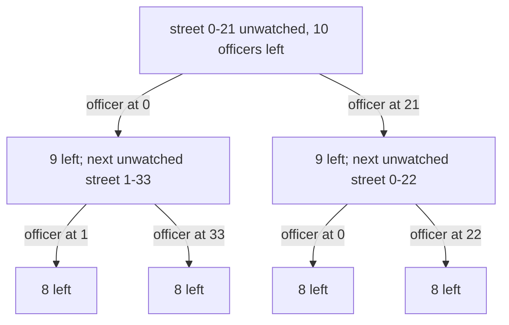
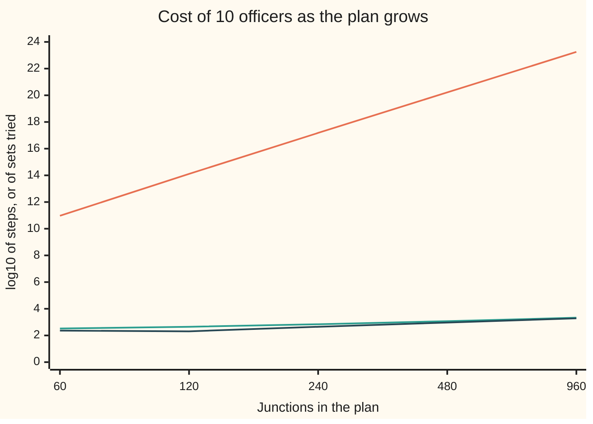

# Parameterised complexity: hard in general, easy while one number stays small

[Syllabus](../../../SYLLABUS.md) → [Computability and complexity](../README.md) → [Beyond Worst Case](../README.md#s04) → Parameterised complexity

---

## General Overview

A city closes its centre for a festival. The plan of the closed area has 60 junctions and 84 streets. The police can spare 10 officers. An officer standing at a junction watches every street that meets it.

Can 10 officers watch every street? This is the vertex cover question: choose a set of junctions that touches every street. On a plan whose junctions split into two sides, with every street crossing between them, it is solved fast by matching ([Konig's theorem](../../04-Combinatorics%20and%20graphs/13-Matchings%20and%20Flows/03-konigs-theorem-and-vertex-cover.md)). This plan has triangles, so it has no two sides.

On a general plan, vertex cover is NP-complete: every problem whose answers can be checked fast reduces to it, and no method polynomial in the plan's size is known. Trying every set of at most 10 junctions out of 60 means 93,178,047,049 sets, each checked against 84 streets.

A different method searches a tree of choices. Each point where it stops to choose is a **node**, and here it needs at most 2,047 nodes, whatever the size of the city. It looks at one unwatched street at a time. One of its two ends must hold an officer, so it tries both ends and spends one officer each time. After 10 officers the search stops. The exponential part of the work depends only on the 10, and the 60 junctions and 84 streets enter only as a polynomial.

**A problem is fixed-parameter tractable when a second number k, kept apart from the input size, carries all the exponential cost: the time is f(k) times a polynomial in the size, so a hard problem stays fast while k stays small.**

**What kind of fact this is:** fixed-parameter tractable (FPT) and kernel are definitions. That vertex cover is FPT, with the bound below, is a theorem, proved on this card in Why it works. That natural problems such as finding k junctions with no street between any two are not FPT rests on a conjecture (FPT ≠ W[1]), unproved as of 2026-11-11.

### The picture: the first two levels of the search



Schematic. Each node spends one officer, so no path is longer than 10 steps. A tree with two branches per node and depth 10 has at most 2,047 nodes. The festival run found its answer after 11 of them.

---

## The formula

Notation first. The plan is a graph $`G = (V, E)`$: $`V`$ is the set of junctions and $`E`$ the set of streets. $`n`$ counts junctions and $`m`$ counts streets, so the input is about $`n + m`$ numbers long. The **parameter** $`k`$ is a second number given with the input: here the budget of officers.

A parameterised problem is **fixed-parameter tractable**, in the class **FPT**, when some method answers it in time

```math
\text{time} \le f(k)\cdot (n + m)^{c}
```

**Read it aloud:** the time is some function of k alone, times a fixed power of the input size.

$`f`$ may grow as fast as it likes, $`2^k`$ or worse. The power $`c`$ must not depend on $`k`$. That separation is the whole point.

For vertex cover, the method on this card counts its steps (streets looked at) and stays under

```math
T \le (k + 1)\,m + 2^{k+1}\,k^{2}
```

**Read it aloud:** at most k plus one passes over the streets to shrink the plan, then a search of at most 2 to the k plus one nodes, each reading at most k squared streets.

For the festival, $`k = 10`$ and $`m = 84`$ give a ceiling of 205,724 steps. The run used 229.

Brute force is different in kind. It tries every set of at most $`k`$ junctions:

```math
\binom{n}{0} + \binom{n}{1} + \dots + \binom{n}{k} \;\approx\; \frac{n^{k}}{k!} \quad \text{once } n \text{ is far above } k
```

Here $`\binom{n}{i}`$, read "n choose i", counts the sets of $`i`$ junctions out of $`n`$, and $`k!`$ is $`1 \times 2 \times \dots \times k`$. For each fixed $`k`$ this is a polynomial in $`n`$, but its power is $`k`$ itself. A method of that shape puts a problem in the class **XP**; FPT asks for more.

| Symbol | Plain meaning | In our example | Push it up and the answer… |
| --- | --- | --- | --- |
| $`G = (V, E)`$ | the plan: junctions and the streets joining them | the festival centre | — |
| $`n`$ | number of junctions | 60 | brute force grows like $`n^{10}`$; the tree barely notices |
| $`m`$ | number of streets | 84 | the polynomial part grows in step with it |
| $`k`$ | the parameter: officers allowed | 10 | each extra officer doubles the tree's ceiling |
| $`C`$ | a vertex cover: junctions touching every street | junctions 0 to 9 | — |
| $`d(v)`$ | degree: streets meeting junction $`v`$ | 16 at junctions 0 and 1 | above $`k`$, the junction must hold an officer |
| $`k'`$ | officers left after the kernel | 8 | the kernel's ceiling $`k'^2`$ rises |
| $`f(k)`$ | the cost that depends on $`k`$ alone | $`2^{k+1} k^2`$ | — |
| $`c`$ | the fixed power on the input size | 1 | the polynomial part steepens |
| $`T`$ | steps the method takes | 229 | — |

### When it holds

- **The parameter is small.** A ring of 200 junctions needs 100 officers, and the tree's ceiling becomes $`2^{101} - 1`$ nodes, a 31-digit number. There the ring happens to have two sides, so the matching settles it at once.
- **Every branch spends the parameter.** Branching on "officer here or not" at each junction in turn does not spend an officer on the "not" side. The tree is then 60 levels deep, with $`2^{60}`$ leaves.
- **The kernel rule says "more than k".** A junction meeting exactly $`k`$ streets need not hold an officer. Forcing one turns the festival's true "yes" into "no".
- **The right parameter is chosen.** Ask instead for the largest set of junctions with no street between any two: 60 − 10 = 50 here. Parameterised by its size, that problem is W[1]-hard (defined in Step 4) and believed not to be FPT.

---

## Why it works

### Step 0: a street has only two ends

Every street needs an officer at one of its two ends. So a question about 60 junctions turns into a series of two-way choices. Each choice places an officer, so it spends one unit of the budget. No series of choices can be longer than $`k`$.

That is the source of $`f(k)`$. The size of the plan only decides how long it takes to find the next unwatched street.

### Step 1: the bounded search tree

The method:

1. Look through the streets for one that no officer watches.
2. If there is none, answer yes: the officers placed so far are a cover.
3. If there is one but no officers are left, answer no on this branch.
4. Otherwise the street joins $`u`$ and $`v`$. Place an officer at $`u`$ with one fewer left and repeat. If that branch fails, try $`v`$ instead.

Each node of the tree has at most two children and the depth is at most $`k`$. So there are at most $`1 + 2 + 4 + \dots + 2^k = 2^{k+1} - 1`$ nodes. Each node reads at most $`m`$ streets. The total is at most $`(2^{k+1} - 1)\,m`$ steps, which is already the FPT shape.

On the festival plan with 9 officers, the tree visits exactly 1,023 nodes, the full ceiling $`2^{10} - 1`$, and answers no. With 10 it answers yes after 11 nodes and 329 steps.

<details>
<summary>Detailed proof: the tree answers yes exactly when a cover of size at most k exists</summary>

If the tree answers yes, it has just checked that every street is watched by at most $`k`$ placed officers. That is a cover.

Now suppose a cover $`C`$ of at most $`k`$ junctions exists. Call a node **on track** if every officer placed so far is in $`C`$. The root is on track, with nobody placed.

Take an on-track node that has not answered yes. Some street $`uv`$ is unwatched. $`C`$ watches it, so $`u`$ or $`v`$ is in $`C`$, and the corresponding child is on track too. Placing it uses one more junction of $`C`$, so an on-track node never runs out of officers before $`C`$ is used up.

Following on-track children, the depth rises by one each time and cannot pass $`\lvert C\rvert \le k`$. So the path must end at a node with nothing unwatched: a yes.

</details>

### Step 2: the kernel

A **kernel** is a smaller plan, built in polynomial time, whose size is bounded by a function of $`k`$ alone and whose answer is the same. Two rules, due to Jonathan Buss and Judy Goldsmith, build one for vertex cover.

- **Rule 1: a junction meeting more than $`k`$ streets must hold an officer.** If it did not, every street at it would need an officer at its far end: more than $`k`$ officers. Place the officer, remove those streets, and lower $`k`$ by one. Repeat.
- **Rule 2: too many streets left means no.** Once Rule 1 stops, every junction meets at most $`k'`$ streets, where $`k'`$ is the budget left. So $`k'`$ officers watch at most $`k'^2`$ streets. If more remain, no cover of size $`k'`$ exists.

On the festival plan, junctions 0 and 1 meet 16 streets each, more than 10. Both must hold officers, which leaves $`k' = 8`$. No other junction then meets more than 8 streets, so Rule 1 stops. That leaves 53 streets, under the ceiling of $`8^2 = 64`$, so the tree runs on 53 streets instead of 84.

<details>
<summary>Detailed proof: Rule 1 can be applied to every high junction at once</summary>

Let $`B`$ be the junctions meeting more than $`k`$ streets. Each must be in every cover of size at most $`k`$, by Rule 1's argument. If $`\lvert B\rvert > k`$, the answer is no.

Otherwise place officers at all of $`B`$. Every cover of size at most $`k`$ contains all of $`B`$, so placing them together is the same as placing them one at a time. Remove the streets they watch and lower the budget to $`k - \lvert B\rvert`$. The new plan has a cover of that size exactly when the old plan had one of size at most $`k`$.

After the last round no junction has more than $`k'`$ streets. Each officer watches at most $`k'`$ of the remaining streets. So if more than $`k'^2`$ remain, $`k'`$ officers cannot watch them all.

</details>

### Step 3: put the two together

Each round of Rule 1 reads every street once, and there are at most $`k + 1`$ rounds. That costs at most $`(k + 1)\,m`$ steps.

The tree then runs on at most $`k'^2 \le k^2`$ streets with at most $`2^{k+1} - 1`$ nodes. That costs under $`2^{k+1} k^2`$ steps, a number that does not depend on the plan at all.

The sum is the formula above. A general theorem says the two ideas are one: a decidable problem is FPT exactly when it has a kernel (Cygan and co-authors, chapter 2). With 9 officers the kernel alone answers no in 142 steps, against the bare tree's 30,878.

### Step 4: what is not known

Brute force already runs in about $`n^k`$ steps, polynomial for each fixed $`k`$. The tree does better: the $`k`$ leaves the exponent. Not every problem allows that.

**W[1]** is the class of parameterised problems that reduce, in FPT time, to finding $`k`$ junctions all joined to one another. A problem is **W[1]-hard** when that clique problem reduces to it. Finding $`k`$ junctions with no street between any two is W[1]-hard. That is the same plan read the other way: the junctions without officers form such a set.

So the parameter decides, not the problem. Asking for at most 10 officers is FPT. Asking for at least 50 unguarded junctions is believed not to be.

Sharper branching brings the bound for vertex cover far below $`2^k`$: time about $`1.2738^k`$ plus a polynomial (Chen, Kanj and Xia, 2010). Later work lowered it to about $`1.25284^k`$ times a polynomial (Harris and Narayanaswamy, 2024). Under the exponential time hypothesis (ETH: 3-SAT on $`N`$ variables needs at least $`2^{aN}`$ steps for some fixed number $`a > 0`$, a conjecture unproved as of 2026-11-11; see [P versus NP](08-p-versus-np-what-is-known.md)), no method runs in time 2 raised to a power that grows more slowly than every fixed multiple of $`k`$, times a polynomial. The base can shrink, but the cost stays exponential in $`k`$.

---

## Worked numbers, by hand

The festival plan: $`n = 60`$ junctions, $`m = 84`$ streets, budget $`k = 10`$.

| Step | Arithmetic | Value |
| --- | --- | --- |
| streets at junctions 0 and 1 | count them | 16 each |
| Rule 1 at $`k = 10`$ | 16 > 10, twice | officers at 0 and 1 |
| budget left | 10 − 2 | $`k' = 8`$ |
| Rule 1 again at $`k' = 8`$ | no junction meets more than 8 | Rule 1 stops |
| streets left | 84 − 31 removed | 53 |
| Rule 2 ceiling | $`8 \times 8`$ | 64, so keep going |
| tree on the kernel | 9 nodes | officers at junctions 0 to 9 |
| check every street | 84 streets, each touched | yes |
| lower bound | 10 streets sharing no junction | at least 10 officers |
| **answer** | 10 found, 10 needed | **exactly 10 officers suffice** |

The 31 streets removed are junction 0's 16 and junction 1's 16, less the one street joining them. Ten officers do the job, and the 10 separate streets show that 9 never could.

### What breaks if you drop a piece

| Mistake | Comes out at | What went wrong |
| --- | --- | --- |
| Rule 1 at "at least $`k`$" streets | answer no | Junction 20 meets exactly 10 streets, so it is forced. Its 10 neighbours are the real officers, so the budget is wasted and the cascade fails. |
| Officers at both ends of 10 separate streets | 20 officers | This is the matching rule, proved on the applied wing's [Approximation](../../14-Applied%20and%20computational/02-Randomised%20and%20Approximate%20Algorithms/06-approximation-algorithms.md) card to use at most twice the best, so it can miss the budget of 10. |
| Branch on each junction, in or out | $`2^{60}`$ leaves | The "out" branch spends no officer, so the depth is $`n`$, not $`k`$. |
| Run the tree when $`k`$ is large | $`2^{101} - 1`$ nodes for a ring of 200 | $`f(k)`$ is the cost; FPT helps only while $`k`$ is small. |

---

## How the cost grows with the plan

The puzzle: the festival grows, more junctions and streets join the plan, and the budget stays at 10. Which cost grows, and how fast?

The checks enlarge the plan by adding side streets around the 10 hubs, so 10 officers still suffice. Before saying yes, every method must see that every street is watched, so no method escapes reading the plan once.

| Junctions $`n`$ | Streets $`m`$ | Tree nodes | Tree steps | Kernel then tree | log10 of brute-force sets |
| ---: | ---: | ---: | ---: | ---: | ---: |
| 60 | 84 | 11 | 329 | 229 | 10.97 |
| 120 | 204 | 11 | 449 | 204 | 14.11 |
| 240 | 444 | 11 | 689 | 444 | 17.18 |
| 480 | 924 | 11 | 1,169 | 924 | 20.22 |
| 960 | 1,884 | 11 | 2,129 | 1,884 | 23.25 |

The tree's node count does not move. Its steps grow by one extra reading of the plan. From 120 junctions on, all 10 hubs meet more than 10 streets, so Rule 1 places every officer in one pass. Brute force gains about 3 powers of 10 each time $`n`$ doubles, because $`2^{10}`$ is about 1,000.



Top line (orange): sets brute force would try, counted, not run. Middle (green): steps of the bare search tree. Bottom (dark): steps of the kernel then the tree. The two lower lines rise by at most about 0.3, one doubling, for each doubling of the plan, and that only once the plan's size dominates. The top line climbs about 3 per doubling, ten times as steeply.

---

## Code, from first principles, and it actually runs

The code builds the festival plan and answers it four independent ways. Road 1 is the bounded search tree. Road 2 shrinks the plan with the two kernel rules, then runs the tree on what is left. Road 3 is a pair of certificates: a separate check that the 10 officers watch every street, and 10 streets sharing no junction, which force at least 10. Road 4 draws 300 small random plans from a SplitMix64 generator written out in both languages, and compares the tree and the kernel with brute force over all 1,024 sets of junctions. It then grows the plan and runs each mistake.

### Python

```python
# Parameterised complexity -- the check behind the card.  Standard library only.
# A festival street plan: 60 junctions, 84 streets, at most 10 officers.  An officer at a
# junction watches every street that meets it.  Roads to the answer: (1) the bounded search
# tree; (2) the kernel, then the same tree on what is left; (3) certificates: a cover checked
# street by street, and 10 streets sharing no junction, which force at least 10 officers;
# (4) brute force over every set of junctions, on 300 small random plans.
from math import comb, log10

def festival(n):              # hubs 0-9, partners 10-19, junction 20 meets every hub, 21.. side streets
    st = []
    for j in range(21, n):
        if j < 33: st.append((0, j))                         # 12 side streets off square 0
        elif j < 45: st.append((1, j))                       # 12 off square 1
        else: st += [(2 + j % 8, j), (2 + (j + 3) % 8, j)]   # the rest join two smaller hubs
    st += [(20, h) for h in range(10)] + [(h, (h + 1) % 10) for h in range(10)]
    return st + [(h, 10 + h) for h in range(10)]

def tree(st, k, on, cnt):     # ROAD 1: an unwatched street needs an officer at one of its two ends
    cnt[0] += 1                                              # nodes of the search tree
    for u, v in st:
        cnt[1] += 1                                          # steps: streets looked at
        if not on[u] and not on[v]: break
    else: return True                                        # every street is watched
    if k == 0: return False                                  # a street unwatched and nobody left
    for w in (u, v):
        on[w] = True
        if tree(st, k - 1, on, cnt): return True
        on[w] = False
    return False

def kernel(n, st, k, big=lambda d, k: d > k):   # ROAD 2, part one: shrink the plan first
    forced, steps = [], 0
    while True:
        deg = [0] * n
        for u, v in st: deg[u] += 1; deg[v] += 1
        steps += len(st)
        b = [w for w in range(n) if deg[w] and big(deg[w], k)]
        if not b or len(b) > k: break                        # nothing forced, or too many forced
        forced += b; k -= len(b)
        st = [(u, v) for u, v in st if u not in b and v not in b]
    return forced, st, k, steps, len(b) <= k and len(st) <= k * k

def solve(n, st, k, big=lambda d, k: d > k):    # ROAD 2: kernel, then the tree on what is left
    forced, rest, k2, steps, alive = kernel(n, st, k, big)
    on, cnt = [w in forced for w in range(n)], [0, 0]
    ok = alive and tree(rest, k2, on, cnt)
    return ok, [w for w in range(n) if on[w]], forced, len(rest), k2, steps + cnt[1], cnt[0]

def matching(st):             # ROAD 3: streets sharing no junction; each needs an officer of its own
    used, m = set(), []
    for u, v in st:
        if u not in used and v not in used: m.append((u, v)); used |= {u, v}
    return m

n, K = 60, 10
st = festival(n)
deg = [sum(w in s for s in st) for w in range(n)]
on, c10 = [False] * n, [0, 0]
yes10 = tree(st, K, on, c10)
cover = [w for w in range(n) if on[w]]
watched = all(u in cover or v in cover for u, v in st)       # separate verifier
c9 = [0, 0]; yes9 = tree(st, K - 1, [False] * n, c9)
ok, kcov, forced, left, k2, ksteps, knodes = solve(n, st, K)
ok9, _, forced9, left9, k29, ksteps9, _ = solve(n, st, K - 1)
mt = matching(st)
print(f"plan: {n} junctions, {len(st)} streets, budget k = {K} officers")
print(f"streets meeting junctions 0, 1, 20: {deg[0]}, {deg[1]}, {deg[20]}; largest elsewhere {max(deg[2:20])}")
print(f"road 1, tree, k = 10: {'yes' if yes10 else 'no'}, officers at {cover}; {c10[0]} nodes, {c10[1]} steps; bound 2^11 - 1 = {2**11 - 1}")
print(f"road 1, tree, k = 9:  {'yes' if yes9 else 'no'}; {c9[0]} nodes, {c9[1]} steps; bound 2^10 - 1 = {2**10 - 1}")
print(f"road 2, kernel, k = 10: forced {forced}; {len(st) - left} streets removed, {left} left for k = {k2}, limit {k2 * k2}")
print(f"road 2, kernel then tree, k = 10: {'yes' if ok else 'no'}, {kcov}; {knodes} nodes, {ksteps} steps;"
      f" ceiling (k+1)m + 2^(k+1) k^2 = {(K + 1) * len(st) + 2 ** (K + 1) * K * K}")
print(f"road 2, kernel, k = 9: forced {forced9}; {left9} streets left for k = {k29}: {'yes' if ok9 else 'no'}; {ksteps9} steps")
print(f"road 3, verifier: every street watched by {len(cover)} officers: {'yes' if watched else 'no'}")
print(f"road 3, {len(mt)} streets sharing no junction: {mt}")
print(f"other parameter: largest set of junctions with no street between any two = {n} - {len(cover)} = {n - len(cover)}")
sets = sum(comb(n, i) for i in range(K + 1))
print(f"brute force: sets of at most 10 junctions out of 60 = {sets}, times {len(st)} streets each")

M64 = (1 << 64) - 1
def splitmix(s):             # SplitMix64, written out, so Python and Rust draw the same plans
    s = (s + 0x9E3779B97F4A7C15) & M64
    z = ((s ^ (s >> 30)) * 0xBF58476D1CE4E5B9) & M64
    z = ((z ^ (z >> 27)) * 0x94D049BB133111EB) & M64
    return s, z ^ (z >> 31)
seed, agree, hist, worst = 2026, 0, [0] * 11, 0
for trial in range(300):     # ROAD 4: 300 random plans on 10 junctions, each pair a street 30% of the time
    sm = []
    for u in range(10):
        for v in range(u + 1, 10):
            seed, z = splitmix(seed)
            if z % 100 < 30: sm.append((u, v))
    brute = min(bin(m).count("1") for m in range(1024) if all(m >> u & 1 or m >> v & 1 for u, v in sm))
    t = 0
    while True:
        cnt = [0, 0]
        if tree(sm, t, [False] * 10, cnt): break
        worst = max(worst, cnt[0] / (2 ** (t + 1) - 1)); t += 1
    kk = next(t for t in range(11) if solve(10, sm, t)[0])
    agree += brute == t == kk; hist[brute] += 1
print(f"road 4, 300 random plans: brute force, tree and kernel agree on {agree}; covers of size 0-10: {hist}")
print(f"road 4, largest tree as a share of its bound 2^(k+1) - 1: {worst:.3f}")

print("growth at k = 10: before saying yes, every road must see that every street is watched")
print("     n     m  tree nodes  tree steps  kernel+tree steps  log10 brute-force sets")
rows = []
for size in (60, 120, 240, 480, 960):
    s2 = festival(size); c = [0, 0]
    tree(s2, K, [False] * size, c)
    r = solve(size, s2, K)
    lb = log10(sum(comb(size, i) for i in range(K + 1)))
    rows.append((size, len(s2), c[0], c[1], r[5], lb))
    print(f"{size:>6}{len(s2):>6}{c[0]:>12}{c[1]:>12}{r[5]:>19}{lb:>24.2f}")
print("chart, log10 tree steps: " + " ".join(f"{log10(r[3]):.2f}" for r in rows))
print("chart, log10 kernel+tree steps: " + " ".join(f"{log10(r[4]):.2f}" for r in rows))
print("chart, log10 brute-force sets: " + " ".join(f"{r[5]:.2f}" for r in rows))

wrong = solve(n, st, K, big=lambda d, k: d >= k)             # mistake: force a junction meeting exactly k streets
print(f"mistake, force at >= k streets: forced {wrong[2]}, answer {'yes' if wrong[0] else 'no'}")
print(f"mistake, both ends of {len(mt)} separate streets: {2 * len(mt)} officers")
print(f"mistake, branch on every junction in or out: 2^60 = {2 ** 60} leaves")
ring = [(i, (i + 1) % 200) for i in range(200)]               # hypothesis fails: k is not small
rm, evens = matching(ring), set(range(0, 200, 2))
fine = all(u in evens or v in evens for u, v in ring)
print(f"k not small: a ring of 200 needs {len(rm)}; tree bound 2^101 - 1 = {2 ** 101 - 1} nodes;"
      f" two-sided, so the matching settles it; the 100 even junctions watch all: {'yes' if fine else 'no'}")

assert yes10 and watched and len(cover) == K                 # tree's cover passes a separate check
assert len(mt) == K and len({w for s in mt for w in s}) == 2 * K and not yes9   # 10 separate streets: 9 cannot do
assert ok and not ok9 and sorted(kcov) == cover              # kernel road agrees with the tree road
assert agree == 300 and worst <= 1.0 and c9[0] <= 2 ** K - 1 # brute force agrees; trees stay under 2^(k+1) - 1
assert all(r[4] <= (K + 1) * r[1] + 2 ** (K + 1) * K * K for r in rows)   # within (k+1)m + 2^(k+1) k^2
assert not wrong[0] and len(rm) == 100 and fine              # the wrong rule says no; the ring needs 100
print("ALL CHECKS PASS")
```

**Ran 2026-11-19 on macOS, Python 3.14.10, standard library only. All checks passed. Output, pasted from the run:**

```
plan: 60 junctions, 84 streets, budget k = 10 officers
streets meeting junctions 0, 1, 20: 16, 16, 10; largest elsewhere 8
road 1, tree, k = 10: yes, officers at [0, 1, 2, 3, 4, 5, 6, 7, 8, 9]; 11 nodes, 329 steps; bound 2^11 - 1 = 2047
road 1, tree, k = 9:  no; 1023 nodes, 30878 steps; bound 2^10 - 1 = 1023
road 2, kernel, k = 10: forced [0, 1]; 31 streets removed, 53 left for k = 8, limit 64
road 2, kernel then tree, k = 10: yes, [0, 1, 2, 3, 4, 5, 6, 7, 8, 9]; 9 nodes, 229 steps; ceiling (k+1)m + 2^(k+1) k^2 = 205724
road 2, kernel, k = 9: forced [0, 1, 20, 3, 4, 5, 7, 8]; 13 streets left for k = 1: no; 142 steps
road 3, verifier: every street watched by 10 officers: yes
road 3, 10 streets sharing no junction: [(0, 21), (1, 33), (7, 45), (8, 46), (9, 47), (2, 48), (3, 49), (4, 50), (5, 51), (6, 52)]
other parameter: largest set of junctions with no street between any two = 60 - 10 = 50
brute force: sets of at most 10 junctions out of 60 = 93178047049, times 84 streets each
road 4, 300 random plans: brute force, tree and kernel agree on 300; covers of size 0-10: [0, 0, 1, 7, 78, 153, 60, 1, 0, 0, 0]
road 4, largest tree as a share of its bound 2^(k+1) - 1: 1.000
growth at k = 10: before saying yes, every road must see that every street is watched
     n     m  tree nodes  tree steps  kernel+tree steps  log10 brute-force sets
    60    84          11         329                229                   10.97
   120   204          11         449                204                   14.11
   240   444          11         689                444                   17.18
   480   924          11        1169                924                   20.22
   960  1884          11        2129               1884                   23.25
chart, log10 tree steps: 2.52 2.65 2.84 3.07 3.33
chart, log10 kernel+tree steps: 2.36 2.31 2.65 2.97 3.28
chart, log10 brute-force sets: 10.97 14.11 17.18 20.22 23.25
mistake, force at >= k streets: forced [0, 1, 20, 3, 4, 5, 7, 8], answer no
mistake, both ends of 10 separate streets: 20 officers
mistake, branch on every junction in or out: 2^60 = 1152921504606846976 leaves
k not small: a ring of 200 needs 100; tree bound 2^101 - 1 = 2535301200456458802993406410751 nodes; two-sided, so the matching settles it; the 100 even junctions watch all: yes
ALL CHECKS PASS
```

### Rust

The same roads, with the same output. Python's big integers become `u128`.

```rust
// Parameterised complexity -- the same check as the Python, in Rust.  No crates.
// A festival street plan: 60 junctions, 84 streets, at most 10 officers.  An officer at a
// junction watches every street that meets it.  Roads to the answer: (1) the bounded search
// tree; (2) the kernel, then the same tree on what is left; (3) certificates: a cover checked
// street by street, and 10 streets sharing no junction, which force at least 10 officers;
// (4) brute force over every set of junctions, on 300 small random plans.
type St = Vec<(usize, usize)>;

fn festival(n: usize) -> St {     // hubs 0-9, partners 10-19, junction 20 meets every hub, 21.. side streets
    let mut st = Vec::new();
    for j in 21..n {
        if j < 33 { st.push((0, j)) }                            // 12 side streets off square 0
        else if j < 45 { st.push((1, j)) }                       // 12 off square 1
        else { st.push((2 + j % 8, j)); st.push((2 + (j + 3) % 8, j)) }   // the rest join two smaller hubs
    }
    for h in 0..10 { st.push((20, h)) }
    for h in 0..10 { st.push((h, (h + 1) % 10)) }
    for h in 0..10 { st.push((h, 10 + h)) }
    st
}

fn tree(st: &St, k: usize, on: &mut Vec<bool>, cnt: &mut [u64; 2]) -> bool {   // ROAD 1
    cnt[0] += 1;                                                 // nodes of the search tree
    let mut open = None;
    for &(u, v) in st {
        cnt[1] += 1;                                             // steps: streets looked at
        if !on[u] && !on[v] { open = Some((u, v)); break }
    }
    let (u, v) = match open { None => return true, Some(e) => e };   // None: every street is watched
    if k == 0 { return false }                                   // a street unwatched and nobody left
    for w in [u, v] {
        on[w] = true;
        if tree(st, k - 1, on, cnt) { return true }
        on[w] = false;
    }
    false
}

fn kernel(n: usize, st0: &St, k0: usize, at_least: bool) -> (Vec<usize>, St, usize, u64, bool) {
    let (mut forced, mut steps, mut st, mut k) = (Vec::new(), 0u64, st0.clone(), k0);
    loop {                                                       // ROAD 2, part one: shrink the plan first
        let mut deg = vec![0usize; n];
        for &(u, v) in &st { deg[u] += 1; deg[v] += 1 }
        steps += st.len() as u64;
        let b: Vec<usize> = (0..n).filter(|&w| deg[w] > 0 && (deg[w] > k || (at_least && deg[w] == k))).collect();
        if b.is_empty() || b.len() > k { let alive = b.len() <= k && st.len() <= k * k; return (forced, st, k, steps, alive) }
        forced.extend(&b); k -= b.len();
        st.retain(|&(u, v)| !b.contains(&u) && !b.contains(&v));
    }
}

fn solve(n: usize, st: &St, k: usize, at_least: bool) -> (bool, Vec<usize>, Vec<usize>, usize, usize, u64, u64) {
    let (forced, rest, k2, steps, alive) = kernel(n, st, k, at_least);   // ROAD 2: kernel, then the tree
    let mut on: Vec<bool> = (0..n).map(|w| forced.contains(&w)).collect();
    let mut cnt = [0u64; 2];
    let ok = alive && tree(&rest, k2, &mut on, &mut cnt);
    (ok, (0..n).filter(|&w| on[w]).collect(), forced, rest.len(), k2, steps + cnt[1], cnt[0])
}

fn matching(st: &St) -> St {      // ROAD 3: streets sharing no junction; each needs an officer of its own
    let (mut used, mut m) = (Vec::new(), Vec::new());
    for &(u, v) in st { if !used.contains(&u) && !used.contains(&v) { m.push((u, v)); used.push(u); used.push(v) } }
    m
}

fn yn(b: bool) -> &'static str { if b { "yes" } else { "no" } }
fn sets_up_to(n: u128, k: u128) -> u128 {                        // sets of at most k junctions out of n
    let (mut c, mut total) = (1u128, 1u128);
    for i in 1..=k { c = c * (n - i + 1) / i; total += c }
    total
}
fn splitmix(s: u64) -> (u64, u64) {  // SplitMix64, written out, so Python and Rust draw the same plans
    let s = s.wrapping_add(0x9E3779B97F4A7C15);
    let z = (s ^ (s >> 30)).wrapping_mul(0xBF58476D1CE4E5B9);
    let z = (z ^ (z >> 27)).wrapping_mul(0x94D049BB133111EB);
    (s, z ^ (z >> 31))
}

fn main() {
    let (n, kk) = (60usize, 10usize);
    let st = festival(n);
    let deg: Vec<usize> = (0..n).map(|w| st.iter().filter(|&&(u, v)| u == w || v == w).count()).collect();
    let (mut on, mut c10) = (vec![false; n], [0u64; 2]);
    let yes10 = tree(&st, kk, &mut on, &mut c10);
    let cover: Vec<usize> = (0..n).filter(|&w| on[w]).collect();
    let watched = st.iter().all(|(u, v)| cover.contains(u) || cover.contains(v));   // separate verifier
    let mut c9 = [0u64; 2];
    let yes9 = tree(&st, kk - 1, &mut vec![false; n], &mut c9);
    let (ok, kcov, forced, left, k2, ksteps, knodes) = solve(n, &st, kk, false);
    let (ok9, _, forced9, left9, k29, ksteps9, _) = solve(n, &st, kk - 1, false);
    let mt = matching(&st);
    println!("plan: {} junctions, {} streets, budget k = {} officers", n, st.len(), kk);
    println!("streets meeting junctions 0, 1, 20: {}, {}, {}; largest elsewhere {}", deg[0], deg[1], deg[20], deg[2..20].iter().max().unwrap());
    println!("road 1, tree, k = 10: {}, officers at {:?}; {} nodes, {} steps; bound 2^11 - 1 = {}", yn(yes10), cover, c10[0], c10[1], (1u64 << 11) - 1);
    println!("road 1, tree, k = 9:  {}; {} nodes, {} steps; bound 2^10 - 1 = {}", yn(yes9), c9[0], c9[1], (1u64 << 10) - 1);
    println!("road 2, kernel, k = 10: forced {:?}; {} streets removed, {} left for k = {}, limit {}", forced, st.len() - left, left, k2, k2 * k2);
    println!("road 2, kernel then tree, k = 10: {}, {:?}; {} nodes, {} steps; ceiling (k+1)m + 2^(k+1) k^2 = {}",
        yn(ok), kcov, knodes, ksteps, (kk + 1) * st.len() + (1usize << (kk + 1)) * kk * kk);
    println!("road 2, kernel, k = 9: forced {:?}; {} streets left for k = {}: {}; {} steps", forced9, left9, k29, yn(ok9), ksteps9);
    println!("road 3, verifier: every street watched by {} officers: {}", cover.len(), yn(watched));
    println!("road 3, {} streets sharing no junction: {:?}", mt.len(), mt);
    println!("other parameter: largest set of junctions with no street between any two = {} - {} = {}", n, cover.len(), n - cover.len());
    println!("brute force: sets of at most 10 junctions out of 60 = {}, times {} streets each", sets_up_to(60, 10), st.len());

    let (mut seed, mut agree, mut hist, mut worst) = (2026u64, 0, [0usize; 11], 0.0f64);
    for _trial in 0..300 {        // ROAD 4: 300 random plans on 10 junctions, each pair a street 30% of the time
        let mut sm: St = Vec::new();
        for u in 0..10 { for v in u + 1..10 {
            let (s, z) = splitmix(seed); seed = s;
            if z % 100 < 30 { sm.push((u, v)) }
        } }
        let brute = (0..1024u32).filter(|m| sm.iter().all(|&(u, v)| m >> u & 1 == 1 || m >> v & 1 == 1))
            .map(|m| m.count_ones() as usize).min().unwrap();
        let mut t = 0;
        loop {
            let mut cnt = [0u64; 2];
            if tree(&sm, t, &mut vec![false; 10], &mut cnt) { break }
            worst = worst.max(cnt[0] as f64 / ((1u64 << (t + 1)) - 1) as f64); t += 1;
        }
        let kt = (0..11).find(|&t| solve(10, &sm, t, false).0).unwrap();
        if brute == t && t == kt { agree += 1 }
        hist[brute] += 1;
    }
    println!("road 4, 300 random plans: brute force, tree and kernel agree on {}; covers of size 0-10: {:?}", agree, hist);
    println!("road 4, largest tree as a share of its bound 2^(k+1) - 1: {:.3}", worst);

    println!("growth at k = 10: before saying yes, every road must see that every street is watched");
    println!("     n     m  tree nodes  tree steps  kernel+tree steps  log10 brute-force sets");
    let mut rows = Vec::new();
    for size in [60usize, 120, 240, 480, 960] {
        let s2 = festival(size);
        let mut c = [0u64; 2];
        tree(&s2, kk, &mut vec![false; size], &mut c);
        let r = solve(size, &s2, kk, false);
        let lb = (sets_up_to(size as u128, 10) as f64).log10();
        println!("{:>6}{:>6}{:>12}{:>12}{:>19}{:>24.2}", size, s2.len(), c[0], c[1], r.5, lb);
        rows.push((size, s2.len() as u64, c[0], c[1], r.5, lb));
    }
    let line = |f: &dyn Fn(&(usize, u64, u64, u64, u64, f64)) -> f64| rows.iter().map(|r| format!("{:.2}", f(r))).collect::<Vec<_>>().join(" ");
    println!("chart, log10 tree steps: {}", line(&|r| (r.3 as f64).log10()));
    println!("chart, log10 kernel+tree steps: {}", line(&|r| (r.4 as f64).log10()));
    println!("chart, log10 brute-force sets: {}", line(&|r| r.5));

    let wrong = solve(n, &st, kk, true);                        // mistake: force a junction meeting exactly k streets
    println!("mistake, force at >= k streets: forced {:?}, answer {}", wrong.2, yn(wrong.0));
    println!("mistake, both ends of {} separate streets: {} officers", mt.len(), 2 * mt.len());
    println!("mistake, branch on every junction in or out: 2^60 = {} leaves", 1u64 << 60);
    let ring: St = (0..200).map(|i| (i, (i + 1) % 200)).collect();   // hypothesis fails: k is not small
    let rm = matching(&ring);
    let fine = ring.iter().all(|&(u, v)| u % 2 == 0 || v % 2 == 0);
    println!("k not small: a ring of 200 needs {}; tree bound 2^101 - 1 = {} nodes; two-sided, so the matching settles it; the 100 even junctions watch all: {}",
        rm.len(), (1u128 << 101) - 1, yn(fine));

    assert!(yes10 && watched && cover.len() == kk);              // tree's cover passes a separate check
    let mut ends: Vec<usize> = mt.iter().flat_map(|&(u, v)| [u, v]).collect();
    ends.sort(); ends.dedup();
    assert!(mt.len() == kk && ends.len() == 2 * kk && !yes9);    // 10 separate streets: 9 cannot do
    assert!(ok && !ok9 && kcov == cover);                        // kernel road agrees with the tree road
    assert!(agree == 300 && worst <= 1.0 && c9[0] <= (1 << kk) - 1);   // brute force agrees; trees under 2^(k+1) - 1
    let k64 = kk as u64;
    assert!(rows.iter().all(|r| r.4 <= (k64 + 1) * r.1 + (1u64 << (k64 + 1)) * k64 * k64));   // within (k+1)m + 2^(k+1) k^2
    assert!(!wrong.0 && rm.len() == 100 && fine);                // the wrong rule says no; the ring needs 100
    println!("ALL CHECKS PASS");
}
```

**Ran 2026-11-19 on macOS, rustc 1.98.1, no crates. All checks passed. Output, pasted from the run:**

```
plan: 60 junctions, 84 streets, budget k = 10 officers
streets meeting junctions 0, 1, 20: 16, 16, 10; largest elsewhere 8
road 1, tree, k = 10: yes, officers at [0, 1, 2, 3, 4, 5, 6, 7, 8, 9]; 11 nodes, 329 steps; bound 2^11 - 1 = 2047
road 1, tree, k = 9:  no; 1023 nodes, 30878 steps; bound 2^10 - 1 = 1023
road 2, kernel, k = 10: forced [0, 1]; 31 streets removed, 53 left for k = 8, limit 64
road 2, kernel then tree, k = 10: yes, [0, 1, 2, 3, 4, 5, 6, 7, 8, 9]; 9 nodes, 229 steps; ceiling (k+1)m + 2^(k+1) k^2 = 205724
road 2, kernel, k = 9: forced [0, 1, 20, 3, 4, 5, 7, 8]; 13 streets left for k = 1: no; 142 steps
road 3, verifier: every street watched by 10 officers: yes
road 3, 10 streets sharing no junction: [(0, 21), (1, 33), (7, 45), (8, 46), (9, 47), (2, 48), (3, 49), (4, 50), (5, 51), (6, 52)]
other parameter: largest set of junctions with no street between any two = 60 - 10 = 50
brute force: sets of at most 10 junctions out of 60 = 93178047049, times 84 streets each
road 4, 300 random plans: brute force, tree and kernel agree on 300; covers of size 0-10: [0, 0, 1, 7, 78, 153, 60, 1, 0, 0, 0]
road 4, largest tree as a share of its bound 2^(k+1) - 1: 1.000
growth at k = 10: before saying yes, every road must see that every street is watched
     n     m  tree nodes  tree steps  kernel+tree steps  log10 brute-force sets
    60    84          11         329                229                   10.97
   120   204          11         449                204                   14.11
   240   444          11         689                444                   17.18
   480   924          11        1169                924                   20.22
   960  1884          11        2129               1884                   23.25
chart, log10 tree steps: 2.52 2.65 2.84 3.07 3.33
chart, log10 kernel+tree steps: 2.36 2.31 2.65 2.97 3.28
chart, log10 brute-force sets: 10.97 14.11 17.18 20.22 23.25
mistake, force at >= k streets: forced [0, 1, 20, 3, 4, 5, 7, 8], answer no
mistake, both ends of 10 separate streets: 20 officers
mistake, branch on every junction in or out: 2^60 = 1152921504606846976 leaves
k not small: a ring of 200 needs 100; tree bound 2^101 - 1 = 2535301200456458802993406410751 nodes; two-sided, so the matching settles it; the 100 even junctions watch all: yes
ALL CHECKS PASS
```

The two outputs match line for line. The random plans agree on all 300. The largest tree that answers no fills its ceiling $`2^{k+1} - 1`$ exactly (share 1.000). Every no does the same, by argument rather than by the printout: a no branches both ways at every node down to depth $`k`$, as the festival's 1,023 nodes at 9 officers show.

### Lean

Lean proves the tree and the kernel correct, with their bounds, for every plan and every budget k, and checks the festival's numbers.

- Take any plan, with its streets listed once each. Then the kernel followed by the tree answers yes exactly when at most k officers can watch every street.
- Take the same plan, with m streets. Then the kernel and the tree look at no more than $`(k + 1)\,m + 2^{k+1}\,k^{2}`$ streets.
- The search tree on its own also answers yes exactly when at most k officers suffice.
- Take any budget k. Then the search tree has at most $`2^{k+1} - 1`$ nodes, whatever the plan's size.
- Rule 1 holds: a junction meeting more than k streets is in every cover of at most k junctions.
- Suppose no junction meets more than k streets, and at most k officers watch every street. Then Rule 2's count holds: there are at most $`k^2`$ streets.
- On the festival plan, the tree says yes with 10 officers after 11 nodes and 329 steps. With 9 it says no, after 1,023 nodes and 30,878 steps.
- The kernel forces junctions 0 and 1, leaving 53 streets for $`k' = 8`$. The whole method then says yes in 229 steps.
- With 9 officers, the kernel alone answers no in 142 steps.
- Officers at junctions 0 to 9 watch every street of the festival plan.
- The step ceiling of 205,724, the 93,178,047,049 sets of brute force, and the counts $`2^{60}`$ and $`2^{101} - 1`$ are right.

Python and Rust alone check the 10 separate streets, the 300 random plans, the growth table, the "at least k" mistake and the ring.

```lean
-- Parameterised complexity: the bounded search tree and the Buss-Goldsmith kernel decide whether at most k officers can watch every street, in at most (k + 1)m + 2^(k+1) k^2 counted steps.
import Mathlib.Combinatorics.SimpleGraph.VertexCover
import Mathlib.Combinatorics.SimpleGraph.Finite
import Mathlib.Data.Nat.Choose.Basic
import Mathlib.Algebra.BigOperators.Group.Finset.Basic
import Mathlib.Tactic.NormNum.BigOperators
import Mathlib.Algebra.BigOperators.Ring.Finset
import Mathlib.Algebra.Order.BigOperators.Group.Finset

open SimpleGraph

/-! The plan is a Mathlib `SimpleGraph G` on junctions `V`; a set of officers watching every
street is Mathlib's `G.IsVertexCover`. The method reads the plan as a list of streets, each a
pair of its two ends. The code below is the card's Python, step for step: a "node" is one call
of the search, and a "step" is one street looked at. -/

variable {V : Type*} [DecidableEq V]

/-- `es` lists the streets of `G`, each street exactly once, as a pair of its two ends. -/
def IsStreetList (G : SimpleGraph V) (es : List (V × V)) : Prop :=
  (es.map fun e => s(e.1, e.2)).Nodup ∧
    ∀ e : Sym2 V, e ∈ es.map (fun e => s(e.1, e.2)) ↔ e ∈ G.edgeSet

/-- Look through the streets in order for one with no officer at either end. Gives that street,
if there is one, and the number of streets looked at. -/
def firstOpen (on : List V) : List (V × V) → Option (V × V) × ℕ
  | [] => (none, 0)
  | e :: rest =>
    if e.1 ∈ on ∨ e.2 ∈ on then ((firstOpen on rest).1, (firstOpen on rest).2 + 1)
    else (some e, 1)

/-- What a run reports: the answer, the nodes of the search tree, and the steps. -/
structure Run where
  yes : Bool
  nodes : ℕ
  steps : ℕ
deriving DecidableEq

/-- Road 1, the bounded search tree, with `k` officers left and officers already at `on`. An
unwatched street `(u, v)` needs an officer at `u` or at `v`; try `u`, and if that fails, `v`. -/
def searchTree (es : List (V × V)) : ℕ → List V → Run
  | 0, on =>
    match firstOpen on es with
    | (none, s) => ⟨true, 1, s⟩
    | (some _, s) => ⟨false, 1, s⟩
  | k + 1, on =>
    match firstOpen on es with
    | (none, s) => ⟨true, 1, s⟩
    | (some (u, v), s) =>
      let a := searchTree es k (u :: on)
      if a.yes then ⟨true, a.nodes + 1, a.steps + s⟩
      else
        let b := searchTree es k (v :: on)
        ⟨b.yes, a.nodes + b.nodes + 1, a.steps + b.steps + s⟩

/-- The streets of the list `st` that meet junction `w`. -/
def degIn (st : List (V × V)) (w : V) : ℕ :=
  st.countP fun e => e.1 = w ∨ e.2 = w

/-- Rule 1's junctions: those meeting more than `k` of the streets `st`. -/
def high (st : List (V × V)) (k : ℕ) : List V :=
  ((st.flatMap fun e => [e.1, e.2]).dedup).filter fun w => k < degIn st w

/-- What the kernel reports: Rule 2's verdict (`alive` is false when the answer is already no),
the junctions forced by Rule 1, the streets left, the budget left `k'`, and the steps. -/
structure Kernel (V : Type*) where
  alive : Bool
  forced : List V
  rest : List (V × V)
  budget : ℕ
  steps : ℕ

/-- Road 2, part one: the Buss-Goldsmith kernel, for at most `rounds` rounds. Each round reads
every street once to count degrees. If Rule 1 forces no junction, or more than `k`, it stops
and applies Rule 2: carry on only if at most `k` were forced and at most `k * k` streets are
left. Otherwise it places officers at the forced junctions, removes their streets, lowers `k`
and goes round again. Each round but the last spends an officer, so `k + 1` rounds suffice. -/
def kernel : ℕ → List (V × V) → ℕ → Kernel V
  | rounds, st, k =>
    let b := high st k
    let stop : Kernel V := ⟨decide (b.length ≤ k ∧ st.length ≤ k * k), [], st, k, st.length⟩
    match rounds with
    | 0 => stop
    | r + 1 =>
      if b = [] ∨ k < b.length then stop
      else
        let t := kernel r (st.filter fun e => e.1 ∉ b ∧ e.2 ∉ b) (k - b.length)
        ⟨t.alive, b ++ t.forced, t.rest, t.budget, t.steps + st.length⟩

/-- Road 2: the kernel, then the bounded search tree on the streets left, with the budget left.
Gives the answer and the total steps. -/
def kernelThenTree (es : List (V × V)) (k : ℕ) : Bool × ℕ :=
  let r := kernel (k + 1) es k
  if r.alive then
    let t := searchTree r.rest r.budget r.forced
    (t.yes, r.steps + t.steps)
  else (false, r.steps)

/-! Helper lemmas for the three theorems below. -/
theorem firstOpen_steps_le (on : List V) (es : List (V × V)) : (firstOpen on es).2 ≤ es.length := by
  induction es with
  | nil => simp [firstOpen]
  | cons e rest ih =>
    simp only [firstOpen]
    split_ifs <;> simp only [List.length_cons] <;> omega

theorem firstOpen_none (on : List V) (es : List (V × V)) (h : (firstOpen on es).1 = none) :
    ∀ e ∈ es, e.1 ∈ on ∨ e.2 ∈ on := by
  induction es with
  | nil => simp
  | cons e rest ih =>
    simp only [firstOpen] at h
    split_ifs at h with h1
    · intro x hx
      rcases List.mem_cons.1 hx with rfl | hx
      · exact h1
      · exact ih h x hx

theorem firstOpen_some (on : List V) (es : List (V × V)) (x : V × V)
    (h : (firstOpen on es).1 = some x) : x ∈ es ∧ x.1 ∉ on ∧ x.2 ∉ on := by
  induction es with
  | nil => simp [firstOpen] at h
  | cons e rest ih =>
    simp only [firstOpen] at h
    split_ifs at h with h1
    · exact ⟨List.mem_cons_of_mem _ (ih h).1, (ih h).2⟩
    · simp only [Option.some.injEq] at h
      subst h
      simp only [not_or] at h1
      exact ⟨List.mem_cons_self .., h1⟩

theorem searchTree_yes (es : List (V × V)) (k : ℕ) : ∀ on : List V,
    (searchTree es k on).yes = true ↔
      ∃ S : Finset V, S.card ≤ k ∧ ∀ e ∈ es, e.1 ∈ on ∨ e.2 ∈ on ∨ e.1 ∈ S ∨ e.2 ∈ S := by
  induction k with
  | zero =>
    intro on
    rw [searchTree]
    rcases h : firstOpen on es with ⟨_ | x, s⟩
    · simp only [true_iff]
      refine ⟨∅, by simp, fun e he => ?_⟩
      rcases firstOpen_none on es (by rw [h]) e he with h' | h'
      · exact Or.inl h'
      · exact Or.inr (Or.inl h')
    · simp only [Bool.false_eq_true, false_iff, not_exists, not_and]
      intro S hS hcov
      have hS0 : S = ∅ := Finset.card_eq_zero.1 (by omega)
      subst hS0
      obtain ⟨hx, h1, h2⟩ := firstOpen_some on es x (by rw [h])
      rcases hcov x hx with h' | h' | h' | h' <;> simp_all
  | succ k ih =>
    intro on
    rcases h : firstOpen on es with ⟨_ | ⟨u, v⟩, s⟩
    · rw [searchTree, h]
      simp only [true_iff]
      refine ⟨∅, by simp, fun e he => ?_⟩
      rcases firstOpen_none on es (by rw [h]) e he with h' | h'
      · exact Or.inl h'
      · exact Or.inr (Or.inl h')
    · obtain ⟨hx, hu, hv⟩ := firstOpen_some on es (u, v) (by rw [h])
      have key : (searchTree es (k + 1) on).yes = true ↔
          (searchTree es k (u :: on)).yes = true ∨ (searchTree es k (v :: on)).yes = true := by
        rw [searchTree, h]
        dsimp only
        split_ifs with ha <;> simp [ha]
      rw [key, ih, ih]
      constructor
      · rintro (⟨S, hS, hc⟩ | ⟨S, hS, hc⟩)
        · refine ⟨insert u S, (Finset.card_insert_le _ _).trans (by omega), fun e he => ?_⟩
          rcases hc e he with h' | h' | h' | h'
          · rcases List.mem_cons.1 h' with h' | h'
            · exact Or.inr (Or.inr (Or.inl (by simp [h'])))
            · exact Or.inl h'
          · rcases List.mem_cons.1 h' with h' | h'
            · exact Or.inr (Or.inr (Or.inr (by simp [h'])))
            · exact Or.inr (Or.inl h')
          · exact Or.inr (Or.inr (Or.inl (Finset.mem_insert_of_mem h')))
          · exact Or.inr (Or.inr (Or.inr (Finset.mem_insert_of_mem h')))
        · refine ⟨insert v S, (Finset.card_insert_le _ _).trans (by omega), fun e he => ?_⟩
          rcases hc e he with h' | h' | h' | h'
          · rcases List.mem_cons.1 h' with h' | h'
            · exact Or.inr (Or.inr (Or.inl (by simp [h'])))
            · exact Or.inl h'
          · rcases List.mem_cons.1 h' with h' | h'
            · exact Or.inr (Or.inr (Or.inr (by simp [h'])))
            · exact Or.inr (Or.inl h')
          · exact Or.inr (Or.inr (Or.inl (Finset.mem_insert_of_mem h')))
          · exact Or.inr (Or.inr (Or.inr (Finset.mem_insert_of_mem h')))
      · rintro ⟨S, hS, hc⟩
        have huv : u ∈ S ∨ v ∈ S := by
          rcases hc _ hx with h' | h' | h' | h'
          · exact absurd h' hu
          · exact absurd h' hv
          · exact Or.inl h'
          · exact Or.inr h'
        rcases huv with hu' | hv'
        · left
          refine ⟨S.erase u, by rw [Finset.card_erase_of_mem hu']; omega, fun e he => ?_⟩
          rcases hc e he with h' | h' | h' | h'
          · exact Or.inl (List.mem_cons_of_mem _ h')
          · exact Or.inr (Or.inl (List.mem_cons_of_mem _ h'))
          · by_cases heu : e.1 = u
            · exact Or.inl (by simp [heu])
            · exact Or.inr (Or.inr (Or.inl (Finset.mem_erase.2 ⟨heu, h'⟩)))
          · by_cases heu : e.2 = u
            · exact Or.inr (Or.inl (by simp [heu]))
            · exact Or.inr (Or.inr (Or.inr (Finset.mem_erase.2 ⟨heu, h'⟩)))
        · right
          refine ⟨S.erase v, by rw [Finset.card_erase_of_mem hv']; omega, fun e he => ?_⟩
          rcases hc e he with h' | h' | h' | h'
          · exact Or.inl (List.mem_cons_of_mem _ h')
          · exact Or.inr (Or.inl (List.mem_cons_of_mem _ h'))
          · by_cases heu : e.1 = v
            · exact Or.inl (by simp [heu])
            · exact Or.inr (Or.inr (Or.inl (Finset.mem_erase.2 ⟨heu, h'⟩)))
          · by_cases heu : e.2 = v
            · exact Or.inr (Or.inl (by simp [heu]))
            · exact Or.inr (Or.inr (Or.inr (Finset.mem_erase.2 ⟨heu, h'⟩)))

theorem searchTree_nodes (es : List (V × V)) (k : ℕ) : ∀ on : List V,
    (searchTree es k on).nodes ≤ 2 ^ (k + 1) - 1 := by
  induction k with
  | zero =>
    intro on
    rw [searchTree]
    rcases firstOpen on es with ⟨_ | x, s⟩ <;> simp
  | succ k ih =>
    intro on
    rw [searchTree]
    have h1 : 1 ≤ 2 ^ (k + 1) := Nat.one_le_two_pow
    have h2 := Nat.pow_succ 2 (k + 1)
    rcases firstOpen on es with ⟨_ | ⟨u, v⟩, s⟩
    · dsimp only
      omega
    · dsimp only
      have ha := ih (u :: on)
      have hb := ih (v :: on)
      split_ifs <;> dsimp only <;> omega

theorem searchTree_steps (es : List (V × V)) (k : ℕ) : ∀ on : List V,
    (searchTree es k on).steps ≤ (searchTree es k on).nodes * es.length := by
  induction k with
  | zero =>
    intro on
    rw [searchTree]
    have := firstOpen_steps_le on es
    rcases h : firstOpen on es with ⟨_ | x, s⟩ <;> rw [h] at this <;> simpa using this
  | succ k ih =>
    intro on
    rw [searchTree]
    have := firstOpen_steps_le on es
    rcases h : firstOpen on es with ⟨_ | ⟨u, v⟩, s⟩ <;> rw [h] at this
    · simpa using this
    · dsimp only at this ⊢
      have ha := ih (u :: on)
      have hb := ih (v :: on)
      split_ifs
      · dsimp only
        rw [Nat.add_mul, one_mul]
        omega
      · dsimp only
        rw [Nat.add_mul, Nat.add_mul, one_mul]
        omega

theorem mem_high (st : List (V × V)) (k : ℕ) (w : V) : w ∈ high st k ↔ k < degIn st w := by
  unfold high
  rw [List.mem_filter, List.mem_dedup, decide_eq_true_iff]
  constructor
  · exact fun h => h.2
  · intro h
    refine ⟨?_, h⟩
    have hpos : 0 < degIn st w := by omega
    unfold degIn at hpos
    obtain ⟨e, he, hp⟩ := List.countP_pos_iff.1 hpos
    rw [List.mem_flatMap]
    refine ⟨e, he, ?_⟩
    simp only [decide_eq_true_iff] at hp
    rcases hp with hp | hp <;> simp [hp]

theorem high_nodup (st : List (V × V)) (k : ℕ) : (high st k).Nodup :=
  (List.nodup_dedup _).filter _

theorem degIn_le_card (st : List (V × V)) (hnd : (st.map fun e => s(e.1, e.2)).Nodup)
    (S : Finset V) (hS : ∀ e ∈ st, e.1 ∈ S ∨ e.2 ∈ S) (w : V) (hw : w ∉ S) :
    degIn st w ≤ S.card := by
  unfold degIn
  rw [List.countP_eq_length_filter]
  set L := st.filter fun e => decide (e.1 = w ∨ e.2 = w) with hL
  have hLsub : L.Sublist st := List.filter_sublist
  have hndL : (L.map fun e => s(e.1, e.2)).Nodup := hnd.sublist (hLsub.map _)
  let f : V × V → V := fun e => if e.1 = w then e.2 else e.1
  have hmemL : ∀ e ∈ L, e ∈ st ∧ (e.1 = w ∨ e.2 = w) := by
    intro e he
    rw [hL, List.mem_filter, decide_eq_true_iff] at he
    exact he
  have hfS : ∀ e ∈ L, f e ∈ S := by
    intro e he
    obtain ⟨hst, hw'⟩ := hmemL e he
    simp only [f]
    split_ifs with h1
    · rcases hS e hst with h | h
      · exact absurd (h1 ▸ h) hw
      · exact h
    · rcases hw' with h | h
      · exact absurd h h1
      · rcases hS e hst with h' | h'
        · exact h'
        · exact absurd (h ▸ h') hw
  have hsym : ∀ e ∈ L, s(e.1, e.2) = s(w, f e) := by
    intro e he
    obtain ⟨_, hw'⟩ := hmemL e he
    simp only [f]
    split_ifs with h1
    · rw [h1]
    · rcases hw' with h | h
      · exact absurd h h1
      · rw [h, Sym2.eq_swap]
  have hinj := List.inj_on_of_nodup_map hndL
  have hndf : (L.map f).Nodup := by
    refine List.Nodup.map_on ?_ (List.Nodup.of_map _ hndL)
    intro x hx y hy hxy
    exact hinj hx hy (by rw [hsym x hx, hsym y hy, hxy])
  calc L.length = (L.map f).length := (List.length_map _).symm
    _ = (L.map f).toFinset.card := (List.toFinset_card_of_nodup hndf).symm
    _ ≤ S.card := by
      apply Finset.card_le_card
      intro x hx
      rw [List.mem_toFinset, List.mem_map] at hx
      obtain ⟨e, he, rfl⟩ := hx
      exact hfS e he

theorem length_le_sum_degIn (st : List (V × V)) (S : Finset V)
    (hS : ∀ e ∈ st, e.1 ∈ S ∨ e.2 ∈ S) : st.length ≤ ∑ s ∈ S, degIn st s := by
  induction st with
  | nil => simp
  | cons e rest ih =>
    have ih' := ih (fun x hx => hS x (List.mem_cons_of_mem _ hx))
    have hone : 1 ≤ ∑ s ∈ S, (if (e.1 = s ∨ e.2 = s) then 1 else 0) := by
      rw [Finset.sum_boole]
      apply Finset.card_pos.2
      rcases hS e (List.mem_cons_self ..) with h | h
      · exact ⟨e.1, Finset.mem_filter.2 ⟨h, Or.inl rfl⟩⟩
      · exact ⟨e.2, Finset.mem_filter.2 ⟨h, Or.inr rfl⟩⟩
    have hsum : ∑ s ∈ S, degIn (e :: rest) s =
        ∑ s ∈ S, degIn rest s + ∑ s ∈ S, (if (e.1 = s ∨ e.2 = s) then 1 else 0) := by
      rw [← Finset.sum_add_distrib]
      apply Finset.sum_congr rfl
      intro s _
      unfold degIn
      rw [List.countP_cons]
      simp
    rw [hsum, List.length_cons]
    omega

theorem length_le_of_low (st : List (V × V)) (k : ℕ) (S : Finset V) (hk : S.card ≤ k)
    (hS : ∀ e ∈ st, e.1 ∈ S ∨ e.2 ∈ S) (hlow : ∀ w, degIn st w ≤ k) : st.length ≤ k * k := by
  calc st.length ≤ ∑ s ∈ S, degIn st s := length_le_sum_degIn st S hS
    _ ≤ ∑ _s ∈ S, k := Finset.sum_le_sum fun s _ => hlow s
    _ = S.card * k := by rw [Finset.sum_const, smul_eq_mul]
    _ ≤ k * k := Nat.mul_le_mul_right _ hk

theorem high_subset (st : List (V × V)) (hnd : (st.map fun e => s(e.1, e.2)).Nodup) (k : ℕ)
    (S : Finset V) (hk : S.card ≤ k) (hS : ∀ e ∈ st, e.1 ∈ S ∨ e.2 ∈ S) :
    (high st k).toFinset ⊆ S := by
  intro w hw
  rw [List.mem_toFinset, mem_high] at hw
  by_contra hwS
  have := degIn_le_card st hnd S hS w hwS
  omega

theorem kernel_budget (rounds : ℕ) : ∀ (st : List (V × V)) (k : ℕ),
    (kernel rounds st k).budget ≤ k := by
  induction rounds with
  | zero => intro st k; rw [kernel]
  | succ r ih =>
    intro st k
    rw [kernel]
    dsimp only
    split_ifs with h
    · exact le_rfl
    · exact (ih _ _).trans (Nat.sub_le _ _)

theorem kernel_steps (rounds : ℕ) : ∀ (st : List (V × V)) (k : ℕ),
    (kernel rounds st k).steps ≤ (k + 1) * st.length := by
  induction rounds with
  | zero => intro st k; rw [kernel]; dsimp only; exact Nat.le_mul_of_pos_left _ (Nat.succ_pos k)
  | succ r ih =>
    intro st k
    rw [kernel]
    dsimp only
    split_ifs with h
    · dsimp only; exact Nat.le_mul_of_pos_left _ (Nat.succ_pos k)
    · dsimp only
      simp only [not_or, not_lt] at h
      obtain ⟨hne, hle⟩ := h
      have hpos : 0 < (high st k).length := List.length_pos_iff.2 hne
      have h1 := ih (List.filter (fun e => decide (e.1 ∉ high st k ∧ e.2 ∉ high st k)) st)
        (k - (high st k).length)
      have h2 : (List.filter (fun e => decide (e.1 ∉ high st k ∧ e.2 ∉ high st k)) st).length ≤
          st.length := List.length_filter_le _ _
      have h3 : k - (high st k).length + 1 ≤ k := by omega
      calc _ ≤ (k - (high st k).length + 1) *
            (List.filter (fun e => decide (e.1 ∉ high st k ∧ e.2 ∉ high st k)) st).length +
            st.length := Nat.add_le_add_right h1 _
        _ ≤ k * st.length + st.length := Nat.add_le_add_right (Nat.mul_le_mul h3 h2) _
        _ = (k + 1) * st.length := by rw [Nat.add_mul, one_mul]

theorem kernel_alive (rounds : ℕ) : ∀ (st : List (V × V)) (k : ℕ),
    (kernel rounds st k).alive = true →
      (kernel rounds st k).rest.length ≤ (kernel rounds st k).budget * (kernel rounds st k).budget := by
  induction rounds with
  | zero =>
    intro st k h
    rw [kernel] at h ⊢
    dsimp only at h ⊢
    exact (of_decide_eq_true h).2
  | succ r ih =>
    intro st k h
    rw [kernel] at h ⊢
    dsimp only at h ⊢
    split_ifs at h ⊢ with h0
    · exact (of_decide_eq_true h).2
    · exact ih _ _ h

theorem kernel_rest (rounds : ℕ) : ∀ (st : List (V × V)) (k : ℕ),
    ∀ e ∈ (kernel rounds st k).rest,
      e ∈ st ∧ e.1 ∉ (kernel rounds st k).forced ∧ e.2 ∉ (kernel rounds st k).forced := by
  induction rounds with
  | zero =>
    intro st k e he
    rw [kernel] at he ⊢
    dsimp only at he ⊢
    simp [he]
  | succ r ih =>
    intro st k e he
    rw [kernel] at he ⊢
    dsimp only at he ⊢
    split_ifs at he ⊢ with h0
    · simp [he]
    · obtain ⟨h1, h2, h3⟩ := ih _ _ e he
      rw [List.mem_filter, decide_eq_true_iff] at h1
      simp only [List.mem_append, not_or]
      exact ⟨h1.1, ⟨h1.2.1, h2⟩, ⟨h1.2.2, h3⟩⟩

theorem kernel_correct (rounds : ℕ) : ∀ (st : List (V × V)) (k : ℕ), k < rounds →
    (st.map fun e => s(e.1, e.2)).Nodup →
    ((∃ S : Finset V, S.card ≤ k ∧ ∀ e ∈ st, e.1 ∈ S ∨ e.2 ∈ S) ↔
      ((kernel rounds st k).alive = true ∧ ∃ S : Finset V, S.card ≤ (kernel rounds st k).budget ∧
        ∀ e ∈ (kernel rounds st k).rest, e.1 ∈ S ∨ e.2 ∈ S)) := by
  induction rounds with
  | zero => intro st k hk; omega
  | succ r ih =>
    intro st k hk hnd
    rw [kernel]
    dsimp only
    split_ifs with h0
    · dsimp only
      constructor
      · rintro ⟨S, hS, hc⟩
        refine ⟨?_, S, hS, hc⟩
        have hsub := high_subset st hnd k S hS hc
        have hlen : (high st k).length ≤ k := by
          rw [← List.toFinset_card_of_nodup (high_nodup st k)]
          exact (Finset.card_le_card hsub).trans hS
        refine decide_eq_true ⟨hlen, ?_⟩
        rcases h0 with h0 | h0
        · refine length_le_of_low st k S hS hc fun w => ?_
          by_contra hw
          have : w ∈ high st k := (mem_high st k w).2 (by omega)
          rw [h0] at this
          exact List.not_mem_nil this
        · omega
      · exact fun h => h.2
    · simp only [not_or, not_lt] at h0
      obtain ⟨hne, hle⟩ := h0
      have hpos : 0 < (high st k).length := List.length_pos_iff.2 hne
      have hnd' : ((List.filter (fun e => decide (e.1 ∉ high st k ∧ e.2 ∉ high st k)) st).map
          fun e => s(e.1, e.2)).Nodup := hnd.sublist (List.filter_sublist.map _)
      rw [← ih _ _ (by omega) hnd']
      have hcard : (high st k).toFinset.card = (high st k).length :=
        List.toFinset_card_of_nodup (high_nodup st k)
      constructor
      · rintro ⟨S, hS, hc⟩
        have hsub := high_subset st hnd k S hS hc
        refine ⟨S \ (high st k).toFinset, ?_, fun e he => ?_⟩
        · rw [Finset.card_sdiff_of_subset hsub, hcard]
          omega
        · rw [List.mem_filter, decide_eq_true_iff] at he
          obtain ⟨he, h1, h2⟩ := he
          rcases hc e he with h | h
          · exact Or.inl (Finset.mem_sdiff.2 ⟨h, by simpa using h1⟩)
          · exact Or.inr (Finset.mem_sdiff.2 ⟨h, by simpa using h2⟩)
      · rintro ⟨S, hS, hc⟩
        refine ⟨S ∪ (high st k).toFinset, ?_, fun e he => ?_⟩
        · calc (S ∪ (high st k).toFinset).card ≤ S.card + (high st k).toFinset.card :=
                Finset.card_union_le _ _
            _ ≤ k := by rw [hcard]; omega
        · by_cases h1 : e.1 ∈ high st k
          · exact Or.inl (Finset.mem_union_right _ (List.mem_toFinset.2 h1))
          · by_cases h2 : e.2 ∈ high st k
            · exact Or.inr (Finset.mem_union_right _ (List.mem_toFinset.2 h2))
            · have he' : e ∈ List.filter (fun e => decide (e.1 ∉ high st k ∧ e.2 ∉ high st k)) st :=
                List.mem_filter.2 ⟨he, decide_eq_true ⟨h1, h2⟩⟩
              rcases hc e he' with h | h
              · exact Or.inl (Finset.mem_union_left _ h)
              · exact Or.inr (Finset.mem_union_left _ h)

omit [DecidableEq V] in
theorem cover_iff_streets (G : SimpleGraph V) (es : List (V × V)) (hes : IsStreetList G es)
    (C : Finset V) : G.IsVertexCover ↑C ↔ ∀ e ∈ es, e.1 ∈ C ∨ e.2 ∈ C := by
  constructor
  · intro hC e he
    have hm : s(e.1, e.2) ∈ G.edgeSet :=
      (hes.2 _).1 (List.mem_map.2 ⟨e, he, rfl⟩)
    rw [mem_edgeSet] at hm
    simpa using hC hm
  · intro hc v w hadj
    have hm : s(v, w) ∈ es.map (fun e => s(e.1, e.2)) := (hes.2 _).2 ((mem_edgeSet G).2 hadj)
    obtain ⟨e, he, hew⟩ := List.mem_map.1 hm
    rw [Sym2.eq_iff] at hew
    simp only [Finset.mem_coe]
    rcases hew with ⟨h1, h2⟩ | ⟨h1, h2⟩
    · rw [← h1, ← h2]; exact hc e he
    · rw [← h1, ← h2]; exact (hc e he).symm

omit [DecidableEq V] in
theorem exists_cover_iff_streets (G : SimpleGraph V) (es : List (V × V)) (hes : IsStreetList G es)
    (k : ℕ) : (∃ C : Finset V, C.card ≤ k ∧ G.IsVertexCover ↑C) ↔
      ∃ S : Finset V, S.card ≤ k ∧ ∀ e ∈ es, e.1 ∈ S ∨ e.2 ∈ S := by
  simp only [cover_iff_streets G es hes]

/-- The card's theorem: vertex cover is fixed-parameter tractable. The kernel followed by the
bounded search tree answers yes exactly when at most `k` officers can watch every street of the
plan, and it looks at no more than `(k + 1) m + 2^(k+1) k^2` streets, where `m` is the number
of streets: `k + 1` passes to shrink the plan, then a search that does not depend on the plan's
size at all. -/
theorem vertex_cover_fixed_parameter_tractable (G : SimpleGraph V) (es : List (V × V))
    (hes : IsStreetList G es) (k : ℕ) :
    ((kernelThenTree es k).1 = true ↔ ∃ C : Finset V, C.card ≤ k ∧ G.IsVertexCover ↑C) ∧
      (kernelThenTree es k).2 ≤ (k + 1) * es.length + 2 ^ (k + 1) * k ^ 2 := by
  have hcorr := kernel_correct (k + 1) es k (Nat.lt_succ_self k) hes.1
  have hsteps := kernel_steps (k + 1) es k
  have hbud := kernel_budget (k + 1) es k
  rw [exists_cover_iff_streets G es hes, hcorr]
  unfold kernelThenTree
  dsimp only
  by_cases ha : (kernel (k + 1) es k).alive = true
  · simp only [ha, ↓reduceIte]
    constructor
    · rw [searchTree_yes]
      simp only [true_and]
      apply exists_congr
      intro S
      apply and_congr_right
      intro _
      apply forall₂_congr
      intro e he
      have := kernel_rest (k + 1) es k e he
      simp [this.2.1, this.2.2]
    · have ht : (searchTree (kernel (k + 1) es k).rest (kernel (k + 1) es k).budget
          (kernel (k + 1) es k).forced).steps ≤ 2 ^ (k + 1) * k ^ 2 :=
        calc _ ≤ (searchTree (kernel (k + 1) es k).rest (kernel (k + 1) es k).budget
              (kernel (k + 1) es k).forced).nodes * (kernel (k + 1) es k).rest.length :=
              searchTree_steps _ _ _
          _ ≤ (2 ^ ((kernel (k + 1) es k).budget + 1) - 1) *
              ((kernel (k + 1) es k).budget * (kernel (k + 1) es k).budget) :=
              Nat.mul_le_mul (searchTree_nodes _ _ _) (kernel_alive _ _ _ ha)
          _ ≤ 2 ^ (k + 1) * k ^ 2 :=
              Nat.mul_le_mul ((Nat.sub_le _ _).trans (Nat.pow_le_pow_right (by norm_num) (by omega)))
                (by rw [sq]; exact Nat.mul_le_mul hbud hbud)
      omega
  · simp only [ha, Bool.false_eq_true, ↓reduceIte]
    simp only [false_and, iff_self, true_and]
    omega

/-- Step 1, the bounded search tree on its own: it answers yes exactly when at most `k` officers
can watch every street, and its tree has at most `2^(k+1) - 1` nodes, whatever the plan's size. -/
theorem bounded_search_tree_correct (G : SimpleGraph V) (es : List (V × V))
    (hes : IsStreetList G es) (k : ℕ) :
    ((searchTree es k []).yes = true ↔ ∃ C : Finset V, C.card ≤ k ∧ G.IsVertexCover ↑C) ∧
      (searchTree es k []).nodes ≤ 2 ^ (k + 1) - 1 := by
  refine ⟨?_, searchTree_nodes es k []⟩
  rw [searchTree_yes, exists_cover_iff_streets G es hes]
  simp

/-- Step 2, the two kernel rules, in any finite plan. Rule 1: a junction meeting more than `k`
streets is in every set of at most `k` officers that watches every street. Rule 2: if no junction
meets more than `k` streets and at most `k` officers watch every street, there are at most `k^2`
streets. -/
theorem buss_kernel_rules [Fintype V] (G : SimpleGraph V) [DecidableRel G.Adj] (k : ℕ)
    (C : Finset V) (hC : G.IsVertexCover ↑C) (hk : C.card ≤ k) :
    (∀ v, k < G.degree v → v ∈ C) ∧ ((∀ v, G.degree v ≤ k) → G.edgeFinset.card ≤ k ^ 2) := by
  constructor
  · intro v hv
    by_contra hvC
    have hsub : G.neighborFinset v ⊆ C := by
      intro w hw
      rw [mem_neighborFinset] at hw
      rcases hC hw with h | h
      · exact absurd h hvC
      · exact h
    have := Finset.card_le_card hsub
    rw [card_neighborFinset_eq_degree] at this
    omega
  · intro hdeg
    have hsub : G.edgeFinset ⊆ C.biUnion fun c => G.incidenceFinset c := by
      intro e he
      induction e using Sym2.ind with
      | h v w =>
        rw [mem_edgeFinset, mem_edgeSet] at he
        rw [Finset.mem_biUnion]
        rcases hC he with h | h
        · exact ⟨v, h, mem_incidenceFinset.2 ((mem_incidenceSet G v w).2 he)⟩
        · refine ⟨w, h, mem_incidenceFinset.2 ?_⟩
          rw [Sym2.eq_swap]; exact (mem_incidenceSet G w v).2 he.symm
    calc G.edgeFinset.card ≤ (C.biUnion fun c => G.incidenceFinset c).card := Finset.card_le_card hsub
      _ ≤ C.card * k := Finset.card_biUnion_le_card_mul _ _ _ fun c _ => by
          rw [card_incidenceFinset_eq_degree]; exact hdeg c
      _ ≤ k ^ 2 := by rw [sq]; exact Nat.mul_le_mul_right _ hk

/-! The festival plan, built as in the card's code: hubs 0-9, partners 10-19, junction 20 meets
every hub, and junctions 21 and up hang side streets off the hubs. -/

/-- The card's festival plan on `n` junctions. -/
def festival (n : ℕ) : List (ℕ × ℕ) :=
  ((List.range n).drop 21).flatMap (fun j =>
      if j < 33 then [(0, j)] else if j < 45 then [(1, j)]
      else [(2 + j % 8, j), (2 + (j + 3) % 8, j)]) ++
    (List.range 10).map (fun h => (20, h)) ++ (List.range 10).map (fun h => (h, (h + 1) % 10)) ++
    (List.range 10).map (fun h => (h, 10 + h))

-- 60 junctions and 84 streets; junctions 0, 1 and 20 meet 16, 16 and 10 streets.
example : (festival 60).length = 84 := by decide +kernel
example : degIn (festival 60) 0 = 16 ∧ degIn (festival 60) 1 = 16 ∧ degIn (festival 60) 20 = 10 := by
  decide +kernel
-- Road 1 with 10 officers: yes, after 11 nodes and 329 steps; the ceiling is 2^11 - 1 = 2,047.
example : searchTree (festival 60) 10 [] = ⟨true, 11, 329⟩ := by decide +kernel
example : 2 ^ 11 - 1 = 2047 := by norm_num
-- Road 1 with 9 officers: no, after all 1,023 = 2^10 - 1 nodes and 30,878 steps.
example : searchTree (festival 60) 9 [] = ⟨false, 1023, 30878⟩ := by decide +kernel
-- Road 2 with 10 officers: Rule 1 forces junctions 0 and 1, removing 31 streets and leaving 53
-- for k' = 8, under Rule 2's limit 8 * 8 = 64; then yes in 229 steps in all.
example : (kernel 11 (festival 60) 10).forced = [0, 1] ∧ (kernel 11 (festival 60) 10).rest.length = 53 ∧
    (kernel 11 (festival 60) 10).budget = 8 := by decide +kernel
example : kernelThenTree (festival 60) 10 = (true, 229) := by decide +kernel
-- Road 2 with 9 officers: the kernel alone answers no in 142 steps.
example : kernelThenTree (festival 60) 9 = (false, 142) := by decide +kernel
-- Road 3: officers at junctions 0 to 9 watch every street.
example : (festival 60).all (fun e => e.1 < 10 ∨ e.2 < 10) = true := by decide +kernel
-- The ceiling (k + 1) m + 2^(k+1) k^2 at k = 10, m = 84.
example : (10 + 1) * 84 + 2 ^ (10 + 1) * 10 ^ 2 = 205724 := by norm_num
-- Brute force: sets of at most 10 junctions out of 60.
example : ∑ i ∈ Finset.range 11, Nat.choose 60 i = 93178047049 := by
  simp [Finset.sum_range_succ, Nat.choose_eq_descFactorial_div_factorial, Nat.descFactorial,
    Nat.factorial]
-- What breaks: branching in or out on all 60 junctions; a ring of 200 needing k = 100.
example : 2 ^ 60 = 1152921504606846976 := by norm_num
example : 2 ^ 101 - 1 = 2535301200456458802993406410751 := by norm_num

#print axioms firstOpen_steps_le
#print axioms firstOpen_none
#print axioms firstOpen_some
#print axioms searchTree_yes
#print axioms searchTree_nodes
#print axioms searchTree_steps
#print axioms mem_high
#print axioms high_nodup
#print axioms degIn_le_card
#print axioms length_le_sum_degIn
#print axioms length_le_of_low
#print axioms high_subset
#print axioms kernel_budget
#print axioms kernel_steps
#print axioms kernel_alive
#print axioms kernel_rest
#print axioms kernel_correct
#print axioms cover_iff_streets
#print axioms exists_cover_iff_streets
#print axioms vertex_cover_fixed_parameter_tractable
#print axioms bounded_search_tree_correct
#print axioms buss_kernel_rules
```

**Checked 2026-11-19 on macOS, Lean 4.36.0-rc2, Mathlib v4.36.0-rc2. Every proof is complete and uses only Lean's standard axioms. Output, pasted from the run:**

```
'firstOpen_steps_le' depends on axioms: [propext, Quot.sound]
'firstOpen_none' depends on axioms: [propext, Quot.sound]
'firstOpen_some' depends on axioms: [propext]
'searchTree_yes' depends on axioms: [propext, Classical.choice, Quot.sound]
'searchTree_nodes' depends on axioms: [propext, Quot.sound]
'searchTree_steps' depends on axioms: [propext, Quot.sound]
'mem_high' depends on axioms: [propext, Classical.choice, Quot.sound]
'high_nodup' depends on axioms: [propext]
'degIn_le_card' depends on axioms: [propext, Classical.choice, Quot.sound]
'length_le_sum_degIn' depends on axioms: [propext, Classical.choice, Quot.sound]
'length_le_of_low' depends on axioms: [propext, Classical.choice, Quot.sound]
'high_subset' depends on axioms: [propext, Classical.choice, Quot.sound]
'kernel_budget' depends on axioms: [propext]
'kernel_steps' depends on axioms: [propext, Quot.sound]
'kernel_alive' depends on axioms: [propext]
'kernel_rest' depends on axioms: [propext]
'kernel_correct' depends on axioms: [propext, Classical.choice, Quot.sound]
'cover_iff_streets' depends on axioms: [propext, Classical.choice, Quot.sound]
'exists_cover_iff_streets' depends on axioms: [propext, Classical.choice, Quot.sound]
'vertex_cover_fixed_parameter_tractable' depends on axioms: [propext, Classical.choice, Quot.sound]
'bounded_search_tree_correct' depends on axioms: [propext, Classical.choice, Quot.sound]
'buss_kernel_rules' depends on axioms: [propext, Classical.choice, Quot.sound]
```

> [!TIP]
> **Try changing**
> Guess first, then run. The asserts are pinned to the festival plan, so a change may stop the program at an assert.
> - **Cut the budget to 9** with `n, K = 60, 9`. Guess how many nodes the first tree visits before it says no. It visits 1,023, the whole ceiling $`2^{10} - 1`$, in 30,878 steps. The kernel says no in 142.
> - **Grow the plan to 960 junctions** with `n, K = 960, 10`. Guess whether the tree gets more nodes. It does not: still 11 nodes, now 2,129 steps.
> - **Loosen Rule 1** to "at least k": change `d > k` to `d >= k` in the defaults of `kernel` and `solve`. Junction 20 is forced, then 3, 4, 5, 7 and 8, and the answer becomes no.
> - **Guard the ring of 200.** Guess the tree's ceiling. It is $`2^{101} - 1`$ nodes; the matching of 100 streets settles the ring instead.

---

## The usual mistake

> [!warning]
> **Calling brute force "polynomial because k is fixed".** Trying every set of 10 junctions is about $`n^{10}`$ steps: polynomial for k = 10, but with k in the power. At 960 junctions that is $`10^{23.25}`$ sets. FPT demands that k leave the power: the tree takes 2,129 steps on the same plan.
>
> - **Reading one fast run as the worst case.** The tree found 10 officers in 11 nodes. The guarantee is 2,047, and with 9 officers it used all 1,023 of its ceiling.
> - **Forcing a junction with exactly k streets.** Junction 20 meets 10. Forcing it gives "no" on a plan that 10 officers can guard.
> - **Taking the approximation as the answer.** Both ends of 10 separate streets give 20 officers, twice the budget.
> - **Thinking FPT means easy for every input.** With k = 100 on the ring, the ceiling is $`2^{101} - 1`$ nodes. Easy holds while k stays small.

---

## Where you meet it in real life

- **Security and monitoring.** A probe on a router watches every cable at it. Covering a large network with a handful of probes is vertex cover with a small budget.
- **Staff rotas.** Two shifts clash when one person cannot work both. Reassigning the fewest shifts so that no clashing pair remains is vertex cover on the clash plan, and the number of reassignments is usually small.
- **Cleaning data.** Two records conflict when they cannot both be correct. Deleting the fewest records so that no conflict remains is vertex cover again, with the count of bad records as $`k`$.
- **Database queries.** A query is short and the database is huge. Parameterising by the query's length explains why some queries stay fast and others, W[1]-hard ones, blow up.

> **Say it back**
> Some hard problems carry a second number besides their size, such as the budget of officers. If all the exponential cost can be pushed onto that number, the time is f(k) times a polynomial, and the problem is fixed-parameter tractable. For vertex cover, each unwatched street gives a two-way choice that spends an officer, so the search has at most $`2^{k+1} - 1`$ nodes. Junctions meeting more than k streets must be guarded, which shrinks the plan to at most $`k^2`$ streets: a kernel. On the festival plan, 10 officers suffice, 9 do not, and the work grows only in step with the plan.

---

## What this builds on

- [Approximation](01-approximation-and-hardness-of-approximation.md): the other answer to a hard problem. It gives up exactness for speed; this card keeps exactness and pays only in $`k`$. It quotes the ratio 2 for taking both ends of a matching, the 20-officer answer here; the applied wing's [Approximation](../../14-Applied%20and%20computational/02-Randomised%20and%20Approximate%20Algorithms/06-approximation-algorithms.md) card proves it.
- [Konig's theorem](../../04-Combinatorics%20and%20graphs/13-Matchings%20and%20Flows/03-konigs-theorem-and-vertex-cover.md): vertex cover itself, guards at crossroads, and the fast exact answer when the plan has two sides. It also gives the matching lower bound used here as a certificate.

## Where this goes next

- [Average-case hardness](06-average-case-and-cryptographic-hardness.md): the next card on this shelf. Here a small number makes a hard problem easy; there, the question is whether problems stay hard on typical random inputs.
- [Relaxation and rounding](02-relaxation-and-rounding.md): solve a fractional version of a hard problem, then round it back. For vertex cover, the fractional answer also gives a kernel of at most $`2k`$ junctions (Cygan and co-authors).
- [P versus NP](08-p-versus-np-what-is-known.md): ETH, which this card uses to rule out a cost of 2 raised to a power that grows more slowly than every fixed multiple of $`k`$.
- [Fine-grained complexity](../06-Data%2C%20Learning%20and%20Fine-Grained%20Complexity/06-fine-grained-complexity-and-seth.md): SETH, a stronger hypothesis, and exact running-time floors for problems already inside P.

The question this card leaves open: is FPT really different from W[1], so that some parameters can never be made to carry the cost?

---

## Sources

Verified 2026-11-19: every link below resolves to the publisher's page.

- Downey, Rodney G., and Michael R. Fellows. "Fixed-Parameter Tractability and Completeness I: Basic Results." *SIAM Journal on Computing* 24, no. 4 (1995): 873–921. [doi:10.1137/S0097539792228228](https://doi.org/10.1137/S0097539792228228). Defines FPT and the W hierarchy.
- Buss, Jonathan F., and Judy Goldsmith. "Nondeterminism within P*." *SIAM Journal on Computing* 22, no. 3 (1993): 560–572. [doi:10.1137/0222038](https://doi.org/10.1137/0222038). The high-degree rule and the $`k^2`$ kernel for vertex cover.
- Chen, Jianer, Iyad A. Kanj, and Ge Xia. "Improved Upper Bounds for Vertex Cover." *Theoretical Computer Science* 411 (2010): 3736–3756. [doi:10.1016/j.tcs.2010.06.026](https://doi.org/10.1016/j.tcs.2010.06.026). The 1.2738 to the k bound.
- Cygan, Marek, et al. *Parameterized Algorithms*. Springer, 2015. [doi:10.1007/978-3-319-21275-3](https://doi.org/10.1007/978-3-319-21275-3). Search trees, kernels, the kernel theorem, W[1] and the ETH lower bound.
- Harris, David G., and N. S. Narayanaswamy. "A Faster Algorithm for Vertex Cover Parameterized by Solution Size." *41st International Symposium on Theoretical Aspects of Computer Science (STACS 2024)*, LIPIcs 289 (2024): 40:1–40:18. [doi:10.4230/LIPIcs.STACS.2024.40](https://doi.org/10.4230/LIPIcs.STACS.2024.40). Lowers the bound to 1.25284 to the k, from Chen, Kanj and Xia's 1.2738.
