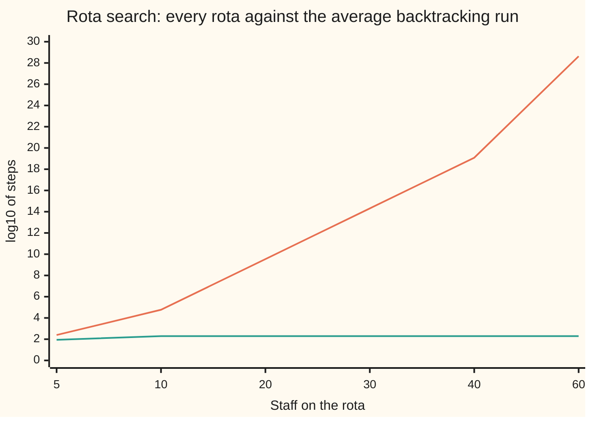

# Average-case hardness: hard on the inputs you actually draw

[Syllabus](../../../SYLLABUS.md) → [Computability and complexity](../README.md) → [Beyond Worst Case](../README.md#s04) → Average-case hardness

---

## General Overview

A bank publishes an RSA key: a 2048-bit number made by multiplying two random 1024-bit primes ([RSA in full](../../14-Applied%20and%20computational/04-Cryptography/04-rsa-in-full.md)). An attacker must split that one number: not the hardest 2048-bit number there is, but the one the key generator happened to draw.

So the question that matters is narrow. Is splitting hard **for the numbers the generator draws**?

Draw 2048-bit numbers in a different way, uniformly at random, and the answer flips. In the run below, 1,860 of 2,000 such numbers had a prime factor below 10,000. Trial division used 99.0 divisions per number on average, counting the numbers that ran through all 1,229 primes below 10,000 without a hit. Factoring is not hard "in general". It is believed hard for one way of drawing: two primes of the same size, multiplied.

The opposite also happens. Fitting staff into three shifts, so that no two staff who clash share a shift, is NP-complete: no fast method is known for every clash list. Yet on a random clash list, a plain search visits about 197 steps on average, for 20 staff or for 60. Hard in the worst case, easy on the inputs you draw.

**Cryptography needs average-case hardness: a problem that stays hard on the instances its key generator draws at random, and worst-case hardness such as NP-completeness does not supply it.**

**What kind of fact this is:** definitions (worst case, average case, one-way function), plus two theorems proved on this card in Why it works: the rota search's average, and the random self-reduction for discrete logarithms. That one-way functions exist, and that factoring a product of two random 1024-bit primes is hard on average, is a conjecture, unproved as of 2026-11-11.

### The picture: most random numbers split at once

The share of random numbers with a prime factor below B, the trial-division limit. RSA's numbers have none below $`2^{1023}`$.

```
divide up to B     share of random numbers that split
         10   ███████████████████████        77.14%
        100   ██████████████████████████     87.97%
      1,000   ████████████████████████████   91.90%
     10,000   ████████████████████████████   93.91%
    100,000   █████████████████████████████  95.12%
  1,000,000   █████████████████████████████  95.94%
```

---

## The formula

Two kinds of "hard", in words first.

- **Worst-case hard.** For every fast algorithm there is *some* input it gets wrong. The bad inputs may be rare and hard to find.
- **Average-case hard.** Fix a **distribution** $`D`$, the rule that draws inputs. Every fast algorithm gets *most* draws wrong.

The cleanest average-case object is a **one-way function**: a function $`f`$ that is quick to compute and that no fast attacker $`A`$ can invert on a random input.

```math
\Pr_{x \leftarrow D_n}\big[\, f(A(f(x))) = f(x) \,\big] \le \nu(n)
```

**Read it aloud:** draw a secret $`x`$ of length $`n`$, hand the attacker only $`f(x)`$; the chance that the attacker returns anything $`f`$ maps to the same output is negligible.

"Fast" means **probabilistic polynomial time**: the attacker may flip coins, as on [BPP](03-randomised-complexity-and-bpp.md), and runs at most a fixed power of $`n`$ steps. **Negligible** means $`\nu(n)`$ shrinks faster than $`1/n^j`$ for every fixed power $`j`$; $`2^{-n/2}`$ is negligible, $`1/n^{10}`$ is not. The bound must hold for every large enough $`n`$. The attacker need not find *the* $`x`$: any input with the same output counts as a win.

| Symbol | Plain meaning | In our example | Push it up and the answer… |
| --- | --- | --- | --- |
| $`n`$ | input length, in bits | 2048 for the key; 1024 per prime | brute force grows exponentially; $`f`$ grows polynomially |
| $`D_n`$ | the distribution: how inputs of length $`n`$ are drawn | two random 1024-bit primes | a skewed $`D_n`$ can make the problem easy |
| $`x`$ | the secret input, drawn from $`D_n`$ | the primes $`p`$ and $`q`$ | — |
| $`f`$ | the easy direction, computed in polynomial time | multiply: $`f(p, q) = N`$ | — |
| $`N`$ | the public output $`f(x)`$; $`N`$, because $`n`$ is the length | the 2048-bit RSA modulus | — |
| $`A`$ | any fast attacker | trial division; the number field sieve | a stronger $`A`$ raises the left side |
| $`\Pr[\cdot]`$ | chance over the draw of $`x`$ and the attacker's coins | 1,860 / 2,000 for uniform numbers | — |
| $`\nu(n)`$, $`j`$ | the negligible bound, and any fixed power it must beat | believed tiny at 2048 bits | — |
| $`E_n`$, $`X`$; $`k`$, $`t`$; $`a, b, c`$ | Step 1: average and actual search nodes; staff placed so far, and one partial rota; staff on each shift | 197.0954 at 30 staff | levels off as staff grow |
| $`B`$, $`p`$, $`\gamma`$ | Step 2: trial-division limit; a prime below it; Euler's constant, 0.5772… | 10,000 | more random numbers split |
| $`g, y, r, s, m`$ | Step 4: base, target, random shift, solver's answer, number of slots | 11, 956, fresh each try, —, 1,008 | — |
| $`\rho`$ | Step 4: share of targets a weak solver answers | 10 / 1,008 = 0.99% | fewer shifts needed: about $`1/\rho`$ |

### When it holds

- **The input really is drawn from $`D_n`$.** A key generator with a poor random source draws from a small set, and the attacker lists that set instead of factoring.
- **$`D_n`$ is the distribution the hardness was claimed for.** Uniform 2048-bit numbers are not RSA moduli: 93.00% of them split by trial division up to 10,000.
- **The attacker sees $`f(x)`$, not $`x`$.** Leak half the bits of one prime and Coppersmith's method recovers the rest quickly.
- **"Fast" is polynomial in $`n`$.** At one fixed size the definition promises nothing; real keys rely on cost estimates for the best known attack, such as about $`2^{112}`$ operations for 2048-bit RSA.
- **The conjecture is true.** No one has proved any function one-way. A large quantum computer would split RSA moduli by Shor's algorithm ([Shor and Grover](../05-Algebraic%2C%20Interactive%20and%20Quantum/07-shors-and-grovers-algorithms.md)).

---

## Why it works

### Step 0: the generator picks the instance, so only the average protects

A key generator draws its instance at random and keeps the answer. The attacker then faces that one instance.

Worst-case hardness only promises that hard instances exist somewhere. It does not say where, and a random draw may almost never land on one. So cryptography needs two things together: a distribution that is easy to **sample with its answer** (pick two primes, multiply), and hard to **solve** on most samples.

[Which case are you quoting? Worst, average and amortised cost](../../14-Applied%20and%20computational/01-Algorithms%20and%20Growth/02-worst-case-average-case-and-amortised.md) already separates worst-case from average-case *cost of one algorithm*. This card asks the same question about a *problem*: the best any algorithm can do.

### Step 1: worst-case hard, easy on average

Take the rota. Each pair of $`n`$ staff clashes with chance 0.5. Assign each person one of three shifts (early, late, night) so that no clashing pair shares a shift. This is 3-COLOURING, an NP-complete problem from the recipe table of [Karp's list](../03-Time%20Complexity/05-karps-problems-and-hardness-recipes.md).

Run a **backtracking search**: place staff one at a time, try each shift, and step back when a clash appears. Count every partial rota it visits, listing *all* valid rotas: an upper bound on the work of finding one.

Each node of the search is a partial rota of the first $`k`$ staff with no clash inside it. A partial rota with $`a`$, $`b`$ and $`c`$ staff on the three shifts survives when none of its same-shift pairs clash. So the average number of nodes is a sum over partial rotas of their survival chances:

```math
E_n = \sum_{a+b+c \le n} \frac{(a+b+c)!}{a!\,b!\,c!}\; 2^{-\left[\binom{a}{2}+\binom{b}{2}+\binom{c}{2}\right]}
```

**Read it aloud:** for every way to split the first few staff into three shifts, count the arrangements and multiply by the chance that no two people on the same shift clash.

Once any shift holds more than a handful of staff, the factor $`2^{-\binom{a}{2}}`$ crushes the term. The sum stops growing: 194.5668 at 10 staff, 197.0954 from 20 staff on. Trying every rota costs $`3^n`$, which at 30 staff is 205,891,132,094,649.

<details>
<summary>Detailed proof: the average search size is the sum above</summary>

Let $`X`$ be the number of nodes visited on a random clash list. Write $`X`$ as a sum of switches: one switch for each partial rota $`t`$ of the first $`k`$ staff, for every $`k`$ from 0 to $`n`$. The switch is 1 when $`t`$ has no clash inside it, and 0 otherwise.

Backtracking visits $`t`$ exactly when $`t`$ has no clash inside it. Every shorter piece of $`t`$ then has no clash either, so the search reaches $`t`$ and does not cut it off.

The average of a sum is the sum of the averages. The switch for $`t`$ averages to the chance that none of its same-shift pairs clash. Those pairs number $`\binom{a}{2}+\binom{b}{2}+\binom{c}{2}`$, and each clashes independently with chance 0.5. The number of partial rotas with shift counts $`a, b, c`$ is the multinomial count (the ways to choose which $`a`$ staff go early, which $`b`$ late, the rest night):

$`\displaystyle E_n = \sum_{k=0}^{n} \sum_{a+b+c=k} \frac{k!}{a!\,b!\,c!}\; 2^{-\left[\binom{a}{2}+\binom{b}{2}+\binom{c}{2}\right]}.`$

The sum over all $`a, b, c`$ converges, so $`E_n`$ is bounded by a constant for every $`n`$. That constant is 197.0954.

</details>



The rising line is $`3^n`$, every rota tried. The flat line is the backtracking average, $`E_n`$. If P ≠ NP, some clash lists defeat every fast method; a coin flip almost never produces them.

### Step 2: the distribution is a choice, and RSA chooses carefully

Factoring shows the same split from the other side. A uniformly random number has no prime factor below $`B`$ with chance

```math
\prod_{p < B} \Big(1 - \frac{1}{p}\Big) \approx \frac{e^{-\gamma}}{\ln B}
```

**Read it aloud:** the number escapes every small prime $`p`$, each with chance one minus one over $`p`$; Mertens' theorem says the product is close to $`e^{-\gamma}`$ over the natural log of $`B`$.

That share falls only like $`1/\ln B`$. At $`B`$ = 10,000 the product gives 93.91% split, Mertens gives 93.90%, and 2,000 random 2048-bit numbers gave 93.00%. Uniform 2048-bit numbers are a soft target, as [One-way streets](../../02-Number%20theory/06-Codes%20and%20Secrets/01-one-way-streets.md) hinted: multiplying is easy, and splitting is slow only when nothing small divides.

RSA's distribution removes every soft case. Both primes have 1024 bits, so the smallest factor is above $`2^{1023}`$. Trial division would face about $`10^{305.4}`$ candidate primes. The best known method, the number field sieve, has a cost whose leading term at 2048 bits is about $`2^{116.9}`$; NIST's published table rates the key at $`2^{112}`$, as [RSA in full](../../14-Applied%20and%20computational/04-Cryptography/04-rsa-in-full.md) records. Both are costs of known attacks, not proofs that nothing faster exists.

### Step 3: one-way functions, weak and strong

The formula above defines a **strong** one-way function: every fast attacker fails on all but a negligible share of inputs.

A **weak** one-way function only promises failure on a small but not negligible share: at least $`1/n^j`$ for some fixed power $`j`$. Multiplying two random 1024-bit numbers (not primes) is the textbook case. An attacker that strips small factors wins most of the time. It is stuck at least when both numbers are prime, which happens with chance about $`0.001409^2`$: 1 in 503,791. If factoring prime products is hard, that share is enough to make plain multiplication weakly one-way.

Yao's theorem turns weak into strong: apply the weak function to many independent inputs at once. To invert the bundle, the attacker must invert every copy, and some copy almost surely lands in the hard share. The theorem is stated here without proof; Goldreich's book (Sources) proves it.

### Step 4: when the average case is the worst case

Sometimes the average and the worst case are provably equal. The tool is a **random self-reduction**: turn any instance into a uniformly random one, solve that, and turn the answer back.

Discrete logarithms do this. Take the clock of 1,009 and base 11 from [One-way streets](../../02-Number%20theory/06-Codes%20and%20Secrets/01-one-way-streets.md), a toy clock, insecure at this size, where 11 to the 613th lands on 956. Suppose a solver knows only 10 of the 1,008 possible answers: $`\rho`$ = 0.99%. To find the log of any target $`y`$:

1. Draw a fresh random shift $`r`$ from 0 to 1,007.
2. Ask the solver about $`y \cdot g^{r}`$ on the clock.
3. If it answers $`s`$, return $`s - r`$, wrapped at 1,008. If not, go back to step 1.

```math
\log_g y \;=\; \log_g\!\big(y\, g^{r}\big) \;-\; r \pmod{1008}
```

**Read it aloud:** the log of the target is the log of the shifted target, minus the shift.

The shifted target $`y \cdot g^r`$ is equally likely to be any of the 1,008 slots, whatever $`y`$ is. So each try succeeds with chance $`\rho`$, and the expected number of tries is $`1/\rho`$ = 100.80. The run solved all 1,008 targets, with 98.54 shifts on average. Target 956 took 53 shifts and gave 613.

<details>
<summary>Detailed proof: a solver right on a share of targets becomes right on all of them</summary>

Let $`g`$ have order $`m`$ on the clock, so its powers visit $`m`$ slots; here $`m`$ = 1,008. Fix any target $`y = g^{x}`$. For a uniform shift $`r`$ in 0 to $`m - 1`$, the shifted target is $`y \cdot g^{r} = g^{x + r}`$. As $`r`$ runs over all $`m`$ values, $`x + r`$ wrapped at $`m`$ also runs over all $`m`$ values, each once. So the shifted target is uniform, whatever $`x`$ was.

If the solver answers a share $`\rho`$ of slots correctly, each try succeeds with chance exactly $`\rho`$, independently of earlier tries. So the number of tries follows the geometric law (the count of tries up to the first success), with mean $`1/\rho`$. A returned answer $`s`$ satisfies $`g^{s} = y \cdot g^{r}`$, so $`g^{s - r} = y`$: the answer is right every time it comes back.

So a solver right on a share $`\rho`$ of random targets becomes a solver right on every target, at $`1/\rho`$ times the cost. In a group where the worst target is hard, the average target is just as hard.

</details>

Factoring has no known random self-reduction, so RSA's average-case hardness stays a separate assumption. Lattice problems have something close: Ajtai proved in 1996 that solving random instances of one lattice problem would solve hard lattice problems in the worst case. That link is one reason for [Lattices](../../14-Applied%20and%20computational/04-Cryptography/09-lattices-and-post-quantum-cryptography.md) in the new standards. Blum and Micali used the discrete log's self-reduction to build a pseudorandom generator whose security rests on discrete logs, the subject of [Pseudorandomness](04-derandomisation-and-pseudorandomness.md).

### Step 5: what is proved, and what is not

- **One-way functions imply P ≠ NP.** If P = NP, an attacker asks "is there an input starting with these bits that $`f`$ maps to $`N`$?", an NP question, and fixes the input one bit at a time.
- **The converse is open.** P ≠ NP might hold while every NP problem is easy on average.
- **Average-case NP has complete problems.** Levin defined them in 1986, so average-case hardness has its own theory of reductions.

Impagliazzo named five possible worlds for this gap. Which one is real is unproved as of 2026-11-11.

| World | What holds there | Cryptography there |
| --- | --- | --- |
| Algorithmica | P = NP | none |
| Heuristica | NP is hard in the worst case, easy on average | none |
| Pessiland | hard on average, but no one-way functions | none |
| Minicrypt | one-way functions, no public-key codes | secret-key codes only |
| Cryptomania | public-key codes exist | RSA-style keys |

Deployed public-key cryptography bets on Cryptomania.

---

## Worked numbers, by hand

| Step | Arithmetic | Value |
| --- | --- | --- |
| random numbers with a factor below 10,000 | one minus the product over 1,229 primes | 93.91% |
| the same, by Mertens | $`1 - e^{-\gamma} / \ln 10{,}000`$ | 93.90% |
| the same, 2,000 random 2048-bit numbers | 1,860 split | 93.00% |
| rota, 5 staff, all 1,024 clash lists | search every list and average | 86.6436 |
| rota, 5 staff, by the sum $`E_5`$ | Step 1's formula | 86.6436 |
| rota, 30 staff, 2,000 random lists | search and average | 193.10 |
| rota, 30 staff, by the sum | Step 1's formula | 197.0954 |
| discrete log: the solver alone | 10 / 1,008 | 0.99% |
| expected shifts per target | 1,008 / 10 | 100.80 |
| measured shifts, all 1,008 targets | average | 98.54 |
| target 956 | 53 shifts, then shift back | **613** |

A solver that knows only 0.99% of the answers still finds every discrete log in about 100 tries. So, in that group, a hard worst case forces a hard average.

### What breaks if you drop a piece

| Mistake | Comes out at | What went wrong |
| --- | --- | --- |
| Draw any 2048-bit number, not two equal primes | 1,860 of 2,000 split, 99.0 divisions each | the hardness belonged to RSA's distribution, not to "numbers" |
| Ask the solver about $`y`$ itself, with no shift | 10 of 1,008 targets, 0.99% | without re-randomising, the solver's blind spots stay blind |
| Rota clash chance 0.1, not 0.5 | 359,238,969 nodes on average at 30 staff, then 977,470,662 at 80 and at 120, not 197.0954 | still a fixed ceiling, only far higher: the constant belongs to the clash chance |
| Clash chance 4/n, falling as staff grow | 70,836 nodes at 20 staff, 916,052,316 at 40, 9,912,928,926,465 at 60 | no ceiling: Step 1's bounded average needs a clash chance that stays fixed while the staff grow |

All four come from the checks.

---

## Code, from first principles, and it actually runs

The code runs three parts, each by three independent roads. The rota average: the closed-form sum, a search of all 1,024 clash lists on 5 staff, and 2,000 random lists on 30 staff. The share that splits: the product over primes, Mertens' estimate, and trial division of 2,000 random 2048-bit numbers. The discrete logs: the self-reduction, a slow walk through every power, and raising 11 to each answer. Randomness is SplitMix64 with seed 20261119, written out in both languages so the outputs match.

### Python

```python
# Average-case hardness -- the check behind the card.  Standard library only.
# Three parts: a rota search that is easy on average though its problem is
# NP-complete; random 2048-bit numbers, most of which split at once; and a
# discrete-log solver that is right on 1% of inputs, turned into one that is
# right on all of them.  Costs are counted steps, never a stopwatch.
from math import log, exp, sqrt, factorial

M64 = (1 << 64) - 1
state = 20261119                                  # SplitMix64, seed stated here
def rng():
    global state
    state = z = (state + 0x9E3779B97F4A7C15) & M64
    z = ((z ^ (z >> 30)) * 0xBF58476D1CE4E5B9) & M64
    z = ((z ^ (z >> 27)) * 0x94D049BB133111EB) & M64
    return z ^ (z >> 31)

# ---- part 1: the rota.  n staff, 3 shifts; a clash list says who may not share a shift ----
def formula(n, q):          # average search nodes: sum over partial rotas of Pr[no clash inside]
    total = 0.0
    for a in range(n + 1):
        for b in range(n + 1 - a):
            for c in range(n + 1 - a - b):
                ways = factorial(a + b + c) / (factorial(a) * factorial(b) * factorial(c))
                total += ways * (1.0 - q) ** (a * (a - 1) // 2 + b * (b - 1) // 2 + c * (c - 1) // 2)
    return total
def pairs(n):
    return [(i, j) for i in range(n) for j in range(i + 1, n)]
def search_nodes(n, clash):    # backtracking that lists every clash-free rota; counts nodes visited
    shift = [0] * n
    def go(k):
        nodes = 1
        for s in range(3 if k < n else 0):
            if all(not ((j, k) in clash and shift[j] == s) for j in range(k)):
                shift[k] = s
                nodes += go(k + 1)
        return nodes
    return go(0)

exhaustive = sum(search_nodes(5, {pr for b, pr in enumerate(pairs(5)) if mask >> b & 1})
                 for mask in range(1 << 10)) / (1 << 10)          # every clash list on 5 staff
runs = [search_nodes(30, {pr for pr in pairs(30) if rng() % 2 == 1}) for _ in range(2000)]
sim = sum(runs) / len(runs)
sd = sqrt(sum((x - sim) ** 2 for x in runs) / (len(runs) - 1))
print("part 1: the rota, 3 shifts, each pair of staff clashing with chance 0.5")
for n in (5, 10, 20, 30, 60):
    print(f"  staff {n:>2}: average search nodes {formula(n, 0.5):12.4f}   every rota tried 3^n = {3 ** n}")
print(f"  staff  5, all 1024 clash lists searched: average {exhaustive:.4f}")
print(f"  staff 30, 2000 random clash lists searched: average {sim:.2f}, largest {max(runs)}, sd {sd:.2f}")
print("  chart, staff:            " + " ".join(f"{n:>6}" for n in (5, 10, 20, 30, 40, 60)))
print("  chart, log10 of 3^n:     " + " ".join(f"{n * log(3) / log(10):6.2f}" for n in (5, 10, 20, 30, 40, 60)))
print("  chart, log10 of average: " + " ".join(f"{log(formula(n, 0.5)) / log(10):6.2f}" for n in (5, 10, 20, 30, 40, 60)))
sparse, falling = [formula(n, 0.1) for n in (30, 80, 120)], [formula(n, 4 / n) for n in (20, 40, 60)]
print("  break: clash chance 0.1, staff 30, 80, 120: average search nodes " + ", ".join(f"{x:.0f}" for x in sparse))
print("  break: clash chance 4/n, staff 20, 40, 60: average search nodes " + ", ".join(f"{x:.0f}" for x in falling))

# ---- part 2: factoring.  A random 2048-bit number against a product of two 1024-bit primes ----
LIMIT = 1000000
sieve = bytearray([1]) * LIMIT
sieve[0] = sieve[1] = 0
for i in range(2, 1001):
    if sieve[i]:
        for j in range(i * i, LIMIT, i):
            sieve[j] = 0
primes = [i for i in range(LIMIT) if sieve[i]]
GAMMA = 0.5772156649015329                        # Euler's constant, for Mertens' theorem
print("part 2: share of random numbers with a prime factor below B")
bars = {}
for b in (10, 100, 1000, 10000, 100000, 1000000):
    keep = 1.0                                    # share with no prime factor below b
    for p in primes:
        if p >= b:
            break
        keep *= 1.0 - 1.0 / p
    bars[b] = 1.0 - keep
for b in sorted(bars):
    print(f"  B = {b:>7}: by the product {100 * bars[b]:6.2f}%   by Mertens {100 * (1 - exp(-GAMMA) / log(b)):6.2f}%")
small = [p for p in primes if p < 10000]
hit, divisions = 0, 0
for _ in range(2000):
    limbs = [rng() for _ in range(32)]
    limbs[31] |= 1 << 63                          # top bit set: exactly 2048 bits
    N = sum(limb << (64 * i) for i, limb in enumerate(limbs))
    for p in small:
        divisions += 1
        if N % p == 0:
            hit += 1
            break
share = hit / 2000
se = sqrt(bars[10000] * (1 - bars[10000]) / 2000)
print(f"  2000 random 2048-bit numbers, {len(small)} trial divisions at most: {hit} split, {100 * share:.2f}%, "
      f"{divisions / 2000:.1f} divisions each on average")
print(f"  RSA product of two 1024-bit primes: smallest factor above 2^1023; primes below 2^1024 about 10^{1024 * log(2) / log(10) - log(1024 * log(2)) / log(10):.1f}")
lnN = 2048 * log(2)
print(f"  number field sieve, leading term for 2048 bits: about 2^{(64 / 9) ** (1 / 3) * lnN ** (1 / 3) * log(lnN) ** (2 / 3) / log(2):.1f}")
pp = 1 / (1024 * log(2))
print(f"  weak one-way: a random 1024-bit number is prime with chance about {pp:.6f}; both of two: 1 in {1 / pp ** 2:.0f}")

# ---- part 3: discrete log on the clock of 1,009, base 11 (from One-way streets) ----
P, G, ORD = 1009, 11, 1008
def power(a, k):                                  # square and multiply, written out
    out = 1
    while k:
        out, a, k = (out * a % P if k & 1 else out), a * a % P, k >> 1
    return out
walk, v = {}, 1                                   # road one: walk every power, the slow way
for k in range(ORD):
    walk[v] = k
    v = v * G % P
oracle = {}                                       # a solver that knows only 10 of the 1,008 answers
while len(oracle) < 10:
    e = rng() % ORD
    oracle[power(G, e)] = e
def self_reduce(y):                               # road two: shift y to a random spot, ask, shift back
    tries = 0
    while True:
        tries += 1
        r = rng() % ORD
        z = y * power(G, r) % P
        if z in oracle:
            return (oracle[z] - r) % ORD, tries
x956, t956 = self_reduce(956)
results = [self_reduce(y) for y in range(1, P)]
mean = sum(t for _, t in results) / ORD
print("part 3: discrete log on a clock of 1009, base 11; the solver alone knows 10 of 1008")
print(f"  the solver alone answers {len(oracle)} of {ORD} targets: {100 * len(oracle) / ORD:.2f}%")
print(f"  target 956: answer {x956} after {t956} random shifts; 11^{x956} on the clock = {power(G, x956)}")
print(f"  all 1008 targets: {sum(power(G, x) == y for (x, _), y in zip(results, range(1, P)))} verified, "
      f"{sum(walk[y] == x for (x, _), y in zip(results, range(1, P)))} match the walk")
print(f"  shifts per target: average {mean:.2f}, expected 1008 / 10 = {ORD / 10:.2f}")

assert abs(exhaustive - formula(5, 0.5)) < 1e-9                  # brute force over 1,024 lists vs closed form
assert abs(sim - formula(30, 0.5)) < 4 * sd / sqrt(len(runs))       # simulation vs closed form
assert abs(formula(60, 0.5) - 197.0954) < 1e-4 and abs(sparse[2] / sparse[1] - 1) < 1e-9   # levels off at 0.5 and at 0.1
assert falling[2] > 1000 * falling[1] > 10 ** 6 * falling[0]         # a clash chance falling as 4/n: no ceiling
assert abs(share - bars[10000]) < 4 * se                            # random 2048-bit numbers vs the product
assert abs(bars[1000000] - (1 - exp(-GAMMA) / log(1000000))) < 0.001  # product vs Mertens
assert all(power(G, x) == y and walk[y] == x for (x, _), y in zip(results, range(1, P)))
geo_se = sqrt(1 - 10 / ORD) / (10 / ORD) / sqrt(ORD)
assert abs(mean - ORD / 10) < 4 * geo_se and x956 == 613           # self-reduction cost vs geometric law
print("ALL CHECKS PASS")
```

**Ran 2026-11-19 on macOS, Python 3.14.10, standard library only. All checks passed. Output, pasted from the run:**

```
part 1: the rota, 3 shifts, each pair of staff clashing with chance 0.5
  staff  5: average search nodes      86.6436   every rota tried 3^n = 243
  staff 10: average search nodes     194.5668   every rota tried 3^n = 59049
  staff 20: average search nodes     197.0954   every rota tried 3^n = 3486784401
  staff 30: average search nodes     197.0954   every rota tried 3^n = 205891132094649
  staff 60: average search nodes     197.0954   every rota tried 3^n = 42391158275216203514294433201
  staff  5, all 1024 clash lists searched: average 86.6436
  staff 30, 2000 random clash lists searched: average 193.10, largest 3592, sd 212.43
  chart, staff:                 5     10     20     30     40     60
  chart, log10 of 3^n:       2.39   4.77   9.54  14.31  19.08  28.63
  chart, log10 of average:   1.94   2.29   2.29   2.29   2.29   2.29
  break: clash chance 0.1, staff 30, 80, 120: average search nodes 359238969, 977470662, 977470662
  break: clash chance 4/n, staff 20, 40, 60: average search nodes 70836, 916052316, 9912928926465
part 2: share of random numbers with a prime factor below B
  B =      10: by the product  77.14%   by Mertens  75.62%
  B =     100: by the product  87.97%   by Mertens  87.81%
  B =    1000: by the product  91.90%   by Mertens  91.87%
  B =   10000: by the product  93.91%   by Mertens  93.90%
  B =  100000: by the product  95.12%   by Mertens  95.12%
  B = 1000000: by the product  95.94%   by Mertens  95.94%
  2000 random 2048-bit numbers, 1229 trial divisions at most: 1860 split, 93.00%, 99.0 divisions each on average
  RSA product of two 1024-bit primes: smallest factor above 2^1023; primes below 2^1024 about 10^305.4
  number field sieve, leading term for 2048 bits: about 2^116.9
  weak one-way: a random 1024-bit number is prime with chance about 0.001409; both of two: 1 in 503791
part 3: discrete log on a clock of 1009, base 11; the solver alone knows 10 of 1008
  the solver alone answers 10 of 1008 targets: 0.99%
  target 956: answer 613 after 53 random shifts; 11^613 on the clock = 956
  all 1008 targets: 1008 verified, 1008 match the walk
  shifts per target: average 98.54, expected 1008 / 10 = 100.80
ALL CHECKS PASS
```

### Rust

The same parts and labels. Rust has no big integers, so each 2048-bit number is 32 words of 64 bits, and its remainder by a small prime is taken one word at a time.

```rust
// Average-case hardness -- the same check as the Python, in Rust.  No crates.
// Three parts: a rota search that is easy on average though its problem is
// NP-complete; random 2048-bit numbers, most of which split at once; and a
// discrete-log solver that is right on 1% of inputs, turned into one that is
// right on all of them.  Costs are counted steps, never a stopwatch.
use std::collections::{HashMap, HashSet};

struct Rng(u64);                                   // SplitMix64, seed stated in main
impl Rng {
    fn next(&mut self) -> u64 {
        self.0 = self.0.wrapping_add(0x9E3779B97F4A7C15);
        let mut z = self.0;
        z = (z ^ (z >> 30)).wrapping_mul(0xBF58476D1CE4E5B9);
        z = (z ^ (z >> 27)).wrapping_mul(0x94D049BB133111EB);
        z ^ (z >> 31)
    }
}

// ---- part 1: the rota.  n staff, 3 shifts; a clash list says who may not share a shift ----
fn formula(n: usize, q: f64) -> f64 {     // average search nodes: sum over partial rotas of Pr[no clash inside]
    let mut fact = vec![1.0f64; n + 1];
    for i in 1..=n { fact[i] = fact[i - 1] * i as f64; }
    let mut total = 0.0;
    for a in 0..=n { for b in 0..=(n - a) { for c in 0..=(n - a - b) {
        let ways = fact[a + b + c] / (fact[a] * fact[b] * fact[c]);
        total += ways * (1.0 - q).powf((a * a.saturating_sub(1) / 2 + b * b.saturating_sub(1) / 2 + c * c.saturating_sub(1) / 2) as f64);
    } } }
    total
}

fn pairs(n: usize) -> Vec<(usize, usize)> {
    let mut out = Vec::new();
    for i in 0..n { for j in (i + 1)..n { out.push((i, j)); } }
    out
}

fn go(k: usize, n: usize, clash: &HashSet<(usize, usize)>, shift: &mut Vec<usize>) -> u64 {
    let mut nodes = 1;                     // backtracking that lists every clash-free rota
    if k == n { return nodes; }
    for s in 0..3 {
        if (0..k).all(|j| !(clash.contains(&(j, k)) && shift[j] == s)) {
            shift[k] = s;
            nodes += go(k + 1, n, clash, shift);
        }
    }
    nodes
}
fn search_nodes(n: usize, clash: &HashSet<(usize, usize)>) -> u64 { go(0, n, clash, &mut vec![0; n]) }

// ---- part 3 helper: square and multiply on the clock of 1009 ----
const P: u64 = 1009;
const G: u64 = 11;
const ORD: u64 = 1008;
fn power(mut a: u64, mut k: u64) -> u64 {
    let mut out = 1;
    while k > 0 { if k & 1 == 1 { out = out * a % P; } a = a * a % P; k >>= 1; }
    out
}

fn main() {
    let mut rng = Rng(20261119);
    let mut exhaustive = 0u64;
    for mask in 0..(1u32 << 10) {                    // every clash list on 5 staff
        let clash: HashSet<(usize, usize)> = pairs(5).into_iter().enumerate()
            .filter(|(b, _)| mask >> b & 1 == 1).map(|(_, pr)| pr).collect();
        exhaustive += search_nodes(5, &clash);
    }
    let exhaustive = exhaustive as f64 / 1024.0;
    let mut runs: Vec<u64> = Vec::new();
    for _ in 0..2000 {
        let clash: HashSet<(usize, usize)> = pairs(30).into_iter().filter(|_| rng.next() % 2 == 1).collect();
        runs.push(search_nodes(30, &clash));
    }
    let sim = runs.iter().sum::<u64>() as f64 / runs.len() as f64;
    let sd = (runs.iter().map(|&x| (x as f64 - sim).powi(2)).sum::<f64>() / (runs.len() - 1) as f64).sqrt();
    println!("part 1: the rota, 3 shifts, each pair of staff clashing with chance 0.5");
    for n in [5usize, 10, 20, 30, 60] {
        println!("  staff {:>2}: average search nodes {:12.4}   every rota tried 3^n = {}", n, formula(n, 0.5), 3u128.pow(n as u32));
    }
    println!("  staff  5, all 1024 clash lists searched: average {:.4}", exhaustive);
    println!("  staff 30, 2000 random clash lists searched: average {:.2}, largest {}, sd {:.2}", sim, runs.iter().max().unwrap(), sd);
    let ns = [5usize, 10, 20, 30, 40, 60];
    let row = |f: &dyn Fn(usize) -> String| ns.iter().map(|&n| f(n)).collect::<Vec<_>>().join(" ");
    println!("  chart, staff:            {}", row(&|n| format!("{:>6}", n)));
    println!("  chart, log10 of 3^n:     {}", row(&|n| format!("{:6.2}", n as f64 * 3f64.ln() / 10f64.ln())));
    println!("  chart, log10 of average: {}", row(&|n| format!("{:6.2}", formula(n, 0.5).ln() / 10f64.ln())));
    let sparse: Vec<f64> = [30usize, 80, 120].iter().map(|&n| formula(n, 0.1)).collect();
    let falling: Vec<f64> = [20usize, 40, 60].iter().map(|&n| formula(n, 4.0 / n as f64)).collect();
    let show = |xs: &[f64]| xs.iter().map(|x| format!("{:.0}", x)).collect::<Vec<_>>().join(", ");
    println!("  break: clash chance 0.1, staff 30, 80, 120: average search nodes {}", show(&sparse));
    println!("  break: clash chance 4/n, staff 20, 40, 60: average search nodes {}", show(&falling));

    // ---- part 2: factoring.  A random 2048-bit number against a product of two 1024-bit primes ----
    const LIMIT: usize = 1000000;
    let mut sieve = vec![true; LIMIT];
    sieve[0] = false; sieve[1] = false;
    for i in 2..1001 { if sieve[i] { let mut j = i * i; while j < LIMIT { sieve[j] = false; j += i; } } }
    let primes: Vec<u64> = (0..LIMIT).filter(|&i| sieve[i]).map(|i| i as u64).collect();
    const GAMMA: f64 = 0.5772156649015329;           // Euler's constant, for Mertens' theorem
    println!("part 2: share of random numbers with a prime factor below B");
    let mut bars: HashMap<u64, f64> = HashMap::new();
    for b in [10u64, 100, 1000, 10000, 100000, 1000000] {
        let mut keep = 1.0;                          // share with no prime factor below b
        for &p in &primes { if p >= b { break; } keep *= 1.0 - 1.0 / p as f64; }
        bars.insert(b, 1.0 - keep);
        println!("  B = {:>7}: by the product {:6.2}%   by Mertens {:6.2}%", b, 100.0 * (1.0 - keep), 100.0 * (1.0 - (-GAMMA).exp() / (b as f64).ln()));
    }
    let small: Vec<u64> = primes.iter().copied().filter(|&p| p < 10000).collect();
    let (mut hit, mut divisions) = (0u64, 0u64);
    for _ in 0..2000 {
        let mut limbs: Vec<u64> = (0..32).map(|_| rng.next()).collect();
        limbs[31] |= 1 << 63;                        // top bit set: exactly 2048 bits
        for &p in &small {
            divisions += 1;
            let rem = limbs.iter().rev().fold(0u128, |r, &l| ((r << 64) | l as u128) % p as u128);
            if rem == 0 { hit += 1; break; }
        }
    }
    let share = hit as f64 / 2000.0;
    let b4 = bars[&10000];
    let se = (b4 * (1.0 - b4) / 2000.0).sqrt();
    println!("  2000 random 2048-bit numbers, {} trial divisions at most: {} split, {:.2}%, {:.1} divisions each on average",
             small.len(), hit, 100.0 * share, divisions as f64 / 2000.0);
    let ln2 = 2f64.ln();
    println!("  RSA product of two 1024-bit primes: smallest factor above 2^1023; primes below 2^1024 about 10^{:.1}",
             1024.0 * ln2 / 10f64.ln() - (1024.0 * ln2).ln() / 10f64.ln());
    let ln_n = 2048.0 * ln2;
    println!("  number field sieve, leading term for 2048 bits: about 2^{:.1}",
             (64.0f64 / 9.0).powf(1.0 / 3.0) * ln_n.powf(1.0 / 3.0) * ln_n.ln().powf(2.0 / 3.0) / ln2);
    let pp = 1.0 / (1024.0 * ln2);
    println!("  weak one-way: a random 1024-bit number is prime with chance about {:.6}; both of two: 1 in {:.0}", pp, 1.0 / (pp * pp));

    // ---- part 3: discrete log on the clock of 1009, base 11 (from One-way streets) ----
    let mut walk: HashMap<u64, u64> = HashMap::new();   // road one: walk every power, the slow way
    let mut v = 1;
    for k in 0..ORD { walk.insert(v, k); v = v * G % P; }
    let mut oracle: HashMap<u64, u64> = HashMap::new(); // a solver that knows only 10 of the 1008 answers
    while oracle.len() < 10 { let e = rng.next() % ORD; oracle.insert(power(G, e), e); }
    let mut self_reduce = |y: u64| -> (u64, u64) {      // road two: shift y to a random spot, ask, shift back
        let mut tries = 0;
        loop {
            tries += 1;
            let r = rng.next() % ORD;
            let z = y * power(G, r) % P;
            if let Some(&e) = oracle.get(&z) { return ((e + ORD - r) % ORD, tries); }
        }
    };
    let (x956, t956) = self_reduce(956);
    let results: Vec<(u64, u64)> = (1..P).map(|y| self_reduce(y)).collect();
    let mean = results.iter().map(|&(_, t)| t).sum::<u64>() as f64 / ORD as f64;
    let verified = results.iter().zip(1..P).filter(|&(&(x, _), y)| power(G, x) == y).count();
    let matched = results.iter().zip(1..P).filter(|&(&(x, _), y)| walk[&y] == x).count();
    println!("part 3: discrete log on a clock of 1009, base 11; the solver alone knows 10 of 1008");
    println!("  the solver alone answers {} of {} targets: {:.2}%", oracle.len(), ORD, 100.0 * oracle.len() as f64 / ORD as f64);
    println!("  target 956: answer {} after {} random shifts; 11^{} on the clock = {}", x956, t956, x956, power(G, x956));
    println!("  all 1008 targets: {} verified, {} match the walk", verified, matched);
    println!("  shifts per target: average {:.2}, expected 1008 / 10 = {:.2}", mean, ORD as f64 / 10.0);

    assert!((exhaustive - formula(5, 0.5)).abs() < 1e-9);               // brute force vs closed form
    assert!((sim - formula(30, 0.5)).abs() < 4.0 * sd / (runs.len() as f64).sqrt());
    assert!((formula(60, 0.5) - 197.0954).abs() < 1e-4 && (sparse[2] / sparse[1] - 1.0).abs() < 1e-9);
    assert!(falling[2] > 1000.0 * falling[1] && 1000.0 * falling[1] > 1e6 * falling[0]);   // 4/n: no ceiling
    assert!((share - b4).abs() < 4.0 * se);                             // random 2048-bit numbers vs the product
    assert!((bars[&1000000] - (1.0 - (-GAMMA).exp() / 1e6f64.ln())).abs() < 0.001);
    assert!(verified == 1008 && matched == 1008);
    let pr = 10.0 / ORD as f64;
    let geo_se = (1.0 - pr).sqrt() / pr / (ORD as f64).sqrt();
    assert!((mean - ORD as f64 / 10.0).abs() < 4.0 * geo_se && x956 == 613);
    println!("ALL CHECKS PASS");
}
```

**Ran 2026-11-19 on macOS, rustc 1.98.1, no crates. All checks passed. Output, pasted from the run:**

```
part 1: the rota, 3 shifts, each pair of staff clashing with chance 0.5
  staff  5: average search nodes      86.6436   every rota tried 3^n = 243
  staff 10: average search nodes     194.5668   every rota tried 3^n = 59049
  staff 20: average search nodes     197.0954   every rota tried 3^n = 3486784401
  staff 30: average search nodes     197.0954   every rota tried 3^n = 205891132094649
  staff 60: average search nodes     197.0954   every rota tried 3^n = 42391158275216203514294433201
  staff  5, all 1024 clash lists searched: average 86.6436
  staff 30, 2000 random clash lists searched: average 193.10, largest 3592, sd 212.43
  chart, staff:                 5     10     20     30     40     60
  chart, log10 of 3^n:       2.39   4.77   9.54  14.31  19.08  28.63
  chart, log10 of average:   1.94   2.29   2.29   2.29   2.29   2.29
  break: clash chance 0.1, staff 30, 80, 120: average search nodes 359238969, 977470662, 977470662
  break: clash chance 4/n, staff 20, 40, 60: average search nodes 70836, 916052316, 9912928926465
part 2: share of random numbers with a prime factor below B
  B =      10: by the product  77.14%   by Mertens  75.62%
  B =     100: by the product  87.97%   by Mertens  87.81%
  B =    1000: by the product  91.90%   by Mertens  91.87%
  B =   10000: by the product  93.91%   by Mertens  93.90%
  B =  100000: by the product  95.12%   by Mertens  95.12%
  B = 1000000: by the product  95.94%   by Mertens  95.94%
  2000 random 2048-bit numbers, 1229 trial divisions at most: 1860 split, 93.00%, 99.0 divisions each on average
  RSA product of two 1024-bit primes: smallest factor above 2^1023; primes below 2^1024 about 10^305.4
  number field sieve, leading term for 2048 bits: about 2^116.9
  weak one-way: a random 1024-bit number is prime with chance about 0.001409; both of two: 1 in 503791
part 3: discrete log on a clock of 1009, base 11; the solver alone knows 10 of 1008
  the solver alone answers 10 of 1008 targets: 0.99%
  target 956: answer 613 after 53 random shifts; 11^613 on the clock = 956
  all 1008 targets: 1008 verified, 1008 match the walk
  shifts per target: average 98.54, expected 1008 / 10 = 100.80
ALL CHECKS PASS
```

The two outputs match line for line.

### Lean

Lean proves Step 4's random self-reduction for any base $`g`$ whose powers visit $`m`$ slots.

- Suppose the solver answers some number of the $`m`$ slots. Then, for any target, exactly that many of the $`m`$ shifts land on a slot it answers.
- Take any target and any slot. Then exactly one of the $`m`$ shifts moves the target onto that slot.
- Suppose the shift $`r`$ is below $`m`$ and the solver answers $`s`$. Then $`s - r`$, wrapped at $`m`$, is the log of the target.
- On the clock of 1,009, which is prime, 11 to the 613th lands on 956.
- On that clock, 11 to the 1,008th lands on 1, while 11 to the 504th, 336th and 144th do not.
- On the rota, 5 staff have 10 pairs and 1,024 clash lists.
- The counts of every rota tried, $`3^n`$, are right for 5, 10, 20, 30 and 60 staff.

The geometric law, the rota average $`E_n`$, the factoring shares and every simulated run are left to the Python and Rust checks.

```lean
-- Average-case hardness: the random self-reduction for discrete logarithms makes every shifted target uniform, so a solver right on a share of targets is right on that same share of shifts for any target, and shifting back always gives the true logarithm.
import Mathlib.GroupTheory.OrderOfElement
import Mathlib.Algebra.Group.Subgroup.ZPowers.Basic
import Mathlib.Data.Nat.Prime.Basic
import Mathlib.Tactic.NormNum.Prime

/-- Helper: a power of `g`, where `g` has positive order `m`, is `g ^ r` for some `r < m`. -/
theorem zpowers_eq_pow_lt_order {G : Type*} [Group G] [DecidableEq G]
    (g : G) {m : ℕ} (hm : orderOf g = m) (hpos : 0 < m) (w : G)
    (hw : w ∈ Subgroup.zpowers g) : ∃ r, r < m ∧ g ^ r = w := by
  have hx : IsOfFinOrder g := orderOf_pos_iff.mp (hm ▸ hpos)
  rw [hx.mem_zpowers_iff_mem_range_orderOf, Finset.mem_image] at hw
  obtain ⟨r, hr, hrw⟩ := hw
  exact ⟨r, hm ▸ Finset.mem_range.mp hr, hrw⟩

/-- Random self-reduction, the cost of one try: let `g` have order `m` and let the solver
answer the targets in a set `S` of powers of `g`. For any target `y = g ^ x`, the number of
shifts `r` from `0` to `m - 1` for which the shifted target `y * g ^ r` lies in `S` is exactly
`|S|`. So each random shift succeeds with chance exactly `ρ = |S| / m`, whatever `y` is. -/
theorem shifted_target_hits_solver_share {G : Type*} [Group G] [DecidableEq G]
    (g : G) {m : ℕ} (hm : orderOf g = m) (hpos : 0 < m)
    (S : Finset G) (hS : ∀ z ∈ S, z ∈ Subgroup.zpowers g) (x : ℕ) :
    ((Finset.range m).filter (fun r => g ^ x * g ^ r ∈ S)).card = S.card := by
  refine Finset.card_bij (fun r _ => g ^ x * g ^ r) ?_ ?_ ?_
  · intro r hr
    exact (Finset.mem_filter.mp hr).2
  · intro r1 hr1 r2 hr2 heq
    have h1 := Finset.mem_range.mp (Finset.mem_filter.mp hr1).1
    have h2 := Finset.mem_range.mp (Finset.mem_filter.mp hr2).1
    have h : g ^ r1 = g ^ r2 := mul_left_cancel heq
    rw [pow_inj_mod, hm, Nat.mod_eq_of_lt h1, Nat.mod_eq_of_lt h2] at h
    exact h
  · intro z hz
    obtain ⟨r, hr, hrw⟩ := zpowers_eq_pow_lt_order g hm hpos ((g ^ x)⁻¹ * z)
      (Subgroup.mul_mem _ (Subgroup.inv_mem _ (Subgroup.pow_mem _ (Subgroup.mem_zpowers g) x))
        (hS z hz))
    refine ⟨r, Finset.mem_filter.mpr ⟨Finset.mem_range.mpr hr, ?_⟩, ?_⟩
    · rw [hrw, mul_inv_cancel_left]; exact hz
    · rw [hrw, mul_inv_cancel_left]

/-- The shifted target is uniform: let `g` have order `m`. For any target `y = g ^ x`, every
power `z` of `g` is hit by exactly one shift `r` from `0` to `m - 1`, that is `y * g ^ r = z`
for exactly one such `r`. -/
theorem shifted_target_uniform {G : Type*} [Group G] [DecidableEq G]
    (g : G) {m : ℕ} (hm : orderOf g = m) (hpos : 0 < m) (x : ℕ)
    (z : G) (hz : z ∈ Subgroup.zpowers g) :
    ((Finset.range m).filter (fun r => g ^ x * g ^ r = z)).card = 1 := by
  have h := shifted_target_hits_solver_share g hm hpos {z}
    (fun w hw => (Finset.mem_singleton.mp hw) ▸ hz) x
  simpa using h

/-- Shifting back is always right: let `g` have order `m`, and let the shift `r` be below `m`.
If the solver's answer `s` satisfies `g ^ s = y * g ^ r`, then `s - r`, wrapped at `m`, is a
logarithm of `y`: `g ^ ((s + m - r) % m) = y`. -/
theorem shift_back_gives_log {G : Type*} [Group G]
    (g y : G) {m : ℕ} (hm : orderOf g = m) (s r : ℕ) (hr : r < m)
    (h : g ^ s = y * g ^ r) :
    g ^ ((s + m - r) % m) = y := by
  have hpos : 0 < m := lt_of_le_of_lt (Nat.zero_le r) hr
  have hy : y = g ^ s * (g ^ r)⁻¹ := by rw [h, mul_inv_cancel_right]
  rw [← hm, pow_mod_orderOf, hy, eq_mul_inv_iff_mul_eq, ← pow_add,
    Nat.sub_add_cancel (by omega), pow_add, pow_orderOf_eq_one, mul_one]

-- The toy clock of 1,009 with base 11 (insecure at this size).
example : Nat.Prime 1009 := by norm_num
example : 11 ^ 613 % 1009 = 956 := by decide +kernel
-- 11 has order 1,008 on the clock: 11 ^ 1008 is 1, and 11 ^ (1008 / p) is not 1 for the
-- primes p = 2, 3, 7 dividing 1,008 = 2 ^ 4 * 3 ^ 2 * 7.
example : 1008 = 2 ^ 4 * 3 ^ 2 * 7 := by norm_num
example : 11 ^ 1008 % 1009 = 1 := by decide +kernel
example : 11 ^ 504 % 1009 ≠ 1 := by decide +kernel
example : 11 ^ 336 % 1009 ≠ 1 := by decide +kernel
example : 11 ^ 144 % 1009 ≠ 1 := by decide +kernel

-- The rota: 5 staff have 10 pairs, so 2 ^ 10 = 1,024 clash lists; every rota tried is 3 ^ n.
example : Nat.choose 5 2 = 10 := by decide
example : 2 ^ 10 = 1024 := by norm_num
example : 3 ^ 5 = 243 := by norm_num
example : 3 ^ 10 = 59049 := by norm_num
example : 3 ^ 20 = 3486784401 := by norm_num
example : 3 ^ 30 = 205891132094649 := by norm_num
example : 3 ^ 60 = 42391158275216203514294433201 := by norm_num

#print axioms zpowers_eq_pow_lt_order
#print axioms shifted_target_hits_solver_share
#print axioms shifted_target_uniform
#print axioms shift_back_gives_log
```

**Checked 2026-11-19 on macOS, Lean 4.36.0-rc2, Mathlib v4.36.0-rc2. Every proof is complete and uses only Lean's standard axioms. Output, pasted from the run:**

```
'zpowers_eq_pow_lt_order' depends on axioms: [propext, Classical.choice, Quot.sound]
'shifted_target_hits_solver_share' depends on axioms: [propext, Classical.choice, Quot.sound]
'shifted_target_uniform' depends on axioms: [propext, Classical.choice, Quot.sound]
'shift_back_gives_log' depends on axioms: [propext, Classical.choice, Quot.sound]
```

> [!TIP]
> **Try changing**
> - **A better solver.** Guess first: what if it knows 100 answers, not 10? Set `while len(oracle) < 100`. The shifts per target fall to 10.32. The printed expectation is still written for 10, so the last assert stops the run.
> - **Sparser clashes.** Guess first: where does the rota average level off at clash chance 0.3? Change `formula(n, 0.1)` to `formula(n, 0.3)`. The break line, still labelled 0.1, prints 3056 at 30, 80 and 120 staff: 3,056 nodes, against 197.0954 at 0.5 and 977,470,662 at 0.1. Every assert still passes.
> - **Another seed.** Guess first: do the simulated numbers move much? Set `state = 7`. The rota average reads 195.55, 1,874 of 2,000 numbers split (93.70%), and the shifts average 98.37. Every assert still passes.

---

## The usual mistake

> [!warning]
> **"NP-complete, so it is secure."** NP-completeness is a worst-case statement: it promises hard instances exist, not that a key generator draws them. The Merkle–Hellman knapsack code of 1978 rested on an NP-complete problem, and Shamir broke it in 1982, because the instances it drew were easy. The rota on this card is NP-complete too, and its random instances take 197 search steps on average.
>
> - **Testing hardness on uniform inputs.** Uniform 2048-bit numbers are not RSA moduli: 93.00% of them split below 10,000.
> - **Reading "fails on most inputs" as safe.** An attacker who wins on 0.99% of keys breaks one key in about a hundred. The definition needs a negligible share, and Step 4 shows how a 0.99% solver can even become a 100% one.
> - **Trusting one run.** In 2,000 random 30-staff rotas the largest search took 3,592 nodes and the average 193.10. One easy run says nothing about the worst case, and one hard run says nothing about the average.
> - **Reading attack costs as lower bounds.** $`2^{116.9}`$ and $`2^{112}`$ price the best *known* attack, not every possible one.

---

## Where you meet it in real life

- **RSA key generation.** Generators draw two random primes of the same size, exactly the distribution the factoring assumption covers ([RSA in full](../../14-Applied%20and%20computational/04-Cryptography/04-rsa-in-full.md)).
- **Diffie-Hellman groups.** Random self-reduction means no key in a fixed group is much weaker than the hardest one, up to the $`1/\rho`$ factor of Step 4. That is part of why standards can publish a few fixed groups for everyone to share.
- **Post-quantum standards.** Lattice codes lean on Ajtai's worst-case-to-average-case link ([Lattices](../../14-Applied%20and%20computational/04-Cryptography/09-lattices-and-post-quantum-cryptography.md)).
- **Staff rotas and timetables.** Schedulers solve NP-complete rota problems every day, because real instances behave far better than the worst case.

> **Say it back**
> Worst-case hardness says some input defeats every fast method; average-case hardness says most inputs from a stated distribution do. A key generator draws its instance at random, so only average-case hardness protects a key. Random 3-shift rotas are easy on average though the problem is NP-complete, and random 2048-bit numbers mostly split at once, while products of two equal-size primes are believed hard. A one-way function is the formal version: quick forwards, and every fast attacker fails on all but a negligible share of random inputs. For discrete logarithms a random shift makes the average case exactly as hard as the worst case; for factoring that link is unknown.

---

## What this builds on

- [BPP](03-randomised-complexity-and-bpp.md): attackers that flip coins, the model behind "fast" in the definition.
- [Pseudorandomness](04-derandomisation-and-pseudorandomness.md): generators whose output fast tests cannot tell from random, which one-way functions make possible.
- [RSA in outline](../../02-Number%20theory/06-Codes%20and%20Secrets/03-rsa-in-outline.md): the round trip whose secrecy rests on splitting the modulus.
- [RSA in full](../../14-Applied%20and%20computational/04-Cryptography/04-rsa-in-full.md): real key sizes, random prime generation and the $`2^{112}`$ estimate.
- [Which case are you quoting? Worst, average and amortised cost](../../14-Applied%20and%20computational/01-Algorithms%20and%20Growth/02-worst-case-average-case-and-amortised.md): worst against average cost for one algorithm.
- [One-way streets](../../02-Number%20theory/06-Codes%20and%20Secrets/01-one-way-streets.md): multiplying is quick and trial division is slow, and the clock of 1,009 reused in Step 4.

## Where this goes next

- [Circuit lower bounds](07-circuit-complexity-and-lower-bounds.md): the attempt to *prove* a problem needs many steps, and why it is so hard.
- [P versus NP](08-p-versus-np-what-is-known.md): the worst-case question that one-way functions would settle, and the barriers around it.
- [Lattices](../../14-Applied%20and%20computational/04-Cryptography/09-lattices-and-post-quantum-cryptography.md): codes built on problems with a proved worst-case-to-average-case link.
- [Total search problems](10-total-search-problems-and-ppad.md): a solution always exists, yet finding it may be hard.

This card leaves open the central question: can worst-case hardness of an NP-complete problem ever be turned into average-case hardness, so that P ≠ NP alone would give cryptography?

---

## Sources

Verified 2026-11-19: every link below resolves to the publisher's page.

- Wilf, Herbert S. "Backtrack: An O(1) expected time algorithm for the graph coloring problem." *Information Processing Letters* 18, no. 3 (1984): 119–121. [doi:10.1016/0020-0190(84)90013-9](https://doi.org/10.1016/0020-0190(84)90013-9). The rota result of Step 1: the average backtracking tree for 3-colouring levels off at about 197 nodes.
- Blum, Manuel, and Silvio Micali. "How to Generate Cryptographically Strong Sequences of Pseudorandom Bits." *SIAM Journal on Computing* 13, no. 4 (1984): 850–864. [doi:10.1137/0213053](https://doi.org/10.1137/0213053). Uses the discrete log's random self-reduction of Step 4.
- Ajtai, Miklós. "Generating hard instances of lattice problems." *Proceedings of the 28th ACM Symposium on Theory of Computing* (1996): 99–108. [doi:10.1145/237814.237838](https://doi.org/10.1145/237814.237838). The first worst-case-to-average-case link for a cryptographic problem.
- Impagliazzo, Russell. "A personal view of average-case complexity." *Proceedings of Structure in Complexity Theory, Tenth Annual IEEE Conference* (1995): 134–147. [doi:10.1109/SCT.1995.514853](https://doi.org/10.1109/SCT.1995.514853). The five worlds of Step 5.
- Goldreich, Oded. *Foundations of Cryptography, Volume 1: Basic Tools*. Cambridge University Press, 2001. [doi:10.1017/CBO9780511546891](https://doi.org/10.1017/CBO9780511546891). One-way functions, weak and strong, and the proof of Yao's amplification theorem.
