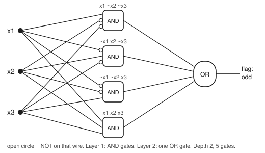

# Circuit lower bounds: counting gates to prove nothing can be fast

[Syllabus](../../../SYLLABUS.md) → [Computability and complexity](../README.md) → [Beyond Worst Case](../README.md#s04) → Circuit lower bounds

---

## General Overview

A hospital ward runs a night rota for 8 staff. For safety, nights are worked in pairs, so the number of staff on a night must be even. A checker reads the rota as 8 yes-or-no answers, one per person, and raises a flag when the headcount is odd. Staff 1, 2 and 5 on the night: 3 people, flag.

"Is the count odd?" is called **parity**. The checker is to be a chip, built from **gates**: small switches that each compute AND (on when all its inputs are on), OR (on when any input is on) or NOT (flips one input). The chip should answer in two gate delays. A **gate delay** is the time one gate takes to switch, so two delays means the signal passes through at most two gates on its way to the answer.

The best such chip for 8 staff needs **129 gates**, and this card proves that no cleverer design exists. For 64 staff it needs 9,223,372,036,854,775,809 gates. Allow five more delays and the cost drops to 251 gates.

A **lower bound** is a proof that every possible method needs at least some amount of a resource. It must defeat every design anyone could invent, not only the known ones. That is why such proofs are rare, and why they stall once the delay limit is removed.

**A lower bound proof finds a property every cheap circuit has and the target function lacks: fix most inputs at random, and a shallow circuit of modest size usually needs just a few more fixed to settle, while parity flips whenever any one input flips and stays unsettled until the last input is fixed, so shallow circuits for parity must be huge.**

**What kind of fact this is:** theorems. The two-delay bound and the counting bound are proved on this card in Why it works. The bound for every fixed depth is a theorem stated with its key steps and a named source (Håstad, 1986). P ≠ NP, met in Step 5, is a conjecture, unproved as of 2026-11-11.

### The picture: the two-delay checker for 3 staff

<p align="center"></p>

Schematic, not to scale. Each AND gate fires on exactly one odd rota: the first when staff 1 is on and staff 2 and 3 are off. The OR gate fires if any AND gate fires. An open circle is a NOT on that wire. With 8 staff there are 128 odd rotas, so 128 AND gates and 1 OR.

---

## The formula

The words first, in one sentence each.

- A **Boolean circuit** is a network of AND, OR and NOT gates wired from the inputs to one output, with no loops.
- Its **size** counts the gates. Its **depth** is the longest path from an input to the output, counted in gates: the number of gate delays. Both get a card of their own later in this wing, [Boolean circuits](../05-Algebraic%2C%20Interactive%20and%20Quantum/01-boolean-circuits-and-formulas.md).
- **Unbounded fan-in** means one AND or OR gate may take any number of wires, not only two. This card uses it throughout, except in Step 4.
- NOT gates sit only on the inputs and are not counted; any circuit can be rewritten this way.
- **AC0** (said "A C zero") is the class of problems solved by circuits of constant depth and polynomial size with unbounded fan-in. Constant depth means the same depth for every $`n`$. Polynomial size means at most $`n`$ raised to some fixed power, such as $`n^3`$, gates.

The card's main result, for parity on $`n`$ inputs:

```math
2^{\,c\, n^{1/(d-1)}} \;\le\; s_d(n) \;\le\; n \cdot 2^{\,n^{1/(d-1)}}, \qquad s_2(n) = 2^{\,n-1} + 1
```

**Read it aloud:** the fewest gates in a depth-$`d`$ circuit for parity grows like 2 raised to the $`(d-1)`$-th root of $`n`$, and at depth 2 it is exactly half of 2 to the $`n`$, plus one.

For every fixed depth $`d`$, the lower bound grows faster than any polynomial in $`n`$, so parity is not in AC0. Step 2 builds circuits meeting the upper bound when $`n^{1/(d-1)}`$ is a whole number.

A second formula counts circuits instead of building them. It uses ordinary two-input gates (fan-in 2), with any depth:

```math
\#\{\text{circuits with at most } s \text{ gates}\} \;\le\; \bigl(16\,(n+s)^2\bigr)^{s} \;<\; 2^{2^n} = \#\{\text{functions of } n \text{ inputs}\}
```

**Read it aloud:** the circuits with at most $`s`$ gates number at most $`\bigl(16(n+s)^2\bigr)^s`$, and whenever that is below the number of functions, some function needs more than $`s`$ gates.

| Symbol | Plain meaning | In our example | Push it up and the answer… |
| --- | --- | --- | --- |
| $`n`$ | inputs: staff on the rota, one bit each | 8, then 64 | every bound grows |
| $`x_i`$ | staff member $`i`$'s bit: 1 if on the night, 0 if off | staff 1, 2, 5 on | — |
| $`\neg x_i`$ | NOT: 1 when staff member $`i`$ is off | open circle in the picture | — |
| $`x_1 \oplus \cdots \oplus x_n`$ | parity: 1 when the count is odd ($`\oplus`$ is exclusive or) | 1 for staff 1, 2, 5 | — |
| $`d`$ | depth: gate delays from input to output | 2, 3, 4, 7 | far fewer gates needed |
| $`s_d(n)`$ | fewest gates in any depth-$`d`$ circuit for parity | 129 at $`n = 8, d = 2`$ | — |
| $`k`$ | block size in Step 2's design, $`n^{1/(d-1)}`$ | 8 for 64 staff at depth 3 | bigger blocks, fewer layers |
| $`c`$ | a fixed positive number supplied by Håstad's proof | not computed here | — |
| $`t`$ | steps a machine runs, in Step 5 | — | the circuit grows like $`t^2`$ |
| $`s`$ | gates in a fan-in-2 circuit, in the counting formula | 18 for 8 inputs | more circuits to count |
| $`16`$ | the number of rules a two-input gate can follow | AND, OR, exclusive or, … | — |
| $`2^{2^n}`$ | how many different yes-or-no functions $`n`$ inputs have | $`2^{256}`$ for 8 staff | — |

### When it holds

- **Only AND, OR and NOT gates.** Allow one exclusive-or gate with unbounded fan-in and parity costs 1 gate at depth 1. The lower bound is about this gate set, not about parity in general.
- **Depth fixed while $`n`$ grows.** Let depth grow like $`\log_2 n`$ and parity is cheap: 251 gates at depth 7 for 64 staff. AC0 forbids exactly that growth.
- **Every possible circuit, not every known one.** The bound covers designs no one has thought of yet, so it needs a proof, not a search.
- **The counting formula names no function.** It proves that hard functions exist, not that any particular one is hard. Step 5 explains why that gap matters.

---

## Why it works

### Step 0: find what every cheap circuit has and the target lacks

A lower bound cannot test every circuit one by one: there are too many. Instead it finds a property. Every small, shallow circuit has the property. Parity does not. So no small, shallow circuit is parity.

Here the property is about fixing inputs. Parity is fragile: change any one person's shift and the answer flips, so fixing staff never settles it while anyone is undecided. A shallow circuit of modest size is sturdy: fix most inputs at random and it usually shrinks to a circuit that fixing just a few more inputs settles.

### Step 1: at depth 2, every term must name every person

After merging gates of the same type, a depth-2 circuit is either an OR of AND gates or an AND of OR gates. Take the first kind. Each AND gate is a **term**: it fires when the staff it lists are on or off as it says. The OR fires when any term fires.

Suppose a term leaves out staff member 8. If the term fires on some odd rota, flip staff 8's bit. The term still fires, because it never looks at staff 8. The count is now even, yet the circuit raises the flag. That is a wrong answer.

So every term must name all $`n`$ staff. Such a term fires on exactly one rota. The circuit must fire on all $`2^{n-1}`$ odd rotas, so it needs at least $`2^{n-1}`$ terms, plus the OR. The picture's design reaches that number, so $`s_2(n) = 2^{n-1} + 1`$. An AND of ORs needs the same count by the mirror argument, with clauses ruling out the even rotas one at a time.

The code tests all $`3^n`$ possible terms (each person on, off or not mentioned) against every rota. For every $`n`$ from 2 to 8, only the $`2^{n-1}`$ full-width terms survive.

### Step 2: more depth buys a much smaller circuit

Split the 64 staff into 8 blocks of 8. Compute each block's parity at depth 2, then combine the 8 block answers with another parity at depth 2. That looks like depth 4, but the middle two layers merge.

The trick is to alternate. Build the first layer as an OR of ANDs and the second as an AND of ORs. The second layer's OR gates take first-layer OR gates as inputs. An OR of ORs is one OR, so the two layers collapse into one. Each further layer of blocks costs one more gate delay, not two.

With $`d-1`$ layers of blocks of size $`k = n^{1/(d-1)}`$, each block uses $`2^k`$ gates (its parity and its opposite), and the circuit has depth $`d`$. For 64 staff: blocks of 8 give 2,177 gates at depth 3, blocks of 4 give 329 at depth 4, and blocks of 2 give 251 at depth 7.

<details>
<summary>Detailed proof: the merged circuit has depth d and at most n · 2^k gates</summary>

Number the block layers 1 to $`d - 1`$. For every block, keep a list of gates for "this block's parity is 1" and another for "this block's parity is 0".

At an odd layer, each gate is an AND, one per pattern of child answers with the right parity. It takes the child gates that say "child equals its value in the pattern". At layer 1 those are input wires. At layer 3 and beyond they are the children's AND-of-OR clauses, whose AND merges into this AND.

At an even layer, each gate is an OR, one clause per pattern with the wrong parity. It takes the child gates that say "child differs from its value in the pattern". Those children are ORs of ANDs, so the OR merges.

Each layer adds one gate delay, and one final gate joins the top block's list. So the depth is $`(d - 1) + 1 = d`$.

Layer 1 has $`n/k`$ blocks, layer 2 has $`n/k^2`$, and so on, each block with at most $`2^k`$ gates. The top block keeps only its "parity is 1" list, $`2^{k-1}`$ gates. With $`k \ge 2`$:

$`\displaystyle s \;\le\; 2^k\left(\frac{n}{k} + \frac{n}{k^2} + \cdots\right) - 2^{k-1} + 1 \;\le\; 2^k \cdot \frac{n}{k-1} - 2^{k-1} + 1 \;\le\; n \cdot 2^k`$

</details>

### Step 3: deeper circuits fall to random restrictions

Step 1 handled depth 2. For depth 3 and more, the proof by Furst, Saxe and Sipser (1984) and Ajtai (1983), sharpened by Håstad (1986), fixes inputs at random. A **restriction** fixes some inputs to 0 or 1 and leaves the rest free.

Fix each of the 8 staff independently: free with chance 1/4, off with chance 3/8, on with chance 3/8. Then compare two things.

- **One AND term that needs staff 1 to 4 all on.** It stays undecided only if none of its 4 staff is fixed off and at least one is free. The chance is $`(5/8)^4 - (3/8)^4 = 0.1328`$, about 13%: most draws settle the term.
- **Parity of all 8.** It stays undecided whenever anyone is free. The chance is $`1 - (3/4)^8 = 0.8999`$, about 90%. And what remains is still parity, of the free staff, possibly flipped.

Narrow terms, ones that name only a few staff, die under restriction, and parity survives. Håstad's **switching lemma** makes this precise. After a restriction, an OR of narrow ANDs can, with high probability, be rewritten as an AND of narrow ORs. That rewrite lets two layers of the circuit merge into one.

Each round of restriction removes one layer. After $`d-2`$ rounds the circuit has depth 2 and narrow terms, and about $`n^{1/(d-1)}`$ inputs are still free. On those inputs the circuit must still compute parity.

Step 1 says that a depth-2 circuit for parity needs terms naming every free input, so narrow terms cannot do it. The rewrite can fail, but each gate fails only with a tiny chance. With fewer than $`2^{c\, n^{1/(d-1)}}`$ gates, the chance that any gate fails stays below 1. So some restriction rewrites every gate, and the result is a narrow depth-2 circuit for parity: a contradiction. That proves the bound.

The full switching lemma is in Håstad's paper and in Arora and Barak, chapter 14.

### Step 4: counting shows that most functions are hard

Now drop the depth limit and use ordinary two-input gates. Shannon (1949) counted circuits against functions, using [The rules of sum and product](../../04-Combinatorics%20and%20graphs/01-Counting%20Principles/01-rules-of-sum-and-product.md).

- **Functions.** A yes-or-no function of 8 inputs gives an answer for each of the $`2^8 = 256`$ rotas. Two answers for each of 256 rotas, in stages, is $`2^{256}`$ functions.
- **Circuits.** Each gate picks one of 16 rules and two wires from at most $`8 + s`$ sources. That is $`16(8+s)^2`$ choices per gate, and $`s`$ gates multiply them. The last gate is the output.

At $`s = 18`$ the circuits number below $`2^{242}`$. So at most 1 function in $`2^{14}`$ has a circuit of 18 gates. At 19 gates the bound passes $`2^{256}`$ and the count no longer forbids anything. At 64 inputs the same count shows that some function needs more than about 1.5e17 gates, that is, $`1.5 \times 10^{17}`$.

The same count works for sorting by comparisons. Ordering 8 staff by seniority has $`8! = 40{,}320`$ possible answers, but 15 yes-or-no comparisons end in at most $`2^{15} = 32{,}768`$ ways. So any method needs 16 comparisons in its worst case. Binary insertion sort, run on all 40,320 orders, needs 17.

### Step 5: why general lower bounds stay out of reach

The counting proof never names a hard function. It shows only that the hard ones outnumber the easy ones. A named function, such as one from NP, has stubbornly resisted.

The gap is enormous. Some function on 64 inputs needs more than about 1.5e17 gates. The best proven bound for any explicit function, one that a fast program computes for every $`n`$, is about 3.1 gates per input (Li and Yang, 2022). A term that grows more slowly than $`n`$ is subtracted from it, so the bound speaks about large $`n`$ and gives no definite count at 64 inputs.

The stakes are high. The tableau in [Cook-Levin](../03-Time%20Complexity/04-cook-levin-theorem.md) turns a machine that runs for $`t`$ steps into a circuit with on the order of $`t^2`$ gates. So a polynomial-time algorithm gives polynomial-size circuits. If some NP problem were proved to need more than polynomial size, P ≠ NP would follow.

Restriction arguments do not reach that far. They work because AC0 circuits are weak under restriction, and general circuits are not. Three barriers explain why the familiar methods cannot settle P versus NP: relativisation, natural proofs and algebrisation. They belong to [P versus NP](08-p-versus-np-what-is-known.md).

---

## Worked numbers, by hand

The rota of 8 staff, and then 64.

| Step | Arithmetic | Value |
| --- | --- | --- |
| staff 1, 2, 5 on | count 3, odd | flag |
| odd rotas of 8 staff | half of $`2^8 = 256`$ | 128 |
| terms a depth-2 checker needs | one full-width term per odd rota | 128 |
| depth-2 gates for 8 staff | 128 AND + 1 OR | **129** |
| depth 3, blocks of 4 then 2 | built and counted | 35 |
| depth 4, blocks of 2 | built and counted | 27 |
| depth 2 for 64 staff | $`2^{63} + 1`$ | 9,223,372,036,854,775,809 |
| depth 3 for 64 staff, blocks of 8 | $`8 \cdot 2^8 + 2^7 + 1`$ | 2,177 |
| depth 7 for 64 staff, blocks of 2 | built and counted | **251** |
| restriction: 4-person term still undecided | $`(5/8)^4 - (3/8)^4`$ | 0.1328 |
| restriction: parity of 8 still undecided | $`1 - (3/4)^8`$ | 0.8999 |

A two-delay checker for 8 staff needs exactly 129 gates, and for 64 staff it is far beyond any chip. Allowing seven delays brings 64 staff down to 251 gates.

### What breaks if you drop a piece

| Mistake | Comes out at | What went wrong |
| --- | --- | --- |
| Allow an exclusive-or gate | 1 gate, depth 1 | The bound is about AND, OR and NOT; a parity gate does it in one step |
| A term on staff 1 to 7 only | fires on 2 rotas, 1 of them even | A term that ignores one person flags an even rota |
| Let depth grow with $`n`$ | 27 gates at depth 4 for 8 staff; 251 at depth 7 for 64 | AC0 fixes the depth; with $`\log_2 n`$ depth parity is cheap |
| Ask "is anyone on?" instead | 8 one-person terms, so a single 8-input OR gate | OR is sturdy under restriction; only fragile functions are hard here |

Both checks print every row.

---

## Code, from first principles, and it actually runs

The code checks Step 1 by brute force over all $`3^n`$ terms for $`n`$ from 2 to 8. It builds the merged circuits gate by gate, checks their answers, and compares each gate count with a closed-form formula and with $`n \cdot 2^k`$. It checks all 6,561 restrictions of 8 staff, then compares exact restriction chances with 100,000 draws from SplitMix64, a small random-number generator written out in full with seed 2026. The counting bound is reached by two roads: exact whole-number powers, and a logarithm search. The sorting bound is set against the worst case of binary insertion over all 40,320 orders, and that worst case against the sum of each insertion's own worst count. In the output, ~ means NOT.

### Python

```python
# Circuit lower bounds -- the check behind the card.  Standard library only; itertools only lists
# orderings.  The rota: 8 staff, one bit each (on nights or not); flag it when the count is odd.
from itertools import permutations
from math import log2
M = (1 << 64) - 1
def parity(x):
    return bin(x).count("1") % 2
def implicant_widths(n, f):          # every AND term (3^n of them) that never fires wrongly
    out = []
    for t in range(3 ** n):
        mask = val = 0
        for i in range(n):
            d = t // 3 ** i % 3
            mask, val = (mask | 1 << i, val | (d - 1) << i) if d else (mask, val)
        if mask and all(f(x) for x in range(2 ** n) if x & mask == val):
            out.append(bin(mask).count("1"))
    return out
def build(n, ks):                    # parity as layers of AND/OR, NOT only on inputs
    gates, nodes = [], [[[-2 * i - 1], [-2 * i - 2]] for i in range(n)]
    for lvl, k in enumerate(ks, 1):  # node[v] = gates that together say "this block = v"
        odd, new = lvl % 2 == 1, []
        for b in range(0, len(nodes), k):
            kids, node = nodes[b:b + k], [[], []]
            for v in ((1,) if len(nodes) == k else (0, 1)):
                for a in range(2 ** k):
                    bits = [a >> j & 1 for j in range(k)]
                    if (sum(bits) % 2 == v) != odd:
                        continue     # odd level: OR of ANDs; even level: AND of ORs
                    ins = [r for j, kid in enumerate(kids) for r in kid[bits[j] if odd else 1 - bits[j]]]
                    gates.append((odd, ins)); node[v].append(len(gates) - 1)
            new.append(node)
        nodes = new
    gates.append((len(ks) % 2 == 0, nodes[0][1]))
    return gates
def run(gates, x):                   # literal -(2i+v)-1 means "staff i is v"
    out = []
    for is_and, ins in gates:
        vals = (out[r] if r >= 0 else (x >> (-r - 1) // 2 & 1) == (-r - 1) % 2 for r in ins)
        out.append(all(vals) if is_and else any(vals))
    return int(out[-1])
def depth(gates):
    d = []
    for _, ins in gates:
        d.append(1 + max([d[r] for r in ins if r >= 0] + [0]))
    return d[-1]
def log_road(n, top):                # largest s with s * log2(16 (n + s)^2) below 2^n
    lo, hi = 1, top
    while hi - lo > 1:
        mid = (lo + hi) // 2
        lo, hi = (mid, hi) if mid * log2(16 * (n + mid) ** 2) < 2.0 ** n else (lo, mid)
    return lo
def formula(n, ks):                  # closed-form gate count, no circuit built
    total, m = 1, n
    for k in ks:
        m //= k
        total += m * 2 ** k if m > 1 else 2 ** (k - 1)
    return total
def splitmix(s):
    s = (s + 0x9E3779B97F4A7C15) & M
    z = ((s ^ (s >> 30)) * 0xBF58476D1CE4E5B9) & M
    z = ((z ^ (z >> 27)) * 0x94D049BB133111EB) & M
    return s, z ^ (z >> 31)
print("rota: 8 staff; flag the night when its headcount is odd (parity)")
print(f"rota with staff 1, 2, 5 on: count {bin(0b10011).count('1')}, parity {parity(0b10011)}, flag")
rows = [implicant_widths(n, lambda x: parity(x) == 1) for n in range(2, 9)]
print("depth 2, all 3^n AND terms tested: terms that never fire on an even rota")
print("  staff n      " + "".join(f"{n:>5}" for n in range(2, 9)))
print("  such terms   " + "".join(f"{len(r):>5}" for r in rows))
print("  narrowest    " + "".join(f"{min(r):>5}" for r in rows))
print(f"depth-2 circuit for 8 staff needs {len(rows[-1])} AND gates + 1 OR = {len(rows[-1]) + 1} gates")
seed, tests = 2026, []
for n, ks in [(8, [8]), (8, [4, 2]), (8, [2, 2, 2]), (64, [8, 8]), (64, [4, 4, 4]), (64, [2] * 6)]:
    g = build(n, ks)
    xs = range(256) if n == 8 else []
    if n == 64:
        for _ in range(64):
            seed, r = splitmix(seed); xs.append(r)
    ok = all(run(g, x) == parity(x) for x in xs)
    tests.append((n, depth(g), len(g), formula(n, ks), n * 2 ** max(ks), ok, len(ks) + 1))
    print(f"built n={n:>2} blocks {str(ks):<18} depth {tests[-1][1]} gates {len(g):>4} formula {formula(n, ks):>4}"
          f" bound n*2^k {n * 2 ** max(ks):>5} inputs tested {len(xs):>3} all right {'yes' if ok else 'no'}")
print(f"64 staff at depth 2: 2^63 + 1 = {formula(64, [64])} gates")
bad = 0
for t in range(3 ** 8):              # every restriction: fixed staff 0/1, the rest free
    fixed = [t // 3 ** i % 3 for i in range(8)]
    free = [i for i in range(8) if fixed[i] == 0]
    base = sum(1 << i for i in range(8) if fixed[i] == 2)
    vals = {parity(base | sum(1 << free[j] for j in range(len(free)) if a >> j & 1)) for a in range(2 ** len(free))}
    bad += (len(vals) == 1) != (not free)
print(f"all 6561 restrictions of 8 staff: parity settled only when nobody is free: {'yes' if bad == 0 else 'no'}")
N, cnt = 100000, [0, 0, 0]
for _ in range(N):                   # each staff: free 2/8, fixed off 3/8, fixed on 3/8
    pick = []
    for i in range(8):
        seed, r = splitmix(seed); pick.append(r % 8)
    nfree = sum(p < 2 for p in pick)
    cnt[0] += all(p < 2 or p >= 5 for p in pick[:4]) and any(p < 2 for p in pick[:4])
    cnt[1] += nfree > 0; cnt[2] += nfree
exact = [((5 / 8) ** 4 - (3 / 8) ** 4), 1 - (3 / 4) ** 8, 2.0]
print(f"random restrictions, {N} draws, seed 2026: exact, simulated")
for name, e, c in zip(["4-person AND term undecided", "parity of 8 undecided", "free staff per draw"], exact, cnt):
    print(f"  {name:<28} {e:.4f} {c / N:.4f}")
for i in range(2):                   # simulation within 4 standard errors of the exact chance
    assert abs(cnt[i] / N - exact[i]) < 4 * (exact[i] * (1 - exact[i]) / N) ** 0.5
s = 0
while (16 * (8 + s + 1) ** 2) ** (s + 1) < 2 ** 256:
    s += 1
bits, lo = (16 * (8 + s) ** 2) ** s, log_road(64, 1 << 62)
print(f"counting: 2^256 functions of 8 inputs; circuits of at most {s} two-input gates number below 2^{bits.bit_length()}")
print(f"  so at most 1 function in 2^{256 - bits.bit_length()} has a circuit of {s} gates; at {s + 1} the bound passes 2^256")
print(f"  64 inputs: some function needs more than about {str(lo)[0]}.{str(lo)[1]}e{len(str(lo)) - 1} gates")
print("  best proven for one named function: about 3.1 gates per input, once n is large")
worst = f8 = 0
for p in permutations(range(8)):     # binary insertion sort, counting comparisons
    done, c = [], 0
    for v in p:
        a, b = 0, len(done)
        while a < b:
            m = (a + b) // 2; c += 1
            a, b = (m + 1, b) if done[m] < v else (a, m)
        done.insert(a, v)
    worst, f8 = max(worst, c), f8 + 1
need = next(d for d in range(40) if 2 ** d >= f8)
print(f"sorting 8 staff: 8! = {f8} orders; 2^{need - 1} = {2 ** (need - 1)} leaves too few, so >= {need} comparisons; binary insertion worst {worst}")
print("what breaks:")
print("  a parity gate allowed: 1 gate, depth 1")
w7 = [x for x in range(256) if x & 127 == 127]
print(f"  term on staff 1-7 only: fires on {len(w7)} rotas, {sum(1 for x in w7 if parity(x) == 0)} of them even")
print(f"  no depth limit: 8 staff {tests[2][2]} gates at depth {tests[2][1]}; 64 staff {tests[5][2]} gates at depth {tests[5][1]}")
anyone = implicant_widths(8, lambda x: x > 0)
print(f"  'anyone on?' instead: {anyone.count(1)} one-person terms, so a single {anyone.count(1)}-input OR gate")
terms = [" ".join(("" if (-r - 1) % 2 else "~") + f"x{(-r - 1) // 2 + 1}" for r in ins) for _, ins in build(3, [3])[:-1]]
print("figure, inputs x=40 y=60,140,220; AND x=220 y=40,110,180,250; OR x=400 y=145; terms " + " | ".join(terms))
assert [len(r) for r in rows] == [2 ** (n - 1) for n in range(2, 9)]       # exhaustive = 2^(n-1)
assert all(min(r) == n for r, n in zip(rows, range(2, 9)))                  # every term names everyone
assert all(t[2] == t[3] for t in tests) and all(t[2] <= t[4] for t in tests)   # built = formula <= bound
assert all(t[5] for t in tests) and all(t[1] == t[6] for t in tests)        # right answers, right depth
assert bad == 0 and s == log_road(8, 256)                                   # restrictions; two counting roads
assert need <= worst == sum((i - 1).bit_length() for i in range(1, 9)) and anyone.count(1) == 8   # sorting; OR
print("ALL CHECKS PASS")
```

**Ran 2026-11-19 on macOS, Python 3.14.10, standard library only. All checks passed. Output, pasted from the run:**

```
rota: 8 staff; flag the night when its headcount is odd (parity)
rota with staff 1, 2, 5 on: count 3, parity 1, flag
depth 2, all 3^n AND terms tested: terms that never fire on an even rota
  staff n          2    3    4    5    6    7    8
  such terms       2    4    8   16   32   64  128
  narrowest        2    3    4    5    6    7    8
depth-2 circuit for 8 staff needs 128 AND gates + 1 OR = 129 gates
built n= 8 blocks [8]                depth 2 gates  129 formula  129 bound n*2^k  2048 inputs tested 256 all right yes
built n= 8 blocks [4, 2]             depth 3 gates   35 formula   35 bound n*2^k   128 inputs tested 256 all right yes
built n= 8 blocks [2, 2, 2]          depth 4 gates   27 formula   27 bound n*2^k    32 inputs tested 256 all right yes
built n=64 blocks [8, 8]             depth 3 gates 2177 formula 2177 bound n*2^k 16384 inputs tested  64 all right yes
built n=64 blocks [4, 4, 4]          depth 4 gates  329 formula  329 bound n*2^k  1024 inputs tested  64 all right yes
built n=64 blocks [2, 2, 2, 2, 2, 2] depth 7 gates  251 formula  251 bound n*2^k   256 inputs tested  64 all right yes
64 staff at depth 2: 2^63 + 1 = 9223372036854775809 gates
all 6561 restrictions of 8 staff: parity settled only when nobody is free: yes
random restrictions, 100000 draws, seed 2026: exact, simulated
  4-person AND term undecided  0.1328 0.1328
  parity of 8 undecided        0.8999 0.8988
  free staff per draw          2.0000 2.0040
counting: 2^256 functions of 8 inputs; circuits of at most 18 two-input gates number below 2^242
  so at most 1 function in 2^14 has a circuit of 18 gates; at 19 the bound passes 2^256
  64 inputs: some function needs more than about 1.5e17 gates
  best proven for one named function: about 3.1 gates per input, once n is large
sorting 8 staff: 8! = 40320 orders; 2^15 = 32768 leaves too few, so >= 16 comparisons; binary insertion worst 17
what breaks:
  a parity gate allowed: 1 gate, depth 1
  term on staff 1-7 only: fires on 2 rotas, 1 of them even
  no depth limit: 8 staff 27 gates at depth 4; 64 staff 251 gates at depth 7
  'anyone on?' instead: 8 one-person terms, so a single 8-input OR gate
figure, inputs x=40 y=60,140,220; AND x=220 y=40,110,180,250; OR x=400 y=145; terms x1 ~x2 ~x3 | ~x1 x2 ~x3 | ~x1 ~x2 x3 | x1 x2 x3
ALL CHECKS PASS
```

Brute force agrees with Step 1 for every $`n`$, each built circuit matches its formula, and the simulated chances sit within 4 standard errors of the exact ones.

### Rust

The same checks in Rust. The comparison with $`2^{256}`$ uses a small big-integer multiplication written into the file. No crates.

```rust
// Circuit lower bounds -- the same check as circuit_complexity_and_lower_bounds_check.py, in Rust.
// Standard library only, no crates.  The 2^256 comparison uses a small big-integer written here.
fn parity(x: u64) -> u64 { (x.count_ones() % 2) as u64 }
fn implicant_widths(n: u32, f: &dyn Fn(u64) -> bool) -> Vec<u32> {
    let mut out = vec![];
    for t in 0..3u64.pow(n) {
        let (mut mask, mut val) = (0u64, 0u64);
        for i in 0..n {
            let d = t / 3u64.pow(i) % 3;
            if d > 0 { mask |= 1 << i; val |= (d - 1) << i; }
        }
        if mask > 0 && (0..1u64 << n).filter(|x| x & mask == val).all(|x| f(x)) { out.push(mask.count_ones()); }
    }
    out
}
type Gate = (bool, Vec<i64>); // (is AND, inputs); input -(2i+v)-1 means "staff i is v"
fn build(n: usize, ks: &[usize]) -> Vec<Gate> {
    let mut gates: Vec<Gate> = vec![];
    let mut nodes: Vec<[Vec<i64>; 2]> = (0..n as i64).map(|i| [vec![-2 * i - 1], vec![-2 * i - 2]]).collect();
    for (l, &k) in ks.iter().enumerate() {
        let odd = l % 2 == 0;
        let mut new = vec![];
        for b in (0..nodes.len()).step_by(k) {
            let (kids, mut node): (&[[Vec<i64>; 2]], [Vec<i64>; 2]) = (&nodes[b..b + k], [vec![], vec![]]);
            let vs: Vec<usize> = if nodes.len() == k { vec![1] } else { vec![0, 1] };
            for &v in &vs {
                for a in 0..1usize << k {
                    let bits: Vec<usize> = (0..k).map(|j| a >> j & 1).collect();
                    if (bits.iter().sum::<usize>() % 2 == v) != odd { continue; }
                    let ins: Vec<i64> = (0..k).flat_map(|j| kids[j][if odd { bits[j] } else { 1 - bits[j] }].iter().cloned()).collect();
                    gates.push((odd, ins)); node[v].push(gates.len() as i64 - 1);
                }
            }
            new.push(node);
        }
        nodes = new;
    }
    gates.push((ks.len() % 2 == 0, nodes[0][1].clone()));
    gates
}
fn run(gates: &[Gate], x: u64) -> u64 {
    let mut out: Vec<bool> = vec![];
    for (is_and, ins) in gates {
        let val = |r: &i64| if *r >= 0 { out[*r as usize] } else { let m = (-r - 1) as u64; (x >> (m / 2) & 1) == m % 2 };
        out.push(if *is_and { ins.iter().all(val) } else { ins.iter().any(val) });
    }
    *out.last().unwrap() as u64
}
fn depth(gates: &[Gate]) -> usize {
    let mut d: Vec<usize> = vec![];
    for (_, ins) in gates { let m = ins.iter().filter(|r| **r >= 0).map(|r| d[*r as usize]).max().unwrap_or(0); d.push(1 + m); }
    *d.last().unwrap()
}
fn formula(n: u64, ks: &[usize]) -> u64 {
    let (mut total, mut m) = (1u64, n);
    for &k in ks { m /= k as u64; total += if m > 1 { m << k } else { 1 << (k - 1) }; }
    total
}
fn splitmix(s: &mut u64) -> u64 {
    *s = s.wrapping_add(0x9E3779B97F4A7C15);
    let mut z = (*s ^ (*s >> 30)).wrapping_mul(0xBF58476D1CE4E5B9);
    z = (z ^ (z >> 27)).wrapping_mul(0x94D049BB133111EB);
    z ^ (z >> 31)
}
fn log_road(n: i32, top: u64) -> u64 {
    let (mut lo, mut hi) = (1u64, top);
    while hi - lo > 1 {
        let (mid, m) = ((lo + hi) / 2, ((lo + hi) / 2) as f64);
        if m * (16.0 * (n as f64 + m).powi(2)).log2() < 2f64.powi(n) { lo = mid } else { hi = mid }
    }
    lo
}
fn pow_bits(base: u64, e: u64) -> u64 { // bit length of base^e, by schoolbook big-integer multiplication
    let mut limbs: Vec<u64> = vec![1];
    for _ in 0..e {
        let mut carry = 0u128;
        for l in limbs.iter_mut() { let p = *l as u128 * base as u128 + carry; *l = p as u64; carry = p >> 64; }
        if carry > 0 { limbs.push(carry as u64); }
    }
    64 * (limbs.len() as u64 - 1) + 64 - limbs.last().unwrap().leading_zeros() as u64
}
fn main() {
    println!("rota: 8 staff; flag the night when its headcount is odd (parity)");
    println!("rota with staff 1, 2, 5 on: count {}, parity {}, flag", 0b10011u64.count_ones(), parity(0b10011));
    let rows: Vec<Vec<u32>> = (2..9).map(|n| implicant_widths(n, &|x| parity(x) == 1)).collect();
    println!("depth 2, all 3^n AND terms tested: terms that never fire on an even rota");
    println!("  staff n      {}", (2..9).map(|n| format!("{:>5}", n)).collect::<String>());
    println!("  such terms   {}", rows.iter().map(|r| format!("{:>5}", r.len())).collect::<String>());
    println!("  narrowest    {}", rows.iter().map(|r| format!("{:>5}", r.iter().min().unwrap())).collect::<String>());
    println!("depth-2 circuit for 8 staff needs {} AND gates + 1 OR = {} gates", rows[6].len(), rows[6].len() + 1);
    let (mut seed, mut tests) = (2026u64, vec![]);
    let cfgs: Vec<(u64, Vec<usize>)> = vec![(8, vec![8]), (8, vec![4, 2]), (8, vec![2, 2, 2]), (64, vec![8, 8]), (64, vec![4, 4, 4]), (64, vec![2; 6])];
    for (n, ks) in &cfgs {
        let g = build(*n as usize, ks);
        let xs: Vec<u64> = if *n == 8 { (0..256).collect() } else { (0..64).map(|_| splitmix(&mut seed)).collect() };
        let ok = xs.iter().all(|&x| run(&g, x) == parity(x));
        let kmax = *ks.iter().max().unwrap();
        tests.push((depth(&g), g.len() as u64, formula(*n, ks), n << kmax, ok, ks.len() + 1));
        println!("built n={:>2} blocks {:<18} depth {} gates {:>4} formula {:>4} bound n*2^k {:>5} inputs tested {:>3} all right {}",
                 n, format!("{:?}", ks), depth(&g), g.len(), formula(*n, ks), n << kmax, xs.len(), if ok { "yes" } else { "no" });
    }
    println!("64 staff at depth 2: 2^63 + 1 = {} gates", formula(64, &[64]));
    let mut bad = 0;
    for t in 0..3u64.pow(8) {
        let fixed: Vec<u64> = (0..8).map(|i| t / 3u64.pow(i) % 3).collect();
        let free: Vec<usize> = (0..8).filter(|&i| fixed[i] == 0).collect();
        let base: u64 = (0..8).filter(|&i| fixed[i] == 2).map(|i| 1u64 << i).sum();
        let mut vals = [false; 2];
        for a in 0..1u64 << free.len() {
            let x = base | (0..free.len()).filter(|&j| a >> j & 1 == 1).map(|j| 1u64 << free[j]).sum::<u64>();
            vals[parity(x) as usize] = true;
        }
        if (vals[0] != vals[1]) != free.is_empty() { bad += 1; }
    }
    println!("all 6561 restrictions of 8 staff: parity settled only when nobody is free: {}", if bad == 0 { "yes" } else { "no" });
    let n_draws = 100000u64;
    let mut cnt = [0u64; 3];
    for _ in 0..n_draws {
        let pick: Vec<u64> = (0..8).map(|_| splitmix(&mut seed) % 8).collect();
        let nfree = pick.iter().filter(|&&p| p < 2).count() as u64;
        if pick[..4].iter().all(|&p| p < 2 || p >= 5) && pick[..4].iter().any(|&p| p < 2) { cnt[0] += 1; }
        if nfree > 0 { cnt[1] += 1; } cnt[2] += nfree;
    }
    let exact = [0.625f64.powi(4) - 0.375f64.powi(4), 1.0 - 0.75f64.powi(8), 2.0];
    println!("random restrictions, {} draws, seed 2026: exact, simulated", n_draws);
    for (i, name) in ["4-person AND term undecided", "parity of 8 undecided", "free staff per draw"].iter().enumerate() { println!("  {:<28} {:.4} {:.4}", name, exact[i], cnt[i] as f64 / n_draws as f64); }
    for i in 0..2 { assert!((cnt[i] as f64 / n_draws as f64 - exact[i]).abs() < 4.0 * (exact[i] * (1.0 - exact[i]) / n_draws as f64).sqrt()); }
    let mut s = 0u64;
    while pow_bits(16 * (8 + s + 1) * (8 + s + 1), s + 1) <= 256 { s += 1; }
    let (bits, lo) = (pow_bits(16 * (8 + s) * (8 + s), s), log_road(64, 1 << 62).to_string());
    println!("counting: 2^256 functions of 8 inputs; circuits of at most {} two-input gates number below 2^{}", s, bits);
    println!("  so at most 1 function in 2^{} has a circuit of {} gates; at {} the bound passes 2^256", 256 - bits, s, s + 1);
    println!("  64 inputs: some function needs more than about {}.{}e{} gates", &lo[0..1], &lo[1..2], lo.len() - 1);
    println!("  best proven for one named function: about 3.1 gates per input, once n is large");
    let (mut p, mut c, mut i) = ([0usize, 1, 2, 3, 4, 5, 6, 7], [0usize; 8], 1usize);
    let ins_sort = |p: &[usize; 8]| { // binary insertion sort, counting comparisons
        let (mut done, mut cmp): (Vec<usize>, u64) = (vec![], 0);
        for &v in p.iter() {
            let (mut a, mut b) = (0, done.len());
            while a < b { let m = (a + b) / 2; cmp += 1; if done[m] < v { a = m + 1 } else { b = m } }
            done.insert(a, v);
        }
        cmp
    };
    let (mut worst, mut f8) = (ins_sort(&p), 1u64);
    while i < 8 { // Heap's algorithm visits every ordering once
        if c[i] < i { if i % 2 == 0 { p.swap(0, i) } else { p.swap(c[i], i) }; worst = worst.max(ins_sort(&p)); f8 += 1; c[i] += 1; i = 1; }
        else { c[i] = 0; i += 1; }
    }
    let need = (0..40).find(|&d| 1u64 << d >= f8).unwrap();
    println!("sorting 8 staff: 8! = {} orders; 2^{} = {} leaves too few, so >= {} comparisons; binary insertion worst {}", f8, need - 1, 1u64 << (need - 1), need, worst);
    println!("what breaks:\n  a parity gate allowed: 1 gate, depth 1");
    let w7: Vec<u64> = (0..256).filter(|x| x & 127 == 127).collect();
    println!("  term on staff 1-7 only: fires on {} rotas, {} of them even", w7.len(), w7.iter().filter(|&&x| parity(x) == 0).count());
    println!("  no depth limit: 8 staff {} gates at depth {}; 64 staff {} gates at depth {}", tests[2].1, tests[2].0, tests[5].1, tests[5].0);
    let ones = implicant_widths(8, &|x| x > 0).iter().filter(|&&w| w == 1).count();
    println!("  'anyone on?' instead: {} one-person terms, so a single {}-input OR gate", ones, ones);
    let g3 = build(3, &[3]);
    let terms: Vec<String> = g3[..g3.len() - 1].iter().map(|(_, ins)| ins.iter().map(|r| { let m = -r - 1; format!("{}x{}", if m % 2 == 1 { "" } else { "~" }, m / 2 + 1) }).collect::<Vec<_>>().join(" ")).collect();
    println!("figure, inputs x=40 y=60,140,220; AND x=220 y=40,110,180,250; OR x=400 y=145; terms {}", terms.join(" | "));
    assert!(rows.iter().zip(2..9u32).all(|(r, n)| r.len() == 1 << (n - 1))); // exhaustive = 2^(n-1)
    assert!(rows.iter().zip(2..9u32).all(|(r, n)| *r.iter().min().unwrap() == n)); // every term names everyone
    assert!(tests.iter().all(|t| t.1 == t.2 && t.1 <= t.3)); // built = formula <= bound
    assert!(tests.iter().all(|t| t.4 && t.0 == t.5)); // right answers, right depth
    assert!(bad == 0 && s == log_road(8, 256)); // restrictions; two counting roads
    assert!(worst >= need as u64 && worst == (1..=8u64).map(|i| 64 - (i - 1).leading_zeros() as u64).sum::<u64>() && ones == 8); // sorting; OR
    println!("ALL CHECKS PASS");
}
```

**Ran 2026-11-19 on macOS, rustc 1.98.1, no crates. All checks passed. Output, pasted from the run:**

```
rota: 8 staff; flag the night when its headcount is odd (parity)
rota with staff 1, 2, 5 on: count 3, parity 1, flag
depth 2, all 3^n AND terms tested: terms that never fire on an even rota
  staff n          2    3    4    5    6    7    8
  such terms       2    4    8   16   32   64  128
  narrowest        2    3    4    5    6    7    8
depth-2 circuit for 8 staff needs 128 AND gates + 1 OR = 129 gates
built n= 8 blocks [8]                depth 2 gates  129 formula  129 bound n*2^k  2048 inputs tested 256 all right yes
built n= 8 blocks [4, 2]             depth 3 gates   35 formula   35 bound n*2^k   128 inputs tested 256 all right yes
built n= 8 blocks [2, 2, 2]          depth 4 gates   27 formula   27 bound n*2^k    32 inputs tested 256 all right yes
built n=64 blocks [8, 8]             depth 3 gates 2177 formula 2177 bound n*2^k 16384 inputs tested  64 all right yes
built n=64 blocks [4, 4, 4]          depth 4 gates  329 formula  329 bound n*2^k  1024 inputs tested  64 all right yes
built n=64 blocks [2, 2, 2, 2, 2, 2] depth 7 gates  251 formula  251 bound n*2^k   256 inputs tested  64 all right yes
64 staff at depth 2: 2^63 + 1 = 9223372036854775809 gates
all 6561 restrictions of 8 staff: parity settled only when nobody is free: yes
random restrictions, 100000 draws, seed 2026: exact, simulated
  4-person AND term undecided  0.1328 0.1328
  parity of 8 undecided        0.8999 0.8988
  free staff per draw          2.0000 2.0040
counting: 2^256 functions of 8 inputs; circuits of at most 18 two-input gates number below 2^242
  so at most 1 function in 2^14 has a circuit of 18 gates; at 19 the bound passes 2^256
  64 inputs: some function needs more than about 1.5e17 gates
  best proven for one named function: about 3.1 gates per input, once n is large
sorting 8 staff: 8! = 40320 orders; 2^15 = 32768 leaves too few, so >= 16 comparisons; binary insertion worst 17
what breaks:
  a parity gate allowed: 1 gate, depth 1
  term on staff 1-7 only: fires on 2 rotas, 1 of them even
  no depth limit: 8 staff 27 gates at depth 4; 64 staff 251 gates at depth 7
  'anyone on?' instead: 8 one-person terms, so a single 8-input OR gate
figure, inputs x=40 y=60,140,220; AND x=220 y=40,110,180,250; OR x=400 y=145; terms x1 ~x2 ~x3 | ~x1 x2 ~x3 | ~x1 ~x2 x3 | x1 x2 x3
ALL CHECKS PASS
```

The two outputs are identical line for line.

### Lean

Lean proves the two-delay gate count and the counting bound for any number of staff, and checks the card's whole-number examples.

- Take $`n \ge 1`$ staff. Then a depth-2 circuit for parity, an OR of ANDs or an AND of ORs, needs exactly $`2^{n-1} + 1`$ gates.
- In an OR of ANDs for parity, every term that ever fires names every staff member.
- Take $`n`$ inputs and $`s`$ two-input gates, with $`(16(n+s)^2)^s < 2^{2^n}`$. Then some function of $`n`$ inputs has no circuit of at most $`s`$ gates.
- The picture's four AND terms under one OR compute parity for 3 staff.
- The worked numbers hold: 129 gates for 8 staff, and $`2^{63} + 1`$ for 64 staff.
- A term on staff 1 to 7 only fires on 2 rotas, and 1 of them is even.
- At 8 inputs, 18 gates give fewer than $`2^{242}`$ circuits, against $`2^{256}`$ functions.
- Sorting 8 staff has $`8! = 40{,}320`$ orders, more than the $`2^{15} = 32{,}768`$ leaves of 15 comparisons.

Step 2's circuits, the restriction chances and the sorting run are left to the Python and Rust checks, and Håstad's bound to his paper.

```lean
-- Circuit lower bounds: a depth-2 AND/OR circuit for parity on n inputs needs exactly 2^(n-1) + 1 gates, every useful term names every input, and counting circuits shows some function needs more than s two-input gates.
import Mathlib.Data.Fintype.Pi
import Mathlib.Data.Fintype.Prod
import Mathlib.Data.Fintype.Card
import Mathlib.Algebra.Order.Group.Nat
import Mathlib.Algebra.Group.Nat.Even
import Mathlib.Order.Bounds.Defs
import Mathlib.Data.Nat.Factorial.Basic
import Mathlib.Tactic.NormNum
import Mathlib.Data.Fintype.BigOperators
import Mathlib.Data.List.GetD

namespace CircuitLowerBounds

/-! ### Depth-2 circuits with unbounded fan-in

A rota on `n` staff is `x : Fin n → Bool`. A literal `(i, b)` is the wire "staff `i` is `b`"
(a NOT on an input wire when `b = false`). An AND gate (a term) is a finite set of literals and
fires when every literal holds. An OR gate (a clause) fires when some literal holds.
A depth-2 circuit is a finite set of such gates under one OR (an OR of ANDs) or under one AND
(an AND of ORs); its size is the number of gates in the set plus the one top gate. -/

/-- Parity: `true` when the number of staff on the night is odd. -/
def parity {n : ℕ} (x : Fin n → Bool) : Bool :=
  decide (Odd (Finset.univ.filter (fun i => x i = true)).card)

/-- An AND gate over literals fires when every literal holds. -/
def termFires {n : ℕ} (t : Finset (Fin n × Bool)) (x : Fin n → Bool) : Prop :=
  ∀ l ∈ t, x l.1 = l.2

/-- An OR gate over literals fires when some literal holds. -/
def clauseFires {n : ℕ} (c : Finset (Fin n × Bool)) (x : Fin n → Bool) : Prop :=
  ∃ l ∈ c, x l.1 = l.2

/-- An OR of AND gates computes `f`: the flag is up exactly when some term fires. -/
def OrOfAndsComputes {n : ℕ} (D : Finset (Finset (Fin n × Bool))) (f : (Fin n → Bool) → Bool) : Prop :=
  ∀ x, f x = true ↔ ∃ t ∈ D, termFires t x

/-- An AND of OR gates computes `f`: the flag is up exactly when every clause fires. -/
def AndOfOrsComputes {n : ℕ} (D : Finset (Finset (Fin n × Bool))) (f : (Fin n → Bool) → Bool) : Prop :=
  ∀ x, f x = true ↔ ∀ c ∈ D, clauseFires c x

instance {n : ℕ} (t : Finset (Fin n × Bool)) (x : Fin n → Bool) : Decidable (termFires t x) := by
  unfold termFires; infer_instance

instance {n : ℕ} (c : Finset (Fin n × Bool)) (x : Fin n → Bool) : Decidable (clauseFires c x) := by
  unfold clauseFires; infer_instance

instance {n : ℕ} (D : Finset (Finset (Fin n × Bool))) (f : (Fin n → Bool) → Bool) :
    Decidable (OrOfAndsComputes D f) := by
  unfold OrOfAndsComputes; infer_instance


theorem parity_flip {n : ℕ} (x : Fin n → Bool) (i : Fin n) :
    parity (Function.update x i (!x i)) = !parity x := by
  unfold parity
  have key : Odd (Finset.univ.filter (fun j => Function.update x i (!x i) j = true)).card ↔
      ¬ Odd (Finset.univ.filter (fun j => x j = true)).card := by
    by_cases hx' : x i = true
    swap
    · have hx : x i = false := by simpa using hx'
      have hS : (Finset.univ.filter (fun j => Function.update x i (!x i) j = true)) =
          insert i (Finset.univ.filter (fun j => x j = true)) := by
        ext j
        by_cases hj : j = i
        · subst hj; simp [hx]
        · simp [Function.update, hj]
      have hi : i ∉ Finset.univ.filter (fun j => x j = true) := by simp [hx]
      rw [hS, Finset.card_insert_of_notMem hi, Nat.odd_add_one]
    · have hx := hx'
      have hS : (Finset.univ.filter (fun j => x j = true)) =
          insert i (Finset.univ.filter (fun j => Function.update x i (!x i) j = true)) := by
        ext j
        by_cases hj : j = i
        · subst hj; simp [hx]
        · simp [Function.update, hj]
      have hi : i ∉ Finset.univ.filter (fun j => Function.update x i (!x i) j = true) := by
        simp [hx]
      rw [hS, Finset.card_insert_of_notMem hi, Nat.odd_add_one, not_not]
  by_cases h : Odd (Finset.univ.filter (fun j => x j = true)).card
  · simp [h, key]
  · simp [h, key]

/-- A function that flips whenever one input bit flips. -/
def Sensitive {n : ℕ} (f : (Fin n → Bool) → Bool) : Prop :=
  ∀ x i, f (Function.update x i (!x i)) = !f x

theorem parity_sensitive (n : ℕ) : Sensitive (parity (n := n)) := fun x i => parity_flip x i

theorem not_sensitive {n : ℕ} {f : (Fin n → Bool) → Bool} (hf : Sensitive f) :
    Sensitive (fun x => !f x) := fun x i => by simp [hf x i]

theorem term_names_all {n : ℕ} {f : (Fin n → Bool) → Bool} (hf : Sensitive f)
    {D : Finset (Finset (Fin n × Bool))} (hD : OrOfAndsComputes D f) {t : Finset (Fin n × Bool)}
    (ht : t ∈ D) {x : Fin n → Bool} (hx : termFires t x) : ∀ i : Fin n, ∃ b : Bool, (i, b) ∈ t := by
  intro i
  by_contra hno
  push Not at hno
  have h1 : f x = true := (hD x).2 ⟨t, ht, hx⟩
  have h2 : termFires t (Function.update x i (!x i)) := by
    intro l hl
    have hne : l.1 ≠ i := by
      intro he
      exact hno l.2 (by rw [← he]; exact hl)
    rw [Function.update_of_ne hne]
    exact hx l hl
  have h3 : f (Function.update x i (!x i)) = true := (hD _).2 ⟨t, ht, h2⟩
  rw [hf, h1] at h3
  simp at h3

theorem fires_unique {n : ℕ} {t : Finset (Fin n × Bool)} (hall : ∀ i : Fin n, ∃ b : Bool, (i, b) ∈ t)
    {x y : Fin n → Bool} (hx : termFires t x) (hy : termFires t y) : x = y := by
  funext i
  obtain ⟨b, hb⟩ := hall i
  rw [hx _ hb, hy _ hb]

theorem card_parity_eq (n : ℕ) (hn : 0 < n) :
    (Finset.univ.filter (fun x : Fin n → Bool => parity x = true)).card = 2 ^ (n - 1) ∧
    (Finset.univ.filter (fun x : Fin n → Bool => parity x = false)).card = 2 ^ (n - 1) := by
  set i0 : Fin n := ⟨0, hn⟩
  have hinv : ∀ x : Fin n → Bool,
      Function.update (Function.update x i0 (!x i0)) i0 (!(Function.update x i0 (!x i0)) i0) = x := by
    intro x; simp
  have heq : (Finset.univ.filter (fun x : Fin n → Bool => parity x = true)).card =
      (Finset.univ.filter (fun x : Fin n → Bool => parity x = false)).card := by
    apply Finset.card_nbij' (fun x => Function.update x i0 (!x i0)) (fun x => Function.update x i0 (!x i0))
    · intro x hx; simp only [Finset.coe_filter, Finset.mem_univ, true_and, Set.mem_ofPred_eq] at hx ⊢
      rw [parity_flip, hx]; rfl
    · intro x hx; simp only [Finset.coe_filter, Finset.mem_univ, true_and, Set.mem_ofPred_eq] at hx ⊢
      rw [parity_flip, hx]; rfl
    · intro x _; exact hinv x
    · intro x _; exact hinv x
  have hsum := Finset.card_filter_add_card_filter_not (s := (Finset.univ : Finset (Fin n → Bool)))
    (fun x => parity x = true)
  have hneg : (Finset.univ.filter (fun x : Fin n → Bool => ¬ parity x = true)) =
      (Finset.univ.filter (fun x : Fin n → Bool => parity x = false)) := by
    ext x; simp
  rw [hneg, Finset.card_univ] at hsum
  simp only [Fintype.card_fun, Fintype.card_bool, Fintype.card_fin] at hsum
  obtain ⟨m, rfl⟩ : ∃ m, n = m + 1 := ⟨n - 1, by omega⟩
  rw [pow_succ] at hsum
  simp only [Nat.add_sub_cancel]
  omega

theorem card_true_le {n : ℕ} {f : (Fin n → Bool) → Bool} (hf : Sensitive f)
    {D : Finset (Finset (Fin n × Bool))} (hD : OrOfAndsComputes D f) :
    (Finset.univ.filter (fun x => f x = true)).card ≤ D.card := by
  classical
  let g : (Fin n → Bool) → Finset (Fin n × Bool) := fun x =>
    if h : ∃ t ∈ D, termFires t x then h.choose else ∅
  have hg : ∀ x, f x = true → g x ∈ D ∧ termFires (g x) x := by
    intro x hx
    have h : ∃ t ∈ D, termFires t x := (hD x).1 hx
    simp only [g, dite_eq_left h]
    exact h.choose_spec
  apply Finset.card_le_card_of_injOn g
  · intro x hx
    simp only [Finset.coe_filter, Finset.mem_univ, true_and, Set.mem_ofPred_eq] at hx
    exact (hg x hx).1
  · intro x hx y hy hxy
    simp only [Finset.coe_filter, Finset.mem_univ, true_and, Set.mem_ofPred_eq] at hx hy
    obtain ⟨hxD, hxf⟩ := hg x hx
    obtain ⟨_, hyf⟩ := hg y hy
    rw [hxy] at hxf hxD
    exact fires_unique (term_names_all hf hD hxD hxf) hxf hyf

/-- Flip every literal: turns a clause into the term that fires exactly when the clause fails. -/
def negLits {n : ℕ} (c : Finset (Fin n × Bool)) : Finset (Fin n × Bool) :=
  c.image (fun l => (l.1, !l.2))

theorem negLits_negLits {n : ℕ} (c : Finset (Fin n × Bool)) : negLits (negLits c) = c := by
  unfold negLits
  rw [Finset.image_image]
  have : ((fun l : Fin n × Bool => (l.1, !l.2)) ∘ (fun l : Fin n × Bool => (l.1, !l.2))) = id := by
    funext l; simp
  rw [this, Finset.image_id]

theorem termFires_negLits {n : ℕ} (c : Finset (Fin n × Bool)) (x : Fin n → Bool) :
    termFires (negLits c) x ↔ ¬ clauseFires c x := by
  unfold termFires clauseFires negLits
  simp only [Finset.mem_image, forall_exists_index, and_imp, not_exists, not_and]
  constructor
  · intro h l hl hx
    have := h _ l hl rfl
    simp [hx] at this
  · intro h l l' hl' hl
    subst hl
    have := h l' hl'
    cases hb : l'.2 <;> simp_all

theorem andOfOrs_to_orOfAnds {n : ℕ} {D : Finset (Finset (Fin n × Bool))}
    {f : (Fin n → Bool) → Bool} (hD : AndOfOrsComputes D f) :
    OrOfAndsComputes (D.image negLits) (fun x => !f x) ∧ (D.image negLits).card = D.card := by
  refine ⟨?_, ?_⟩
  · intro x
    have := hD x
    simp only [Bool.not_eq_true', Finset.mem_image, exists_exists_and_eq_and, termFires_negLits]
    constructor
    · intro hx
      by_contra hno
      push Not at hno
      rw [this.2 hno] at hx
      exact absurd hx (by simp)
    · rintro ⟨c, hc, hnc⟩
      by_contra hno
      have : f x = true := by simpa using hno
      exact hnc ((hD x).1 this c hc)
  · apply Finset.card_image_of_injective
    intro a b hab
    rw [← negLits_negLits a, hab, negLits_negLits]

/-- The full-width term for one rota: it names every staff member at that rota's value. -/
def fullTerm {n : ℕ} (x : Fin n → Bool) : Finset (Fin n × Bool) :=
  Finset.univ.image (fun i => (i, x i))

theorem fullTerm_fires {n : ℕ} (x y : Fin n → Bool) : termFires (fullTerm x) y ↔ y = x := by
  unfold termFires fullTerm
  simp only [Finset.mem_image, Finset.mem_univ, true_and, forall_exists_index]
  constructor
  · intro h; funext i; exact h _ i rfl
  · rintro rfl l i rfl; rfl

/-- The card's main result, `s_2(n) = 2^(n-1) + 1`: among all depth-2 circuits of AND, OR and
NOT gates with unbounded fan-in (an OR of ANDs or an AND of ORs) that compute parity on `n`
inputs, the fewest gates is exactly `2^(n-1) + 1`. One design reaches it (one full-width AND per
odd rota, plus the OR) and no design does better. -/
theorem depth_two_parity_size_eq (n : ℕ) (hn : 0 < n) :
    IsLeast {s | ∃ D : Finset (Finset (Fin n × Bool)),
        (OrOfAndsComputes D parity ∨ AndOfOrsComputes D parity) ∧ D.card + 1 = s}
      (2 ^ (n - 1) + 1) := by
  constructor
  · refine ⟨(Finset.univ.filter (fun x : Fin n → Bool => parity x = true)).image fullTerm,
      Or.inl ?_, ?_⟩
    · intro x
      constructor
      · intro hx
        exact ⟨fullTerm x, Finset.mem_image_of_mem _ (by simpa using hx), (fullTerm_fires x x).2 rfl⟩
      · rintro ⟨t, ht, hf⟩
        obtain ⟨y, hy, rfl⟩ := Finset.mem_image.1 ht
        rw [fullTerm_fires] at hf
        subst hf
        simpa using hy
    · rw [Finset.card_image_of_injective]
      · rw [(card_parity_eq n hn).1]
      · intro x y hxy
        have h : termFires (fullTerm y) x := by rw [← hxy]; exact (fullTerm_fires x x).2 rfl
        exact ((fullTerm_fires y x).1 h)
  · rintro s ⟨D, hD | hD, rfl⟩
    · have := card_true_le (parity_sensitive n) hD
      rw [(card_parity_eq n hn).1] at this
      omega
    · obtain ⟨h1, h2⟩ := andOfOrs_to_orOfAnds hD
      have := card_true_le (not_sensitive (parity_sensitive n)) h1
      simp only [Bool.not_eq_true'] at this
      rw [(card_parity_eq n hn).2, h2] at this
      omega

/-- Step 1's key fact: in an OR of ANDs that computes parity, every term that ever fires names
every staff member. A term that leaves someone out would also fire after that person's bit is
flipped, raising the flag on an even rota. -/
theorem parity_term_names_everyone (n : ℕ) (D : Finset (Finset (Fin n × Bool)))
    (hD : OrOfAndsComputes D parity) (t : Finset (Fin n × Bool)) (ht : t ∈ D)
    (hfires : ∃ x, termFires t x) : ∀ i : Fin n, ∃ b : Bool, (i, b) ∈ t := by
  obtain ⟨x, hx⟩ := hfires
  exact term_names_all (parity_sensitive n) hD ht hx

/-! ### Fan-in-2 circuits of any depth, and Shannon's count

A gate follows one of the 16 rules `Bool → Bool → Bool` and reads two wires. Wires are numbered:
`0, …, n-1` are the inputs and `n + j` is gate `j`. In a valid circuit gate `j` reads only wires
below `n + j`, so there are no loops. The output is the last gate (`false` for no gates). -/

/-- A two-input gate: its rule and the two wires it reads. -/
structure Gate where
  op : Bool → Bool → Bool
  a : ℕ
  b : ℕ

/-- Every wire value, inputs first, then each gate in order. -/
def wires {n : ℕ} (x : Fin n → Bool) (C : List Gate) : List Bool :=
  C.foldl (fun vals g => vals ++ [g.op (vals.getD g.a false) (vals.getD g.b false)]) (List.ofFn x)

/-- The circuit's answer: the value of its last gate. -/
def output {n : ℕ} (C : List Gate) (x : Fin n → Bool) : Bool :=
  if C.length = 0 then false else (wires x C).getD (n + C.length - 1) false

/-- No loops: gate `j` reads only inputs and earlier gates. -/
def Valid (n : ℕ) (C : List Gate) : Prop :=
  ∀ j (h : j < C.length), C[j].a < n + j ∧ C[j].b < n + j

/-- One step of `wires`: append the next gate's value. -/
def wstep (vals : List Bool) (g : Gate) : List Bool :=
  vals ++ [g.op (vals.getD g.a false) (vals.getD g.b false)]

theorem wires_eq_foldl {n : ℕ} (x : Fin n → Bool) (C : List Gate) :
    wires x C = C.foldl wstep (List.ofFn x) := rfl

theorem foldl_wstep_prefix (C : List Gate) (l : List Bool) :
    l <+: C.foldl wstep l ∧ (C.foldl wstep l).length = l.length + C.length := by
  induction C generalizing l with
  | nil => simp
  | cons g C ih =>
    obtain ⟨h1, h2⟩ := ih (wstep l g)
    refine ⟨List.IsPrefix.trans ⟨_, rfl⟩ h1, ?_⟩
    rw [List.foldl_cons, h2]
    simp [wstep]
    omega

theorem wires_length {n : ℕ} (x : Fin n → Bool) (C : List Gate) :
    (wires x C).length = n + C.length := by
  rw [wires_eq_foldl, (foldl_wstep_prefix C _).2, List.length_ofFn]

theorem wires_prefix {n : ℕ} (x : Fin n → Bool) (C L : List Gate) :
    wires x C <+: wires x (C ++ L) := by
  rw [wires_eq_foldl, wires_eq_foldl, List.foldl_append]
  exact (foldl_wstep_prefix L _).1

theorem wires_concat {n : ℕ} (x : Fin n → Bool) (C : List Gate) (g : Gate) :
    wires x (C ++ [g]) = wstep (wires x C) g := by
  rw [wires_eq_foldl, wires_eq_foldl, List.foldl_append]
  rfl

theorem getD_of_prefix {l l' : List Bool} (h : l <+: l') {i : ℕ} (hi : i < l.length) :
    l.getD i false = l'.getD i false := by
  obtain ⟨t, rfl⟩ := h
  rw [List.getD_append _ _ _ _ hi]

/-- The padding gate: it copies the old output wire (or gives `false` if there were no gates). -/
def padGate (n k : ℕ) : Gate := ⟨fun a _ => if k = 0 then false else a, n + k - 1, n + k - 1⟩

theorem output_pad {n : ℕ} (C : List Gate) (m : ℕ) (x : Fin n → Bool) :
    output (C ++ List.replicate m (padGate n C.length)) x = output C x := by
  cases m with
  | zero => simp
  | succ m =>
    rw [List.replicate_succ', ← List.append_assoc]
    set W := wires x (C ++ List.replicate m (padGate n C.length)) with hW
    have hWl : W.length = n + C.length + m := by
      rw [hW, wires_length]; simp; omega
    unfold output
    rw [ite_eq_right (by simp), wires_concat, ← hW]
    have hidx : n + (C ++ List.replicate m (padGate n C.length) ++ [padGate n C.length]).length - 1
        = W.length := by simp [hWl]; omega
    rw [hidx]
    unfold wstep
    rw [List.getD_append_right _ _ _ _ (le_refl _), Nat.sub_self]
    simp only [List.getD_cons_zero]
    unfold padGate
    by_cases hk : C.length = 0
    · simp [hk]
    · simp only [hk, ite_false]
      rw [← getD_of_prefix (wires_prefix x C _) (by rw [wires_length]; omega)]

/-- A circuit code: for each of `s` slots, a rule and two wire numbers below `n + s`. -/
abbrev Code (n s : ℕ) := Fin s → (Bool → Bool → Bool) × Fin (n + s) × Fin (n + s)

/-- Read a code as a list of gates and take its output. -/
def decode {n s : ℕ} (c : Code n s) : (Fin n → Bool) → Bool :=
  output (List.ofFn fun j => (⟨(c j).1, (c j).2.1, (c j).2.2⟩ : Gate))

theorem card_code (n s : ℕ) : Fintype.card (Code n s) = (16 * (n + s) ^ 2) ^ s := by
  simp only [Code, Fintype.card_fun, Fintype.card_prod, Fintype.card_bool, Fintype.card_fin]
  norm_num [sq]

theorem exists_code {n s : ℕ} (P : List Gate) (hlen : P.length = s)
    (hb : ∀ j (h : j < P.length), P[j].a < n + s ∧ P[j].b < n + s) :
    ∃ c : Code n s, decode c = output P := by
  subst hlen
  refine ⟨fun j => (P[j].op, ⟨P[j].a, (hb j j.2).1⟩, ⟨P[j].b, (hb j j.2).2⟩), ?_⟩
  unfold decode
  congr 1
  apply List.ext_getElem
  · simp
  · intro i h1 h2
    simp

theorem padded_code {n s : ℕ} (C : List Gate) (hC : C.length ≤ s) (hV : Valid n C) :
    ∃ c : Code n s, decode c = output C := by
  set P := C ++ List.replicate (s - C.length) (padGate n C.length) with hP
  have hlen : P.length = s := by simp [hP]; omega
  obtain ⟨c, hc⟩ := exists_code (n := n) P hlen (by
    intro j hj
    by_cases hjk : j < C.length
    · have := hV j hjk
      simp only [hP, List.getElem_append_left hjk]
      omega
    · simp only [hP, List.getElem_append_right (Nat.le_of_not_lt hjk), List.getElem_replicate,
        padGate]
      rw [hlen] at hj
      omega)
  refine ⟨c, ?_⟩
  rw [hc]
  funext x
  exact output_pad C _ x

/-- Shannon's counting bound: circuits with at most `s` two-input gates number at most
`(16 (n + s)^2)^s`, so when that is below the `2^(2^n)` functions of `n` inputs, some function
has no circuit of at most `s` gates. The count names no particular function. -/
theorem exists_function_needing_more_than_s_gates (n s : ℕ)
    (hcount : (16 * (n + s) ^ 2) ^ s < 2 ^ (2 ^ n)) :
    ∃ f : (Fin n → Bool) → Bool, ∀ C : List Gate, C.length ≤ s → Valid n C →
      ∃ x, output C x ≠ f x := by
  classical
  let F : Finset ((Fin n → Bool) → Bool) := (Finset.univ : Finset (Code n s)).image decode
  have hF : F.card < (Finset.univ : Finset ((Fin n → Bool) → Bool)).card := by
    refine lt_of_le_of_lt Finset.card_image_le ?_
    rw [Finset.card_univ, Finset.card_univ, card_code]
    simpa [Fintype.card_fun, Fintype.card_bool, Fintype.card_fin] using hcount
  obtain ⟨f, -, hf⟩ := Finset.exists_mem_notMem_of_card_lt_card hF
  refine ⟨f, fun C hC hV => ?_⟩
  by_contra hall
  push Not at hall
  obtain ⟨c, hc⟩ := padded_code C hC hV
  apply hf
  have : f = output C := funext fun x => (hall x).symm
  rw [this, ← hc]
  exact Finset.mem_image_of_mem _ (Finset.mem_univ _)

/-! ### The card's whole-number examples -/

-- Staff 1, 2 and 5 on the night of an 8-person rota: count 3, odd, flag.
example : parity (fun i : Fin 8 => decide (i.val = 0 ∨ i.val = 1 ∨ i.val = 4)) = true := by decide

-- The picture's checker for 3 staff: four full-width AND terms under one OR compute parity.
example : OrOfAndsComputes
    ({{(0, true), (1, false), (2, false)}, {(0, false), (1, true), (2, false)},
      {(0, false), (1, false), (2, true)}, {(0, true), (1, true), (2, true)}} :
      Finset (Finset (Fin 3 × Bool))) parity := by decide

-- What breaks: a term on staff 1 to 7 only (all off) fires on 2 rotas of 8, and 1 of them is even.
example : (Finset.univ.filter (fun x : Fin 8 → Bool =>
    termFires ((Finset.univ.filter (fun i : Fin 8 => i.val < 7)).image (fun i => (i, false))) x)).card = 2 ∧
  (Finset.univ.filter (fun x : Fin 8 → Bool => parity x = false ∧
    termFires ((Finset.univ.filter (fun i : Fin 8 => i.val < 7)).image (fun i => (i, false))) x)).card = 1 := by
  decide

-- Depth 2 for 8 staff: 128 odd rotas, 128 AND gates + 1 OR = 129 gates.
example : 2 ^ 8 / 2 = 128 ∧ 2 ^ (8 - 1) + 1 = 129 := by norm_num

-- Depth 2 for 64 staff: 2^63 + 1 gates.
example : 2 ^ (64 - 1) + 1 = 9223372036854775809 := by norm_num

-- Depth 3 for 64 staff, blocks of 8: 8 · 2^8 + 2^7 + 1 = 2,177 gates, under the bound 64 · 2^8.
example : 8 * 2 ^ 8 + 2 ^ 7 + 1 = 2177 ∧ 2177 ≤ 64 * 2 ^ 8 := by norm_num

-- All restrictions of 8 staff (each free, off or on): 3^8 = 6,561.
example : 3 ^ 8 = 6561 := by norm_num

-- Counting at 8 inputs: 18 gates give fewer than 2^242 circuits; at 19 the bound passes 2^256.
example : (16 * (8 + 18) ^ 2) ^ 18 < 2 ^ 242 ∧ 2 ^ 256 < (16 * (8 + 19) ^ 2) ^ 19 := by norm_num

-- So the counting theorem applies at n = 8, s = 18, with a factor 2^14 to spare.
example : (16 * (8 + 18) ^ 2) ^ 18 < 2 ^ (2 ^ 8) ∧ 2 ^ 242 * 2 ^ 14 = 2 ^ (2 ^ 8) := by norm_num

-- Sorting 8 staff: 8! = 40,320 orders, more than the 2^15 = 32,768 leaves of 15 comparisons.
example : Nat.factorial 8 = 40320 ∧ 2 ^ 15 = 32768 ∧ 2 ^ 15 < Nat.factorial 8 := by decide

#print axioms parity_flip
#print axioms parity_sensitive
#print axioms not_sensitive
#print axioms term_names_all
#print axioms fires_unique
#print axioms card_parity_eq
#print axioms card_true_le
#print axioms negLits_negLits
#print axioms termFires_negLits
#print axioms andOfOrs_to_orOfAnds
#print axioms fullTerm_fires
#print axioms wires_eq_foldl
#print axioms foldl_wstep_prefix
#print axioms wires_length
#print axioms wires_prefix
#print axioms wires_concat
#print axioms getD_of_prefix
#print axioms output_pad
#print axioms card_code
#print axioms exists_code
#print axioms padded_code
#print axioms depth_two_parity_size_eq
#print axioms parity_term_names_everyone
#print axioms exists_function_needing_more_than_s_gates

end CircuitLowerBounds
```

**Checked 2026-11-19 on macOS, Lean 4.36.0-rc2, Mathlib v4.36.0-rc2. Every proof is complete and uses only Lean's standard axioms. Output, pasted from the run:**

```
'CircuitLowerBounds.parity_flip' depends on axioms: [propext, Classical.choice, Quot.sound]
'CircuitLowerBounds.parity_sensitive' depends on axioms: [propext, Classical.choice, Quot.sound]
'CircuitLowerBounds.not_sensitive' depends on axioms: [propext]
'CircuitLowerBounds.term_names_all' depends on axioms: [propext, Classical.choice, Quot.sound]
'CircuitLowerBounds.fires_unique' depends on axioms: [propext, Classical.choice, Quot.sound]
'CircuitLowerBounds.card_parity_eq' depends on axioms: [propext, Classical.choice, Quot.sound]
'CircuitLowerBounds.card_true_le' depends on axioms: [propext, Classical.choice, Quot.sound]
'CircuitLowerBounds.negLits_negLits' depends on axioms: [propext, Classical.choice, Quot.sound]
'CircuitLowerBounds.termFires_negLits' depends on axioms: [propext, Classical.choice, Quot.sound]
'CircuitLowerBounds.andOfOrs_to_orOfAnds' depends on axioms: [propext, Classical.choice, Quot.sound]
'CircuitLowerBounds.fullTerm_fires' depends on axioms: [propext, Classical.choice, Quot.sound]
'CircuitLowerBounds.wires_eq_foldl' depends on axioms: [propext]
'CircuitLowerBounds.foldl_wstep_prefix' depends on axioms: [propext, Quot.sound]
'CircuitLowerBounds.wires_length' depends on axioms: [propext, Quot.sound]
'CircuitLowerBounds.wires_prefix' depends on axioms: [propext, Quot.sound]
'CircuitLowerBounds.wires_concat' depends on axioms: [propext, Quot.sound]
'CircuitLowerBounds.getD_of_prefix' depends on axioms: [propext, Classical.choice, Quot.sound]
'CircuitLowerBounds.output_pad' depends on axioms: [propext, Classical.choice, Quot.sound]
'CircuitLowerBounds.card_code' depends on axioms: [propext, Classical.choice, Quot.sound]
'CircuitLowerBounds.exists_code' depends on axioms: [propext, Quot.sound]
'CircuitLowerBounds.padded_code' depends on axioms: [propext, Classical.choice, Quot.sound]
'CircuitLowerBounds.depth_two_parity_size_eq' depends on axioms: [propext, Classical.choice, Quot.sound]
'CircuitLowerBounds.parity_term_names_everyone' depends on axioms: [propext, Classical.choice, Quot.sound]
'CircuitLowerBounds.exists_function_needing_more_than_s_gates' depends on axioms: [propext, Classical.choice, Quot.sound]
```

> [!TIP]
> **Try changing**
>
> - **Guess first: does the order of blocks matter?** Change `(8, [4, 2])` to `(8, [2, 4])`. The depth stays 3, but the count drops from 35 gates to **25**. Small blocks at the bottom are cheaper, because the bottom layer has the most blocks.
> - **Guess first: does the seed matter?** Change the seed `2026` to `7`. The simulated chances move to **0.1330** and **0.8995**, against exact values of 0.1328 and 0.8999. The asserts still pass, because the tolerance is 4 standard errors.
> - **Guess first: how wrong is a 6-person term?** Change both `127`s to `63` in the line that builds `w7`, so the term names staff 1 to 6 only. It now fires on **4** rotas, **2** of them even. Each missing person doubles the rotas it fires on, and half of them are wrong.

---

## The usual mistake

> [!warning]
> **Reading "no shallow circuit is small" as "parity is hard".** Parity is easy. A chain of exclusive-or gates computes it in $`n-1`$ steps, and Step 2 builds AND-OR circuits of 251 gates for 64 staff. The theorem says something narrower: with AND, OR and NOT, a fixed number of gate delays, and $`n`$ growing, the size must grow faster than any polynomial. The restriction is the result.
>
> - **Thinking a lower bound comes from failing to find a design.** Failing to find a design under 129 gates proves nothing. Step 1's argument does prove it, because it covers every design at once; only a search that truly tried every design could do the same.
> - **Taking the counting bound as a hard example.** It says that at most 1 function in $`2^{14}`$ on 8 inputs has an 18-gate circuit. It does not say which functions are the hard ones.
> - **Mixing up the two gate models.** AC0 gates take any number of wires. The counting formula and the 3.1-gates-per-input bound use two-input gates. A single 8-input AND is 1 gate in the first model and 7 gates in the second.

---

## Where you meet it in real life

- **Chip design.** Depth is delay. Memory parity bits are computed by trees of exclusive-or gates, because AND-OR logic in a few layers does not scale.
- **Database queries.** Pure first-order logic, the core of SQL without counting, is no stronger than a uniform family of AC0 circuits (one fixed rule builds the circuit for each table size). So no such query can test whether a table has an even number of rows.
- **Sorting.** The 16-comparison bound for 8 items is Step 4's counting in another model. Sorting methods are judged against $`\log_2 n!`$ comparisons.
- **Fake randomness.** A function that is hard for circuits can be turned into a generator of bits that small circuits cannot tell from coin flips. See [Pseudorandomness](04-derandomisation-and-pseudorandomness.md).

> **Say it back**
> A lower bound is a proof that every circuit, including ones nobody has designed, needs at least so many gates. Parity flips whenever one input flips, so a depth-2 circuit for it needs a full-width term for each odd input: 129 gates for 8 staff. For any fixed depth, random restrictions nearly settle small circuits but leave parity alive, so parity needs more than polynomial size and is not in AC0. Counting circuits against functions shows that most functions need huge circuits, but it names none. For explicit functions the best proven bound is about 3.1 gates per input, which is why P versus NP stays open.

---

## What this builds on

- [Cook-Levin](../03-Time%20Complexity/04-cook-levin-theorem.md): the tableau that turns a running machine into a circuit, so circuit lower bounds speak about time.
- [The rules of sum and product](../../04-Combinatorics%20and%20graphs/01-Counting%20Principles/01-rules-of-sum-and-product.md): the stage-by-stage count behind $`2^{2^n}`$ functions and $`\bigl(16(n+s)^2\bigr)^s`$ circuits.

## Where this goes next

- [P versus NP](08-p-versus-np-what-is-known.md): the precise question, the three barriers that block restriction-style proofs, and what a circuit lower bound for NP would settle.
- [Average-case hardness](06-average-case-and-cryptographic-hardness.md): hardness on typical inputs, the kind cryptography needs.
- [Boolean circuits](../05-Algebraic%2C%20Interactive%20and%20Quantum/01-boolean-circuits-and-formulas.md): gates, size and depth as a cost model in their own right, with two-input gates.

The question this card leaves open: can anyone name a function in NP that provably needs more than a few gates per input in circuits of unlimited depth?

---

## Sources

Verified 2026-11-19: every link below resolves to the publisher's page.

- Shannon, C. E. "The Synthesis of Two-Terminal Switching Circuits." *Bell System Technical Journal* 28, no. 1 (1949): 59–98. [doi:10.1002/j.1538-7305.1949.tb03624.x](https://doi.org/10.1002/j.1538-7305.1949.tb03624.x). The counting argument: most functions need large circuits.
- Furst, Merrick, James B. Saxe, and Michael Sipser. "Parity, Circuits, and the Polynomial-Time Hierarchy." *Mathematical Systems Theory* 17 (1984): 13–27. [doi:10.1007/BF01744431](https://doi.org/10.1007/BF01744431). Random restrictions; parity is not in AC0.
- Håstad, Johan. "Almost Optimal Lower Bounds for Small Depth Circuits." *Proceedings of the 18th ACM Symposium on Theory of Computing* (1986): 6–20. [doi:10.1145/12130.12132](https://doi.org/10.1145/12130.12132). The switching lemma and the $`2^{c\, n^{1/(d-1)}}`$ bound.
- Li, Jiatu, and Tianqi Yang. "3.1n − o(n) Circuit Lower Bounds for Explicit Functions." *Proceedings of the 54th ACM Symposium on Theory of Computing* (2022): 1180–1193. [doi:10.1145/3519935.3519976](https://doi.org/10.1145/3519935.3519976). The best bound for an explicit function in two-input circuits.
- Arora, Sanjeev, and Boaz Barak. *Computational Complexity: A Modern Approach*. Cambridge University Press, 2009. [Publisher page](https://www.cambridge.org/core/books/computational-complexity/3453CAFDEB0B4820B186FE69A64E1086). Chapter 14 proves the switching lemma and that parity is not in AC0.
