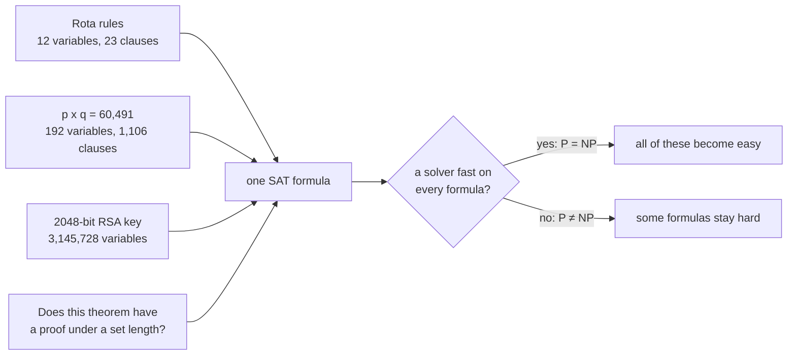
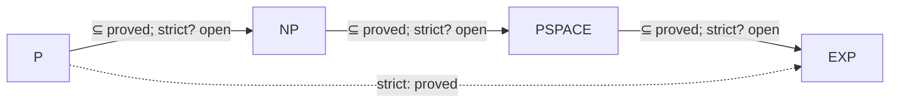

# P versus NP: the precise statement, and the barriers that block proof

[Syllabus](../../../SYLLABUS.md) → [Computability and complexity](../README.md) → [Beyond Worst Case](../README.md#s04) → P versus NP

---

## General Overview

A café needs a rota for two days. Staff A, B and C cover four shifts: Monday early and late, Tuesday early and late. Each shift needs exactly one person, nobody works both shifts on one day, and B cannot do Monday early.

Each rule becomes a **clause**: a short "or" of yes/no facts, such as "A or B or C works Monday early". Twelve yes/no **variables** and 23 clauses describe the rota. Making every clause true at once is **SAT**, the satisfiability problem. A plain solver finds A, B, A, B after 5 search **nodes** (a node is one guess the solver tries, plus the values that guess forces). Checking that answer takes one pass over the clauses.

Now write "the 8 bits of p times the 8 bits of q make 60,491" as clauses: 192 variables and 1,106 clauses. The same solver returns p = 251 and q = 241. For a 2048-bit RSA key the same build gives 3,145,728 variables and 20,948,994 clauses: large, but growing only as the square of the key length.

So a solver fast on **every** formula would factor RSA keys, write every rota and find any short proof a checker can verify. Whether one can exist is the P versus NP question. This card states it exactly, lists what is proved around it, and names the three **barriers**: families of proof methods proved unable to settle it.

**P versus NP asks whether every problem whose answers can be checked quickly can also be solved quickly; satisfiability carries the whole question, and three families of proof method (relativising, natural and algebrising proofs) are proved unable to answer it.**

**What kind of fact this is:** a conjecture: P ≠ NP is unproved as of 2026-11-11. The results around it, including the three barriers, are theorems stated here with key steps and named sources; the code runs the construction behind the first barrier.

### The picture: one solver, many problems



Every arrow into the formula costs polynomial time. Only the diamond is unknown.

---

## The formula

Notation first, in words. A machine **decides** a set of strings L when it answers yes on strings in L and no on the rest. TIME(t(n)) is the set of problems some machine decides in at most about t(n) steps on inputs of n symbols, as on [Time and space classes](../03-Time%20Complexity/01-time-and-space-classes.md). A **verifier** V(x, c) is a fast program that reads an input x and a proposed answer c, the **certificate**, and says yes or no.

```math
\mathrm{P} = \bigcup_{k \ge 1} \mathrm{TIME}(n^k), \qquad L \in \mathrm{NP} \text{ when } \Big( x \in L \iff \exists\, c \text{ with } |c| \le |x|^k \text{ and } V(x, c) = 1 \Big)
```

**Read it aloud:** P is every problem some machine solves in a polynomial number of steps; NP is every problem whose yes-answers have short certificates that a polynomial-time verifier accepts.

The question asks whether the two classes are equal. Cook-Levin turns it into one problem:

```math
\mathrm{P} = \mathrm{NP} \iff \mathrm{SAT} \in \mathrm{P}
```

**Read it aloud:** P equals NP exactly when some machine solves satisfiability in polynomial time.

A proof of P ≠ NP must show this: for **every** machine M and **every** fixed power k, some formulas make M either answer wrongly or take more than about $`n^k`$ steps. The claim covers all machines at once.

| Symbol | Plain meaning | In our example | Push it up and the answer… |
| --- | --- | --- | --- |
| $`n`$ | input length, in symbols | 40 in the budget table | brute force grows as $`2^n`$, a budget as $`n^k`$ |
| $`k`$ | the fixed power in a polynomial budget | 3, the $`n^3`$ budget below | more problems fit, still all inside P |
| $`\mathrm{TIME}(n^k)`$ | problems solved in about $`n^k`$ steps | $`n^3`$: 64,000 steps at $`n = 40`$ | a bigger class (time hierarchy) |
| $`\mathrm{P}`$ | problems solved in polynomial time | checking a rota | — |
| $`\mathrm{NP}`$ | problems whose yes-answers can be checked in polynomial time | finding a rota; factoring 60,491 | — |
| $`L`$, $`x`$ | a problem, written as the set of inputs whose answer is yes; one input | satisfiable formulas; the 23-clause rota formula | — |
| $`c`$, $`\lvert c\rvert`$ | a certificate, and its length | the rota A, B, A, B; 12 bits | — |
| $`V(x, c)`$ | the verifier: 1 for accept, 0 for reject | one pass over 23 clauses | — |
| $`N`$, $`b`$ | the number to factor; bits per factor | 60,491; 8 | variables grow as $`3b^2`$, clauses as $`20b^2`$ |
| SAT | does some setting of the variables make every clause true? | the rota; the multiplier for 60,491 | — |
| $`M^A`$, $`\mathrm{P}^A`$ | a machine that may ask "is s in A?" for one step each; the class it gives | strings of length 10 | — |
| ETH | the exponential time hypothesis: 3-SAT (clauses of three literals) on n variables needs $`2^{a n}`$ steps for some fixed number $`a > 0`$ | brute force $`2^n`$ has the right shape | — |

### When it holds

- **Worst case, not typical case.** P asks for one machine fast on every input. A solver fast on rotas but slow on pigeonhole formulas proves nothing either way.
- **A fixed power k.** A budget of $`n^{\log n}`$ or $`2^{\sqrt n}`$ is not polynomial; allow it and the question changes.
- **Short certificates.** NP needs $`\lvert c\rvert \le \lvert x\rvert^k`$. Allow exponentially long certificates and the class jumps to NEXP, which is proved larger than P.
- **Deterministic machines for P.** A guessing machine (shelf 01) solves SAT in one checking pass, so guessing must stay out of P.
- **Plain machines, no oracle.** Attach an oracle A and the answer can flip either way: Step 3.

---

## Why it works

### Step 0: checking is cheap, so the question is whether search is too

Every NP problem has a cheap check: one pass over 23 clauses, or one multiplication. Trying every certificate always solves it: 4096 tries for 12 bits, 1,099,511,627,776 for 40 bits. P = NP would mean this search can always shrink to polynomial cost; P ≠ NP would mean that for some problems it cannot.

### Step 1: why a fast SAT solver breaks everything in NP

Cook-Levin says SAT is **NP-complete**: every NP problem reduces to it in polynomial time. The reduction writes the verifier's run as a circuit, then writes each gate as a few clauses.

The factoring formula is that recipe done by hand. The verifier "multiply p by q, compare with N" is a school multiplier: AND gates make the partial products, and rows of adders sum them. Each gate becomes one clause per row of its truth table. The 16 product bits are pinned to the bits of 60,491, so a satisfying setting is exactly a pair of factors. With b bits per factor:

- **Variables:** $`3b^2`$. At b = 8 that is 192.
- **Clauses:** $`20b^2 - 22b + 2`$. At b = 8 that is 1,106.
- **At b = 1024**, a 2048-bit RSA modulus: 3,145,728 variables and 20,948,994 clauses.

<details>
<summary>Detailed count: where 3b² and 20b² − 22b + 2 come from</summary>

The inputs are the 2b bits of p and q. The partial products are $`b^2`$ AND gates, each with 4 clauses. Rows 1 to b − 1 are added in turn, each with b adders that make 2 new variables each, so each row adds 2b variables.

$`\displaystyle \text{variables} = 2b + b^2 + (b - 1)\,2b = 3b^2`$

A half adder (XOR and AND of two bits) has 8 clauses. A full adder (XOR and majority of three bits) has 16. Row 1 has 2 half adders and b − 2 full adders; each later row has 1 half adder and b − 1 full adders. The product adds 2b one-literal clauses, and "p ≥ 2" and "q ≥ 2" add one clause each.

$`\displaystyle \text{clauses} = 4b^2 + (16b - 16) + (b - 2)(16b - 8) + 2b + 2 = 20b^2 - 22b + 2`$

The code builds the formula for b = 2 to 8 and checks both counts against these closed forms.

</details>

A yes/no solver is enough: ask "is there a solution with this bit set to 1?", fix the bit, and go on, one question per variable. So P = NP would hand over RSA's private keys, and every secret a fast program can check. Every public-key scheme therefore needs P ≠ NP, but P ≠ NP alone would not make factoring hard (Step 2).

### Step 2: what is proved around the question



Schematic. PSPACE is what polynomial memory solves, EXP what exponential time solves. Solid arrows are proved inclusions, strictness open. The dotted arrow is proved strict by the time hierarchy, so at least one solid arrow is strict, and nobody knows which.

| Result | Status | What it says |
| --- | --- | --- |
| P ⊆ NP ⊆ PSPACE ⊆ EXP | theorem | trying every certificate needs little memory |
| P ≠ EXP | theorem (time hierarchy, 1965) | more time solves strictly more problems |
| SAT is NP-complete | theorem (Cook-Levin, 1971) | P = NP exactly when SAT is in P |
| If P ≠ NP, problems strictly between exist | theorem (Ladner, 1975) | not every hard NP problem is NP-complete |
| If P = NP, the whole polynomial hierarchy equals P | theorem | the there-exists and for-all ladder above NP collapses |
| Pigeonhole formulas need exponentially long resolution proofs | theorem (Haken, 1985) | DPLL-style solvers are slow on them |
| Parity is not in AC0 | theorem | constant-depth circuits are weak: [Circuit lower bounds](07-circuit-complexity-and-lower-bounds.md) |
| ETH: 3-SAT on n variables needs $`2^{a n}`$ steps | conjecture, unproved as of 2026-11-11 | brute force has the right shape, up to the constant $`a`$ |
| Factoring is NP-complete | not known, and not expected | factoring lies in NP and in coNP |

coNP is the class of problems whose no-answers have short certificates. Factoring lies in both NP and coNP: the full list of prime factors certifies either answer. An NP-complete problem in coNP would force NP = coNP, which is not expected, so factoring is probably easier than SAT.

The pigeonhole formula puts n + 1 pigeons in n holes, at most one per hole, so it can never be satisfied. The card's solver is plain DPLL (the Davis-Putnam-Logemann-Loveland method): fill in forced values, then branch on one variable. Its failed search on an unsatisfiable formula is a resolution proof (a chain of steps that each merge two clauses and cancel one variable), so Haken's theorem shows up as search nodes:

| Pigeons into holes | Variables | Clauses | DPLL nodes |
| --- | ---: | ---: | ---: |
| 2 into 1 | 2 | 3 | 1 |
| 3 into 2 | 6 | 9 | 3 |
| 4 into 3 | 12 | 22 | 17 |
| 5 into 4 | 20 | 45 | 103 |
| 6 into 5 | 30 | 81 | 749 |
| 7 into 6 | 42 | 133 | 6,491 |

The rota took 5 nodes and the 192-variable factoring formula 72, yet 42 pigeonhole variables take 6,491. Easy instances say nothing about the worst case.

### Step 3: the first barrier, relativisation

An **oracle** A is a fixed set of strings that a machine may ask about: "is s in A?" costs one step. $`M^A`$ is a machine with that power, and $`\mathrm{P}^A`$ and $`\mathrm{NP}^A`$ are the classes it gives.

A proof method **relativises** when it still works after every machine gets the same oracle. Simulation (one machine running another step by step) and diagonalisation (the method behind the halting problem and the time hierarchy) both relativise. In 1975 Baker, Gill and Solovay proved two facts:

- **Some oracle A gives $`\mathrm{P}^A = \mathrm{NP}^A`$.** Take A to be a PSPACE-complete problem. Then both classes equal PSPACE.
- **Some oracle B gives $`\mathrm{P}^B \ne \mathrm{NP}^B`$.** It is built so that a guess beats every deterministic machine.

A relativising proof of P ≠ NP would also prove $`\mathrm{P}^A \ne \mathrm{NP}^A`$, which is false, and a relativising proof of P = NP would fail on B the same way. So no relativising method settles the question.

The code runs one stage of building B. The question is "does B hold any string of length L?" A guessing machine guesses the string and asks once. At L = 10 there are 1,024 strings. A deterministic machine that asks about 1,023 of them hears "no" each time and answers no. The adversary records every question, then puts the one string never asked, 1111111111, into B: the machine still answers no, and the truth is yes.

<details>
<summary>Detailed proof sketch: building the oracle B</summary>

List all deterministic oracle machines with polynomial clocks, $`M_1, M_2, \ldots`$, where $`M_i`$ stops within $`n^i`$ steps. Build B in stages.

At stage i, pick a length L longer than every string any earlier stage placed or asked about, with $`2^L > L^i`$. Run $`M_i`$ on the input $`1^L`$ (L ones), answering its questions from the current B. It asks at most $`L^i`$ questions, so some string of length L is never asked.

If $`M_i`$ answers yes, add no string of length L to B: the true answer is no. If it answers no, add one unasked string of length L: the true answer is yes. Either way $`M_i`$ is wrong on $`1^L`$. Later stages pick longer lengths still, so they never change an answer this run relied on.

The problem "does B hold a string of length L?" is in $`\mathrm{NP}^B`$: guess the string, ask once. No $`M_i`$ decides it, so it is not in $`\mathrm{P}^B`$. Source: Baker, Gill and Solovay (1975).

</details>

### Step 4: the second barrier, natural proofs

Showing that some NP function needs large circuits would prove P ≠ NP ([Circuit lower bounds](07-circuit-complexity-and-lower-bounds.md)). Most such proofs find a property of a function's **truth table** (its outputs on all $`2^n`$ inputs) that small circuits never have.

Razborov and Rudich (1997) called such a property **natural** when it has two features:

- **Constructive:** it can be tested in time polynomial in the truth table's length, $`2^n`$.
- **Large:** a fair share of all functions have it, at least a $`2^{-O(n)}`$ fraction.

Their theorem: a natural property that rules out polynomial-size circuits would also tell **pseudorandom functions** apart from truly random ones. These are functions computed by a small circuit from a short secret key that look random to any fast test ([Pseudorandomness](04-derandomisation-and-pseudorandomness.md)), and they can be built from factoring. So if factoring needs nearly exponential time (2 raised to a fixed power of n, such as the fourth root), as RSA's users assume, no natural proof shows that an NP problem needs large circuits, which is the circuit route to P ≠ NP. The hardness that keeps RSA safe blocks the usual way of proving hardness ([Average-case hardness](06-average-case-and-cryptographic-hardness.md)).

### Step 5: the third barrier, algebrisation

Some proofs do not relativise. The best known is IP = PSPACE ([Interactive proofs](../05-Algebraic%2C%20Interactive%20and%20Quantum/04-interactive-proofs-ip-pspace-and-the-pcp-theorem.md)). It rests on **arithmetisation**: turning a yes/no formula into a polynomial over a field, so that it can be evaluated at points that are not 0 or 1.

For the rota, each clause becomes $`1 - \prod (1 - \ell)`$, where a literal $`\ell`$ (a variable or its "not") is written x or 1 − x. The product over all clauses is 1 on a valid rota and 0 otherwise. Summed over all 4096 yes/no settings it gives 24, matching brute force. Set every variable to 2, work modulo 97, and it gives 43: a value with no yes/no meaning. Proofs that use such values get past relativisation.

Aaronson and Wigderson (ACM Transactions on Computation Theory 1, 2009) showed they still fall short. A proof **algebrises** when it survives giving machines access to the oracle's polynomial extension too. IP = PSPACE algebrises, yet such oracles push P versus NP both ways, so algebrising proofs cannot settle it.

---

## Worked numbers, by hand

The example: what a fast SAT solver would do to the number 60,491.

| Step | Arithmetic | Value |
| --- | --- | --- |
| bits per factor | 60,491 is below $`2^{16}`$; like an RSA key, it is split into two factors of half the bits | b = 8 |
| variables | $`3b^2 = 3 \times 64`$ | 192 |
| clauses | $`20 \times 64 - 22 \times 8 + 2 = 1280 - 176 + 2`$ | 1,106 |
| DPLL search | unit propagation, then branch on the lowest free bit | 72 nodes |
| read off p and q | bits set in the solution | p = 251, q = 241 |
| verify | $`251 \times 241`$ | 60,491 |
| a 2048-bit RSA key | b = 1024: $`3 \times 1024^2`$ | 3,145,728 variables |
| its clauses | $`20 \times 1024^2 - 22 \times 1024 + 2`$ | **20,948,994 clauses** |

A real RSA key is one formula of about 21 million clauses, so a solver that is polynomial-time on every formula would break it; no such solver is known, and none is proved impossible.

The budgets themselves, at stated sizes:

| n | $`2^n`$ | $`n^3`$ |
| ---: | ---: | ---: |
| 10 | 1,024 | 1,000 |
| 20 | 1,048,576 | 8,000 |
| 40 | 1,099,511,627,776 | 64,000 |
| 60 | 1,152,921,504,606,846,976 | 216,000 |

### What breaks if you drop a piece

| Mistake | Comes out at | What went wrong |
| --- | --- | --- |
| Judging the worst case from easy runs | rota: 5 nodes; 7 pigeons into 6 holes: 6,491 nodes | P needs one machine fast on every input |
| Calling $`2^n`$ "fine" because it is small at first | at n = 9, 512 against 729; from n = 10 on, $`2^n`$ stays ahead | a polynomial budget is about growth, not small cases |
| A deterministic machine that asks almost every oracle question | asks 1,023 of 1,024, answers no; the truth is yes | the adversary hides the string it never asked |
| Dropping the "B not Monday early" clause | 36 rotas instead of 24 | a formula means only what its clauses say |

The fourth row is a "Try changing" experiment below.

---

## Code, from first principles, and it actually runs

The code writes one plain DPLL solver and runs it on the rota, the factoring formula and six pigeonhole formulas, then runs one stage of the oracle construction. It takes three pairs of independent roads:

- the 24 rotas, by brute force and by the arithmetised polynomial, with a separate verifier for the solver's rota;
- the factors, by the solver and by trial division;
- the formula sizes, by building the formula and by the hand-counted closed forms.

### Python

```python
# P versus NP: what is known -- the check behind the card.  Standard library only.
# One plain DPLL solver solves a staff rota, factors a number and stalls on pigeonhole
# formulas; an adversary fools an oracle machine.  A clause lists literals, +v or -v.

def dpll(clauses, nvars):                # returns (assignment or None, search nodes)
    val, nodes = [0] * (nvars + 1), [0]  # val: +1 true, -1 false, 0 not set yet
    def setlit(lit, trail):
        val[abs(lit)] = 1 if lit > 0 else -1
        trail.append(abs(lit))
    def propagate(trail):                # a clause with one free literal forces it
        changed = True
        while changed:
            changed = False
            for cl in clauses:
                if any(val[abs(l)] * l > 0 for l in cl):
                    continue
                free = [l for l in cl if val[abs(l)] == 0]
                if not free:
                    return False         # every literal false: a dead end
                if len(free) == 1:
                    setlit(free[0], trail)
                    changed = True
        return True
    def search(lit):
        nodes[0] += 1
        trail = []
        if lit: setlit(lit, trail)
        if propagate(trail):
            free = [v for v in range(1, nvars + 1) if val[v] == 0]
            if not free or search(free[0]) or search(-free[0]):
                return True
        for v in trail:
            val[v] = 0
        return False
    return ([v > 0 for v in val] if search(0) else None), nodes[0]

def satisfied(clauses, a):               # the verifier V(x, c): one pass, no search
    return all(any(a[abs(l)] == (l > 0) for l in cl) for cl in clauses)
yn = lambda t: "yes" if t else "no"

# 1. The rota: staff A, B, C; shifts Mon-early, Mon-late, Tue-early, Tue-late.
x = lambda s, t: 1 + 4 * s + t
rota = [[x(s, t) for s in range(3)] for t in range(4)]                 # each shift covered
rota += [[-x(s, t), -x(r, t)] for t in range(4) for s in range(3) for r in range(s + 1, 3)]
rota += [[-x(s, d), -x(s, d + 1)] for s in range(3) for d in (0, 2)]   # one shift a day
rota += [[-x(1, 0)]]                                                   # B not Mon-early
rsol, rnodes = dpll(rota, 12)
shifts = ["Mon-early", "Mon-late", "Tue-early", "Tue-late"]
found = [f"{'ABC'[s]}:{shifts[t]}" for t in range(4) for s in range(3) if rsol[x(s, t)]]
cube = [[0] + [(m >> i) & 1 for i in range(12)] for m in range(4096)]
brute = sum(satisfied(rota, [a == 1 for a in pt]) for pt in cube)
def poly(a, p):                          # arithmetised rota: clause -> 1 - prod(1 - literal)
    out = 1
    for cl in rota:
        miss = 1
        for l in cl:
            miss = miss * (1 - a[l] if l > 0 else a[-l]) % p
        out = out * (1 - miss) % p
    return out
psum = sum(poly(pt, 1009) for pt in cube)
print(f"rota: 12 variables, {len(rota)} clauses; DPLL nodes {rnodes}; verifier says {yn(satisfied(rota, rsol))}")
print("rota found: " + ", ".join(found))
print(f"valid rotas: brute force over 2^12 = 4096 settings {brute}; polynomial summed over them {psum}")
print(f"the polynomial at x = 2 for every variable, mod 97: {poly([2] * 13, 97)}")

# 2. Factoring as satisfiability: bits of p and q, a school multiplier of AND, XOR and
#    majority gates (one clause per truth-table row), the product's bits pinned to N.
def factor_cnf(n, b):
    cl, top = [], [2 * b]
    def gate(f, ins):
        top[0] += 1
        for m in range(1 << len(ins)):
            bits = [(m >> i) & 1 for i in range(len(ins))]
            cl.append([-v if bit else v for v, bit in zip(ins, bits)] + [top[0] if f(bits) else -top[0]])
        return top[0]
    AND, XOR, MAJ = (lambda t: t[0] & t[1]), (lambda t: sum(t) % 2), (lambda t: int(sum(t) >= 2))
    acc = [gate(AND, [1 + j, b + 1]) for j in range(b)]
    for i in range(1, b):                # add row i, shifted i places, with ripple carries
        row = [gate(AND, [1 + j, b + 1 + i]) for j in range(b)]
        out, c = acc[:i], None
        for j in range(b):
            pair = [u for u in (acc[i + j] if i + j < len(acc) else None, row[j], c) if u is not None]
            out.append(gate(XOR, pair))
            c = gate(MAJ if len(pair) == 3 else AND, pair)
        acc = out + [c]
    cl += [[acc[k] if (n >> k) & 1 else -acc[k]] for k in range(2 * b)]
    cl += [list(range(2, b + 1)), list(range(b + 2, 2 * b + 1))]       # p >= 2, q >= 2
    return cl, top[0]
def formula_size(b):                     # counted by hand on the card
    return 3 * b * b, 20 * b * b - 22 * b + 2

built = [(factor_cnf(1, b)[1], len(factor_cnf(1, b)[0])) for b in range(2, 9)]
N, B = 60491, 8
cl, nv = factor_cnf(N, B)
sol, nodes = dpll(cl, nv)
p, q = (sum(1 << j for j in range(B) if sol[off + 1 + j]) for off in (0, B))
trial = next(d for d in range(2, N) if N % d == 0)
v, c = formula_size(1024)
print(f"formula sizes built for b = 2..8 match 3b^2 and 20b^2 - 22b + 2: {yn(built == [formula_size(b) for b in range(2, 9)])}")
print(f"b = {B} bits each: b^2 = {B * B}, 20b^2 = {20 * B * B}, 22b = {22 * B}; product bits {2 * B}, below 2^{2 * B} = {2 ** (2 * B)}")
print(f"factor N = {N}: {nv} variables, {len(cl)} clauses; DPLL nodes {nodes}; p = {p}, q = {q}")
print(f"trial division finds {trial} x {N // trial}; check p x q = {p * q}")
print(f"2048-bit RSA modulus as a formula: {v:,} variables, {c:,} clauses")

# 3. Where the solver stalls: n + 1 pigeons into n holes, which can never fit.
php_nodes = []
for n in range(1, 7):
    y = lambda i, h: 1 + n * i + h
    php = [[y(i, h) for h in range(n)] for i in range(n + 1)]
    php += [[-y(i, h), -y(j, h)] for h in range(n) for i in range(n + 1) for j in range(i + 1, n + 1)]
    res, k = dpll(php, n * (n + 1))
    php_nodes.append(k)
    print(f"pigeonhole {n + 1} into {n}: {n * (n + 1)} variables, {len(php)} clauses, "
          f"satisfiable {yn(res is not None)}, DPLL nodes {k}")

# 4. Relativisation: an oracle is a set of strings, asked about one at a time.  "Does it
#    hold a string of length L?" is easy with a guess; fewer than 2^L questions are fooled.
def machine(oracle, length, budget, asked):   # asks strings 0, 1, 2, ... while the budget lasts; logs each
    return any(asked.add(s) or s in oracle for s in range(min(budget, 2 ** length)))
L, budget, asked = 10, 2 ** 10 - 1, set()
says_empty = machine(set(), L, budget, asked)                     # the adversary watches this run
hidden = set(sorted(set(range(2 ** L)) - asked)[:1])              # and hides one string never asked
says_hidden = machine(hidden, L, budget, set())
print(f"oracle, L = {L}: {2 ** L} strings of length {L}; machine asks {len(asked)}, answers {yn(says_empty)} on the empty oracle")
print(f"adversary adds {', '.join(format(s, 'b') for s in hidden) or 'nothing'}: machine still answers {yn(says_hidden)}; "
      f"the truth is {yn(len(hidden) > 0)}; the certificate check asks 1 question")

# 5. Brute force against a polynomial budget.
for m in (10, 20, 40, 60):
    print(f"n = {m}: 2^n = {2 ** m:,}; n^3 = {m ** 3:,}")
cross = next(m for m in range(2, 100) if all(2 ** k > k ** 3 for k in range(m, 100)))
print(f"2^n passes n^3 for good at n = {cross}; at n = 9: {2 ** 9} vs {9 ** 3}")

assert brute == psum == 24 and satisfied(rota, rsol)               # three roads to the rota
assert p * q == N and sorted([p, q]) == [trial, N // trial]        # solver against trial division
assert built == [formula_size(b) for b in range(2, 9)]             # construction against count
assert all(php_nodes[i + 1] > 6 * php_nodes[i] for i in range(2, 5))  # each step over 6x
assert not says_empty and says_hidden != (len(hidden) > 0)      # the adversary wins
assert cross == 10
print("ALL CHECKS PASS")
```

**Ran 2026-11-19 on macOS, Python 3.14.10, standard library only. All checks passed. Output, pasted from the run:**

```
rota: 12 variables, 23 clauses; DPLL nodes 5; verifier says yes
rota found: A:Mon-early, B:Mon-late, A:Tue-early, B:Tue-late
valid rotas: brute force over 2^12 = 4096 settings 24; polynomial summed over them 24
the polynomial at x = 2 for every variable, mod 97: 43
formula sizes built for b = 2..8 match 3b^2 and 20b^2 - 22b + 2: yes
b = 8 bits each: b^2 = 64, 20b^2 = 1280, 22b = 176; product bits 16, below 2^16 = 65536
factor N = 60491: 192 variables, 1106 clauses; DPLL nodes 72; p = 251, q = 241
trial division finds 241 x 251; check p x q = 60491
2048-bit RSA modulus as a formula: 3,145,728 variables, 20,948,994 clauses
pigeonhole 2 into 1: 2 variables, 3 clauses, satisfiable no, DPLL nodes 1
pigeonhole 3 into 2: 6 variables, 9 clauses, satisfiable no, DPLL nodes 3
pigeonhole 4 into 3: 12 variables, 22 clauses, satisfiable no, DPLL nodes 17
pigeonhole 5 into 4: 20 variables, 45 clauses, satisfiable no, DPLL nodes 103
pigeonhole 6 into 5: 30 variables, 81 clauses, satisfiable no, DPLL nodes 749
pigeonhole 7 into 6: 42 variables, 133 clauses, satisfiable no, DPLL nodes 6491
oracle, L = 10: 1024 strings of length 10; machine asks 1023, answers no on the empty oracle
adversary adds 1111111111: machine still answers no; the truth is yes; the certificate check asks 1 question
n = 10: 2^n = 1,024; n^3 = 1,000
n = 20: 2^n = 1,048,576; n^3 = 8,000
n = 40: 2^n = 1,099,511,627,776; n^3 = 64,000
n = 60: 2^n = 1,152,921,504,606,846,976; n^3 = 216,000
2^n passes n^3 for good at n = 10; at n = 9: 512 vs 729
ALL CHECKS PASS
```

### Rust

Same numbers, same labels, built with `rustc --edition 2021 -O`.

```rust
// P versus NP: what is known -- the same check as the Python, in Rust.  No crates.
// One plain DPLL solver solves a staff rota, factors a number and stalls on pigeonhole
// formulas; an adversary fools an oracle machine.  A clause lists literals, +v or -v.
type Cnf = Vec<Vec<i64>>;

struct Solver { clauses: Cnf, val: Vec<i64>, nodes: u64 }  // val: +1 true, -1 false, 0 not set

impl Solver {
    fn setlit(&mut self, lit: i64, trail: &mut Vec<usize>) {
        self.val[lit.unsigned_abs() as usize] = lit.signum(); trail.push(lit.unsigned_abs() as usize);
    }
    fn propagate(&mut self, trail: &mut Vec<usize>) -> bool {  // one free literal is forced
        let mut changed = true;
        while changed {
            changed = false;
            for c in 0..self.clauses.len() {
                let cl = &self.clauses[c];
                if cl.iter().any(|&l| self.val[l.unsigned_abs() as usize] * l > 0) { continue }
                let free: Vec<i64> = cl.iter().copied().filter(|&l| self.val[l.unsigned_abs() as usize] == 0).collect();
                if free.is_empty() { return false }        // every literal false: a dead end
                if free.len() == 1 { self.setlit(free[0], trail); changed = true }
            }
        }
        true
    }
    fn search(&mut self, lit: i64) -> bool {
        self.nodes += 1;
        let mut trail = Vec::new();
        if lit != 0 { self.setlit(lit, &mut trail) }
        if self.propagate(&mut trail) {
            match (1..self.val.len()).find(|&v| self.val[v] == 0) {
                None => return true,
                Some(v) => if self.search(v as i64) || self.search(-(v as i64)) { return true },
            }
        }
        for v in trail { self.val[v] = 0 }
        false
    }
}

fn dpll(clauses: &Cnf, nvars: usize) -> (Option<Vec<bool>>, u64) {
    let mut s = Solver { clauses: clauses.clone(), val: vec![0; nvars + 1], nodes: 0 };
    if s.search(0) { (Some(s.val.iter().map(|&v| v > 0).collect()), s.nodes) } else { (None, s.nodes) }
}
fn satisfied(clauses: &Cnf, a: &[bool]) -> bool {  // the verifier V(x, c): one pass, no search
    clauses.iter().all(|cl| cl.iter().any(|&l| a[l.unsigned_abs() as usize] == (l > 0)))
}

fn yn(t: bool) -> &'static str { if t { "yes" } else { "no" } }
fn commas(n: u128) -> String {                  // 1234567 -> 1,234,567
    let (s, mut out) = (n.to_string(), String::new());
    for (i, ch) in s.chars().enumerate() { if i > 0 && (s.len() - i) % 3 == 0 { out.push(',') } out.push(ch) }
    out
}
fn poly(rota: &Cnf, a: &[i64], p: i64) -> i64 {  // arithmetised rota: clause -> 1 - prod(1 - literal)
    let mut out = 1;
    for cl in rota {
        let mut miss = 1;
        for &l in cl { miss = (miss * if l > 0 { 1 - a[l as usize] } else { a[(-l) as usize] }).rem_euclid(p) }
        out = (out * (1 - miss)).rem_euclid(p);
    }
    out
}

fn gate(cl: &mut Cnf, top: &mut i64, kind: u8, ins: &[i64]) -> i64 {  // one clause per truth-table row
    *top += 1;
    for m in 0..(1u32 << ins.len()) {
        let bits: Vec<i64> = (0..ins.len()).map(|i| ((m >> i) & 1) as i64).collect();
        let (sum, and) = (bits.iter().sum::<i64>(), bits[0] & bits[1]);
        let f = match kind { 0 => and, 1 => sum % 2, _ => (sum >= 2) as i64 };
        let mut c: Vec<i64> = ins.iter().zip(&bits).map(|(&v, &b)| if b == 1 { -v } else { v }).collect();
        c.push(if f == 1 { *top } else { -*top });
        cl.push(c);
    }
    *top
}

fn factor_cnf(n: u64, b: usize) -> (Cnf, usize) {  // school multiplier, product pinned to n
    let (mut cl, mut top): (Cnf, i64) = (Vec::new(), 2 * b as i64);
    let bi = b as i64;
    let mut acc: Vec<i64> = (0..bi).map(|j| gate(&mut cl, &mut top, 0, &[1 + j, bi + 1])).collect();
    for i in 1..b {                                     // add row i, shifted i places
        let row: Vec<i64> = (0..bi).map(|j| gate(&mut cl, &mut top, 0, &[1 + j, bi + 1 + i as i64])).collect();
        let (mut out, mut c): (Vec<i64>, Option<i64>) = (acc[..i].to_vec(), None);
        for j in 0..b {
            let a = if i + j < acc.len() { Some(acc[i + j]) } else { None };
            let pair: Vec<i64> = [a, Some(row[j]), c].iter().flatten().copied().collect();
            out.push(gate(&mut cl, &mut top, 1, &pair));
            c = Some(gate(&mut cl, &mut top, if pair.len() == 3 { 2 } else { 0 }, &pair));
        }
        out.push(c.unwrap()); acc = out;
    }
    for k in 0..2 * b { cl.push(vec![if (n >> k) & 1 == 1 { acc[k] } else { -acc[k] }]) }
    cl.push((2..=bi).collect()); cl.push((bi + 2..=2 * bi).collect());  // p >= 2, q >= 2
    (cl, top as usize)
}

fn formula_size(b: u128) -> (u128, u128) { (3 * b * b, 20 * b * b - 22 * b + 2) }  // counted by hand
fn machine(oracle: &[u64], length: u32, budget: u64, asked: &mut Vec<u64>) -> bool {  // asks 0, 1, 2, ...; logs each
    (0..budget.min(1 << length)).any(|s| { asked.push(s); oracle.contains(&s) })
}

fn main() {
    // 1. The rota: staff A, B, C; shifts Mon-early, Mon-late, Tue-early, Tue-late.
    let x = |s: i64, t: i64| 1 + 4 * s + t;
    let mut rota: Cnf = (0..4).map(|t| (0..3).map(|s| x(s, t)).collect()).collect();
    for t in 0..4 { for s in 0..3 { for r in s + 1..3 { rota.push(vec![-x(s, t), -x(r, t)]) } } }
    for s in 0..3 { for d in [0, 2] { rota.push(vec![-x(s, d), -x(s, d + 1)]) } }
    rota.push(vec![-x(1, 0)]);                          // B not Mon-early
    let (rsol, rnodes) = dpll(&rota, 12); let rsol = rsol.unwrap();
    let (shifts, mut found) = (["Mon-early", "Mon-late", "Tue-early", "Tue-late"], Vec::new());
    for t in 0..4 { for s in 0..3 { if rsol[x(s, t) as usize] { found.push(format!("{}:{}", ["A", "B", "C"][s as usize], shifts[t as usize])) } } }
    let cube: Vec<Vec<i64>> = (0..4096).map(|m| (0..13).map(|i| if i == 0 { 0 } else { (m >> (i - 1)) & 1 }).collect()).collect();
    let brute = cube.iter().filter(|pt| satisfied(&rota, &pt.iter().map(|&a| a == 1).collect::<Vec<bool>>())).count();
    let psum: i64 = cube.iter().map(|pt| poly(&rota, pt, 1009)).sum();
    println!("rota: 12 variables, {} clauses; DPLL nodes {}; verifier says {}", rota.len(), rnodes, yn(satisfied(&rota, &rsol)));
    println!("rota found: {}", found.join(", "));
    println!("valid rotas: brute force over 2^12 = 4096 settings {}; polynomial summed over them {}", brute, psum);
    println!("the polynomial at x = 2 for every variable, mod 97: {}", poly(&rota, &[2; 13], 97));

    let built: Vec<(u128, u128)> = (2..9).map(|b| { let (c, v) = factor_cnf(1, b); (v as u128, c.len() as u128) }).collect();
    let expect: Vec<(u128, u128)> = (2..9).map(formula_size).collect();
    let (n_big, bb) = (60491u64, 8usize);
    let (cl, nv) = factor_cnf(n_big, bb);
    let (sol, nodes) = dpll(&cl, nv); let sol = sol.unwrap();
    let bits = |off: usize| -> u64 { (0..bb).filter(|&j| sol[off + 1 + j]).map(|j| 1 << j).sum() };
    let (p, q) = (bits(0), bits(bb));
    let trial = (2..n_big).find(|d| n_big % d == 0).unwrap();
    let (v, c) = formula_size(1024);
    println!("formula sizes built for b = 2..8 match 3b^2 and 20b^2 - 22b + 2: {}", yn(built == expect));
    println!("b = {} bits each: b^2 = {}, 20b^2 = {}, 22b = {}; product bits {}, below 2^{} = {}", bb, bb * bb, 20 * bb * bb, 22 * bb, 2 * bb, 2 * bb, 1u64 << (2 * bb));
    println!("factor N = {}: {} variables, {} clauses; DPLL nodes {}; p = {}, q = {}", n_big, nv, cl.len(), nodes, p, q);
    println!("trial division finds {} x {}; check p x q = {}", trial, n_big / trial, p * q);
    println!("2048-bit RSA modulus as a formula: {} variables, {} clauses", commas(v), commas(c));

    // 3. Where the solver stalls: n + 1 pigeons into n holes, which can never fit.
    let mut php_nodes = Vec::new();
    for n in 1..7i64 {
        let y = |i: i64, h: i64| 1 + n * i + h;
        let mut php: Cnf = (0..=n).map(|i| (0..n).map(|h| y(i, h)).collect()).collect();
        for h in 0..n { for i in 0..=n { for j in i + 1..=n { php.push(vec![-y(i, h), -y(j, h)]) } } }
        let (res, k) = dpll(&php, (n * (n + 1)) as usize);
        php_nodes.push(k);
        println!("pigeonhole {} into {}: {} variables, {} clauses, satisfiable {}, DPLL nodes {}",
                 n + 1, n, n * (n + 1), php.len(), yn(res.is_some()), k);
    }

    // 4. Relativisation: an oracle machine with fewer than 2^L questions is fooled.
    let (l, budget, mut asked) = (10u32, (1u64 << 10) - 1, Vec::new());
    let says_empty = machine(&[], l, budget, &mut asked);              // the adversary watches this run
    let hidden: Vec<u64> = (0..1u64 << l).filter(|s| !asked.contains(s)).take(1).collect();   // and hides one never asked
    let says_hidden = machine(&hidden, l, budget, &mut Vec::new());
    println!("oracle, L = {}: {} strings of length {}; machine asks {}, answers {} on the empty oracle", l, 1u64 << l, l, asked.len(), yn(says_empty));
    let shown = hidden.iter().map(|s| format!("{:b}", s)).collect::<Vec<_>>().join(", ");
    println!("adversary adds {}: machine still answers {}; the truth is {}; the certificate check asks 1 question",
             if shown.is_empty() { "nothing" } else { shown.as_str() }, yn(says_hidden), yn(!hidden.is_empty()));

    // 5. Brute force against a polynomial budget.
    for m in [10u32, 20, 40, 60] { println!("n = {}: 2^n = {}; n^3 = {}", m, commas(1u128 << m), commas((m as u128).pow(3))) }
    let cross = (2u128..100).find(|&m| (m..100).all(|k| (1u128 << k) > k * k * k)).unwrap();
    println!("2^n passes n^3 for good at n = {}; at n = 9: {} vs {}", cross, 1 << 9, 9 * 9 * 9);

    assert!(brute == 24 && psum == 24 && satisfied(&rota, &rsol));       // three roads to the rota
    assert!(p * q == n_big && p.min(q) == trial && p.max(q) == n_big / trial);
    assert!(built == expect);                                            // construction against count
    assert!((2..5).all(|i| php_nodes[i + 1] > 6 * php_nodes[i]));      // each step over 6x
    assert!(!says_empty && says_hidden != !hidden.is_empty());          // the adversary wins
    assert!(cross == 10);
    println!("ALL CHECKS PASS");
}
```

**Ran 2026-11-19 on macOS, rustc 1.98.1, no crates. All checks passed. Output, pasted from the run:**

```
rota: 12 variables, 23 clauses; DPLL nodes 5; verifier says yes
rota found: A:Mon-early, B:Mon-late, A:Tue-early, B:Tue-late
valid rotas: brute force over 2^12 = 4096 settings 24; polynomial summed over them 24
the polynomial at x = 2 for every variable, mod 97: 43
formula sizes built for b = 2..8 match 3b^2 and 20b^2 - 22b + 2: yes
b = 8 bits each: b^2 = 64, 20b^2 = 1280, 22b = 176; product bits 16, below 2^16 = 65536
factor N = 60491: 192 variables, 1106 clauses; DPLL nodes 72; p = 251, q = 241
trial division finds 241 x 251; check p x q = 60491
2048-bit RSA modulus as a formula: 3,145,728 variables, 20,948,994 clauses
pigeonhole 2 into 1: 2 variables, 3 clauses, satisfiable no, DPLL nodes 1
pigeonhole 3 into 2: 6 variables, 9 clauses, satisfiable no, DPLL nodes 3
pigeonhole 4 into 3: 12 variables, 22 clauses, satisfiable no, DPLL nodes 17
pigeonhole 5 into 4: 20 variables, 45 clauses, satisfiable no, DPLL nodes 103
pigeonhole 6 into 5: 30 variables, 81 clauses, satisfiable no, DPLL nodes 749
pigeonhole 7 into 6: 42 variables, 133 clauses, satisfiable no, DPLL nodes 6491
oracle, L = 10: 1024 strings of length 10; machine asks 1023, answers no on the empty oracle
adversary adds 1111111111: machine still answers no; the truth is yes; the certificate check asks 1 question
n = 10: 2^n = 1,024; n^3 = 1,000
n = 20: 2^n = 1,048,576; n^3 = 8,000
n = 40: 2^n = 1,099,511,627,776; n^3 = 64,000
n = 60: 2^n = 1,152,921,504,606,846,976; n^3 = 216,000
2^n passes n^3 for good at n = 10; at n = 9: 512 vs 729
ALL CHECKS PASS
```

The two outputs match line for line.

### Lean

Lean proves the oracle stage for every length and question budget, both formula counts for every b, and the budget crossing.

- Suppose $`2^L > L^i`$, and a deterministic machine on the empty oracle asks at most $`L^i`$ questions about strings of length $`L`$. Then some oracle holding at most one such string makes it answer "does the oracle hold a string of length $`L`$?" wrongly.
- Take $`b \ge 2`$ bits per factor. Then the factoring formula has $`2b + b^2 + (b - 1)\,2b = 3b^2`$ variables.
- Take the same $`b`$. Then the hand count of clauses in the detailed count sums to $`20b^2 - 22b + 2`$.
- Take any $`n \ge 10`$. Then $`n^3 < 2^n`$.
- The card's whole-number examples are exact, such as 60,491 = 251 × 241 and the budget table.

The Python and Rust checks run the solver, count the 24 rotas, build each formula and play the oracle stage at L = 10.

```lean
-- P versus NP: one stage of the oracle construction fools every machine that asks fewer than 2^L questions, the factoring formula has 3b^2 variables and 20b^2 - 22b + 2 clauses, 2^n beats n^3 from n = 10 on, and the card's whole-number examples are exact.
import Mathlib.Data.Fintype.Pi
import Mathlib.Data.Fintype.Card
import Mathlib.Algebra.Order.Group.Nat
import Mathlib.Tactic.Ring
import Mathlib.Tactic.NormNum
import Mathlib.Tactic.Linarith
import Mathlib.Data.Fintype.BigOperators

/-- One stage of the Baker-Gill-Solovay oracle B (the first barrier, relativisation).
An oracle is a set of strings of length L, written as a yes/no function on `Fin L → Bool`.
A deterministic machine's answer `run A` may depend on the oracle A. Run on the empty
oracle, it asks the questions in Q, at most L^i of them, and 2^L > L^i. So its answer is
unchanged on any oracle that also says no to every question in Q. Then some oracle B,
holding at most one string, makes the machine answer "does B hold a string of length L?"
wrongly. -/
theorem oracle_stage_fools_machine (L i : ℕ)
    (run : ((Fin L → Bool) → Bool) → Bool) (Q : Finset (Fin L → Bool))
    (hQ : Q.card ≤ L ^ i) (hL : L ^ i < 2 ^ L)
    (hrun : ∀ A : (Fin L → Bool) → Bool, (∀ q ∈ Q, A q = false) →
      run A = run (fun _ => false)) :
    ∃ B : (Fin L → Bool) → Bool,
      (∀ s t, B s = true → B t = true → s = t) ∧
      ¬ (run B = true ↔ ∃ s, B s = true) := by
  have hcard : Q.card < (Finset.univ : Finset (Fin L → Bool)).card := by
    rw [Finset.card_univ, Fintype.card_fun, Fintype.card_bool, Fintype.card_fin]
    omega
  obtain ⟨s0, -, hs0⟩ := Finset.exists_mem_notMem_of_card_lt_card hcard
  by_cases h0 : run (fun _ => false) = true
  · refine ⟨fun _ => false, ?_, ?_⟩
    · intro s t hs; simp at hs
    · simp [h0]
  · refine ⟨fun t => decide (t = s0), ?_, ?_⟩
    · intro s t hs ht
      simp only [decide_eq_true_eq] at hs ht
      rw [hs, ht]
    · have hB : run (fun t => decide (t = s0)) = run (fun _ => false) := by
        apply hrun
        intro q hq
        simp only [decide_eq_false_iff_not]
        rintro rfl
        exact hs0 hq
      rw [hB]
      simp [h0]

/-- The factoring formula's size, counted by hand on the card. With b ≥ 2 bits per factor:
variables = 2b inputs + b^2 partial products + (b - 1) rows of 2b adder outputs = 3b^2, and
clauses = 4b^2 (AND gates) + (16b - 16) (row 1) + (b - 2)(16b - 8) (later rows)
+ 2b (product bits) + 2 (p ≥ 2, q ≥ 2) = 20b^2 - 22b + 2. -/
theorem factor_formula_size (b : ℕ) (hb : 2 ≤ b) :
    2 * b + b ^ 2 + (b - 1) * (2 * b) = 3 * b ^ 2 ∧
    4 * b ^ 2 + (16 * b - 16) + (b - 2) * (16 * b - 8) + 2 * b + 2
      = 20 * b ^ 2 - 22 * b + 2 := by
  obtain ⟨c, rfl⟩ : ∃ c, b = c + 2 := ⟨b - 2, by omega⟩
  have e1 : c + 2 - 1 = c + 1 := by omega
  have e2 : 16 * (c + 2) - 16 = 16 * c + 16 := by omega
  have e3 : c + 2 - 2 = c := by omega
  have e4 : 16 * (c + 2) - 8 = 16 * c + 24 := by omega
  have e5 : 20 * (c + 2) ^ 2 = (20 * c ^ 2 + 58 * c + 36) + 22 * (c + 2) := by ring
  have e6 : 20 * (c + 2) ^ 2 - 22 * (c + 2) = 20 * c ^ 2 + 58 * c + 36 := by omega
  rw [e1, e2, e3, e4, e6]
  constructor <;> ring

/-- Brute force passes a polynomial budget for good: from n = 10 on, n^3 < 2^n. -/
theorem cube_lt_two_pow (n : ℕ) (hn : 10 ≤ n) : n ^ 3 < 2 ^ n := by
  induction n, hn using Nat.le_induction with
  | base => norm_num
  | succ k hk ih =>
    have h1 : 3 * k ^ 2 + 3 * k + 1 ≤ k ^ 3 := by nlinarith
    calc (k + 1) ^ 3 = k ^ 3 + (3 * k ^ 2 + 3 * k + 1) := by ring
      _ ≤ k ^ 3 + k ^ 3 := by omega
      _ < 2 ^ k + 2 ^ k := by omega
      _ = 2 ^ (k + 1) := by ring

-- The oracle stage at L = 10: the machine asks 1,023 of the 1,024 strings.
example : 2 ^ 10 - 1 < 2 ^ 10 ∧ 2 ^ 10 = 1024 := by norm_num

-- Factoring 60,491 with b = 8 bits per factor.
example : 60491 < 2 ^ 16 ∧ 2 ^ 16 = 65536 := by norm_num
example : 3 * 8 ^ 2 = 192 := by norm_num
example : 20 * 8 ^ 2 - 22 * 8 + 2 = 1106 ∧ 20 * 8 ^ 2 = 1280 ∧ 22 * 8 = 176 := by norm_num
example : 251 * 241 = 60491 := by norm_num
example : 60491 % 241 = 0 ∧ 60491 / 241 = 251 := by norm_num

-- A 2048-bit RSA key, b = 1024.
example : 3 * 1024 ^ 2 = 3145728 := by norm_num
example : 20 * 1024 ^ 2 - 22 * 1024 + 2 = 20948994 := by norm_num

-- The smaller key in "Try changing": b = 4, N = 143 = 11 × 13.
example : 3 * 4 ^ 2 = 48 ∧ 20 * 4 ^ 2 - 22 * 4 + 2 = 234 ∧ 11 * 13 = 143 := by norm_num

-- The budget table, and the crossing point.
example : 2 ^ 10 = 1024 ∧ 10 ^ 3 = 1000 := by norm_num
example : 2 ^ 20 = 1048576 ∧ 20 ^ 3 = 8000 := by norm_num
example : 2 ^ 40 = 1099511627776 ∧ 40 ^ 3 = 64000 := by norm_num
example : 2 ^ 60 = 1152921504606846976 ∧ 60 ^ 3 = 216000 := by norm_num
example : 2 ^ 9 = 512 ∧ 9 ^ 3 = 729 ∧ 2 ^ 9 < 9 ^ 3 := by norm_num

-- Brute force over 12 rota bits tries 4,096 settings.
example : 2 ^ 12 = 4096 := by norm_num

#print axioms oracle_stage_fools_machine
#print axioms factor_formula_size
#print axioms cube_lt_two_pow
```

**Checked 2026-11-19 on macOS, Lean 4.36.0-rc2, Mathlib v4.36.0-rc2. Every proof is complete and uses only Lean's standard axioms. Output, pasted from the run:**

```
'oracle_stage_fools_machine' depends on axioms: [propext, Classical.choice, Quot.sound]
'factor_formula_size' depends on axioms: [propext, Quot.sound]
'cube_lt_two_pow' depends on axioms: [propext, Classical.choice, Quot.sound]
```

> [!TIP]
> **Try changing**
> Guess first, then run it.
> - **Ask every question.** Set the oracle budget to `2 ** 10`. The machine now asks about all 1,024 strings, so the adversary finds none left to hide: it adds nothing, the machine's no is right, and the adversary assert stops the run.
> - **One more pigeon.** Change `range(1, 7)` to `range(1, 8)`. Eight pigeons into 7 holes take 65,561 nodes, about 10 times the 7-into-6 count, from just 56 variables.
> - **Drop a rule.** Delete the "B not Mon-early" clause. Both brute force and the polynomial now count 36 rotas, and the first assert stops the run.
> - **A smaller key.** Set `N, B = 143, 4`. The solver finds 11 × 13 in 6 nodes, from 48 variables and 234 clauses.

---

## The usual mistake

> [!warning]
> **"NP" does not mean "not polynomial".** It means nondeterministic polynomial time: problems whose yes-answers a fast verifier can check. Every problem in P is also in NP. The open question is whether finding is ever truly harder than checking.
>
> - **Practice is not proof.** Solvers handle huge industrial formulas daily, yet plain DPLL needs 6,491 nodes for 7 pigeons in 6 holes, and Haken's theorem makes that family exponential for every resolution-based solver.
> - **Factoring is not known to be NP-complete.** It lies in NP and coNP. A fast factoring method would break RSA but would not prove P = NP.
> - **P ≠ NP would not make RSA safe.** It makes some problem hard in the worst case; RSA needs factoring hard on random keys ([Average-case hardness](06-average-case-and-cryptographic-hardness.md)).
> - **A barrier is not an impossibility proof.** It rules out a family of methods, not every proof. Whether P versus NP could be unprovable is a separate, open question.

---

## Where you meet it in real life

- **Rota and timetable software.** Shift rotas, exam timetables and sports fixtures go to SAT and integer solvers: fast on typical instances, with no guarantee.
- **Public-key cryptography.** [RSA in full](../../14-Applied%20and%20computational/04-Cryptography/04-rsa-in-full.md) bets that factoring a 2048-bit modulus is hard. A polynomial-time SAT solver would turn that modulus into a 20,948,994-clause formula and solve it.
- **Hardware verification.** Chip designers turn "can this circuit reach a bad state within a set number of clock steps?" into SAT. A yes comes with a certificate: the failing run.
- **Mathematics itself.** "Does this statement have a proof, below a set length, that a proof checker accepts?" is an NP problem. P = NP would make finding such proofs about as cheap as checking them.

> **Say it back**
> P is what a machine solves in polynomial time; NP is what a polynomial-time verifier can check, given a short certificate. Cook-Levin makes SAT the whole question: a fast SAT solver would write rotas, factor RSA keys and find short proofs. The time hierarchy, Ladner's theorem and the pigeonhole lower bound are proved; P ≠ NP is not. Relativising proofs fail because oracles push the answer both ways, natural proofs fail if pseudorandom functions exist, and algebrising proofs fail by the oracle trick lifted to polynomials.

---

## What this builds on

- [Hierarchy and Ladner](../03-Time%20Complexity/09-time-hierarchy-and-ladners-theorem.md): more time solves strictly more problems, and if P ≠ NP there are NP problems that are neither easy nor complete.
- [Circuit lower bounds](07-circuit-complexity-and-lower-bounds.md): the counting argument and the AC0 results that natural proofs describe.
- [RSA in full](../../14-Applied%20and%20computational/04-Cryptography/04-rsa-in-full.md): the 2048-bit keys whose factoring the example turns into a formula.

P, NP, reductions and SAT are defined on shelf 03: [P and NP](../03-Time%20Complexity/02-p-and-np.md), [Reductions](../03-Time%20Complexity/03-polynomial-reductions-and-np-completeness.md) and [Cook-Levin](../03-Time%20Complexity/04-cook-levin-theorem.md); arithmetisation is taught on [Interactive proofs](../05-Algebraic%2C%20Interactive%20and%20Quantum/04-interactive-proofs-ip-pspace-and-the-pcp-theorem.md).

## Where this goes next

- [Fine-grained complexity](../06-Data%2C%20Learning%20and%20Fine-Grained%20Complexity/06-fine-grained-complexity-and-seth.md): ETH and SETH turned into exact floors for problems inside P, such as quadratic edit distance.
- P versus NP: the frontier card, which reads the question as a Millennium problem and cites the barriers from this card.

Other cards on this shelf: [Approximation](01-approximation-and-hardness-of-approximation.md), with the unique games conjecture (unproved as of 2026-11-11); [Relaxation and rounding](02-relaxation-and-rounding.md); [BPP](03-randomised-complexity-and-bpp.md); [Pseudorandomness](04-derandomisation-and-pseudorandomness.md); [Parameterised complexity](05-parameterised-complexity.md); [Average-case hardness](06-average-case-and-cryptographic-hardness.md).

The question left open: what proof could be non-relativising, non-natural and non-algebrising at once, and still strong enough to separate P from NP?

---

## Sources

Verified 2026-11-19: every link below resolves to the publisher's page.

- Cook, Stephen A. "The complexity of theorem-proving procedures." *Proceedings of the Third Annual ACM Symposium on Theory of Computing*, 1971, 151–158. [doi:10.1145/800157.805047](https://doi.org/10.1145/800157.805047). SAT is NP-complete.
- Baker, Theodore, John Gill and Robert Solovay. "Relativizations of the P =? NP question." *SIAM Journal on Computing* 4(4), 1975, 431–442. [doi:10.1137/0204037](https://doi.org/10.1137/0204037). The two oracles and the relativisation barrier.
- Razborov, Alexander A., and Steven Rudich. "Natural proofs." *Journal of Computer and System Sciences* 55(1), 1997, 24–35. [doi:10.1006/jcss.1997.1494](https://doi.org/10.1006/jcss.1997.1494). The natural-proofs barrier.
- Aaronson, Scott, and Avi Wigderson. "Algebrization: a new barrier in complexity theory." *ACM Transactions on Computation Theory* 1(1), 2009, article 2. [doi:10.1145/1490270.1490272](https://doi.org/10.1145/1490270.1490272). The algebrisation barrier.
- Impagliazzo, Russell, and Ramamohan Paturi. "On the complexity of k-SAT." *Journal of Computer and System Sciences* 62(2), 2001, 367–375. [doi:10.1006/jcss.2000.1727](https://doi.org/10.1006/jcss.2000.1727). States the exponential time hypothesis.
