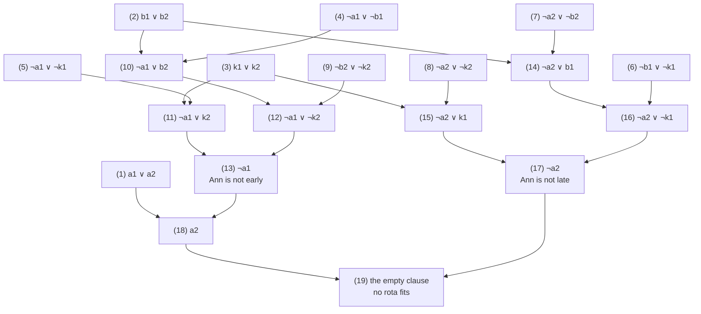
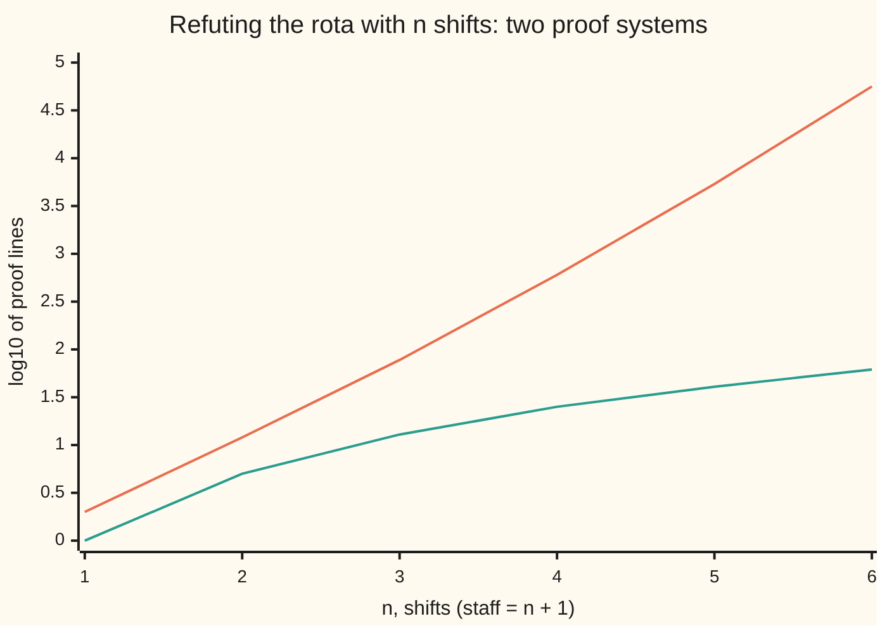

# Proof complexity: how long must a refutation be, and why that is NP versus coNP in disguise

[Syllabus](../../../SYLLABUS.md) → [Computability and complexity](../README.md) → [Beyond Worst Case](../README.md#s04) → Proof complexity

---

## General Overview

A café has three staff, Ann, Bob and Kim, and two shifts on Saturday: early and late. The manager's rules are short. Everyone gets a shift. No two people share a shift.

No rota fits, and a person sees why at once: three people, two shifts. Written as logic, the rota is 6 yes-or-no questions such as "does Ann work early?" and 9 rules called **clauses**. A program can try all 64 answer patterns and find that none works. That check doubles in cost with every new question.

A **refutation** is a short written argument that no answer pattern works. This card uses one rule of argument, **resolution**: take two clauses that disagree about one question, and keep everything else they say. Ten resolution steps refute the café rota. The argument reads: if Ann works early, Bob and Kim are both pushed to late, where they clash; the same happens if Ann works late; so Ann cannot work at all.

Proof complexity asks how short such a refutation can be. Armin Haken proved in 1985 that every resolution refutation of the rota with n shifts has at least $`2^{c\,n}`$ steps, for a fixed constant $`c > 0`$. Stephen Cook and Robert Reckhow had shown in 1979 why this matters: if every proof system needs long refutations for some formulas, then NP ≠ coNP, and so P ≠ NP.

**A refutation proves that no answer pattern fits; resolution builds one by cancelling a single question between two clauses; the rota with one more person than shifts forces every resolution refutation to grow exponentially; and a proof system with short refutations of everything exists exactly when NP = coNP.**

**What kind of fact this is:** theorems. Resolution is sound and complete, proved on this card in Why it works. The Cook–Reckhow theorem is proved on this card in a fold. Haken's lower bound is a theorem stated with its key steps and a named source (Haken, 1985). The polynomial cutting-plane refutation is a theorem (Cook, Coullard and Turán, 1987), worked by hand for the café and checked by the code up to 6 shifts. NP ≠ coNP is a conjecture, unproved as of 2026-11-11.

### The picture: ten steps from the rules to a contradiction



Schematic. Each new clause has two arrows in, one from each clause it was built from. The left half shows Ann cannot work early, the right half that she cannot work late. Clauses (2) and (3) are used twice.

---

## The formula

Notation first, in words. From [Normal forms](../../01-Foundations/05-Logic/07-normal-forms-and-complete-connectives.md) and [SAT solvers](../03-Time%20Complexity/07-sat-solvers-and-hard-problems-in-practice.md): a **literal** is a yes-or-no variable or its negation (¬, "not"); a **clause** is literals joined by ∨ ("or"); a formula in **CNF** is clauses joined by ∧ ("and"). An **assignment** gives every variable a value, true or false: one of the café's 64 answer patterns. A formula is **satisfiable** when some assignment makes every clause true, and **unsatisfiable** when none does.

Write $`x_{i,j}`$ for "staff member i works shift j". In the café, $`a_1`$ is "Ann works early", $`b_2`$ is "Bob works late", and $`k_1`$, $`k_2`$ are Kim's. On this card $`n`$ is the number of shifts, not the input length. The rota with one more person than shifts is the **pigeonhole formula**:

```math
\mathrm{PHP}(n+1, n) = \bigwedge_{i=1}^{n+1} \Big( \bigvee_{j=1}^{n} x_{i,j} \Big) \;\wedge\; \bigwedge_{j=1}^{n} \bigwedge_{i < k} \big( \neg x_{i,j} \vee \neg x_{k,j} \big)
```

**Read it aloud:** every staff member works some shift, and for every shift, no two staff members both work it.

For the café that is 3 "needs a shift" clauses and 2 × 3 = 6 "no sharing" clauses, 9 in all:

| Rule | First clause | Second clause | Third clause |
| --- | --- | --- | --- |
| Needs a shift | (1) Ann: $`a_1 \vee a_2`$ | (2) Bob: $`b_1 \vee b_2`$ | (3) Kim: $`k_1 \vee k_2`$ |
| No sharing early | (4) $`\neg a_1 \vee \neg b_1`$ | (5) $`\neg a_1 \vee \neg k_1`$ | (6) $`\neg b_1 \vee \neg k_1`$ |
| No sharing late | (7) $`\neg a_2 \vee \neg b_2`$ | (8) $`\neg a_2 \vee \neg k_2`$ | (9) $`\neg b_2 \vee \neg k_2`$ |

The only rule of resolution takes two clauses that hold one variable with opposite signs:

```math
\frac{C \vee x \qquad D \vee \neg x}{C \vee D}
```

**Read it aloud:** if "C or x" is true and "D or not x" is true, then "C or D" is true, whichever way x goes.

Here $`C`$ and $`D`$ stand for the rest of each clause, and $`x`$ is the **pivot**, the variable cancelled. The pivot can be any one variable, such as $`b_1`$: this bare $`x`$ is a placeholder, not the $`x`$ of $`x_{i,j}`$. A **refutation** is a list of clauses, each an original clause or a resolvent of two earlier ones, ending in the **empty clause** $`\square`$. The empty clause has no literals, so it is never true. A refutation's **size** $`S`$ is the number of resolution steps.

The card's two theorems, Haken's and Cook and Reckhow's:

```math
S\big(\mathrm{PHP}(n+1, n)\big) \ge 2^{c\,n} \text{ for every resolution refutation}, \qquad \mathrm{NP} = \mathrm{coNP} \iff \text{some proof system gives every tautology } \varphi \text{ a proof of length at most } \lvert \varphi \rvert^{d}
```

**Read it aloud:** every resolution refutation of the rota with n shifts has at least 2 to the power c times n steps; and NP equals coNP exactly when some proof system has, for every true formula, a proof whose length is polynomial in the formula's length.

A **tautology** is a formula true under every assignment. TAUT is the set of tautologies. A formula F is unsatisfiable exactly when ¬F is a tautology, so a refutation of F is a proof of ¬F.

| Symbol | Plain meaning | In our example | Push it up and the answer… |
| --- | --- | --- | --- |
| $`x_{i,j}`$ | "staff member i works shift j" | $`a_1`$: Ann works early; 6 variables | more variables, more assignments to rule out |
| $`\neg`$, $`\vee`$, $`\wedge`$ | not, or, and | — | — |
| $`n`$, $`N`$ | shifts (on this card only; elsewhere in the wing, input length); in the completeness fold, the number of variables | 2 shifts; $`N = 6`$ | Haken's bound grows exponentially; the fold's $`2^{N}`$ bound doubles per variable |
| $`\mathrm{PHP}(n+1, n)`$ | the rota with n + 1 staff and n shifts | PHP(3, 2): 9 clauses | 133 clauses at n = 6 |
| $`C`$, $`D`$; $`C_1`$, $`C_0`$ | the rest of each parent clause; in the completeness fold, the clauses passed up from the branches with $`x`$ true and $`x`$ false | step (10): $`C = b_2`$, $`D = \neg a_1`$ | a wider resolvent |
| $`x`$ | the pivot: any one variable, cancelled in a step | $`b_1`$ in step (10) | — |
| $`\square`$ | the empty clause: never true | line (19) | — |
| $`S`$ | a refutation's size: resolution steps | 10 by hand, 12 read off a search | — |
| $`c`$ | a fixed positive constant in Haken's bound | not computed on this card | a stronger bound |
| $`f`$, $`\pi`$ | a proof system: a polynomial-time checker; a proof it reads | the line checker in the code; the 10 steps | — |
| $`\varphi`$, $`\lvert \varphi \rvert`$, TAUT | a formula; its length in symbols; the set of tautologies | ¬PHP(3, 2) is in TAUT | — |
| $`d`$ | the exponent allowed in a proof's length | — | longer proofs allowed |

### When it holds

- **The formula must be unsatisfiable.** Resolution only ever derives true consequences, so a satisfiable formula has no refutation. Drop clause (9) and one rota fits: Ann early, Bob and Kim both late.
- **One pivot per step.** Cancelling two variables at once is not resolution. From $`a_1 \vee a_2`$ and $`\neg a_1 \vee \neg a_2`$ it gives the empty clause, yet 2 of the 4 assignments make both true.
- **A lower bound belongs to one proof system.** Haken's theorem is about resolution only. Cutting planes, a system that adds inequalities, refutes PHP(7, 6) in 61 lines.
- **The checker must run in polynomial time.** A "proof system" that checks every assignment itself would accept a one-line proof of anything, but its check takes exponential time, so it does not count.

---

## Why it works

### Step 0: a "no" needs a certificate too

A rota that fits is easy to show: hand over the rota, and anyone checks it clause by clause. That is NP, from [P and NP](../03-Time%20Complexity/02-p-and-np.md). A rota that cannot fit is a coNP question ([Above NP](../03-Time%20Complexity/08-conp-pspace-and-the-polynomial-hierarchy.md)): the claim is that every one of the 64 assignments breaks a rule. A refutation is a certificate for that claim. The whole subject is the length of such certificates.

### Step 1: resolution only derives true clauses

Take any assignment that makes both parents, $`C \vee x`$ and $`D \vee \neg x`$, true. If x is true, then $`\neg x`$ is false, so D must be true. If x is false, C must be true. Either way $`C \vee D`$ is true. So the resolution rule is **sound**: every derived clause is true wherever the original clauses are all true.

The empty clause is true nowhere. So if a refutation reaches it, no assignment makes all the original clauses true. The code checks every step of the café proof on all 64 assignments.

### Step 2: the café in ten steps

The proof follows the argument a person gives.

1. **If Ann is early, Bob is late.** Clause (2) says Bob works early or late. Clause (4) says Ann and Bob are not both early. Cancel $`b_1`$: $`\neg a_1 \vee b_2`$, line (10).
2. **If Ann is early, Kim is late.** The same with (3) and (5): $`\neg a_1 \vee k_2`$, line (11).
3. **Then Bob and Kim clash late.** Line (10) with clause (9), cancelling $`b_2`$, gives $`\neg a_1 \vee \neg k_2`$, line (12). With line (11), cancelling $`k_2`$: $`\neg a_1`$, line (13). Ann is not early.
4. **Ann is not late either.** Lines (14) to (17) repeat the argument for the late shift and end in $`\neg a_2`$.
5. **Ann has no shift.** Clause (1) with line (13) gives $`a_2`$, line (18). With line (17): the empty clause, line (19).

Each derived line here feeds exactly one later line. A refutation of that shape is called **tree-like**. General resolution may cite one derived line many times, so its refutation is a dag (a directed acyclic graph: arrows with no loops), not a tree. Tree-like resolution, the kind the search in Step 3 produces, can need exponentially more steps on some formulas. Haken's bound in Step 5 holds for the general form.

### Step 3: every unsatisfiable formula has a refutation

Resolution is also **complete**: every unsatisfiable CNF formula has a refutation. Run the DPLL search from [SAT solvers](../03-Time%20Complexity/07-sat-solvers-and-hard-problems-in-practice.md) (guess a variable, try both values, back up), here without unit propagation (the shortcut that sets a variable a one-literal clause forces). Every branch ends at a clause the guesses make false. Resolving the two branches' clauses at each guess, from the leaves up, ends in the empty clause. On the café this gives 12 steps, two more than the hand proof.

<details>
<summary>Detailed proof: a failed search tree is a resolution refutation</summary>

Label every node of the search tree by the partial assignment on the path to it. The claim is that each node gets a clause that its partial assignment makes false.

A leaf stops where some original clause is already false; that clause is its label. At a node that branches on x, the child with x true has a clause $`C_1`$ made false by the node's assignment plus "x true". The other child has $`C_0`$, false under the node's assignment plus "x false".

If $`C_1`$ has no $`\neg x`$, every literal of $`C_1`$ is false under the node's own assignment: pass $`C_1`$ up. The same holds for $`C_0`$ without $`x`$. Otherwise $`C_1 = C \vee \neg x`$ and $`C_0 = D \vee x`$, and every literal of C and D is false under the node's assignment. So the resolvent $`C \vee D`$ is false there: pass it up.

At the root the assignment is empty, and the only clause an empty assignment makes false is the empty clause. A tree that branches on all N variables always stops, since a full assignment makes some clause of an unsatisfiable formula false. So every unsatisfiable formula has a refutation of at most $`2^{N}`$ steps.

</details>

### Step 4: Cook and Reckhow's theorem

A **proof system** for tautologies is a function f, computed in polynomial time, whose outputs are exactly the tautologies. A string $`\pi`$ is a proof of $`\varphi`$ when $`f(\pi) = \varphi`$. Resolution is one: f reads a list of clause lines, checks each step, and outputs ¬F if the list refutes F. Any other string goes to a fixed tautology such as $`p \vee \neg p`$.

A proof system is **polynomially bounded** when every tautology has a proof of length at most $`\lvert \varphi \rvert^{d}`$, for one fixed d. The theorem: such a system exists exactly when NP = coNP.

<details>
<summary>Detailed proof: short proofs for everything exist exactly when NP = coNP</summary>

**First direction.** Suppose f is polynomially bounded. To show $`\varphi`$ is a tautology, guess a string $`\pi`$ of length at most $`\lvert \varphi \rvert^{d}`$, compute $`f(\pi)`$ in polynomial time, and compare it with $`\varphi`$. That is an NP verifier, so TAUT is in NP.

TAUT is coNP-complete. A formula $`\varphi`$ is not a tautology exactly when $`\neg \varphi`$ is satisfiable, and SAT is NP-complete ([Cook-Levin](../03-Time%20Complexity/04-cook-levin-theorem.md)). So every coNP problem reduces in polynomial time to TAUT, and TAUT in NP puts all of coNP inside NP.

Then NP is inside coNP too: a problem L in NP has its complement $`L^c`$ in coNP, hence in NP, so L is in coNP. The two classes are equal.

**Second direction.** Suppose NP = coNP. TAUT is in coNP, so it is in NP. It has a verifier V that runs in polynomial time and certificates c of length at most $`\lvert \varphi \rvert^{d}`$. Define

$`\displaystyle f(\varphi, c) = \varphi \text{ if } V(\varphi, c) = 1, \qquad f(\varphi, c) = p \vee \neg p \text{ otherwise.}`$

This f runs in polynomial time, outputs only tautologies, and gives every tautology a proof $`(\varphi, c)`$ of polynomial length. So f is a polynomially bounded proof system.

</details>

So NP ≠ coNP says that every proof system has some tautologies with only long proofs. One route towards it proves this for stronger and stronger systems, one at a time. Haken did it for resolution.

### Step 5: Haken's lower bound, with its key steps

Haken's theorem: for a fixed $`c > 0`$, every resolution refutation of PHP(n + 1, n) has at least $`2^{c\,n}`$ steps. Haken's own proof counts bottlenecks. Each critical assignment (step 1 below) makes some wide clause of the refutation false, and each wide clause is false on only a tiny share of them, so a refutation needs exponentially many wide clauses. The key steps below follow a shorter proof by Beame and Pitassi (1996). It keeps Haken's first two steps and replaces the counting with fixing part of the rota at random.

<details>
<summary>Key steps, in the simplified form of Beame and Pitassi (1996)</summary>

1. **Critical assignments.** Match n of the n + 1 staff one to one with the n shifts, leaving one person out. There are $`(n+1)!`$ of these: 6 for the café, which the code also finds by brute force. Each makes exactly one clause false: the left-out person's "needs a shift" clause.
2. **Remove the negations.** On a critical assignment every shift has exactly one person. So "Ann is not early" means "someone else is early". On the café, line (13) $`\neg a_1`$ becomes $`b_1 \vee k_1`$, and all 10 derived lines agree with their rewritten forms on all 6 critical assignments. Now every clause has only positive literals.
3. **A clause in the middle must be wide.** Score each clause by how many "needs a shift" clauses it takes to imply it on critical assignments. An original clause scores at most 1, the empty clause n + 1, and a resolution step at most adds its parents' scores. So some clause scores between a third and two thirds of n + 1. Such a clause, rewritten, has of the order of $`n^2`$ literals.
4. **A short proof cannot have one.** Fix part of the rota at random. Each wide clause becomes true, and drops out, with probability exponentially close to 1. With fewer than $`2^{c\,n}`$ lines, some choice removes every wide clause at once. What is left refutes a smaller pigeonhole formula with no wide clause, which step 3 rules out.

</details>

The code cannot run "every refutation". It runs the construction behind the proof, the critical assignments, and measures one strategy. The DPLL search, read as resolution, gives 2, 12, 78, 600, 5,410 and 56,196 steps for 1 to 6 shifts. Those are one method's sizes, not the minimum; Haken's theorem covers every method.

### Step 6: stronger systems refute the rota quickly

A person refutes the rota by counting, and resolution cannot count. **Cutting planes** can. Its lines are inequalities, with each variable 1 for true and 0 for false. It has two rules. Add whole-number multiples of earlier lines. Divide a line by a whole number that divides every coefficient, and round the constant to a whole number in the safe direction.

On the café:

1. Clause (4) becomes $`a_1 + b_1 \le 1`$, and (5) and (6) the same for the other pairs.
2. Add the three early-shift lines: $`2(a_1 + b_1 + k_1) \le 3`$.
3. Divide by 2 and round down: $`a_1 + b_1 + k_1 \le 1`$. Same for late.
4. Add the three "needs a shift" lines: $`(a_1 + a_2) + (b_1 + b_2) + (k_1 + k_2) \ge 3`$. The two shift lines say the same sum is at most 2. Adding everything gives $`0 \ge 1`$.

That is 5 derived lines. For n shifts the same plan takes $`2n(n-1) + 1`$ lines: 61 at n = 6, where the search above needed 56,196 resolution steps. Cook, Coullard and Turán (1987) proved this polynomial refutation, and showed cutting planes can copy any resolution proof with little loss.



The orange line is resolution read off the DPLL search, measured. The green line is the cutting-plane refutation. Both checks print every point.

Further up are **Frege systems**: the proof systems of a logic textbook, whose lines are any formulas and whose rules include modus ponens (from A and "A implies B", conclude B). Buss (1987) gave Frege refutations of the pigeonhole formulas of polynomial size. No one has proved a superpolynomial lower bound for Frege systems, as of 2026-11-11.

---

## Worked numbers, by hand

| Step | Arithmetic | Value |
| --- | --- | --- |
| variables, clauses | 3 staff × 2 shifts; 3 + 2 × 3 | 6 and 9 |
| brute force | try all $`2^6`$ assignments | 64 tried, 0 fit |
| (10) | (2) $`b_1 \vee b_2`$ with (4) $`\neg a_1 \vee \neg b_1`$, cancel $`b_1`$ | $`\neg a_1 \vee b_2`$ |
| (11) | (3) $`k_1 \vee k_2`$ with (5) $`\neg a_1 \vee \neg k_1`$, cancel $`k_1`$ | $`\neg a_1 \vee k_2`$ |
| (12) | (10) with (9) $`\neg b_2 \vee \neg k_2`$, cancel $`b_2`$ | $`\neg a_1 \vee \neg k_2`$ |
| (13) | (11) with (12), cancel $`k_2`$ | $`\neg a_1`$ |
| (14) | (2) with (7) $`\neg a_2 \vee \neg b_2`$, cancel $`b_2`$ | $`\neg a_2 \vee b_1`$ |
| (15) | (3) with (8) $`\neg a_2 \vee \neg k_2`$, cancel $`k_2`$ | $`\neg a_2 \vee k_1`$ |
| (16) | (14) with (6) $`\neg b_1 \vee \neg k_1`$, cancel $`b_1`$ | $`\neg a_2 \vee \neg k_1`$ |
| (17) | (15) with (16), cancel $`k_1`$ | $`\neg a_2`$ |
| (18) | (1) $`a_1 \vee a_2`$ with (13), cancel $`a_1`$ | $`a_2`$ |
| (19) | (18) with (17), cancel $`a_2`$ | **the empty clause, in 10 steps** |

Ten steps, each a one-line check, prove that no café rota fits; a checker reads them in time proportional to their length, without trying a single assignment.

### What breaks if you drop a piece

| Mistake | Comes out at | What went wrong |
| --- | --- | --- |
| Two pivots at once, on $`a_1 \vee a_2`$ and $`\neg a_1 \vee \neg a_2`$ | the empty clause, yet 2 of 4 assignments fit | only one variable may be cancelled per step |
| Clause (9) dropped | 1 rota fits: Ann early, Bob and Kim late | the formula is satisfiable, and step (12) has no parent |
| The search's refutation read as the shortest | 12 steps, against 10 by hand | one strategy's size is an upper bound, not the minimum |

The code prints all three.

---

## Code, from first principles, and it actually runs

The code builds PHP(n + 1, n) and takes five independent roads:

1. Brute force tries every assignment, for up to 3 shifts.
2. A proof checker reads the 10-step hand refutation, and each step is tested on all 64 assignments.
3. The DPLL search is read back as resolution for 1 to 6 shifts, and the same checker accepts it.
4. A cutting-plane refutation is built in whole-number arithmetic and must end in $`0 \ge 1`$.
5. Haken's critical assignments are found by matching and by brute force, and counted against $`(n+1)!`$.

### Python

```python
# Proof complexity and resolution -- the check behind the card.  Only math is
# imported (log10, factorial).  The rota: n + 1 staff, n shifts, every staff member
# needs a shift and no two share one: the pigeonhole formula PHP(n + 1, n).
# Roads: brute force over every assignment; a hand-written resolution proof,
# checked line by line; a DPLL search read back as a resolution proof; a
# cutting-plane proof in integer arithmetic; Haken's critical assignments.
import math

def php(n):                      # variable i*n + j + 1 means "staff i works shift j"
    v = lambda i, j: i * n + j + 1
    cl = [frozenset(v(i, j) for j in range(n)) for i in range(n + 1)]
    for j in range(n):
        for i in range(n + 1):
            for k in range(i + 1, n + 1):
                cl.append(frozenset((-v(i, j), -v(k, j))))
    return cl

def holds(c, a):                 # a is a bitmask: bit v - 1 set means variable v is true
    return any((a >> (abs(l) - 1) & 1) == (l > 0) for l in c)

def models(cls, nv):             # road 1: try every assignment
    return sum(all(holds(c, a) for c in cls) for a in range(2 ** nv))

def name(l):                     # PHP(3, 2) only: staff a(nn), b(ob), k(im); shift 1 early, 2 late
    return ("-" if l < 0 else "") + "abk"[(abs(l) - 1) // 2] + str((abs(l) - 1) % 2 + 1)

def show(c):
    return " v ".join(name(l) for l in sorted(c, key=lambda l: (abs(l), l < 0))) or "empty"

def lit(s):
    return -lit(s[1:]) if s[0] == "-" else "abk".index(s[0]) * 2 + int(s[1])

def check(axioms, steps):        # the proof checker: every step a true resolvent of known clauses
    known = set(axioms)
    for ci, cj, x, r in steps:
        assert ci in known and cj in known and x in ci and -x in cj
        assert r == (ci | cj) - {x, -x} and not any(-l in r for l in r)
        known.add(r)
    return steps[-1][3] == frozenset()

def dpll(cls):                   # road 3: branch on variables in order, read the tree as resolution
    steps = []
    def go(asg):
        for c in cls:
            if all(asg.get(abs(l)) == (l < 0) for l in c):
                return c         # a clause this partial assignment makes false: a leaf
        x = len(asg) + 1
        asg[x] = True; c1 = go(asg)
        asg[x] = False; c0 = go(asg)
        del asg[x]
        if -x not in c1: return c1
        if x not in c0: return c0
        r = (c1 - {-x}) | (c0 - {x}); steps.append((c0, c1, x, r)); return r
    go({})
    return steps

def cutting_planes(n):           # road 4: lines are sum(coefficient * variable) >= right side
    v = lambda i, j: i * n + j + 1
    def comb(terms):             # a sum of earlier lines times whole numbers 0 or more
        co, rhs = {}, 0
        for m, (c, b) in terms:
            for k, a in c.items(): co[k] = co.get(k, 0) + m * a
            rhs += m * b
        return {k: a for k, a in co.items() if a}, rhs
    def div(line, d):            # divide by d, rounding the right side up
        assert all(a % d == 0 for a in line[0].values())
        return {k: a // d for k, a in line[0].items()}, -((-line[1]) // d)
    pair = lambda i, k, j: ({v(i, j): -1, v(k, j): -1}, -1)
    count, holes = 1, []
    for j in range(n):
        s = pair(0, 1, j)        # "at most one of staff 0 and 1 on shift j"
        for k in range(2, n + 1):
            s = div(comb([(k - 1, s)] + [(1, pair(i, k, j)) for i in range(k)]), k)
            count += 2
        holes.append(s)
    staff = [({v(i, j): 1 for j in range(n)}, 1) for i in range(n + 1)]
    return count, comb([(1, s) for s in staff + holes]), holes

def critical(n):                 # Haken: n staff matched one-to-one to n shifts, one left out
    out = []
    def place(rest, j, a):
        if j == n: out.append(a); return
        for i in rest:
            place([r for r in rest if r != i], j + 1, a | 1 << (i * n + j))
    for left in range(n + 1):
        place([i for i in range(n + 1) if i != left], 0, 0)
    return out

F = php(2)
print(f"PHP(3, 2): 3 staff, 2 shifts, 6 variables, {len(F)} clauses")
for t in range(0, 9, 3):
    print("  " + "   ".join(f"({t + s + 1}) {show(F[t + s])}" for s in range(3)))
print(f"road 1, brute force: {2 ** 6} assignments, {models(F, 6)} make every clause true")
HAND = [(2, 4, "b1", "-a1 v b2"), (3, 5, "k1", "-a1 v k2"), (10, 9, "b2", "-a1 v -k2"),
        (11, 12, "k2", "-a1"), (2, 7, "b2", "-a2 v b1"), (3, 8, "k2", "-a2 v k1"),
        (14, 6, "b1", "-a2 v -k1"), (15, 16, "k1", "-a2"), (1, 13, "a1", "a2"), (18, 17, "a2", "empty")]
L, steps = list(F), []
for i, j, p, claim in HAND:
    L.append(frozenset(lit(s) for s in claim.split(" v ")) if claim != "empty" else frozenset())
    steps.append((L[i - 1], L[j - 1], lit(p), L[-1]))
    print(f"  ({len(L)}) {claim:<9} from ({i}) and ({j}), on {p}")
ok = check(F, steps)
sound = all(holds(r, a) or not (holds(ci, a) and holds(cj, a)) for ci, cj, _, r in steps for a in range(64))
print(f"road 2, hand proof: {len(steps)} resolution steps, checker accepts and ends empty: {'yes' if ok else 'no'}")
print(f"  each step true wherever both its parents are true, all 64 assignments: {'yes' if sound else 'no'}")
crit = critical(2)
lone = [a for a in range(64) if [k for k in range(9) if not holds(F[k], a)] in ([0], [1], [2])]
print(f"critical assignments: {len(crit)} by matching, {len(lone)} by brute force, 3! = 6")
mono = lambda c: frozenset(x for l in c for x in ([l] if l > 0 else  # -x_ij becomes "someone else on j"
                 [k * 2 + (abs(l) - 1) % 2 + 1 for k in range(3) if k != (abs(l) - 1) // 2]))
agree = all(holds(r, a) == holds(mono(r), a) for _, _, _, r in steps for a in crit)
print(f"  (13) -a1 on critical assignments reads {show(mono(L[12]))}; all 10 lines agree: {'yes' if agree else 'no'}")
print("n  staff  vars  clauses  models  resolution-by-DPLL  cutting-plane-lines")
pts = []
for n in range(1, 7):
    cls = php(n)
    st = dpll(cls)
    cp, last, holes = cutting_planes(n)
    m = str(models(cls, n * (n + 1))) if n <= 3 else "-"
    assert check(cls, st) and last == ({}, 1)               # both proofs valid, cutting planes ends 0 >= 1
    assert all(h == ({j * 1 + i * n + 1: -1 for i in range(n + 1)}, -1) for j, h in enumerate(holes))
    assert len(critical(n)) == math.factorial(n + 1)
    pts.append((math.log10(len(st)), math.log10(cp)))
    print(f"{n}  {n + 1:>5}  {n * (n + 1):>4}  {len(cls):>7}  {m:>6}  {len(st):>18}  {cp:>19}")
print("chart, log10 resolution-by-DPLL:", ", ".join(f"{p[0]:.2f}" for p in pts))
print("chart, log10 cutting-plane lines:", ", ".join(f"{p[1]:.2f}" for p in pts))
two = [frozenset((1, 2)), frozenset((-1, -2))]          # Ann early or late, and not both
bad = (two[0] | two[1]) - {1, -1, 2, -2}
print(f"mistake 1, two pivots at once on a1 v a2 and -a1 v -a2: {show(bad)}, yet {models(two, 2)} of 4 assignments work")
fits = [a for a in range(64) if all(holds(c, a) for c in F[:8])]
print(f"mistake 2, clause (9) dropped: {len(fits)} rota fits, "
      f"{', '.join(name(v) for v in range(1, 7) if fits[0] >> (v - 1) & 1)} true")
print(f"mistake 3, DPLL's proof read as the shortest: {len(dpll(F))} steps, the hand proof has {len(HAND)}")
assert models(F, 6) == 0 and ok and sound and agree                 # unsatisfiable, and the proof holds
assert len(crit) == len(lone) == 6 and sorted(crit) == sorted(lone)  # two roads to Haken's assignments
assert bad == frozenset() and models(two, 2) == 2 and len(fits) == 1
print("ALL CHECKS PASS")
```

**Ran 2026-11-24 on macOS, Python 3.14.10, standard library only. All checks passed. Output, pasted from the run:**

```
PHP(3, 2): 3 staff, 2 shifts, 6 variables, 9 clauses
  (1) a1 v a2   (2) b1 v b2   (3) k1 v k2
  (4) -a1 v -b1   (5) -a1 v -k1   (6) -b1 v -k1
  (7) -a2 v -b2   (8) -a2 v -k2   (9) -b2 v -k2
road 1, brute force: 64 assignments, 0 make every clause true
  (10) -a1 v b2  from (2) and (4), on b1
  (11) -a1 v k2  from (3) and (5), on k1
  (12) -a1 v -k2 from (10) and (9), on b2
  (13) -a1       from (11) and (12), on k2
  (14) -a2 v b1  from (2) and (7), on b2
  (15) -a2 v k1  from (3) and (8), on k2
  (16) -a2 v -k1 from (14) and (6), on b1
  (17) -a2       from (15) and (16), on k1
  (18) a2        from (1) and (13), on a1
  (19) empty     from (18) and (17), on a2
road 2, hand proof: 10 resolution steps, checker accepts and ends empty: yes
  each step true wherever both its parents are true, all 64 assignments: yes
critical assignments: 6 by matching, 6 by brute force, 3! = 6
  (13) -a1 on critical assignments reads b1 v k1; all 10 lines agree: yes
n  staff  vars  clauses  models  resolution-by-DPLL  cutting-plane-lines
1      2     2        3       0                   2                    1
2      3     6        9       0                  12                    5
3      4    12       22       0                  78                   13
4      5    20       45       -                 600                   25
5      6    30       81       -                5410                   41
6      7    42      133       -               56196                   61
chart, log10 resolution-by-DPLL: 0.30, 1.08, 1.89, 2.78, 3.73, 4.75
chart, log10 cutting-plane lines: 0.00, 0.70, 1.11, 1.40, 1.61, 1.79
mistake 1, two pivots at once on a1 v a2 and -a1 v -a2: empty, yet 2 of 4 assignments work
mistake 2, clause (9) dropped: 1 rota fits, a1, b2, k2 true
mistake 3, DPLL's proof read as the shortest: 12 steps, the hand proof has 10
ALL CHECKS PASS
```

### Rust

Same numbers, same labels, built with `rustc --edition 2021 -O`.

```rust
// Proof complexity and resolution -- the same check as the Python, in Rust, no crates.
// The rota PHP(n + 1, n): n + 1 staff, n shifts, everyone needs a shift, no two share one.
// Roads: brute force; a hand resolution proof, checked; DPLL read as resolution; cutting planes.
use std::collections::BTreeMap;
type Clause = Vec<i32>;                    // sorted literals; -v means "not v"
type Ineq = (BTreeMap<i32, i64>, i64);     // sum(coefficient * variable) >= right side

fn norm(mut c: Clause) -> Clause { c.sort(); c.dedup(); c }
fn php(n: i32) -> Vec<Clause> {            // variable i*n + j + 1 means "staff i works shift j"
    let v = |i: i32, j: i32| i * n + j + 1;
    let mut cl: Vec<Clause> = (0..=n).map(|i| norm((0..n).map(|j| v(i, j)).collect())).collect();
    for j in 0..n { for i in 0..=n { for k in i + 1..=n { cl.push(norm(vec![-v(i, j), -v(k, j)])) } } }
    cl
}

fn holds(c: &Clause, a: u64) -> bool { c.iter().any(|&l| ((a >> (l.abs() - 1) & 1) == 1) == (l > 0)) }

fn models(cls: &[Clause], nv: u32) -> usize {      // road 1: try every assignment
    (0..1u64 << nv).filter(|&a| cls.iter().all(|c| holds(c, a))).count()
}

fn name(l: i32) -> String {                // PHP(3, 2) only: staff a(nn), b(ob), k(im)
    format!("{}{}{}", if l < 0 { "-" } else { "" }, ["a", "b", "k"][((l.abs() - 1) / 2) as usize], (l.abs() - 1) % 2 + 1)
}

fn show(c: &Clause) -> String {
    let mut c = c.clone(); c.sort_by_key(|&l| (l.abs(), l < 0));
    if c.is_empty() { "empty".to_string() } else { c.iter().map(|&l| name(l)).collect::<Vec<_>>().join(" v ") }
}

fn lit(s: &str) -> i32 {
    if let Some(r) = s.strip_prefix('-') { -lit(r) } else { "abk".find(&s[..1]).unwrap() as i32 * 2 + s[1..].parse::<i32>().unwrap() }
}

fn resolve(ci: &Clause, cj: &Clause, x: i32) -> Clause {
    norm(ci.iter().chain(cj.iter()).copied().filter(|&l| l != x && l != -x).collect())
}

fn check(axioms: &[Clause], steps: &[(Clause, Clause, i32, Clause)]) -> bool {  // the proof checker
    let mut known: Vec<Clause> = axioms.to_vec();
    for (ci, cj, x, r) in steps {
        assert!(known.contains(ci) && known.contains(cj) && ci.contains(x) && cj.contains(&-x));
        assert!(*r == resolve(ci, cj, *x) && !r.iter().any(|l| r.contains(&-l)));
        known.push(r.clone());
    }
    steps.last().unwrap().3.is_empty()
}

fn go(cls: &[Clause], asg: &mut Vec<i8>, steps: &mut Vec<(Clause, Clause, i32, Clause)>) -> Clause {
    for c in cls {                         // a clause this partial assignment makes false: a leaf
        if c.iter().all(|&l| (l.abs() as usize) < asg.len() && asg[l.abs() as usize] == if l < 0 { 1 } else { -1 }) { return c.clone() }
    }
    let x = asg.len() as i32;
    asg.push(1); let c1 = go(cls, asg, steps);
    asg.pop(); asg.push(-1); let c0 = go(cls, asg, steps); asg.pop();
    if !c1.contains(&-x) { return c1 }
    if !c0.contains(&x) { return c0 }
    let r = resolve(&c1, &c0, x); steps.push((c0, c1, x, r.clone())); r
}

fn dpll(cls: &[Clause]) -> Vec<(Clause, Clause, i32, Clause)> {  // road 3: DPLL read as resolution
    let (mut asg, mut steps) = (vec![0i8], Vec::new());           // slot 0 unused: variables are 1, 2, ...
    go(cls, &mut asg, &mut steps); steps
}

fn comb(terms: &[(i64, Ineq)]) -> Ineq {   // a sum of earlier lines times whole numbers 0 or more
    let (mut co, mut rhs) = (BTreeMap::new(), 0i64);
    for (m, (c, b)) in terms {
        for (k, a) in c { *co.entry(*k).or_insert(0) += m * a } rhs += m * b;
    }
    co.retain(|_, a| *a != 0); (co, rhs)
}

fn div(line: Ineq, d: i64) -> Ineq {       // divide by d, rounding the right side up
    assert!(line.0.values().all(|a| a % d == 0));
    (line.0.iter().map(|(k, a)| (*k, a / d)).collect(), -((-line.1).div_euclid(d)))
}

fn cutting_planes(n: i32) -> (usize, Ineq, Vec<Ineq>) {        // road 4
    let v = |i: i32, j: i32| i * n + j + 1;
    let pair = |i: i32, k: i32, j: i32| -> Ineq { (BTreeMap::from([(v(i, j), -1), (v(k, j), -1)]), -1) };
    let (mut count, mut holes) = (1, Vec::new());
    for j in 0..n {
        let mut s = pair(0, 1, j);         // "at most one of staff 0 and 1 on shift j"
        for k in 2..=n {
            let mut t = vec![((k - 1) as i64, s)];
            for i in 0..k { t.push((1, pair(i, k, j))) }
            s = div(comb(&t), k as i64); count += 2;
        }
        holes.push(s);
    }
    let mut t: Vec<(i64, Ineq)> = (0..=n).map(|i| (1, ((0..n).map(|j| (v(i, j), 1)).collect(), 1))).collect();
    for h in &holes { t.push((1, h.clone())) }
    (count, comb(&t), holes)
}

fn place(n: i32, rest: Vec<i32>, j: i32, a: u64, out: &mut Vec<u64>) {
    if j == n { out.push(a); return }
    for &i in &rest { place(n, rest.iter().copied().filter(|&r| r != i).collect(), j + 1, a | 1 << (i * n + j), out) }
}

fn critical(n: i32) -> Vec<u64> {          // Haken: n staff matched one-to-one to n shifts, one left out
    let mut out = Vec::new();
    for left in 0..=n { place(n, (0..=n).filter(|&i| i != left).collect(), 0, 0, &mut out) } out
}

fn yn(b: bool) -> &'static str { if b { "yes" } else { "no" } }

fn main() {
    let f = php(2);
    println!("PHP(3, 2): 3 staff, 2 shifts, 6 variables, {} clauses", f.len());
    for t in (0..9).step_by(3) {
        let row: Vec<String> = (0..3).map(|s| format!("({}) {}", t + s + 1, show(&f[t + s]))).collect();
        println!("  {}", row.join("   "));
    }
    println!("road 1, brute force: {} assignments, {} make every clause true", 1 << 6, models(&f, 6));
    let hand = [(2, 4, "b1", "-a1 v b2"), (3, 5, "k1", "-a1 v k2"), (10, 9, "b2", "-a1 v -k2"),
        (11, 12, "k2", "-a1"), (2, 7, "b2", "-a2 v b1"), (3, 8, "k2", "-a2 v k1"),
        (14, 6, "b1", "-a2 v -k1"), (15, 16, "k1", "-a2"), (1, 13, "a1", "a2"), (18, 17, "a2", "empty")];
    let (mut l, mut steps) = (f.clone(), Vec::new());
    for &(i, j, p, claim) in &hand {
        l.push(if claim == "empty" { vec![] } else { norm(claim.split(" v ").map(lit).collect()) });
        steps.push((l[i - 1].clone(), l[j - 1].clone(), lit(p), l[l.len() - 1].clone()));
        println!("  ({}) {:<9} from ({}) and ({}), on {}", l.len(), claim, i, j, p);
    }
    let (ok, crit) = (check(&f, &steps), critical(2));
    let sound = steps.iter().all(|(ci, cj, _, r)| (0..64).all(|a| holds(r, a) || !(holds(ci, a) && holds(cj, a))));
    println!("road 2, hand proof: {} resolution steps, checker accepts and ends empty: {}", steps.len(), yn(ok));
    println!("  each step true wherever both its parents are true, all 64 assignments: {}", yn(sound));
    let lone: Vec<u64> = (0..64).filter(|&a| {
        let bad: Vec<usize> = (0..9).filter(|&k| !holds(&f[k], a)).collect(); bad.len() == 1 && bad[0] < 3 }).collect();
    println!("critical assignments: {} by matching, {} by brute force, 3! = 6", crit.len(), lone.len());
    let mono = |c: &Clause| -> Clause {    // -x_ij becomes "someone else on shift j"
        norm(c.iter().flat_map(|&l| if l > 0 { vec![l] } else {
            (0..3).filter(|&k| k != (l.abs() - 1) / 2).map(|k| k * 2 + (l.abs() - 1) % 2 + 1).collect() }).collect())
    };
    let agree = steps.iter().all(|(_, _, _, r)| crit.iter().all(|&a| holds(r, a) == holds(&mono(r), a)));
    println!("  (13) -a1 on critical assignments reads {}; all 10 lines agree: {}", show(&mono(&l[12])), yn(agree));
    println!("n  staff  vars  clauses  models  resolution-by-DPLL  cutting-plane-lines");
    let mut pts = Vec::new();
    for n in 1..=6 {
        let cls = php(n);
        let st = dpll(&cls);
        let (cp, last, holes) = cutting_planes(n);
        let m = if n <= 3 { models(&cls, (n * (n + 1)) as u32).to_string() } else { "-".to_string() };
        assert!(check(&cls, &st) && last == (BTreeMap::new(), 1));
        for (j, h) in holes.iter().enumerate() { assert!(*h == ((0..=n).map(|i| (j as i32 + i * n + 1, -1)).collect(), -1)) }
        assert!(critical(n).len() == (1..=(n + 1) as usize).product::<usize>());
        pts.push(((st.len() as f64).log10(), (cp as f64).log10()));
        println!("{}  {:>5}  {:>4}  {:>7}  {:>6}  {:>18}  {:>19}", n, n + 1, n * (n + 1), cls.len(), m, st.len(), cp);
    }
    let fmt = |k: usize| pts.iter().map(|p| format!("{:.2}", if k == 0 { p.0 } else { p.1 })).collect::<Vec<_>>().join(", ");
    println!("chart, log10 resolution-by-DPLL: {}", fmt(0));
    println!("chart, log10 cutting-plane lines: {}", fmt(1));
    let two = vec![vec![1, 2], vec![-2, -1]];                 // Ann early or late, and not both
    let bad: Clause = norm(two.concat().into_iter().filter(|l| ![1, -1, 2, -2].contains(l)).collect());
    println!("mistake 1, two pivots at once on a1 v a2 and -a1 v -a2: {}, yet {} of 4 assignments work",
             show(&bad), models(&two, 2));
    let fits: Vec<u64> = (0..64).filter(|&a| f[..8].iter().all(|c| holds(c, a))).collect();
    let on: Vec<String> = (1..7).filter(|v| fits[0] >> (v - 1) & 1 == 1).map(name).collect();
    println!("mistake 2, clause (9) dropped: {} rota fits, {} true", fits.len(), on.join(", "));
    println!("mistake 3, DPLL's proof read as the shortest: {} steps, the hand proof has {}", dpll(&f).len(), hand.len());
    assert!(models(&f, 6) == 0 && ok && sound && agree);              // unsatisfiable, and the proof holds
    let (mut c1, mut c2) = (crit.clone(), lone.clone()); c1.sort(); c2.sort();
    assert!(crit.len() == 6 && lone.len() == 6 && c1 == c2);           // two roads to Haken's assignments
    assert!(bad.is_empty() && models(&two, 2) == 2 && fits.len() == 1);
    println!("ALL CHECKS PASS");
}
```

**Ran 2026-11-24 on macOS, rustc 1.98.1, no crates. All checks passed. Output, pasted from the run:**

```
PHP(3, 2): 3 staff, 2 shifts, 6 variables, 9 clauses
  (1) a1 v a2   (2) b1 v b2   (3) k1 v k2
  (4) -a1 v -b1   (5) -a1 v -k1   (6) -b1 v -k1
  (7) -a2 v -b2   (8) -a2 v -k2   (9) -b2 v -k2
road 1, brute force: 64 assignments, 0 make every clause true
  (10) -a1 v b2  from (2) and (4), on b1
  (11) -a1 v k2  from (3) and (5), on k1
  (12) -a1 v -k2 from (10) and (9), on b2
  (13) -a1       from (11) and (12), on k2
  (14) -a2 v b1  from (2) and (7), on b2
  (15) -a2 v k1  from (3) and (8), on k2
  (16) -a2 v -k1 from (14) and (6), on b1
  (17) -a2       from (15) and (16), on k1
  (18) a2        from (1) and (13), on a1
  (19) empty     from (18) and (17), on a2
road 2, hand proof: 10 resolution steps, checker accepts and ends empty: yes
  each step true wherever both its parents are true, all 64 assignments: yes
critical assignments: 6 by matching, 6 by brute force, 3! = 6
  (13) -a1 on critical assignments reads b1 v k1; all 10 lines agree: yes
n  staff  vars  clauses  models  resolution-by-DPLL  cutting-plane-lines
1      2     2        3       0                   2                    1
2      3     6        9       0                  12                    5
3      4    12       22       0                  78                   13
4      5    20       45       -                 600                   25
5      6    30       81       -                5410                   41
6      7    42      133       -               56196                   61
chart, log10 resolution-by-DPLL: 0.30, 1.08, 1.89, 2.78, 3.73, 4.75
chart, log10 cutting-plane lines: 0.00, 0.70, 1.11, 1.40, 1.61, 1.79
mistake 1, two pivots at once on a1 v a2 and -a1 v -a2: empty, yet 2 of 4 assignments work
mistake 2, clause (9) dropped: 1 rota fits, a1, b2, k2 true
mistake 3, DPLL's proof read as the shortest: 12 steps, the hand proof has 10
ALL CHECKS PASS
```

The two outputs match line for line.

### Lean

Lean proves resolution sound and complete, shows no rota with one more person than shifts fits, and checks the café's numbers.

- Take one assignment and two clauses true under it, one holding $`x`$ and one holding $`\neg x`$. Then their resolvent on the pivot $`x`$ is true under it too.
- Suppose some list of resolution steps reaches the empty clause from a formula's clauses. Then no assignment makes every clause of that formula true.
- Take an unsatisfiable formula with $`N`$ variables. Then it has a refutation of at most $`2^{N}`$ steps.
- For every $`n`$, no assignment makes every clause of $`\mathrm{PHP}(n+1, n)`$ true: the rota never fits.
- The café's formula has 6 variables and 9 clauses, and none of its 64 assignments makes every clause true.
- The checker accepts all 10 steps of the hand proof, and they produce exactly lines (10) to (19).
- With clause (9) dropped, exactly 1 rota fits.
- Take the clauses $`a_1 \vee a_2`$ and $`\neg a_1 \vee \neg a_2`$. Then 2 of the 4 assignments make both true.
- Exactly 6 assignments, 3!, make just one café clause false, and that clause is always a "needs a shift" clause.
- The rota with 6 shifts has 133 clauses.
- The cutting-plane line count $`2n(n-1) + 1`$ is 5 at $`n = 2`$ and 61 at $`n = 6`$.

The search's step counts and cutting-plane proofs are left to the Python and Rust checks; Haken's and Cook and Reckhow's theorems are not in Lean.

```lean
-- Proof complexity: resolution is sound and complete (a refutation exists exactly when no assignment fits, with one of at most 2^N steps over N variables), every rota with one more person than shifts is unsatisfiable, and the café's ten-step refutation of PHP(3, 2) checks line by line.
import Mathlib.Data.Fintype.Pi
import Mathlib.Data.Fintype.Prod
import Mathlib.Data.Finset.Image
import Mathlib.Data.List.FinRange
import Mathlib.Data.Fintype.Pigeonhole

/-! Clauses, refutations and the rota.

A literal is a variable with a sign: `(v, true)` is `v` and `(v, false)` is `¬v`. A clause is a
finite set of literals joined by "or"; a CNF formula is a list of clauses joined by "and". An
assignment `a` gives every variable true or false.

The resolution rule takes a clause holding `x` and a clause holding `¬x`, removes the pivot from
each, and joins what is left: from `C ∨ x` and `D ∨ ¬x`, conclude `C ∨ D`. A proof is a list of
steps; each step names two earlier lines (numbered from 0, the formula's own clauses first) and a
pivot, and adds their resolvent as a new line. `run` checks the steps in order and returns every
line, or `none` if some step cites a missing line or a pivot its parents do not hold. A refutation
is a proof whose lines include the empty clause; its size is the number of steps. -/

/-- A literal: a variable and a sign. -/
abbrev Lit (V : Type*) := V × Bool
/-- A clause: literals joined by "or". -/
abbrev Clause (V : Type*) := Finset (Lit V)
/-- A formula in conjunctive normal form: clauses joined by "and". -/
abbrev CNF (V : Type*) := List (Clause V)

variable {V : Type*}

/-- The assignment `a` makes the clause true: some literal of it is true. -/
def Clause.Holds (a : V → Bool) (c : Clause V) : Prop := ∃ l ∈ c, a l.1 = l.2

/-- The assignment `a` makes every clause of `F` true. -/
def CNF.Holds (a : V → Bool) (F : CNF V) : Prop := ∀ c ∈ F, c.Holds a

/-- Satisfiable: some assignment makes every clause true. -/
def Satisfiable (F : CNF V) : Prop := ∃ a : V → Bool, F.Holds a

instance [DecidableEq V] (a : V → Bool) (c : Clause V) : Decidable (c.Holds a) := by
  unfold Clause.Holds; infer_instance

instance [DecidableEq V] (a : V → Bool) (F : CNF V) : Decidable (F.Holds a) := by
  unfold CNF.Holds; infer_instance

/-- The resolvent on pivot `x`: drop `x` from `C`, drop `¬x` from `D`, join the rest. -/
def resolvent [DecidableEq V] (x : V) (C D : Clause V) : Clause V :=
  C.erase (x, true) ∪ D.erase (x, false)

/-- One resolution step: two earlier line numbers and the pivot cancelled between them. -/
structure Step (V : Type*) where
  left : ℕ
  right : ℕ
  pivot : V

/-- Check the steps in order. Each step's left line must hold the pivot and its right line must
hold the pivot's negation; the resolvent is then added as a new line. Returns all lines, or `none`
at the first step that breaks the rule. -/
def run [DecidableEq V] (lines : List (Clause V)) : List (Step V) → Option (List (Clause V))
  | [] => some lines
  | s :: rest =>
    match lines[s.left]?, lines[s.right]? with
    | some C, some D =>
      if (s.pivot, true) ∈ C ∧ (s.pivot, false) ∈ D then
        run (lines ++ [resolvent s.pivot C D]) rest
      else none
    | _, _ => none

/-- `π` is a resolution refutation of `F`: every step obeys the rule, and the lines reach the
empty clause. Its size is `π.length`. -/
def Refutes [DecidableEq V] (F : CNF V) (π : List (Step V)) : Prop :=
  ∃ L, run F π = some L ∧ (∅ : Clause V) ∈ L

instance [DecidableEq V] (F : CNF V) (π : List (Step V)) : Decidable (Refutes F π) := by
  unfold Refutes
  cases run F π with
  | none => exact isFalse (by simp)
  | some L => exact decidable_of_iff ((∅ : Clause V) ∈ L) (by simp)

/-- The rota with `n + 1` staff and `n` shifts, the pigeonhole formula PHP(n + 1, n). Variable
`(i, j)` means "staff member i works shift j". First, for each staff member, "works some shift";
then, shift by shift, for each pair `i < k` of staff, "not both on this shift". -/
def php (n : ℕ) : CNF (Fin (n + 1) × Fin n) :=
  (List.finRange (n + 1)).map (fun i => Finset.univ.image fun j : Fin n => ((i, j), true)) ++
  (List.finRange n).flatMap fun j =>
    (List.finRange (n + 1)).flatMap fun i =>
      ((List.finRange (n + 1)).filter fun k => i < k).map fun k =>
        ({((i, j), false), ((k, j), false)} : Clause (Fin (n + 1) × Fin n))

/-- Helper: the resolvent of two true parents is true. -/
theorem resolvent_holds_aux [DecidableEq V] (a : V → Bool) (x : V)
    (C D : Clause V) (hC : C.Holds a) (hD : D.Holds a) :
    (resolvent x C D).Holds a := by
  obtain ⟨l, hl, hal⟩ := hC
  by_cases hlx : l = (x, true)
  · subst hlx
    obtain ⟨m, hm, ham⟩ := hD
    refine ⟨m, ?_, ham⟩
    simp only [resolvent, Finset.mem_union, Finset.mem_erase]
    right
    refine ⟨?_, hm⟩
    rintro rfl
    simp_all
  · exact ⟨l, by simp [resolvent, hlx, hl], hal⟩

/-- Helper: running `p ++ q` is running `p`, then `q` on its lines. -/
theorem run_append_aux [DecidableEq V] (p q : List (Step V)) :
    ∀ (lines L : List (Clause V)), run lines p = some L → run lines (p ++ q) = run L q := by
  induction p with
  | nil => intro lines L h; simp only [run, Option.some.injEq] at h; subst h; rfl
  | cons s rest ih =>
    intro lines L h
    simp only [List.cons_append, run] at h ⊢
    cases hC : lines[s.left]? with
    | none => simp [hC] at h
    | some C =>
      cases hD : lines[s.right]? with
      | none => simp [hC, hD] at h
      | some D =>
        simp only [hC, hD] at h ⊢
        split_ifs at h ⊢ with hp
        exact ih _ _ h

/-- Helper: every line produced from true lines is true. -/
theorem run_sound_aux [DecidableEq V] (a : V → Bool) (π : List (Step V)) :
    ∀ (lines L : List (Clause V)), (∀ c ∈ lines, c.Holds a) → run lines π = some L →
      ∀ c ∈ L, c.Holds a := by
  induction π with
  | nil => intro lines L hl h; simp only [run, Option.some.injEq] at h; subst h; exact hl
  | cons s rest ih =>
    intro lines L hl h
    simp only [run] at h
    cases hC : lines[s.left]? with
    | none => simp [hC] at h
    | some C =>
      cases hD : lines[s.right]? with
      | none => simp [hC, hD] at h
      | some D =>
        simp only [hC, hD] at h
        split_ifs at h with hp
        refine ih _ _ ?_ h
        intro c hc
        rcases List.mem_append.1 hc with hc | hc
        · exact hl c hc
        · rw [List.mem_singleton] at hc
          subst hc
          exact resolvent_holds_aux a s.pivot C D
            (hl C (List.mem_of_getElem? hC)) (hl D (List.mem_of_getElem? hD))

/-- Helper (search tree): if every assignment agreeing with `a` off `S` falsifies a line, then
at most `2 ^ |S| - 1` steps derive a line falsified by `a` that uses no variable of `S`. -/
theorem refute_aux [DecidableEq V] (S : Finset V) : ∀ (a : V → Bool) (lines : List (Clause V)),
    (∀ b : V → Bool, (∀ v ∉ S, b v = a v) → ∃ c ∈ lines, ∀ l ∈ c, b l.1 ≠ l.2) →
    ∃ (π : List (Step V)) (M : List (Clause V)), run lines π = some (lines ++ M) ∧
      π.length + 1 ≤ 2 ^ S.card ∧ ∃ c ∈ lines ++ M, ∀ l ∈ c, l.1 ∉ S ∧ a l.1 ≠ l.2 := by
  induction S using Finset.induction_on with
  | empty =>
    intro a lines h
    obtain ⟨c, hc, hf⟩ := h a (fun _ _ => rfl)
    exact ⟨[], [], by simp [run], by simp, c, by simpa using hc,
      fun l hl => ⟨Finset.notMem_empty _, hf l hl⟩⟩
  | insert x S hx ih =>
    intro a lines h
    have hcard : (insert x S).card = S.card + 1 := Finset.card_insert_of_notMem hx
    have agree : ∀ (t : Bool) (b : V → Bool), (∀ v ∉ S, b v = Function.update a x t v) →
        ∀ v ∉ insert x S, b v = a v := by
      intro t b hb v hv
      rw [Finset.mem_insert, not_or] at hv
      rw [hb v hv.2, Function.update_of_ne hv.1]
    have lift : ∀ (t : Bool) (c : Clause V),
        (∀ l ∈ c, l.1 ∉ S ∧ Function.update a x t l.1 ≠ l.2) →
        ∀ l ∈ c, l ≠ (x, !t) → l.1 ∉ insert x S ∧ a l.1 ≠ l.2 := by
      intro t c hc l hl hne
      obtain ⟨h1, h2⟩ := hc l hl
      by_cases hlx : l.1 = x
      · exfalso
        apply hne
        obtain ⟨v, s⟩ := l
        simp only at hlx
        subst hlx
        rw [Function.update_self] at h2
        revert h2
        cases t <;> cases s <;> simp
      · refine ⟨by simp [hlx, h1], ?_⟩
        rwa [Function.update_of_ne hlx] at h2
    obtain ⟨π1, M1, hr1, hl1, C1, hC1, hf1⟩ :=
      ih (Function.update a x true) lines (fun b hb => h b (agree true b hb))
    by_cases hx1 : (x, false) ∈ C1
    · obtain ⟨π0, M0, hr0, hl0, C0, hC0, hf0⟩ :=
        ih (Function.update a x false) (lines ++ M1) (fun b hb => by
          obtain ⟨c, hc, hf⟩ := h b (agree false b hb)
          exact ⟨c, List.mem_append_left _ hc, hf⟩)
      by_cases hx0 : (x, true) ∈ C0
      · obtain ⟨i, hi⟩ := List.mem_iff_getElem?.1 hC0
        obtain ⟨j, hj⟩ := List.mem_iff_getElem?.1 (List.mem_append_left M0 hC1)
        refine ⟨π1 ++ π0 ++ [⟨i, j, x⟩], M1 ++ M0 ++ [resolvent x C0 C1], ?_, ?_,
          resolvent x C0 C1, by simp, ?_⟩
        · rw [List.append_assoc, run_append_aux _ _ _ _ hr1, run_append_aux _ _ _ _ hr0]
          simp only [run]
          rw [hi, hj]
          simp [hx0, hx1]
        · simp only [List.length_append, List.length_singleton, hcard, pow_succ]
          omega
        · intro l hl
          simp only [resolvent, Finset.mem_union, Finset.mem_erase] at hl
          rcases hl with ⟨hne, hl⟩ | ⟨hne, hl⟩
          · exact lift false C0 hf0 l hl hne
          · exact lift true C1 hf1 l hl hne
      · refine ⟨π1 ++ π0, M1 ++ M0, ?_, ?_, C0, by simpa using hC0,
          fun l hl => lift false C0 hf0 l hl (by rintro rfl; exact hx0 hl)⟩
        · rw [run_append_aux _ _ _ _ hr1, hr0, List.append_assoc]
        · simp only [List.length_append, hcard, pow_succ]
          omega
    · refine ⟨π1, M1, hr1, ?_, C1, hC1, fun l hl => lift true C1 hf1 l hl (by rintro rfl; exact hx1 hl)⟩
      rw [hcard, pow_succ]
      omega

/-- Resolution is sound and complete. Sound: if some list of resolution steps reaches the empty
clause from the clauses of `F`, no assignment makes every clause of `F` true. Complete: if no
assignment makes every clause of `F` true, a resolution refutation exists, read off a failed
search tree, with at most `2 ^ N` steps, where `N` is the number of variables. -/
theorem resolution_sound_and_complete [DecidableEq V] [Fintype V] (F : CNF V) :
    (∀ π : List (Step V), Refutes F π → ¬ Satisfiable F) ∧
    (¬ Satisfiable F → ∃ π : List (Step V), Refutes F π ∧ π.length ≤ 2 ^ Fintype.card V) := by
  refine ⟨fun π hπ hsat => ?_, fun hF => ?_⟩
  · obtain ⟨a, ha⟩ := hsat
    obtain ⟨L, hL, he⟩ := hπ
    obtain ⟨l, hl, _⟩ := run_sound_aux a π F L ha hL ∅ he
    simp at hl
  · obtain ⟨π, M, hr, hlen, c, hc, hf⟩ :=
      refute_aux (Finset.univ : Finset V) (fun _ => false) F (fun b _ => by
        by_contra hne
        exact hF ⟨b, fun c hc => by
          by_contra h'
          exact hne ⟨c, hc, fun l hl he => h' ⟨l, hl, he⟩⟩⟩)
    have hc0 : c = ∅ := by
      ext l
      simp only [Finset.notMem_empty, iff_false]
      exact fun hl => (hf l hl).1 (Finset.mem_univ _)
    rw [Finset.card_univ] at hlen
    exact ⟨π, ⟨F ++ M, hr, hc0 ▸ hc⟩, by omega⟩

/-- One step derives only true clauses: any assignment that makes both parents `C ∨ x` and
`D ∨ ¬x` true also makes their resolvent `C ∨ D` true. -/
theorem resolvent_true_where_parents_true [DecidableEq V] (a : V → Bool) (x : V)
    (C D : Clause V) (hC : C.Holds a) (hD : D.Holds a)
    (hx : (x, true) ∈ C) (hnx : (x, false) ∈ D) :
    (resolvent x C D).Holds a := by
  have _ := hx; have _ := hnx
  exact resolvent_holds_aux a x C D hC hD

/-- No rota fits: for every `n`, no way of answering the questions "does staff member i work
shift j" gives each of the `n + 1` staff a shift with no two sharing one, so PHP(n + 1, n) is
unsatisfiable. -/
theorem pigeonhole_formula_unsatisfiable (n : ℕ) : ¬ Satisfiable (php n) := by
  rintro ⟨a, ha⟩
  have h1 : ∀ i : Fin (n + 1), ∃ j : Fin n, a (i, j) = true := by
    intro i
    obtain ⟨l, hl, hal⟩ := ha _ (List.mem_append_left _ (List.mem_map.2 ⟨i, List.mem_finRange i, rfl⟩))
    simp only [Finset.mem_image, Finset.mem_univ, true_and] at hl
    obtain ⟨j, rfl⟩ := hl
    exact ⟨j, hal⟩
  choose f hf using h1
  obtain ⟨i, k, hne, hik⟩ := Fintype.exists_ne_map_eq_of_card_lt f (by simp)
  have key : ∀ i k, i < k → f i = f k → False := by
    intro i k hlt heq
    have hmem : ({((i, f i), false), ((k, f i), false)} : Clause (Fin (n + 1) × Fin n)) ∈ php n := by
      apply List.mem_append_right
      simp only [List.mem_flatMap, List.mem_map, List.mem_filter, List.mem_finRange, true_and,
        decide_eq_true_eq]
      exact ⟨f i, i, k, hlt, rfl⟩
    obtain ⟨l, hl, hal⟩ := ha _ hmem
    simp only [Finset.mem_insert, Finset.mem_singleton] at hl
    rcases hl with rfl | rfl
    · simp [hf i] at hal
    · simp [heq, hf k] at hal
  rcases lt_or_gt_of_ne hne with h | h
  · exact key i k h hik
  · exact key k i h hik.symm

/-! The café: Ann, Bob and Kim are staff 0, 1 and 2; early and late are shifts 0 and 1. -/

/-- `st i j x`: resolve line (i) with line (j) on pivot `x`, lines numbered from 1 as on the card. -/
def st (i j : ℕ) (x : Fin 3 × Fin 2) : Step (Fin 3 × Fin 2) := ⟨i - 1, j - 1, x⟩

/-- The card's ten-step hand refutation, lines (10) to (19). -/
def cafeProof : List (Step (Fin 3 × Fin 2)) :=
  [st 2 4 (1, 0), st 3 5 (2, 0), st 10 9 (1, 1), st 11 12 (2, 1), st 2 7 (1, 1),
   st 3 8 (2, 1), st 14 6 (1, 0), st 15 16 (2, 0), st 1 13 (0, 0), st 18 17 (0, 1)]

/-- The derived lines (10) to (19) as the card writes them. -/
def cafeLines : List (Clause (Fin 3 × Fin 2)) :=
  [{((0, 0), false), ((1, 1), true)},  -- (10) ¬a1 ∨ b2
   {((0, 0), false), ((2, 1), true)},  -- (11) ¬a1 ∨ k2
   {((0, 0), false), ((2, 1), false)}, -- (12) ¬a1 ∨ ¬k2
   {((0, 0), false)},                  -- (13) ¬a1
   {((0, 1), false), ((1, 0), true)},  -- (14) ¬a2 ∨ b1
   {((0, 1), false), ((2, 0), true)},  -- (15) ¬a2 ∨ k1
   {((0, 1), false), ((2, 0), false)}, -- (16) ¬a2 ∨ ¬k1
   {((0, 1), false)},                  -- (17) ¬a2
   {((0, 1), true)},                   -- (18) a2
   ∅]                                  -- (19) the empty clause

-- PHP(3, 2): 6 variables and 3 + 2 × 3 = 9 clauses.
example : Fintype.card (Fin 3 × Fin 2) = 6 ∧ (php 2).length = 9 := by decide +kernel
-- Brute force: of the 2^6 = 64 assignments, none makes every clause true.
example : Fintype.card (Fin 3 × Fin 2 → Bool) = 64 ∧
    (Finset.univ.filter fun a : Fin 3 × Fin 2 → Bool => (php 2).Holds a).card = 0 := by
  decide +kernel
-- The hand proof: the checker accepts all 10 steps, and they produce exactly lines (10) to (19).
example : run (php 2) cafeProof = some (php 2 ++ cafeLines) := by decide +kernel
example : Refutes (php 2) cafeProof ∧ cafeProof.length = 10 := by decide +kernel
-- Clause (9) dropped: exactly 1 rota fits (Ann early, Bob and Kim both late).
example : (Finset.univ.filter fun a : Fin 3 × Fin 2 → Bool => CNF.Holds a ((php 2).take 8)).card = 1 := by
  decide +kernel
-- Two pivots at once is not resolution: a1 ∨ a2 and ¬a1 ∨ ¬a2 are both true on 2 of the 4
-- assignments to a1, a2.
example : (Finset.univ.filter fun a : Fin 2 → Bool =>
    CNF.Holds a [{(0, true), (1, true)}, {(0, false), (1, false)}]).card = 2 := by decide +kernel
-- Haken's critical assignments for the café: exactly 6 = 3! assignments make exactly one clause
-- false, and that clause is one of the "needs a shift" clauses (1) to (3).
example : (Finset.univ.filter fun a : Fin 3 × Fin 2 → Bool =>
    ((php 2).filter fun c => ¬ c.Holds a).length = 1 ∧
    ∀ c ∈ (php 2).drop 3, c.Holds a).card = 6 := by decide +kernel
-- The rota at 6 shifts: 7 + 6 × 21 = 133 clauses; cutting planes needs 2n(n - 1) + 1 lines,
-- 5 at n = 2 and 61 at n = 6.
example : (php 6).length = 133 := by decide +kernel
example : 2 * 2 * (2 - 1) + 1 = 5 ∧ 2 * 6 * (6 - 1) + 1 = 61 := by decide

#print axioms resolvent_holds_aux
#print axioms run_append_aux
#print axioms run_sound_aux
#print axioms refute_aux
#print axioms resolution_sound_and_complete
#print axioms resolvent_true_where_parents_true
#print axioms pigeonhole_formula_unsatisfiable
```

**Checked 2026-11-24 on macOS, Lean 4.36.0-rc2, Mathlib v4.36.0-rc2. Every proof is complete and uses only Lean's standard axioms. Output, pasted from the run:**

```
'resolvent_holds_aux' depends on axioms: [propext, Classical.choice, Quot.sound]
'run_append_aux' depends on axioms: [propext, Classical.choice, Quot.sound]
'run_sound_aux' depends on axioms: [propext, Classical.choice, Quot.sound]
'refute_aux' depends on axioms: [propext, Classical.choice, Quot.sound]
'resolution_sound_and_complete' depends on axioms: [propext, Classical.choice, Quot.sound]
'resolvent_true_where_parents_true' depends on axioms: [propext, Classical.choice, Quot.sound]
'pigeonhole_formula_unsatisfiable' depends on axioms: [propext, Classical.choice, Quot.sound]
```

> [!TIP]
> **Try changing**
> Guess first, then run it. The asserts are pinned to the café, so expect some changes to stop the program.
> - **Round the wrong way.** In `div`, change `-((-line[1]) // d)` to `line[1] // d`. Guess what the cutting-plane proof's last line says. It reads $`0 \ge -1`$, which is true and proves nothing, and the assert in the loop stops the run at n = 2.
> - **Drop a different clause.** Change `F[:8]` to `F[:3] + F[4:]`, removing clause (4). Guess who shares. One rota fits: Ann and Bob both early, Kim late.
> - **Cite the wrong parent.** In `HAND`, change step (12)'s `(10, 9, ...)` to `(10, 8, ...)`. Clause (8) holds no $`\neg b_2`$, so the checker refuses the step.

---

## The usual mistake

> [!warning]
> **Reading Haken's theorem as a proof that NP ≠ coNP.** Haken's theorem rules out one proof system, resolution. NP ≠ coNP needs a lower bound for every proof system at once. The same rota that forces 56,196 resolution steps from the search at n = 6 has a 61-line cutting-plane refutation, and Frege systems refute it in polynomial size too.
>
> - **Cancelling two variables in one step.** From $`a_1 \vee a_2`$ and $`\neg a_1 \vee \neg a_2`$ it "derives" the empty clause, though 2 of the 4 assignments make both true.
> - **Treating a measured size as a lower bound.** The search gives 12 steps for the café, but 10 suffice. A program's proof size is an upper bound on the shortest one.
> - **Forgetting a rule.** Without clause (9) the formula is satisfiable, Ann early with Bob and Kim late, so it has no refutation at all.

---

## Where you meet it in real life

- **SAT solver competitions.** A solver that answers "unsatisfiable" must write out a refutation in a resolution-style format, and a small checker program verifies it. Trust moves from a large solver to a small checker.
- **Chip verification.** "This circuit never reaches a bad state within k clock steps" is shown by refuting one large formula. The refutation file is evidence a second tool checks.
- **Staff rostering.** Rota software that meets more tasks than slots can stall in resolution. Pseudo-Boolean solvers reason with inequalities, in the cutting-plane style, and count instead.
- **Proof assistants.** Checking a proof is fast and finding one is hard, the same split as Cook–Reckhow: [Proof assistants](../02-Computability%20and%20Logic/08-proof-assistants-and-formal-verification.md).

> **Say it back**
> A refutation is a written proof that no assignment satisfies a formula, and resolution builds one by cancelling one variable between two clauses. The rule only derives true clauses, and any failed search tree can be read as a refutation, so resolution is sound and complete. The café rota, three staff and two shifts, falls in 10 steps. Haken proved that the rota with n shifts needs at least $`2^{c\,n}`$ resolution steps, though cutting planes needs only $`2n(n-1) + 1`$ lines. Cook and Reckhow proved that a proof system with short proofs of every tautology exists exactly when NP = coNP.

---

## What this builds on

- [SAT solvers](../03-Time%20Complexity/07-sat-solvers-and-hard-problems-in-practice.md): the DPLL search whose failed runs are resolution refutations, and the first mention of the pigeonhole formula.
- [Above NP](../03-Time%20Complexity/08-conp-pspace-and-the-polynomial-hierarchy.md): coNP, the class whose "no" answers a refutation certifies.
- [P versus NP](08-p-versus-np-what-is-known.md): the open question, with Haken's theorem in its table of known results; this card explains that row.
- [Circuit lower bounds](07-circuit-complexity-and-lower-bounds.md): the same kind of argument, a property every small object has and the target lacks, and random restrictions.
- [Normal forms](../../01-Foundations/05-Logic/07-normal-forms-and-complete-connectives.md): CNF, the clause form resolution reads.

## Where this goes next

- [Total search problems](10-total-search-problems-and-ppad.md): the next card. The pigeonhole principle returns as a search problem: a collision always exists, so the task is to find one.
- [Boolean functions](12-boolean-functions-fourier-and-sensitivity.md): decision trees and their depth, the same trees a tree-like refutation is read from.
- [Interactive proofs](../05-Algebraic%2C%20Interactive%20and%20Quantum/04-interactive-proofs-ip-pspace-and-the-pcp-theorem.md): what changes when a prover may answer questions instead of writing one fixed proof.
- [P versus NP](../../25-Frontier/02-The%20Millennium%20Problems/03-p-versus-np.md): the frontier card on the Millennium problem; a proof of NP ≠ coNP would settle it as P ≠ NP.

The question this card leaves open: does some formula family need superpolynomial proofs in every Frege system?

---

## Sources

Verified 2026-11-24: every link below resolves to the publisher's page.

- Cook, Stephen A., and Robert A. Reckhow. "The Relative Efficiency of Propositional Proof Systems." *Journal of Symbolic Logic* 44, no. 1 (1979): 36–50. [doi:10.2307/2273702](https://doi.org/10.2307/2273702). Defines a proof system and proves the link with NP = coNP.
- Haken, Armin. "The Intractability of Resolution." *Theoretical Computer Science* 39 (1985): 297–308. [doi:10.1016/0304-3975(85)90144-6](https://doi.org/10.1016/0304-3975(85)90144-6). Every resolution refutation of the pigeonhole formula has exponential size.
- Cook, W., C. R. Coullard, and Gy. Turán. "On the Complexity of Cutting-Plane Proofs." *Discrete Applied Mathematics* 18 (1987): 25–38. [doi:10.1016/0166-218X(87)90039-4](https://doi.org/10.1016/0166-218X(87)90039-4). Polynomial cutting-plane refutations of the pigeonhole formulas, and cutting planes copying resolution.
- Buss, Samuel R. "Polynomial Size Proofs of the Propositional Pigeonhole Principle." *Journal of Symbolic Logic* 52, no. 4 (1987): 916–927. [doi:10.2307/2273826](https://doi.org/10.2307/2273826). Polynomial-size Frege proofs of the pigeonhole formulas.
- Arora, Sanjeev, and Boaz Barak. *Computational Complexity: A Modern Approach*. Cambridge University Press, 2009. [Publisher page](https://www.cambridge.org/core/books/computational-complexity/3453CAFDEB0B4820B186FE69A64E1086). Chapter 15, proof complexity: resolution, its lower bounds and the Cook–Reckhow view.
