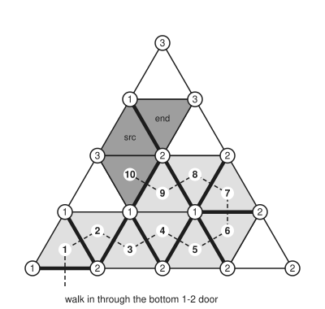
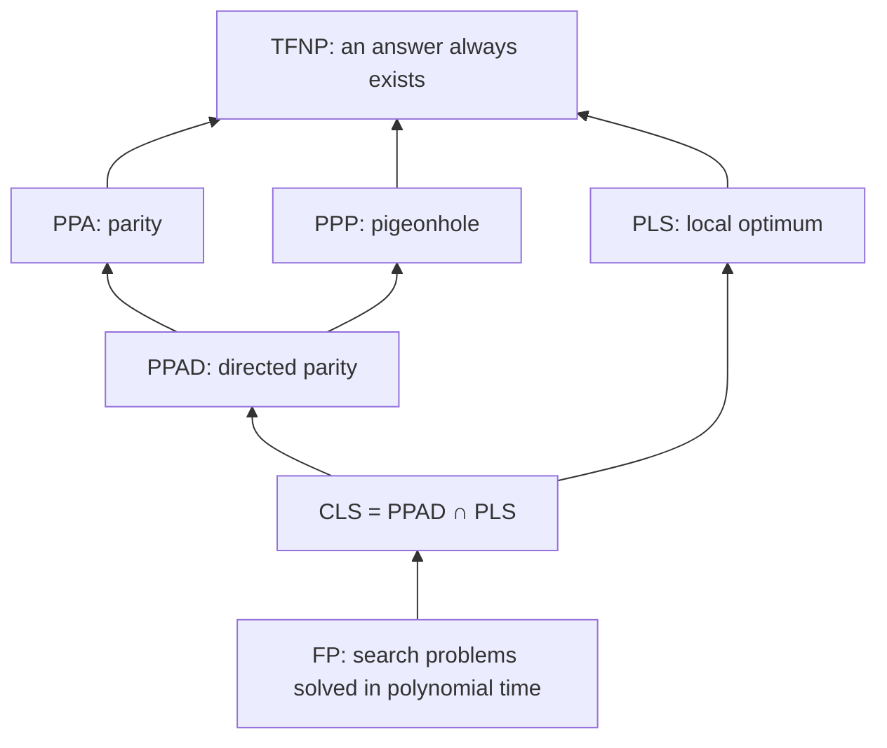

# Total search problems: a solution always exists, yet finding it may be hard

[Syllabus](../../../SYLLABUS.md) → [Computability and complexity](../README.md) → [Beyond Worst Case](../README.md#s04) → Total search problems

---

## General Overview

Draw a big triangle and cut it into 16 small triangles, four steps along each side. Put a colour, 1, 2 or 3, on every grid point. One rule: corner 1 gets colour 1, corner 2 gets 2, corner 3 gets 3, and a point on a side uses only the colours of that side's two corners. Inside, anything goes.

Call an edge whose ends are coloured 1 and 2 a **door**. Walk in from outside through a door on the bottom side. Each small triangle you enter has either a second door, so you walk on, or no second door, which happens only when its third corner is coloured 3. On the card's colouring the walk passes 10 triangles and stops in a triangle coloured 1, 2 and 3. This is **Sperner's lemma**: under the rule, a three-coloured small triangle always exists.

So the question "is there a three-coloured triangle?" always has the answer yes. The real task is to **find** one. Problems like this, where an answer is guaranteed and any proposed answer is quick to check, are **total search problems**, and their class is called TFNP.

A second guaranteed answer: two staff, A and B, choose an Early or a Late shift for a swap, at the same moment. A Nash equilibrium (a choice for each player that neither can improve by changing alone) always exists. Here one has each staff member take their favourite shift with chance 2/3. Finding such an equilibrium is complete for **PPAD**, the class of problems solved by walking a line like the one through the doors.

**A total search problem always has an answer that can be checked quickly, so its difficulty lies only in finding one; the classes inside TFNP are sorted by the argument that proves an answer exists (parity, pigeonhole, local optimum, fixed point), and finding a Nash equilibrium is complete for PPAD, the class of the directed parity argument behind Sperner's lemma.**

**What kind of fact this is:** Sperner's lemma, and the fact that no total search problem is NP-hard unless NP = coNP (coNP: the problems whose no-answers have short, quickly checked certificates), are theorems proved on this card in Why it works. That finding a Nash equilibrium is PPAD-complete is a theorem stated with its key steps and named sources. That PPAD has no polynomial-time algorithm is a conjecture, unproved as of 2026-11-11.

### The picture: the walk through the doors

<p align="center"></p>

Drawn to scale, side 320 pixels. Thick edges are doors. The dashed walk enters through the one door on the bottom side and numbers the triangles 1 to 10 in order. Dark triangles are three-coloured. The two marked "src" and "end" are joined by a door of their own, a short line that the walk from outside never meets.

---

## The formula

Notation first, in words. A **search problem** is a rule that says, for an input $`x`$ and a proposed answer $`y`$, whether $`y`$ is acceptable. A verifier $`V(x, y)`$ (a fast checking program, as on [P and NP](../03-Time%20Complexity/02-p-and-np.md)) returns 1 for yes and 0 for no.

```math
\mathrm{TFNP} = \Big\{\, V \;:\; V \text{ runs in polynomial time, every accepted } y \text{ has } |y| \le |x|^k, \text{ and } \forall x \;\exists y \;\; V(x, y) = 1 \,\Big\}
```

**Read it aloud:** a total search problem has a fast checker, short answers, and at least one acceptable answer for every input.

The problem that defines PPAD is **END-OF-LINE**. A graph has $`2^n`$ nodes named by $`n`$-bit strings. Two small programs, $`\mathrm{succ}`$ and $`\mathrm{pred}`$, name each node's next and previous node. An arrow runs from $`x`$ to $`y`$ when $`\mathrm{succ}(x) = y`$ and $`\mathrm{pred}(y) = x`$. The node $`0^n`$ ($`n`$ zeros; as on shelf 01, $`a^n`$ means $`n`$ copies of a symbol, not a power) has an arrow out and none in.

```math
\text{find } x \ne 0^n \text{ with } \mathrm{pred}(\mathrm{succ}(x)) \ne x \;\text{ or }\; \mathrm{succ}(\mathrm{pred}(x)) \ne x
```

**Read it aloud:** starting from a known beginning of a line, find any other end of any line: a node with no arrow out or no arrow in.

Sperner's lemma, the existence fact behind the door walk:

```math
\#\{\text{three-coloured small triangles}\} \text{ is odd}, \qquad \sum_{t \text{ three-coloured}} \mathrm{sign}(t) = 1
```

**Read it aloud:** the three-coloured triangles come in an odd number, and counting $`+1`$ for each whose colours run 1, 2, 3 anticlockwise and $`-1`$ for each that runs clockwise always gives exactly 1.

The shift-swap game's mixed equilibrium comes from making the other player indifferent:

```math
p = \frac{u_B(L,L) - u_B(L,E)}{u_B(E,E) - u_B(L,E) - u_B(E,L) + u_B(L,L)} = \frac{2 - 0}{1 - 0 - 0 + 2} = \frac{2}{3}
```

**Read it aloud:** A's chance of taking Early is set by B's payoffs, at the level where B gains nothing by preferring either shift; the same recipe on A's payoffs gives B's chance of Early, 1/3.

| Symbol | Plain meaning | In our example | Push it up and the answer… |
| --- | --- | --- | --- |
| $`x`$, $`y`$ | an input; a proposed answer | the coloured big triangle; one small triangle | — |
| $`V(x, y)`$, $`k`$ | the verifier, 1 accept and 0 reject; the fixed power bounding an answer's length | "are this triangle's corners 1, 2 and 3?"; answers are three grid points | — |
| $`\varphi`$ | a SAT formula fed to a reduction (Step 5) | — | — |
| $`n`$ | bits in a node's name | 8, 12, 16 in the code; 40 in the text | a walk can need $`2^n - 1`$ steps |
| $`\mathrm{succ}`$, $`\mathrm{pred}`$ | the programs naming the next and previous node | leave by the other door; come in by the door you used | — |
| $`0^n`$ | the known start: the node named by $`n`$ zeros | the outside of the big triangle | — |
| $`(a, b)`$ | a grid point: $`a`$ steps right along the bottom, $`b`$ rows up | corner 3 is $`(0, 4)`$ | — |
| $`T`$, $`\mathrm{sign}(t)`$ | the number of three-coloured small triangles; for one such triangle $`t`$, $`+1`$ if its colours run 1, 2, 3 anticlockwise, $`-1`$ if clockwise | 3; $`-1, +1, +1`$, sum 1 | — |
| $`E`$, $`L`$ | the Early and Late shift | A prefers Early, B prefers Late | — |
| $`p`$, $`r`$ | A's chance of Early; B's chance of Early | 2/3 and 1/3 | raise B's Late payoff: $`p`$ rises |
| $`u_A`$, $`u_B`$ | each player's payoff; $`u_B(s, t)`$ is B's when A works shift $`s`$ and B works $`t`$, and without arguments it is averaged over the chances | $`u_B(L, L) = 2`$; 2/3 each at the mixed equilibrium | — |
| $`f`$, $`v`$ | a continuous map of the triangle into itself; a grid point (Step 3) | — | — |

### When it holds

- **Sperner's rule on the sides.** Colour the top corner 2 instead of 3 and 176 of 13,824 such colourings have no three-coloured triangle at all.
- **An odd number of doors on one side.** The bottom side runs from colour 1 to colour 2, so it holds an odd number of doors. With three doors, a walk from the first door comes back out through the second after 3 triangles. So no single door is sure to lead inside. What is sure: doors leading in outnumber doors leading out by one, so at least one walk from outside ends in a three-coloured triangle.
- **A fast checker and short answers.** Without them a problem leaves TFNP: "find a proof of this theorem" always has an answer for a true theorem, but the proof may be too long to write down.
- **Finite games for Nash.** Nash's theorem needs finitely many players and choices, and it needs mixed choices. The shift-swap game has two equilibria in plain choices and a third in mixed ones.
- **PPAD-hard is not NP-hard.** The classes below sit inside TFNP, and no total problem is NP-hard unless NP = coNP (Step 5).

---

## Why it works

### Step 0: when the answer is always yes, only the search remains

For a yes-or-no problem such as SAT, the hard part may be telling yes from no. A total problem has no "no" inputs. Its whole difficulty is producing the answer.

The proof that an answer exists is what sorts these problems. Each proof below is non-constructive in a particular way: it shows an answer exists without saying where. Papadimitriou (1994) named a class for each kind of proof:

| Class | The existence argument | The defining problem | A complete problem |
| --- | --- | --- | --- |
| PPA | parity: a graph has an even number of odd-degree nodes | given one end of a line with no arrows, find another | splitting a necklace fairly between two people |
| PPAD | directed parity: a line with arrows that starts somewhere ends somewhere | END-OF-LINE | Sperner, Brouwer, Nash |
| PPP | pigeonhole: $`2^n`$ inputs into fewer than $`2^n`$ boxes collide | given a map from $`n`$ bits to $`n`$ bits, find two inputs with one output, or an input sent to $`0^n`$ | a constrained form of SIS (short integer solution), a lattice problem used in cryptography (Sotiraki, Zampetakis and Zirdelis, 2018) |
| PLS | local optimum: a cost on a finite set has a lowest point, and no small move improves it | given a cost and small moves, find a point no move improves | a cut of a weighted graph no single move improves |

PPA, PPAD and PPP stand for "polynomial parity argument", "the same, directed" and "polynomial pigeonhole principle". PLS, "polynomial local search", came earlier, from Johnson, Papadimitriou and Yannakakis (1988).

### Step 1: the parity argument

Count the ends of edges in any finite graph. Each edge has two ends, so the total is even. So the number of nodes with an odd number of edges is even.

Now let every node have at most two edges. The graph is a collection of lines and loops. A line has exactly two ends. So if one end is known, a second end exists. That is the whole existence proof behind PPA.

PPAD adds arrows: every node has at most one arrow in and one arrow out. A line now has a start (no arrow in) and a finish (no arrow out). Given one start, a finish exists, and walking the arrows reaches it. The walk can be long. With nodes named by $`n`$ bits, a line can visit all $`2^n`$ nodes, and the code walks such a line:

| Name length $`n`$ | Steps walked from $`0^n`$ to the finish |
| ---: | ---: |
| 8 | 255 |
| 12 | 4,095 |
| 16 | 65,535 |
| 40 | up to 1,099,511,627,775 |

The programs $`\mathrm{succ}`$ and $`\mathrm{pred}`$ are short, yet the line they describe has about a trillion nodes at $`n = 40`$. END-OF-LINE asks for a shortcut: an end found without walking. This particular line has one, since its nodes are numbered in order and the last name can be written down at once. For general programs $`\mathrm{succ}`$ and $`\mathrm{pred}`$, none is known.

### Step 2: Sperner's lemma is a door walk

Turn the triangle into a line graph. Each small triangle is a node, and so is the outside. Two nodes are joined when they share a door, an edge coloured 1 and 2.

- **A small triangle** coloured 1, 2, 3 has one door. One coloured 1, 2, 2 or 1, 1, 2 has two. Any other has none.
- **The outside** meets doors only on the bottom side: the left side uses colours 1 and 3, the right side 2 and 3. The bottom runs from 1 to 2, so it switches colour an odd number of times, and each switch is a door.

So the outside has an odd number of edges and every node except a three-coloured triangle has an even number. By Step 1 the number of odd nodes is even, so the three-coloured triangles are odd in number, and at least one exists.

The card's walk, door by door, with each triangle's colours read anticlockwise:

| Triangle | Colours | What happens |
| ---: | --- | --- |
| 1 | 1 2 1 | entered through the bottom door, from $`(0, 0)`$ to $`(1, 0)`$; one more door |
| 2 | 2 1 1 | two doors: in and on |
| 3 to 8 | 2 2 1, 2 1 1, 2 2 1, 2 2 1, 1 2 2, 1 2 2 | each has exactly two doors, so the walk never stalls |
| 9 | 1 1 2 | two doors |
| 10 | 1 2 3 | one door: **three-coloured, the walk ends** at $`(1, 1)`$, $`(1, 2)`$, $`(0, 2)`$ |

The scan of all 16 triangles finds three three-coloured ones, an odd count. The other two sit side by side, joined by one door: a line of two triangles that the walk from outside never meets.

<details>
<summary>Detailed proof: Sperner's lemma, and why the signed count is 1</summary>

Count pairs (small triangle, door on its edge). A three-coloured triangle has one door. A triangle coloured from $`\{1, 2\}`$ with a repeat has two. Every other triangle has none. So the total is the number $`T`$ of three-coloured triangles plus an even number.

Count the same pairs by doors. An inside door lies on two triangles. A door on the boundary lies on one, and boundary doors occur only on the bottom side, which runs from colour 1 to colour 2. Reading along it, the colour switches between 1 and 2 an odd number of times, and each switch is one boundary door. So the total is twice the inside doors plus an odd number.

The two totals are equal, so $`T`$ is odd.

For the sign, give each door a direction: cross it with colour 1 on your left. In a triangle with two doors one is crossed inward and one outward. A three-coloured triangle running 1, 2, 3 anticlockwise has its single door crossed inward, so it is a finish, sign $`+1`$. One running clockwise has its door crossed outward, so it is a start, sign $`-1`$. The bottom side has one more inward door than outward door, so the outside is one extra start. Starts and finishes pair up along the lines, so the finishes outnumber the starts by exactly 1.

</details>

The arrows put Sperner in PPAD, not only PPA. The code checks the lemma on every legal colouring of the 16 triangles: 13,824 of them, each with an odd count and a signed sum of 1.

### Step 3: from Sperner to Brouwer, and from Brouwer to Nash

Brouwer's theorem says a continuous map of a triangle (or disc) into itself leaves some point fixed ([Brouwer and Borsuk-Ulam](../../17-Topology/04-Homotopy/08-brouwer-and-borsuk-ulam.md)). Sperner's lemma proves it, and turns it into a search.

Write each point of the triangle by three weights, one per corner, adding to 1. Colour a grid point $`v`$ by a corner where $`v`$ has positive weight and the map does not increase that weight. Such a corner exists: if every positive weight rose, the new weights would add to more than 1. A point on a side has weight 0 at the third corner, so its colour is one of its own side's corners: Sperner's rule holds. A three-coloured small triangle is then a place where no weight can go up. As the grid gets finer, these triangles close in on a fixed point.

So, for a map given as a program with a known limit on how fast it can change, finding a point that the map moves by less than a set tolerance is a door walk: it lies in PPAD.

Nash proved equilibria exist with Brouwer's theorem. Each player shifts weight toward choices that would pay more against the others, and a point this shift leaves alone is an equilibrium. So finding an approximate Nash equilibrium is in PPAD too.

<details>
<summary>Why a point no weight can rise at is a fixed point</summary>

Suppose at a point $`v`$ the map $`f`$ raises no weight: each of the three weights of $`f(v)`$ is at most the matching weight of $`v`$. Both sets of weights add to 1. If any weight fell, another would have to rise. So none falls, and $`f(v) = v`$.

A three-coloured triangle gives "one weight does not rise" at each of three nearby points, a different weight at each. On finer and finer grids these triangles shrink toward a point where, by continuity, no weight rises: a fixed point.

</details>

### Step 4: Nash is PPAD-complete

The surprise runs the other way: every END-OF-LINE problem can be dressed as a game.

- **Daskalakis, Goldberg and Papadimitriou (2009)**: finding a Nash equilibrium of a game with three or more players is PPAD-complete. The reduction builds the line's $`\mathrm{succ}`$ and $`\mathrm{pred}`$ programs as gadgets of players whose equilibrium chances act as arithmetic gates.
- **Chen, Deng and Teng (2009)**: the same holds for two players, and even for equilibria accurate to one part in a polynomial of the game's size.

Both are theorems, stated here with their key steps. Two players were the hoped-for easy case, since Lemke and Howson (1964) gave a path-following method for them that works like the door walk.

That method also explains the shift-swap game's count. For a two-player game without ties of a special kind (a nondegenerate game), its paths pair up all equilibria but one, so the number of equilibria is odd. The shift-swap game has three:

| Equilibrium | A's chance of Early | B's chance of Early | A's payoff | B's payoff |
| --- | ---: | ---: | ---: | ---: |
| both Early | 1 | 1 | 2 | 1 |
| both Late | 0 | 0 | 1 | 2 |
| mixed | 2/3 | 1/3 | 2/3 | 2/3 |

In the mixed one each staff member takes their favourite shift with chance 2/3, about 67%. Each then expects 2/3, less than either gets at a plain equilibrium, because the two often pick different shifts and the swap fails.

### Step 5: why no total problem is NP-hard unless NP = coNP

A **reduction** from SAT to a search problem turns each formula $`\varphi`$ into an input $`x`$, and turns any answer $`y`$ for $`x`$ into a correct yes or no for $`\varphi`$, both in polynomial time ([Reductions](../03-Time%20Complexity/03-polynomial-reductions-and-np-completeness.md)).

Suppose a total problem had such a reduction. Take an unsatisfiable $`\varphi`$. Its input $`x`$ has an answer $`y`$, because the problem is total. That $`y`$ is short, it is checked fast, and it makes the reduction print "no". So $`y`$ is a short certificate that $`\varphi`$ is unsatisfiable. Then every unsatisfiable formula has a short certificate, so the complement of SAT is in NP, and NP = coNP. Here coNP is the class whose no-answers have short certificates.

Megiddo and Papadimitriou (1991) gave this argument. Most researchers expect NP ≠ coNP, so PPAD-complete problems are expected to be easier than NP-complete ones. Yet they are not expected to be easy: if P = NP, every TFNP problem would be solvable in polynomial time, so a proof that END-OF-LINE is hard would also prove P ≠ NP.

### Step 6: the classes side by side



Schematic. Each arrow is a proved inclusion. None is proved strict: if P = NP, every class here collapses to FP. CLS (continuous local search) was shown equal to PPAD ∩ PLS by Fearnley, Goldberg, Hollender and Savani (2022).

The pigeonhole class in the house example: ten staff each work at most 48 hours a week. There are 1,024 groups of staff, but only 481 possible weekly totals, 0 to 480. So two different groups share a total. The code finds one after 67 groups: the 33-hour worker alone, against the 12-hour and 21-hour workers together.

The 48-hour cap makes this version easy at any size. The totals stay small, so a table of the totals reached so far, filled in one name at a time, finds a pair within the first few names, however long the list. The search becomes a genuine PPP question only when the hours are huge numbers, with about as many bits each as there are staff, and a sum still small enough that two groups must share a total. Then the table can grow as large as the list of groups, and no fast general method is known. That version, called EQUAL SUMS, lies in PPP.

---

## Worked numbers, by hand

The card's triangle and the shift-swap game.

| Step | Arithmetic | Value |
| --- | --- | --- |
| doors on the bottom side | colours 1, 2, 2, 2, 2: one switch | 1 |
| walk from outside | through triangles 1 to 10, door by door | ends in 1, 2, 3 at $`(1, 1)`$, $`(1, 2)`$, $`(0, 2)`$ |
| three-coloured triangles, by scanning all 16 | signs $`-1, +1, +1`$ | 3, signed sum 1 |
| B indifferent between Early and Late | $`1 \times p = 2 \times (1 - p)`$, so $`3p = 2`$ | $`p = 2/3`$ |
| A indifferent between Early and Late | $`2 \times r = 1 \times (1 - r)`$, so $`3r = 1`$ | $`r = 1/3`$, B's Late chance 2/3 |
| A's payoff at the mix | $`2 \times \tfrac23 \times \tfrac13 + 1 \times \tfrac13 \times \tfrac23 = \tfrac49 + \tfrac29`$ | 2/3 |
| equilibria found by a search over chances in steps of 1/60 | both Early, both Late, the mix | **3, an odd number, with each staff member taking their favourite at 2/3** |

Both guaranteed answers were found here by brute force on a small case; at the sizes where TFNP matters, the guarantee stays and the brute force does not.

### What breaks if you drop a piece

| Mistake | Comes out at | What went wrong |
| --- | --- | --- |
| Breaking Sperner's rule at the top corner (coloured 2) | 176 of 13,824 colourings have no three-coloured triangle; the card's own colouring gets 4, an even count | the left side now runs from colour 1 to colour 2, so it can gain a door, and the outside can meet an even number of doors |
| Assuming every walk from outside ends inside | bottom side recoloured 1, 2, 1, 2, 2 has 3 doors; the walk from the first leaves through the second after 3 triangles | doors pair up; what is sure is one more door in than out, so at least one walk leads in |
| Setting A's mix from A's own payoffs | A takes Early with chance 1/3; B then gets 1/3 from Early and 4/3 from Late, and stops mixing | a mix must make the *other* player indifferent |
| Treating the walk as a fast method | a 40-bit line can need 1,099,511,627,775 steps | PPAD asks for a shortcut, not a walk |

The code prints all four.

---

## Code, from first principles, and it actually runs

Three independent roads lead to Sperner's lemma: the door walk, a scan of all 16 triangles, and a count over all 13,824 legal colourings. A line of $`2^n`$ nodes is walked and checked against $`2^n - 1`$. The staff collision is found by trying groups until a total repeats. The game is solved twice: by the indifference formula, and by a whole-number search over all chances in steps of 1/60.

### Python

```python
# Total search problems and PPAD -- the check behind the card.  Standard library only.
# A Sperner triangle cut into 16 small triangles is walked door by door and scanned;
# every legal colouring is counted; a staff-hours collision and a shift-swap game follow.
M = 4                                       # each side of the big triangle has 4 steps
V = [(a, b) for b in range(M + 1) for a in range(M + 1 - b)]   # a: steps right, b: rows up
COL = dict(zip(V, (1, 2, 2, 2, 2, 1, 1, 1, 2, 3, 2, 2, 1, 3, 3)))   # the card's colouring
UP = [((a, b), (a + 1, b), (a, b + 1)) for b in range(M) for a in range(M - b)]
DOWN = [((a + 1, b), (a + 1, b + 1), (a, b + 1)) for b in range(M - 1) for a in range(M - 1 - b)]
TRIS = UP + DOWN                            # 16 triangles, corners listed anticlockwise

def allowed(a, b):                          # Sperner's rule: a side uses only its corners' colours
    if (a, b) == (0, 0): return [1]
    if (a, b) == (M, 0): return [2]
    if (a, b) == (0, M): return [3]
    if b == 0: return [1, 2]
    if a == 0: return [1, 3]
    if a + b == M: return [2, 3]
    return [1, 2, 3]

def scan(col):                              # road one: look at all 16 triangles
    found = []
    for t in TRIS:
        cs = [col[v] for v in t]
        if sorted(cs) == [1, 2, 3]:         # +1 if 1, 2, 3 run anticlockwise, -1 if clockwise
            found.append((t, 1 if cs in ([1, 2, 3], [2, 3, 1], [3, 1, 2]) else -1))
    return found

def exit_door(t, col):                      # the edge whose colours run 2 then 1 anticlockwise
    for i in range(3):
        if (col[t[i]], col[t[(i + 1) % 3]]) == (2, 1):
            return frozenset((t[i], t[(i + 1) % 3]))
    return None                             # none: a 1, 2, 3 anticlockwise triangle, a sink

def walk(col, start):                       # road two: follow doors one triangle at a time
    path = [start]
    while True:
        door = exit_door(path[-1], col)
        if door is None: return path, "inside"
        nxt = [t for t in TRIS if door <= set(t) and t != path[-1]]
        if not nxt: return path, "outside"
        path.append(nxt[0])

def sperner_report(col, name):
    doors = [a for a in range(M) if {col[(a, 0)], col[(a + 1, 0)]} == {1, 2}]
    entry = [t for t in UP if t[0] == (doors[0], 0)][0]
    path, how = walk(col, entry)
    print(f"{name}: bottom-side doors {len(doors)}, first at a = {doors[0]} to {doors[0] + 1}")
    print(f"{name}: walk visits {len(path)} triangles, ends {how}, last {list(path[-1])}")
    print(f"{name}: colours along the walk " + " ".join("".join(str(col[v]) for v in t) for t in path))
    return path, how

path, how = sperner_report(COL, "card")
found = scan(COL)
print(f"scan of 16 triangles: {len(found)} three-coloured, signs {[s for _, s in found]}, sum {sum(s for _, s in found)}")
for t, s in found:
    print(f"  three-coloured {list(t)} sign {s:+d}")
src = [t for t, s in found if s == -1][0]
p2, how2 = walk(COL, src)
print(f"walk from the inside source ends {how2} after {len(p2)} triangles at {list(p2[-1])}")
assert how == "inside" and path[-1] in [t for t, _ in found]     # walk lands on a scan find
assert how2 == "inside" and p2[-1] != path[-1]
assert all(COL[v] in allowed(*v) for v in V) and len(found) == 3 and sum(s for _, s in found) == 1

opts = [allowed(*v) for v in V]
def every(opts):                            # road three: every colouring, odometer style
    idx = [0] * len(opts)
    while True:
        yield {v: o[i] for v, o, i in zip(V, opts, idx)}
        k = 0
        while k < len(idx) and idx[k] == len(opts[k]) - 1:
            idx[k] = 0; k += 1
        if k == len(idx): return
        idx[k] += 1
tally, total, signed_ok = {}, 0, True
for col in every(opts):
    f = scan(col)
    tally[len(f)] = tally.get(len(f), 0) + 1
    total += 1
    signed_ok = signed_ok and sum(s for _, s in f) == 1
print(f"legal colourings {total}; three-coloured counts " + ", ".join(f"{k}: {tally[k]}" for k in sorted(tally)))
print(f"every legal colouring: count odd {'yes' if all(k % 2 for k in tally) else 'no'}, signed sum 1 {'yes' if signed_ok else 'no'}")
assert total == 2 ** 9 * 3 ** 3 and all(k % 2 == 1 for k in tally) and signed_ok

bad = [o if v != (0, M) else [2] for v, o in zip(V, opts)]  # rule broken: top corner coloured 2
nb = [not scan(col) for col in every(bad)]   # one entry per colouring: True if it has none
none = sum(nb)
broken = dict(COL); broken[(0, M)] = 2
print(f"top corner coloured 2: {none} of {len(nb)} colourings have none; the card's colouring then has {len(scan(broken))}")
three = dict(COL); three[(2, 0)] = 1                 # bottom 1,2,1,2,2: three doors
p3, how3 = sperner_report(three, "three doors")
assert none > 0 and len(nb) == total and how3 == "outside"

for n in (8, 12, 16):                       # a line of 2^n nodes named by n bits (Gray code)
    node, steps = 0, 0
    while True:
        i, g = node, node >> 1
        while g: i ^= g; g >>= 1             # decode the Gray name to a position
        if i == 2 ** n - 1: break
        node = (i + 1) ^ ((i + 1) >> 1)      # successor: next position, re-encoded
        steps += 1
    print(f"line of {n}-bit nodes walked: {steps} steps; 2^{n} - 1 = {2 ** n - 1}")
    assert steps == 2 ** n - 1
print(f"a 40-bit line: up to {2 ** 40 - 1:,} steps")

HOURS = [38, 12, 25, 40, 16, 33, 21, 45, 8, 29]     # ten staff, weekly hours, each at most 48
seen, pair = {}, None
for mask in range(2 ** len(HOURS)):
    s = sum(h for j, h in enumerate(HOURS) if mask >> j & 1)
    if s in seen: pair = (seen[s], mask); break
    seen[s] = mask
common = pair[0] & pair[1]
g1, g2 = [[HOURS[j] for j in range(10) if (m & ~common) >> j & 1] for m in pair]
print(f"staff groups {2 ** 10}; hours each at most 48, so totals 0 to {10 * 48}: {10 * 48 + 1} values; after {pair[1] + 1} groups: {g1} and {g2}, both {sum(g1)} hours")
assert sum(g1) == sum(g2) and not set(g1) & set(g2) and g1 != g2

A = {("E", "E"): 2, ("E", "L"): 0, ("L", "E"): 0, ("L", "L"): 1}   # rows: A's shift, cols: B's
B = {("E", "E"): 1, ("E", "L"): 0, ("L", "E"): 0, ("L", "L"): 2}
pn, pd = B["L", "L"] - B["L", "E"], B["E", "E"] - B["L", "E"] - B["E", "L"] + B["L", "L"]
rn, rd = A["L", "L"] - A["E", "L"], A["E", "E"] - A["E", "L"] - A["L", "E"] + A["L", "L"]
print(f"formula: A takes Early with chance {pn}/{pd}, B takes Early with chance {rn}/{rd}, Late {rd - rn}/{rd}")
eqs = []
for k in range(61):                         # road two: every pair of chances in steps of 1/60
    for l in range(61):
        pr, pc = (k, 60 - k), (l, 60 - l)    # (Early, Late) weights, out of 60
        uA = [sum(A[s, t] * w for t, w in zip("EL", pc)) for s in "EL"]   # A's pure payoffs x60
        uB = [sum(B[s, t] * w for s, w in zip("EL", pr)) for t in "EL"]
        if (k * uA[0] + (60 - k) * uA[1] == 60 * max(uA) and l * uB[0] + (60 - l) * uB[1] == 60 * max(uB)):
            eqs.append((k, l, (k * uA[0] + (60 - k) * uA[1]), (l * uB[0] + (60 - l) * uB[1])))
for k, l, a, b in eqs:
    print(f"equilibrium: A Early {k}/60, B Early {l}/60; payoffs A {a / 3600:.4f}, B {b / 3600:.4f}")
print(f"equilibria found by search: {len(eqs)} (odd)")
assert [(k, l) for k, l, _, _ in eqs] == [(0, 0), (40, 20), (60, 60)]
assert eqs[1][0] * pd == 60 * pn and eqs[1][1] * rd == 60 * rn   # formula meets search
own = (A["L", "L"] - A["L", "E"], A["E", "E"] - A["L", "E"] - A["E", "L"] + A["L", "L"])
print(f"wrong: A's mix from A's own payoffs, Early {own[0]}/{own[1]}; B then gets Early {B['E', 'E'] * own[0]}/{own[1]}, Late {B['L', 'L'] * (own[1] - own[0])}/{own[1]}")
print(f"figure, side 320 px, corners (40, 330) (360, 330) (200, {330 - 160 * 3 ** 0.5:.2f}); walk {len(path)} triangles")
print("ALL CHECKS PASS")
```

**Ran 2026-11-24 on macOS, Python 3.14.10, standard library only. All checks passed. Output, pasted from the run:**

```
card: bottom-side doors 1, first at a = 0 to 1
card: walk visits 10 triangles, ends inside, last [(1, 1), (1, 2), (0, 2)]
card: colours along the walk 121 211 221 211 221 221 122 122 112 123
scan of 16 triangles: 3 three-coloured, signs [-1, 1, 1], sum 1
  three-coloured [(0, 2), (1, 2), (0, 3)] sign -1
  three-coloured [(1, 1), (1, 2), (0, 2)] sign +1
  three-coloured [(1, 2), (1, 3), (0, 3)] sign +1
walk from the inside source ends inside after 2 triangles at [(1, 2), (1, 3), (0, 3)]
legal colourings 13824; three-coloured counts 1: 2920, 3: 6192, 5: 3840, 7: 848, 9: 24
every legal colouring: count odd yes, signed sum 1 yes
top corner coloured 2: 176 of 13824 colourings have none; the card's colouring then has 4
three doors: bottom-side doors 3, first at a = 0 to 1
three doors: walk visits 3 triangles, ends outside, last [(1, 0), (2, 0), (1, 1)]
three doors: colours along the walk 121 211 211
line of 8-bit nodes walked: 255 steps; 2^8 - 1 = 255
line of 12-bit nodes walked: 4095 steps; 2^12 - 1 = 4095
line of 16-bit nodes walked: 65535 steps; 2^16 - 1 = 65535
a 40-bit line: up to 1,099,511,627,775 steps
staff groups 1024; hours each at most 48, so totals 0 to 480: 481 values; after 67 groups: [33] and [12, 21], both 33 hours
formula: A takes Early with chance 2/3, B takes Early with chance 1/3, Late 2/3
equilibrium: A Early 0/60, B Early 0/60; payoffs A 1.0000, B 2.0000
equilibrium: A Early 40/60, B Early 20/60; payoffs A 0.6667, B 0.6667
equilibrium: A Early 60/60, B Early 60/60; payoffs A 2.0000, B 1.0000
equilibria found by search: 3 (odd)
wrong: A's mix from A's own payoffs, Early 1/3; B then gets Early 1/3, Late 4/3
figure, side 320 px, corners (40, 330) (360, 330) (200, 52.87); walk 10 triangles
ALL CHECKS PASS
```

### Rust

Same numbers, same labels, built with `rustc --edition 2021 -O`.

```rust
// Total search problems and PPAD -- the same check as the Python, in Rust.  No crates.
// A Sperner triangle cut into 16 small triangles is walked door by door and scanned;
// every legal colouring is counted; a staff-hours collision and a shift-swap game follow.
use std::collections::HashMap;
type P = (i64, i64);
type T = [P; 3];
type Col = HashMap<P, i64>;
const M: i64 = 4; // each side of the big triangle has 4 steps

fn verts() -> Vec<P> { // a: steps right, b: rows up
    let mut v = vec![];
    for b in 0..=M { for a in 0..=M - b { v.push((a, b)); } }
    v
}
fn tris() -> (Vec<T>, Vec<T>) { // corners listed anticlockwise
    let (mut up, mut down) = (vec![], vec![]);
    for b in 0..M { for a in 0..M - b { up.push([(a, b), (a + 1, b), (a, b + 1)]); } }
    for b in 0..M - 1 { for a in 0..M - 1 - b { down.push([(a + 1, b), (a + 1, b + 1), (a, b + 1)]); } }
    (up, down)
}
fn allowed(a: i64, b: i64) -> Vec<i64> { // Sperner's rule: a side uses only its corners' colours
    if (a, b) == (0, 0) { vec![1] } else if (a, b) == (M, 0) { vec![2] } else if (a, b) == (0, M) { vec![3] }
    else if b == 0 { vec![1, 2] } else if a == 0 { vec![1, 3] } else if a + b == M { vec![2, 3] } else { vec![1, 2, 3] }
}
fn scan(all: &[T], col: &Col) -> Vec<(T, i64)> { // road one: look at all 16 triangles
    let mut found = vec![];
    for t in all {
        let cs: Vec<i64> = t.iter().map(|v| col[v]).collect();
        let mut s = cs.clone(); s.sort();
        if s == vec![1, 2, 3] {
            let anti = cs == vec![1, 2, 3] || cs == vec![2, 3, 1] || cs == vec![3, 1, 2];
            found.push((*t, if anti { 1 } else { -1 }));
        }
    }
    found
}
fn exit_door(t: &T, col: &Col) -> Option<(P, P)> { // colours running 2 then 1 anticlockwise
    for i in 0..3 { if (col[&t[i]], col[&t[(i + 1) % 3]]) == (2, 1) { return Some((t[i], t[(i + 1) % 3])); } }
    None
}
fn walk(all: &[T], col: &Col, start: T) -> (Vec<T>, &'static str) { // road two: follow doors
    let mut path = vec![start];
    loop {
        let last = *path.last().unwrap();
        let door = match exit_door(&last, col) { None => return (path, "inside"), Some(d) => d };
        let nxt: Vec<T> = all.iter().filter(|t| **t != last && t.contains(&door.0) && t.contains(&door.1)).cloned().collect();
        if nxt.is_empty() { return (path, "outside"); }
        path.push(nxt[0]);
    }
}
fn tl(t: &T) -> String { format!("[{}]", t.iter().map(|p| format!("({}, {})", p.0, p.1)).collect::<Vec<_>>().join(", ")) }
fn il(v: &[i64]) -> String { format!("[{}]", v.iter().map(|x| x.to_string()).collect::<Vec<_>>().join(", ")) }
fn commas(n: u64) -> String {
    let s = n.to_string(); let mut out = String::new();
    for (i, ch) in s.chars().enumerate() { if i > 0 && (s.len() - i) % 3 == 0 { out.push(','); } out.push(ch); }
    out
}
fn report(up: &[T], all: &[T], col: &Col, name: &str) -> (Vec<T>, &'static str) {
    let doors: Vec<i64> = (0..M).filter(|&a| { let (x, y) = (col[&(a, 0)], col[&(a + 1, 0)]); x != y && x + y == 3 }).collect();
    let entry = *up.iter().find(|t| t[0] == (doors[0], 0)).unwrap();
    let (path, how) = walk(all, col, entry);
    println!("{}: bottom-side doors {}, first at a = {} to {}", name, doors.len(), doors[0], doors[0] + 1);
    println!("{}: walk visits {} triangles, ends {}, last {}", name, path.len(), how, tl(path.last().unwrap()));
    let cs: Vec<String> = path.iter().map(|t| t.iter().map(|v| col[v].to_string()).collect::<String>()).collect();
    println!("{}: colours along the walk {}", name, cs.join(" "));
    (path, how)
}
fn every(v: &[P], opts: &[Vec<i64>], mut f: impl FnMut(&Col)) { // road three: every colouring
    let mut idx = vec![0usize; opts.len()];
    loop {
        let col: Col = v.iter().zip(opts).zip(&idx).map(|((p, o), &i)| (*p, o[i])).collect();
        f(&col);
        let mut k = 0;
        while k < idx.len() && idx[k] == opts[k].len() - 1 { idx[k] = 0; k += 1; }
        if k == idx.len() { return; }
        idx[k] += 1;
    }
}
fn main() {
    let v = verts();
    let base = [1, 2, 2, 2, 2, 1, 1, 1, 2, 3, 2, 2, 1, 3, 3]; // the card's colouring
    let colr: Col = v.iter().cloned().zip(base.iter().cloned()).collect();
    let (up, down) = tris();
    let all: Vec<T> = up.iter().chain(down.iter()).cloned().collect();
    let (path, how) = report(&up, &all, &colr, "card");
    let found = scan(&all, &colr);
    let signs: Vec<i64> = found.iter().map(|f| f.1).collect();
    println!("scan of 16 triangles: {} three-coloured, signs {}, sum {}", found.len(), il(&signs), signs.iter().sum::<i64>());
    for (t, s) in &found { println!("  three-coloured {} sign {:+}", tl(t), s); }
    let src = found.iter().find(|f| f.1 == -1).unwrap().0;
    let (p2, how2) = walk(&all, &colr, src);
    println!("walk from the inside source ends {} after {} triangles at {}", how2, p2.len(), tl(p2.last().unwrap()));
    assert!(how == "inside" && found.iter().any(|f| f.0 == *path.last().unwrap()));
    assert!(how2 == "inside" && p2.last() != path.last());
    assert!(v.iter().all(|p| allowed(p.0, p.1).contains(&colr[p])) && found.len() == 3 && signs.iter().sum::<i64>() == 1);
    let opts: Vec<Vec<i64>> = v.iter().map(|p| allowed(p.0, p.1)).collect();
    let mut tally: HashMap<usize, u64> = HashMap::new();
    let (mut total, mut signed_ok) = (0u64, true);
    every(&v, &opts, |c| { let f = scan(&all, c); *tally.entry(f.len()).or_insert(0) += 1; total += 1;
        signed_ok = signed_ok && f.iter().map(|x| x.1).sum::<i64>() == 1; });
    let mut keys: Vec<usize> = tally.keys().cloned().collect(); keys.sort();
    let parts: Vec<String> = keys.iter().map(|k| format!("{}: {}", k, tally[k])).collect();
    println!("legal colourings {}; three-coloured counts {}", total, parts.join(", "));
    let odd = keys.iter().all(|k| k % 2 == 1);
    println!("every legal colouring: count odd {}, signed sum 1 {}", if odd { "yes" } else { "no" }, if signed_ok { "yes" } else { "no" });
    assert!(total == 512 * 27 && odd && signed_ok);
    let bad: Vec<Vec<i64>> = v.iter().zip(&opts).map(|(p, o)| if *p == (0, M) { vec![2] } else { o.clone() }).collect();
    let (mut none, mut nbad) = (0u64, 0u64);
    every(&v, &bad, |c| { nbad += 1; if scan(&all, c).is_empty() { none += 1; } });
    let mut broken = colr.clone(); broken.insert((0, M), 2);
    println!("top corner coloured 2: {} of {} colourings have none; the card's colouring then has {}", none, nbad, scan(&all, &broken).len());
    let mut three = colr.clone(); three.insert((2, 0), 1); // bottom 1,2,1,2,2: three doors
    let (_p3, how3) = report(&up, &all, &three, "three doors");
    assert!(none > 0 && nbad == total && how3 == "outside");

    for n in [8u32, 12, 16] { // a line of 2^n nodes named by n bits (Gray code)
        let (mut node, mut steps) = (0u64, 0u64);
        loop {
            let (mut i, mut g) = (node, node >> 1);
            while g > 0 { i ^= g; g >>= 1; } // decode the Gray name to a position
            if i == (1u64 << n) - 1 { break; }
            node = (i + 1) ^ ((i + 1) >> 1); // successor: next position, re-encoded
            steps += 1;
        }
        println!("line of {}-bit nodes walked: {} steps; 2^{} - 1 = {}", n, steps, n, (1u64 << n) - 1);
        assert!(steps == (1u64 << n) - 1);
    }
    println!("a 40-bit line: up to {} steps", commas((1u64 << 40) - 1));

    let hours: [i64; 10] = [38, 12, 25, 40, 16, 33, 21, 45, 8, 29]; // weekly hours, each at most 48
    let mut seen: HashMap<i64, usize> = HashMap::new();
    let mut pair = (0usize, 0usize);
    for mask in 0..1usize << 10 {
        let s: i64 = (0..10).filter(|j| mask >> j & 1 == 1).map(|j| hours[j]).sum();
        if let Some(&m0) = seen.get(&s) { pair = (m0, mask); break; }
        seen.insert(s, mask);
    }
    let common = pair.0 & pair.1;
    let grp = |m: usize| -> Vec<i64> { (0..10).filter(|j| (m & !common) >> j & 1 == 1).map(|j| hours[j]).collect() };
    let (g1, g2) = (grp(pair.0), grp(pair.1));
    println!("staff groups {}; hours each at most 48, so totals 0 to {}: {} values; after {} groups: {} and {}, both {} hours", 1 << 10, 10 * 48, 10 * 48 + 1, pair.1 + 1, il(&g1), il(&g2), g1.iter().sum::<i64>());
    assert!(g1.iter().sum::<i64>() == g2.iter().sum::<i64>() && g1.iter().all(|h| !g2.contains(h)) && g1 != g2);

    let a = |s: usize, t: usize| [[2i64, 0], [0, 1]][s][t]; // rows: A's shift (0 Early, 1 Late)
    let b = |s: usize, t: usize| [[1i64, 0], [0, 2]][s][t]; // cols: B's shift
    let (pn, pd) = (b(1, 1) - b(1, 0), b(0, 0) - b(1, 0) - b(0, 1) + b(1, 1));
    let (rn, rd) = (a(1, 1) - a(0, 1), a(0, 0) - a(0, 1) - a(1, 0) + a(1, 1));
    println!("formula: A takes Early with chance {}/{}, B takes Early with chance {}/{}, Late {}/{}", pn, pd, rn, rd, rd - rn, rd);
    let mut eqs = vec![];
    for k in 0..=60i64 { // road two: every pair of chances in steps of 1/60
        for l in 0..=60i64 {
            let (pr, pc) = ([k, 60 - k], [l, 60 - l]);
            let ua: Vec<i64> = (0..2).map(|s| (0..2).map(|t| a(s, t) * pc[t]).sum()).collect();
            let ub: Vec<i64> = (0..2).map(|t| (0..2).map(|s| b(s, t) * pr[s]).sum()).collect();
            let (xa, xb) = (k * ua[0] + (60 - k) * ua[1], l * ub[0] + (60 - l) * ub[1]);
            if xa == 60 * ua[0].max(ua[1]) && xb == 60 * ub[0].max(ub[1]) { eqs.push((k, l, xa, xb)); }
        }
    }
    for (k, l, x, y) in &eqs {
        println!("equilibrium: A Early {}/60, B Early {}/60; payoffs A {:.4}, B {:.4}", k, l, *x as f64 / 3600.0, *y as f64 / 3600.0);
    }
    println!("equilibria found by search: {} (odd)", eqs.len());
    let kl: Vec<(i64, i64)> = eqs.iter().map(|e| (e.0, e.1)).collect();
    assert!(kl == vec![(0, 0), (40, 20), (60, 60)]);
    assert!(eqs[1].0 * pd == 60 * pn && eqs[1].1 * rd == 60 * rn); // formula meets search
    let own = (a(1, 1) - a(1, 0), a(0, 0) - a(1, 0) - a(0, 1) + a(1, 1));
    println!("wrong: A's mix from A's own payoffs, Early {}/{}; B then gets Early {}/{}, Late {}/{}", own.0, own.1, b(0, 0) * own.0, own.1, b(1, 1) * (own.1 - own.0), own.1);
    println!("figure, side 320 px, corners (40, 330) (360, 330) (200, {:.2}); walk {} triangles", 330.0 - 160.0 * 3f64.sqrt(), path.len());
    println!("ALL CHECKS PASS");
}
```

**Ran 2026-11-24 on macOS, rustc 1.98.1, no crates. All checks passed. Output, pasted from the run:**

```
card: bottom-side doors 1, first at a = 0 to 1
card: walk visits 10 triangles, ends inside, last [(1, 1), (1, 2), (0, 2)]
card: colours along the walk 121 211 221 211 221 221 122 122 112 123
scan of 16 triangles: 3 three-coloured, signs [-1, 1, 1], sum 1
  three-coloured [(0, 2), (1, 2), (0, 3)] sign -1
  three-coloured [(1, 1), (1, 2), (0, 2)] sign +1
  three-coloured [(1, 2), (1, 3), (0, 3)] sign +1
walk from the inside source ends inside after 2 triangles at [(1, 2), (1, 3), (0, 3)]
legal colourings 13824; three-coloured counts 1: 2920, 3: 6192, 5: 3840, 7: 848, 9: 24
every legal colouring: count odd yes, signed sum 1 yes
top corner coloured 2: 176 of 13824 colourings have none; the card's colouring then has 4
three doors: bottom-side doors 3, first at a = 0 to 1
three doors: walk visits 3 triangles, ends outside, last [(1, 0), (2, 0), (1, 1)]
three doors: colours along the walk 121 211 211
line of 8-bit nodes walked: 255 steps; 2^8 - 1 = 255
line of 12-bit nodes walked: 4095 steps; 2^12 - 1 = 4095
line of 16-bit nodes walked: 65535 steps; 2^16 - 1 = 65535
a 40-bit line: up to 1,099,511,627,775 steps
staff groups 1024; hours each at most 48, so totals 0 to 480: 481 values; after 67 groups: [33] and [12, 21], both 33 hours
formula: A takes Early with chance 2/3, B takes Early with chance 1/3, Late 2/3
equilibrium: A Early 0/60, B Early 0/60; payoffs A 1.0000, B 2.0000
equilibrium: A Early 40/60, B Early 20/60; payoffs A 0.6667, B 0.6667
equilibrium: A Early 60/60, B Early 60/60; payoffs A 2.0000, B 1.0000
equilibria found by search: 3 (odd)
wrong: A's mix from A's own payoffs, Early 1/3; B then gets Early 1/3, Late 4/3
figure, side 320 px, corners (40, 330) (360, 330) (200, 52.87); walk 10 triangles
ALL CHECKS PASS
```

### Lean

Lean proves Sperner's lemma at every size, the parity argument for every finite graph, the shift-swap game's three equilibria, and the card's numbers.

- Take a triangle cut into small triangles, any number of steps along each side, coloured by Sperner's rule. Then the three-coloured small triangles are odd in number, so at least one exists.
- In any finite graph, the number of nodes with an odd number of edges is even.
- Take chances $`p`$ and $`r`$ of Early for A and B. Then they form a Nash equilibrium exactly when they are 1 and 1, 0 and 0, or 2/3 and 1/3.
- The card's colouring obeys Sperner's rule, its 16 small triangles hold 3 three-coloured ones, and recolouring the top corner 2 gives 4.
- The arithmetic of the colouring count holds: $`2^9 \times 3^3 = 13{,}824`$, matching the tally by three-coloured count.
- One less than the node count is 255, 4,095, 65,535 and 1,099,511,627,775 for names of 8, 12, 16 and 40 bits.
- The staff count holds: 1,024 groups, only 481 possible totals, and 33 hours equal to 12 plus 21.
- At the mixed equilibrium each staff member expects 2/3.
- If A mixes at 1/3 from A's own payoffs, B gets 1/3 from Early and 4/3 from Late.

The door walk, the signed sum, the scan of 13,824 colourings and the search over chances are left to the Python and Rust checks.

```lean
-- Total search problems: under Sperner's rule a triangle cut into small triangles always has an odd number of three-coloured small triangles, a finite graph has an even number of odd-degree nodes, and the shift-swap game has exactly three Nash equilibria, the mixed one at chances 2/3 and 1/3.
import Mathlib.Combinatorics.SimpleGraph.DegreeSum
import Mathlib.Data.Finset.Prod
import Mathlib.Basic.Real.Basic
import Mathlib.Order.Interval.Set.Basic
import Mathlib.Tactic.NormNum
import Mathlib.Data.ZMod.Basic
import Mathlib.Algebra.BigOperators.Ring.Finset
import Mathlib.Tactic.LinearCombination
import Mathlib.Tactic.Ring
import Mathlib.Tactic.Linarith

/-! ## Sperner's lemma on the triangular grid

The big triangle has side `M` steps. A grid point is `(a, b)` with `a + b ≤ M`: `a` steps right
along the bottom, `b` rows up. Corner 1 is `(0, 0)`, corner 2 is `(M, 0)`, corner 3 is `(0, M)`.
The bottom side is `b = 0`, the left side is `a = 0`, the slanted side is `a + b = M`.

The grid is cut into `M ^ 2` small triangles:
* an upward triangle with corners `(a, b)`, `(a + 1, b)`, `(a, b + 1)` when `a + b + 1 ≤ M`;
* a downward triangle with corners `(a + 1, b)`, `(a + 1, b + 1)`, `(a, b + 1)` when `a + b + 2 ≤ M`.
-/

/-- Base points `(a, b)` of the upward small triangles. -/
def upBases (M : ℕ) : Finset (ℕ × ℕ) :=
  (Finset.range M ×ˢ Finset.range M).filter fun p => p.1 + p.2 + 1 ≤ M

/-- Base points `(a, b)` of the downward small triangles. -/
def downBases (M : ℕ) : Finset (ℕ × ℕ) :=
  (Finset.range M ×ˢ Finset.range M).filter fun p => p.1 + p.2 + 2 ≤ M

/-- The number of three-coloured small triangles: those whose corners carry colours 1, 2 and 3. -/
def threeColouredCount (M : ℕ) (c : ℕ × ℕ → ℕ) : ℕ :=
  ((upBases M).filter fun p =>
      ({c p, c (p.1 + 1, p.2), c (p.1, p.2 + 1)} : Finset ℕ) = {1, 2, 3}).card +
  ((downBases M).filter fun p =>
      ({c (p.1 + 1, p.2), c (p.1 + 1, p.2 + 1), c (p.1, p.2 + 1)} : Finset ℕ) = {1, 2, 3}).card

/-- Helper: a three-coloured triangle has exactly one edge with colours 1 and 2; any other
triangle coloured from {1, 2, 3} has zero or two such edges. -/
lemma sperner_tri_parity (x y z : ℕ) (hx : x ∈ ({1, 2, 3} : Finset ℕ))
    (hy : y ∈ ({1, 2, 3} : Finset ℕ)) (hz : z ∈ ({1, 2, 3} : Finset ℕ)) :
    (if ({x, y, z} : Finset ℕ) = {1, 2, 3} then (1 : ZMod 2) else 0) =
      (if ({x, y} : Finset ℕ) = {1, 2} then (1 : ZMod 2) else 0) +
      (if ({y, z} : Finset ℕ) = {1, 2} then (1 : ZMod 2) else 0) +
      (if ({x, z} : Finset ℕ) = {1, 2} then (1 : ZMod 2) else 0) := by
  simp only [Finset.mem_insert, Finset.mem_singleton] at hx hy hz
  rcases hx with rfl | rfl | rfl <;> rcases hy with rfl | rfl | rfl <;>
    rcases hz with rfl | rfl | rfl <;> decide

#print axioms sperner_tri_parity

/-- Helper: an edge whose two ends both avoid colour 1, or both avoid colour 2, is not a 1-2 edge. -/
lemma sperner_pair_ne (x y : ℕ) (h : (x ≠ 1 ∧ y ≠ 1) ∨ (x ≠ 2 ∧ y ≠ 2)) :
    ({x, y} : Finset ℕ) ≠ {1, 2} := by
  intro h'
  have h1 : (1 : ℕ) ∈ ({x, y} : Finset ℕ) := by rw [h']; simp
  have h2 : (2 : ℕ) ∈ ({x, y} : Finset ℕ) := by rw [h']; simp
  simp only [Finset.mem_insert, Finset.mem_singleton] at h1 h2
  omega

#print axioms sperner_pair_ne

/-- Helper: along a path coloured 1 and 2 that starts at 1 and ends at 2, the number of
1-2 steps is odd. -/
lemma sperner_path_odd (M : ℕ) (f : ℕ → ℕ) (hf : ∀ a, a ≤ M → f a ∈ ({1, 2} : Finset ℕ))
    (h0 : f 0 = 1) (hM : f M = 2) :
    ∑ a ∈ Finset.range M,
      (if ({f a, f (a + 1)} : Finset ℕ) = {1, 2} then (1 : ZMod 2) else 0) = 1 := by
  have key : ∀ a ∈ Finset.range M,
      (if ({f a, f (a + 1)} : Finset ℕ) = {1, 2} then (1 : ZMod 2) else 0) =
        (fun x : ℕ => if f x = 2 then (1 : ZMod 2) else 0) (a + 1) -
        (fun x : ℕ => if f x = 2 then (1 : ZMod 2) else 0) a := by
    intro a ha
    rw [Finset.mem_range] at ha
    have hx := hf a (by omega)
    have hy := hf (a + 1) (by omega)
    simp only [Finset.mem_insert, Finset.mem_singleton] at hx hy
    simp only
    rcases hx with hx | hx <;> rcases hy with hy | hy <;> rw [hx, hy] <;> decide
  rw [Finset.sum_congr rfl key,
    Finset.sum_range_sub (fun x : ℕ => if f x = 2 then (1 : ZMod 2) else 0)]
  simp [h0, hM]

#print axioms sperner_path_odd

/-- Helper: the edge sum over all small triangles telescopes to the bottom side, because every
inside edge is counted twice and the left and slanted sides carry no 1-2 edges. -/
lemma sperner_cancel (M : ℕ) (H V D : ℕ × ℕ → ZMod 2)
    (hV0 : ∀ b, b + 1 ≤ M → V (0, b) = 0)
    (hD : ∀ a b, a + b + 1 = M → D (a, b) = 0) :
    ∑ p ∈ upBases M, (H p + V p + D p) +
      ∑ p ∈ downBases M, (H (p.1, p.2 + 1) + V (p.1 + 1, p.2) + D p) =
      ∑ a ∈ Finset.range M, H (a, 0) := by
  have two : ∀ x : ZMod 2, x + x = 0 := by decide
  simp only [Finset.sum_add_distrib]
  -- horizontal edges
  have e1 := Finset.sum_filter_add_sum_filter_not (upBases M) (fun p => p.2 = 0) H
  have e2 : ∑ p ∈ (upBases M).filter (fun p => p.2 = 0), H p = ∑ a ∈ Finset.range M, H (a, 0) := by
    apply Finset.sum_nbij' Prod.fst (fun a => (a, 0))
    · intro p hp
      simp [upBases] at hp ⊢
      omega
    · intro a ha
      simp [upBases] at ha ⊢
      omega
    · intro p hp
      simp [upBases] at hp
      ext <;> simp [hp.2]
    · intro a _; rfl
    · intro p hp
      simp [upBases] at hp
      rw [← hp.2]
  have e3 : ∑ p ∈ downBases M, H (p.1, p.2 + 1) =
      ∑ p ∈ (upBases M).filter (fun p => ¬ p.2 = 0), H p := by
    apply Finset.sum_nbij' (fun p => (p.1, p.2 + 1)) (fun p => (p.1, p.2 - 1))
    · intro p hp
      simp [upBases, downBases] at hp ⊢
      omega
    · intro p hp
      simp [upBases, downBases] at hp ⊢
      omega
    · intro p _; simp
    · intro p hp
      simp [upBases] at hp
      ext
      · rfl
      · simp only; omega
    · intro p _; rfl
  -- vertical edges
  have v1 := Finset.sum_filter_add_sum_filter_not (upBases M) (fun p => p.1 = 0) V
  have v2 : ∑ p ∈ (upBases M).filter (fun p => p.1 = 0), V p = 0 := by
    apply Finset.sum_eq_zero
    intro p hp
    simp only [upBases, Finset.mem_filter, Finset.mem_product, Finset.mem_range] at hp
    obtain ⟨a, b⟩ := p
    simp only at hp
    rw [hp.2]
    exact hV0 b (by omega)
  have v3 : ∑ p ∈ downBases M, V (p.1 + 1, p.2) =
      ∑ p ∈ (upBases M).filter (fun p => ¬ p.1 = 0), V p := by
    apply Finset.sum_nbij' (fun p => (p.1 + 1, p.2)) (fun p => (p.1 - 1, p.2))
    · intro p hp
      simp [upBases, downBases] at hp ⊢
      omega
    · intro p hp
      simp [upBases, downBases] at hp ⊢
      omega
    · intro p _; simp
    · intro p hp
      simp [upBases] at hp
      ext
      · simp only; omega
      · rfl
    · intro p _; rfl
  -- diagonal edges
  have d1 := Finset.sum_filter_add_sum_filter_not (upBases M) (fun p => p.1 + p.2 + 2 ≤ M) D
  have d2 : (upBases M).filter (fun p => p.1 + p.2 + 2 ≤ M) = downBases M := by
    ext p
    simp only [upBases, downBases, Finset.mem_filter, Finset.mem_product, Finset.mem_range]
    omega
  have d3 : ∑ p ∈ (upBases M).filter (fun p => ¬ p.1 + p.2 + 2 ≤ M), D p = 0 := by
    apply Finset.sum_eq_zero
    intro p hp
    simp only [upBases, Finset.mem_filter, Finset.mem_product, Finset.mem_range] at hp
    obtain ⟨a, b⟩ := p
    exact hD a b (by simp only at hp; omega)
  rw [d2] at d1
  rw [← e1, ← d1, ← v1, e3, v3, v2, d3, ← e2]
  linear_combination two (∑ p ∈ (upBases M).filter (fun p => ¬ p.2 = 0), H p) +
    two (∑ p ∈ (upBases M).filter (fun p => ¬ p.1 = 0), V p) +
    two (∑ p ∈ downBases M, D p)

#print axioms sperner_cancel

/-- Sperner's lemma, the card's main exact claim: colour every grid point of a triangle cut into
small triangles with 1, 2 or 3, so that corner 1 gets colour 1, corner 2 gets 2, corner 3 gets 3,
and a point on a side uses only the colours of that side's two corners (inside, anything goes).
Then the number of three-coloured small triangles is odd; in particular at least one exists. -/
theorem sperner_three_coloured_count_odd (M : ℕ) (c : ℕ × ℕ → ℕ)
    (hcol : ∀ a b, a + b ≤ M → c (a, b) ∈ ({1, 2, 3} : Finset ℕ))
    (h1 : c (0, 0) = 1) (h2 : c (M, 0) = 2) (h3 : c (0, M) = 3)
    (hbottom : ∀ a, a ≤ M → c (a, 0) ∈ ({1, 2} : Finset ℕ))
    (hleft : ∀ b, b ≤ M → c (0, b) ∈ ({1, 3} : Finset ℕ))
    (hslant : ∀ a b, a + b = M → c (a, b) ∈ ({2, 3} : Finset ℕ)) :
    Odd (threeColouredCount M c) := by
  rcases Nat.eq_zero_or_pos M with rfl | hM
  · rw [h1] at h2; exact absurd h2 (by decide)
  have hV0 : ∀ b, b + 1 ≤ M →
      (fun p : ℕ × ℕ => if ({c p, c (p.1, p.2 + 1)} : Finset ℕ) = {1, 2} then (1 : ZMod 2)
        else 0) (0, b) = 0 := by
    intro b hb
    have hx := hleft b (by omega)
    have hy := hleft (b + 1) hb
    simp only [Finset.mem_insert, Finset.mem_singleton] at hx hy
    simp only
    exact ite_eq_right_iff.mpr fun h => absurd h (sperner_pair_ne _ _ (Or.inr ⟨by omega, by omega⟩))
  have hD : ∀ a b, a + b + 1 = M →
      (fun p : ℕ × ℕ => if ({c (p.1 + 1, p.2), c (p.1, p.2 + 1)} : Finset ℕ) = {1, 2}
        then (1 : ZMod 2) else 0) (a, b) = 0 := by
    intro a b hab
    have hx := hslant (a + 1) b (by omega)
    have hy := hslant a (b + 1) (by omega)
    simp only [Finset.mem_insert, Finset.mem_singleton] at hx hy
    simp only
    exact ite_eq_right_iff.mpr fun h => absurd h (sperner_pair_ne _ _ (Or.inl ⟨by omega, by omega⟩))
  have key := sperner_cancel M
    (fun p => if ({c p, c (p.1 + 1, p.2)} : Finset ℕ) = {1, 2} then (1 : ZMod 2) else 0)
    (fun p => if ({c p, c (p.1, p.2 + 1)} : Finset ℕ) = {1, 2} then (1 : ZMod 2) else 0)
    (fun p => if ({c (p.1 + 1, p.2), c (p.1, p.2 + 1)} : Finset ℕ) = {1, 2}
      then (1 : ZMod 2) else 0) hV0 hD
  have bottom := sperner_path_odd M (fun a => c (a, 0)) hbottom h1 h2
  dsimp only at key bottom
  rw [← ZMod.natCast_eq_one_iff_odd, threeColouredCount, Nat.cast_add,
    Finset.natCast_card_filter, Finset.natCast_card_filter]
  refine Eq.trans ?_ (key.trans bottom)
  congr 1
  · apply Finset.sum_congr rfl
    rintro ⟨a, b⟩ hp
    simp only [upBases, Finset.mem_filter, Finset.mem_product, Finset.mem_range] at hp
    rw [sperner_tri_parity _ _ _ (hcol _ _ (by omega)) (hcol _ _ (by omega))
      (hcol _ _ (by omega))]
    ring
  · apply Finset.sum_congr rfl
    rintro ⟨a, b⟩ hp
    simp only [downBases, Finset.mem_filter, Finset.mem_product, Finset.mem_range] at hp
    rw [sperner_tri_parity _ _ _ (hcol _ _ (by omega)) (hcol _ _ (by omega))
      (hcol _ _ (by omega)), Finset.pair_comm (c (a + 1, b + 1)) (c (a, b + 1))]
    ring

/-! ## The parity argument behind PPA -/

/-- The parity argument (Step 1): in any finite graph the number of nodes with an odd number of
edges is even. -/
theorem even_card_odd_degree_nodes {V : Type*} [Fintype V] [DecidableEq V]
    (G : SimpleGraph V) [DecidableRel G.Adj] :
    Even (Finset.univ.filter fun v => Odd (G.degree v)).card := by
  exact G.even_card_odd_degree_vertices

/-! ## The shift-swap game

Two staff, A and B, each choose Early or Late. Payoffs (A, B): both Early (2, 1), both Late
(1, 2), different shifts (0, 0). `p` is A's chance of Early and `r` is B's chance of Early. -/

/-- A's expected payoff when A takes Early with chance `p` and B with chance `r`. -/
def payoffA (p r : ℝ) : ℝ :=
  2 * p * r + 0 * p * (1 - r) + 0 * (1 - p) * r + 1 * (1 - p) * (1 - r)

/-- B's expected payoff when A takes Early with chance `p` and B with chance `r`. -/
def payoffB (p r : ℝ) : ℝ :=
  1 * p * r + 0 * p * (1 - r) + 0 * (1 - p) * r + 2 * (1 - p) * (1 - r)

/-- A Nash equilibrium in mixed choices: both chances lie in [0, 1], and neither player can raise
their expected payoff by changing their own chance alone. -/
def IsShiftSwapEquilibrium (p r : ℝ) : Prop :=
  p ∈ Set.Icc (0 : ℝ) 1 ∧ r ∈ Set.Icc (0 : ℝ) 1 ∧
  (∀ p' ∈ Set.Icc (0 : ℝ) 1, payoffA p' r ≤ payoffA p r) ∧
  (∀ r' ∈ Set.Icc (0 : ℝ) 1, payoffB p r' ≤ payoffB p r)

/-- The shift-swap game has exactly three Nash equilibria, an odd number: both Early, both Late,
and the mix in which A takes Early with chance 2/3 and B takes Early with chance 1/3, so each
takes their favourite shift with chance 2/3. -/
theorem shift_swap_equilibria (p r : ℝ) :
    IsShiftSwapEquilibrium p r ↔
      (p = 1 ∧ r = 1) ∨ (p = 0 ∧ r = 0) ∨ (p = 2 / 3 ∧ r = 1 / 3) := by
  unfold IsShiftSwapEquilibrium payoffA payoffB
  simp only [Set.mem_Icc]
  constructor
  · rintro ⟨⟨hp0, hp1⟩, ⟨hr0, hr1⟩, hA, hB⟩
    have a0 := hA 0 ⟨le_refl _, zero_le_one⟩
    have a1 := hA 1 ⟨zero_le_one, le_refl _⟩
    have b0 := hB 0 ⟨le_refl _, zero_le_one⟩
    have b1 := hB 1 ⟨zero_le_one, le_refl _⟩
    rcases lt_trichotomy r (1 / 3) with h | h | h
    · have hp : p = 0 := by nlinarith
      subst hp
      exact Or.inr (Or.inl ⟨rfl, by nlinarith⟩)
    · subst h
      exact Or.inr (Or.inr ⟨by nlinarith, rfl⟩)
    · have hp : p = 1 := by nlinarith
      subst hp
      exact Or.inl ⟨rfl, by nlinarith⟩
  · rintro (⟨rfl, rfl⟩ | ⟨rfl, rfl⟩ | ⟨rfl, rfl⟩) <;>
      refine ⟨⟨by norm_num, by norm_num⟩, ⟨by norm_num, by norm_num⟩, ?_, ?_⟩ <;>
      rintro x ⟨hx0, hx1⟩ <;> nlinarith

/-! ## The card's worked examples -/

/-- The card's colouring of the side-4 triangle. -/
def cardColouring : ℕ × ℕ → ℕ
  | (0, 0) => 1 | (1, 0) => 2 | (2, 0) => 2 | (3, 0) => 2 | (4, 0) => 2
  | (0, 1) => 1 | (1, 1) => 1 | (2, 1) => 1 | (3, 1) => 2
  | (0, 2) => 3 | (1, 2) => 2 | (2, 2) => 2
  | (0, 3) => 1 | (1, 3) => 3
  | (0, 4) => 3
  | _ => 0

-- The card's colouring obeys Sperner's rule.
example : ∀ a ∈ Finset.range 5, ∀ b ∈ Finset.range 5, a + b ≤ 4 →
    cardColouring (a, b) ∈ ({1, 2, 3} : Finset ℕ) ∧
    (b = 0 → cardColouring (a, b) ∈ ({1, 2} : Finset ℕ)) ∧
    (a = 0 → cardColouring (a, b) ∈ ({1, 3} : Finset ℕ)) ∧
    (a + b = 4 → cardColouring (a, b) ∈ ({2, 3} : Finset ℕ)) := by decide

-- 16 small triangles: 10 upward and 6 downward.
example : (upBases 4).card = 10 ∧ (downBases 4).card = 6 := by decide

-- The scan of all 16 triangles finds 3 three-coloured ones.
example : threeColouredCount 4 cardColouring = 3 := by decide

-- Breaking the rule (top corner coloured 2) gives 4, an even count.
example : threeColouredCount 4 (Function.update cardColouring (0, 4) 2) = 4 := by decide

-- Legal colourings: 9 side points with 2 choices, 3 inside points with 3 choices.
example : 2 ^ 9 * 3 ^ 3 = 13824 := by norm_num

-- The tally of three-coloured counts over all legal colourings adds up to 13,824.
example : 2920 + 6192 + 3840 + 848 + 24 = 13824 := by norm_num

-- Lines of 2^n nodes walked in 2^n - 1 steps.
example : 2 ^ 8 - 1 = 255 ∧ 2 ^ 12 - 1 = 4095 ∧ 2 ^ 16 - 1 = 65535 := by norm_num
example : 2 ^ 40 - 1 = 1099511627775 := by norm_num

-- Staff pigeonhole: 1,024 groups but only 481 totals, and 33 = 12 + 21.
example : 2 ^ 10 = 1024 ∧ 10 * 48 + 1 = 481 ∧ 481 < 1024 ∧ 12 + 21 = 33 := by norm_num

-- Each staff member expects 2/3 at the mixed equilibrium.
example : payoffA (2 / 3) (1 / 3) = 2 / 3 ∧ payoffB (2 / 3) (1 / 3) = 2 / 3 := by
  norm_num [payoffA, payoffB]

-- The usual mistake: A mixes at 1/3 from A's own payoffs; B then gets 1/3 from Early, 4/3 from Late.
example : payoffB (1 / 3) 1 = 1 / 3 ∧ payoffB (1 / 3) 0 = 4 / 3 := by
  norm_num [payoffB]

#print axioms sperner_three_coloured_count_odd
#print axioms even_card_odd_degree_nodes
#print axioms shift_swap_equilibria
```

**Checked 2026-11-24 on macOS, Lean 4.36.0-rc2, Mathlib v4.36.0-rc2. Every proof is complete and uses only Lean's standard axioms. Output, pasted from the run:**

```
'sperner_tri_parity' depends on axioms: [propext, Classical.choice, Quot.sound]
'sperner_pair_ne' depends on axioms: [propext, Classical.choice, Quot.sound]
'sperner_path_odd' depends on axioms: [propext, Classical.choice, Quot.sound]
'sperner_cancel' depends on axioms: [propext, Classical.choice, Quot.sound]
'sperner_three_coloured_count_odd' depends on axioms: [propext, Classical.choice, Quot.sound]
'even_card_odd_degree_nodes' depends on axioms: [propext, Classical.choice, Quot.sound]
'shift_swap_equilibria' depends on axioms: [propext, Classical.choice, Quot.sound]
```

> [!TIP]
> **Try changing**
> Guess first, then run it.
> - **Break the rule at one corner.** In `COL`, change the last colour from 3 to 2. The walk is unchanged, since the bottom side is, but the scan now finds 4 three-coloured triangles with signs summing to 0, and the assert on Sperner's rule stops the run.
> - **Make B like Late more.** Set B's `("L", "L")` payoff to 3. The search now finds A taking Early 45/60 = 3/4 of the time in the mix, B's payoff there becomes 0.7500, and the equilibrium assert stops the run.
> - **Lift the hours cap.** Set `HOURS` to 1, 2, 4, … 512. All 1,024 groups now have different totals, the search finds no repeat, and the run stops where it reads the pair.
> - **A longer line.** Change `(8, 12, 16)` to `(8, 12, 20)`. The walk takes 1,048,575 steps.

---

## The usual mistake

> [!warning]
> **"PPAD-complete" does not mean "as hard as NP-complete".** A total problem cannot be NP-hard unless NP = coNP (Step 5), because its guaranteed answer would certify "no" for SAT. PPAD-complete means as hard as finding the end of a line, a different and probably milder kind of hardness.
>
> - **Existence is not an algorithm.** Nash's proof uses Brouwer's theorem and names no equilibrium. The Lemke-Howson path-following method can take exponentially many steps on some games.
> - **"Some equilibrium" is not "the best equilibrium".** Finding some equilibrium of the shift-swap game is PPAD-type. Deciding whether a game has an equilibrium giving A at least a set payoff is NP-hard (Gilboa and Zemel, 1989).
> - **Mixing at your own taste.** A's chance comes from B's payoffs. Using A's own gives 1/3 for Early, and B then gains 4/3 by switching to Late.
> - **Sperner's lemma is not Sperner's theorem.** The theorem on families of sets with no member inside another is a different result by the same mathematician.

---

## Where you meet it in real life

- **Splitting rent or shifts fairly.** Sperner's lemma proves that three flatmates can always split rent so each prefers a different room, under mild conditions, and the door walk computes the split. The same argument splits a day's hours into three shifts that three staff each accept.
- **Economic models.** Market equilibrium, where supply meets demand for every good at once, is a Brouwer fixed point. Computing it in some standard models is PPAD-hard, which limits what a model can promise to compute.
- **Hash functions.** A hash squeezes long files into short digests, so collisions exist by the pigeonhole principle, as with the staff totals. Security rests on their being hard to find, a PPP-type question.
- **Traffic and network routing.** When each driver picks the fastest route given the others, a stable choice exists by a local-optimum argument, and finding it is complete for PLS in general.

> **Say it back**
> A total search problem always has an answer that a fast program can check, so only finding it can be hard. Each class inside TFNP matches an existence proof: parity for PPA, directed parity for PPAD, pigeonhole for PPP and local optimum for PLS. Sperner's lemma is a door walk: an odd number of doors on the bottom side forces an odd number of three-coloured triangles, and the walk from outside reaches one. Sperner proves Brouwer, Brouwer proves Nash, and finding a Nash equilibrium, even for two players such as the shift-swap staff, is PPAD-complete. No total problem is NP-hard unless NP = coNP.

---

## What this builds on

- [P and NP](../03-Time%20Complexity/02-p-and-np.md): verifiers, certificates and polynomial time, which define TFNP's fast checker and short answers.
- [Approximation](01-approximation-and-hardness-of-approximation.md): answers good to a tolerance; here an approximate fixed point or equilibrium; Chen, Deng and Teng show close approximations are no easier unless PPAD is.
- [Nash equilibrium](../../14-Applied%20and%20computational/05-Operations%20Research/09-game-theory-and-nash-equilibrium.md): the definition, and the indifference method used for the shift-swap mix.
- [Brouwer and Borsuk-Ulam](../../17-Topology/04-Homotopy/08-brouwer-and-borsuk-ulam.md): the fixed-point theorem that Sperner's lemma proves and turns into a search.

Reductions are taught on [Reductions](../03-Time%20Complexity/03-polynomial-reductions-and-np-completeness.md) and coNP on [Above NP](../03-Time%20Complexity/08-conp-pspace-and-the-polynomial-hierarchy.md); the wider picture of what is proved is [P versus NP](08-p-versus-np-what-is-known.md); and the hardness cryptography relies on, behind the hash-function example, is on [Average-case hardness](06-average-case-and-cryptographic-hardness.md).

## Where this goes next

- [Randomness extractors](11-randomness-extractors.md): objects that a counting argument proves exist, where the work is building one explicitly, the same gap between existence and finding.
- [Boolean functions](12-boolean-functions-fourier-and-sensitivity.md): decision trees and query complexity, the count of questions a method asks about its input. The door walk asks one question per step; query complexity asks whether any method can ask far fewer.

The question this card leaves open: is there a shortcut to the end of the line, so that PPAD lies in polynomial time, or is the walk unavoidable?

---

## Sources

Verified 2026-11-24: every link below resolves to the publisher's page.

- Sperner, Emanuel. "Neuer Beweis für die Invarianz der Dimensionszahl und des Gebietes." *Abhandlungen aus dem Mathematischen Seminar der Universität Hamburg* 6, 1928, 265–272. [doi:10.1007/BF02940617](https://doi.org/10.1007/BF02940617). The lemma on coloured triangles.
- Megiddo, Nimrod, and Christos H. Papadimitriou. "On total functions, existence theorems and computational complexity." *Theoretical Computer Science* 81(2), 1991, 317–324. [doi:10.1016/0304-3975(91)90200-L](https://doi.org/10.1016/0304-3975(91)90200-L). TFNP, and why its problems are not NP-hard unless NP = coNP.
- Papadimitriou, Christos H. "On the complexity of the parity argument and other inefficient proofs of existence." *Journal of Computer and System Sciences* 48(3), 1994, 498–532. [doi:10.1016/S0022-0000(05)80063-7](https://doi.org/10.1016/S0022-0000(05)80063-7). The classes PPA, PPAD and PPP, and Sperner and Brouwer in PPAD.
- Daskalakis, Constantinos, Paul W. Goldberg and Christos H. Papadimitriou. "The complexity of computing a Nash equilibrium." *SIAM Journal on Computing* 39(1), 2009, 195–259. [doi:10.1137/070699652](https://doi.org/10.1137/070699652). Nash with three or more players is PPAD-complete.
- Chen, Xi, Xiaotie Deng and Shang-Hua Teng. "Settling the complexity of computing two-player Nash equilibria." *Journal of the ACM* 56(3), 2009, article 14. [doi:10.1145/1516512.1516516](https://doi.org/10.1145/1516512.1516516). Two-player Nash is PPAD-complete, even approximately.
