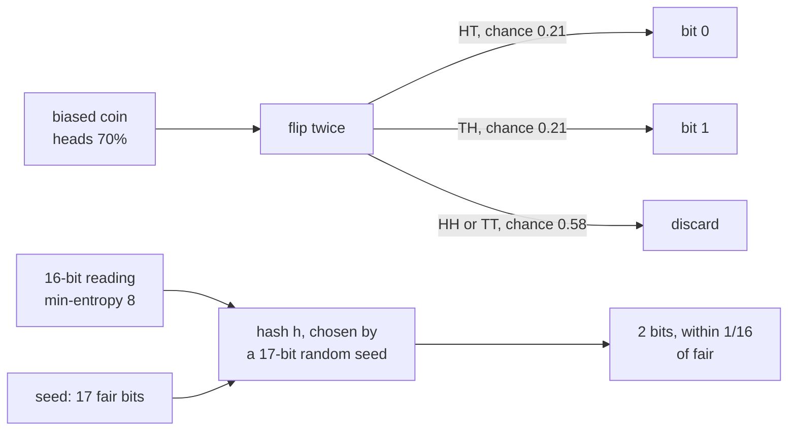
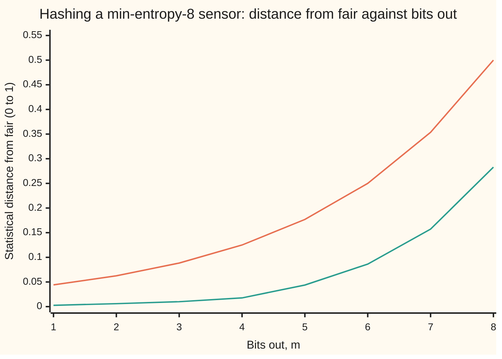

# Randomness extractors: squeeze nearly perfect coin flips out of a biased source

[Syllabus](../../../SYLLABUS.md) → [Computability and complexity](../README.md) → [Beyond Worst Case](../README.md#s04) → Randomness extractors

---

## General Overview

The rota programs on [BPP](03-randomised-complexity-and-bpp.md) and [Pseudorandomness](04-derandomisation-and-pseudorandomness.md) assume fair coins. Real hardware gives lopsided, lumpy bits instead.

Take a coin that lands heads 70% of the time. In 1951 von Neumann gave a rule that turns it into a fair coin. Flip it twice. Heads then tails gives 0. Tails then heads gives 1. Two heads or two tails give nothing, and the pair is thrown away.

The rule is exactly fair, with no approximation. Heads-then-tails has chance 0.7 × 0.3 = 0.21, and tails-then-heads has chance 0.3 × 0.7 = 0.21: the same two numbers multiplied in the other order. The price is waste. On average the coin yields 0.21 fair bits per flip.

A second source is harder. A sensor gives 16-bit readings, numbers from 0 to 65,535. No reading is more likely than 1 in 256, but the readings bunch together in a pattern nobody knows. There is no coin to flip twice.

The fix is to hash. Pick a hash function at random from a suitable family, using 17 truly random bits called the **seed**. Feed each reading in and keep 2 bits out. Those 2 bits land within **statistical distance** 1/16 of perfectly fair coins: no test, however slow, says "yes" to them at a rate more than 1/16 away from its rate on fair coins, on average over the seed.

**A randomness extractor turns a source that only promises "no outcome is too likely" into nearly fair bits: the promise is measured by min-entropy, no fixed rule works for every such source, and a short truly random seed fixes that, with a random hash giving about k − 2 log2(1/ε) fair bits from k bits of min-entropy.**

**What kind of fact this is:** theorems. Von Neumann's fairness, the impossibility of a seedless extractor, and the leftover hash lemma are proved on this card in Why it works. What explicit extractors achieve, and the lower bound on any extractor, are theorems stated with their sources.

### The picture: two ways to clean a weak source



---

## The formula

Notation first, in words. A **source** $`X`$ is a random string of $`n`$ bits; here $`n = 16`$. As on [BPP](03-randomised-complexity-and-bpp.md), $`\Pr[\cdot]`$ is a probability, since P names a class. $`U_m`$ is $`m`$ fair coins: the uniform spread over all $`2^m`$ strings of $`m`$ bits, not the universal machine $`U`$ of shelf 01.

The **min-entropy** of a source counts the bits of its most likely outcome:

```math
H_\infty(X) = -\log_2 \max_x \Pr[X = x]
```

**Read it aloud:** min-entropy is the number of fair coins whose every outcome is exactly as likely as the source's most likely value. Here $`H`$ is entropy, as on [Entropy](../../14-Applied%20and%20computational/03-Information%20Theory/01-entropy.md), not the Hadamard gate of shelf 05.

The sensor's top chance is 1/256, so its min-entropy is 8 bits. A source has min-entropy at least $`k`$ exactly when a best single guess of its value succeeds with chance at most $`2^{-k}`$.

The **statistical distance** between two spreads $`P`$ and $`Q`$ on the same outcomes is half the total gap, and it equals the best any test $`T`$ can do at telling them apart. Here $`P`$ and $`Q`$ are spreads of chance, not the class P:

```math
\Delta(P, Q) = \tfrac{1}{2} \sum_y \bigl\lvert P(y) - Q(y) \bigr\rvert = \max_T \bigl\lvert \Pr[T(P) = 1] - \Pr[T(Q) = 1] \bigr\rvert
```

**Read it aloud:** add up how far apart the two spreads are on every outcome and halve it; that is the largest gap in "yes" rates any test can find.

A **(k, ε)-extractor** is a rule $`\mathrm{Ext}(x, z)`$ taking an $`n`$-bit sample $`x`$ and a $`d`$-bit seed $`z`$ to $`m`$ bits, such that for every source with $`H_\infty(X) \ge k`$ and a fair seed $`Z`$, the output is within $`\varepsilon`$ of $`U_m`$. It is **strong** when the output stays that close even to someone who sees the seed. Here $`\varepsilon`$ is wing 14's allowance, not the empty string of shelf 01.

A family of functions $`h`$ from $`n`$ bits to $`m`$ bits is **universal** (also called 2-universal) when two different inputs collide rarely: $`\Pr_h[h(x) = h(x')] \le 2^{-m}`$ for every $`x \ne x'`$. The card's family is linear: a random $`2 \times 16`$ matrix of bits whose second row is its first row shifted by one place, called a **Toeplitz** matrix. Output bit $`j`$ is the parity (whether the count of 1s is odd) of row $`j`$ AND the reading (bitwise AND: 1 only where both have a 1). The matrix's 17 free bits are the seed.

The card's main formula is the **leftover hash lemma**:

```math
H_\infty(X) \ge k \;\Longrightarrow\; \Delta\bigl((h,\, h(X)),\; (h,\, U_m)\bigr) \;\le\; \tfrac{1}{2}\, 2^{-(k-m)/2}
```

**Read it aloud:** if no value of the source has chance above $`2^{-k}`$, then hashing it to $`m`$ bits with a random universal hash gives output within one half of $`2^{-(k-m)/2}`$ of fair coins, even to someone who knows which hash was used.

With $`k = 8`$ and $`m = 2`$, the bound is $`\tfrac{1}{2} \cdot 2^{-3} = 1/16`$. Turned around, for a target $`\varepsilon`$ the hash can output

```math
m = k - 2\log_2(1/\varepsilon) + 2 \ \text{bits}
```

**Read it aloud:** every halving of the allowed distance costs two bits of output.

Von Neumann's rule needs one line: for a coin with heads chance $`p`$ and tails chance $`q = 1 - p`$,

```math
\Pr[\text{HT}] = p\,q = q\,p = \Pr[\text{TH}], \qquad \text{fair bits per flip} = p\,q
```

| Symbol | Plain meaning | In our example | Push it up and the answer… |
| --- | --- | --- | --- |
| $`p`$, $`q`$ | the coin's chance of heads, and of tails | 0.7 and 0.3 | further from 0.5, fewer bits per flip: $`pq`$ falls |
| $`X`$, $`X'`$, $`x`$, $`x'`$, $`n`$, $`v`$, $`t`$ | the source and an independent copy; samples; length in bits; in the proof, the XOR of two samples and its highest 1 bit | a 16-bit reading, 32,768 + a − b, with noise a and b each uniform on 0 to 255 | — |
| $`H_\infty(X)`$, $`k`$ | min-entropy; the promised lower bound on it | 8 bits: top chance 1/256 | more bits can be extracted |
| $`H(X)`$ | Shannon entropy: the average of $`\log_2(1/\Pr[X = x])`$ | 8.7213 bits for the sensor | says nothing about the top chance |
| $`\mathrm{CP}(X)`$ | collision probability: chance two independent samples agree, $`\sum_x \Pr[X = x]^2`$ | 0.002604, 1 in 384 | the hash output is less even |
| $`h`$, $`j`$, $`c`$, $`s_c`$, $`\mathbb{E}_h`$ | the hash; an output bit's number; an output cell; the chance landing in cell $`c`$; the average over the hash | bit $`j`$ = parity of (row $`j`$ AND $`x`$); cells 00 to 11 | — |
| $`z`$, $`z_i`$, $`d`$, $`Z`$ | the seed, its bit number $`i`$, its length in bits, and a fair random seed | 17 bits; 131,072 seeds | more seeds to try in a derandomised run |
| $`m`$ | bits out | 2 | the output drifts further from fair |
| $`U_m`$ | $`m`$ fair coins | 2 fair coins: 00, 01, 10, 11 at 0.25 each | — |
| $`\Delta(P, Q)`$, $`y`$, $`T`$ | statistical distance between spreads $`P`$ and $`Q`$; an outcome; any test that answers 1 or 0 | 0.005054, average over all seeds | a test can tell more often |
| $`\varepsilon`$, $`\alpha`$ | the allowed distance; a fixed fraction of bits given up | 1/16 = 0.0625 | more bits allowed out |
| $`\mathrm{Ext}`$ | an extractor: sample and seed in, nearly fair bits out | the Toeplitz hash | — |

### When it holds

- **Von Neumann's flips are independent.** The proof multiplies chances, which needs independence. Reusing flips in overlapping pairs breaks it: the bits then alternate 0, 1, 0, 1, so each bit differs from the one before it, every time (share 1.0000).
- **Both flips of a pair have the same bias.** If the coin drifts from 0.7 to 0.6 between the two flips, a 0 comes out with chance 0.6087, not 0.5.
- **The seed is fair and chosen after the source is fixed.** A seed fixed in advance is just a fixed function, and some source with min-entropy 8 sends all its readings to 00: distance 0.7500.
- **The promise is min-entropy, not Shannon entropy.** A sensor stuck at 0 half the time has Shannon entropy 9.0000 bits but min-entropy 1.0000 bit, and its hashed output sits at distance 0.375 from fair.
- **The output is short enough.** Asking for all $`m = 8`$ bits from $`k = 8`$ leaves the bound at 0.5, which promises nothing useful; the sampled distance is 0.2829.

---

## Why it works

### Step 0: a weak source is many small chances; spread them evenly

A source with min-entropy $`k`$ has no outcome above $`2^{-k}`$. So its chance is spread across at least $`2^k`$ outcomes, in small pieces. If a rule sends those pieces evenly into $`2^m`$ output cells, each cell gets close to $`2^{-m}`$.

Two ideas deliver "evenly". For an independent coin, symmetry does it exactly: HT and TH are mirror images. For a general source, randomness in the rule does it on average: a random hash rarely sends two different inputs to the same cell, so it rarely piles chance up.

### Step 1: von Neumann's rule is exactly fair

Two independent flips give HT with chance $`p \cdot q`$ and TH with chance $`q \cdot p`$. Multiplication does not care about order, so the two are equal. Given that a bit comes out, it is 0 or 1 with chance 1/2 each, whatever $`p`$ is. The rule never needs to know $`p`$.

Successive bits are independent too, since they come from separate pairs of independent flips. In the simulation the next bit equals the last at share 0.4981.

The cost: a pair gives a bit with chance $`2pq`$ = 0.42, so each flip gives $`pq`$ = 0.21 bits on average. The checks simulate 200,000 flips and get 41,986 bits, 0.2099 per flip, with 1s at share 0.4955, within two standard errors of one half.

The coin holds more than that.

| Measure, per flip | Value |
| --- | ---: |
| von Neumann's rule | 0.2100 |
| min-entropy, $`-\log_2 0.7`$ | 0.5146 |
| Shannon entropy, $`H`$ of one flip | 0.8813 |

Peres (1992) showed that reapplying the rule to the discarded pairs, and to the pattern of which pairs were discarded, raises the rate toward the Shannon entropy, 0.8813 bits per flip, as the rounds grow. No rule can beat the Shannon entropy for a long run of independent flips, by the source coding theorem on [Entropy](../../14-Applied%20and%20computational/03-Information%20Theory/01-entropy.md).

### Step 2: why the measure is min-entropy

An extractor must work against the worst case, so its measure must see the worst case. Shannon entropy averages, and can hide one huge spike. A sensor stuck at 0 half the time, and otherwise uniform over the other 65,535 readings, has Shannon entropy 9.0000 bits. Yet half its output is one value.

Min-entropy reads the spike directly: $`-\log_2 0.5`$ = 1.0000 bit. That is the right count. Any rule sends the value 0 to one output cell, so that cell gets chance at least 1/2 against a fair 1/4, and the distance is at least 1/4. The checks find 0.375 on average over all seeds.

The card's sensor reads 32,768 + a − b, with a and b independent noise values, each uniform on 0 to 255. Its 511 readings peak at 32,768, with chance 256/65,536 = 1/256. So its min-entropy is exactly 8 bits; its Shannon entropy is 8.7213 bits.

### Step 3: no fixed rule works; a seed is needed

**Theorem.** For every fixed function $`f`$ from 16 bits to 2 bits, some source with min-entropy 8 makes $`f`$'s output constant.

The proof is counting. The 65,536 inputs fall into 4 output cells, so some cell holds at least 16,384 inputs; the worked seed sends exactly 16,384 to 00. Pick 256 of them and let the source be uniform on those. Its min-entropy is 8, and $`f`$ maps every sample to the same cell: distance $`1 - 1/4`$ = 0.75 from fair.

The checks show this twice.

- **Keep the low 2 bits.** A sensor whose two lowest bits are dead, stuck at 0, reads 12,288, 12,292, …, 13,308: 256 readings, min-entropy 8. All 256 land in cell 00.
- **Fix the card's own worked seed in advance.** That seed hashes the sensor perfectly evenly. Yet the 256 smallest readings it sends to 00 form a source of min-entropy 8 with distance 0.7500.

So an extractor needs a second input: a short seed of truly fair bits, chosen independently of the source. That is the gap a deterministic rule cannot cross, and it is why the definition has $`z`$.

### Step 4: the leftover hash lemma

First, the family. Output bit $`j`$ of the hash is the parity (odd or even count of 1s) of row $`j`$ AND the reading. Row 0 is seed bits 0 to 15; row 1 is seed bits 1 to 16.

**This Toeplitz family is universal.** For two different readings, the hash collides exactly when the matrix sends their XOR (bitwise difference) to 00. That happens for exactly 1/4 of the seeds.

<details>
<summary>Detailed proof: a random Toeplitz matrix sends any nonzero input to each output equally often</summary>

Let $`v \ne 0`$ be the XOR of the two readings, and let $`t`$ be its highest 1 bit, so $`t \le 15`$. Output bit 0 is the parity of the seed bits $`z_i`$ at the 1 bits $`i`$ of $`v`$. Output bit 1 is the parity of the seed bits $`z_{i+1}`$ at those same $`i`$.

Seed bit $`z_{t+1}`$ appears in bit 1 only: bit 0 uses seed bits up to $`z_t`$. Seed bit $`z_t`$ appears in bit 0. Fix every other seed bit. Flipping $`z_{t+1}`$ flips bit 1 alone. Flipping $`z_t`$ flips bit 0, and possibly bit 1.

So the four settings of $`(z_t, z_{t+1})`$ give the four outputs 00, 01, 10, 11 once each. Every other choice of the remaining 15 bits does the same. Each output therefore comes from exactly 1/4 of all $`2^{17}`$ seeds, and the collision chance is exactly $`2^{-2}`$.

</details>

**Theorem (leftover hash lemma).** If $`h`$ is drawn from a universal family into $`m`$ bits and $`H_\infty(X) \ge k`$, then on average over $`h`$ the distance of $`h(X)`$ from $`U_m`$ is at most $`\tfrac{1}{2}\sqrt{(2^m - 1)\,\mathrm{CP}(X)}`$, which is at most $`\tfrac{1}{2} \, 2^{-(k-m)/2}`$.

The proof has three moves.

1. **Count collisions.** Run the source twice independently. The two hashed outputs agree if the samples agree, chance $`\mathrm{CP}(X)`$, or if they differ but collide, chance at most $`2^{-m}`$.
2. **Collisions measure unevenness.** A spread over $`2^m`$ cells has collision chance $`2^{-m}`$ when it is even, and more by exactly its sum of squared gaps from even.
3. **Squared gaps bound the distance.** Cauchy–Schwarz (a sum of products is at most the product of the square roots of the sums of squares) turns a sum of squares into a bound on the sum of absolute gaps, which is twice the distance.

<details>
<summary>Detailed proof: the leftover hash lemma, from collisions to distance</summary>

Fix a hash $`h`$ and write $`s_c = \Pr[h(X) = c]`$ for each of the $`2^m`$ cells $`c`$. Let $`X'`$ be an independent copy of $`X`$. Then $`\sum_c s_c^2 = \Pr[h(X) = h(X')]`$.

Average over the random $`h`$. The samples agree with chance $`\mathrm{CP}(X)`$; otherwise universality caps the collision at $`2^{-m}`$:

$`\displaystyle \mathbb{E}_h \sum_c s_c^2 \le \mathrm{CP}(X) + \bigl(1 - \mathrm{CP}(X)\bigr)\, 2^{-m}.`$

The gaps from even satisfy $`\sum_c (s_c - 2^{-m})^2 = \sum_c s_c^2 - 2^{-m}`$, since the $`s_c`$ add to 1. By Cauchy–Schwarz over the $`2^m`$ cells,

$`\displaystyle \Delta\bigl(h(X), U_m\bigr) = \tfrac{1}{2} \sum_c \lvert s_c - 2^{-m} \rvert \le \tfrac{1}{2} \sqrt{2^m \sum_c (s_c - 2^{-m})^2} = \tfrac{1}{2} \sqrt{2^m \sum_c s_c^2 - 1}.`$

The square root bends downward, so its average is at most the root of the average (Jensen's inequality). Insert the collision bound:

$`\displaystyle \mathbb{E}_h\, \Delta\bigl(h(X), U_m\bigr) \le \tfrac{1}{2} \sqrt{2^m\,\mathrm{CP}(X) + 1 - \mathrm{CP}(X) - 1} = \tfrac{1}{2} \sqrt{(2^m - 1)\,\mathrm{CP}(X)}.`$

Finally $`\mathrm{CP}(X) = \sum_x \Pr[X = x]^2 \le \max_x \Pr[X = x] = 2^{-k}`$, and $`2^m - 1 < 2^m`$. The average over $`h`$ of the distance of $`h(X)`$ from fair equals the distance of the pair $`(h, h(X))`$ from $`(h, U_m)`$, which is the strong form.

</details>

On the sensor, with $`m = 2`$, the numbers stack up like this.

| Quantity | Value |
| --- | ---: |
| bound from min-entropy, $`\tfrac{1}{2} \, 2^{-3}`$ | 0.062500 |
| bound from collision probability, $`\tfrac{1}{2}\sqrt{3/384}`$ | 0.044194 |
| exact average over all 131,072 seeds | 0.005054 |
| worst seed (the all-zero matrix) | 0.750000 |
| seeds whose own distance exceeds 1/16 | 1,920, which is 1.46% |

The bound is true and loose: this sensor is smoother than the worst source with min-entropy 8. The worst seed shows that the promise is an average over seeds, not a promise for each seed.

The checks confirm universality exactly: summed over every seed, the squared cell weights come to 2,269,392,133,947,392, as the collision count predicts. A direct count over all 511 readings matches on 200 sampled seeds.

More bits out cost closeness. The bound doubles for every two extra bits, and the sampled distance climbs with it:



Orange: the leftover hash lemma's bound $`\tfrac{1}{2} \, 2^{-(8-m)/2}`$. Green: the average distance over 1,000 sampled Toeplitz seeds, each computed exactly.

### Step 5: what explicit extractors achieve

The hash works, but its seed is long: 17 bits to extract 2. Because the extractor is strong, the seed can be published and reused for independent readings. But a seed as long as the input spoils one main use: trying every seed.

That use is running a [BPP](03-randomised-complexity-and-bpp.md) program on a weak source. Draw one sample, run the program once for every seed $`z`$, using $`\mathrm{Ext}(x, z)`$ as its coins, and take the majority vote. This is the vote over seeds of [Pseudorandomness](04-derandomisation-and-pseudorandomness.md), with the extractor in place of the generator. With a seed of $`O(\log n)`$ bits that is polynomially many runs.

How short can the seed be? These are the known answers, stated with sources.

| Construction | Seed length $`d`$ | Bits out $`m`$ |
| --- | --- | --- |
| Universal hashing (leftover hash lemma) | about $`n`$ | $`k - 2\log_2(1/\varepsilon) + 2`$ |
| Trevisan (2001), constant $`\varepsilon`$ | $`O(\log^2 n / \log k)`$; $`O(\log n)`$ when $`k`$ is a fixed power of $`n`$ | $`k^{1 - \alpha}`$, any fixed $`\alpha > 0`$ |
| Guruswami, Umans and Vadhan (2009) | $`O(\log n + \log(1/\varepsilon))`$ | $`(1 - \alpha)\,k`$, any fixed $`\alpha > 0`$ |
| Lower bound for any extractor (Radhakrishnan and Ta-Shma, 2000) | at least $`\log_2(n - k) + 2\log_2(1/\varepsilon) - O(1)`$ | at most $`k + d - 2\log_2(1/\varepsilon) + O(1)`$ |

The last row says a loss of about $`2\log_2(1/\varepsilon)`$ bits is unavoidable. Hashing is optimal in output and wasteful only in seed. The 2009 construction is optimal in both, up to constant factors.

**Trevisan's idea links extractors to pseudorandom generators.** The Nisan–Wigderson generator on [Pseudorandomness](04-derandomisation-and-pseudorandomness.md) reads a hard function at many overlapping chunks of a seed. Trevisan fed it the sample itself, spread by an error-correcting code (a stretching that lets a damaged copy be repaired), as the "hard function".

- If some test told the output from fair coins, the generator's proof would rebuild the sample from the test plus a few advice bits (extra hints fixed in advance).
- So every sample that fails the test has a short description.
- A short description fits only a few samples, and a source with high min-entropy puts little chance on any few samples.

So the output is close to fair against every test. A proof about computers fooling fast tests became a proof about extractors fooling all tests.

---

## Worked numbers, by hand

The coin first, then the sensor and one seed.

| Step | Arithmetic | Value |
| --- | --- | --- |
| HH, HT, TH, TT | 0.7 × 0.7, 0.7 × 0.3, 0.3 × 0.7, 0.3 × 0.3 | 0.49, 0.21, 0.21, 0.09 |
| a pair gives a bit | 0.21 + 0.21 | 0.42 |
| chance the bit is 1 | 0.21 / 0.42 | 0.5000 |
| fair bits per flip | 0.42 / 2 | **0.21** |
| first 12 simulated flips | TH, HH, TT, TT, HH, HT | bits 1, 0 |
| sensor's top chance | 256 / 65,536 | 1/256: min-entropy 8 |
| distance bound, 2 bits out | ½ × 2 to the power −(8 − 2)/2 = ½ × 1/8 | **1/16 = 0.0625** |
| worked seed | 1 0110 0100 1100 0101 (17 bits) | rows 0110010011000101 and 1011001001100010 |
| reading 32,805 | 1000000000100101 AND row 0 = 0000000000000101: two 1s | bit 0 is 0 |
| same reading | 1000000000100101 AND row 1 = 1000000000100000: two 1s | bit 1 is 0: cell 00 |
| worked seed, all readings | weight per cell out of 65,536 | 16,384 each: distance 0 |
| all 131,072 seeds | exact average | 0.005054 |

The coin gives exactly fair bits at 0.21 per flip. The sensor's 2 hashed bits sit, on average over the seed, 0.005054 from fair, well inside the promised 1/16.

### What breaks if you drop a piece

| Mistake | Comes out at | What went wrong |
| --- | --- | --- |
| Von Neumann on overlapping pairs (flips 1–2, 2–3, …) | each bit differs from the last with share 1.0000 | a bit marks a switch between H and T, and switches alternate H-to-T and T-to-H |
| Bias drifts from 0.7 to 0.6 inside each pair | a 0 comes out with chance 0.6087 | HT is 0.7 × 0.4 = 0.28, TH is 0.3 × 0.6 = 0.18 |
| A fixed rule, no seed: keep the low 2 bits | dead-bit sensor: all 256 readings in 00, distance 0.7500 | some source with min-entropy 8 defeats every fixed rule |
| Shannon entropy taken as the promise | stuck sensor: 9.0000 bits, yet distance 0.375 | min-entropy is 1 bit; the spike at 0 fills one cell |

The code prints all four.

---

## Code, from first principles, and it actually runs

The code imports only `log2` and `sqrt`. It takes four roads. Von Neumann's rule is computed exactly, then simulated on 200,000 flips from SplitMix64 with seed 2026. For the hash, a Walsh–Hadamard transform (one pass that computes, for every row pattern, the source's even-minus-odd parity balance) gives exact cell weights for all 131,072 seeds. A direct count over the 511 readings checks it on 200 sampled seeds. The universality identity checks the total of squared weights exactly, and the leftover hash lemma's bound is checked at every output length.

### Python

```python
# Randomness extractors -- the check behind the card.  Standard library only.
# Part 1: von Neumann's trick on a coin that lands heads 70% of the time.
# Part 2: 16-bit sensor readings with min-entropy 8, hashed to 2 bits by a random
# Toeplitz matrix (a 17-bit seed), measured against the leftover hash lemma.
from math import log2, sqrt
MASK, N16 = (1 << 64) - 1, 1 << 16

class SplitMix64:                            # small seeded generator, written out
    def __init__(self, seed):
        self.s = seed
    def next(self):
        self.s = (self.s + 0x9E3779B97F4A7C15) & MASK
        z = self.s
        z = ((z ^ (z >> 30)) * 0xBF58476D1CE4E5B9) & MASK
        z = ((z ^ (z >> 27)) * 0x94D049BB133111EB) & MASK
        return z ^ (z >> 31)

def flips(rng, n, p1, p2):                   # n coin flips, 1 = heads; odd flips use p1, even p2
    return [1 if (rng.next() >> 11) / 2.0 ** 53 < (p1 if i % 2 == 0 else p2) else 0 for i in range(n)]

def von_neumann(f, step):                    # pairs (f[i], f[i+1]); HT -> 0, TH -> 1, else nothing
    return [f[i + 1] for i in range(0, len(f) - 1, step) if f[i] != f[i + 1]]

def parity(v):                               # 1 if v has an odd number of 1 bits
    p = 0
    while v:
        p ^= v & 1
        v >>= 1
    return p

def wht(a, size):                            # Walsh-Hadamard: out[r] = sum_x a[x] * (-1)^parity(r AND x)
    a, h = a[:], 1
    while h < size:
        for i in range(0, size, 2 * h):
            for j in range(i, i + h):
                a[j], a[j + h] = a[j] + a[j + h], a[j] - a[j + h]
        h *= 2
    return a

def cells(F, z, m):                          # 2^m * weight landing in each output cell, Toeplitz seed z
    rows = [(z >> j) & 0xFFFF for j in range(m)]
    comb = [0] * (1 << m)
    for S in range(1, 1 << m):               # each mix of rows, XORed together
        low = S & -S
        comb[S] = comb[S ^ low] ^ rows[low.bit_length() - 1]
    return wht([F[c] for c in comb], 1 << m)

def dist(c, W, m):                           # statistical distance of the cells from uniform
    return sum(abs(v - W) for v in c) / (2 * W * (1 << m))

print("PART 1: a coin with Pr[heads] = 0.7")
p, q = 0.7, 0.3
print(f"one pair: HH {p * p:.4f}, HT {p * q:.4f}, TH {q * p:.4f}, TT {q * q:.4f}, discarded {p * p + q * q:.4f}")
print(f"von Neumann, exact: a pair gives a bit with chance {2 * p * q:.4f}; Pr[bit = 1] = {q * p / (2 * p * q):.4f}; bits per flip {p * q:.4f}")
print(f"per flip: min-entropy {-log2(p):.4f} bits, Shannon entropy {-(p * log2(p) + q * log2(q)):.4f} bits")
f = flips(SplitMix64(2026), 200000, p, p)
print("first 12 flips: " + "".join("H" if b else "T" for b in f[:12]) + " -> bits " + "".join(map(str, von_neumann(f[:12], 2))))
out = von_neumann(f, 2)
se = sqrt(0.25 / len(out))
print(f"simulated, 200000 flips, seed 2026: {len(out)} bits, {len(out) / 200000:.4f} per flip, share of 1s {sum(out) / len(out):.4f}, standard error {se:.4f}")
same = sum(out[i] == out[i + 1] for i in range(len(out) - 1)) / (len(out) - 1)
print(f"simulated: next bit equals the last one with share {same:.4f} (fair coins: 0.5000)")
ov = von_neumann(f, 1)
alt = sum(ov[i] != ov[i + 1] for i in range(len(ov) - 1)) / (len(ov) - 1)
print(f"mistake, overlapping pairs: {len(ov)} bits, each bit differs from the last with share {alt:.4f}")
dr_exact = p * 0.4 / (p * 0.4 + q * 0.6)
dr = von_neumann(flips(SplitMix64(7), 200000, 0.7, 0.6), 2)
dr_se = sqrt(dr_exact * (1 - dr_exact) / len(dr))
print(f"mistake, bias drifts 0.7 then 0.6 inside a pair: HT {p * 0.4:.4f}, TH {q * 0.6:.4f}, Pr[bit = 0] exact {dr_exact:.4f}, simulated {1 - sum(dr) / len(dr):.4f}")

print("PART 2: 16-bit readings = 32768 + a - b, with a, b uniform on 0..255")
w = [0] * N16
for d in range(-255, 256):
    w[32768 + d] = 256 - abs(d)              # chance (256 - |d|) / 65536
W, sq = sum(w), sum(v * v for v in w)
print(f"readings {sum(v > 0 for v in w)}, most likely chance {max(w)}/{W} = 1/{W // max(w)}, min-entropy {-log2(max(w) / W):.4f} bits")
print(f"collision probability {sq / W ** 2:.6f} = 1/{W ** 2 / sq:.1f}, Shannon entropy {-sum(v / W * log2(v / W) for v in w if v):.4f} bits")
F = wht(w, N16)
z0, x0 = 0b10110010011000101, 32768 + 37
r0, r1 = z0 & 0xFFFF, (z0 >> 1) & 0xFFFF
print(f"worked seed {z0:017b}: row 0 {r0:016b}, row 1 {r1:016b}")
print(f"reading {x0} = {x0:016b}: AND row 0 has {bin(r0 & x0).count('1')} ones, AND row 1 has {bin(r1 & x0).count('1')} ones -> output {parity(r1 & x0)}{parity(r0 & x0)}")
c0 = cells(F, z0, 2)
print(f"worked seed: weight in cells 00, 01, 10, 11 = {[v // 4 for v in c0]} of {W}, distance {dist(c0, W, 2):.6f}")
tot, worst, over, sumsq = 0, 0, 0, 0
for z in range(1 << 17):                     # every seed of the family, by the Fourier road
    c = cells(F, z, 2)
    s = sum(abs(v - W) for v in c)
    tot, worst, over, sumsq = tot + s, max(worst, s), over + (2 * s > W), sumsq + sum(v * v for v in c)
avg2, bound2, cpb = tot / (8 * W * (1 << 17)), 0.5 * 2.0 ** (-(8 - 2) / 2), 0.5 * sqrt(3 * sq / W ** 2)
print(f"all 131072 seeds, m = 2: average distance {avg2:.6f}, worst {worst / (8 * W):.6f}, seeds above 1/16: {over} ({100 * over / (1 << 17):.2f}%)")
print(f"leftover hash lemma: min-entropy bound {bound2:.6f}, collision-probability bound {cpb:.6f}")
pred = (1 << 17) * (12 * sq + 4 * W * W)     # universality: average of sum of squares, predicted
print(f"universality: sum over seeds of squared cell weights {sumsq}, predicted {pred}: {'equal' if sumsq == pred else 'different'}")
rng, agree, sup = SplitMix64(11), 0, [x for x in range(N16) if w[x]]
for _ in range(200):                         # direct count over the 511 readings, no Fourier
    z = rng.next() >> 47
    direct = [0] * 4
    for x in sup:
        direct[2 * parity(((z >> 1) & 0xFFFF) & x) + parity((z & 0xFFFF) & x)] += w[x]
    agree += [4 * v for v in direct] == cells(F, z, 2)
print(f"direct count against Fourier road, 200 sampled seeds: {agree} agree")
print("m | bound 0.5 * 2^(-(8 - m)/2) | sampled average over 1000 seeds")
sweep, bnds, rng = [], [], SplitMix64(5)
for m in range(1, 9):
    vals = [dist(cells(F, rng.next() >> (64 - 15 - m), m), W, m) for _ in range(1000)]
    sweep.append(sum(vals) / 1000)
    bnds.append(0.5 * 2.0 ** (-(8 - m) / 2))
    print(f"{m} | {bnds[-1]:.4f} | {sweep[-1]:.4f}")
print("figure, bound: " + ", ".join(f"{b:.4f}" for b in bnds))
print("figure, sampled: " + ", ".join(f"{s:.4f}" for s in sweep))
dead = [1 if 0x3000 <= x < 0x3400 and x % 4 == 0 else 0 for x in range(N16)]
fixed = [sum(dead[x] for x in range(N16) if x & 3 == c) for c in range(4)]
print(f"mistake, dead low bits (readings 12288, 12292, ..., 13308) with fixed 'keep the low 2 bits': cells {fixed}, distance {sum(abs(4 * v - 256) for v in fixed) / 2048:.4f}")
Fd = wht(dead, N16)
avgd = sum(dist(cells(Fd, z, 2), 256, 2) for z in range(1 << 17)) / (1 << 17)
print(f"same dead-bit readings, random seed: average distance {avgd:.6f}")
bad = (to00 := [x for x in range(N16) if parity(r0 & x) == 0 and parity(r1 & x) == 0])[:256]
bw = [0] * N16
for x in bad:
    bw[x] = 1
print(f"mistake, worked seed fixed in advance: it sends {len(to00)} readings to 00; the first 256 as a source, distance {dist(cells(wht(bw, N16), z0, 2), 256, 2):.4f}")
st = [1] * N16
st[0] = N16 - 1                              # stuck at 0 half the time, else any other reading
Ws = sum(st)
Hs = -sum(v / Ws * log2(v / Ws) for v in st)
Fs = wht(st, N16)
avgs = sum(dist(cells(Fs, z, 2), Ws, 2) for z in range(1 << 17)) / (1 << 17)
print(f"mistake, stuck sensor: Shannon entropy {Hs:.4f} bits, min-entropy {-log2(st[0] / Ws):.4f} bits, average distance {avgs:.6f}")
print(f"real size: k = 256 bits, eps = 2^-64 -> m = 256 - 2 * 64 + 2 = {256 - 128 + 2} bits")
assert abs(len(out) / 200000 - p * q) < 4 * sqrt(p * q / 200000)        # simulated rate against pq
assert abs(sum(out) / len(out) - 0.5) < 4 * se                          # simulated bits against exact 1/2
assert alt == 1.0                                                       # overlapping pairs alternate
assert abs(1 - sum(dr) / len(dr) - dr_exact) < 4 * dr_se                # drift: simulation against formula
assert sumsq == pred and agree == 200                                   # universality identity; two roads agree
assert avg2 <= cpb <= bound2 and abs(sweep[1] - avg2) < 0.003            # bound holds; sampling meets exact
assert all(s <= b for s, b in zip(sweep, bnds))                         # bound holds at every m
assert fixed == [256, 0, 0, 0] and len(bad) == 256 and avgs > 0.25      # no seed, or low min-entropy: fails
assert W == 256 * max(w) and sq == 256 ** 2 + 255 * 256 * 511 // 3     # min-entropy 8; sum of squares by formula
print("ALL CHECKS PASS")
```

**Ran 2026-11-24 on macOS, Python 3.14.10, standard library only. All checks passed. Output, pasted from the run:**

```
PART 1: a coin with Pr[heads] = 0.7
one pair: HH 0.4900, HT 0.2100, TH 0.2100, TT 0.0900, discarded 0.5800
von Neumann, exact: a pair gives a bit with chance 0.4200; Pr[bit = 1] = 0.5000; bits per flip 0.2100
per flip: min-entropy 0.5146 bits, Shannon entropy 0.8813 bits
first 12 flips: THHHTTTTHHHT -> bits 10
simulated, 200000 flips, seed 2026: 41986 bits, 0.2099 per flip, share of 1s 0.4955, standard error 0.0024
simulated: next bit equals the last one with share 0.4981 (fair coins: 0.5000)
mistake, overlapping pairs: 83783 bits, each bit differs from the last with share 1.0000
mistake, bias drifts 0.7 then 0.6 inside a pair: HT 0.2800, TH 0.1800, Pr[bit = 0] exact 0.6087, simulated 0.6030
PART 2: 16-bit readings = 32768 + a - b, with a, b uniform on 0..255
readings 511, most likely chance 256/65536 = 1/256, min-entropy 8.0000 bits
collision probability 0.002604 = 1/384.0, Shannon entropy 8.7213 bits
worked seed 10110010011000101: row 0 0110010011000101, row 1 1011001001100010
reading 32805 = 1000000000100101: AND row 0 has 2 ones, AND row 1 has 2 ones -> output 00
worked seed: weight in cells 00, 01, 10, 11 = [16384, 16384, 16384, 16384] of 65536, distance 0.000000
all 131072 seeds, m = 2: average distance 0.005054, worst 0.750000, seeds above 1/16: 1920 (1.46%)
leftover hash lemma: min-entropy bound 0.062500, collision-probability bound 0.044194
universality: sum over seeds of squared cell weights 2269392133947392, predicted 2269392133947392: equal
direct count against Fourier road, 200 sampled seeds: 200 agree
m | bound 0.5 * 2^(-(8 - m)/2) | sampled average over 1000 seeds
1 | 0.0442 | 0.0027
2 | 0.0625 | 0.0060
3 | 0.0884 | 0.0100
4 | 0.1250 | 0.0177
5 | 0.1768 | 0.0438
6 | 0.2500 | 0.0863
7 | 0.3536 | 0.1572
8 | 0.5000 | 0.2829
figure, bound: 0.0442, 0.0625, 0.0884, 0.1250, 0.1768, 0.2500, 0.3536, 0.5000
figure, sampled: 0.0027, 0.0060, 0.0100, 0.0177, 0.0438, 0.0863, 0.1572, 0.2829
mistake, dead low bits (readings 12288, 12292, ..., 13308) with fixed 'keep the low 2 bits': cells [256, 0, 0, 0], distance 0.7500
same dead-bit readings, random seed: average distance 0.004395
mistake, worked seed fixed in advance: it sends 16384 readings to 00; the first 256 as a source, distance 0.7500
mistake, stuck sensor: Shannon entropy 9.0000 bits, min-entropy 1.0000 bits, average distance 0.375000
real size: k = 256 bits, eps = 2^-64 -> m = 256 - 2 * 64 + 2 = 130 bits
ALL CHECKS PASS
```

### Rust

Same numbers, same labels, built with `rustc --edition 2021 -O`.

```rust
// Randomness extractors -- the same check as the Python, in Rust.  No crates.
// Part 1: von Neumann's trick on a coin that lands heads 70% of the time.
// Part 2: 16-bit sensor readings with min-entropy 8, hashed to 2 bits by a random
// Toeplitz matrix (a 17-bit seed), measured against the leftover hash lemma.
const N16: usize = 1 << 16;

struct SplitMix64 { s: u64 }                         // small seeded generator, written out
impl SplitMix64 {
    fn next(&mut self) -> u64 {
        self.s = self.s.wrapping_add(0x9E3779B97F4A7C15);
        let mut z = self.s;
        z = (z ^ (z >> 30)).wrapping_mul(0xBF58476D1CE4E5B9);
        z = (z ^ (z >> 27)).wrapping_mul(0x94D049BB133111EB);
        z ^ (z >> 31)
    }
}

fn flips(rng: &mut SplitMix64, n: usize, p1: f64, p2: f64) -> Vec<u8> {   // 1 = heads
    (0..n).map(|i| {
        let u = (rng.next() >> 11) as f64 / 9007199254740992.0;
        if u < (if i % 2 == 0 { p1 } else { p2 }) { 1 } else { 0 }
    }).collect()
}

fn von_neumann(f: &[u8], step: usize) -> Vec<u8> {   // HT -> 0, TH -> 1, else nothing
    let mut out = Vec::new();
    let mut i = 0;
    while i + 1 < f.len() {
        if f[i] != f[i + 1] { out.push(f[i + 1]); }
        i += step;
    }
    out
}

fn parity(v: usize) -> usize { (v.count_ones() & 1) as usize }

fn wht(a: &[i64], size: usize) -> Vec<i64> {         // out[r] = sum_x a[x] * (-1)^parity(r AND x)
    let mut a = a.to_vec();
    let mut h = 1;
    while h < size {
        for i in (0..size).step_by(2 * h) {
            for j in i..i + h { let (x, y) = (a[j], a[j + h]); a[j] = x + y; a[j + h] = x - y; }
        }
        h *= 2;
    }
    a
}

fn cells(f: &[i64], z: usize, m: usize) -> Vec<i64> { // 2^m * weight in each output cell
    let rows: Vec<usize> = (0..m).map(|j| (z >> j) & 0xFFFF).collect();
    let mut comb = vec![0usize; 1 << m];
    for s in 1..(1usize << m) {
        let low = s & s.wrapping_neg();
        comb[s] = comb[s ^ low] ^ rows[low.trailing_zeros() as usize];
    }
    let vals: Vec<i64> = comb.iter().map(|&c| f[c]).collect();
    wht(&vals, 1 << m)
}

fn dist(c: &[i64], w: i64, m: usize) -> f64 {
    c.iter().map(|&v| (v - w).abs()).sum::<i64>() as f64 / (2 * w * (1i64 << m)) as f64
}

fn bits(v: &[u8]) -> String { v.iter().map(|b| b.to_string()).collect() }
fn join(v: &[f64]) -> String { v.iter().map(|x| format!("{:.4}", x)).collect::<Vec<_>>().join(", ") }
fn share(v: &[u8]) -> f64 { v.iter().map(|&b| b as f64).sum::<f64>() / v.len() as f64 }

fn main() {
    println!("PART 1: a coin with Pr[heads] = 0.7");
    let (p, q) = (0.7f64, 0.3f64);
    println!("one pair: HH {:.4}, HT {:.4}, TH {:.4}, TT {:.4}, discarded {:.4}", p * p, p * q, q * p, q * q, p * p + q * q);
    println!("von Neumann, exact: a pair gives a bit with chance {:.4}; Pr[bit = 1] = {:.4}; bits per flip {:.4}", 2.0 * p * q, q * p / (2.0 * p * q), p * q);
    println!("per flip: min-entropy {:.4} bits, Shannon entropy {:.4} bits", -p.log2(), -(p * p.log2() + q * q.log2()));
    let f = flips(&mut SplitMix64 { s: 2026 }, 200000, p, p);
    let hs: String = f[..12].iter().map(|&b| if b == 1 { 'H' } else { 'T' }).collect();
    println!("first 12 flips: {} -> bits {}", hs, bits(&von_neumann(&f[..12], 2)));
    let out = von_neumann(&f, 2);
    let se = (0.25 / out.len() as f64).sqrt();
    println!("simulated, 200000 flips, seed 2026: {} bits, {:.4} per flip, share of 1s {:.4}, standard error {:.4}", out.len(), out.len() as f64 / 200000.0, share(&out), se);
    let same = (0..out.len() - 1).filter(|&i| out[i] == out[i + 1]).count() as f64 / (out.len() - 1) as f64;
    println!("simulated: next bit equals the last one with share {:.4} (fair coins: 0.5000)", same);
    let ov = von_neumann(&f, 1);
    let alt = (0..ov.len() - 1).filter(|&i| ov[i] != ov[i + 1]).count() as f64 / (ov.len() - 1) as f64;
    println!("mistake, overlapping pairs: {} bits, each bit differs from the last with share {:.4}", ov.len(), alt);
    let dr_exact = p * 0.4 / (p * 0.4 + q * 0.6);
    let dr = von_neumann(&flips(&mut SplitMix64 { s: 7 }, 200000, 0.7, 0.6), 2);
    let dr_se = (dr_exact * (1.0 - dr_exact) / dr.len() as f64).sqrt();
    println!("mistake, bias drifts 0.7 then 0.6 inside a pair: HT {:.4}, TH {:.4}, Pr[bit = 0] exact {:.4}, simulated {:.4}", p * 0.4, q * 0.6, dr_exact, 1.0 - share(&dr));

    println!("PART 2: 16-bit readings = 32768 + a - b, with a, b uniform on 0..255");
    let mut w = vec![0i64; N16];
    for d in -255i64..256 { w[(32768 + d) as usize] = 256 - d.abs(); }
    let ww: i64 = w.iter().sum();
    let sq: i64 = w.iter().map(|v| v * v).sum();
    let mx = *w.iter().max().unwrap();
    println!("readings {}, most likely chance {}/{} = 1/{}, min-entropy {:.4} bits", w.iter().filter(|&&v| v > 0).count(), mx, ww, ww / mx, -(mx as f64 / ww as f64).log2());
    let hsh: f64 = -w.iter().filter(|&&v| v > 0).map(|&v| { let r = v as f64 / ww as f64; r * r.log2() }).sum::<f64>();
    println!("collision probability {:.6} = 1/{:.1}, Shannon entropy {:.4} bits", sq as f64 / (ww * ww) as f64, (ww * ww) as f64 / sq as f64, hsh);
    let ff = wht(&w, N16);
    let (z0, x0) = (0b10110010011000101usize, 32768usize + 37);
    let (r0, r1) = (z0 & 0xFFFF, (z0 >> 1) & 0xFFFF);
    println!("worked seed {:017b}: row 0 {:016b}, row 1 {:016b}", z0, r0, r1);
    println!("reading {} = {:016b}: AND row 0 has {} ones, AND row 1 has {} ones -> output {}{}", x0, x0, (r0 & x0).count_ones(), (r1 & x0).count_ones(), parity(r1 & x0), parity(r0 & x0));
    let c0 = cells(&ff, z0, 2);
    println!("worked seed: weight in cells 00, 01, 10, 11 = {:?} of {}, distance {:.6}", c0.iter().map(|v| v / 4).collect::<Vec<_>>(), ww, dist(&c0, ww, 2));
    let (mut tot, mut worst, mut over, mut sumsq) = (0i64, 0i64, 0usize, 0i64);
    for z in 0..(1usize << 17) {                     // every seed of the family, by the Fourier road
        let c = cells(&ff, z, 2);
        let s: i64 = c.iter().map(|&v| (v - ww).abs()).sum();
        tot += s; worst = worst.max(s); if 2 * s > ww { over += 1; }
        sumsq += c.iter().map(|v| v * v).sum::<i64>();
    }
    let avg2 = tot as f64 / (8 * ww * (1 << 17)) as f64;
    let bound2 = 0.5 * 2f64.powf(-(8.0 - 2.0) / 2.0);
    let cpb = 0.5 * (3.0 * sq as f64 / (ww * ww) as f64).sqrt();
    println!("all 131072 seeds, m = 2: average distance {:.6}, worst {:.6}, seeds above 1/16: {} ({:.2}%)", avg2, worst as f64 / (8 * ww) as f64, over, 100.0 * over as f64 / (1 << 17) as f64);
    println!("leftover hash lemma: min-entropy bound {:.6}, collision-probability bound {:.6}", bound2, cpb);
    let pred = (1i64 << 17) * (12 * sq + 4 * ww * ww);
    println!("universality: sum over seeds of squared cell weights {}, predicted {}: {}", sumsq, pred, if sumsq == pred { "equal" } else { "different" });
    let mut rng = SplitMix64 { s: 11 };
    let sup: Vec<usize> = (0..N16).filter(|&x| w[x] > 0).collect();
    let mut agree = 0;
    for _ in 0..200 {                                // direct count over the 511 readings, no Fourier
        let z = (rng.next() >> 47) as usize;
        let mut direct = vec![0i64; 4];
        for &x in &sup { direct[2 * parity(((z >> 1) & 0xFFFF) & x) + parity((z & 0xFFFF) & x)] += w[x]; }
        if direct.iter().map(|v| 4 * v).collect::<Vec<_>>() == cells(&ff, z, 2) { agree += 1; }
    }
    println!("direct count against Fourier road, 200 sampled seeds: {} agree", agree);
    println!("m | bound 0.5 * 2^(-(8 - m)/2) | sampled average over 1000 seeds");
    let (mut sweep, mut bnds, mut rng) = (Vec::new(), Vec::new(), SplitMix64 { s: 5 });
    for m in 1..=8usize {
        let mut sum = 0.0;
        for _ in 0..1000 { sum += dist(&cells(&ff, (rng.next() >> (64 - 15 - m)) as usize, m), ww, m); }
        sweep.push(sum / 1000.0);
        bnds.push(0.5 * 2f64.powf(-(8.0 - m as f64) / 2.0));
        println!("{} | {:.4} | {:.4}", m, bnds[m - 1], sweep[m - 1]);
    }
    println!("figure, bound: {}", join(&bnds));
    println!("figure, sampled: {}", join(&sweep));
    let dead: Vec<i64> = (0..N16).map(|x| if (0x3000..0x3400).contains(&x) && x % 4 == 0 { 1 } else { 0 }).collect();
    let fixed: Vec<i64> = (0..4).map(|c| (0..N16).filter(|&x| x & 3 == c).map(|x| dead[x]).sum()).collect();
    println!("mistake, dead low bits (readings 12288, 12292, ..., 13308) with fixed 'keep the low 2 bits': cells {:?}, distance {:.4}", fixed, fixed.iter().map(|&v| (4 * v - 256).abs()).sum::<i64>() as f64 / 2048.0);
    let fd = wht(&dead, N16);
    let avgd = (0..(1usize << 17)).map(|z| dist(&cells(&fd, z, 2), 256, 2)).sum::<f64>() / (1 << 17) as f64;
    println!("same dead-bit readings, random seed: average distance {:.6}", avgd);
    let to00: Vec<usize> = (0..N16).filter(|&x| parity(r0 & x) == 0 && parity(r1 & x) == 0).collect();
    let bad: Vec<usize> = to00[..256].to_vec();
    let mut bw = vec![0i64; N16];
    for &x in &bad { bw[x] = 1; }
    println!("mistake, worked seed fixed in advance: it sends {} readings to 00; the first 256 as a source, distance {:.4}", to00.len(), dist(&cells(&wht(&bw, N16), z0, 2), 256, 2));
    let mut st = vec![1i64; N16];
    st[0] = N16 as i64 - 1;                          // stuck at 0 half the time, else any other reading
    let ws: i64 = st.iter().sum();
    let hs2: f64 = -st.iter().map(|&v| { let r = v as f64 / ws as f64; r * r.log2() }).sum::<f64>();
    let fs = wht(&st, N16);
    let avgs = (0..(1usize << 17)).map(|z| dist(&cells(&fs, z, 2), ws, 2)).sum::<f64>() / (1 << 17) as f64;
    println!("mistake, stuck sensor: Shannon entropy {:.4} bits, min-entropy {:.4} bits, average distance {:.6}", hs2, -(st[0] as f64 / ws as f64).log2(), avgs);
    println!("real size: k = 256 bits, eps = 2^-64 -> m = 256 - 2 * 64 + 2 = {} bits", 256 - 128 + 2);
    assert!((out.len() as f64 / 200000.0 - p * q).abs() < 4.0 * (p * q / 200000.0).sqrt()); // rate against pq
    assert!((share(&out) - 0.5).abs() < 4.0 * se);                                     // bits against 1/2
    assert!(alt == 1.0);                                                               // overlapping pairs alternate
    assert!((1.0 - share(&dr) - dr_exact).abs() < 4.0 * dr_se);                        // drift against formula
    assert!(sumsq == pred && agree == 200);                                            // universality; two roads
    assert!(avg2 <= cpb && cpb <= bound2 && (sweep[1] - avg2).abs() < 0.003);          // bound; sampling meets exact
    assert!(sweep.iter().zip(&bnds).all(|(s, b)| s <= b));                             // bound at every m
    assert!(fixed == vec![256, 0, 0, 0] && bad.len() == 256 && avgs > 0.25);           // no seed, or low min-entropy
    assert!(ww == 256 * mx && sq == 256 * 256 + 255 * 256 * 511 / 3);                  // min-entropy 8; squares by formula
    println!("ALL CHECKS PASS");
}
```

**Ran 2026-11-24 on macOS, rustc 1.98.1, no crates. All checks passed. Output, pasted from the run:**

```
PART 1: a coin with Pr[heads] = 0.7
one pair: HH 0.4900, HT 0.2100, TH 0.2100, TT 0.0900, discarded 0.5800
von Neumann, exact: a pair gives a bit with chance 0.4200; Pr[bit = 1] = 0.5000; bits per flip 0.2100
per flip: min-entropy 0.5146 bits, Shannon entropy 0.8813 bits
first 12 flips: THHHTTTTHHHT -> bits 10
simulated, 200000 flips, seed 2026: 41986 bits, 0.2099 per flip, share of 1s 0.4955, standard error 0.0024
simulated: next bit equals the last one with share 0.4981 (fair coins: 0.5000)
mistake, overlapping pairs: 83783 bits, each bit differs from the last with share 1.0000
mistake, bias drifts 0.7 then 0.6 inside a pair: HT 0.2800, TH 0.1800, Pr[bit = 0] exact 0.6087, simulated 0.6030
PART 2: 16-bit readings = 32768 + a - b, with a, b uniform on 0..255
readings 511, most likely chance 256/65536 = 1/256, min-entropy 8.0000 bits
collision probability 0.002604 = 1/384.0, Shannon entropy 8.7213 bits
worked seed 10110010011000101: row 0 0110010011000101, row 1 1011001001100010
reading 32805 = 1000000000100101: AND row 0 has 2 ones, AND row 1 has 2 ones -> output 00
worked seed: weight in cells 00, 01, 10, 11 = [16384, 16384, 16384, 16384] of 65536, distance 0.000000
all 131072 seeds, m = 2: average distance 0.005054, worst 0.750000, seeds above 1/16: 1920 (1.46%)
leftover hash lemma: min-entropy bound 0.062500, collision-probability bound 0.044194
universality: sum over seeds of squared cell weights 2269392133947392, predicted 2269392133947392: equal
direct count against Fourier road, 200 sampled seeds: 200 agree
m | bound 0.5 * 2^(-(8 - m)/2) | sampled average over 1000 seeds
1 | 0.0442 | 0.0027
2 | 0.0625 | 0.0060
3 | 0.0884 | 0.0100
4 | 0.1250 | 0.0177
5 | 0.1768 | 0.0438
6 | 0.2500 | 0.0863
7 | 0.3536 | 0.1572
8 | 0.5000 | 0.2829
figure, bound: 0.0442, 0.0625, 0.0884, 0.1250, 0.1768, 0.2500, 0.3536, 0.5000
figure, sampled: 0.0027, 0.0060, 0.0100, 0.0177, 0.0438, 0.0863, 0.1572, 0.2829
mistake, dead low bits (readings 12288, 12292, ..., 13308) with fixed 'keep the low 2 bits': cells [256, 0, 0, 0], distance 0.7500
same dead-bit readings, random seed: average distance 0.004395
mistake, worked seed fixed in advance: it sends 16384 readings to 00; the first 256 as a source, distance 0.7500
mistake, stuck sensor: Shannon entropy 9.0000 bits, min-entropy 1.0000 bits, average distance 0.375000
real size: k = 256 bits, eps = 2^-64 -> m = 256 - 2 * 64 + 2 = 130 bits
ALL CHECKS PASS
```

The two outputs match line for line.

### Lean

Lean proves the leftover hash lemma and Step 3's theorem for all sizes, von Neumann's fairness for every bias, and the worked numbers.

- Take a universal family of hashes into $`m`$ bits, a fair seed, and a source with min-entropy at least $`k`$. Then the pair (seed, output) is within $`\tfrac{1}{2}\, 2^{-(k-m)/2}`$ of (seed, $`U_m`$).
- Take any fixed rule from $`n`$ bits to $`m`$ bits, with $`k + m \le n`$. Then some source with min-entropy at least $`k`$ sends every sample to one cell.
- Take a coin with heads chance $`p`$ strictly between 0 and 1, flipped twice independently. Then HT and TH both have chance $`pq`$, so the bit is 1 with chance exactly 1/2.
- Take the same coin. Then a pair gives a bit with chance $`2pq`$, and the rule yields $`pq`$ fair bits per flip.
- For the 70% coin, HT and TH each have chance 0.21, discards 0.58, and the rate is 0.21 fair bits per flip.
- A bias drifting from 0.7 to 0.6 inside a pair gives a 0 with chance 14/23, about 0.6087.
- The sensor's weights add to 65,536, its top chance is 1/256, and the bound for 2 bits out is 1/16.
- From the sensor's weights, the universality prediction for the squared cell weights over all 131,072 seeds is 2,269,392,133,947,392.
- The worked seed's two rows, and reading 32,805 landing in cell 00, match the hand table.
- A fixed rule leaves some cell with at least 16,384 of the 65,536 inputs, and 1 − 1/4 = 3/4.

The Toeplitz family's universality, the simulated flips, the distances over all seeds and the stuck sensor are left to the Python and Rust checks.

```lean
-- Randomness extractors: hashing a source of min-entropy k to m bits with a random universal hash lands within ½ · 2^(−(k − m)/2) of fair coins, no fixed rule without a seed can do this, and von Neumann's pairing rule gives exactly fair bits.
import Mathlib.Analysis.SpecialFunctions.Pow.Real
import Mathlib.Algebra.Order.BigOperators.Group.Finset
import Mathlib.Data.Fintype.Pi
import Mathlib.Data.Fintype.Prod
import Mathlib.Algebra.Order.Chebyshev
import Mathlib.Combinatorics.Pigeonhole

open Finset

/-- Sum of squared cell chances for one seed, as a double sum over pairs of inputs. -/
lemma lhl_sum_sq_seed {n m : ℕ} {S : Type*} (H : S → (Fin n → Bool) → (Fin m → Bool))
    (P : (Fin n → Bool) → ℝ) (s : S) :
    ∑ c : Fin m → Bool, (∑ x ∈ univ.filter (fun x => H s x = c), P x) ^ 2
      = ∑ x, ∑ x', P x * (if H s x' = H s x then P x' else 0) := by
  classical
  calc ∑ c : Fin m → Bool, (∑ x ∈ univ.filter (fun x => H s x = c), P x) ^ 2
      = ∑ c : Fin m → Bool, ∑ x ∈ univ.filter (fun x => H s x = c),
          P x * (∑ x' ∈ univ.filter (fun x' => H s x' = H s x), P x') := by
        refine Finset.sum_congr rfl fun c _ => ?_
        rw [sq, Finset.sum_mul]
        refine Finset.sum_congr rfl fun x hx => ?_
        rw [(Finset.mem_filter.1 hx).2]
    _ = ∑ x, P x * (∑ x' ∈ univ.filter (fun x' => H s x' = H s x), P x') :=
        Finset.sum_fiberwise univ (H s) _
    _ = ∑ x, ∑ x', P x * (if H s x' = H s x then P x' else 0) := by
        refine Finset.sum_congr rfl fun x _ => ?_
        rw [Finset.sum_filter, Finset.mul_sum]

#print axioms lhl_sum_sq_seed

/-- The collision bound: summed over every seed, the squared cell chances add to at most
N / 2^m + N · 2^(−k), where N is the number of seeds. -/
lemma lhl_collision {n m : ℕ} {S : Type*} [Fintype S]
    (H : S → (Fin n → Bool) → (Fin m → Bool))
    (huniv : ∀ x x' : Fin n → Bool, x ≠ x' →
      ((univ.filter fun s => H s x = H s x').card : ℝ) / Fintype.card S ≤ 1 / 2 ^ m)
    (P : (Fin n → Bool) → ℝ) (hP0 : ∀ x, 0 ≤ P x) (hP1 : ∑ x, P x = 1)
    (k : ℝ) (hk : ∀ x, P x ≤ (2 : ℝ) ^ (-k)) :
    ∑ sc : S × (Fin m → Bool), (∑ x ∈ univ.filter (fun x => H sc.1 x = sc.2), P x) ^ 2
      ≤ (Fintype.card S : ℝ) / 2 ^ m + Fintype.card S * (2 : ℝ) ^ (-k) := by
  classical
  have hN0 : (0 : ℝ) ≤ Fintype.card S := Nat.cast_nonneg _
  have hM : (0 : ℝ) < 2 ^ m := by positivity
  rw [Fintype.sum_prod_type]
  simp only [lhl_sum_sq_seed]
  have hswap : ∑ s : S, ∑ x, ∑ x', P x * (if H s x' = H s x then P x' else 0)
      = ∑ x, ∑ x', P x * P x' * ((univ.filter fun s => H s x' = H s x).card : ℝ) := by
    rw [Finset.sum_comm]
    refine Finset.sum_congr rfl fun x _ => ?_
    rw [Finset.sum_comm]
    refine Finset.sum_congr rfl fun x' _ => ?_
    rw [← Finset.mul_sum, ← Finset.sum_filter, Finset.sum_const, nsmul_eq_mul]
    ring
  rw [hswap]
  have hpt : ∀ x x' : Fin n → Bool,
      P x * P x' * ((univ.filter fun s => H s x' = H s x).card : ℝ)
        ≤ P x * P x' * ((Fintype.card S : ℝ) / 2 ^ m)
          + (if x' = x then (Fintype.card S : ℝ) * (P x * P x') else 0) := by
    intro x x'
    have hxx : 0 ≤ P x * P x' := mul_nonneg (hP0 x) (hP0 x')
    by_cases h : x' = x
    · subst h
      simp only [↓reduceIte, Finset.filter_true, Finset.card_univ]
      have : 0 ≤ P x' * P x' * ((Fintype.card S : ℝ) / 2 ^ m) := by positivity
      nlinarith
    · simp only [h, ↓reduceIte, add_zero]
      have hc := huniv x' x h
      by_cases hS : (Fintype.card S : ℝ) = 0
      · have : ((univ.filter fun s => H s x' = H s x).card : ℝ) = 0 := by
          have h0 : Fintype.card S = 0 := by exact_mod_cast hS
          have : IsEmpty S := Fintype.card_eq_zero_iff.1 h0
          simp
        rw [this, hS]; simp
      · have hNpos : (0 : ℝ) < Fintype.card S := lt_of_le_of_ne hN0 (Ne.symm hS)
        have : ((univ.filter fun s => H s x' = H s x).card : ℝ) ≤ (Fintype.card S : ℝ) / 2 ^ m := by
          rw [div_le_iff₀ hNpos] at hc
          calc _ ≤ 1 / 2 ^ m * (Fintype.card S : ℝ) := hc
            _ = _ := by ring
        exact mul_le_mul_of_nonneg_left this hxx
  calc ∑ x, ∑ x', P x * P x' * ((univ.filter fun s => H s x' = H s x).card : ℝ)
      ≤ ∑ x, ∑ x', (P x * P x' * ((Fintype.card S : ℝ) / 2 ^ m)
          + (if x' = x then (Fintype.card S : ℝ) * (P x * P x') else 0)) :=
        Finset.sum_le_sum fun x _ => Finset.sum_le_sum fun x' _ => hpt x x'
    _ = (Fintype.card S : ℝ) / 2 ^ m * ((∑ x, P x) * (∑ x, P x))
          + (Fintype.card S : ℝ) * ∑ x, P x * P x := by
        simp only [Finset.sum_add_distrib, Finset.sum_ite_eq', Finset.mem_univ, ite_true]
        rw [Finset.sum_mul_sum, Finset.mul_sum, Finset.mul_sum (s := univ) (a := (Fintype.card S : ℝ))]
        congr 1
        refine Finset.sum_congr rfl fun x _ => ?_
        rw [Finset.mul_sum]
        refine Finset.sum_congr rfl fun x' _ => ?_
        ring
    _ ≤ (Fintype.card S : ℝ) / 2 ^ m + Fintype.card S * (2 : ℝ) ^ (-k) := by
        rw [hP1, mul_one, mul_one]
        have : ∑ x, P x * P x ≤ (2 : ℝ) ^ (-k) := by
          calc ∑ x, P x * P x ≤ ∑ x, (2 : ℝ) ^ (-k) * P x :=
                Finset.sum_le_sum fun x _ => mul_le_mul_of_nonneg_right (hk x) (hP0 x)
            _ = (2 : ℝ) ^ (-k) := by rw [← Finset.mul_sum, hP1, mul_one]
        gcongr

#print axioms lhl_collision

/-- The leftover hash lemma. Let the source X be a random n-bit string, given by its chances
P x ≥ 0 adding to 1, with min-entropy at least k: no n-bit string has chance above 2^(−k).
Let the seed s be drawn fairly from a finite family of hashes H s from n bits to m bits that is
universal: for any two different inputs x ≠ x′, the chance over the seed that H s x = H s x′ is
at most 2^(−m). Then the pair (seed, H seed (X)) is within statistical distance ½ · 2^(−(k − m)/2)
of the pair (seed, m fair coins). The statistical distance is half the total gap
½ ∑ |Pr[pair = (s, c)] − Pr[(s, U_m) = (s, c)]| over every seed s and every m-bit output c. -/
theorem leftover_hash_lemma {n m : ℕ} {S : Type*} [Fintype S] [Nonempty S]
    (H : S → (Fin n → Bool) → (Fin m → Bool))
    (huniv : ∀ x x' : Fin n → Bool, x ≠ x' →
      ((univ.filter fun s => H s x = H s x').card : ℝ) / Fintype.card S ≤ 1 / 2 ^ m)
    (P : (Fin n → Bool) → ℝ) (hP0 : ∀ x, 0 ≤ P x) (hP1 : ∑ x, P x = 1)
    (k : ℝ) (hk : ∀ x, P x ≤ (2 : ℝ) ^ (-k)) :
    (1 / 2 : ℝ) * ∑ sc : S × (Fin m → Bool),
        |(1 / Fintype.card S : ℝ) * (∑ x ∈ univ.filter (fun x => H sc.1 x = sc.2), P x)
          - (1 / Fintype.card S : ℝ) * (1 / 2 ^ m)|
      ≤ (1 / 2 : ℝ) * (2 : ℝ) ^ (-(k - m) / 2) := by
  classical
  have hNpos : (0 : ℝ) < Fintype.card S := by exact_mod_cast Fintype.card_pos
  have hM : (0 : ℝ) < 2 ^ m := by positivity
  -- each output fiber sum over c is 1
  have hsum1 : ∀ s : S, ∑ c : Fin m → Bool, (∑ x ∈ univ.filter (fun x => H s x = c), P x) = 1 :=
    fun s => by rw [Finset.sum_fiberwise univ (H s) P, hP1]
  have hcardC : ((Fintype.card (Fin m → Bool) : ℕ) : ℝ) = 2 ^ m := by simp
  -- sum of squared gaps
  have hgap : ∑ sc : S × (Fin m → Bool),
      ((∑ x ∈ univ.filter (fun x => H sc.1 x = sc.2), P x) - 1 / 2 ^ m) ^ 2
        ≤ Fintype.card S * (2 : ℝ) ^ (-k) := by
    have hexp : ∑ sc : S × (Fin m → Bool),
        ((∑ x ∈ univ.filter (fun x => H sc.1 x = sc.2), P x) - 1 / 2 ^ m) ^ 2
          = ∑ sc : S × (Fin m → Bool), (∑ x ∈ univ.filter (fun x => H sc.1 x = sc.2), P x) ^ 2
            - (Fintype.card S : ℝ) / 2 ^ m := by
      have e1 : ∀ sc : S × (Fin m → Bool),
          ((∑ x ∈ univ.filter (fun x => H sc.1 x = sc.2), P x) - 1 / 2 ^ m) ^ 2
            = (∑ x ∈ univ.filter (fun x => H sc.1 x = sc.2), P x) ^ 2
              - 2 / 2 ^ m * (∑ x ∈ univ.filter (fun x => H sc.1 x = sc.2), P x)
              + 1 / (2 ^ m) ^ 2 := fun sc => by ring
      simp only [e1, Finset.sum_add_distrib, Finset.sum_sub_distrib, ← Finset.mul_sum,
        Finset.sum_const, Finset.card_univ, nsmul_eq_mul]
      simp only [Fintype.sum_prod_type, hsum1, Finset.sum_const, Finset.card_univ, nsmul_eq_mul,
        Fintype.card_prod, Nat.cast_mul, hcardC, mul_one]
      field_simp
      ring
    rw [hexp]
    have := lhl_collision H huniv P hP0 hP1 k hk
    linarith
  -- Cauchy-Schwarz
  set T := ∑ sc : S × (Fin m → Bool),
      |(∑ x ∈ univ.filter (fun x => H sc.1 x = sc.2), P x) - 1 / 2 ^ m| with hT
  have hT0 : 0 ≤ T := Finset.sum_nonneg fun _ _ => abs_nonneg _
  have hCS : T ^ 2 ≤ (Fintype.card S * 2 ^ m : ℝ) * (Fintype.card S * (2 : ℝ) ^ (-k)) := by
    have h := sq_sum_le_card_mul_sum_sq (s := (univ : Finset (S × (Fin m → Bool))))
      (f := fun sc => |(∑ x ∈ univ.filter (fun x => H sc.1 x = sc.2), P x) - 1 / 2 ^ m|)
    simp only [sq_abs, Finset.card_univ, Fintype.card_prod, Nat.cast_mul, hcardC] at h
    calc T ^ 2 ≤ _ := h
      _ ≤ _ := by gcongr
  -- the target radius
  set R : ℝ := (2 : ℝ) ^ (-(k - m) / 2) with hR
  have hR0 : 0 ≤ R := by positivity
  have hR2 : R ^ 2 = 2 ^ m * (2 : ℝ) ^ (-k) := by
    rw [hR, ← Real.rpow_natCast, ← Real.rpow_mul (by norm_num), ← Real.rpow_natCast (2 : ℝ) m,
      ← Real.rpow_add (by norm_num)]
    congr 1
    push_cast
    ring
  have hTR : T ≤ Fintype.card S * R := by
    have h2 : T ^ 2 ≤ (Fintype.card S * R) ^ 2 := by
      rw [mul_pow, hR2]; nlinarith [hCS]
    exact (pow_le_pow_iff_left₀ hT0 (by positivity) two_ne_zero).1 h2
  have hrw : ∀ sc : S × (Fin m → Bool),
      |(1 / Fintype.card S : ℝ) * (∑ x ∈ univ.filter (fun x => H sc.1 x = sc.2), P x)
          - (1 / Fintype.card S : ℝ) * (1 / 2 ^ m)|
        = (1 / Fintype.card S : ℝ) *
          |(∑ x ∈ univ.filter (fun x => H sc.1 x = sc.2), P x) - 1 / 2 ^ m| := by
    intro sc
    rw [← mul_sub, abs_mul, abs_of_pos (by positivity)]
  simp only [hrw, ← Finset.mul_sum]
  rw [← hT]
  have : (1 / Fintype.card S : ℝ) * T ≤ R := by
    rw [div_mul_eq_mul_div, one_mul, div_le_iff₀ hNpos]
    linarith
  linarith

/-- No fixed rule is an extractor without a seed. For every fixed function f from n bits to
m bits, and every k with k + m ≤ n, some source with min-entropy at least k (no n-bit string
has chance above 2^(−k)) makes f's output constant: every string the source can produce is
sent by f to the same m-bit output c. On the card, n = 16, m = 2 and k = 8. -/
theorem no_seedless_extractor {n m k : ℕ} (hkm : k + m ≤ n)
    (f : (Fin n → Bool) → (Fin m → Bool)) :
    ∃ P : (Fin n → Bool) → ℝ, (∀ x, 0 ≤ P x) ∧ ∑ x, P x = 1 ∧
      (∀ x, P x ≤ 1 / (2 : ℝ) ^ k) ∧ ∃ c, ∀ x, P x ≠ 0 → f x = c := by
  classical
  have hcard : Fintype.card (Fin m → Bool) * 2 ^ k ≤ Fintype.card (Fin n → Bool) := by
    simp only [Fintype.card_fun, Fintype.card_bool, Fintype.card_fin, ← pow_add]
    exact Nat.pow_le_pow_right (by norm_num) (by omega)
  obtain ⟨c, hc⟩ := Fintype.exists_le_card_fiber_of_mul_le_card f hcard
  obtain ⟨T, hTsub, hTcard⟩ := Finset.exists_subset_card_eq hc
  refine ⟨fun x => if x ∈ T then 1 / (2 : ℝ) ^ k else 0, ?_, ?_, ?_, c, ?_⟩
  · intro x; dsimp only; split_ifs <;> positivity
  · rw [← Finset.sum_filter, Finset.filter_mem_eq_inter, Finset.univ_inter, Finset.sum_const,
      hTcard, nsmul_eq_mul]
    push_cast
    field_simp
  · intro x; dsimp only; split_ifs <;> simp
  · intro x hx
    by_cases h : x ∈ T
    · exact (Finset.mem_filter.1 (hTsub h)).2
    · simp [h] at hx

/-- Von Neumann's rule is exactly fair. Flip a coin with heads chance p and tails chance
q = 1 − p twice, independently and with the same bias, so a pair's chance is the product of the
two flips' chances. Heads then tails (bit 0) has chance p · q, tails then heads (bit 1) has
chance q · p, and these are equal. When 0 < p < 1, a pair gives a bit with chance 2pq, the bit
is 1 with chance exactly 1/2 given that a bit comes out, and the rule yields p · q fair bits
per flip on average. -/
theorem von_neumann_exactly_fair (p : ℝ) (hp0 : 0 < p) (hp1 : p < 1) :
    p * (1 - p) = (1 - p) * p ∧
      p * (1 - p) + (1 - p) * p = 2 * p * (1 - p) ∧
      ((1 - p) * p) / (p * (1 - p) + (1 - p) * p) = 1 / 2 ∧
      (p * (1 - p) + (1 - p) * p) / 2 = p * (1 - p) := by
  have hq : 0 < 1 - p := by linarith
  have hpq : 0 < p * (1 - p) := mul_pos hp0 hq
  refine ⟨by ring, by ring, ?_, by ring⟩
  rw [div_eq_iff (by linarith)]
  ring

-- The card's coin, heads 7 in 10: HT and TH each have chance 21/100, a pair gives a bit
-- with chance 42/100, the bit is 1 with chance 1/2, and the rate is 21/100 fair bits per flip.
example : (7 / 10 : ℚ) * (3 / 10) = 21 / 100 ∧ (3 / 10 : ℚ) * (7 / 10) = 21 / 100 := by norm_num
example : (21 / 100 : ℚ) + 21 / 100 = 42 / 100 ∧ (21 / 100 : ℚ) / (42 / 100) = 1 / 2 := by norm_num
example : (42 / 100 : ℚ) / 2 = 21 / 100 := by norm_num
-- Discarded pairs: HH and TT have chance 49/100 + 9/100 = 58/100.
example : (7 / 10 : ℚ) * (7 / 10) + (3 / 10) * (3 / 10) = 58 / 100 := by norm_num
-- What breaks: bias drifting from 7/10 to 6/10 inside a pair gives a 0 with chance 14/23, not 1/2.
example : (7 / 10 * (4 / 10) : ℚ) / (7 / 10 * (4 / 10) + 3 / 10 * (6 / 10)) = 14 / 23 := by norm_num

-- The sensor reads 32,768 + a − b with a, b uniform on 0 to 255: reading 32,768 + d has weight
-- 256 − |d| out of 65,536 = 2^16, over 511 readings, and the top chance is 256/65,536 = 1/256.
example : ((List.range 511).map fun j => 256 - Int.natAbs ((j : ℤ) - 255)).sum = 65536 := by decide +kernel
example : (2 : ℕ) ^ 16 = 65536 ∧ (256 : ℚ) / 65536 = 1 / 256 := by norm_num
-- The bound for k = 8 bits in and m = 2 bits out: ½ · 2^(−(8 − 2)/2) = ½ · 1/8 = 1/16.
example : (1 / 2 : ℚ) * (1 / 2 ^ ((8 - 2) / 2)) = 1 / 16 := by norm_num
-- The seed has 17 bits: 2^17 = 131,072 seeds.
example : (2 : ℕ) ^ 17 = 131072 := by norm_num
-- Universality checked exactly: the squared cell weights summed over every seed equal
-- 2^17 · (12 · ∑ (weight)² + 4 · 65,536²) = 2,269,392,133,947,392.
example : ((List.range 511).map fun j => (256 - Int.natAbs ((j : ℤ) - 255)) ^ 2).sum = 11184896 := by
  decide +kernel
example : 2 ^ 17 * (12 * 11184896 + 4 * 65536 ^ 2) = 2269392133947392 := by norm_num
-- The worked seed 1 0110 0100 1100 0101: row 0 is its low 16 bits, row 1 is bits 1 to 16.
example : 0b10110010011000101 &&& 0xFFFF = 0b0110010011000101 := by decide
example : (0b10110010011000101 >>> 1) &&& 0xFFFF = 0b1011001001100010 := by decide
-- Reading 32,805 = 32,768 + 37: AND row 0 keeps two 1s, AND row 1 keeps two 1s, so cell 00.
example : 32768 + 37 = 32805 ∧ 32805 = 0b1000000000100101 := by decide
example : 32805 &&& 0b0110010011000101 = 0b0000000000000101 := by decide
example : 32805 &&& 0b1011001001100010 = 0b1000000000100000 := by decide
-- No fixed rule: 65,536 inputs in 4 cells leave some cell with at least 16,384 ≥ 256 inputs,
-- and a source uniform on 256 of them sits at distance 1 − 1/4 = 3/4 from fair.
example : 65536 / 4 = 16384 ∧ 256 ≤ 16384 := by decide
example : (1 : ℚ) - 1 / 4 = 3 / 4 := by norm_num

#print axioms leftover_hash_lemma
#print axioms no_seedless_extractor
#print axioms von_neumann_exactly_fair
```

**Checked 2026-11-24 on macOS, Lean 4.36.0-rc2, Mathlib v4.36.0-rc2. Every proof is complete and uses only Lean's standard axioms. Output, pasted from the run:**

```
'lhl_sum_sq_seed' depends on axioms: [propext, Classical.choice, Quot.sound]
'lhl_collision' depends on axioms: [propext, Classical.choice, Quot.sound]
'leftover_hash_lemma' depends on axioms: [propext, Classical.choice, Quot.sound]
'no_seedless_extractor' depends on axioms: [propext, Classical.choice, Quot.sound]
'von_neumann_exactly_fair' depends on axioms: [propext, Classical.choice, Quot.sound]
```

> [!TIP]
> **Try changing**
> Guess first, then run it. The asserts are pinned to the card's numbers, so some changes stop the program on purpose.
> - **Guess first:** a coin with heads 90% of the time. Change `p, q = 0.7, 0.3` to `p, q = 0.9, 0.1`. Answer: 0.0900 fair bits per flip, still exactly fair, against a min-entropy of 0.1520 bits per flip. The drift assert stops the run, since its formula reads `p`.
> - **Guess first:** the all-zero seed. Change `z0, x0 = 0b10110010011000101` to `z0, x0 = 0`. Answer: every reading lands in 00, distance 0.750000. This is the worst seed of Step 4; every assert still passes, because the guarantee is an average.
> - **Guess first:** a quieter sensor, noise 0 to 15. Change `range(-255, 256)` to `range(-15, 16)` and `256 - abs(d)` to `16 - abs(d)`. Answer: min-entropy 4.0000 bits, and the exact average distance rises to 0.077881, past 1/16 but inside the lemma's 0.25 for k = 4. The assert pinned to k = 8 stops the run.

---

## The usual mistake

> [!warning]
> **Measuring a source by its Shannon entropy.** Shannon entropy is an average; an extractor faces the worst case. The stuck sensor has 9.0000 bits of Shannon entropy, more than the card's sensor's 8.7213, but only 1.0000 bit of min-entropy. Hashed to 2 bits, it lands 0.375 from fair, against 0.005054.
>
> - **Fixing the hash in advance.** A fixed rule is defeated by some source with min-entropy 8: 0.7500 for the card's own worked seed.
> - **Reusing flips.** Overlapping pairs make von Neumann's bits alternate, share 1.0000, a perfectly predictable stream.
> - **Asking for every bit.** Eight bits out of min-entropy 8 leave the bound at 0.5 and the sampled distance at 0.2829. The lemma charges $`2\log_2(1/\varepsilon) - 2`$ bits: 6 bits for $`\varepsilon`$ = 1/16.
> - **Trusting one seed's luck.** The all-zero seed gives 0.7500. The promise is an average over seeds; 1.46% of seeds exceed 1/16 on their own.

---

## Where you meet it in real life

- **Hardware random number generators.** Chips sample thermal noise or jittery oscillators. Standards for them require a min-entropy estimate of the raw source and a conditioning step, often a hash.
- **Key derivation.** A secret agreed by public-key exchange is hard to guess but not uniform. An extract step hashes it with a public random salt into a uniform key.
- **Quantum key distribution.** When an eavesdropper may know part of a shared key, privacy amplification hashes it shorter. The leftover hash lemma sets the length: 130 bits from $`k`$ = 256 bits of min-entropy at $`\varepsilon = 2^{-64}`$.
- **Operating-system entropy pools.** Keyboard timings and interrupt times are hashed into a pool that feeds a generator.
- **Derandomisation.** An extractor with a short seed lets a BPP program run on any weak source by trying every seed, as in Step 5.

> **Say it back**
> A weak source is measured by its min-entropy: the bits of its single most likely value. Von Neumann's rule makes exactly fair bits from an independent biased coin, at $`pq`$ = 0.21 bits per flip for a 70% coin. No fixed rule extracts from every source with a given min-entropy, so an extractor also takes a short fair seed. A random universal hash is such an extractor: from min-entropy $`k`$ it gives $`k - 2\log_2(1/\varepsilon) + 2`$ bits within $`\varepsilon`$ of fair, so 2 bits within 1/16 from a 16-bit sensor with min-entropy 8. Explicit extractors cut the seed to $`O(\log n)`$ bits while keeping almost all the min-entropy.

---

## What this builds on

- [Pseudorandomness](04-derandomisation-and-pseudorandomness.md): fooling a class of tests, the vote over all seeds, and the Nisan–Wigderson generator that Trevisan turned into an extractor.
- [BPP](03-randomised-complexity-and-bpp.md): the coin-flipping programs that need fair coins, and the majority vote that tolerates a small error in them.
- [Hashing for size](../../14-Applied%20and%20computational/02-Randomised%20and%20Approximate%20Algorithms/04-hashing-bloom-filters-and-sketches.md): hashes that scatter items like random darts; this card asks for the weaker, provable promise of universality.
- [Entropy](../../14-Applied%20and%20computational/03-Information%20Theory/01-entropy.md): Shannon entropy and the source coding theorem, the average-case measure that min-entropy replaces here.

## Where this goes next

- [Boolean functions](12-boolean-functions-fourier-and-sensitivity.md): uses the Walsh–Hadamard transform that the checks run, the Fourier transform on bit strings taught on [Fourier analysis on a finite abelian group](../../20-Harmonic%20analysis/08-Harmonic%20Analysis%20on%20Groups/01-fourier-analysis-on-finite-abelian-groups.md), to measure a rule's degree, influence and sensitivity.

Related on this shelf: [Average-case hardness](06-average-case-and-cryptographic-hardness.md), where cryptographic generators need the uniform keys extractors make, and [Circuit lower bounds](07-circuit-complexity-and-lower-bounds.md), whose hard functions drive the Nisan–Wigderson generator that Trevisan reused, with the sample in their place.

The question this card leaves open: how close can a rule come to extracting nearly all the min-entropy with no seed at all, given two or more independent weak sources?

---

## Sources

Verified 2026-11-24: every link below resolves to the publisher's page.

- Peres, Yuval. "Iterating von Neumann's procedure for extracting random bits." *Annals of Statistics* 20 (1992). [DOI 10.1214/aos/1176348543](https://doi.org/10.1214/aos/1176348543). Von Neumann's rule, and its iteration toward the Shannon entropy rate in Step 1.
- Impagliazzo, Russell, Leonid Levin, and Michael Luby. "Pseudo-random generation from one-way functions." STOC 1989. [DOI 10.1145/73007.73009](https://doi.org/10.1145/73007.73009). The leftover hash lemma of Step 4.
- Trevisan, Luca. "Extractors and pseudorandom generators." *Journal of the ACM* 48 (2001). [DOI 10.1145/502090.502099](https://doi.org/10.1145/502090.502099). Every pseudorandom generator of a certain kind is an extractor; the construction of Step 5.
- Guruswami, Venkatesan, Christopher Umans, and Salil Vadhan. "Unbalanced expanders and randomness extractors from Parvaresh–Vardy codes." *Journal of the ACM* 56 (2009). [DOI 10.1145/1538902.1538904](https://doi.org/10.1145/1538902.1538904). Extractors optimal up to constant factors, the third row of Step 5's table.
- Vadhan, Salil. "Pseudorandomness." *Foundations and Trends in Theoretical Computer Science* 7 (2012). [DOI 10.1561/0400000010](https://doi.org/10.1561/0400000010). Chapter 6: min-entropy, statistical distance, seeded and strong extractors, the impossibility of seedless extraction and the lower bounds.
