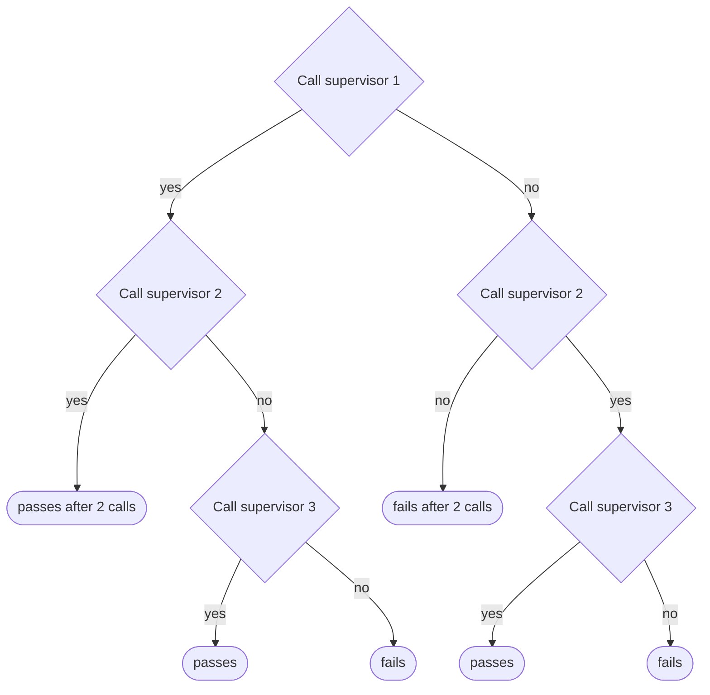
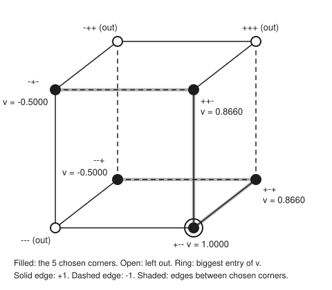

# Boolean functions: decision trees, Fourier coefficients, and Huang's sensitivity theorem

[Syllabus](../../../SYLLABUS.md) → [Computability and complexity](../README.md) → [Beyond Worst Case](../README.md#s04) → Boolean functions

---

## General Overview

Three shift supervisors vote yes or no on next month's rota. The rota passes if at least 2 of them say yes. A clerk phones the supervisors one at a time and stops as soon as the result is certain.

Three plain questions measure how hard this rule is.

- **How many calls does the clerk need in the worst case?** 3. After two calls that disagree, the third vote decides.
- **How many votes prove the result to an auditor?** 2. Two agreeing votes settle it, whatever the third says.
- **How many single changed votes could flip the result?** At most 2. With votes yes, yes, no, either yes voter changing their mind sinks the rota.

A second rule covers a gap in Saturday's rota. Four relief staff are asked, and the gap is covered if anyone says yes. When all four say no, any one of them changing to yes flips the answer. That rule is fragile in 4 places at once, and the clerk must call all 4 to know the answer.

A rule that turns yes-or-no inputs into a yes-or-no answer is a **Boolean function**. The three questions above are its **decision-tree depth**, its **certificate size** and its **sensitivity**. A fourth measure comes from algebra: the **degree** of the rule written as a polynomial in the votes.

Since the early 1990s, these measures, and most others, were known to be within fixed powers of each other. Sensitivity was the exception. In 2019 Hao Huang closed that gap with one signed matrix on the corners of a cube.

**Every measure of a Boolean function's complexity (questions needed, votes that prove the answer, single votes that flip it, the degree of its polynomial) is at most a fixed power of every other, and the last link, sensitivity at least the square root of degree, comes from a signed cube matrix whose square is a multiple of the identity.**

**What kind of fact this is:** theorems. The chain from sensitivity up to decision-tree depth, the bound of degree by depth, and Huang's theorem are proved on this card in Why it works. The bound of block sensitivity by degree (Nisan and Szegedy, 1994) is stated with its key steps and a named source. The bounds of depth by certificate size and block sensitivity, the influence theorem of Kahn, Kalai and Linial, and the linearity test of Blum, Luby and Rubinfeld are stated with named sources.

### The picture: the clerk's calls for the rota vote



A decision tree: each box is a call, each branch an answer, each rounded end a result. The longest path has 3 calls, so the depth is 3. Over the 8 possible vote patterns the clerk makes 2.5 calls on average.

---

## The formula

The words first, one sentence each. This card uses the convention of [Fourier analysis on a finite abelian group](../../20-Harmonic%20analysis/08-Harmonic%20Analysis%20on%20Groups/01-fourier-analysis-on-finite-abelian-groups.md): a vote is $`+1`$ for yes and $`-1`$ for no.

- A **Boolean function** $`f`$ takes $`n`$ votes $`x = (x_1, \dots, x_n)`$ and returns $`+1`$ or $`-1`$. Majority of three, $`\mathrm{Maj}`$, and OR of four, $`\mathrm{OR}`$, are the two examples.
- $`x^{(i)}`$ is the pattern $`x`$ with vote $`i`$ changed. $`x^{B}`$ is $`x`$ with every vote in a **block** $`B`$ (a set of voters) changed.
- **Sensitivity** $`s(f, x)`$ counts the voters $`i`$ with $`f(x^{(i)}) \ne f(x)`$. The sensitivity $`s(f)`$ is the largest over all patterns.
- **Block sensitivity** $`\mathrm{bs}(f, x)`$ is the most blocks, sharing no voter, that each flip $`f`$ when changed. $`\mathrm{bs}(f)`$ is the largest over all patterns.
- **Certificate size** $`C(f, x)`$ is the fewest votes whose values at $`x`$ already force the answer. $`C(f)`$ is the largest over all patterns.
- **Decision-tree depth** $`D(f)`$ is the fewest calls that always suffice, for the best order of calls. [Communication complexity](../06-Data%2C%20Learning%20and%20Fine-Grained%20Complexity/03-communication-complexity-in-outline.md) uses $`D(f)`$ for bits sent between two parties; here it counts calls.
- The **Fourier expansion** writes $`f`$ as a sum of products of votes: $`f(x) = \sum_S \hat f(S)\, \chi_S(x)`$, where $`\chi_S(x)`$ is the product of the votes in the set $`S`$ and $`\hat f(S)`$ is its amount (its Fourier coefficient). The **degree** $`\deg(f)`$ is the size of the largest $`S`$ with a nonzero amount.
- The **influence** $`\mathrm{Inf}_i(f)`$ is the chance, over all patterns equally likely, that changing vote $`i`$ alone flips $`f`$. The **total influence** $`\mathrm{Inf}(f)`$ adds them.

The card's result is a chain of inequalities:

```math
\sqrt{\deg(f)} \;\le\; s(f) \;\le\; \mathrm{bs}(f) \;\le\; C(f) \;\le\; D(f), \qquad \deg(f) \le D(f), \qquad \mathrm{bs}(f) \le 2\deg(f)^2
```

**Read it aloud:** the square root of the degree is at most the sensitivity, which is at most the block sensitivity, the certificate size and the depth in turn; the degree is at most the depth; and the block sensitivity is at most twice the degree squared.

The first inequality is Huang's theorem. Its engine is a matrix on the corners of the $`n`$-dimensional cube:

```math
A_1 = \begin{pmatrix} 0 & 1 \\ 1 & 0 \end{pmatrix}, \qquad A_n = \begin{pmatrix} A_{n-1} & I \\ I & -A_{n-1} \end{pmatrix}, \qquad A_n^2 = n\, I
```

**Read it aloud:** build each signed cube matrix from two copies of the last one, the second with its signs flipped, joined by identity blocks; its square is $`n`$ times the identity.

| Symbol | Plain meaning | In our example | Push it up and the answer… |
| --- | --- | --- | --- |
| $`n`$, $`x_i`$ | number of voters; voter $`i`$'s vote, $`+1`$ yes, $`-1`$ no | 3 supervisors; 4 relief staff | every measure can grow up to $`n`$ |
| $`f`$, $`\mathrm{Maj}`$, $`\mathrm{OR}`$, $`g`$ | the rule; majority of 3; anyone-says-yes of 4; the rule times all the votes (Step 3) | the rota vote; the Saturday gap | — |
| $`x^{(i)}`$, $`x^{B}`$, $`B`$ | the pattern with vote $`i`$ changed; with block $`B`$ changed; a set of voters | $`(+,+,-)`$ becomes $`(-,+,-)`$ | — |
| $`s(f)`$ | sensitivity: most single votes that flip $`f`$ at one pattern | 2 for Maj, 4 for OR | Huang allows degree up to its square |
| $`\mathrm{bs}(f)`$ | block sensitivity: most disjoint flipping blocks at one pattern | 2 for Maj, 4 for OR | at least $`s(f)`$ |
| $`C(f)`$ | certificate size: fewest votes that force the answer | 2 for Maj, 4 for OR | at least $`\mathrm{bs}(f)`$ |
| $`D(f)`$ | decision-tree depth: calls the best clerk needs, worst case | 3 for Maj, 4 for OR | at least $`C(f)`$ and $`\deg(f)`$ |
| $`S`$, $`\chi_S`$, $`\hat f(S)`$ | a set of voters; the product of their votes; its amount in $`f`$ | Maj: $`\tfrac12`$ on each single vote, $`-\tfrac12`$ on all three | — |
| $`\deg(f)`$ | largest set with a nonzero amount | 3 for Maj, 4 for OR | sensitivity must be at least its root |
| $`\mathrm{Inf}_i(f)`$, $`\mathrm{Inf}(f)`$ | chance that vote $`i`$ alone decides; their sum | 0.5 and 1.5 for Maj; 0.125 and 0.5 for OR | — |
| $`A_n`$, $`I`$ | Huang's signed cube matrix; the identity matrix | $`A_3`$ is 8 by 8, $`A_3^2 = 3I`$ | stretch factors $`\pm\sqrt n`$ |
| $`H`$, $`v`$ ($`v_x`$, $`v_y`$), $`k`$ | a set of chosen corners (here $`H`$ is neither the Hadamard gate nor entropy); a vector that is zero off $`H`$ (its entries at corners $`x`$ and $`y`$); chosen neighbours of the busiest corner | 5 of the 8 vote patterns; $`k = 2`$ | more corners, more crowding |

### When it holds

- **The rule answers on every pattern.** Step 3 multiplies $`f`$ by a product of all votes and uses every corner of the cube. For a rule promised only some inputs, the chain can fail.
- **Worst case over patterns.** Each measure is a maximum. OR of four has sensitivity 4 at all-no but average sensitivity 0.5. Averages obey different laws.
- **The signs in $`A_n`$.** The plain cube matrix, all signs $`+1`$, has $`A^2 \ne 3I`$ and only one stretch factor as large as $`\sqrt 3`$. Step 5's count then fails.
- **More than half the corners.** Four corners, the patterns with an even number of yes votes, have no chosen neighbours at all. The bound needs $`2^{n-1} + 1`$ corners.
- **A square root, not equality.** Majority has sensitivity 2 and degree 3, so sensitivity can sit below degree.

---

## Why it works

### Step 0: a rule of high degree must be fragile somewhere

Multiply the rule by the product of all votes. If the rule has full degree, the result is unbalanced: one answer covers more than half the cube's corners.

Any set of more than half the corners has a crowded corner, one with many neighbours in the set. At that corner the original rule flips along every one of those neighbours. So a crowded corner is a sensitive pattern.

The crowding comes from linear algebra. A signed cube matrix squares to $`n\, I`$, so half its stretch factors (eigenvalues: how much it stretches each of its special directions) are $`+\sqrt n`$. A vector stretched by $`\sqrt n`$ that lives on the chosen corners forces some corner to have at least $`\sqrt n`$ chosen neighbours.

### Step 1: the easy chain

Four inequalities need only the definitions.

- **$`s \le \mathrm{bs}`$.** A single voter is a block of one, so single flipping votes are disjoint flipping blocks.
- **$`\mathrm{bs} \le C`$.** A certificate must contain a voter from every flipping block. If it missed one, changing that block would keep the certificate's votes but flip the answer. The blocks are disjoint, so the certificate has at least as many voters as blocks.
- **$`C \le D`$.** Follow the clerk's tree on pattern $`x`$. The calls on that path force the answer, so they form a certificate of at most $`D(f)`$ votes.
- **$`\deg \le D`$.** Each end of the tree is reached by fixed answers from the called voters. Multiply $`(1 + x_i)/2`$ for each called voter who said yes and $`(1 - x_i)/2`$ for each who said no. That product is 1 on the patterns reaching this end and 0 elsewhere, and its degree is the number of calls on the path. The rule is the sum of these products, each times its result.

For Majority: $`s = \mathrm{bs} = C = 2`$ and $`D = \deg = 3`$. The step from 2 to 3 is real: two agreeing votes prove the result, but the clerk does not know in advance which two agree. Across all 254 rules on 3 voters that are not constant, the code finds 56 with $`C < D`$ and none with $`s < \mathrm{bs}`$.

Parity, the rule "is the yes count odd?", sits at the other extreme. Its sensitivity is $`n`$ at every pattern. That fragility is why it defeats shallow circuits in [Circuit lower bounds](07-circuit-complexity-and-lower-bounds.md).

### Step 2: degree and influence from the Fourier amounts

[Fourier analysis on a finite abelian group](../../20-Harmonic%20analysis/08-Harmonic%20Analysis%20on%20Groups/01-fourier-analysis-on-finite-abelian-groups.md) computes Majority's expansion:

```math
\mathrm{Maj}(x_1, x_2, x_3) = \tfrac12 x_1 + \tfrac12 x_2 + \tfrac12 x_3 - \tfrac12 x_1 x_2 x_3
```

The largest set with a nonzero amount is $`\{1, 2, 3\}`$, so $`\deg(\mathrm{Maj}) = 3`$.

The same card shows that voter $`i`$'s influence is the summed squares of the amounts on sets holding $`i`$. For supervisor 1 that is $`\tfrac14 + \tfrac14 = 0.5`$: in 50% of all vote patterns, supervisor 1 decides.

Summing over voters counts each set once per member:

```math
\mathrm{Inf}(f) = \sum_i \mathrm{Inf}_i(f) = \sum_S \lvert S\rvert\, \hat f(S)^2 = \text{the average of } s(f, x) \text{ over all } x
```

For Majority, $`1 \times 0.75 + 3 \times 0.25 = 1.5`$. Six patterns have sensitivity 2 and two have 0, an average of 1.5 too. For OR of four, each influence is the chance that the other three all say no, 0.125 (12.5%), and the total is 0.5.

Two classical results read the same amounts.

- **Kahn, Kalai and Linial (1988).** In any rule where yes and no are equally likely, some voter has influence at least a fixed multiple of $`\ln n / n`$. No fair rule spreads power perfectly evenly. Stated, with the proof in O'Donnell, chapter 9.
- **Blum, Luby and Rubinfeld (1990).** Pick random patterns $`x`$ and $`y`$ and test $`f(x)f(y) = f(xy)`$, multiplying votes entry by entry. If the test fails on only a small share of tries, then $`f`$ agrees with some product $`\chi_S`$ on all but at most that share of patterns. Majority fails often; the Fourier card computes its pass rate. Spot tests of this kind sit inside the PCP theorem of [Interactive proofs](../05-Algebraic%2C%20Interactive%20and%20Quantum/04-interactive-proofs-ip-pspace-and-the-pcp-theorem.md). Stated, with the proof in O'Donnell, chapter 1.

### Step 3: from high degree to a big set of corners

Gotsman and Linial (1992) turned the question about sensitivity into a question about the cube. This step proves the direction Huang needs.

1. **Shrink to full degree.** Take a set $`S`$ of voters, as large as the degree, with $`\hat f(S) \ne 0`$. Fix every other vote to any value. No larger set has a nonzero amount, so the amount on $`S`$ survives unchanged and the smaller rule has the same degree, now equal to its number of voters. Fixing votes cannot raise sensitivity. So assume $`\deg(f) = n`$.
2. **Multiply by all the votes.** Let $`g(x) = f(x)\, x_1 x_2 \cdots x_n`$. The average of $`g`$ over all patterns is $`\hat f(\{1, \dots, n\})`$, which is not 0. So one answer of $`g`$ covers more than half the corners. Call that set $`H`$: at least $`2^{n-1} + 1`$ corners.
3. **Neighbours inside $`H`$ are flips of $`f`$.** Take two patterns one vote apart, both in $`H`$. They have the same value of $`g`$. The product of all votes changes sign between them, so $`f`$ differs between them.

So a corner of $`H`$ with $`k`$ neighbours in $`H`$ is a pattern where $`f`$ has sensitivity at least $`k`$.

For Majority, $`g`$ has average $`-0.5`$, the amount on $`\{1, 2, 3\}`$. It equals $`-1`$ on the 6 mixed patterns, all but $`(+,+,+)`$ and $`(-,-,-)`$. Each mixed pattern has 2 mixed neighbours, and Majority differs across both: sensitivity 2.

### Step 4: the signed cube matrix squares to $`n`$ times the identity

Number the cube's corners by their vote patterns. The plain cube matrix has a 1 for every pair of patterns one vote apart. Huang's matrix $`A_n`$ has the same nonzero places, but some entries are $`-1`$. The recursion in The formula gives an edge the sign $`-1`$ when an odd number of the voters numbered after the changed one say yes.

Square the block form:

```math
A_n^2 = \begin{pmatrix} A_{n-1}^2 + I & A_{n-1} - A_{n-1} \\ A_{n-1} - A_{n-1} & I + A_{n-1}^2 \end{pmatrix} = \begin{pmatrix} n I & 0 \\ 0 & n I \end{pmatrix}
```

The off-diagonal blocks cancel because of the flipped signs. The diagonal blocks grow by 1 at each step, starting from $`A_1^2 = I`$.

$`A_n`$ is symmetric, so by [The spectral theorem](../../03-Algebra/07-Eigenvalues%20and%20Symmetric%20Matrices/04-spectral-theorem.md) it has $`2^n`$ real stretch factors (eigenvalues, see [Eigenvalues and eigenvectors](../../03-Algebra/07-Eigenvalues%20and%20Symmetric%20Matrices/02-eigenvalues-and-eigenvectors.md)) along perpendicular directions. Each one squared is $`n`$, so each is $`+\sqrt n`$ or $`-\sqrt n`$. The diagonal of $`A_n`$ is all zero, so the stretch factors add to 0. Half are $`+\sqrt n`$: exactly $`2^{n-1}`$ of them.

### Step 5: more than half the corners forces a crowded corner

Take any set $`H`$ of $`2^{n-1} + 1`$ corners.

1. **Two spaces must meet.** The vectors that $`A_n`$ stretches by $`+\sqrt n`$ form a space of dimension $`2^{n-1}`$. The vectors that are zero off $`H`$ form a space of dimension $`2^{n-1} + 1`$. The two dimensions add to more than $`2^n`$, so the spaces share a nonzero vector $`v`$.
2. **Look at the biggest entry.** Let $`x`$ be the corner where $`\lvert v_x \rvert`$ is largest; it lies in $`H`$. Row $`x`$ of $`A_n v = \sqrt n\, v`$ reads $`\sqrt n\, v_x = \sum_y (\pm 1)\, v_y`$, a sum over the neighbours $`y`$ of $`x`$, each with the sign of its edge.
3. **Only chosen neighbours count.** Off $`H`$, $`v_y = 0`$. Each other term is at most $`\lvert v_x \rvert`$ in size. So $`\sqrt n\, \lvert v_x \rvert \le k\, \lvert v_x \rvert`$, where $`k`$ is the number of neighbours of $`x`$ in $`H`$. Hence $`k \ge \sqrt n`$.

On the 3-cube, any 5 of the 8 vote patterns include one with at least $`\sqrt 3 = 1.7321`$, so at least 2, chosen neighbours.

The picture runs this on 5 chosen patterns. The code finds $`v`$, scaled so its biggest entry is 1, at the pattern $`(+,-,-)`$. Its two chosen neighbours carry 0.8660 each, so $`\sqrt 3 \times 1 = 0.8660 + 0.8660`$. Each term is at most 1, so 2 chosen neighbours are needed, and $`2 \ge \sqrt 3`$.

<p align="center"></p>

Schematic, drawn from the corner coordinates both checks print. A pattern such as $`+--`$ lists voter 1 first. Voter 1 runs left to right, voter 2 bottom to top, voter 3 front to back.

<details>
<summary>Detailed proof: why the +√n space has dimension 2^(n-1), and how the code finds v</summary>

The spectral theorem gives $`2^n`$ perpendicular directions, each stretched by a real factor. Applying $`A_n`$ twice stretches by the square of that factor, and $`A_n^2 = nI`$ makes that square $`n`$. So each factor is $`+\sqrt n`$ or $`-\sqrt n`$.

The trace, the sum of the diagonal entries, equals the sum of the stretch factors. The diagonal of $`A_n`$ is zero, so the positive and negative factors cancel: $`2^{n-1}`$ of each.

The directions stretched by $`+\sqrt n`$ span the $`+\sqrt n`$ space, so its dimension is $`2^{n-1}`$.

The code does not diagonalise. It uses one identity instead:

$`\displaystyle (A_n - \sqrt n\, I)(A_n + \sqrt n\, I) = A_n^2 - n I = 0`$

So every column of $`A_n + \sqrt n\, I`$ is stretched by $`+\sqrt n`$. For $`n = 3`$ the first 4 columns are independent, because their lower half is the identity, so they span the whole $`+\sqrt 3`$ space.

The code asks for a mix of those 4 columns that is zero on the 3 corners outside $`H`$: 3 equations in 4 unknowns. Row reduction finds a nonzero solution. The result is checked against $`A_3 v = \sqrt 3\, v`$ to within $`2.2 \times 10^{-16}`$.

</details>

### Step 6: putting the measures together

Steps 3 and 5 give Huang's theorem: $`s(f) \ge \sqrt{\deg(f)}`$. The code checks it on all 65,534 rules on 4 voters that are not constant. On 96 of them, the degree is 4 and the sensitivity only 2, so the square root cannot be improved there.

Three known bounds complete the circle.

- **Nisan and Szegedy (1994):** $`\mathrm{bs}(f) \le 2 \deg(f)^2`$. Key steps: treat each of the $`\mathrm{bs}(f)`$ disjoint blocks as one new voter. Averaging over orderings turns the rule into a polynomial in one count, how many blocks are changed. That polynomial stays between 0 and 1 at whole numbers, yet jumps by 1 at the first step. A bound of Ehlich and Zeller, and of Rivlin and Cheney, a whole-number form of Markov's inequality, then makes its degree at least the square root of half the block count.
- **Certificates and depth:** $`C(f) \le s(f)\,\mathrm{bs}(f)`$ and $`D(f) \le C(f)\,\mathrm{bs}(f)`$, so $`D(f) \le \mathrm{bs}(f)^3`$. Both are in the Buhrman and de Wolf survey.
- **Huang plus Nisan and Szegedy:** $`\mathrm{bs}(f) \le 2 \deg(f)^2 \le 2 s(f)^4`$.

So every measure is at most a fixed power of every other. The gap can be real: Rubinstein (1995) built rules whose block sensitivity grows like the square of their sensitivity.

---

## Worked numbers, by hand

The rota vote, the Saturday gap, and the cube.

| Step | Arithmetic | Value |
| --- | --- | --- |
| Majority at $`(+,+,-)`$ | voter 1 or voter 2 changing sinks it; voter 3 changing keeps it | sensitivity 2 |
| Majority at $`(+,+,+)`$ | any one change leaves 2 yes votes | sensitivity 0 |
| $`s(\mathrm{Maj})`$, $`\mathrm{bs}(\mathrm{Maj})`$ | largest over the 8 patterns | 2, 2 |
| $`C(\mathrm{Maj})`$ | two agreeing votes | 2 |
| $`D(\mathrm{Maj})`$ | call 1, call 2, call 3 only on a split | 3 |
| average calls | $`(4 \times 2 + 4 \times 3) / 8`$ | 2.5 |
| $`\deg(\mathrm{Maj})`$ | amount $`-\tfrac12`$ on $`\{1, 2, 3\}`$ | 3 |
| $`\mathrm{Inf}_1(\mathrm{Maj})`$ | changing vote 1 flips 4 of 8 patterns | 0.5 |
| $`\mathrm{Inf}(\mathrm{Maj})`$ | $`1 \times 0.75 + 3 \times 0.25`$ | 1.5 |
| Huang for Majority | $`\sqrt 3 = 1.7321 \le 2`$ | holds |
| OR at all-no | each of 4 staff saying yes flips it | sensitivity 4 |
| $`\mathrm{Inf}_i(\mathrm{OR})`$ | the other three all say no: $`(\tfrac12)^3`$ | 0.125 |
| $`A_3^2`$ | block form, Step 4 | $`3I`$ |
| 5 chosen corners | $`\sqrt 3 \times 1 = 0.8660 + 0.8660`$ at $`(+,-,-)`$ | **2 chosen neighbours** |

Any 5 of the 8 vote patterns contain one with 2 chosen neighbours, and that is what forces a rule of degree 3 on three supervisors to be sensitive to 2 votes somewhere.

### What breaks if you drop a piece

| Mistake | Comes out at | What went wrong |
| --- | --- | --- |
| Drop the signs: plain cube matrix | $`A^2`$ has entries 0, 2 and 3; stretch factors 3, 1, 1, 1, −1, −1, −1, −3; only 1 is at least $`\sqrt 3`$ | The space stretched by at least $`\sqrt 3`$ shrinks to dimension 1, too small to meet the 5-corner space |
| Choose exactly half the corners | the 4 even-count patterns: 0 chosen neighbours | The dimension count needs more than $`2^{n-1}`$ corners |
| Expect $`s(f) \ge \deg(f)`$ | Majority: $`s = 2 < \deg = 3`$ | Huang's bound is a square root, $`1.7321 \le 2`$ |
| Read certificate size as depth | Majority: $`C = 2 < D = 3`$ | Proving the answer is easier than finding the proof |

Both checks print every row.

---

## Code, from first principles, and it actually runs

The code computes every measure by brute force, trying every vote, block, set of votes and order of calls. Five pairs of independent roads meet: Fourier amounts by fast butterflies and by direct averaging; influence by changing votes and from squared amounts; depth by search and from the clerk's tree; Huang's matrix by recursion and by a sign formula, squared for $`n`$ from 1 to 6; and the crowded corner by searching every 5-corner set of the 3-cube and every 9-corner set of the 4-cube, against the vector of Step 5. The chain is checked on every rule on 3 voters, and Huang's bound on every rule on 4.

### Python

```python
# Boolean functions: decision trees, Fourier coefficients and Huang's sensitivity theorem -- the check.
# Standard library only.  An input is a bit mask: bit i set means voter i+1 says yes (+1), clear means no (-1).
from itertools import combinations
from math import sqrt
def table(n, rule):                  # f as a list of +1/-1 over all 2^n inputs
    return [rule([1 if x >> i & 1 else -1 for i in range(n)]) for x in range(2 ** n)]
pc = lambda x: bin(x).count("1")
show = lambda x, n: "".join("+" if x >> i & 1 else "-" for i in range(n))
def fourier(f):                      # 2^n times each coefficient, by fast butterflies
    v, h = f[:], 1
    while h < len(v):
        for x in [x for x in range(len(v)) if not x & h]:
            v[x], v[x | h] = v[x] + v[x | h], v[x | h] - v[x]
        h *= 2
    return v
fourier_slow = lambda f, n: [sum(f[x] * (-1) ** pc(S & ~x) for x in range(2 ** n)) for S in range(2 ** n)]
degree = lambda f: max(pc(S) for S, c in enumerate(fourier(f)) if c)
sens = lambda f, n, x: sum(f[x] != f[x ^ 1 << i] for i in range(n))     # votes whose single change flips f
def bsens(f, n, x, used=0, last=0):  # most disjoint blocks of votes, each flipping the answer
    return max([1 + bsens(f, n, x, used | B, B) for B in range(last + 1, 2 ** n)
                if not B & used and f[x ^ B] != f[x]] + [0])
def cert(f, n, x):                   # fewest votes that, once seen, fix the answer
    return min(pc(S) for S in range(2 ** n) if all(f[y] == f[x] for y in range(2 ** n) if (y ^ x) & S == 0))
def depth(f, n, mask=0, val=0):      # fewest questions in the worst case, best tree, by brute force
    pts = [f[y] for y in range(2 ** n) if y & mask == val]
    if min(pts) == max(pts): return 0
    return min(1 + max(depth(f, n, mask | 1 << i, val), depth(f, n, mask | 1 << i, val | 1 << i))
               for i in range(n) if not mask >> i & 1)
measures = lambda f, n: [max(m(f, n, x) for x in range(2 ** n)) for m in (sens, bsens, cert)] + [depth(f, n), degree(f)]
def infl(f, n):                      # chance that changing vote i alone flips the answer, two roads
    flip = [sum(f[x] != f[x ^ 1 << i] for x in range(2 ** n)) / 2 ** n for i in range(n)]
    c = fourier(f)
    return flip, [sum(c[S] ** 2 for S in range(2 ** n) if S >> i & 1) / 4 ** n for i in range(n)]
fl = lambda xs: "[" + ", ".join(f"{v:.4f}" for v in xs) + "]"
maj = table(3, lambda v: 1 if sum(v) > 0 else -1)
print("Majority of 3 supervisors (+ yes, - no); voter 1 first")
for x in range(8):
    S = min(S for S in range(8) if pc(S) == cert(maj, 3, x) and all(maj[y] == maj[x] for y in range(8) if (y ^ x) & S == 0))
    print(f"  {show(x, 3)} -> {'+' if maj[x] > 0 else '-'}  sensitive votes {sens(maj, 3, x)}"
          f"  certificate: voters {[i + 1 for i in range(3) if S >> i & 1]}")
c, cs = fourier(maj), fourier_slow(maj, 3)
print("  coefficients x 8, sets {} {1} {2} {1,2} {3} {1,3} {2,3} {1,2,3}:", c)
m = measures(maj, 3)
print(f"  s {m[0]}  bs {m[1]}  C {m[2]}  D {m[3]}  deg {m[4]}")
reads = [2 if (x & 1) == (x >> 1 & 1) else 3 for x in range(8)]
print(f"  tree 'ask 1, ask 2, ask 3 only on a split': worst {max(reads)} questions, average {sum(reads) / 8:.4f}")
a, b = infl(maj, 3)
print(f"  influence by flipping {fl(a)}; from coefficients {fl(b)}; total {sum(a):.4f}")
w = [sum(c[S] ** 2 for S in range(8) if pc(S) == d) / 64 for d in range(4)]   # Fourier weight at each degree
print(f"  weights by degree {fl(w)}; total influence = 1 x {w[1]:.4f} + 3 x {w[3]:.4f} = {w[1] + 3 * w[3]:.4f}")
orf = table(4, lambda v: 1 if max(v) > 0 else -1)
mo, (ao, bo), co = measures(orf, 4), infl(orf, 4), fourier(orf)
print("OR of 4 relief staff: the gap is covered if anyone says yes")
print(f"  s {mo[0]} (at {show(max(range(16), key=lambda x: sens(orf, 4, x)), 4)})  bs {mo[1]}  C {mo[2]}  D {mo[3]}  deg {mo[4]}")
print(f"  coefficients: empty set {co[0] / 16:.4f}, all four {co[15] / 16:.4f}; influence each {ao[0]:.4f}"
      f" ({bo[0]:.4f} from coefficients); average sensitivity {sum(sens(orf, 4, x) for x in range(16)) / 16:.4f}")
ok3, gap = True, [0, 0]
for k in range(256):                 # every Boolean function of 3 votes
    f = [1 - 2 * (k >> x & 1) for x in range(8)]
    if min(f) == max(f): continue
    s, bs, C, D, d = measures(f, 3)
    ok3 &= s <= bs <= C <= D and d <= D and d <= s * s and bs <= 2 * d * d
    gap[0] += s < bs; gap[1] += C < D
print(f"all 254 non-constant functions of 3 votes: s <= bs <= C <= D, deg <= D, deg <= s^2, bs <= 2 deg^2: {ok3}")
print(f"  functions with s < bs: {gap[0]}; with C < D: {gap[1]}")
ok4, tight = True, 0
for k in range(1, 65535):            # every non-constant function of 4 votes
    f = [1 - 2 * (k >> x & 1) for x in range(16)]
    s, d = max(sens(f, 4, x) for x in range(16)), degree(f)
    ok4 &= d <= s * s; tight += d == 4 and s == 2
print(f"all 65534 non-constant functions of 4 votes: deg <= s^2 (Huang): {ok4}; degree 4 with s only 2: {tight}")
def huang(n):                        # A_1 = [[0,1],[1,0]];  A_n = [[A, I], [I, -A]]
    if n == 0: return [[0]]
    A = huang(n - 1); m = len(A)
    return [A[r] + [int(r == c) for c in range(m)] for r in range(m)] + \
           [[int(r == c) for c in range(m)] + [-v for v in A[r]] for r in range(m)]
by_formula = lambda n: [[                          # edge x -- x with vote i changed: -1 per yes vote above i
          (-1) ** pc(x >> (x ^ y).bit_length()) if pc(x ^ y) == 1 else 0 for y in range(2 ** n)] for x in range(2 ** n)]
mul = lambda A, B: [[sum(A[r][k] * B[k][c] for k in range(len(B))) for c in range(len(B))] for r in range(len(A))]
A = huang(3)
print("Huang's signed matrix for 3 votes, rows and columns in mask order 0..7:")
for r in A: print("  " + " ".join(f"{v:>2}" for v in r))
sq = all(mul(huang(n), huang(n)) == [[n * (r == c) for c in range(2 ** n)] for r in range(2 ** n)] for n in range(1, 7))
same = all(huang(n) == by_formula(n) for n in range(1, 7))
print(f"  A^2 = nI for n = 1..6: {sq}; recursion = sign formula: {same}; trace {sum(A[i][i] for i in range(8))}")
md = lambda H, n: max(sum((x ^ 1 << i) in H for i in range(n)) for x in H)
mins = [min(md(set(H), 3) for H in combinations(range(8), k)) for k in (4, 5)]
min9 = min(md(set(H), 4) for H in combinations(range(16), 9))
print(f"any 5 of 8 corners: fewest chosen neighbours at the busiest corner {mins[1]} (sqrt 3 = {sqrt(3):.4f});"
      f" 4 corners: {mins[0]}; any 9 of 16: {min9}")
H, r3 = [1, 2, 3, 4, 5], sqrt(3)
Bm = [[A[r][c] + r3 * (r == c) for c in range(8)] for r in range(8)]   # its columns lie in the +sqrt3 space
M = [[Bm[k][j] for j in range(4)] for k in range(8) if k not in H]
def null_vector(M):                  # one nonzero solution of M c = 0, by elimination
    M, piv, r = [row[:] for row in M], [], 0
    for col in range(len(M[0])):
        p = max(range(r, len(M)), key=lambda i: abs(M[i][col]))
        if abs(M[p][col]) < 1e-9: continue
        M[r], M[p] = M[p], M[r]
        M[r] = [v / M[r][col] for v in M[r]]
        for i in range(len(M)):
            if i != r: M[i] = [a - M[i][col] * b for a, b in zip(M[i], M[r])]
        piv.append(col); r += 1
        if r == len(M): break
    free = next(c for c in range(len(M[0])) if c not in piv)
    cvec = [0.0] * len(M[0]); cvec[free] = 1.0
    for i, col in enumerate(piv): cvec[col] = -M[i][free]
    return cvec
cv = null_vector(M)
v = [sum(cv[j] * Bm[k][j] for j in range(4)) for k in range(8)]
top = max(range(8), key=lambda k: abs(v[k]))
v = [w / v[top] + 0.0 if abs(w) > 1e-9 else 0.0 for w in v]
res = max(abs(sum(A[k][j] * v[j] for j in range(8)) - r3 * v[k]) for k in range(8))
nb = [x for x in H if pc(x ^ top) == 1]
print(f"chosen 5 corners {[show(x, 3) for x in H]}; vector with A v = sqrt3 v, zero off them:")
print("  v = " + " ".join(f"{show(k, 3)}:{v[k]:.4f}" for k in range(8)) + f"  (largest error {res:.1e})")
print(f"  biggest entry at {show(top, 3)}: sqrt3 x 1 = |{' + '.join(f'({A[top][y]})({v[y]:.4f})' for y in nb)}|"
      f" <= {len(nb)} chosen neighbours")
g = [maj[x] * (-1) ** pc(7 & ~x) for x in range(8)]
Hg = [x for x in range(8) if g[x] == -1]
print(f"Majority times the triple product: average {sum(g) / 8:.4f}; it is -1 on {len(Hg)} corners {[show(x, 3) for x in Hg]}")
print(f"  each has {md(set(Hg), 3)} neighbours inside, where Majority differs: sensitivity {min(sens(maj, 3, x) for x in Hg)}")
U, eig = [[int(pc(x ^ y) == 1) for y in range(8)] for x in range(8)], [3 - 2 * pc(S) for S in range(8)]
okU = all(sum(U[x][y] * (-1) ** pc(S & y) for y in range(8)) == eig[S] * (-1) ** pc(S & x) for S in range(8) for x in range(8))
print("what breaks:\n"
      f"  unsigned cube matrix: A^2 entries {sorted(set(v for row in mul(U, U) for v in row))}; stretch factors"
      f" {sorted(eig, reverse=True)} (checked on all 8 products: {okU}); only {sum(e > 1.5 for e in eig)} is >= sqrt3")
print(f"  exactly half, the 4 corners with an even count of yes votes: busiest has {md({0, 3, 5, 6}, 3)} neighbours inside")
print(f"  Majority: s {m[0]} < deg {m[4]}, so s >= deg fails; s >= sqrt(deg) = {sqrt(3):.4f} holds")
print(f"  Majority: certificate {m[2]} < depth {m[3]}: two agreeing votes prove the answer, but finding them can take 3")
P = {x: (80 + 200 * (x & 1) + 90 * (x >> 2 & 1), 330 - 200 * (x >> 1 & 1) - 70 * (x >> 2 & 1)) for x in range(8)}
neg = [f"{show(x, 3)}/{show(x ^ 1 << i, 3)}" for x in range(8) for i in range(3) if x >> i & 1 == 0 and A[x][x ^ 1 << i] < 0]
print("figure, corners " + " ".join(f"{show(x, 3)}=({P[x][0]},{P[x][1]})" for x in range(8)) + " minus edges " + " ".join(neg))
assert c == cs and c == [0, 4, 4, 0, 4, 0, 0, -4]                       # fast = slow = (1/2, 1/2, 1/2, -1/2)
assert m == [2, 2, 2, 3, 3] and mo == [4, 4, 4, 4, 4] and max(reads) == m[3]  # brute force = known values
assert a == b == [0.5] * 3 and ao == bo == [0.125] * 4 and sum(a) == w[1] + 3 * w[3]   # flipping = weights
assert ok3 and ok4 and sq and same and okU                             # chains, Huang, matrix two roads
assert mins == [0, 2] and min9 == 2 and res < 1e-9 and len(nb) >= r3 and v[top] == 1.0
assert [v[k] for k in range(8) if k not in H] == [0.0] * 3 and sum(g) == c[7]
print("ALL CHECKS PASS")
```

**Ran 2026-11-24 on macOS, Python 3.14.10, standard library only. All checks passed. Output, pasted from the run:**

```
Majority of 3 supervisors (+ yes, - no); voter 1 first
  --- -> -  sensitive votes 0  certificate: voters [1, 2]
  +-- -> -  sensitive votes 2  certificate: voters [2, 3]
  -+- -> -  sensitive votes 2  certificate: voters [1, 3]
  ++- -> +  sensitive votes 2  certificate: voters [1, 2]
  --+ -> -  sensitive votes 2  certificate: voters [1, 2]
  +-+ -> +  sensitive votes 2  certificate: voters [1, 3]
  -++ -> +  sensitive votes 2  certificate: voters [2, 3]
  +++ -> +  sensitive votes 0  certificate: voters [1, 2]
  coefficients x 8, sets {} {1} {2} {1,2} {3} {1,3} {2,3} {1,2,3}: [0, 4, 4, 0, 4, 0, 0, -4]
  s 2  bs 2  C 2  D 3  deg 3
  tree 'ask 1, ask 2, ask 3 only on a split': worst 3 questions, average 2.5000
  influence by flipping [0.5000, 0.5000, 0.5000]; from coefficients [0.5000, 0.5000, 0.5000]; total 1.5000
  weights by degree [0.0000, 0.7500, 0.0000, 0.2500]; total influence = 1 x 0.7500 + 3 x 0.2500 = 1.5000
OR of 4 relief staff: the gap is covered if anyone says yes
  s 4 (at ----)  bs 4  C 4  D 4  deg 4
  coefficients: empty set 0.8750, all four -0.1250; influence each 0.1250 (0.1250 from coefficients); average sensitivity 0.5000
all 254 non-constant functions of 3 votes: s <= bs <= C <= D, deg <= D, deg <= s^2, bs <= 2 deg^2: True
  functions with s < bs: 0; with C < D: 56
all 65534 non-constant functions of 4 votes: deg <= s^2 (Huang): True; degree 4 with s only 2: 96
Huang's signed matrix for 3 votes, rows and columns in mask order 0..7:
   0  1  1  0  1  0  0  0
   1  0  0  1  0  1  0  0
   1  0  0 -1  0  0  1  0
   0  1 -1  0  0  0  0  1
   1  0  0  0  0 -1 -1  0
   0  1  0  0 -1  0  0 -1
   0  0  1  0 -1  0  0  1
   0  0  0  1  0 -1  1  0
  A^2 = nI for n = 1..6: True; recursion = sign formula: True; trace 0
any 5 of 8 corners: fewest chosen neighbours at the busiest corner 2 (sqrt 3 = 1.7321); 4 corners: 0; any 9 of 16: 2
chosen 5 corners ['+--', '-+-', '++-', '--+', '+-+']; vector with A v = sqrt3 v, zero off them:
  v = ---:0.0000 +--:1.0000 -+-:-0.5000 ++-:0.8660 --+:-0.5000 +-+:0.8660 -++:0.0000 +++:0.0000  (largest error 2.2e-16)
  biggest entry at +--: sqrt3 x 1 = |(1)(0.8660) + (1)(0.8660)| <= 2 chosen neighbours
Majority times the triple product: average -0.5000; it is -1 on 6 corners ['+--', '-+-', '++-', '--+', '+-+', '-++']
  each has 2 neighbours inside, where Majority differs: sensitivity 2
what breaks:
  unsigned cube matrix: A^2 entries [0, 2, 3]; stretch factors [3, 1, 1, 1, -1, -1, -1, -3] (checked on all 8 products: True); only 1 is >= sqrt3
  exactly half, the 4 corners with an even count of yes votes: busiest has 0 neighbours inside
  Majority: s 2 < deg 3, so s >= deg fails; s >= sqrt(deg) = 1.7321 holds
  Majority: certificate 2 < depth 3: two agreeing votes prove the answer, but finding them can take 3
figure, corners ---=(80,330) +--=(280,330) -+-=(80,130) ++-=(280,130) --+=(170,260) +-+=(370,260) -++=(170,60) +++=(370,60) minus edges -+-/++- --+/+-+ --+/-++ +-+/+++
ALL CHECKS PASS
```

### Rust

The same checks in Rust, with the same row reduction and the same printing. No crates.

```rust
// Boolean functions: decision trees, Fourier coefficients and Huang's sensitivity theorem -- the same
// check as boolean_functions_fourier_and_sensitivity_check.py, in Rust.  Standard library only, no crates.
// An input is a bit mask: bit i set means voter i+1 says yes (+1), clear means no (-1).
type F = Vec<i64>;
fn pc(x: usize) -> u32 { x.count_ones() }
fn show(x: usize, n: usize) -> String { (0..n).map(|i| if x >> i & 1 == 1 { '+' } else { '-' }).collect() }
fn table(n: usize, rule: &dyn Fn(&[i64]) -> i64) -> F {
    (0..1usize << n).map(|x| rule(&(0..n).map(|i| if x >> i & 1 == 1 { 1 } else { -1 }).collect::<Vec<_>>())).collect()
}
fn fourier(f: &F) -> F { // 2^n times each coefficient, by fast butterflies
    let (mut v, mut h) = (f.clone(), 1);
    while h < v.len() {
        for x in (0..v.len()).filter(|x| x & h == 0) { let (a, b) = (v[x], v[x | h]); v[x] = a + b; v[x | h] = b - a; }
        h *= 2;
    }
    v
}
fn fourier_slow(f: &F, n: usize) -> F { // averaging f against chi_S directly
    (0..1usize << n).map(|s| (0..1usize << n).map(|x| f[x] * if pc(s & !x) % 2 == 1 { -1 } else { 1 }).sum()).collect()
}
fn degree(f: &F) -> u32 { fourier(f).iter().enumerate().filter(|(_, c)| **c != 0).map(|(s, _)| pc(s)).max().unwrap() }
fn sens(f: &F, n: usize, x: usize) -> usize { (0..n).filter(|i| f[x] != f[x ^ 1 << i]).count() }
fn bsens(f: &F, n: usize, x: usize, used: usize, last: usize) -> usize { // most disjoint flipping blocks
    (last + 1..1 << n).filter(|b| b & used == 0 && f[x ^ b] != f[x]).map(|b| 1 + bsens(f, n, x, used | b, b)).max().unwrap_or(0)
}
fn cert_set(f: &F, n: usize, x: usize) -> usize { // lowest set of fewest votes that fixes the answer
    (0..1usize << n).filter(|s| (0..1usize << n).all(|y| (y ^ x) & s != 0 || f[y] == f[x])).min_by_key(|s| (pc(*s), *s)).unwrap()
}
fn depth(f: &F, n: usize, mask: usize, val: usize) -> usize { // fewest questions, worst case, best tree
    let pts: Vec<i64> = (0..1usize << n).filter(|y| y & mask == val).map(|y| f[y]).collect();
    if pts.iter().min() == pts.iter().max() { return 0; }
    (0..n).filter(|i| mask >> i & 1 == 0).map(|i| 1 + depth(f, n, mask | 1 << i, val).max(depth(f, n, mask | 1 << i, val | 1 << i))).min().unwrap()
}
fn measures(f: &F, n: usize) -> Vec<usize> {
    let all = |m: &dyn Fn(usize) -> usize| (0..1usize << n).map(m).max().unwrap();
    vec![all(&|x| sens(f, n, x)), all(&|x| bsens(f, n, x, 0, 0)), all(&|x| pc(cert_set(f, n, x)) as usize), depth(f, n, 0, 0), degree(f) as usize]
}
fn infl(f: &F, n: usize) -> (Vec<f64>, Vec<f64>) { // flipping, and from the coefficients
    let c = fourier(f);
    ((0..n).map(|i| (0..1usize << n).filter(|x| f[*x] != f[x ^ 1 << i]).count() as f64 / (1 << n) as f64).collect(),
     (0..n).map(|i| (0..1usize << n).filter(|s| s >> i & 1 == 1).map(|s| c[s] * c[s]).sum::<i64>() as f64 / (1 << 2 * n) as f64).collect())
}
fn fl(xs: &[f64]) -> String { format!("[{}]", xs.iter().map(|v| format!("{:.4}", v)).collect::<Vec<_>>().join(", ")) }
fn ilist<T: std::fmt::Display>(xs: &[T]) -> String { format!("[{}]", xs.iter().map(|v| v.to_string()).collect::<Vec<_>>().join(", ")) }
fn slist(xs: &[usize]) -> String { format!("[{}]", xs.iter().map(|x| format!("'{}'", show(*x, 3))).collect::<Vec<_>>().join(", ")) }
fn py(b: bool) -> &'static str { if b { "True" } else { "False" } }
fn huang(n: usize) -> Vec<Vec<i64>> { // A_1 = [[0,1],[1,0]];  A_n = [[A, I], [I, -A]]
    if n == 0 { return vec![vec![0]]; }
    let a = huang(n - 1); let m = a.len();
    let id = |r: usize| (0..m).map(move |c| (r == c) as i64);
    (0..m).map(|r| a[r].iter().cloned().chain(id(r)).collect())
        .chain((0..m).map(|r| id(r).chain(a[r].iter().map(|v| -v)).collect())).collect()
}
fn by_formula(n: usize) -> Vec<Vec<i64>> { // edge x -- x with vote i changed: -1 per yes vote above i
    (0..1usize << n).map(|x| (0..1usize << n).map(|y| if pc(x ^ y) != 1 { 0 } else if pc(x >> (64 - (x ^ y).leading_zeros())) % 2 == 1 { -1 } else { 1 }).collect()).collect()
}
fn mul(a: &[Vec<i64>], b: &[Vec<i64>]) -> Vec<Vec<i64>> { (0..a.len()).map(|r| (0..b.len()).map(|c| (0..b.len()).map(|k| a[r][k] * b[k][c]).sum()).collect()).collect() }
fn md(h: &[usize], n: usize) -> usize { h.iter().map(|x| (0..n).filter(|i| h.contains(&(x ^ 1 << i))).count()).max().unwrap() }
fn subsets(m: usize, k: u32) -> Vec<Vec<usize>> { // all k-element subsets of 0..m
    (0..1usize << m).filter(|s| pc(*s) == k).map(|s| (0..m).filter(|i| s >> i & 1 == 1).collect()).collect()
}
fn null_vector(mut m: Vec<Vec<f64>>) -> Vec<f64> { // one nonzero solution of M c = 0, by elimination
    let (mut piv, mut r, w) = (vec![], 0, m[0].len());
    for col in 0..w {
        let mut p = r; for i in r..m.len() { if m[i][col].abs() > m[p][col].abs() { p = i; } }
        if m[p][col].abs() < 1e-9 { continue; }
        m.swap(r, p);
        let pv = m[r][col]; m[r] = m[r].iter().map(|v| v / pv).collect();
        for i in 0..m.len() { if i != r { let f = m[i][col]; m[i] = (0..w).map(|k| m[i][k] - f * m[r][k]).collect(); } }
        piv.push(col); r += 1;
        if r == m.len() { break; }
    }
    let free = (0..w).find(|c| !piv.contains(c)).unwrap();
    let mut c = vec![0.0; w]; c[free] = 1.0;
    for (i, col) in piv.iter().enumerate() { c[*col] = -m[i][free]; }
    c
}
fn sci(x: f64) -> String { let s = format!("{:.1e}", x); let (a, e) = s.split_once('e').unwrap();
    let e: i32 = e.parse().unwrap(); format!("{}e{}{:02}", a, if e < 0 { '-' } else { '+' }, e.abs()) }
fn main() {
    let maj = table(3, &|v| if v.iter().sum::<i64>() > 0 { 1 } else { -1 });
    println!("Majority of 3 supervisors (+ yes, - no); voter 1 first");
    for x in 0..8 {
        let s = cert_set(&maj, 3, x);
        println!("  {} -> {}  sensitive votes {}  certificate: voters {}", show(x, 3), if maj[x] > 0 { '+' } else { '-' },
                 sens(&maj, 3, x), ilist(&(0..3).filter(|i| s >> i & 1 == 1).map(|i| i + 1).collect::<Vec<_>>()));
    }
    let (c, cs) = (fourier(&maj), fourier_slow(&maj, 3));
    println!("  coefficients x 8, sets {{}} {{1}} {{2}} {{1,2}} {{3}} {{1,3}} {{2,3}} {{1,2,3}}: {}", ilist(&c));
    let m = measures(&maj, 3);
    println!("  s {}  bs {}  C {}  D {}  deg {}", m[0], m[1], m[2], m[3], m[4]);
    let reads: Vec<usize> = (0..8).map(|x| if x & 1 == x >> 1 & 1 { 2 } else { 3 }).collect();
    println!("  tree 'ask 1, ask 2, ask 3 only on a split': worst {} questions, average {:.4}",
             reads.iter().max().unwrap(), reads.iter().sum::<usize>() as f64 / 8.0);
    let (a, b) = infl(&maj, 3);
    println!("  influence by flipping {}; from coefficients {}; total {:.4}", fl(&a), fl(&b), a.iter().sum::<f64>());
    let w: Vec<f64> = (0..4).map(|d| (0..8).filter(|s| pc(*s) == d).map(|s| c[s] * c[s]).sum::<i64>() as f64 / 64.0).collect();
    println!("  weights by degree {}; total influence = 1 x {:.4} + 3 x {:.4} = {:.4}", fl(&w), w[1], w[3], w[1] + 3.0 * w[3]);
    let orf = table(4, &|v| if v.iter().max().unwrap() > &0 { 1 } else { -1 });
    let (mo, (ao, bo), co) = (measures(&orf, 4), infl(&orf, 4), fourier(&orf));
    println!("OR of 4 relief staff: the gap is covered if anyone says yes");
    let at = (0..16).fold(0, |best, x| if sens(&orf, 4, x) > sens(&orf, 4, best) { x } else { best });
    println!("  s {} (at {})  bs {}  C {}  D {}  deg {}", mo[0], show(at, 4), mo[1], mo[2], mo[3], mo[4]);
    println!("  coefficients: empty set {:.4}, all four {:.4}; influence each {:.4} ({:.4} from coefficients); average sensitivity {:.4}",
             co[0] as f64 / 16.0, co[15] as f64 / 16.0, ao[0], bo[0], (0..16).map(|x| sens(&orf, 4, x)).sum::<usize>() as f64 / 16.0);
    let (mut ok3, mut gap) = (true, [0, 0]);
    for k in 0..256usize { // every Boolean function of 3 votes
        let f: F = (0..8).map(|x| 1 - 2 * (k >> x & 1) as i64).collect();
        if f.iter().min() == f.iter().max() { continue; }
        let v = measures(&f, 3); let (s, bs, cc, d, dg) = (v[0], v[1], v[2], v[3], v[4]);
        ok3 &= s <= bs && bs <= cc && cc <= d && dg <= d && dg <= s * s && bs <= 2 * dg * dg;
        gap[0] += (s < bs) as usize; gap[1] += (cc < d) as usize;
    }
    println!("all 254 non-constant functions of 3 votes: s <= bs <= C <= D, deg <= D, deg <= s^2, bs <= 2 deg^2: {}", py(ok3));
    println!("  functions with s < bs: {}; with C < D: {}", gap[0], gap[1]);
    let (mut ok4, mut tight) = (true, 0);
    for k in 1..65535usize { // every non-constant function of 4 votes
        let f: F = (0..16).map(|x| 1 - 2 * (k >> x & 1) as i64).collect();
        let (s, d) = ((0..16).map(|x| sens(&f, 4, x)).max().unwrap() as u32, degree(&f));
        ok4 &= d <= s * s; tight += (d == 4 && s == 2) as usize;
    }
    println!("all 65534 non-constant functions of 4 votes: deg <= s^2 (Huang): {}; degree 4 with s only 2: {}", py(ok4), tight);
    let am = huang(3);
    println!("Huang's signed matrix for 3 votes, rows and columns in mask order 0..7:");
    for r in &am { println!("  {}", r.iter().map(|v| format!("{:>2}", v)).collect::<Vec<_>>().join(" ")); }
    let sq = (1..7).all(|n| mul(&huang(n), &huang(n)) == (0..1 << n).map(|r| (0..1 << n).map(|c| n as i64 * (r == c) as i64).collect()).collect::<Vec<Vec<i64>>>());
    let same = (1..7).all(|n| huang(n) == by_formula(n));
    println!("  A^2 = nI for n = 1..6: {}; recursion = sign formula: {}; trace {}", py(sq), py(same), (0..8).map(|i| am[i][i]).sum::<i64>());
    let mins: Vec<usize> = [4, 5].iter().map(|k| subsets(8, *k).iter().map(|h| md(h, 3)).min().unwrap()).collect();
    let min9 = subsets(16, 9).iter().map(|h| md(h, 4)).min().unwrap();
    let r3 = 3f64.sqrt();
    println!("any 5 of 8 corners: fewest chosen neighbours at the busiest corner {} (sqrt 3 = {:.4}); 4 corners: {}; any 9 of 16: {}", mins[1], r3, mins[0], min9);
    let hs = [1usize, 2, 3, 4, 5];
    let bm: Vec<Vec<f64>> = (0..8).map(|r| (0..8).map(|c| am[r][c] as f64 + if r == c { r3 } else { 0.0 }).collect()).collect();
    let cv = null_vector((0..8).filter(|k| !hs.contains(k)).map(|k| (0..4).map(|j| bm[k][j]).collect()).collect());
    let v0: Vec<f64> = (0..8).map(|k| (0..4).fold(0.0, |s, j| s + cv[j] * bm[k][j])).collect();
    let top = (0..8).fold(0, |t, k| if v0[k].abs() > v0[t].abs() { k } else { t });
    let v: Vec<f64> = v0.iter().map(|x| if x.abs() > 1e-9 { x / v0[top] + 0.0 } else { 0.0 }).collect();
    let res = (0..8).map(|k| ((0..8).fold(0.0, |s, j| s + am[k][j] as f64 * v[j]) - r3 * v[k]).abs()).fold(0.0, f64::max);
    let nb: Vec<usize> = hs.iter().cloned().filter(|x| pc(x ^ top) == 1).collect();
    println!("chosen 5 corners {}; vector with A v = sqrt3 v, zero off them:", slist(&hs));
    println!("  v = {}  (largest error {})", (0..8).map(|k| format!("{}:{:.4}", show(k, 3), v[k])).collect::<Vec<_>>().join(" "), sci(res));
    println!("  biggest entry at {}: sqrt3 x 1 = |{}| <= {} chosen neighbours", show(top, 3),
             nb.iter().map(|y| format!("({})({:.4})", am[top][*y], v[*y])).collect::<Vec<_>>().join(" + "), nb.len());
    let g: Vec<i64> = (0..8).map(|x| maj[x] * if pc(7 & !x) % 2 == 1 { -1 } else { 1 }).collect();
    let hg: Vec<usize> = (0..8).filter(|x| g[*x] == -1).collect();
    println!("Majority times the triple product: average {:.4}; it is -1 on {} corners {}", g.iter().sum::<i64>() as f64 / 8.0, hg.len(), slist(&hg));
    println!("  each has {} neighbours inside, where Majority differs: sensitivity {}", md(&hg, 3), hg.iter().map(|x| sens(&maj, 3, *x)).min().unwrap());
    let u: Vec<Vec<i64>> = (0..8).map(|x| (0..8).map(|y| (pc(x ^ y) == 1) as i64).collect()).collect();
    let eig: Vec<i64> = (0..8).map(|s| 3 - 2 * pc(s) as i64).collect();
    let chi = |s: usize, x: usize| if pc(s & x) % 2 == 1 { -1 } else { 1 };
    let ok_u = (0..8).all(|s| (0..8).all(|x| (0..8).map(|y| u[x][y] * chi(s, y)).sum::<i64>() == eig[s] * chi(s, x)));
    let (mut ent, mut es) = (mul(&u, &u).concat(), eig.clone()); ent.sort(); ent.dedup(); es.sort(); es.reverse();
    println!("what breaks:\n  unsigned cube matrix: A^2 entries {}; stretch factors {} (checked on all 8 products: {}); only {} is >= sqrt3",
             ilist(&ent), ilist(&es), py(ok_u), eig.iter().filter(|e| **e as f64 > 1.5).count());
    println!("  exactly half, the 4 corners with an even count of yes votes: busiest has {} neighbours inside", md(&[0, 3, 5, 6], 3));
    println!("  Majority: s {} < deg {}, so s >= deg fails; s >= sqrt(deg) = {:.4} holds", m[0], m[4], r3);
    println!("  Majority: certificate {} < depth {}: two agreeing votes prove the answer, but finding them can take 3", m[2], m[3]);
    let p = |x: usize| (80 + 200 * (x & 1) + 90 * (x >> 2 & 1), 330 - 200 * (x >> 1 & 1) - 70 * (x >> 2 & 1));
    let neg: Vec<String> = (0..8).flat_map(|x| (0..3).map(move |i| (x, i))).filter(|&(x, i)| x >> i & 1 == 0 && am[x][x ^ 1 << i] < 0)
        .map(|(x, i)| format!("{}/{}", show(x, 3), show(x ^ 1 << i, 3))).collect();
    println!("figure, corners {} minus edges {}", (0..8).map(|x| format!("{}=({},{})", show(x, 3), p(x).0, p(x).1)).collect::<Vec<_>>().join(" "), neg.join(" "));
    assert!(c == cs && c == vec![0, 4, 4, 0, 4, 0, 0, -4]);                      // fast = slow = (1/2, 1/2, 1/2, -1/2)
    assert!(m == vec![2, 2, 2, 3, 3] && mo == vec![4, 4, 4, 4, 4] && *reads.iter().max().unwrap() == m[3]); // brute force
    assert!(a == b && a == vec![0.5; 3] && ao == bo && ao == vec![0.125; 4] && a.iter().sum::<f64>() == w[1] + 3.0 * w[3]);
    assert!(ok3 && ok4 && sq && same && ok_u);                                    // chains, Huang, matrix two roads
    assert!(mins == vec![0, 2] && min9 == 2 && res < 1e-9 && nb.len() as f64 >= r3 && v[top] == 1.0);
    assert!((0..8).filter(|k| !hs.contains(k)).all(|k| v[k] == 0.0) && g.iter().sum::<i64>() == c[7]);
    println!("ALL CHECKS PASS");
}
```

**Ran 2026-11-24 on macOS, rustc 1.98.1, no crates. All checks passed. Output, pasted from the run:**

```
Majority of 3 supervisors (+ yes, - no); voter 1 first
  --- -> -  sensitive votes 0  certificate: voters [1, 2]
  +-- -> -  sensitive votes 2  certificate: voters [2, 3]
  -+- -> -  sensitive votes 2  certificate: voters [1, 3]
  ++- -> +  sensitive votes 2  certificate: voters [1, 2]
  --+ -> -  sensitive votes 2  certificate: voters [1, 2]
  +-+ -> +  sensitive votes 2  certificate: voters [1, 3]
  -++ -> +  sensitive votes 2  certificate: voters [2, 3]
  +++ -> +  sensitive votes 0  certificate: voters [1, 2]
  coefficients x 8, sets {} {1} {2} {1,2} {3} {1,3} {2,3} {1,2,3}: [0, 4, 4, 0, 4, 0, 0, -4]
  s 2  bs 2  C 2  D 3  deg 3
  tree 'ask 1, ask 2, ask 3 only on a split': worst 3 questions, average 2.5000
  influence by flipping [0.5000, 0.5000, 0.5000]; from coefficients [0.5000, 0.5000, 0.5000]; total 1.5000
  weights by degree [0.0000, 0.7500, 0.0000, 0.2500]; total influence = 1 x 0.7500 + 3 x 0.2500 = 1.5000
OR of 4 relief staff: the gap is covered if anyone says yes
  s 4 (at ----)  bs 4  C 4  D 4  deg 4
  coefficients: empty set 0.8750, all four -0.1250; influence each 0.1250 (0.1250 from coefficients); average sensitivity 0.5000
all 254 non-constant functions of 3 votes: s <= bs <= C <= D, deg <= D, deg <= s^2, bs <= 2 deg^2: True
  functions with s < bs: 0; with C < D: 56
all 65534 non-constant functions of 4 votes: deg <= s^2 (Huang): True; degree 4 with s only 2: 96
Huang's signed matrix for 3 votes, rows and columns in mask order 0..7:
   0  1  1  0  1  0  0  0
   1  0  0  1  0  1  0  0
   1  0  0 -1  0  0  1  0
   0  1 -1  0  0  0  0  1
   1  0  0  0  0 -1 -1  0
   0  1  0  0 -1  0  0 -1
   0  0  1  0 -1  0  0  1
   0  0  0  1  0 -1  1  0
  A^2 = nI for n = 1..6: True; recursion = sign formula: True; trace 0
any 5 of 8 corners: fewest chosen neighbours at the busiest corner 2 (sqrt 3 = 1.7321); 4 corners: 0; any 9 of 16: 2
chosen 5 corners ['+--', '-+-', '++-', '--+', '+-+']; vector with A v = sqrt3 v, zero off them:
  v = ---:0.0000 +--:1.0000 -+-:-0.5000 ++-:0.8660 --+:-0.5000 +-+:0.8660 -++:0.0000 +++:0.0000  (largest error 2.2e-16)
  biggest entry at +--: sqrt3 x 1 = |(1)(0.8660) + (1)(0.8660)| <= 2 chosen neighbours
Majority times the triple product: average -0.5000; it is -1 on 6 corners ['+--', '-+-', '++-', '--+', '+-+', '-++']
  each has 2 neighbours inside, where Majority differs: sensitivity 2
what breaks:
  unsigned cube matrix: A^2 entries [0, 2, 3]; stretch factors [3, 1, 1, 1, -1, -1, -1, -3] (checked on all 8 products: True); only 1 is >= sqrt3
  exactly half, the 4 corners with an even count of yes votes: busiest has 0 neighbours inside
  Majority: s 2 < deg 3, so s >= deg fails; s >= sqrt(deg) = 1.7321 holds
  Majority: certificate 2 < depth 3: two agreeing votes prove the answer, but finding them can take 3
figure, corners ---=(80,330) +--=(280,330) -+-=(80,130) ++-=(280,130) --+=(170,260) +-+=(370,260) -++=(170,60) +++=(370,60) minus edges -+-/++- --+/+-+ --+/-++ +-+/+++
ALL CHECKS PASS
```

### Lean

Lean proves Huang's theorem for any number of voters, the two steps behind it, and the worked numbers.

- Take any rule $`f`$ that answers on every pattern. Then $`\sqrt{\deg(f)} \le s(f)`$.
- Take Huang's signed cube matrix $`A_n`$, with the signs of Step 4. Then $`A_n^2 = n\, I`$ for every $`n`$.
- Take any set $`H`$ of at least $`2^{n-1} + 1`$ corners. Then some corner of $`H`$ has at least $`\sqrt n`$ chosen neighbours.
- Majority has sensitivity 2 at $`(+,+,-)`$, 0 at $`(+,+,+)`$, and 2 overall.
- Majority's amount is $`\tfrac12`$ on vote 1 and $`-\tfrac12`$ on all three votes. Its degree is 3.
- Supervisor 1's influence on Majority is 0.5, and the three influences add to 1.5.
- OR of four has sensitivity 4 at all-no and 4 overall. Its degree is 4, and each staff member's influence is 0.125.
- On the 3-cube, $`A_3^2 = 3I`$. Any 5 of the 8 vote patterns include one with at least 2 chosen neighbours.
- The 4 patterns with an even count of yes votes have no chosen neighbours, so exactly half the corners is not enough.

Block sensitivity, certificates, depth, the plain cube matrix and the searches over all rules are left to the Python and Rust checks.

```lean
-- Boolean functions: every yes-or-no rule on n votes has sensitivity at least the square root of its Fourier degree (Huang's theorem), with the signed cube matrix and the crowded-corner bound behind it.
import Mathlib
import Mathlib.Analysis.Real.Sqrt
import Mathlib.Data.Matrix.Mul
import Mathlib.Data.Fintype.Pi
import Mathlib.Data.Fintype.Powerset
import Mathlib.Algebra.BigOperators.Fin
import Mathlib.Tactic.NormNum
import Mathlib.Tactic.FinCases

open Finset

namespace BooleanSensitivity

variable {n : ℕ}

/-- A vote pattern is a corner of the cube: `x i = true` means voter `i` says yes (`+1`),
`false` means no (`-1`). `flip x i` is `x^(i)`, the pattern with vote `i` changed. -/
def flip (x : Fin n → Bool) (i : Fin n) : Fin n → Bool :=
  Function.update x i (!x i)

/-- A yes-or-no value read as a number: `+1` for yes, `-1` for no. -/
def pm (b : Bool) : ℚ := if b then 1 else -1

/-- The Fourier coefficient `f̂(S)`: the average over all `2^n` patterns of
`f(x) · χ_S(x)`, where `χ_S(x)` is the product of the votes in `S`. -/
def fourierCoeff (f : (Fin n → Bool) → Bool) (S : Finset (Fin n)) : ℚ :=
  (∑ x : Fin n → Bool, pm (f x) * ∏ i ∈ S, pm (x i)) / 2 ^ n

/-- The degree `deg(f)`: the size of the largest set `S` with `f̂(S) ≠ 0`. -/
def degree (f : (Fin n → Bool) → Bool) : ℕ :=
  (univ.filter fun S : Finset (Fin n) => fourierCoeff f S ≠ 0).sup Finset.card

/-- The sensitivity `s(f, x)` at a pattern: the number of voters `i` with `f(x^(i)) ≠ f(x)`. -/
def sensitivityAt (f : (Fin n → Bool) → Bool) (x : Fin n → Bool) : ℕ :=
  (univ.filter fun i : Fin n => f (flip x i) ≠ f x).card

/-- The sensitivity `s(f)`: the largest `s(f, x)` over all patterns `x`. -/
def sensitivity (f : (Fin n → Bool) → Bool) : ℕ :=
  univ.sup (sensitivityAt f)

/-- The influence `Inf_i(f)`: the share of all patterns at which changing vote `i` alone
changes the answer. -/
def influence (f : (Fin n → Bool) → Bool) (i : Fin n) : ℚ :=
  ((univ.filter fun x : Fin n → Bool => f (flip x i) ≠ f x).card : ℚ) / 2 ^ n

/-- Huang's signed cube matrix `A_n`, indexed by corners. The entry for two patterns one vote
apart (vote `i` changed) is `-1` when an odd number of the voters numbered after `i` say yes,
and `+1` otherwise; every other entry is `0`. This is the matrix built by the recursion
`A_1 = [[0, 1], [1, 0]]`, `A_n = [[A_{n-1}, I], [I, -A_{n-1}]]`. -/
def huangMatrix (n : ℕ) : Matrix (Fin n → Bool) (Fin n → Bool) ℤ := fun x y =>
  ∑ i : Fin n, if y = flip x i then
    (-1) ^ (univ.filter fun j : Fin n => i < j ∧ x j = true).card else 0

/-- The number of corners next to `x` (one vote apart) that lie in the set `H`. -/
def chosenNeighbours (H : Finset (Fin n → Bool)) (x : Fin n → Bool) : ℕ :=
  (univ.filter fun i : Fin n => flip x i ∈ H).card

section General

open Matrix

set_option linter.unusedSectionVars false
set_option linter.unusedSimpArgs false

variable {ι : Type*} [Fintype ι] [LinearOrder ι]

def gflip (x : ι → Bool) (i : ι) : ι → Bool := Function.update x i (!x i)

lemma gflip_gflip (x : ι → Bool) (i : ι) : gflip (gflip x i) i = x := by
  funext j; by_cases h : j = i
  · subst h; simp [gflip]
  · simp [gflip, Function.update_of_ne h]

#print axioms gflip_gflip

lemma gflip_comm (x : ι → Bool) {i k : ι} (h : i ≠ k) :
    gflip (gflip x i) k = gflip (gflip x k) i := by
  funext j
  by_cases hj : j = i
  · subst hj; simp [gflip, Function.update_of_ne h, Function.update_of_ne (Ne.symm h)]
  · by_cases hk : j = k
    · subst hk; simp [gflip, Function.update_of_ne h, Function.update_of_ne (Ne.symm h)]
    · simp [gflip, Function.update_of_ne hj, Function.update_of_ne hk]

#print axioms gflip_comm

lemma filter_gflip_not (p : ι → Prop) [DecidablePred p] (x : ι → Bool) {k : ι} (hk : ¬ p k) :
    (univ.filter fun j => p j ∧ gflip x k j = true) = univ.filter fun j => p j ∧ x j = true := by
  ext j
  simp only [mem_filter, mem_univ, true_and]
  by_cases hj : j = k
  · subst hj; simp [hk]
  · simp [gflip, Function.update_of_ne hj]

#print axioms filter_gflip_not

lemma sign_gflip_mem {R : Type*} [CommRing R] (p : ι → Prop) [DecidablePred p] (x : ι → Bool)
    {k : ι} (hk : p k) :
    ((-1 : R) ^ (univ.filter fun j => p j ∧ gflip x k j = true).card) =
      -(-1 : R) ^ (univ.filter fun j => p j ∧ x j = true).card := by
  cases hx : x k
  · have : (univ.filter fun j => p j ∧ gflip x k j = true) =
        insert k (univ.filter fun j => p j ∧ x j = true) := by
      ext j
      simp only [mem_filter, mem_univ, true_and, mem_insert]
      by_cases hj : j = k
      · subst hj; simp [gflip, hk, hx]
      · simp [gflip, Function.update_of_ne hj, hj]
    rw [this, card_insert_of_notMem (by simp [hx]), pow_succ]; ring
  · have : (univ.filter fun j => p j ∧ x j = true) =
        insert k (univ.filter fun j => p j ∧ gflip x k j = true) := by
      ext j
      simp only [mem_filter, mem_univ, true_and, mem_insert]
      by_cases hj : j = k
      · subst hj; simp [gflip, hk, hx]
      · simp [gflip, Function.update_of_ne hj, hj]
    rw [this, card_insert_of_notMem (by simp [gflip, hx]), pow_succ]; ring

#print axioms sign_gflip_mem

/-- The sign attached to the edge from `x` in direction `i`. -/
def csign (R : Type*) [CommRing R] (x : ι → Bool) (i : ι) : R :=
  (-1) ^ (univ.filter fun j : ι => i < j ∧ x j = true).card

lemma csign_sq {R : Type*} [CommRing R] (x : ι → Bool) (i : ι) :
    csign R x i * csign R x i = 1 := by
  unfold csign; rw [← mul_pow]; simp

#print axioms csign_sq

lemma csign_gflip_le {R : Type*} [CommRing R] (x : ι → Bool) {i k : ι} (h : i ≤ k) :
    csign R (gflip x i) k = csign R x k := by
  unfold csign; rw [filter_gflip_not (fun j => k < j) x (not_lt.2 h)]

#print axioms csign_gflip_le

lemma csign_gflip_lt {R : Type*} [CommRing R] (x : ι → Bool) {i k : ι} (h : i < k) :
    csign R (gflip x k) i = - csign R x i := by
  unfold csign; exact sign_gflip_mem (fun j => i < j) x h

#print axioms csign_gflip_lt

lemma double_sum {R : Type*} [CommRing R] (F : (ι → Bool) → R) (x : ι → Bool) :
    ∑ i, csign R x i * ∑ k, csign R (gflip x i) k * F (gflip (gflip x i) k) =
      (Fintype.card ι : R) * F x := by
  set G : ι → ι → R := fun i k => csign R x i * (csign R (gflip x i) k * F (gflip (gflip x i) k))
    with hG
  have hsplit : ∀ i k, G i k = (if i = k then G i k else 0) + (if i < k then G i k else 0) +
      (if k < i then G i k else 0) := by
    intro i k
    rcases lt_trichotomy i k with h | h | h
    · simp [h, h.ne, not_lt.2 h.le]
    · simp [h]
    · simp [h, h.ne', not_lt.2 h.le]
  have hpair : ∀ i k, i < k → G i k + G k i = 0 := by
    intro i k h
    simp only [hG, csign_gflip_le x h.le, csign_gflip_lt x h, gflip_comm x h.ne]
    ring
  have hdiag : ∀ i, G i i = F x := by
    intro i
    simp only [hG, csign_gflip_le x le_rfl, gflip_gflip]
    rw [← mul_assoc, csign_sq, one_mul]
  calc ∑ i, csign R x i * ∑ k, csign R (gflip x i) k * F (gflip (gflip x i) k)
      = ∑ i, ∑ k, G i k := by simp only [hG, Finset.mul_sum]
    _ = ∑ i, G i i + (∑ i, ∑ k, (if i < k then G i k else 0) +
          ∑ i, ∑ k, (if k < i then G i k else 0)) := by
        rw [← Finset.sum_add_distrib, ← Finset.sum_add_distrib]
        refine Finset.sum_congr rfl fun i _ => ?_
        conv_lhs => rw [Finset.sum_congr rfl fun k _ => hsplit i k]
        rw [Finset.sum_add_distrib, Finset.sum_add_distrib, Finset.sum_ite_eq]
        simp [add_assoc]
    _ = ∑ i, G i i + ∑ i, ∑ k, (if i < k then G i k + G k i else 0) := by
        congr 1
        rw [Finset.sum_comm (f := fun i k => if k < i then G i k else 0),
          ← Finset.sum_add_distrib]
        refine Finset.sum_congr rfl fun i _ => ?_
        rw [← Finset.sum_add_distrib]
        refine Finset.sum_congr rfl fun k _ => ?_
        split_ifs <;> simp
    _ = (Fintype.card ι : R) * F x := by
        rw [Finset.sum_eq_zero (fun i _ => Finset.sum_eq_zero fun k _ => by
          split_ifs with h
          · exact hpair i k h
          · rfl)]
        simp [hdiag, Finset.card_univ]

#print axioms double_sum

/-- Huang's signed matrix on the cube with coordinates `ι`, over a ring `R`. -/
def hM (R : Type*) [CommRing R] (ι : Type*) [Fintype ι] [LinearOrder ι] :
    Matrix (ι → Bool) (ι → Bool) R := fun x y =>
  ∑ i : ι, if y = gflip x i then csign R x i else 0

lemma hM_mulVec {R : Type*} [CommRing R] (v : (ι → Bool) → R) (x : ι → Bool) :
    (hM R ι *ᵥ v) x = ∑ i, csign R x i * v (gflip x i) := by
  simp only [Matrix.mulVec, dotProduct, hM, Finset.sum_mul]
  rw [Finset.sum_comm]
  refine Finset.sum_congr rfl fun i _ => ?_
  simp [ite_mul]

#print axioms hM_mulVec

lemma hM_mulVec_mulVec {R : Type*} [CommRing R] (v : (ι → Bool) → R) :
    hM R ι *ᵥ (hM R ι *ᵥ v) = (Fintype.card ι : R) • v := by
  funext x
  rw [hM_mulVec]
  simp only [hM_mulVec, Pi.smul_apply, smul_eq_mul]
  exact double_sum v x

#print axioms hM_mulVec_mulVec

lemma hM_sq (R : Type*) [CommRing R] :
    hM R ι * hM R ι = (Fintype.card ι : R) • (1 : Matrix _ _ R) := by
  ext x y
  have h1 := congrFun (hM_mulVec_mulVec (R := R) (ι := ι) (Pi.single y 1)) x
  rw [Matrix.mulVec_mulVec, Matrix.mulVec_single_one] at h1
  rw [show ((hM R ι * hM R ι) x y) = (hM R ι * hM R ι).col y x from rfl, h1]
  simp [Matrix.one_apply, Pi.single_apply, eq_comm]

#print axioms hM_sq

/-- The parity sign of a corner. -/
def dsign (x : ι → Bool) : ℝ := (-1) ^ (univ.filter fun j : ι => True ∧ x j = true).card

lemma dsign_gflip (x : ι → Bool) (i : ι) : dsign (gflip x i) = - dsign x := by
  unfold dsign; exact sign_gflip_mem (fun _ => True) x trivial

#print axioms dsign_gflip

lemma dsign_sq (x : ι → Bool) : dsign x * dsign x = 1 := by
  unfold dsign; rw [← mul_pow]; simp

#print axioms dsign_sq

/-- Extension by zero from `H` to the whole cube, as a linear map. -/
def extH (H : Finset (ι → Bool)) : (H → ℝ) →ₗ[ℝ] ((ι → Bool) → ℝ) where
  toFun u x := if h : x ∈ H then u ⟨x, h⟩ else 0
  map_add' u w := by funext x; simp only [Pi.add_apply]; split_ifs <;> simp
  map_smul' c u := by funext x; simp only [Pi.smul_apply, smul_eq_mul, RingHom.id_apply]; split_ifs <;> simp

/-- Multiplication by the parity sign, as a linear map. -/
def dmap : ((ι → Bool) → ℝ) →ₗ[ℝ] ((ι → Bool) → ℝ) where
  toFun v x := dsign x * v x
  map_add' u w := by funext x; simp [mul_add]
  map_smul' c u := by funext x; simp only [Pi.smul_apply, smul_eq_mul, RingHom.id_apply]; ring

lemma dmap_dmap (v : (ι → Bool) → ℝ) : dmap (dmap v) = v := by
  funext x; simp only [dmap, LinearMap.coe_mk, AddHom.coe_mk]
  rw [← mul_assoc, dsign_sq, one_mul]

#print axioms dmap_dmap

lemma hM_dmap (v : (ι → Bool) → ℝ) :
    hM ℝ ι *ᵥ dmap v = - dmap (hM ℝ ι *ᵥ v) := by
  funext x
  simp only [hM_mulVec, dmap, LinearMap.coe_mk, AddHom.coe_mk, Pi.neg_apply, dsign_gflip,
    Finset.mul_sum]
  rw [← Finset.sum_neg_distrib]
  refine Finset.sum_congr rfl fun i _ => ?_
  ring

#print axioms hM_dmap

lemma crowded (H : Finset (ι → Bool)) (hH : 2 ^ (Fintype.card ι - 1) + 1 ≤ H.card) :
    ∃ x ∈ H, Real.sqrt (Fintype.card ι) ≤
      ((univ.filter fun i : ι => gflip x i ∈ H).card : ℝ) := by
  set n := Fintype.card ι with hn
  have hHle : H.card ≤ 2 ^ n := by
    have := Finset.card_le_univ H
    simpa [Fintype.card_fun, Fintype.card_bool] using this
  have hn1 : 1 ≤ n := by
    rcases Nat.eq_zero_or_pos n with h | h
    · rw [h] at hH hHle; simp at hH hHle; omega
    · exact h
  set s := Real.sqrt n with hs
  have hspos : 0 < s := Real.sqrt_pos.2 (by exact_mod_cast hn1)
  have hss : s * s = n := Real.mul_self_sqrt (Nat.cast_nonneg _)
  set L : ((ι → Bool) → ℝ) →ₗ[ℝ] ((ι → Bool) → ℝ) := Matrix.mulVecLin (hM ℝ ι) with hL
  have hLL : ∀ v, L (L v) = (n : ℝ) • v := fun v => hM_mulVec_mulVec v
  have hLD : ∀ v, L (dmap v) = - dmap (L v) := fun v => hM_dmap v
  set T : (H → ℝ) →ₗ[ℝ] ((ι → Bool) → ℝ) := (L - s • LinearMap.id) ∘ₗ extH H with hT
  have hLT : ∀ u, L (T u) = -s • T u := by
    intro u
    simp only [hT, LinearMap.comp_apply, LinearMap.sub_apply, LinearMap.smul_apply,
      LinearMap.id_apply, map_sub, map_smul, hLL]
    rw [smul_sub, smul_smul, neg_mul, hss]
    module
  have hker : ∃ u, u ≠ 0 ∧ T u = 0 := by
    by_contra hcon
    push Not at hcon
    have hTinj : Function.Injective T := by
      rw [← LinearMap.ker_eq_bot, LinearMap.ker_eq_bot']
      intro u hu; by_contra h; exact hcon u h hu
    set Ψ := T.coprod (dmap ∘ₗ T) with hΨ
    have hΨinj : Function.Injective Ψ := by
      rw [← LinearMap.ker_eq_bot, LinearMap.ker_eq_bot']
      rintro ⟨u, w⟩ huw
      simp only [hΨ, LinearMap.coprod_apply, LinearMap.comp_apply] at huw
      have hb : L (dmap (T w)) = s • dmap (T w) := by
        rw [hLD, hLT, map_smul]; simp
      have ha : T u = - dmap (T w) := eq_neg_of_add_eq_zero_left huw
      have h2 : (2 * s) • dmap (T w) = 0 := by
        have e1 := hLT u
        rw [ha, map_neg, hb] at e1
        have : (2 * s) • dmap (T w) = s • dmap (T w) - -(s • dmap (T w)) := by module
        rw [this, e1]; module
      have hw : T w = 0 := by
        rcases smul_eq_zero.1 h2 with h | h
        · exfalso; linarith
        · rw [← dmap_dmap (T w), h, map_zero]
      have hu : T u = 0 := by rw [ha, hw, map_zero, neg_zero]
      have : u = 0 := hTinj (by rw [hu, map_zero])
      have : w = 0 := hTinj (by rw [hw, map_zero])
      simp [*]
    have hfr := LinearMap.finrank_le_finrank_of_injective hΨinj
    rw [Module.finrank_prod, Module.finrank_fintype_fun_eq_card,
      Module.finrank_fintype_fun_eq_card, Fintype.card_coe, Fintype.card_fun,
      Fintype.card_bool, ← hn] at hfr
    have : 2 ^ n = 2 * 2 ^ (n - 1) := by
      rw [← pow_succ']; congr 1; omega
    omega
  obtain ⟨u, hu0, hTu⟩ := hker
  set v := extH H u with hv
  have hLv : L v = s • v := by
    have := hTu
    simp only [hT, LinearMap.comp_apply, LinearMap.sub_apply, LinearMap.smul_apply,
      LinearMap.id_apply] at this
    exact sub_eq_zero.1 this
  have hv0 : ∃ y, v y ≠ 0 := by
    obtain ⟨⟨y, hy⟩, hy0⟩ := Function.ne_iff.1 hu0
    exact ⟨y, by simpa [hv, extH, hy] using hy0⟩
  obtain ⟨x, -, hxmax⟩ := Finset.exists_max_image univ (fun x => |v x|) univ_nonempty
  obtain ⟨y, hy⟩ := hv0
  have hxpos : 0 < |v x| := lt_of_lt_of_le (abs_pos.2 hy) (hxmax y (mem_univ _))
  have hvH : ∀ z, z ∉ H → v z = 0 := fun z hz => by simp [hv, extH, hz]
  have hxH : x ∈ H := by
    by_contra h; rw [hvH x h] at hxpos; simp at hxpos
  refine ⟨x, hxH, ?_⟩
  have key : s * |v x| ≤ ((univ.filter fun i : ι => gflip x i ∈ H).card : ℝ) * |v x| := by
    have e : L v x = s * v x := by rw [hLv]; rfl
    have e2 : L v x = ∑ i, csign ℝ x i * v (gflip x i) := hM_mulVec v x
    calc s * |v x| = |L v x| := by rw [e, abs_mul, abs_of_pos hspos]
      _ = |∑ i, csign ℝ x i * v (gflip x i)| := by rw [e2]
      _ ≤ ∑ i, |csign ℝ x i * v (gflip x i)| := Finset.abs_sum_le_sum_abs _ _
      _ ≤ ∑ i, (if gflip x i ∈ H then |v x| else 0) := by
          refine Finset.sum_le_sum fun i _ => ?_
          have hc : |csign ℝ x i| = 1 := by simp [csign]
          rw [abs_mul, hc, one_mul]
          split_ifs with h
          · exact hxmax _ (mem_univ _)
          · rw [hvH _ h]; simp
      _ = ((univ.filter fun i : ι => gflip x i ∈ H).card : ℝ) * |v x| := by
          rw [Finset.sum_ite, Finset.sum_const_zero, add_zero, Finset.sum_const, nsmul_eq_mul]
  exact le_of_mul_le_mul_right key hxpos

#print axioms crowded

end General

section Main

lemma pm_not (b : Bool) : pm (!b) = - pm b := by cases b <;> simp [pm]

#print axioms pm_not

lemma pm_cases (b : Bool) : pm b = 1 ∨ pm b = -1 := by cases b <;> simp [pm]

#print axioms pm_cases

lemma prod_pm_cases (S : Finset (Fin n)) (x : Fin n → Bool) :
    (∏ i ∈ S, pm (x i)) = 1 ∨ (∏ i ∈ S, pm (x i)) = -1 := by
  refine Finset.prod_induction _ (fun a => a = 1 ∨ a = -1) ?_ (Or.inl rfl) (fun i _ => pm_cases _)
  rintro a b (rfl | rfl) (rfl | rfl) <;> norm_num

#print axioms prod_pm_cases

lemma prod_pm_flip (S : Finset (Fin n)) (x : Fin n → Bool) {j : Fin n} (hj : j ∈ S) :
    (∏ i ∈ S, pm (flip x j i)) = - ∏ i ∈ S, pm (x i) := by
  rw [← Finset.mul_prod_erase S _ hj, ← Finset.mul_prod_erase S (fun i => pm (x i)) hj]
  have : (∏ i ∈ S.erase j, pm (flip x j i)) = ∏ i ∈ S.erase j, pm (x i) :=
    Finset.prod_congr rfl fun i hi => by
      rw [flip, Function.update_of_ne (Finset.ne_of_mem_erase hi)]
  rw [this, flip, Function.update_self, pm_not]; ring

#print axioms prod_pm_flip

lemma glue_gflip (S : Finset (Fin n)) (y : {i // i ∈ S} → Bool) (w : {i // i ∉ S} → Bool)
    (i : {i // i ∈ S}) :
    (Equiv.piEquivPiSubtypeProd (fun i => i ∈ S) (fun _ => Bool)).symm (gflip y i, w) =
      flip ((Equiv.piEquivPiSubtypeProd (fun i => i ∈ S) (fun _ => Bool)).symm (y, w)) i.1 := by
  funext j
  simp only [Equiv.piEquivPiSubtypeProd, Equiv.coe_fn_symm_mk, flip, gflip]
  by_cases hj : j = i.1
  · subst hj; simp [i.2]
  · rw [Function.update_of_ne hj]
    split_ifs with h
    · have hne : (⟨j, h⟩ : {i // i ∈ S}) ≠ i := fun e => hj (congrArg Subtype.val e)
      simp only [Function.update, hne, dite_false]
    · rfl

#print axioms glue_gflip

lemma exists_sensitive (f : (Fin n → Bool) → Bool) (S : Finset (Fin n))
    (hS : fourierCoeff f S ≠ 0) : ∃ x, Real.sqrt S.card ≤ (sensitivityAt f x : ℝ) := by
  by_cases hS0 : S.card = 0
  · exact ⟨fun _ => false, by simp [hS0]⟩
  set h : (Fin n → Bool) → ℚ := fun x => pm (f x) * ∏ i ∈ S, pm (x i) with hh
  have hsum : (∑ x, h x) ≠ 0 := by
    intro h0; apply hS; simp only [fourierCoeff]; rw [show (∑ x, pm (f x) * ∏ i ∈ S, pm (x i))
      = ∑ x, h x from rfl, h0, zero_div]
  set e := Equiv.piEquivPiSubtypeProd (fun i : Fin n => i ∈ S) (fun _ => Bool) with he
  rw [← Equiv.sum_comp e.symm, Fintype.sum_prod_type_right] at hsum
  obtain ⟨w, -, hw⟩ := Finset.exists_ne_zero_of_sum_ne_zero hsum
  set g : ({i // i ∈ S} → Bool) → (Fin n → Bool) := fun y => e.symm (y, w) with hg
  have hcard : Fintype.card {i // i ∈ S} = S.card := Fintype.card_coe S
  have hval : ∀ x, h x = 1 ∨ h x = -1 := by
    intro x
    rcases pm_cases (f x) with h1 | h1 <;> rcases prod_pm_cases S x with h2 | h2 <;>
      simp [hh, h1, h2]
  -- flipping a vote in `S` keeps `h` only if it changes `f`
  have hflip : ∀ y (i : {i // i ∈ S}), h (g (gflip y i)) = h (g y) →
      f (flip (g y) i.1) ≠ f (g y) := by
    intro y i heq hfe
    have e1 : g (gflip y i) = flip (g y) i.1 := glue_gflip S y w i
    rw [e1] at heq
    simp only [hh, prod_pm_flip S _ i.2, hfe] at heq
    rcases prod_pm_cases S (g y) with h2 | h2 <;> rcases pm_cases (f (g y)) with h1 | h1 <;>
      simp [h1, h2] at heq <;> norm_num at heq
  -- a large set on which `h ∘ g` is constant
  have hbig : ∃ H : Finset ({i // i ∈ S} → Bool),
      2 ^ (S.card - 1) + 1 ≤ H.card ∧ ∀ y ∈ H, ∀ y' ∈ H, h (g y) = h (g y') := by
    set H1 := univ.filter fun y : {i // i ∈ S} → Bool => h (g y) = 1
    set H2 := univ.filter fun y : {i // i ∈ S} → Bool => ¬ h (g y) = 1
    have htot : H1.card + H2.card = 2 ^ S.card := by
      rw [Finset.card_filter_add_card_filter_not, card_univ, Fintype.card_fun,
        Fintype.card_bool, hcard]
    have hdiff : (∑ y, h (g y)) = (H1.card : ℚ) - H2.card := by
      rw [← Finset.sum_filter_add_sum_filter_not univ (fun y => h (g y) = 1)]
      rw [Finset.sum_congr rfl (fun y hy => (Finset.mem_filter.1 hy).2),
        Finset.sum_congr rfl (fun y hy => (hval (g y)).resolve_left (Finset.mem_filter.1 hy).2)]
      simp [H1, H2, sub_eq_add_neg]
    have hne : H1.card ≠ H2.card := by
      intro hc; apply hw; rw [show (∑ y, h (e.symm (y, w))) = ∑ y, h (g y) from rfl, hdiff, hc,
        sub_self]
    have hpow : S.card = 0 ∨ 2 ^ S.card = 2 * 2 ^ (S.card - 1) := by
      rcases Nat.eq_zero_or_pos S.card with h0 | h0
      · exact Or.inl h0
      · right; rw [← pow_succ']; congr 1; omega
    rcases hpow with h0 | h0
    · exact absurd h0 hS0
    · rcases Nat.lt_or_gt_of_ne hne with hc | hc
      · refine ⟨H2, by omega, fun y hy y' hy' => ?_⟩
        rw [(hval (g y)).resolve_left (Finset.mem_filter.1 hy).2,
          (hval (g y')).resolve_left (Finset.mem_filter.1 hy').2]
      · refine ⟨H1, by omega, fun y hy y' hy' => ?_⟩
        rw [(Finset.mem_filter.1 hy).2, (Finset.mem_filter.1 hy').2]
  obtain ⟨H, hHc, hHconst⟩ := hbig
  rw [← hcard] at hHc
  obtain ⟨y, hyH, hy⟩ := crowded H hHc
  refine ⟨g y, ?_⟩
  rw [hcard] at hy
  refine hy.trans ?_
  have : (univ.filter fun i : {i // i ∈ S} => gflip y i ∈ H).card ≤ sensitivityAt f (g y) := by
    unfold sensitivityAt
    refine Finset.card_le_card_of_injOn (fun i => i.1) ?_ ?_
    · intro i hi
      have hi' := (Finset.mem_filter.1 hi).2
      simp only [coe_filter, mem_univ, true_and, Set.mem_ofPred_eq]
      exact hflip y i (hHconst _ hi' _ hyH)
    · intro i _ j _ hij; exact Subtype.ext hij
  exact_mod_cast this

#print axioms exists_sensitive

end Main


section Compute

/-- `pm` with integer values, for exact computation. -/
def pmZ (b : Bool) : ℤ := if b then 1 else -1

/-- The integer sum behind a Fourier coefficient. -/
def fourierSumZ (f : (Fin n → Bool) → Bool) (S : Finset (Fin n)) : ℤ :=
  ∑ x : Fin n → Bool, pmZ (f x) * ∏ i ∈ S, pmZ (x i)

lemma fourierCoeff_eq (f : (Fin n → Bool) → Bool) (S : Finset (Fin n)) :
    fourierCoeff f S = (fourierSumZ f S : ℚ) / 2 ^ n := by
  have hp : ∀ b, pm b = (pmZ b : ℚ) := fun b => by cases b <;> simp [pm, pmZ]
  simp [fourierCoeff, fourierSumZ, hp]

#print axioms fourierCoeff_eq

lemma degree_eq (f : (Fin n → Bool) → Bool) :
    degree f = (univ.filter fun S : Finset (Fin n) => fourierSumZ f S ≠ 0).sup Finset.card := by
  unfold degree
  congr 1
  refine Finset.filter_congr fun S _ => ?_
  rw [fourierCoeff_eq]
  simp

#print axioms degree_eq

end Compute

/-- Huang's sensitivity theorem (2019): for every Boolean function `f` of `n` votes,
defined on every pattern, the square root of its degree is at most its sensitivity,
`√deg(f) ≤ s(f)`. -/
theorem sqrt_degree_le_sensitivity (f : (Fin n → Bool) → Bool) :
    Real.sqrt (degree f) ≤ (sensitivity f : ℝ) := by
  rcases Finset.eq_empty_or_nonempty (univ.filter fun S : Finset (Fin n) => fourierCoeff f S ≠ 0)
    with h | h
  · simp [degree, h]
  · obtain ⟨S, hS, hdeg⟩ := Finset.exists_mem_eq_sup _ h Finset.card
    obtain ⟨x, hx⟩ := exists_sensitive f S (Finset.mem_filter.1 hS).2
    have h1 : degree f = S.card := hdeg
    rw [h1]
    refine hx.trans ?_
    exact_mod_cast Finset.le_sup (f := sensitivityAt f) (mem_univ x)

/-- The signed cube matrix squares to `n` times the identity: `A_n^2 = n I`. -/
theorem huangMatrix_sq (n : ℕ) : huangMatrix n * huangMatrix n = (n : ℤ) • (1 : Matrix _ _ ℤ) := by
  have := hM_sq (ι := Fin n) ℤ
  rw [Fintype.card_fin] at this
  exact this

/-- More than half the corners forces a crowded corner: any set `H` of at least
`2^(n-1) + 1` corners of the `n`-cube contains a corner with at least `√n` neighbours in `H`. -/
theorem exists_crowded_corner (H : Finset (Fin n → Bool)) (hH : 2 ^ (n - 1) + 1 ≤ H.card) :
    ∃ x ∈ H, Real.sqrt n ≤ (chosenNeighbours H x : ℝ) := by
  have := crowded (ι := Fin n) H (by rw [Fintype.card_fin]; exact hH)
  rw [Fintype.card_fin] at this
  exact this

/-- Majority of 3 supervisors: the rota passes when at least 2 say yes. -/
def maj3 (x : Fin 3 → Bool) : Bool := (x 0 && x 1) || (x 0 && x 2) || (x 1 && x 2)

/-- OR of 4 relief staff: the gap is covered when anyone says yes. -/
def or4 (x : Fin 4 → Bool) : Bool := x 0 || x 1 || x 2 || x 3

-- Majority: sensitivity 2 at (+,+,-), 0 at (+,+,+), 2 overall.
example : sensitivityAt maj3 ![true, true, false] = 2 := by decide
example : sensitivityAt maj3 ![true, true, true] = 0 := by decide
example : sensitivity maj3 = 2 := by decide
-- Majority's Fourier amounts: 1/2 on each single vote, -1/2 on all three; degree 3.
example : fourierCoeff maj3 {0} = 1 / 2 := by
  rw [fourierCoeff_eq, show fourierSumZ maj3 {0} = 4 by decide]; norm_num
example : fourierCoeff maj3 univ = -1 / 2 := by
  rw [fourierCoeff_eq, show fourierSumZ maj3 univ = -4 by decide]; norm_num
example : degree maj3 = 3 := by rw [degree_eq]; decide
-- Majority's influences: 1/2 each, 3/2 in total.
example : influence maj3 0 = 1 / 2 := by
  rw [influence, show (univ.filter fun x : Fin 3 → Bool => maj3 (flip x 0) ≠ maj3 x).card = 4 by
    decide]; norm_num
example : ∑ i, influence maj3 i = 3 / 2 := by
  simp only [influence]
  rw [← Finset.sum_div, ← Nat.cast_sum, show (∑ i : Fin 3,
    (univ.filter fun x : Fin 3 → Bool => maj3 (flip x i) ≠ maj3 x).card) = 12 by decide]
  norm_num
-- OR of 4: sensitivity 4 at all-no, degree 4, influence 1/8 each.
example : sensitivityAt or4 (fun _ => false) = 4 := by decide
example : sensitivity or4 = 4 := by decide
example : degree or4 = 4 := by rw [degree_eq]; decide
example : influence or4 0 = 1 / 8 := by
  rw [influence, show (univ.filter fun x : Fin 4 → Bool => or4 (flip x 0) ≠ or4 x).card = 2 by
    decide]; norm_num
-- The signed 3-cube matrix squares to 3I.
example : huangMatrix 3 * huangMatrix 3 = (3 : ℤ) • (1 : Matrix _ _ ℤ) := by
  exact_mod_cast huangMatrix_sq 3
-- Any 5 of the 8 corners include one with at least 2 chosen neighbours.
example : ∀ H : Finset (Fin 3 → Bool), H.card = 5 → ∃ x ∈ H, 2 ≤ chosenNeighbours H x := by
  intro H hH
  obtain ⟨x, hx, h⟩ := exists_crowded_corner H (by rw [hH]; norm_num)
  refine ⟨x, hx, ?_⟩
  by_contra hlt
  have h1 : (chosenNeighbours H x : ℝ) ≤ 1 := by exact_mod_cast Nat.le_of_lt_succ (not_le.1 hlt)
  have h3 : (1 : ℝ) < Real.sqrt ((3 : ℕ) : ℝ) := by
    rw [Real.lt_sqrt (by norm_num)]; norm_num
  linarith
-- Exactly half is not enough: the 4 patterns with an even number of yes votes have no chosen neighbours.
example : ∃ H : Finset (Fin 3 → Bool), H.card = 4 ∧ ∀ x ∈ H, chosenNeighbours H x = 0 :=
  ⟨{![false, false, false], ![true, true, false], ![true, false, true], ![false, true, true]},
    by decide⟩

#print axioms sqrt_degree_le_sensitivity
#print axioms huangMatrix_sq
#print axioms exists_crowded_corner

end BooleanSensitivity
```

**Checked 2026-11-24 on macOS, Lean 4.36.0-rc2, Mathlib v4.36.0-rc2. Every proof is complete and uses only Lean's standard axioms. Output, pasted from the run:**

```
'BooleanSensitivity.gflip_gflip' depends on axioms: [propext, Classical.choice, Quot.sound]
'BooleanSensitivity.gflip_comm' depends on axioms: [propext, Classical.choice, Quot.sound]
'BooleanSensitivity.filter_gflip_not' depends on axioms: [propext, Classical.choice, Quot.sound]
'BooleanSensitivity.sign_gflip_mem' depends on axioms: [propext, Classical.choice, Quot.sound]
'BooleanSensitivity.csign_sq' depends on axioms: [propext, Classical.choice, Quot.sound]
'BooleanSensitivity.csign_gflip_le' depends on axioms: [propext, Classical.choice, Quot.sound]
'BooleanSensitivity.csign_gflip_lt' depends on axioms: [propext, Classical.choice, Quot.sound]
'BooleanSensitivity.double_sum' depends on axioms: [propext, Classical.choice, Quot.sound]
'BooleanSensitivity.hM_mulVec' depends on axioms: [propext, Classical.choice, Quot.sound]
'BooleanSensitivity.hM_mulVec_mulVec' depends on axioms: [propext, Classical.choice, Quot.sound]
'BooleanSensitivity.hM_sq' depends on axioms: [propext, Classical.choice, Quot.sound]
'BooleanSensitivity.dsign_gflip' depends on axioms: [propext, Classical.choice, Quot.sound]
'BooleanSensitivity.dsign_sq' depends on axioms: [propext, Classical.choice, Quot.sound]
'BooleanSensitivity.dmap_dmap' depends on axioms: [propext, Classical.choice, Quot.sound]
'BooleanSensitivity.hM_dmap' depends on axioms: [propext, Classical.choice, Quot.sound]
'BooleanSensitivity.crowded' depends on axioms: [propext, Classical.choice, Quot.sound]
'BooleanSensitivity.pm_not' depends on axioms: [propext, Classical.choice, Quot.sound]
'BooleanSensitivity.pm_cases' depends on axioms: [propext, Quot.sound]
'BooleanSensitivity.prod_pm_cases' depends on axioms: [propext, Classical.choice, Quot.sound]
'BooleanSensitivity.prod_pm_flip' depends on axioms: [propext, Classical.choice, Quot.sound]
'BooleanSensitivity.glue_gflip' depends on axioms: [propext, Classical.choice, Quot.sound]
'BooleanSensitivity.exists_sensitive' depends on axioms: [propext, Classical.choice, Quot.sound]
'BooleanSensitivity.fourierCoeff_eq' depends on axioms: [propext, Classical.choice, Quot.sound]
'BooleanSensitivity.degree_eq' depends on axioms: [propext, Classical.choice, Quot.sound]
'BooleanSensitivity.sqrt_degree_le_sensitivity' depends on axioms: [propext, Classical.choice, Quot.sound]
'BooleanSensitivity.huangMatrix_sq' depends on axioms: [propext, Classical.choice, Quot.sound]
'BooleanSensitivity.exists_crowded_corner' depends on axioms: [propext, Classical.choice, Quot.sound]
```

> [!TIP]
> **Try changing**
>
> - **Guess first: what if the rota passes on any single yes?** In the Python, change `sum(v) > 0` to `max(v) > 0` in the line that builds `maj`. Every measure becomes **3**: sensitivity, block sensitivity, certificate, depth and degree. Each influence drops to **0.2500**. The first assert then stops the run, because Majority's amounts no longer match.
> - **Guess first: how fragile is parity of 4?** Change `1 if max(v) > 0 else -1` to `1 if v.count(1) % 2 else -1` in the line that builds `orf`. Every measure stays 4, but each influence rises to **1.0000** and the average sensitivity to **4.0000**. The influence assert then stops the run.
> - **Guess first: a crowded set.** Change `H` to `[0, 3, 5, 6, 1]`: the 4 even-count patterns plus $`(+,-,-)`$. The biggest entry is still at $`(+,-,-)`$, now with **3** chosen neighbours, each carrying **0.5774**, one over $`\sqrt 3`$. All asserts pass.

---

## The usual mistake

> [!warning]
> **Reading Huang's theorem as "sensitivity equals the other measures".** It says sensitivity is at least the square root of degree. Majority already has sensitivity 2 against degree 3. Rubinstein's rules have block sensitivity growing like the square of sensitivity. The theorem rules out only a gap bigger than a fixed power.
>
> - **Taking the worst pattern for the typical one.** OR of four has sensitivity 4, but its average sensitivity, the total influence, is 0.5. Sensitivity is a maximum.
> - **Reading influence 0.5 as a coin flip.** Majority's $`\mathrm{Inf}_1 = 0.5`$ means supervisor 1 decides in 4 of the 8 patterns. In a given pattern supervisor 1 either decides or does not.
> - **Treating a certificate as a strategy.** Majority's certificate is 2 votes, but the clerk needs 3 calls in the worst case: 2 versus 3.

---

## Where you meet it in real life

- **Quantum search.** A quantum algorithm accepts with a chance that is a polynomial in the inputs, of degree at most twice its number of calls (Beals and others, 2001, in the Buhrman and de Wolf survey). Degree bounds therefore limit quantum speedups. OR of $`n`$ needs $`n`$ calls from a classical clerk but about $`\sqrt n`$ from Grover's algorithm ([Shor and Grover](../05-Algebraic%2C%20Interactive%20and%20Quantum/07-shors-and-grovers-algorithms.md)).
- **Voting rules.** Influence measures how often one voter is pivotal. For Majority of three it is 0.5 each, and the Kahn, Kalai and Linial theorem shows that every fair rule gives some voter at least a fixed multiple of $`\ln n / n`$.
- **Learning from examples.** A rule whose Fourier weight sits on small sets can be learned by estimating only those amounts from random examples (O'Donnell, chapter 3). Low degree means few amounts to estimate.
- **Property testing.** The linearity test reads $`f`$ at 3 points and catches a rule far from every product $`\chi_S`$. Tests of this kind are the parts the PCP theorem is built from.

> **Say it back**
> A Boolean function can be measured by its sensitivity, block sensitivity, certificate size, decision-tree depth and polynomial degree; for Majority of three these are 2, 2, 2, 3 and 3. The first four sit in a chain, and degree is at most depth. Huang's theorem closes the circle: sensitivity is at least the square root of degree. The proof multiplies the rule by all the votes to get a set of more than half the cube's corners. A signed cube matrix that squares to $`n\, I`$ then forces a corner of that set with at least $`\sqrt n`$ neighbours inside, which is a pattern where $`\sqrt n`$ single votes flip the rule.

---

## What this builds on

- [Circuit lower bounds](07-circuit-complexity-and-lower-bounds.md): parity's full sensitivity, used there against shallow circuits; this card measures sensitivity for every rule.
- [BPP](03-randomised-complexity-and-bpp.md): chances over random inputs, written $`\Pr[\cdot]`$, which define influence here.
- [Eigenvalues and eigenvectors](../../03-Algebra/07-Eigenvalues%20and%20Symmetric%20Matrices/02-eigenvalues-and-eigenvectors.md): stretch factors and the directions they act on, the language of Steps 4 and 5.
- [The spectral theorem](../../03-Algebra/07-Eigenvalues%20and%20Symmetric%20Matrices/04-spectral-theorem.md): a symmetric matrix has real stretch factors along perpendicular directions, which counts the $`+\sqrt n`$ space.
- [Fourier analysis on a finite abelian group](../../20-Harmonic%20analysis/08-Harmonic%20Analysis%20on%20Groups/01-fourier-analysis-on-finite-abelian-groups.md): Majority's expansion, the weights and influence as summed squares.

## Where this goes next

- [Interactive proofs](../05-Algebraic%2C%20Interactive%20and%20Quantum/04-interactive-proofs-ip-pspace-and-the-pcp-theorem.md): spot checks that read a proof in a few places, where linearity tests and Fourier amounts do the work.
- [Shor and Grover](../05-Algebraic%2C%20Interactive%20and%20Quantum/07-shors-and-grovers-algorithms.md): quantum calls, where OR of $`n`$ costs about $`\sqrt n`$ instead of $`n`$.
- [Communication complexity](../06-Data%2C%20Learning%20and%20Fine-Grained%20Complexity/03-communication-complexity-in-outline.md): the cost of a rule when its inputs are split between two parties.
- [MIP* = RE](../../25-Frontier/06-Algebra%2C%20Logic%20and%20Computation/09-mip-star-equals-re-and-connes-embedding.md): entangled provers can certify any halting question, and Connes' embedding problem falls.

The question this card leaves open: the true gap between block sensitivity and sensitivity is somewhere between a square (Rubinstein's rules) and a fourth power (Huang's bound), and nobody knows where.

---

## Sources

Verified 2026-11-24: every link below resolves to the publisher's page.

- Huang, Hao. "Induced Subgraphs of Hypercubes and a Proof of the Sensitivity Conjecture." *Annals of Mathematics* 190, no. 3 (2019): 949–955. [doi:10.4007/annals.2019.190.3.6](https://doi.org/10.4007/annals.2019.190.3.6). The signed matrix, the crowded-corner bound and $`s(f) \ge \sqrt{\deg(f)}`$.
- Gotsman, Craig, and Nathan Linial. "The Equivalence of Two Problems on the Cube." *Journal of Combinatorial Theory, Series A* 61, no. 1 (1992): 142–146. [doi:10.1016/0097-3165(92)90060-8](https://doi.org/10.1016/0097-3165(92)90060-8). The link from degree to a set of more than half the corners, Step 3.
- Nisan, Noam, and Mario Szegedy. "On the Degree of Boolean Functions as Real Polynomials." *Computational Complexity* 4, no. 4 (1994): 301–313. [doi:10.1007/BF01263419](https://doi.org/10.1007/BF01263419). $`\mathrm{bs}(f) \le 2\deg(f)^2`$ and the sensitivity question.
- Buhrman, Harry, and Ronald de Wolf. "Complexity Measures and Decision Tree Complexity: A Survey." *Theoretical Computer Science* 288, no. 1 (2002): 21–43. [doi:10.1016/S0304-3975(01)00144-X](https://doi.org/10.1016/S0304-3975(01)00144-X). The measures, the bounds between them, Rubinstein's gap and the polynomial bound for quantum calls.
- O'Donnell, Ryan. *Analysis of Boolean Functions*. Cambridge University Press, 2014. [doi:10.1017/CBO9781139814782](https://doi.org/10.1017/CBO9781139814782). Chapter 1 for the expansion and the linearity test, chapter 2 for influence, chapter 3 for learning, chapter 9 for the Kahn, Kalai and Linial theorem.
