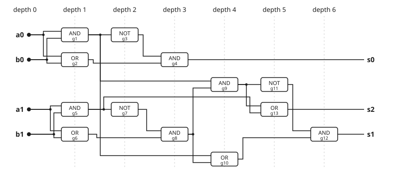

# Boolean circuits: cost measured in gates and in depth

[Syllabus](../../../SYLLABUS.md) → [Computability and complexity](../README.md) → [Algebraic, Interactive and Quantum](../README.md#s05) → Boolean circuits

---

## General Overview

Every processor adds numbers with a fixed network of tiny switches. Take the smallest useful case: add two 2-bit numbers, such as 1 + 3. The answer, 4, needs three bits, 100 in binary. A network of 13 AND, OR and NOT gates does it.

That network has two costs, and they pull in different directions:

- **Gates.** Each gate is chip area and energy. The adder here uses 13.
- **Depth.** Each gate waits for its inputs to settle. The longest chain of gates from an input to an output sets how long the whole answer takes. Here that chain is 6 gates long.

A **Boolean circuit** is such a network: inputs that are 0 or 1, gates that each compute AND, OR or NOT of earlier wires, and some wires marked as outputs. Its **size** is the number of gates. Its **depth** is the number of gates on the longest path from an input to an output.

A circuit may send one gate's output to several later gates. A **formula** may not: it is a circuit where every gate feeds at most one later gate, so it is a tree, the shape of an expression written on paper. Writing the 13-gate adder as formulas means copying every shared part, and the formulas cost 26 gates in all.

**A circuit's cost is two numbers, gates and depth; writing it as a formula copies every shared gate, which can cost many more gates but never changes the depth, and a formula of depth d never needs more than 2^d − 1 gates.**

**What kind of fact this is:** circuit, formula, size and depth are definitions. The bound "a formula of depth d has at most 2^d − 1 gates" is a theorem, proved on this card in Why it works. The reverse direction, that a formula can be rebuilt with depth a fixed multiple of log2 of its gate count, is Spira's 1971 theorem, stated here with its key steps and a source.

### The picture: the 13-gate adder, one column per depth

<p align="center"></p>

Schematic, not to scale. Inputs sit in column 0. A gate sits in the column equal to its depth. A dot marks a wire that feeds more than one gate; g1, for example, feeds three. A formula cannot do that.

---

## The formula

The numbers to add are $`a`$ and $`b`$, each $`k`$ bits long. Their bits are $`a_0, \dots, a_{k-1}`$ and $`b_0, \dots, b_{k-1}`$, low bit first. The answer has $`k + 1`$ bits $`s_0, \dots, s_k`$. The input length is $`n = 2k`$ bits.

Call the ripple-carry adder circuit $`C_k`$ and the same adder written as formulas $`F_k`$. Three exact counts hold for $`k \ge 2`$:

```math
\mathrm{size}(C_k) = 9k - 5, \qquad \mathrm{depth}(C_k) = 2k + 2, \qquad \mathrm{size}(F_k) = 7k^2 - 2
```

**Read it aloud:** the shared circuit grows by nine gates per bit, its longest path by two gates per bit, and the copied formula grows with the square of the bit count.

For the 2-bit adder, $`k = 2`$: 13 gates, depth 6, and 26 formula gates.

The general link between depth and formula size, for any circuit $`C`$ whose gates have at most two inputs:

```math
\mathrm{depth}(F) = \mathrm{depth}(C) = d \quad\Longrightarrow\quad \mathrm{size}(F) \le 2^{d} - 1 \text{ for each output}
```

**Read it aloud:** unfold a circuit into a formula and the depth stays the same, while each output's formula has at most two to the depth, minus one, gates.

For the sum bit $`s_1`$: depth 6, so at most 63 gates. The real count is 14.

| Symbol | Plain meaning | In our example | Push it up and the answer… |
| --- | --- | --- | --- |
| $`a_i`$, $`b_i`$ | bit $`i`$ of each number, low bit first | 1 = 01 and 3 = 11 | — |
| $`s_i`$ | bit $`i`$ of the sum | 4 = 100 | — |
| $`k`$ | bits in each number | 2 | more gates and more depth |
| $`n`$ | input length, $`2k`$ bits | 4 | — |
| $`C`$, $`C_k`$ | a circuit; the ripple-carry adder for $`k`$ bits | 13 gates | — |
| $`F`$, $`F_k`$ | a formula: a circuit where no gate output is shared | 26 gates | — |
| $`\mathrm{size}`$ | number of gates, NOT gates included | 13 | more area and energy |
| $`\mathrm{depth}`$, $`d`$ | gates on the longest input-to-output path | 6 | longer wait for the answer |
| $`c_i`$ | the carry out of bit $`i`$ | $`c_0 = 1`$ for 1 + 3 | — |
| $`h`$, $`t`$, $`u`$ | in one bit's block: $`a_i`$ AND $`b_i`$, $`a_i`$ XOR $`b_i`$, and $`t`$ AND carry-in | 0, 1 and 1 for 1 + 3 | — |
| $`\oplus`$ | XOR, exclusive or: 1 when exactly one input is 1 | $`a_1 \oplus b_1 = 1`$ for 1 + 3 | — |
| $`f_i`$, $`e_i`$ | formula size and depth of the carry $`c_i`$ (proof fold only) | $`f_0 = 1`$, $`e_0 = 1`$ | — |

XOR, "exclusive or", is 1 when exactly one input is 1. It is not a gate here. It is built from four gates: $`(x \lor y) \land \lnot(x \land y)`$.

### When it holds

- **Every gate has at most two inputs.** One OR gate with many input wires has depth 1. Rebuilt from two-input ORs it needs depth log2 of the wire count, rounded up. Circuits with unlimited inputs per gate are a separate model, met in [Circuit lower bounds](../04-Beyond%20Worst%20Case/07-circuit-complexity-and-lower-bounds.md).
- **No loops.** A wire that feeds back into an earlier gate makes memory, not a circuit. Depth then has no meaning.
- **Every gate counts as one, NOT included.** Some books count only AND and OR gates, or count a formula's leaves. The numbers on this card then change; the bound and the growth rates keep their shape.
- **One circuit per input length.** $`C_2`$ adds 2-bit numbers and nothing else. A problem on all input lengths needs a family $`C_1, C_2, \dots`$, one circuit per length.
- **Depth is a model of time.** Real gates and wires have different delays; depth counts each gate as one step.

---

## Why it works

### Step 0: a circuit is a recipe that reuses its own results

A gate's output is a single 0 or 1 that any number of later gates may read. Reusing it costs nothing extra. A formula is an expression on paper, and paper has no "reuse": each time a result is needed, it is written out again. So turning a circuit into a formula means copying. The depth stays the same, because copying a path does not make it longer. The size grows, and the copies can at most double at each layer, which gives the $`2^d`$ ceiling.

The laws of AND, OR and NOT, De Morgan's laws and truth tables are on the [Boolean algebra](../../03-Algebra/10-For%20the%20Curious/05-boolean-algebra-and-lattices.md) card. That card ends by asking how many gates a rule needs. This card counts them.

### Step 1: one bit of addition is an XOR and an AND

Adding two bits gives a sum bit and a carry. The sum bit is 1 when exactly one input is 1: that is XOR. The carry is 1 when both are 1: that is AND.

XOR from AND, OR and NOT: "at least one" AND NOT "both". That uses four gates, and the AND inside it is the carry, so the half adder (one bit, no carry in) costs four gates in all. Its depth is 3: the AND, then the NOT, then the last AND.

An exhaustive search in the code tries every circuit of up to three gates on two inputs. None computes XOR. So four gates is the least possible. A second search, layer by layer, finds no circuit of depth 2 that computes XOR, so depth 3 is the least possible too.

### Step 2: the next bit adds three things

Bit 1 must add $`a_1`$, $`b_1`$ and the carry $`c_0`$ from bit 0. Do it in two XOR steps:

1. $`t = a_1 \oplus b_1`$, with $`h = a_1 \land b_1`$ shared from inside the XOR.
2. $`s_1 = t \oplus c_0`$, with $`u = t \land c_0`$ shared from inside the second XOR.
3. The carry out is $`h \lor u`$. Either both input bits were 1, or exactly one was and a carry came in. The two cases never happen together, so OR is safe.

That block is 4 + 4 + 1 = 9 gates. Bit 0 costs 4, so $`k`$ bits cost $`4 + 9(k-1) = 9k - 5`$. For $`k = 2`$: 13.

### Step 3: the carry sets the depth

The carry has to travel. $`c_0`$ is ready at depth 1. Bit 1's $`t`$ is ready at depth 3, so $`u`$ comes at depth 4 and the carry out $`c_1`$ at depth 5. Each further bit adds two layers: one AND, one OR.

The last sum bit waits for the carry before it, then adds three layers of its XOR. That gives depth $`2k + 2`$ for $`k \ge 2`$. Its name is **ripple carry**: the carry ripples along the bits one block at a time. For 64-bit numbers the depth is 130.

### Step 4: the formula copies, but only where a result is read twice

In the formula, each XOR reads both of its inputs twice: once in the OR and once in the AND. So the sum bit $`s_i`$ holds two full copies of the carry formula $`c_{i-1}`$.

The carry chain itself reads each carry only once, through $`u`$. So the carry formula grows by 7 gates per bit, and each sum bit holds two copies of a carry formula. Adding the outputs gives $`7k^2 - 2`$. For $`k = 2`$ the outputs cost 4, 14 and 8 gates: 26 in all, double the circuit.

<details>
<summary>Detailed proof: the three counts by induction on k</summary>

Write $`f_i`$ for the formula size of the carry $`c_i`$. The base is $`f_0 = 1`$: one AND gate.

The carry is $`c_i = h \lor u`$ with $`h = a_i \land b_i`$ and $`u = t \land c_{i-1}`$, where $`t`$ is a 4-gate XOR. So:

$`\displaystyle f_i = 1 + 1 + (1 + 4 + f_{i-1}) = f_{i-1} + 7, \quad\text{so}\quad f_i = 7i + 1.`$

The sum bit is $`s_i = (t \lor c_{i-1}) \land \lnot(t \land c_{i-1})`$, which holds $`t`$ twice and $`c_{i-1}`$ twice:

$`\displaystyle \mathrm{size}(s_i) = 1 + (1 + 4 + f_{i-1}) + (1 + 1 + 4 + f_{i-1}) = 12 + 2f_{i-1} = 14i.`$

The outputs are $`s_0`$ (4 gates), $`s_1, \dots, s_{k-1}`$, and the last carry $`s_k = c_{k-1}`$:

$`\displaystyle \mathrm{size}(F_k) = 4 + \sum_{i=1}^{k-1} 14i + 7(k-1) + 1 = 4 + 7k(k-1) + 7k - 6 = 7k^2 - 2.`$

For depth, write $`e_i`$ for the depth of $`c_i`$. Then $`e_0 = 1`$, and $`e_i = \max(3, e_{i-1}) + 2`$, which gives $`e_i = 2i + 3`$ for $`i \ge 1`$. The sum bit $`s_i`$ has depth $`\max(3, e_{i-1}) + 3`$. For $`k \ge 2`$ the deepest output is $`s_{k-1}`$, at depth $`\max(3, e_{k-2}) + 3 = 2k + 2`$. The carry $`s_k`$ is one layer shallower, at $`2k + 1`$.

</details>

### Step 5: any circuit unfolds into a formula of the same depth

This step proves the bound in The formula.

Start at an output gate and walk backwards. Every time two paths reach the same gate, give each path its own copy of that gate and everything behind it. The result is a tree with the same gates on every path, so the depth is the same.

A tree of depth $`d`$ whose gates have at most two inputs has at most 1 gate on the top layer, 2 on the next, 4 on the next, and so on. In total that is at most $`1 + 2 + \dots + 2^{d-1} = 2^d - 1`$ gates.

For the 2-bit adder the three outputs have depths 3, 6 and 5. The bounds are 7, 63 and 31. The real formula sizes are 4, 14 and 8.

So a shallow circuit always has a small formula. Depth a fixed multiple of log2 $`n`$ gives formulas whose size is at most a fixed power of $`n`$: depth $`3 \log_2 n`$, for example, gives at most $`2^{3 \log_2 n} = n^3`$ gates.

### Step 6: the way back, from a small formula to a shallow one

Spira proved the reverse in 1971: a formula can be rebuilt with depth at most a fixed multiple of log2 of its gate count. The key steps:

1. Any formula tree has a sub-formula holding between a third and two thirds of its gates.
2. Compute that sub-formula, and in parallel compute the rest of the formula twice: once with the sub-formula replaced by 0, once by 1.
3. Pick the right answer with three more layers: (sub-formula AND rest-with-1) OR (NOT sub-formula AND rest-with-0).
4. Every piece is now at most two thirds of the size. Repeat. After a number of rounds proportional to log2 of the gate count, the pieces are single gates.

Together with Step 5, this says formula size and depth measure the same thing up to a polynomial. A function has polynomial-size formulas exactly when it has circuits of depth proportional to log2 of the input length. The proof is in the book by Jukna listed under Sources.

### Step 7: trading gates for depth

The ripple adder is cheap in gates but slow, because the carry walks one bit at a time. A **carry-lookahead** adder computes all carries in parallel. For each bit it computes two signals:

- **generate**, $`a_i \land b_i`$: this bit makes a carry by itself.
- **propagate**, $`a_i \lor b_i`$: this bit passes a carry on if one comes in.

A block of bits generates a carry if its high half generates, or its high half propagates and its low half generates. That rule costs two gates, an AND and an OR. A block also passes a carry on only when both halves do, which costs one more AND. So combining two neighbouring blocks takes three gates, and two in the last round, where no later round reads the passing signal. The Kogge–Stone version doubles the block length every round, so the number of rounds grows like log2 $`k`$, not like $`k`$.

Both adders, built and run on the same sums:

| Bits $`k`$ | Ripple gates | Ripple depth | Formula gates | Lookahead gates | Lookahead depth |
| ---: | ---: | ---: | ---: | ---: | ---: |
| 2 | 13 | 6 | 26 | 14 | 6 |
| 4 | 31 | 10 | 110 | 41 | 7 |
| 8 | 67 | 18 | 446 | 107 | 9 |
| 16 | 139 | 34 | 1,790 | 263 | 11 |
| 32 | 283 | 66 | 7,166 | 623 | 13 |
| 64 | 571 | 130 | 28,670 | 1,439 | 15 |

At 64 bits the lookahead adder uses 1,439 gates against 571, and has depth 15 against 130. Neither number is the "cost": a chip designer chooses where to sit between them.

---

## Worked numbers, by hand

Add 1 + 3 on the 13-gate adder. In binary, $`a = 01`$ and $`b = 11`$, so $`a_0 = 1`$, $`a_1 = 0`$, $`b_0 = 1`$, $`b_1 = 1`$. Gate names match the picture.

| Step | Arithmetic | Value |
| --- | --- | --- |
| g1 = $`a_0 \land b_0`$, the carry $`c_0`$ | 1 AND 1 | 1 |
| g2 = $`a_0 \lor b_0`$ | 1 OR 1 | 1 |
| g3 = NOT g1 | NOT 1 | 0 |
| g4 = g2 AND g3, the sum bit $`s_0`$ | 1 AND 0 | 0 |
| g5 = $`a_1 \land b_1`$, called $`h`$ | 0 AND 1 | 0 |
| g6 = $`a_1 \lor b_1`$ | 0 OR 1 | 1 |
| g7 = NOT g5 | NOT 0 | 1 |
| g8 = g6 AND g7, called $`t`$ | 1 AND 1 | 1 |
| g9 = $`t \land c_0`$, called $`u`$ | 1 AND 1 | 1 |
| g10 = $`t \lor c_0`$ | 1 OR 1 | 1 |
| g11 = NOT g9 | NOT 1 | 0 |
| g12 = g10 AND g11, the sum bit $`s_1`$ | 1 AND 0 | 0 |
| g13 = $`h \lor u`$, the carry-out $`s_2`$ | 0 OR 1 | 1 |
| read $`s_2 s_1 s_0`$ | 100 in binary | **4** |
| size and depth | 13 gates; longest path a1 → g5 → g7 → g8 → g9 → g11 → g12 | **13 gates, depth 6** |
| the same adder as formulas | 4 + 14 + 8 | **26 gates** |

The carry from bit 0 travels through g9 and g13 to become the top bit of 4. That travel is the depth.

### What breaks if you drop a piece

The code runs each broken adder on all 16 pairs from 0 + 0 to 3 + 3, and counts the gates of one tree that breaks the two-input rule.

| Mistake | Comes out at | What went wrong |
| --- | --- | --- |
| OR used for the sum bit instead of XOR | wrong on 4 of 16; 3 + 3 gives 7 | OR says 1 when both bits are 1, where the sum bit is 0 |
| carry into bit 1 dropped | wrong on 4 of 16; 3 + 3 gives 4 | the low bits' carry is lost whenever $`a_0 = b_0 = 1`$ |
| carry out taken as $`a_1 \land b_1`$ only | wrong on 2 of 16; 3 + 1 gives 0 | a carry can also pass through bit 1 when exactly one of its bits is 1 |
| answer cut to two bits | wrong on 6 of 16; 3 + 3 gives 2 | sums of 4 or more need a third bit |
| formula priced like the circuit | 13 gates claimed, 26 needed | a formula cannot share; each reuse is a copy |
| gates with three inputs: an OR of three ANDs | depth 2, but 4 gates against the bound $`2^2 - 1 = 3`$ | the bound assumes at most two inputs per gate; with three, a tree of depth $`d`$ can hold $`(3^d - 1)/2`$ gates |

---

## Code, from first principles, and it actually runs

Nothing is imported. The scripts build adders out of gates and count what they built. Five roads cross-check the answer:

1. **Simulation against arithmetic.** Each circuit runs gate by gate against ordinary addition: every pair for $`k \le 4`$, and 41 pairs for larger $`k`$. The 41 are all ones plus one, the worst carry, and 40 pairs from a SplitMix64 generator with seed 2026.
2. **Formula against circuit.** The same adder code builds a tree instead of a gate list. The tree is walked, evaluated and checked against $`7k^2 - 2`$.
3. **Two constructions.** The lookahead adder shares no carry logic with the ripple adder; both must give the same sums.
4. **Exhaustive search.** No circuit of up to three gates, and none of depth 2, on two inputs computes XOR.
5. **Counts against closed forms.** Built sizes and depths meet $`9k - 5`$, $`2k + 2`$ and the bound $`2^d - 1`$, which a tree of three-input gates exceeds. The broken adders are plain bit arithmetic, apart from the gate builder.

### Python

```python
# Boolean circuits -- the check behind the card.  Standard library only.  A k-bit adder
# is built from AND, OR and NOT gates three ways: a ripple-carry circuit that shares gates,
# the same adder as a formula (a tree: a shared part is copied each time it is used) and a
# carry-lookahead circuit.  Each runs on real sums; sizes and depths are counted, not assumed.

class Circuit:                        # a gate list; inputs and gates are numbered
    def __init__(s, n): s.ops, s.ins = [("IN", i) for i in range(n)], list(range(n))
    def add(s, *op): s.ops.append(op); return len(s.ops) - 1
    def AND(s, x, y): return s.add("AND", x, y)
    def OR(s, x, y): return s.add("OR", x, y)
    def NOT(s, x): return s.add("NOT", x)
    def size(s): return len(s.ops) - len(s.ins)
    def depths(s):                    # depth: gates on the longest path from an input
        d = []
        for op, *a in s.ops: d.append(0 if op == "IN" else 1 + max(d[x] for x in a))
        return d
    def run(s, bits):
        v = []
        for op, *a in s.ops:
            v.append(bits[a[0]] if op == "IN" else 1 - v[a[0]] if op == "NOT"
                     else v[a[0]] & v[a[1]] if op == "AND" else v[a[0]] | v[a[1]])
        return v

class Formula:                        # a tree: nothing is shared, every use is a copy
    def __init__(s, n): s.ins = [("IN", i) for i in range(n)]
    def AND(s, x, y): return ("AND", x, y)
    def OR(s, x, y): return ("OR", x, y)
    def NOT(s, x): return ("NOT", x)
def t_size(t): return 0 if t[0] == "IN" else 1 + sum(t_size(c) for c in t[1:])
def t_depth(t): return 0 if t[0] == "IN" else 1 + max(t_depth(c) for c in t[1:])
def t_eval(t, bits):
    if t[0] == "IN": return bits[t[1]]
    v = [t_eval(c, bits) for c in t[1:]]
    return 1 - v[0] if t[0] == "NOT" else v[0] & v[1] if t[0] == "AND" else v[0] | v[1]

def xor(m, x, y):                     # (x OR y) AND NOT(x AND y): 4 gates, depth 3
    both = m.AND(x, y)
    return m.AND(m.OR(x, y), m.NOT(both)), both

def ripple(m, k):                     # inputs a0..a(k-1), then b0..b(k-1), low bit first
    a, b = m.ins[:k], m.ins[k:]
    s, c = xor(m, a[0], b[0])         # bit 0: sum bit, and carry a0 AND b0
    out = [s]
    for i in range(1, k):
        t, h = xor(m, a[i], b[i])     # t = a XOR b, h = a AND b
        s, u = xor(m, t, c)           # sum bit, and u = t AND carry-in
        out.append(s); c = m.OR(h, u)
    return out + [c]
def lookahead(m, k):                  # Kogge-Stone: each round doubles the span a carry covers
    a, b = m.ins[:k], m.ins[k:]
    g = [m.AND(a[i], b[i]) for i in range(k)]            # bit i makes a carry
    p = [m.OR(a[i], b[i]) for i in range(k)]             # bit i passes a carry on
    x = [m.AND(p[i], m.NOT(g[i])) for i in range(k)]     # a XOR b
    G, P, d = g, p, 1
    while d < k:
        G, P = ([G[i] if i < d else m.OR(G[i], m.AND(P[i], G[i - d])) for i in range(k)],
                [P[i] if i < d or 2 * d >= k else m.AND(P[i], P[i - d]) for i in range(k)])
        d *= 2
    return [x[0]] + [xor(m, x[i], G[i - 1])[0] for i in range(1, k)] + [G[k - 1]]
def bits_of(a, b, k): return [a >> i & 1 for i in range(k)] + [b >> i & 1 for i in range(k)]
def value(bits): return sum(v << i for i, v in enumerate(bits))
def build(k, how): m = Circuit(2 * k); return m, how(m, k)
def run_sum(m, outs, a, b, k): v = m.run(bits_of(a, b, k)); return value([v[o] for o in outs])

m, outs = build(2, ripple); dep = m.depths()
def name(j): return ["a0", "a1", "b0", "b1"][j] if j < 4 else f"g{j - 3}"
print(f"2-bit adder circuit: {m.size()} gates, depth {max(dep)}; output depths "
      + " ".join(f"s{i}={dep[o]}" for i, o in enumerate(outs)))
ok = sum(run_sum(m, outs, a, b, 2) == a + b for a in range(4) for b in range(4))
print(f"circuit right on {ok} of 16 inputs")
v = m.run(bits_of(1, 3, 2))
print("trace 1 + 3: " + " ".join(f"{name(j)}={v[j]}" for j in range(4, len(v)))
      + f" -> s2 s1 s0 = {v[outs[2]]}{v[outs[1]]}{v[outs[0]]} = {value([v[o] for o in outs])}")
cols = [" ".join(name(j) for j in range(len(dep)) if dep[j] == c) for c in range(max(dep) + 1)]
print("figure, depth columns: " + " | ".join(f"{c}: {s}" for c, s in enumerate(cols)))
fo = ripple(Formula(4), 2)
fs, fd = [t_size(t) for t in fo], [t_depth(t) for t in fo]
fok = sum(value([t_eval(t, bits_of(a, b, 2)) for t in fo]) == a + b for a in range(4) for b in range(4))
print(f"formula: s0={fs[0]} s1={fs[1]} s2={fs[2]} gates, {sum(fs)} in all; "
      f"depths {fd[0]}, {fd[1]}, {fd[2]}; right on {fok} of 16 inputs")
print("unfolding bound, size <= 2^depth - 1: " + ", ".join(f"{a} <= {2 ** d - 1}" for a, d in zip(fs, fd)))
assert ok == 16 and fok == 16 and fd == [dep[o] for o in outs] and all(a <= 2 ** d - 1 for a, d in zip(fs, fd)) and sum(fs) == 2 * m.size()

A, B, ALL, XOR, CARRY = 0b1100, 0b1010, 0b1111, 0b0110, 0b1000   # truth tables, rows ab = 00..11
def fits(nodes, targets, left):       # can `left` more gates reach every target?
    if all(t in nodes for t in targets): return True
    if left == 0: return False
    n = len(nodes)
    new = [ALL ^ x for x in nodes] + [f for i in range(n) for j in range(i + 1, n)
                                     for f in (nodes[i] & nodes[j], nodes[i] | nodes[j])]
    return any(fits(nodes + [w], targets, left - 1) for w in new)
def least_gates(targets): return next(g for g in range(9) if fits([A, B], targets, g))
def least_depth(t):
    level, d = {A, B}, 0
    while t not in level:
        level = (level | {ALL ^ x for x in level} | {x & y for x in level for y in level}
                 | {x | y for x in level for y in level})
        d += 1
    return d
lx, dx, lh = least_gates([XOR]), least_depth(XOR), least_gates([XOR, CARRY])
xc = Circuit(2); xor(xc, 0, 1)
print(f"search: XOR needs {lx} gates (none with {lx - 1}) and depth {dx}; "
      f"half adder (sum and carry) needs {lh} gates")
assert lx == xc.size() and dx == max(xc.depths()) and lh == lx

state = 2026                          # SplitMix64, seed 2026, for test sums
def splitmix():
    global state
    M = (1 << 64) - 1; state = (state + 0x9E3779B97F4A7C15) & M; z = state
    z = ((z ^ (z >> 30)) * 0xBF58476D1CE4E5B9) & M; z = ((z ^ (z >> 27)) * 0x94D049BB133111EB) & M
    return z ^ (z >> 31)
for k in (1, 2, 4, 8, 16, 32, 64):
    r, ro = build(k, ripple); l, lo = build(k, lookahead); fo = ripple(Formula(2 * k), k)
    fsz, rd, ld, top = sum(t_size(t) for t in fo), max(r.depths()), max(l.depths()), (1 << k) - 1
    pairs = ([(a, b) for a in range(top + 1) for b in range(top + 1)] if k <= 4 else
             [(top, 1)] + [(splitmix() & top, splitmix() & top) for _ in range(40)])
    good = sum(run_sum(r, ro, a, b, k) == a + b == run_sum(l, lo, a, b, k)
               == value([t_eval(t, bits_of(a, b, k)) for t in fo]) for a, b in pairs)
    print(f"k={k}: ripple {r.size()} gates, depth {rd}; formula {fsz} gates; "
          f"lookahead {l.size()} gates, depth {ld}; {good} of {len(pairs)} sums right")
    assert good == len(pairs) and r.size() == 9 * k - 5 and fsz == 7 * k * k - 2
    assert rd == (3 if k == 1 else 2 * k + 2) == max(t_depth(t) for t in fo) and ld <= 2 * (k - 1).bit_length() + 4

def adder2(a, b, slip):               # the 2-bit adder in plain bit arithmetic, one piece swapped
    a0, a1, b0, b1 = a & 1, a >> 1, b & 1, b >> 1
    c0 = 0 if slip == "carry into bit 1 dropped" else a0 & b0
    s0 = a0 | b0 if slip == "OR for the sum bit" else a0 ^ b0
    s2 = (a1 & b1) | ((a1 ^ b1) & c0)
    s2 = 0 if slip == "answer cut to two bits" else a1 & b1 if slip == "carry out as a1 AND b1" else s2
    return s0 + 2 * (a1 ^ b1 ^ c0) + 4 * s2
miss = [sum(adder2(a, b, "none") != a + b for a in range(4) for b in range(4))]
for slip in ("OR for the sum bit", "carry into bit 1 dropped", "carry out as a1 AND b1", "answer cut to two bits"):
    bad = [(a, b) for a in range(4) for b in range(4) if adder2(a, b, slip) != a + b]
    a, b = bad[-1]; miss.append(len(bad))
    print(f"mistake, {slip}: wrong on {len(bad)} of 16, e.g. {a} + {b} -> {adder2(a, b, slip)}")
wide = ("OR", *[("AND", *[("IN", 3 * i + j) for j in range(3)]) for i in range(3)])   # gates with 3 inputs
print(f"mistake, gates with 3 inputs: an OR of three ANDs, depth {t_depth(wide)}, {t_size(wide)} gates; bound 2^{t_depth(wide)} - 1 = {2 ** t_depth(wide) - 1}")
assert miss == [0, 4, 4, 2, sum(a + b >= 4 for a in range(4) for b in range(4))]
assert t_size(wide) == (3 ** t_depth(wide) - 1) // 2 > 2 ** t_depth(wide) - 1      # a 3-input tree beats the bound
print("ALL CHECKS PASS")
```

**Ran 2026-11-19 on macOS, Python 3.14.10, standard library only. All checks passed. Output, pasted from the run:**

```
2-bit adder circuit: 13 gates, depth 6; output depths s0=3 s1=6 s2=5
circuit right on 16 of 16 inputs
trace 1 + 3: g1=1 g2=1 g3=0 g4=0 g5=0 g6=1 g7=1 g8=1 g9=1 g10=1 g11=0 g12=0 g13=1 -> s2 s1 s0 = 100 = 4
figure, depth columns: 0: a0 a1 b0 b1 | 1: g1 g2 g5 g6 | 2: g3 g7 | 3: g4 g8 | 4: g9 g10 | 5: g11 g13 | 6: g12
formula: s0=4 s1=14 s2=8 gates, 26 in all; depths 3, 6, 5; right on 16 of 16 inputs
unfolding bound, size <= 2^depth - 1: 4 <= 7, 14 <= 63, 8 <= 31
search: XOR needs 4 gates (none with 3) and depth 3; half adder (sum and carry) needs 4 gates
k=1: ripple 4 gates, depth 3; formula 5 gates; lookahead 4 gates, depth 3; 4 of 4 sums right
k=2: ripple 13 gates, depth 6; formula 26 gates; lookahead 14 gates, depth 6; 16 of 16 sums right
k=4: ripple 31 gates, depth 10; formula 110 gates; lookahead 41 gates, depth 7; 256 of 256 sums right
k=8: ripple 67 gates, depth 18; formula 446 gates; lookahead 107 gates, depth 9; 41 of 41 sums right
k=16: ripple 139 gates, depth 34; formula 1790 gates; lookahead 263 gates, depth 11; 41 of 41 sums right
k=32: ripple 283 gates, depth 66; formula 7166 gates; lookahead 623 gates, depth 13; 41 of 41 sums right
k=64: ripple 571 gates, depth 130; formula 28670 gates; lookahead 1439 gates, depth 15; 41 of 41 sums right
mistake, OR for the sum bit: wrong on 4 of 16, e.g. 3 + 3 -> 7
mistake, carry into bit 1 dropped: wrong on 4 of 16, e.g. 3 + 3 -> 4
mistake, carry out as a1 AND b1: wrong on 2 of 16, e.g. 3 + 1 -> 0
mistake, answer cut to two bits: wrong on 6 of 16, e.g. 3 + 3 -> 2
mistake, gates with 3 inputs: an OR of three ANDs, depth 2, 4 gates; bound 2^2 - 1 = 3
ALL CHECKS PASS
```

### Rust

Same numbers, same labels, built with `rustc --edition 2021 -O`. The formula is a tree of shared pointers, walked so that every use counts as a copy; the numbers are 128-bit so 64-bit sums cannot overflow.

```rust
// Boolean circuits -- the same check as the Python, in Rust.  No crates.  A k-bit adder
// is built from AND, OR and NOT gates three ways: a ripple-carry circuit that shares gates,
// the same adder as a formula (a tree: a shared part is copied each time it is used) and a
// carry-lookahead circuit.  Each runs on real sums; sizes and depths are counted, not assumed.
use std::rc::Rc;

trait Build { type N: Clone; fn and(&mut self, x: Self::N, y: Self::N) -> Self::N;
    fn or(&mut self, x: Self::N, y: Self::N) -> Self::N; fn not(&mut self, x: Self::N) -> Self::N; }

struct Circuit { ops: Vec<(u8, usize, usize)>, n: usize }   // op 0 input, 1 NOT, 2 AND, 3 OR
impl Circuit {
    fn new(n: usize) -> Circuit { Circuit { ops: (0..n).map(|i| (0, i, 0)).collect(), n } }
    fn add(&mut self, op: u8, x: usize, y: usize) -> usize { self.ops.push((op, x, y)); self.ops.len() - 1 }
    fn size(&self) -> usize { self.ops.len() - self.n }
    fn depths(&self) -> Vec<usize> {                         // gates on the longest path from an input
        let mut d: Vec<usize> = Vec::new();
        for &(op, x, y) in &self.ops { let v = match op { 0 => 0, 1 => 1 + d[x], _ => 1 + d[x].max(d[y]) }; d.push(v); }
        d
    }
    fn run(&self, bits: &[u8]) -> Vec<u8> {
        let mut v: Vec<u8> = Vec::new();
        for &(op, x, y) in &self.ops { let w = match op { 0 => bits[x], 1 => 1 - v[x], 2 => v[x] & v[y], _ => v[x] | v[y] }; v.push(w); }
        v
    }
}
impl Build for Circuit { type N = usize;
    fn and(&mut self, x: usize, y: usize) -> usize { self.add(2, x, y) }
    fn or(&mut self, x: usize, y: usize) -> usize { self.add(3, x, y) }
    fn not(&mut self, x: usize) -> usize { self.add(1, x, 0) } }

enum T { In(usize), Not(Rc<T>), And(Rc<T>, Rc<T>), Or(Rc<T>, Rc<T>) }   // a formula: a tree
struct Formula;
impl Build for Formula { type N = Rc<T>;
    fn and(&mut self, x: Rc<T>, y: Rc<T>) -> Rc<T> { Rc::new(T::And(x, y)) }
    fn or(&mut self, x: Rc<T>, y: Rc<T>) -> Rc<T> { Rc::new(T::Or(x, y)) }
    fn not(&mut self, x: Rc<T>) -> Rc<T> { Rc::new(T::Not(x)) } }
fn t_size(t: &T) -> usize { match t { T::In(_) => 0, T::Not(x) => 1 + t_size(x), T::And(x, y) | T::Or(x, y) => 1 + t_size(x) + t_size(y) } }
fn t_depth(t: &T) -> usize { match t { T::In(_) => 0, T::Not(x) => 1 + t_depth(x), T::And(x, y) | T::Or(x, y) => 1 + t_depth(x).max(t_depth(y)) } }
fn t_eval(t: &T, b: &[u8]) -> u8 { match t { T::In(i) => b[*i], T::Not(x) => 1 - t_eval(x, b),
    T::And(x, y) => t_eval(x, b) & t_eval(y, b), T::Or(x, y) => t_eval(x, b) | t_eval(y, b) } }

fn xor<B: Build>(m: &mut B, x: B::N, y: B::N) -> (B::N, B::N) {   // (x OR y) AND NOT(x AND y)
    let both = m.and(x.clone(), y.clone()); let o = m.or(x, y); let nb = m.not(both.clone());
    (m.and(o, nb), both)
}
fn ripple<B: Build>(m: &mut B, a: &[B::N], b: &[B::N]) -> Vec<B::N> {
    let (s, mut c) = xor(m, a[0].clone(), b[0].clone());   // bit 0: sum bit, and carry a0 AND b0
    let mut out = vec![s];
    for i in 1..a.len() {
        let (t, h) = xor(m, a[i].clone(), b[i].clone());  // t = a XOR b, h = a AND b
        let (s, u) = xor(m, t, c.clone());                 // sum bit, and u = t AND carry-in
        out.push(s); c = m.or(h, u);
    }
    out.push(c); out
}
fn lookahead(m: &mut Circuit, k: usize) -> Vec<usize> {    // Kogge-Stone: spans double each round
    let g: Vec<usize> = (0..k).map(|i| m.and(i, k + i)).collect();
    let p: Vec<usize> = (0..k).map(|i| m.or(i, k + i)).collect();
    let x: Vec<usize> = (0..k).map(|i| { let ng = m.not(g[i]); m.and(p[i], ng) }).collect();
    let (mut gg, mut pp, mut d) = (g.clone(), p.clone(), 1);
    while d < k {
        let mut g2 = gg.clone(); let mut p2 = pp.clone();
        for i in d..k { let t = m.and(pp[i], gg[i - d]); g2[i] = m.or(gg[i], t); }
        if 2 * d < k { for i in d..k { p2[i] = m.and(pp[i], pp[i - d]); } }
        gg = g2; pp = p2; d *= 2;
    }
    let mut out = vec![x[0]];
    for i in 1..k { out.push(xor(m, x[i], gg[i - 1]).0); }
    out.push(gg[k - 1]); out
}
fn bits_of(a: u128, b: u128, k: usize) -> Vec<u8> { (0..k).map(|i| (a >> i & 1) as u8).chain((0..k).map(|i| (b >> i & 1) as u8)).collect() }
fn value(bits: &[u8]) -> u128 { bits.iter().enumerate().map(|(i, &v)| (v as u128) << i).sum() }
fn build_ripple(k: usize) -> (Circuit, Vec<usize>) { let mut m = Circuit::new(2 * k); let ins: Vec<usize> = (0..2 * k).collect(); let o = ripple(&mut m, &ins[..k], &ins[k..]); (m, o) }
fn formula(k: usize) -> Vec<Rc<T>> { let ins: Vec<Rc<T>> = (0..2 * k).map(|i| Rc::new(T::In(i))).collect(); ripple(&mut Formula, &ins[..k], &ins[k..]) }
fn run_sum(m: &Circuit, outs: &[usize], a: u128, b: u128, k: usize) -> u128 { let v = m.run(&bits_of(a, b, k)); value(&outs.iter().map(|&o| v[o]).collect::<Vec<u8>>()) }
fn f_sum(fo: &[Rc<T>], a: u128, b: u128, k: usize) -> u128 { let bits = bits_of(a, b, k); value(&fo.iter().map(|t| t_eval(t, &bits)).collect::<Vec<u8>>()) }
fn join(v: Vec<String>, sep: &str) -> String { v.join(sep) }

const A: u8 = 0b1100; const B: u8 = 0b1010; const ALL: u8 = 0b1111; const XOR: u8 = 0b0110; const CARRY: u8 = 0b1000;
fn fits(nodes: &mut Vec<u8>, targets: &[u8], left: usize) -> bool {   // can `left` more gates reach every target?
    if targets.iter().all(|t| nodes.contains(t)) { return true; }
    if left == 0 { return false; }
    let n = nodes.len();
    let mut new: Vec<u8> = nodes.iter().map(|x| ALL ^ x).collect();
    for i in 0..n { for j in i + 1..n { new.push(nodes[i] & nodes[j]); new.push(nodes[i] | nodes[j]); } }
    for w in new { nodes.push(w); let ok = fits(nodes, targets, left - 1); nodes.pop(); if ok { return true; } }
    false
}
fn least_gates(targets: &[u8]) -> usize { (0..9).find(|&g| fits(&mut vec![A, B], targets, g)).unwrap() }
fn least_depth(t: u8) -> usize {
    let (mut level, mut d) = ([false; 16], 0);
    level[A as usize] = true; level[B as usize] = true;
    while !level[t as usize] {
        let mut next = level;
        for x in 0..16u8 { if !level[x as usize] { continue; } next[(ALL ^ x) as usize] = true;
            for y in 0..16u8 { if level[y as usize] { next[(x & y) as usize] = true; next[(x | y) as usize] = true; } } }
        level = next; d += 1;
    }
    d
}
fn adder2(a: u128, b: u128, slip: &str) -> u128 {          // the 2-bit adder in plain bit arithmetic, one piece swapped
    let (a0, a1, b0, b1) = (a & 1, a >> 1, b & 1, b >> 1);
    let c0 = if slip == "carry into bit 1 dropped" { 0 } else { a0 & b0 };
    let s0 = if slip == "OR for the sum bit" { a0 | b0 } else { a0 ^ b0 };
    let mut s2 = (a1 & b1) | ((a1 ^ b1) & c0);
    if slip == "answer cut to two bits" { s2 = 0 } else if slip == "carry out as a1 AND b1" { s2 = a1 & b1 }
    s0 + 2 * (a1 ^ b1 ^ c0) + 4 * s2
}
fn wide_tree(fan: usize, d: usize) -> (usize, usize) {     // a tree of gates with `fan` inputs each: (gates, depth)
    if d == 0 { (0, 0) } else { let (s, e) = wide_tree(fan, d - 1); (1 + fan * s, 1 + e) }
}

fn main() {
    let (m, outs) = build_ripple(2); let dep = m.depths(); let dmax = *dep.iter().max().unwrap();
    let name = |j: usize| -> String { if j < 4 { ["a0", "a1", "b0", "b1"][j].to_string() } else { format!("g{}", j - 3) } };
    println!("2-bit adder circuit: {} gates, depth {}; output depths {}", m.size(), dmax,
             join(outs.iter().enumerate().map(|(i, &o)| format!("s{}={}", i, dep[o])).collect(), " "));
    let mut ok = 0; for a in 0..4u128 { for b in 0..4u128 { if run_sum(&m, &outs, a, b, 2) == a + b { ok += 1; } } }
    println!("circuit right on {} of 16 inputs", ok);
    let v = m.run(&bits_of(1, 3, 2));
    println!("trace 1 + 3: {} -> s2 s1 s0 = {}{}{} = {}", join((4..v.len()).map(|j| format!("{}={}", name(j), v[j])).collect(), " "),
             v[outs[2]], v[outs[1]], v[outs[0]], value(&outs.iter().map(|&o| v[o]).collect::<Vec<u8>>()));
    let cols: Vec<String> = (0..=dmax).map(|c| format!("{}: {}", c, join((0..dep.len()).filter(|&j| dep[j] == c).map(|j| name(j)).collect(), " "))).collect();
    println!("figure, depth columns: {}", join(cols, " | "));
    let fo = formula(2);
    let fs: Vec<usize> = fo.iter().map(|t| t_size(t)).collect(); let fd: Vec<usize> = fo.iter().map(|t| t_depth(t)).collect();
    let mut fok = 0; for a in 0..4u128 { for b in 0..4u128 { if f_sum(&fo, a, b, 2) == a + b { fok += 1; } } }
    println!("formula: s0={} s1={} s2={} gates, {} in all; depths {}, {}, {}; right on {} of 16 inputs",
             fs[0], fs[1], fs[2], fs.iter().sum::<usize>(), fd[0], fd[1], fd[2], fok);
    println!("unfolding bound, size <= 2^depth - 1: {}", join((0..3).map(|i| format!("{} <= {}", fs[i], (1usize << fd[i]) - 1)).collect(), ", "));
    assert!(ok == 16 && fok == 16 && (0..3).all(|i| fd[i] == dep[outs[i]] && fs[i] <= (1usize << fd[i]) - 1));
    assert!(fs.iter().sum::<usize>() == 2 * m.size());

    let (lx, dx, lh) = (least_gates(&[XOR]), least_depth(XOR), least_gates(&[XOR, CARRY]));
    let mut xc = Circuit::new(2); xor(&mut xc, 0, 1);
    println!("search: XOR needs {} gates (none with {}) and depth {}; half adder (sum and carry) needs {} gates", lx, lx - 1, dx, lh);
    assert!(lx == xc.size() && dx == *xc.depths().iter().max().unwrap() && lh == lx);

    let mut state: u64 = 2026;                               // SplitMix64, seed 2026, for test sums
    let mut splitmix = || -> u128 { state = state.wrapping_add(0x9E3779B97F4A7C15); let mut z = state;
        z = (z ^ (z >> 30)).wrapping_mul(0xBF58476D1CE4E5B9); z = (z ^ (z >> 27)).wrapping_mul(0x94D049BB133111EB); (z ^ (z >> 31)) as u128 };
    for &k in &[1usize, 2, 4, 8, 16, 32, 64] {
        let (r, ro) = build_ripple(k); let mut l = Circuit::new(2 * k); let lo = lookahead(&mut l, k); let fo = formula(k);
        let fsz: usize = fo.iter().map(|t| t_size(t)).sum();
        let (rd, ld) = (*r.depths().iter().max().unwrap(), *l.depths().iter().max().unwrap());
        let top: u128 = (1u128 << k) - 1;
        let mut pairs: Vec<(u128, u128)> = Vec::new();
        if k <= 4 { for a in 0..=top { for b in 0..=top { pairs.push((a, b)); } } }
        else { pairs.push((top, 1)); for _ in 0..40 { let a = splitmix() & top; let b = splitmix() & top; pairs.push((a, b)); } }
        let good = pairs.iter().filter(|&&(a, b)| run_sum(&r, &ro, a, b, k) == a + b && run_sum(&l, &lo, a, b, k) == a + b && f_sum(&fo, a, b, k) == a + b).count();
        println!("k={}: ripple {} gates, depth {}; formula {} gates; lookahead {} gates, depth {}; {} of {} sums right",
                 k, r.size(), rd, fsz, l.size(), ld, good, pairs.len());
        let ceil_log = (usize::BITS - (k - 1).leading_zeros()) as usize;
        assert!(good == pairs.len() && r.size() == 9 * k - 5 && fsz == 7 * k * k - 2);
        assert!(rd == (if k == 1 { 3 } else { 2 * k + 2 }) && fo.iter().map(|t| t_depth(t)).max().unwrap() == rd && ld <= 2 * ceil_log + 4);
    }

    let mut miss = vec![(0..16u128).filter(|&i| adder2(i / 4, i % 4, "none") != i / 4 + i % 4).count()];
    for slip in ["OR for the sum bit", "carry into bit 1 dropped", "carry out as a1 AND b1", "answer cut to two bits"] {
        let bad: Vec<(u128, u128)> = (0..16u128).map(|i| (i / 4, i % 4)).filter(|&(a, b)| adder2(a, b, slip) != a + b).collect();
        let (a, b) = bad[bad.len() - 1]; miss.push(bad.len());
        println!("mistake, {}: wrong on {} of 16, e.g. {} + {} -> {}", slip, bad.len(), a, b, adder2(a, b, slip));
    }
    let (ws, wd) = wide_tree(3, 2);                           // an OR of three ANDs, 3 inputs a gate
    println!("mistake, gates with 3 inputs: an OR of three ANDs, depth {}, {} gates; bound 2^{} - 1 = {}", wd, ws, wd, (1usize << wd) - 1);
    assert!(miss == vec![0, 4, 4, 2, (0..16u128).filter(|&i| i / 4 + i % 4 >= 4).count()]);
    assert!(ws == (3usize.pow(wd as u32) - 1) / 2 && ws > (1usize << wd) - 1);   // a 3-input tree beats the bound
    println!("ALL CHECKS PASS");
}
```

**Ran 2026-11-19 on macOS, rustc 1.98.1, no crates. All checks passed. Output, pasted from the run:**

```
2-bit adder circuit: 13 gates, depth 6; output depths s0=3 s1=6 s2=5
circuit right on 16 of 16 inputs
trace 1 + 3: g1=1 g2=1 g3=0 g4=0 g5=0 g6=1 g7=1 g8=1 g9=1 g10=1 g11=0 g12=0 g13=1 -> s2 s1 s0 = 100 = 4
figure, depth columns: 0: a0 a1 b0 b1 | 1: g1 g2 g5 g6 | 2: g3 g7 | 3: g4 g8 | 4: g9 g10 | 5: g11 g13 | 6: g12
formula: s0=4 s1=14 s2=8 gates, 26 in all; depths 3, 6, 5; right on 16 of 16 inputs
unfolding bound, size <= 2^depth - 1: 4 <= 7, 14 <= 63, 8 <= 31
search: XOR needs 4 gates (none with 3) and depth 3; half adder (sum and carry) needs 4 gates
k=1: ripple 4 gates, depth 3; formula 5 gates; lookahead 4 gates, depth 3; 4 of 4 sums right
k=2: ripple 13 gates, depth 6; formula 26 gates; lookahead 14 gates, depth 6; 16 of 16 sums right
k=4: ripple 31 gates, depth 10; formula 110 gates; lookahead 41 gates, depth 7; 256 of 256 sums right
k=8: ripple 67 gates, depth 18; formula 446 gates; lookahead 107 gates, depth 9; 41 of 41 sums right
k=16: ripple 139 gates, depth 34; formula 1790 gates; lookahead 263 gates, depth 11; 41 of 41 sums right
k=32: ripple 283 gates, depth 66; formula 7166 gates; lookahead 623 gates, depth 13; 41 of 41 sums right
k=64: ripple 571 gates, depth 130; formula 28670 gates; lookahead 1439 gates, depth 15; 41 of 41 sums right
mistake, OR for the sum bit: wrong on 4 of 16, e.g. 3 + 3 -> 7
mistake, carry into bit 1 dropped: wrong on 4 of 16, e.g. 3 + 3 -> 4
mistake, carry out as a1 AND b1: wrong on 2 of 16, e.g. 3 + 1 -> 0
mistake, answer cut to two bits: wrong on 6 of 16, e.g. 3 + 3 -> 2
mistake, gates with 3 inputs: an OR of three ANDs, depth 2, 4 gates; bound 2^2 - 1 = 3
ALL CHECKS PASS
```

### Lean

Lean proves the unfolding bound for every circuit, the adder's sums and three counts for every $`k`$, and the worked numbers.

- Take any circuit with no loops whose gates have at most two inputs. Then each output's formula gives the same bit on every input, has the same depth $`d`$, and at most $`2^d - 1`$ gates.
- Take $`k \ge 1`$ and two $`k`$-bit numbers $`a`$ and $`b`$. Then the output bits of $`C_k`$ spell $`a + b`$ in binary.
- Take $`k \ge 2`$. Then $`C_k`$ has $`9k - 5`$ gates and depth $`2k + 2`$, and $`F_k`$ has $`7k^2 - 2`$ gates.
- The 2-bit adder has 13 gates and depth 6, with outputs at depths 3, 6 and 5.
- Adding 1 + 3 gives the 13 gate values in the hand table, and the answer 100, which is 4.
- The 2-bit adder is right on all 16 pairs, from 0 + 0 to 3 + 3.
- As formulas its outputs cost 4, 14 and 8 gates, 26 in all, within the bounds 7, 63 and 31.
- For 1, 4 and 8 bits, the ripple gates, ripple depth and formula gates match the code's output.

The lookahead adder, the XOR searches, the broken adders, the three-input tree and the random sums are left to the Python and Rust checks.

```lean
-- Boolean circuits: unfolding a circuit of two-input AND, OR and NOT gates into formulas keeps every output's value and depth and gives it at most 2^d - 1 gates, and the k-bit ripple-carry adder adds correctly with 9k - 5 gates, depth 2k + 2 and 7k^2 - 2 formula gates.
import Mathlib.Data.Nat.Digits.Defs
import Mathlib.Tactic.Linarith
import Mathlib.Tactic.IntervalCases
import Mathlib.Tactic.NormNum

/-! Mathlib has no Boolean circuits, so this file defines them as the card does.
A circuit is a list of gates; wires `0, …, inputs - 1` are the inputs and wire `inputs + j`
is gate `j`. Every gate has at most two inputs (the `Gate` type allows nothing else), and every
gate counts as one, NOT included. A formula is a tree: nothing in it is shared. -/

namespace BooleanCircuits

/-! ### Formulas: trees of gates -/

/-- A formula over the input bits `var 0, var 1, …`: AND, OR and NOT gates in a tree. -/
inductive Formula
  | var (i : ℕ)
  | not (f : Formula)
  | and (f g : Formula)
  | or (f g : Formula)
  deriving DecidableEq

namespace Formula

/-- The size of a formula: its number of gates, NOT included; inputs cost nothing. -/
def size : Formula → ℕ
  | var _ => 0
  | not f => f.size + 1
  | and f g => f.size + g.size + 1
  | or f g => f.size + g.size + 1

/-- The depth of a formula: the number of gates on its longest path from an input. -/
def depth : Formula → ℕ
  | var _ => 0
  | not f => f.depth + 1
  | and f g => max f.depth g.depth + 1
  | or f g => max f.depth g.depth + 1

/-- The value of a formula when input bit `i` is `x i`. -/
def eval (x : ℕ → Bool) : Formula → Bool
  | var i => x i
  | not f => !f.eval x
  | and f g => f.eval x && g.eval x
  | or f g => f.eval x || g.eval x

end Formula

/-! ### Circuits: gate lists that may reuse a wire -/

/-- A gate with at most two inputs; each input is a wire number. -/
inductive Gate
  | not (x : ℕ)
  | and (x y : ℕ)
  | or (x y : ℕ)

namespace Gate

/-- The wires a gate reads. -/
def reads : Gate → List ℕ
  | not x => [x]
  | and x y => [x, y]
  | or x y => [x, y]

/-- The gate's value, given the values of all earlier wires. -/
def value (vs : List Bool) : Gate → Bool
  | not x => !vs.getD x false
  | and x y => vs.getD x false && vs.getD y false
  | or x y => vs.getD x false || vs.getD y false

/-- The gate's depth, given the depths of all earlier wires. -/
def depth (ds : List ℕ) : Gate → ℕ
  | not x => ds.getD x 0 + 1
  | and x y => max (ds.getD x 0) (ds.getD y 0) + 1
  | or x y => max (ds.getD x 0) (ds.getD y 0) + 1

/-- The gate written as a formula, given the formulas of all earlier wires: each wire it reads
is copied in whole. -/
def formula (fs : List Formula) : Gate → Formula
  | not x => .not (fs.getD x (.var 0))
  | and x y => .and (fs.getD x (.var 0)) (fs.getD y (.var 0))
  | or x y => .or (fs.getD x (.var 0)) (fs.getD y (.var 0))

end Gate

/-- A circuit: `inputs` input bits, a list of gates, and the wires marked as outputs. -/
structure Circuit where
  inputs : ℕ
  gates : List Gate
  outputs : List ℕ

namespace Circuit

/-- No loops: gate `j` (wire `inputs + j`) reads only earlier wires, and every output is a wire
of the circuit. -/
def WellFormed (C : Circuit) : Prop :=
  (∀ j (hj : j < C.gates.length), ∀ w ∈ (C.gates[j]'hj).reads, w < C.inputs + j) ∧
    ∀ o ∈ C.outputs, o < C.inputs + C.gates.length

/-- The size of a circuit: its number of gates, NOT included. -/
def size (C : Circuit) : ℕ := C.gates.length

/-- The value on every wire, inputs first, when input bit `i` is `x i`. -/
def wireValues (C : Circuit) (x : ℕ → Bool) : List Bool :=
  C.gates.foldl (fun vs g => vs ++ [g.value vs]) ((List.range C.inputs).map x)

/-- The depth of every wire: gates on its longest path from an input. -/
def wireDepths (C : Circuit) : List ℕ :=
  C.gates.foldl (fun ds g => ds ++ [g.depth ds]) (List.replicate C.inputs 0)

/-- Every wire unfolded into a formula: a wire read twice is copied twice. -/
def wireFormulas (C : Circuit) : List Formula :=
  C.gates.foldl (fun fs g => fs ++ [g.formula fs]) ((List.range C.inputs).map Formula.var)

/-- The output bits, in order. -/
def run (C : Circuit) (x : ℕ → Bool) : List Bool :=
  C.outputs.map fun o => (C.wireValues x).getD o false

/-- The depth of each output. -/
def outputDepths (C : Circuit) : List ℕ :=
  C.outputs.map fun o => C.wireDepths.getD o 0

/-- The depth of a circuit: gates on its longest path from an input to an output. -/
def depth (C : Circuit) : ℕ := C.outputDepths.foldr max 0

/-- The circuit written as formulas, one for each output. -/
def formulas (C : Circuit) : List Formula :=
  C.outputs.map fun o => C.wireFormulas.getD o (.var 0)

/-- The total size of the circuit written as formulas. -/
def formulaSize (C : Circuit) : ℕ := (C.formulas.map Formula.size).sum

end Circuit

/-! ### The main claim -/

/-! ### Helper lemmas for the unfolding theorem -/

/-- Folding gates onto a wire list only appends: one new wire per gate. -/
theorem fold_prefix {α : Type} (f : List α → Gate → α) (gs : List Gate) (l : List α) :
    ∃ t, gs.foldl (fun l g => l ++ [f l g]) l = l ++ t ∧ t.length = gs.length := by
  induction gs generalizing l with
  | nil => exact ⟨[], by simp, rfl⟩
  | cons g gs ih =>
    obtain ⟨t, ht, hl⟩ := ih (l ++ [f l g])
    exact ⟨f l g :: t, by simp [List.foldl_cons, ht], by simp [hl]⟩

#print axioms fold_prefix

/-- The number of wires after folding. -/
theorem fold_length {α : Type} (f : List α → Gate → α) (gs : List Gate) (l : List α) :
    (gs.foldl (fun l g => l ++ [f l g]) l).length = l.length + gs.length := by
  obtain ⟨t, ht, hl⟩ := fold_prefix f gs l
  rw [ht, List.length_append, hl]

#print axioms fold_length

/-- Folding gates leaves the earlier wires unchanged. -/
theorem fold_getD_lt {α : Type} (f : List α → Gate → α) (gs : List Gate) (l : List α) (d : α)
    (w : ℕ) (hw : w < l.length) :
    (gs.foldl (fun l g => l ++ [f l g]) l).getD w d = l.getD w d := by
  obtain ⟨t, ht, -⟩ := fold_prefix f gs l
  rw [ht, List.getD_eq_getElem?_getD, List.getD_eq_getElem?_getD, List.getElem?_append_left hw]

#print axioms fold_getD_lt

/-- The wire of gate `j` holds the gate's rule applied to the finished wire list, provided the
rule only looks at the wires the gate reads and those are all earlier wires. -/
theorem fold_getD_gate {α : Type} (f : List α → Gate → α) (d : α)
    (hf : ∀ g l₁ l₂, (∀ w ∈ g.reads, l₁.getD w d = l₂.getD w d) → f l₁ g = f l₂ g)
    (init : List α) (gs : List Gate) (j : ℕ) (g : Gate) (hg : gs[j]? = some g)
    (hr : ∀ w ∈ g.reads, w < init.length + j) :
    (gs.foldl (fun l g => l ++ [f l g]) init).getD (init.length + j) d =
      f (gs.foldl (fun l g => l ++ [f l g]) init) g := by
  obtain ⟨hj, hgj⟩ := List.getElem?_eq_some_iff.1 hg
  have hsplit : gs = gs.take j ++ g :: gs.drop (j + 1) := by
    conv_lhs => rw [← List.take_append_drop j gs]
    rw [List.drop_eq_getElem_cons hj, hgj]
  obtain ⟨t, ht, htl⟩ := fold_prefix f (gs.take j) init
  have hP : ((gs.take j).foldl (fun l g => l ++ [f l g]) init).length = init.length + j := by
    rw [ht, List.length_append, htl, List.length_take]; omega
  generalize hPdef : (gs.take j).foldl (fun l g => l ++ [f l g]) init = P at hP
  obtain ⟨u, hu, -⟩ := fold_prefix f (gs.drop (j + 1)) (P ++ [f P g])
  have hfin : gs.foldl (fun l g => l ++ [f l g]) init = P ++ ([f P g] ++ u) := by
    conv_lhs => rw [hsplit]
    rw [List.foldl_append, List.foldl_cons, hPdef, hu, List.append_assoc]
  rw [hfin]
  have hloc : f P g = f (P ++ ([f P g] ++ u)) g := hf g _ _ (fun w hw => by
    have := hr w hw
    rw [List.getD_eq_getElem?_getD, List.getD_eq_getElem?_getD,
      List.getElem?_append_left (by omega)])
  rw [← hloc, List.getD_eq_getElem?_getD, List.getElem?_append_right (by omega), ← hP]
  simp

#print axioms fold_getD_gate

theorem value_local (g : Gate) (l₁ l₂ : List Bool)
    (h : ∀ w ∈ g.reads, l₁.getD w false = l₂.getD w false) : g.value l₁ = g.value l₂ := by
  cases g with
  | not x => simp only [Gate.value]; rw [h x (by simp [Gate.reads])]
  | and x y => simp only [Gate.value]; rw [h x (by simp [Gate.reads]), h y (by simp [Gate.reads])]
  | or x y => simp only [Gate.value]; rw [h x (by simp [Gate.reads]), h y (by simp [Gate.reads])]

#print axioms value_local

theorem depth_local (g : Gate) (l₁ l₂ : List ℕ)
    (h : ∀ w ∈ g.reads, l₁.getD w 0 = l₂.getD w 0) : g.depth l₁ = g.depth l₂ := by
  cases g with
  | not x => simp only [Gate.depth]; rw [h x (by simp [Gate.reads])]
  | and x y => simp only [Gate.depth]; rw [h x (by simp [Gate.reads]), h y (by simp [Gate.reads])]
  | or x y => simp only [Gate.depth]; rw [h x (by simp [Gate.reads]), h y (by simp [Gate.reads])]

#print axioms depth_local

theorem formula_local (g : Gate) (l₁ l₂ : List Formula)
    (h : ∀ w ∈ g.reads, l₁.getD w (.var 0) = l₂.getD w (.var 0)) :
    g.formula l₁ = g.formula l₂ := by
  cases g with
  | not x => simp only [Gate.formula]; rw [h x (by simp [Gate.reads])]
  | and x y =>
    simp only [Gate.formula]; rw [h x (by simp [Gate.reads]), h y (by simp [Gate.reads])]
  | or x y =>
    simp only [Gate.formula]; rw [h x (by simp [Gate.reads]), h y (by simp [Gate.reads])]

#print axioms formula_local

/-- One gate: if each wire it reads has a formula with the wire's value and depth, so does the
gate's own formula. -/
theorem gate_formula_step (g : Gate) (F : List Formula) (V : List Bool) (D : List ℕ)
    (x : ℕ → Bool)
    (h : ∀ w ∈ g.reads, (F.getD w (.var 0)).eval x = V.getD w false ∧
      (F.getD w (.var 0)).depth = D.getD w 0) :
    (g.formula F).eval x = g.value V ∧ (g.formula F).depth = g.depth D := by
  cases g with
  | not a =>
    obtain ⟨h1, h2⟩ := h a (by simp [Gate.reads])
    simp only [Gate.formula, Gate.value, Gate.depth, Formula.eval, Formula.depth, h1, h2]
    exact ⟨trivial, trivial⟩
  | and a b =>
    obtain ⟨h1, h2⟩ := h a (by simp [Gate.reads])
    obtain ⟨h3, h4⟩ := h b (by simp [Gate.reads])
    simp only [Gate.formula, Gate.value, Gate.depth, Formula.eval, Formula.depth, h1, h2, h3, h4]
    exact ⟨trivial, trivial⟩
  | or a b =>
    obtain ⟨h1, h2⟩ := h a (by simp [Gate.reads])
    obtain ⟨h3, h4⟩ := h b (by simp [Gate.reads])
    simp only [Gate.formula, Gate.value, Gate.depth, Formula.eval, Formula.depth, h1, h2, h3, h4]
    exact ⟨trivial, trivial⟩

#print axioms gate_formula_step

/-- Every formula has at most `2^depth - 1` gates, written without subtraction. -/
theorem formula_size_add_one_le (F : Formula) : F.size + 1 ≤ 2 ^ F.depth := by
  induction F with
  | var i => simp [Formula.size, Formula.depth]
  | not f ih =>
    simp only [Formula.size, Formula.depth, pow_succ]
    have := Nat.one_le_two_pow (n := f.depth)
    omega
  | and f g ihf ihg =>
    simp only [Formula.size, Formula.depth, pow_succ]
    have h1 : 2 ^ f.depth ≤ 2 ^ max f.depth g.depth :=
      Nat.pow_le_pow_right (by norm_num) (le_max_left _ _)
    have h2 : 2 ^ g.depth ≤ 2 ^ max f.depth g.depth :=
      Nat.pow_le_pow_right (by norm_num) (le_max_right _ _)
    omega
  | or f g ihf ihg =>
    simp only [Formula.size, Formula.depth, pow_succ]
    have h1 : 2 ^ f.depth ≤ 2 ^ max f.depth g.depth :=
      Nat.pow_le_pow_right (by norm_num) (le_max_left _ _)
    have h2 : 2 ^ g.depth ≤ 2 ^ max f.depth g.depth :=
      Nat.pow_le_pow_right (by norm_num) (le_max_right _ _)
    omega

#print axioms formula_size_add_one_le

/-- Every wire of a circuit with no loops: its formula has the wire's value and depth. -/
theorem wire_formula_correct (C : Circuit) (hC : C.WellFormed) (x : ℕ → Bool) :
    ∀ w, w < C.inputs + C.gates.length →
      (C.wireFormulas.getD w (.var 0)).eval x = (C.wireValues x).getD w false ∧
        (C.wireFormulas.getD w (.var 0)).depth = C.wireDepths.getD w 0 := by
  intro w
  induction w using Nat.strong_induction_on with
  | _ w ih =>
    intro hw
    by_cases hin : w < C.inputs
    · simp only [Circuit.wireFormulas, Circuit.wireValues, Circuit.wireDepths]
      rw [fold_getD_lt _ _ _ _ _ (by simpa using hin), fold_getD_lt _ _ _ _ _ (by simpa using hin),
        fold_getD_lt _ _ _ _ _ (by simpa using hin)]
      simp [List.getD_eq_getElem?_getD, hin, Formula.eval, Formula.depth]
    · obtain ⟨j, rfl⟩ : ∃ j, w = C.inputs + j := ⟨w - C.inputs, by omega⟩
      have hj : j < C.gates.length := by omega
      have hg : C.gates[j]? = some (C.gates[j]'hj) := List.getElem?_eq_getElem hj
      have hr := hC.1 j hj
      simp only [Circuit.wireFormulas, Circuit.wireValues, Circuit.wireDepths]
      have eF := fold_getD_gate (fun fs g => g.formula fs) (.var 0) formula_local
        ((List.range C.inputs).map Formula.var) C.gates j _ hg (by simpa using hr)
      have eV := fold_getD_gate (fun vs g => g.value vs) false value_local
        ((List.range C.inputs).map x) C.gates j _ hg (by simpa using hr)
      have eD := fold_getD_gate (fun ds g => g.depth ds) 0 depth_local
        (List.replicate C.inputs 0) C.gates j _ hg (by simpa using hr)
      simp only [List.length_map, List.length_range, List.length_replicate] at eF eV eD
      rw [eF, eV, eD]
      exact gate_formula_step _ _ _ _ x (fun r hrr => ih r (by have := hr r hrr; omega)
        (by have := hr r hrr; omega))

#print axioms wire_formula_correct

/-- **Unfolding a circuit into formulas.** Take a circuit with no loops whose gates are AND, OR
and NOT with at most two inputs. Write any output as a formula by copying every shared part.
The formula computes the same bit on every input, has exactly the same depth `d` as that output
of the circuit, and has at most `2^d - 1` gates. -/
theorem unfolding_keeps_depth_and_size_le_two_pow_depth_sub_one (C : Circuit)
    (hC : C.WellFormed) (o : ℕ) (ho : o ∈ C.outputs) :
    (∀ x : ℕ → Bool, (C.wireFormulas.getD o (.var 0)).eval x = (C.wireValues x).getD o false) ∧
      (C.wireFormulas.getD o (.var 0)).depth = C.wireDepths.getD o 0 ∧
      (C.wireFormulas.getD o (.var 0)).size ≤ 2 ^ (C.wireFormulas.getD o (.var 0)).depth - 1 := by
  have hlen : o < C.inputs + C.gates.length := hC.2 o ho
  refine ⟨fun x => (wire_formula_correct C hC x o hlen).1,
    (wire_formula_correct C hC (fun _ => false) o hlen).2, ?_⟩
  have := formula_size_add_one_le (C.wireFormulas.getD o (.var 0))
  omega

/-! ### The ripple-carry adder

Inputs: wire `i` is `a_i` and wire `k + i` is `b_i`, low bit first. With `N = 2k`, bit 0 is the
half adder at wires `N, …, N + 3` (`N` is the carry `c_0`, `N + 3` the sum bit `s_0`). Bit `i ≥ 1`
is a block of 9 gates starting at wire `B = N + 9i - 5`: `h = a_i AND b_i`, the XOR `t`, then
`u = t AND c_{i-1}`, the sum bit `s_i = t XOR c_{i-1}` at `B + 7`, and the carry
`c_i = h OR u` at `B + 8`. The outputs are `s_0, …, s_{k-1}` and the last carry `s_k = c_{k-1}`. -/

/-- The wire holding the carry `c_i` out of bit `i`. -/
def carryWire (k i : ℕ) : ℕ := if i = 0 then 2 * k else 2 * k + 9 * i + 3

/-- Bit 0: the half adder `a_0 AND b_0`, `a_0 OR b_0`, `NOT (a_0 AND b_0)`, and the sum bit. -/
def halfAdder (k : ℕ) : List Gate :=
  [.and 0 k, .or 0 k, .not (2 * k), .and (2 * k + 1) (2 * k + 2)]

/-- Bit `i ≥ 1`: the 9-gate block adding `a_i`, `b_i` and the carry `c_{i-1}`. -/
def fullAdder (k i : ℕ) : List Gate :=
  let B := 2 * k + 9 * i - 5
  let c := carryWire k (i - 1)
  [.and i (k + i), .or i (k + i), .not B, .and (B + 1) (B + 2),
    .and (B + 3) c, .or (B + 3) c, .not (B + 4), .and (B + 5) (B + 6),
    .or B (B + 4)]

/-- The ripple-carry adder `C_k` for two `k`-bit numbers. -/
def ripple (k : ℕ) : Circuit where
  inputs := 2 * k
  gates := halfAdder k ++ (List.range (k - 1)).flatMap fun j => fullAdder k (j + 1)
  outputs := (2 * k + 3) :: ((List.range (k - 1)).map fun j => 2 * k + 9 * (j + 1) + 2) ++
    [carryWire k (k - 1)]

/-- The input bits for adding `a` and `b`: bit `i` of `a` on wire `i`, bit `i` of `b` on wire `k + i`. -/
def inputBits (k a b : ℕ) : ℕ → Bool := fun w => if w < k then a.testBit w else b.testBit (w - k)

/-- The number whose binary digits, low bit first, are the given bits. -/
def bitsValue (l : List Bool) : ℕ := Nat.ofDigits 2 (l.map Bool.toNat)

/-! ### Helper lemmas for the ripple-carry adder -/

theorem fullAdder_succ (k j : ℕ) : fullAdder k (j + 1) =
    [.and (j + 1) (k + (j + 1)), .or (j + 1) (k + (j + 1)), .not (2 * k + 9 * j + 4),
      .and (2 * k + 9 * j + 4 + 1) (2 * k + 9 * j + 4 + 2),
      .and (2 * k + 9 * j + 4 + 3) (carryWire k j), .or (2 * k + 9 * j + 4 + 3) (carryWire k j),
      .not (2 * k + 9 * j + 4 + 4), .and (2 * k + 9 * j + 4 + 5) (2 * k + 9 * j + 4 + 6),
      .or (2 * k + 9 * j + 4) (2 * k + 9 * j + 4 + 4)] := by
  have h : 2 * k + 9 * (j + 1) - 5 = 2 * k + 9 * j + 4 := by omega
  simp only [fullAdder, h, Nat.add_sub_cancel]

#print axioms fullAdder_succ

theorem flat_length (k m : ℕ) :
    ((List.range m).flatMap fun j => fullAdder k (j + 1)).length = 9 * m := by
  induction m with
  | zero => simp
  | succ m ih =>
    rw [List.range_succ, List.flatMap_append, List.length_append, ih, List.flatMap_singleton]
    simp [fullAdder]
    omega

#print axioms flat_length

theorem flat_get (k m j r : ℕ) (hj : j < m) (hr : r < 9) :
    ((List.range m).flatMap fun j => fullAdder k (j + 1))[9 * j + r]? =
      (fullAdder k (j + 1))[r]? := by
  induction m with
  | zero => omega
  | succ m ih =>
    rw [List.range_succ, List.flatMap_append]
    rcases Nat.lt_succ_iff_lt_or_eq.1 hj with h | h
    · rw [List.getElem?_append_left (by rw [flat_length]; omega), ih h]
    · subst h
      rw [List.getElem?_append_right (by rw [flat_length]; omega), flat_length,
        List.flatMap_singleton, Nat.add_sub_cancel_left]

#print axioms flat_get

theorem ripple_size (k : ℕ) (hk : 1 ≤ k) : (ripple k).gates.length = 9 * k - 5 := by
  simp only [ripple, List.length_append, flat_length]
  simp [halfAdder]
  omega

#print axioms ripple_size

theorem ripple_gate_half (k r : ℕ) (hr : r < 4) :
    (ripple k).gates[r]? = (halfAdder k)[r]? := by
  simp only [ripple]
  rw [List.getElem?_append_left (by simp [halfAdder]; omega)]

#print axioms ripple_gate_half

theorem ripple_gate_full (k j r : ℕ) (hj : j < k - 1) (hr : r < 9) :
    (ripple k).gates[4 + 9 * j + r]? = (fullAdder k (j + 1))[r]? := by
  simp only [ripple]
  rw [List.getElem?_append_right (by simp only [halfAdder, List.length_cons, List.length_nil]; omega)]
  have : 4 + 9 * j + r - (halfAdder k).length = 9 * j + r := by simp [halfAdder]; omega
  rw [this, flat_get k (k - 1) j r hj hr]

#print axioms ripple_gate_full

theorem half_reads (k r : ℕ) (hk : 1 ≤ k) (hr : r < 4) (g : Gate) (hg : (halfAdder k)[r]? = some g) :
    ∀ w ∈ g.reads, w < 2 * k + r := by
  intro w hw
  interval_cases r <;> simp [halfAdder] at hg <;> subst hg <;> simp [Gate.reads] at hw <;> omega

#print axioms half_reads

theorem full_reads (k j r : ℕ) (hr : r < 9) (g : Gate)
    (hg : (fullAdder k (j + 1))[r]? = some g) : ∀ w ∈ g.reads, w < 2 * k + 9 * j + 4 + r := by
  intro w hw
  rw [fullAdder_succ] at hg
  have hc : carryWire k j < 2 * k + 9 * j + 4 := by unfold carryWire; split <;> omega
  interval_cases r <;> simp at hg <;> subst hg <;> simp [Gate.reads] at hw <;> omega

#print axioms full_reads

/-- A half-adder wire of `C_k` holds its gate's rule applied to the finished wire list. -/
theorem ripple_half_wire {α : Type} (k : ℕ) (hk : 1 ≤ k) (f : List α → Gate → α) (d : α)
    (hf : ∀ g l₁ l₂, (∀ w ∈ g.reads, l₁.getD w d = l₂.getD w d) → f l₁ g = f l₂ g)
    (init : List α) (hinit : init.length = 2 * k) (r : ℕ) (hr : r < 4) (g : Gate)
    (hg : (halfAdder k)[r]? = some g) :
    ((ripple k).gates.foldl (fun l g => l ++ [f l g]) init).getD (2 * k + r) d =
      f ((ripple k).gates.foldl (fun l g => l ++ [f l g]) init) g := by
  have := fold_getD_gate f d hf init (ripple k).gates r g (by rw [ripple_gate_half k r hr, hg])
    (by rw [hinit]; exact half_reads k r hk hr g hg)
  rwa [hinit] at this

#print axioms ripple_half_wire

/-- A full-adder wire of `C_k` holds its gate's rule applied to the finished wire list. -/
theorem ripple_full_wire {α : Type} (k : ℕ) (f : List α → Gate → α) (d : α)
    (hf : ∀ g l₁ l₂, (∀ w ∈ g.reads, l₁.getD w d = l₂.getD w d) → f l₁ g = f l₂ g)
    (init : List α) (hinit : init.length = 2 * k) (j r : ℕ) (hj : j < k - 1) (hr : r < 9)
    (g : Gate) (hg : (fullAdder k (j + 1))[r]? = some g) :
    ((ripple k).gates.foldl (fun l g => l ++ [f l g]) init).getD (2 * k + 9 * j + 4 + r) d =
      f ((ripple k).gates.foldl (fun l g => l ++ [f l g]) init) g := by
  have := fold_getD_gate f d hf init (ripple k).gates (4 + 9 * j + r) g
    (by rw [ripple_gate_full k j r hj hr, hg])
    (by rw [hinit]; have := full_reads k j r hr g hg; intro w hw; have := this w hw; omega)
  rw [hinit, show 2 * k + (4 + 9 * j + r) = 2 * k + 9 * j + 4 + r by omega] at this
  exact this

#print axioms ripple_full_wire

/-! Wire values of `C_k`. -/

theorem V_input (k : ℕ) (x : ℕ → Bool) (w : ℕ) (hw : w < 2 * k) :
    ((ripple k).wireValues x).getD w false = x w := by
  unfold Circuit.wireValues
  rw [fold_getD_lt _ _ _ _ _ (by simpa [ripple] using hw)]
  simp [List.getD_eq_getElem?_getD, ripple, hw]

#print axioms V_input

theorem V_half (k : ℕ) (hk : 1 ≤ k) (x : ℕ → Bool) (r : ℕ) (hr : r < 4) (g : Gate)
    (hg : (halfAdder k)[r]? = some g) :
    ((ripple k).wireValues x).getD (2 * k + r) false = g.value ((ripple k).wireValues x) :=
  ripple_half_wire k hk (fun vs g => g.value vs) false value_local ((List.range (2 * k)).map x)
    (by simp) r hr g hg

#print axioms V_half

theorem V_full (k : ℕ) (x : ℕ → Bool) (j r : ℕ) (hj : j < k - 1) (hr : r < 9) (g : Gate)
    (hg : (fullAdder k (j + 1))[r]? = some g) :
    ((ripple k).wireValues x).getD (2 * k + 9 * j + 4 + r) false =
      g.value ((ripple k).wireValues x) :=
  ripple_full_wire k (fun vs g => g.value vs) false value_local ((List.range (2 * k)).map x)
    (by simp) j r hj hr g hg

#print axioms V_full

/-- The sum bit and the carry out of a full-adder block, in terms of its three inputs. -/
theorem block_values (k : ℕ) (x : ℕ → Bool) (j : ℕ) (hj : j < k - 1) :
    ((ripple k).wireValues x).getD (2 * k + 9 * j + 4 + 7) false =
        ((((ripple k).wireValues x).getD (j + 1) false ^^
          ((ripple k).wireValues x).getD (k + (j + 1)) false) ^^
          ((ripple k).wireValues x).getD (carryWire k j) false) ∧
      ((ripple k).wireValues x).getD (2 * k + 9 * j + 4 + 8) false =
        ((((ripple k).wireValues x).getD (j + 1) false &&
          ((ripple k).wireValues x).getD (k + (j + 1)) false) ||
          ((((ripple k).wireValues x).getD (j + 1) false ^^
            ((ripple k).wireValues x).getD (k + (j + 1)) false) &&
            ((ripple k).wireValues x).getD (carryWire k j) false)) := by
  have e0 := V_full k x j 0 hj (by norm_num) _ (by rw [fullAdder_succ]; rfl)
  have e1 := V_full k x j 1 hj (by norm_num) _ (by rw [fullAdder_succ]; rfl)
  have e2 := V_full k x j 2 hj (by norm_num) _ (by rw [fullAdder_succ]; rfl)
  have e3 := V_full k x j 3 hj (by norm_num) _ (by rw [fullAdder_succ]; rfl)
  have e4 := V_full k x j 4 hj (by norm_num) _ (by rw [fullAdder_succ]; rfl)
  have e5 := V_full k x j 5 hj (by norm_num) _ (by rw [fullAdder_succ]; rfl)
  have e6 := V_full k x j 6 hj (by norm_num) _ (by rw [fullAdder_succ]; rfl)
  have e7 := V_full k x j 7 hj (by norm_num) _ (by rw [fullAdder_succ]; rfl)
  have e8 := V_full k x j 8 hj (by norm_num) _ (by rw [fullAdder_succ]; rfl)
  simp only [Gate.value, Nat.add_zero] at e0 e1 e2 e3 e4 e5 e6 e7 e8
  rw [e7, e8, e5, e6, e4, e3, e1, e2, e0]
  generalize ((ripple k).wireValues x).getD (j + 1) false = p
  generalize ((ripple k).wireValues x).getD (k + (j + 1)) false = q
  generalize ((ripple k).wireValues x).getD (carryWire k j) false = c
  cases p <;> cases q <;> cases c <;> exact ⟨rfl, rfl⟩

#print axioms block_values

/-! Binary arithmetic: the carry into bit `i` is `2^i ≤ a mod 2^i + b mod 2^i`. -/

theorem mod_two_pow_succ' (a i : ℕ) : a % 2 ^ (i + 1) = a % 2 ^ i + 2 ^ i * (a.testBit i).toNat := by
  rw [Nat.mod_pow_succ, Nat.toNat_testBit]

#print axioms mod_two_pow_succ'

theorem carry_succ (a b i : ℕ) :
    decide (2 ^ (i + 1) ≤ a % 2 ^ (i + 1) + b % 2 ^ (i + 1)) =
      ((a.testBit i && b.testBit i) ||
        ((a.testBit i ^^ b.testBit i) && decide (2 ^ i ≤ a % 2 ^ i + b % 2 ^ i))) := by
  have ha := Nat.mod_lt a (Nat.two_pow_pos i)
  have hb := Nat.mod_lt b (Nat.two_pow_pos i)
  rw [mod_two_pow_succ' a i, mod_two_pow_succ' b i, pow_succ]
  generalize a % 2 ^ i = A at *
  generalize b % 2 ^ i = B at *
  generalize 2 ^ i = P at *
  cases a.testBit i <;> cases b.testBit i <;> by_cases h : P ≤ A + B <;> simp [h] <;> omega

#print axioms carry_succ

theorem sum_bits (a b m : ℕ) :
    Nat.ofDigits 2 ((List.range m).map fun i =>
        ((a.testBit i ^^ b.testBit i) ^^ decide (2 ^ i ≤ a % 2 ^ i + b % 2 ^ i)).toNat) +
      2 ^ m * (decide (2 ^ m ≤ a % 2 ^ m + b % 2 ^ m)).toNat = a % 2 ^ m + b % 2 ^ m := by
  induction m with
  | zero => simp [Nat.mod_one]
  | succ m ih =>
    rw [List.range_succ, List.map_append, Nat.ofDigits_append, List.length_map,
      List.length_range, List.map_singleton, Nat.ofDigits_singleton, carry_succ,
      mod_two_pow_succ' a m, mod_two_pow_succ' b m, pow_succ]
    generalize decide (2 ^ m ≤ a % 2 ^ m + b % 2 ^ m) = c at *
    generalize Nat.ofDigits 2 _ = X at *
    generalize a.testBit m = p
    generalize b.testBit m = q
    generalize a % 2 ^ m = A at *
    generalize b % 2 ^ m = B at *
    generalize 2 ^ m = P at *
    cases p <;> cases q <;> cases c <;> simp at * <;> omega

#print axioms sum_bits

theorem input_a (k a b i : ℕ) (hi : i < k) : inputBits k a b i = a.testBit i := by
  simp [inputBits, hi]

#print axioms input_a

theorem input_b (k a b i : ℕ) : inputBits k a b (k + i) = b.testBit i := by
  simp [inputBits]

#print axioms input_b

/-- The carry wire `c_i` of `C_k` holds the carry out of bit `i`. -/
theorem carry_val (k a b : ℕ) (hk : 1 ≤ k) : ∀ i, i < k →
    ((ripple k).wireValues (inputBits k a b)).getD (carryWire k i) false =
      decide (2 ^ (i + 1) ≤ a % 2 ^ (i + 1) + b % 2 ^ (i + 1)) := by
  intro i
  induction i with
  | zero =>
    intro _
    have e := V_half k hk (inputBits k a b) 0 (by norm_num) _ rfl
    simp only [Gate.value, Nat.add_zero] at e
    rw [show carryWire k 0 = 2 * k by simp [carryWire], e, V_input k _ 0 (by omega),
      V_input k _ k (by omega), carry_succ, input_a k a b 0 (by omega)]
    have := input_b k a b 0
    rw [Nat.add_zero] at this
    rw [this]
    simp [Nat.mod_one]
  | succ j ih =>
    intro hj
    have hj' : j < k - 1 := by omega
    rw [show carryWire k (j + 1) = 2 * k + 9 * j + 4 + 8 by simp [carryWire]; omega,
      (block_values k _ j hj').2, ih (by omega), V_input k _ (j + 1) (by omega),
      V_input k _ (k + (j + 1)) (by omega), input_a k a b (j + 1) hj, input_b, carry_succ a b (j + 1)]

#print axioms carry_val

/-- The sum wire of bit `j + 1` holds `a_{j+1} XOR b_{j+1} XOR` the carry into that bit. -/
theorem sum_val (k a b j : ℕ) (hk : 1 ≤ k) (hj : j < k - 1) :
    ((ripple k).wireValues (inputBits k a b)).getD (2 * k + 9 * (j + 1) + 2) false =
      ((a.testBit (j + 1) ^^ b.testBit (j + 1)) ^^
        decide (2 ^ (j + 1) ≤ a % 2 ^ (j + 1) + b % 2 ^ (j + 1))) := by
  rw [show 2 * k + 9 * (j + 1) + 2 = 2 * k + 9 * j + 4 + 7 by omega, (block_values k _ j hj).1,
    carry_val k a b hk j (by omega), V_input k _ (j + 1) (by omega),
    V_input k _ (k + (j + 1)) (by omega), input_a k a b (j + 1) (by omega), input_b]

#print axioms sum_val

/-- The sum wire of bit 0. -/
theorem sum0_val (k a b : ℕ) (hk : 1 ≤ k) :
    ((ripple k).wireValues (inputBits k a b)).getD (2 * k + 3) false =
      ((a.testBit 0 ^^ b.testBit 0) ^^ decide (2 ^ 0 ≤ a % 2 ^ 0 + b % 2 ^ 0)) := by
  have e0 := V_half k hk (inputBits k a b) 0 (by norm_num) _ rfl
  have e1 := V_half k hk (inputBits k a b) 1 (by norm_num) _ rfl
  have e2 := V_half k hk (inputBits k a b) 2 (by norm_num) _ rfl
  have e3 := V_half k hk (inputBits k a b) 3 (by norm_num) _ rfl
  simp only [Gate.value, Nat.add_zero] at e0 e1 e2 e3
  rw [e3, e1, e2, e0, V_input k _ 0 (by omega), V_input k _ k (by omega),
    input_a k a b 0 (by omega)]
  have := input_b k a b 0
  rw [Nat.add_zero] at this
  rw [this]
  cases a.testBit 0 <;> cases b.testBit 0 <;> simp [Nat.mod_one]

#print axioms sum0_val

/-! Wire depths and wire formulas of `C_k`. -/

theorem D_input (k w : ℕ) (hw : w < 2 * k) : (ripple k).wireDepths.getD w 0 = 0 := by
  unfold Circuit.wireDepths
  rw [fold_getD_lt _ _ _ _ _ (by simpa [ripple] using hw)]
  simp [List.getD_eq_getElem?_getD, ripple, hw]

#print axioms D_input

theorem D_half (k : ℕ) (hk : 1 ≤ k) (r : ℕ) (hr : r < 4) (g : Gate)
    (hg : (halfAdder k)[r]? = some g) :
    (ripple k).wireDepths.getD (2 * k + r) 0 = g.depth (ripple k).wireDepths :=
  ripple_half_wire k hk (fun ds g => g.depth ds) 0 depth_local (List.replicate (2 * k) 0)
    (by simp) r hr g hg

#print axioms D_half

theorem D_full (k j r : ℕ) (hj : j < k - 1) (hr : r < 9) (g : Gate)
    (hg : (fullAdder k (j + 1))[r]? = some g) :
    (ripple k).wireDepths.getD (2 * k + 9 * j + 4 + r) 0 = g.depth (ripple k).wireDepths :=
  ripple_full_wire k (fun ds g => g.depth ds) 0 depth_local (List.replicate (2 * k) 0)
    (by simp) j r hj hr g hg

#print axioms D_full

theorem block_depths (k j : ℕ) (hj : j < k - 1) :
    (ripple k).wireDepths.getD (2 * k + 9 * j + 4 + 7) 0 =
        max 3 ((ripple k).wireDepths.getD (carryWire k j) 0) + 3 ∧
      (ripple k).wireDepths.getD (2 * k + 9 * j + 4 + 8) 0 =
        max 3 ((ripple k).wireDepths.getD (carryWire k j) 0) + 2 := by
  have e0 := D_full k j 0 hj (by norm_num) _ (by rw [fullAdder_succ]; rfl)
  have e1 := D_full k j 1 hj (by norm_num) _ (by rw [fullAdder_succ]; rfl)
  have e2 := D_full k j 2 hj (by norm_num) _ (by rw [fullAdder_succ]; rfl)
  have e3 := D_full k j 3 hj (by norm_num) _ (by rw [fullAdder_succ]; rfl)
  have e4 := D_full k j 4 hj (by norm_num) _ (by rw [fullAdder_succ]; rfl)
  have e5 := D_full k j 5 hj (by norm_num) _ (by rw [fullAdder_succ]; rfl)
  have e6 := D_full k j 6 hj (by norm_num) _ (by rw [fullAdder_succ]; rfl)
  have e7 := D_full k j 7 hj (by norm_num) _ (by rw [fullAdder_succ]; rfl)
  have e8 := D_full k j 8 hj (by norm_num) _ (by rw [fullAdder_succ]; rfl)
  simp only [Gate.depth, Nat.add_zero] at e0 e1 e2 e3 e4 e5 e6 e7 e8
  rw [e7, e8, e5, e6, e4, e3, e1, e2, e0, D_input k (j + 1) (by omega),
    D_input k (k + (j + 1)) (by omega)]
  omega

#print axioms block_depths

theorem carry_depth (k : ℕ) (hk : 1 ≤ k) : ∀ i, i < k →
    (ripple k).wireDepths.getD (carryWire k i) 0 = if i = 0 then 1 else 2 * i + 3 := by
  intro i
  induction i with
  | zero =>
    intro _
    have e := D_half k hk 0 (by norm_num) _ rfl
    simp only [Gate.depth, Nat.add_zero] at e
    rw [show carryWire k 0 = 2 * k by simp [carryWire], e, D_input k 0 (by omega),
      D_input k k (by omega)]
    rfl
  | succ j ih =>
    intro hj
    rw [show carryWire k (j + 1) = 2 * k + 9 * j + 4 + 8 by simp [carryWire]; omega,
      (block_depths k j (by omega)).2, ih (by omega)]
    by_cases h : j = 0 <;> simp [h]; omega

#print axioms carry_depth

theorem F_input (k w : ℕ) (hw : w < 2 * k) : (ripple k).wireFormulas.getD w (.var 0) = .var w := by
  unfold Circuit.wireFormulas
  rw [fold_getD_lt _ _ _ _ _ (by simpa [ripple] using hw)]
  simp [List.getD_eq_getElem?_getD, ripple, hw]

#print axioms F_input

theorem F_half (k : ℕ) (hk : 1 ≤ k) (r : ℕ) (hr : r < 4) (g : Gate)
    (hg : (halfAdder k)[r]? = some g) :
    (ripple k).wireFormulas.getD (2 * k + r) (.var 0) = g.formula (ripple k).wireFormulas :=
  ripple_half_wire k hk (fun fs g => g.formula fs) (.var 0) formula_local
    ((List.range (2 * k)).map Formula.var) (by simp) r hr g hg

#print axioms F_half

theorem F_full (k j r : ℕ) (hj : j < k - 1) (hr : r < 9) (g : Gate)
    (hg : (fullAdder k (j + 1))[r]? = some g) :
    (ripple k).wireFormulas.getD (2 * k + 9 * j + 4 + r) (.var 0) =
      g.formula (ripple k).wireFormulas :=
  ripple_full_wire k (fun fs g => g.formula fs) (.var 0) formula_local
    ((List.range (2 * k)).map Formula.var) (by simp) j r hj hr g hg

#print axioms F_full

theorem block_sizes (k j : ℕ) (hj : j < k - 1) :
    ((ripple k).wireFormulas.getD (2 * k + 9 * j + 4 + 7) (.var 0)).size =
        2 * ((ripple k).wireFormulas.getD (carryWire k j) (.var 0)).size + 12 ∧
      ((ripple k).wireFormulas.getD (2 * k + 9 * j + 4 + 8) (.var 0)).size =
        ((ripple k).wireFormulas.getD (carryWire k j) (.var 0)).size + 7 := by
  have e0 := F_full k j 0 hj (by norm_num) _ (by rw [fullAdder_succ]; rfl)
  have e1 := F_full k j 1 hj (by norm_num) _ (by rw [fullAdder_succ]; rfl)
  have e2 := F_full k j 2 hj (by norm_num) _ (by rw [fullAdder_succ]; rfl)
  have e3 := F_full k j 3 hj (by norm_num) _ (by rw [fullAdder_succ]; rfl)
  have e4 := F_full k j 4 hj (by norm_num) _ (by rw [fullAdder_succ]; rfl)
  have e5 := F_full k j 5 hj (by norm_num) _ (by rw [fullAdder_succ]; rfl)
  have e6 := F_full k j 6 hj (by norm_num) _ (by rw [fullAdder_succ]; rfl)
  have e7 := F_full k j 7 hj (by norm_num) _ (by rw [fullAdder_succ]; rfl)
  have e8 := F_full k j 8 hj (by norm_num) _ (by rw [fullAdder_succ]; rfl)
  simp only [Gate.formula, Nat.add_zero] at e0 e1 e2 e3 e4 e5 e6 e7 e8
  rw [e7, e8, e5, e6, e4, e3, e1, e2, e0, F_input k (j + 1) (by omega),
    F_input k (k + (j + 1)) (by omega)]
  simp only [Formula.size]
  omega

#print axioms block_sizes

theorem carry_size (k : ℕ) (hk : 1 ≤ k) : ∀ i, i < k →
    ((ripple k).wireFormulas.getD (carryWire k i) (.var 0)).size = 7 * i + 1 := by
  intro i
  induction i with
  | zero =>
    intro _
    have e := F_half k hk 0 (by norm_num) _ rfl
    simp only [Gate.formula, Nat.add_zero] at e
    rw [show carryWire k 0 = 2 * k by simp [carryWire], e, F_input k 0 (by omega),
      F_input k k (by omega)]
    rfl
  | succ j ih =>
    intro hj
    rw [show carryWire k (j + 1) = 2 * k + 9 * j + 4 + 8 by simp [carryWire]; omega,
      (block_sizes k j (by omega)).2, ih (by omega)]
    ring

#print axioms carry_size

theorem foldr_max_le (l : List ℕ) (M : ℕ) (h : ∀ x ∈ l, x ≤ M) : l.foldr max 0 ≤ M := by
  induction l with
  | nil => simp
  | cons a l ih =>
    simp only [List.mem_cons, forall_eq_or_imp] at h
    simp only [List.foldr_cons]
    exact max_le h.1 (ih h.2)

#print axioms foldr_max_le

theorem le_foldr_max (l : List ℕ) (x : ℕ) (hx : x ∈ l) : x ≤ l.foldr max 0 := by
  induction l with
  | nil => simp at hx
  | cons a l ih =>
    simp only [List.mem_cons] at hx
    simp only [List.foldr_cons]
    rcases hx with rfl | hx
    · exact le_max_left _ _
    · exact le_trans (ih hx) (le_max_right _ _)

#print axioms le_foldr_max

theorem sum_range_fourteen (m : ℕ) :
    ((List.range m).map fun j => 14 * (j + 1)).sum = 7 * m * (m + 1) := by
  induction m with
  | zero => simp
  | succ m ih =>
    rw [List.range_succ, List.map_append, List.sum_append, ih]
    simp
    ring

#print axioms sum_range_fourteen

/-- **The ripple-carry adder adds.** For `k ≥ 1` and two `k`-bit numbers `a` and `b`, the
`k + 1` output bits of `C_k` spell `a + b` in binary. -/
theorem ripple_carry_adder_adds (k a b : ℕ) (hk : 1 ≤ k) (ha : a < 2 ^ k) (hb : b < 2 ^ k) :
    bitsValue ((ripple k).run (inputBits k a b)) = a + b := by
  obtain ⟨m, rfl⟩ : ∃ m, k = m + 1 := ⟨k - 1, by omega⟩
  have hrun : (ripple (m + 1)).run (inputBits (m + 1) a b) =
      ((List.range (m + 1)).map fun i =>
        ((a.testBit i ^^ b.testBit i) ^^ decide (2 ^ i ≤ a % 2 ^ i + b % 2 ^ i))) ++
        [decide (2 ^ (m + 1) ≤ a % 2 ^ (m + 1) + b % 2 ^ (m + 1))] := by
    have hout : (ripple (m + 1)).outputs = (2 * (m + 1) + 3) ::
        ((List.range m).map fun j => 2 * (m + 1) + 9 * (j + 1) + 2) ++ [carryWire (m + 1) m] := rfl
    simp only [Circuit.run, hout, List.map_cons, List.map_append, List.map_map, List.map_nil]
    rw [List.range_succ_eq_map, List.map_cons, List.map_map, List.cons_append]
    congr 1
    · exact sum0_val (m + 1) a b hk
    · congr 1
      · apply List.map_congr_left
        intro j hj
        rw [List.mem_range] at hj
        exact sum_val (m + 1) a b j hk (by omega)
      · rw [carry_val (m + 1) a b hk m (by omega)]
  unfold bitsValue
  rw [hrun, List.map_append, Nat.ofDigits_append, List.map_singleton, Nat.ofDigits_singleton,
    List.map_map]
  simp only [List.length_map, List.length_range]
  have := sum_bits a b (m + 1)
  exact this.trans (by rw [Nat.mod_eq_of_lt ha, Nat.mod_eq_of_lt hb])

/-- **The three exact counts.** For `k ≥ 2`, the ripple-carry adder has `9k - 5` gates and depth
`2k + 2`, and written as formulas it has `7k^2 - 2` gates. -/
theorem ripple_carry_adder_counts (k : ℕ) (hk : 2 ≤ k) :
    (ripple k).size = 9 * k - 5 ∧ (ripple k).depth = 2 * k + 2 ∧
      (ripple k).formulaSize = 7 * k ^ 2 - 2 := by
  have hk1 : 1 ≤ k := by omega
  have hout : (ripple k).outputs = (2 * k + 3) ::
      ((List.range (k - 1)).map fun j => 2 * k + 9 * (j + 1) + 2) ++ [carryWire k (k - 1)] := rfl
  -- depths of the outputs
  have d0 : (ripple k).wireDepths.getD (2 * k + 3) 0 = 3 := by
    have e0 := D_half k hk1 0 (by norm_num) _ rfl
    have e1 := D_half k hk1 1 (by norm_num) _ rfl
    have e2 := D_half k hk1 2 (by norm_num) _ rfl
    have e3 := D_half k hk1 3 (by norm_num) _ rfl
    simp only [Gate.depth, Nat.add_zero] at e0 e1 e2 e3
    rw [e3, e1, e2, e0, D_input k 0 (by omega), D_input k k (by omega)]
    rfl
  have dj : ∀ j, j < k - 1 → (ripple k).wireDepths.getD (2 * k + 9 * (j + 1) + 2) 0 =
      if j = 0 then 6 else 2 * j + 6 := by
    intro j hj
    rw [show 2 * k + 9 * (j + 1) + 2 = 2 * k + 9 * j + 4 + 7 by omega, (block_depths k j hj).1,
      carry_depth k hk1 j (by omega)]
    split_ifs <;> omega
  have dlast : (ripple k).wireDepths.getD (carryWire k (k - 1)) 0 = 2 * k + 1 := by
    rw [carry_depth k hk1 (k - 1) (by omega)]
    split_ifs <;> omega
  -- sizes of the output formulas
  have s0 : ((ripple k).wireFormulas.getD (2 * k + 3) (.var 0)).size = 4 := by
    have e0 := F_half k hk1 0 (by norm_num) _ rfl
    have e1 := F_half k hk1 1 (by norm_num) _ rfl
    have e2 := F_half k hk1 2 (by norm_num) _ rfl
    have e3 := F_half k hk1 3 (by norm_num) _ rfl
    simp only [Gate.formula, Nat.add_zero] at e0 e1 e2 e3
    rw [e3, e1, e2, e0, F_input k 0 (by omega), F_input k k (by omega)]
    rfl
  have sj : ∀ j, j < k - 1 →
      ((ripple k).wireFormulas.getD (2 * k + 9 * (j + 1) + 2) (.var 0)).size = 14 * (j + 1) := by
    intro j hj
    rw [show 2 * k + 9 * (j + 1) + 2 = 2 * k + 9 * j + 4 + 7 by omega, (block_sizes k j hj).1,
      carry_size k hk1 j (by omega)]
    ring
  have slast : ((ripple k).wireFormulas.getD (carryWire k (k - 1)) (.var 0)).size =
      7 * (k - 1) + 1 := carry_size k hk1 (k - 1) (by omega)
  refine ⟨ripple_size k hk1, ?_, ?_⟩
  · unfold Circuit.depth Circuit.outputDepths
    rw [hout]
    apply le_antisymm
    · apply foldr_max_le
      intro d hd
      simp only [List.map_cons, List.map_append, List.map_map, List.map_nil, List.cons_append,
        List.mem_cons, List.mem_append, List.mem_map, List.mem_range, Function.comp,
        List.not_mem_nil, or_false] at hd
      rcases hd with rfl | ⟨j, hj, rfl⟩ | rfl
      · omega
      · rw [dj j hj]; split_ifs <;> omega
      · omega
    · have hmem : (ripple k).wireDepths.getD (2 * k + 9 * (k - 2 + 1) + 2) 0 ∈
          (((2 * k + 3) :: ((List.range (k - 1)).map fun j => 2 * k + 9 * (j + 1) + 2) ++
            [carryWire k (k - 1)]).map fun o => (ripple k).wireDepths.getD o 0) := by
        simp only [List.map_cons, List.map_append, List.map_map, List.cons_append,
          List.mem_cons, List.mem_append, List.mem_map, List.mem_range, Function.comp]
        exact Or.inr (Or.inl ⟨k - 2, by omega, rfl⟩)
      refine le_trans ?_ (le_foldr_max _ _ hmem)
      rw [dj (k - 2) (by omega)]
      split_ifs <;> omega
  · unfold Circuit.formulaSize Circuit.formulas
    rw [hout]
    simp only [List.map_cons, List.map_append, List.map_map, List.map_nil, List.sum_cons,
      List.sum_append, List.sum_nil, Function.comp_def]
    rw [s0, slast, List.map_congr_left (fun j hj => sj j (List.mem_range.1 hj)),
      sum_range_fourteen]
    obtain ⟨m, rfl⟩ : ∃ m, k = m + 1 := ⟨k - 1, by omega⟩
    simp only [Nat.add_sub_cancel]
    symm
    apply Nat.sub_eq_of_eq_add
    ring

/-! ### The card's worked numbers -/

-- The 2-bit adder: 13 gates, depth 6; output depths s0 = 3, s1 = 6, s2 = 5.
example : (ripple 2).size = 13 ∧ (ripple 2).depth = 6 := by decide
example : (ripple 2).outputDepths = [3, 6, 5] := by decide

-- The trace of 1 + 3: gates g1 … g13 read 1 1 0 0 0 1 1 1 1 1 0 0 1, and s2 s1 s0 = 100 = 4.
example : ((ripple 2).wireValues (inputBits 2 1 3)).drop 4 =
    [true, true, false, false, false, true, true, true, true, true, false, false, true] := by decide
example : (ripple 2).run (inputBits 2 1 3) = [false, false, true] := by decide
example : bitsValue ((ripple 2).run (inputBits 2 1 3)) = 4 := by decide

-- The circuit is right on all 16 inputs.
example : ∀ a : Fin 4, ∀ b : Fin 4,
    bitsValue ((ripple 2).run (inputBits 2 a b)) = a + b := by decide

-- As formulas: s0, s1, s2 cost 4, 14 and 8 gates, 26 in all, at depths 3, 6, 5,
-- within the bounds 7, 63 and 31.
example : (ripple 2).formulas.map Formula.size = [4, 14, 8] := by decide
example : (ripple 2).formulas.map Formula.depth = [3, 6, 5] := by decide
example : (ripple 2).formulaSize = 26 := by decide
example : (ripple 2).formulas.map (fun F => 2 ^ F.depth - 1) = [7, 63, 31] := by decide

-- The table: k = 1 has 4 gates, depth 3, formula 5; k = 4 has 31, 10, 110; k = 8 has 67, 18, 446.
example : (ripple 1).size = 4 ∧ (ripple 1).depth = 3 ∧ (ripple 1).formulaSize = 5 := by decide
example : (ripple 4).size = 31 ∧ (ripple 4).depth = 10 ∧ (ripple 4).formulaSize = 110 := by decide
example : (ripple 8).size = 67 ∧ (ripple 8).depth = 18 ∧ (ripple 8).formulaSize = 446 := by decide

#print axioms unfolding_keeps_depth_and_size_le_two_pow_depth_sub_one
#print axioms ripple_carry_adder_adds
#print axioms ripple_carry_adder_counts

end BooleanCircuits
```

**Checked 2026-11-19 on macOS, Lean 4.36.0-rc2, Mathlib v4.36.0-rc2. Every proof is complete and uses only Lean's standard axioms. Output, pasted from the run:**

```
'BooleanCircuits.fold_prefix' depends on axioms: [propext]
'BooleanCircuits.fold_length' depends on axioms: [propext]
'BooleanCircuits.fold_getD_lt' depends on axioms: [propext]
'BooleanCircuits.fold_getD_gate' depends on axioms: [propext, Classical.choice, Quot.sound]
'BooleanCircuits.value_local' depends on axioms: [propext]
'BooleanCircuits.depth_local' depends on axioms: [propext]
'BooleanCircuits.formula_local' depends on axioms: [propext]
'BooleanCircuits.gate_formula_step' depends on axioms: [propext]
'BooleanCircuits.formula_size_add_one_le' depends on axioms: [propext, Classical.choice, Quot.sound]
'BooleanCircuits.wire_formula_correct' depends on axioms: [propext, Classical.choice, Quot.sound]
'BooleanCircuits.fullAdder_succ' depends on axioms: [propext, Quot.sound]
'BooleanCircuits.flat_length' depends on axioms: [propext, Classical.choice, Quot.sound]
'BooleanCircuits.flat_get' depends on axioms: [propext, Classical.choice, Quot.sound]
'BooleanCircuits.ripple_size' depends on axioms: [propext, Classical.choice, Quot.sound]
'BooleanCircuits.ripple_gate_half' depends on axioms: [propext]
'BooleanCircuits.ripple_gate_full' depends on axioms: [propext, Classical.choice, Quot.sound]
'BooleanCircuits.half_reads' depends on axioms: [propext, Classical.choice, Quot.sound]
'BooleanCircuits.full_reads' depends on axioms: [propext, Classical.choice, Quot.sound]
'BooleanCircuits.ripple_half_wire' depends on axioms: [propext, Classical.choice, Quot.sound]
'BooleanCircuits.ripple_full_wire' depends on axioms: [propext, Classical.choice, Quot.sound]
'BooleanCircuits.V_input' depends on axioms: [propext]
'BooleanCircuits.V_half' depends on axioms: [propext, Classical.choice, Quot.sound]
'BooleanCircuits.V_full' depends on axioms: [propext, Classical.choice, Quot.sound]
'BooleanCircuits.block_values' depends on axioms: [propext, Classical.choice, Quot.sound]
'BooleanCircuits.mod_two_pow_succ'' depends on axioms: [propext, Classical.choice, Quot.sound]
'BooleanCircuits.carry_succ' depends on axioms: [propext, Classical.choice, Quot.sound]
'BooleanCircuits.sum_bits' depends on axioms: [propext, Classical.choice, Quot.sound]
'BooleanCircuits.input_a' depends on axioms: [propext]
'BooleanCircuits.input_b' depends on axioms: [propext, Classical.choice, Quot.sound]
'BooleanCircuits.carry_val' depends on axioms: [propext, Classical.choice, Quot.sound]
'BooleanCircuits.sum_val' depends on axioms: [propext, Classical.choice, Quot.sound]
'BooleanCircuits.sum0_val' depends on axioms: [propext, Classical.choice, Quot.sound]
'BooleanCircuits.D_input' depends on axioms: [propext]
'BooleanCircuits.D_half' depends on axioms: [propext, Classical.choice, Quot.sound]
'BooleanCircuits.D_full' depends on axioms: [propext, Classical.choice, Quot.sound]
'BooleanCircuits.block_depths' depends on axioms: [propext, Classical.choice, Quot.sound]
'BooleanCircuits.carry_depth' depends on axioms: [propext, Classical.choice, Quot.sound]
'BooleanCircuits.F_input' depends on axioms: [propext]
'BooleanCircuits.F_half' depends on axioms: [propext, Classical.choice, Quot.sound]
'BooleanCircuits.F_full' depends on axioms: [propext, Classical.choice, Quot.sound]
'BooleanCircuits.block_sizes' depends on axioms: [propext, Classical.choice, Quot.sound]
'BooleanCircuits.carry_size' depends on axioms: [propext, Classical.choice, Quot.sound]
'BooleanCircuits.foldr_max_le' depends on axioms: [propext, Quot.sound]
'BooleanCircuits.le_foldr_max' depends on axioms: [propext]
'BooleanCircuits.sum_range_fourteen' depends on axioms: [propext]
'BooleanCircuits.unfolding_keeps_depth_and_size_le_two_pow_depth_sub_one' depends on axioms: [propext, Classical.choice, Quot.sound]
'BooleanCircuits.ripple_carry_adder_adds' depends on axioms: [propext, Classical.choice, Quot.sound]
'BooleanCircuits.ripple_carry_adder_counts' depends on axioms: [propext, Classical.choice, Quot.sound]
```

> [!TIP]
> **Try changing**
> Guess first, then run the Python. An assert stops the program when a number no longer matches.
> - **Cut the lookahead short.** In `lookahead`, change `while d < k:` to `while d < 2:`, so only one round runs. Guess: at which size do sums start to fail? At k=4 the line reads 224 of 256 sums right, and the assert stops the run.
> - **Write the lookahead adder as a formula.** In the loop, change `fo = ripple(Formula(2 * k), k)` to `fo = lookahead(Formula(2 * k), k)`. Guess: more or fewer formula gates than 26 at k=2? Fewer: k=2 prints formula 23 gates, and the $`7k^2 - 2`$ assert stops the run.
> - **Search for XNOR instead.** XNOR is 1 when the two bits agree. Change `0b0110` to `0b1001` in the line that sets `XOR`. Guess: easier or harder than XOR? The same: 4 gates, depth 3, as $`(a \land b) \lor \lnot(a \lor b)`$ shows.

---

## The usual mistake

> [!warning]
> **Taking fewer gates to mean faster.** Gates and depth are different costs. At 64 bits the ripple adder has the fewest gates here, 571, and the longest wait, depth 130. The lookahead adder spends 1,439 gates to bring the depth down to 15. A circuit is only "cheap" once it is said which cost is meant.
>
> - **Pricing a formula like the circuit.** A formula cannot reuse a result. The 13-gate adder becomes 26 gates as formulas, and 571 gates become 28,670 at 64 bits.
> - **Using OR where XOR is needed.** OR says 1 when both bits are 1. As the sum bit it gets 4 of the 16 small sums wrong; 3 + 3 comes out as 7.
> - **Dropping a carry path.** Taking the carry out of bit 1 as $`a_1 \land b_1`$ alone misses the carry that passes through. It fails on 2 of 16 sums; 3 + 1 comes out as 0.
> - **Forgetting the extra output bit.** A sum of two 2-bit numbers can need three bits. Cut to two bits, 6 of the 16 sums are wrong; 3 + 3 comes out as 2.

---

## Where you meet it in real life

- **Processor design.** Every gate layer adds a delay, so the deepest path, called the critical path, limits the clock speed. Fast chips use lookahead-style adders, accepting more gates for less depth.
- **Secure computation.** Protocols that let two parties compute on secret inputs, such as garbled circuits, first turn the program into a Boolean circuit. Their running cost grows with its gate count, especially its AND gates.
- **Parallel computing.** Depth is the time a machine with one processor per gate needs. Problems with circuits of polynomial size and depth growing like a power of log2 $`n`$ are the ones that parallelise well.
- **Complexity theory.** A machine that runs for $`t`$ steps can be turned into a circuit of size about $`t^2`$, by laying out its run as a grid. That is the idea behind [Cook-Levin](../03-Time%20Complexity/04-cook-levin-theorem.md). So a problem in NP that provably needs circuits of more than polynomial size would prove P ≠ NP.

> **Say it back**
> A Boolean circuit is a network of AND, OR and NOT gates, and it has two costs: size, the number of gates, and depth, the longest chain of gates. A 2-bit adder needs 13 gates and depth 6, and the carry's journey sets that depth. A formula is a circuit that cannot reuse a result, so the same adder as formulas costs 26 gates, with the same depth. Unfolding never adds depth, and a formula of depth d has at most 2^d − 1 gates; Spira's theorem gives the way back, so formula size and depth measure the same thing up to a polynomial. Faster adders trade gates for depth: at 64 bits, 1,439 gates at depth 15 against 571 at depth 130.

---

## What this builds on

- [Boolean algebra](../../03-Algebra/10-For%20the%20Curious/05-boolean-algebra-and-lattices.md): the AND, OR and NOT laws, De Morgan and truth tables. It ends by asking how many gates a rule needs, which this card answers for addition.
- [Cook-Levin](../03-Time%20Complexity/04-cook-levin-theorem.md): a machine's run written as a formula, the first place a computation becomes a Boolean expression whose size matters.

## Where this goes next

- [Counting](02-counting-solutions-and-sharp-p.md): instead of asking whether some input makes a formula output 1, ask how many inputs do.
- [Qubits](05-qubits-superposition-and-measurement.md): gates that act on qubits instead of bits, with size and depth counted the same way. The shelf's two-qubit circuit starts there.

This card counts gates for one function at a time. It leaves open whether any problem in NP needs circuits of more than polynomial size, which is the circuit form of P versus NP and is unproved as of 2026-11-11.

---

## Sources

Verified 2026-11-19: every link below resolves to the publisher's page.

- Shannon, Claude E. "The Synthesis of Two-Terminal Switching Circuits." *Bell System Technical Journal* 28, no. 1 (1949): 59–98. [doi:10.1002/j.1538-7305.1949.tb03624.x](https://doi.org/10.1002/j.1538-7305.1949.tb03624.x). Counts circuits to show that most functions need many gates; the start of circuit size as a cost.
- Kogge, Peter M., and Harold S. Stone. "A Parallel Algorithm for the Efficient Solution of a General Class of Recurrence Equations." *IEEE Transactions on Computers* C-22, no. 8 (1973): 786–793. [doi:10.1109/TC.1973.5009159](https://doi.org/10.1109/TC.1973.5009159). The doubling scheme behind the lookahead adder in the code.
- Brent, Richard P. "The Parallel Evaluation of General Arithmetic Expressions." *Journal of the ACM* 21, no. 2 (1974): 201–206. [doi:10.1145/321812.321815](https://doi.org/10.1145/321812.321815). Rebalancing any expression to logarithmic depth, the arithmetic form of Step 6.
- Arora, Sanjeev, and Boaz Barak. *Computational Complexity: A Modern Approach*. Cambridge University Press, 2009. [doi:10.1017/CBO9780511804090](https://doi.org/10.1017/CBO9780511804090). Chapter 6, "Boolean circuits": size, depth, formulas and circuit families.
- Jukna, Stasys. *Boolean Function Complexity: Advances and Frontiers*. Springer, 2012. [doi:10.1007/978-3-642-24508-4](https://doi.org/10.1007/978-3-642-24508-4). Chapter 6, "Formulas", Section 6.1, "Size versus depth": formula size against depth, including Spira's theorem.
