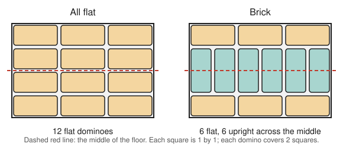

# Counting: how many solutions, not merely whether one exists

[Syllabus](../../../SYLLABUS.md) → [Computability and complexity](../README.md) → [Algebraic, Interactive and Quantum](../README.md#s05) → Counting

---

## General Overview

A floor is 4 squares wide and 6 squares long. It is to be laid with dominoes: tiles 1 square by 2, set flat along the floor or upright across it. Twelve dominoes cover the 24 squares exactly.

Two questions sound alike. **Can** the floor be tiled? Yes: lay every domino flat, three to a row. One tiling ends the search. **How many** ways can it be tiled? The answer is 281, and no single tiling proves it. A count has to account for every tiling, including the 280 nobody laid.

That gap is the subject of this card. Deciding asks whether one solution exists. Counting asks how many exist. A count always answers the yes-or-no question, since "at least one" is the same as "the count is not 0". The reverse fails: finding one solution shows only that the count is at least 1.

Complexity theory turns this into a class. Take any problem whose solutions are quick to check, such as "is this list of 12 dominoes a tiling?" Ask how many solutions there are. The counting functions made this way form the class **#P**, read "sharp P". It was named by Leslie Valiant in 1979.

Some counts are easy anyway. This floor is flat, and a determinant (a number computed from a square table by elimination) counts its tilings in a short calculation, without listing them. On a general network of allowed pairs, one no flat floor can draw, the same question becomes as hard as any counting problem. Yet finding one solution stays easy.

**To decide, a machine may stop at the first solution; to count, it must account for all of them, and #P is the class of counts whose solutions are each quick to check.**

**What kind of fact this is:** #P is a definition. "Counting is at least as hard as deciding" is a theorem, proved in Why it works. The determinant count for flat floors (Kasteleyn, 1961) and the hardness of counting pairings (Valiant, 1979) are theorems stated here with their key steps and a named source. That counting can be *strictly* harder is unproved: counting perfect matchings would be harder than finding one if P ≠ NP, a conjecture unproved as of 2026-11-11.

### The picture: two of the 281 tilings

<p align="center"></p>

Both floors are to scale. The right-hand tiling has dominoes crossing the middle line. A count that splits the floor into two 2 by 6 halves misses it (see What breaks).

---

## The formula

Notation first, in words. Here x is an input, such as a description of the floor, and n is its length in symbols. A **certificate** c is a proposed solution, written as a string of bits. A **verifier** V(x, c) is a program that runs in time polynomial in n and answers 1 (accept) or 0 (reject). These three come from [P and NP](../03-Time%20Complexity/02-p-and-np.md). The sharp sign # in front of V means "the number of certificates V accepts".

```math
\#V(x) = \Bigl\lvert \{\, c \in \{0,1\}^{p(n)} : V(x, c) = 1 \,\} \Bigr\rvert
```

**Read it aloud:** the count for input x is the number of bit strings c, of length p(n), a fixed polynomial in n, that the verifier accepts.

The class **#P** is every function that can be written this way, for some polynomial-time V and some polynomial p. The class **FP** is every function a machine can compute in polynomial time. Counting decides at once:

```math
x \text{ has a solution} \iff \#V(x) \ge 1
```

**Read it aloud:** a solution exists exactly when the count is at least 1.

On the floor, x lists the 24 squares. A certificate c has one bit for each pair of neighbouring squares, set to 1 where a domino covers that pair. V accepts when every square is in exactly one chosen pair. Every tiling gives one accepted c, and every accepted c is a tiling, so #V(floor) = 281.

The second formula is the shortcut that works on flat floors. Colour the squares like a chessboard, dark and light. Build a table K with one row per dark square and one column per light square. Its entry is 1 where the two squares are neighbours and a domino could join them, and 0 otherwise. Then flip the sign of every upright pair in an odd-numbered column (columns counted 0 to 5).

```math
\#\mathrm{tilings}(4 \times 6) = \lvert \det K \rvert = 281
```

**Read it aloud:** the number of tilings is the size of the determinant of the signed neighbour table.

| Symbol | Plain meaning | In our example | Push it up and the answer… |
| --- | --- | --- | --- |
| $`x`$ | the input: the floor, given as its list of squares | 24 squares | — |
| $`n`$ | the input's length in symbols | grows with the 24 squares | the count can grow exponentially in n |
| $`c`$ | a certificate: one proposed solution, as bits | a set of 12 dominoes | — |
| $`p(n)`$ | the polynomial bound on a certificate's length | one bit per neighbouring pair | — |
| $`V(x, c)`$ | the verifier: a quick check, 1 accept, 0 reject | "every square covered once?" | — |
| $`\#V(x)`$ | how many certificates V accepts | 281 | — |
| #P | the class of all such counting functions | tilings, satisfying inputs | — |
| FP | functions computable in polynomial time | the determinant road | — |
| $`m`$ | the floor's length, in squares, at width 4 | 6 | tilings climb: 36 at 4, 281 at 6, 2,245 at 8 |
| $`K`$ | the signed table: a row per dark square, a column per light square | 12 rows, 12 columns | — |
| $`\det K`$ | the determinant of K | 281 in size | — |
| $`j`$, $`k`$, $`\ell`$ | counters: the closed product's two indices, and half a loop's length in the fold | j to 2, k to 3 | — |

The shelf's house example fits the same frame. Its two-bit adder (a circuit adding two 2-bit numbers, built on [Boolean circuits](01-boolean-circuits-and-formulas.md)) takes 4 input bits. Ask how many input settings give the sum 3. The certificate is the 4 input bits, the verifier runs the gates, and the count is 4: 0 + 3, 1 + 2, 2 + 1 and 3 + 0. Counting the satisfying inputs of a circuit or formula is the standard #P problem, written #SAT.

### When it holds

- **Each solution must be quick to check.** The verifier runs in polynomial time. Without that, a "count" can hide a problem no program solves, such as counting halting machines.
- **One certificate per solution.** If V accepted two encodings of the same tiling, #V would count every tiling twice. The encoding above, one bit per pair, leaves no choice.
- **Certificates are of bounded length.** The bound p(n) keeps the count finite: at most $`2^{p(n)}`$.
- **The determinant road needs a flat floor.** Kasteleyn's signs are guaranteed to exist when the neighbour graph can be drawn in the plane without crossings; on a general graph they usually do not. Without the signs the determinant gives 1, not 281.

---

## Why it works

### Step 0: the idea

A decider needs one witness. A counter needs to account for all of them, and there can be exponentially many. Counting is never easier than deciding, because the count answers the yes-or-no question (Step 1), and it may be much harder. Listing is one slow way to count: it costs at least as many steps as there are solutions. The question is whether some counts can be found without listing.

### Step 1: counting is at least as hard as deciding

Take any problem in NP, with verifier V. A solution exists exactly when #V(x) ≥ 1. So a fast counter gives a fast decider: compute the count and compare it with 1.

That proves a theorem. If every #P function were in FP, then every NP problem would be in P, so P = NP. Most researchers expect P ≠ NP, which would make #SAT impossible to compute in polynomial time. That expectation is a conjecture, unproved as of 2026-11-11.

### Step 2: listing costs at least the count

The first road in the code lists every tiling. It finds the first empty square and covers it each legal way, upright or flat, then repeats. On the 4 by 6 floor it tries 1,179 squares and finds 281 tilings.

Deciding needs much less. A tiling is a **perfect matching**: a pairing of every dark square with a neighbouring light square, no square used twice. The augmenting-path method from [Matchings](../../04-Combinatorics%20and%20graphs/13-Matchings%20and%20Flows/01-matchings-and-augmenting-paths.md) finds one in polynomial time. Here it pairs all 12 dark squares after 18 looks at neighbours.

The gap grows with the floor:

| Floor | Tilings | Squares tried, listing | Looks, deciding |
| --- | ---: | ---: | ---: |
| 4 by 2 | 5 | 17 | 6 |
| 4 by 4 | 36 | 146 | 12 |
| 4 by 6 | 281 | 1,179 | 18 |
| 4 by 8 | 2,245 | 9,493 | 24 |
| 4 by 10 | 18,061 | 76,525 | 30 |

Two more columns multiply the tilings by about 8. The decider's work grows by 6 looks. On an 8 by 8 chessboard there are 12,988,816 tilings, so listing them takes at least that many steps.

### Step 3: some counts dodge the listing

The second road never lists a tiling. It walks along the floor one column at a time. A column's **state** records which of its 4 squares are already covered by flat dominoes poking in from the left. There are $`2^4 = 16`$ states. For each state the code counts the ways to finish that column, then carries the counts forward. After 6 columns, the count for "nothing pokes out of the far wall" is 281.

That is polynomial in the floor's length. But each extra square of width doubles the number of states, so on a square floor the work is still exponential in the side.

The third road is polynomial for every flat floor. A determinant is a signed sum over all ways to pair each row with a different column ([Determinants](../../03-Algebra/05-Solving%20Systems/04-determinants.md)). In the table K, a pairing contributes a non-zero term only if every dark square is paired with a neighbour: that is, only if it is a tiling. So det K is a sum of 281 terms, each +1 or −1.

With all entries +1, the plus and minus terms cancel down to 1. Kasteleyn's signs make all 281 terms carry the same sign, so none cancel. Elimination then computes det K in polynomial time, without seeing a single tiling. On the 8 by 8 board it gives 12,988,816, matching the column-state road.

<details>
<summary>Why the signs line up: the key steps of Kasteleyn's argument</summary>

Lay two tilings on top of each other. Dominoes the two tilings share stay as they are. All other dominoes join into closed loops, alternating between the two tilings. Each loop has an even length, 2ℓ squares, and it encloses an even number of squares, since both tilings cover the inside.

Changing one tiling into the other along a loop of 2ℓ squares changes the pairing by a cycle of ℓ steps. That changes the term's sign by $`(-1)^{\ell - 1}`$.

The signs on K change the term's value by the product of the signs around the loop. Look at any 2 by 2 block of squares. It holds four neighbour pairs: two flat and two upright, the upright ones in neighbouring columns. Exactly one of those columns is odd, so the rule "minus on upright pairs in odd columns" puts exactly one minus in every block. Kasteleyn showed that this block rule makes the sign product around any loop enclosing an even number of squares equal to $`(-1)^{\ell - 1}`$.

The two changes cancel. So every tiling's term has the same sign as the all-flat tiling's term, and $`\lvert \det K \rvert`$ counts the tilings. The proof needs the blocks to be the faces of a flat drawing; it is in Kasteleyn (1961).

</details>

Kasteleyn and, separately, Temperley and Fisher turned the determinant into a closed product. For a floor 4 by 6 it reads:

```math
\prod_{j=1}^{2} \prod_{k=1}^{3} \Bigl( 4\cos^2 \tfrac{\pi j}{5} + 4\cos^2 \tfrac{\pi k}{7} \Bigr) = 281
```

The code's fourth road computes the six factors in floating point and prints 281.000000.

### Step 4: where the trick runs out

Drop the flatness. Take any two-sided graph, with dark points on one side and light points on the other, and ask for its perfect matchings. Deciding is still easy, by augmenting paths. Counting is the **permanent** of the 0-and-1 table: the determinant's sum with every sign set to plus. The next card, [Permanent against determinant](03-algebraic-complexity-permanent-versus-determinant.md), shows why that one change destroys elimination.

Valiant proved in 1979 that counting perfect matchings is **#P-complete**: every #P function reduces to it in polynomial time. The key steps are a chain of gadgets. A formula's satisfying assignments become cycle covers of a weighted graph, the weights are removed by a counting trick, and the cycle covers of a directed graph are the perfect matchings of a two-sided graph built from it. The proof is in Valiant (1979); it is not run on this card.

So here is a problem whose decision version is in P while its counting version is as hard as #SAT. If counting perfect matchings were in FP, Step 1 would give P = NP. The flat floor escapes only because Kasteleyn's signs exist in the plane.

### Step 5: how much counting buys

The problem #SAT is #P-complete too. The [Cook-Levin](../03-Time%20Complexity/04-cook-levin-theorem.md) translation of a verifier's run into a formula keeps one satisfying assignment per accepted certificate, so it preserves counts, not just yes and no.

Counting also outranks the whole tower of "there exists… for all…" questions above NP, the **polynomial hierarchy** (written PH, the subject of [Above NP](../03-Time%20Complexity/08-conp-pspace-and-the-polynomial-hierarchy.md)). Toda proved in 1991 that a polynomial-time machine allowed to ask a #P counter questions can answer every question in that hierarchy. The class of such machines is written $`\mathrm{P}^{\#\mathrm{P}}`$. Toda's theorem is stated here with a named source; its proof is not on this card.

---

## Worked numbers, by hand

| Step | Arithmetic | Value |
| --- | --- | --- |
| a 4 by 2 floor | all upright; all flat; flat on the top two rows only; on the bottom two only; on the outer two only | 5 |
| a 2 by 6 half floor | the hallway count from [Recurrences](../../04-Combinatorics%20and%20graphs/05-Recurrences/01-recurrences-and-fibonacci.md) | 13 |
| no domino crosses the middle line | the two halves chosen freely: 13 × 13 | 169 |
| some domino crosses the middle line | 281 − 169 | 112 |
| the 4 by 6 floor, by three exact roads | listing, column states, signed determinant | **281** |
| deciding instead | augmenting paths pair 12 of 12 dark squares | 18 looks |

The floor has 281 tilings, and 112 of them have a domino crossing the middle line. A decider found one tiling in 18 looks, while the lister tried 1,179 squares.

### What breaks if you drop a piece

| Mistake | Comes out at | What went wrong |
| --- | --- | --- |
| Each of the 12 dominoes chosen flat or upright freely | $`2^{12}`$ = 4,096 | the choices are not free: one domino blocks its neighbours |
| The floor as two separate 2 by 6 strips | 13 × 13 = 169 | misses the 112 tilings with a domino crossing the middle |
| A determinant with no signs | 1 | plus and minus terms cancel; Kasteleyn's signs are what make it count |
| Column states read at every far-wall state | 823 | counts dominoes poking out past the last column |

The code prints all four.

---

## Code, from first principles, and it actually runs

The code counts the 4 by 6 floor by four independent roads. Road one lists every tiling by search. Road two steps 16 column states along the floor. Road three is Kasteleyn's signed determinant, computed exactly by fraction-free elimination (the Bareiss method, which keeps every entry a whole number). Road four is the closed product of cosines. A separate decider finds one tiling by augmenting paths and counts its looks. The verifier V is written out and tested on two tilings and two non-tilings. The two-bit adder, built from AND, OR and NOT as on the circuits card, is counted by its gates and by plain arithmetic, for every sum from 0 to 6.

### Python

```python
# Counting solutions and #P -- the check behind the card.  A floor 4 squares by 6 takes 1 x 2
# dominoes; deciding needs one tiling, counting needs all.  Only math.cos and math.pi are imported.
import math
ROWS, COLS = 4, 6

def search(rows, cols):             # road one: cover the first empty square every legal way
    full = [[False] * cols for _ in range(rows)]
    seen = [0, 0]                   # tilings found, squares tried
    def go(i):
        seen[1] += 1
        while i < rows * cols and full[i % rows][i // rows]:
            i += 1                  # squares are read down each column, column by column
        if i == rows * cols:
            seen[0] += 1
            return
        r, c = i % rows, i // rows
        for dr, dc in ((1, 0), (0, 1)):        # an upright domino, then a flat one
            if r + dr < rows and c + dc < cols and not full[r + dr][c + dc]:
                full[r][c] = full[r + dr][c + dc] = True
                go(i + 1)
                full[r][c] = full[r + dr][c + dc] = False
    go(0)
    return seen

def moves(mask, r, nxt, rows, out):  # ways to finish one column whose filled squares are mask
    if r == rows:
        out.append(nxt)
    elif mask >> r & 1:
        moves(mask, r + 1, nxt, rows, out)
    else:
        moves(mask, r + 1, nxt | 1 << r, rows, out)              # flat: pokes into the next column
        if r + 1 < rows and not mask >> (r + 1) & 1:
            moves(mask, r + 2, nxt, rows, out)                   # upright: two squares here

def transfer(rows, cols):            # road two: 2^rows column states, stepped cols times
    v = [1] + [0] * ((1 << rows) - 1)
    for _ in range(cols):
        w = [0] * (1 << rows)
        for mask in range(1 << rows):
            out = []
            moves(mask, 0, 0, rows, out)
            for nxt in out:
                w[nxt] += v[mask]
        v = w
    return v[0], sum(v)              # closed far wall; and the slip that lets dominoes poke out

def det(a):                          # exact determinant by fraction-free elimination (Bareiss)
    a, n, sign, prev = [row[:] for row in a], len(a), 1, 1
    for k in range(n - 1):
        if a[k][k] == 0:
            swap = next((i for i in range(k + 1, n) if a[i][k] != 0), None)
            if swap is None: return 0
            a[k], a[swap], sign = a[swap], a[k], -sign
        for i in range(k + 1, n):
            for j in range(k + 1, n):
                a[i][j] = (a[i][j] * a[k][k] - a[i][k] * a[k][j]) // prev
        prev = a[k][k]
    return sign * a[n - 1][n - 1]

def squares(rows, cols, colour):     # dark squares have colour 0, light squares colour 1
    return [(r, c) for c in range(cols) for r in range(rows) if (r + c) % 2 == colour]

def kasteleyn(rows, cols, signed):   # road three: a row per dark square, a column per light one
    dark, light = squares(rows, cols, 0), squares(rows, cols, 1)
    k = [[0] * len(light) for _ in dark]
    for i, (r, c) in enumerate(dark):
        for j, (s, d) in enumerate(light):
            if abs(r - s) + abs(c - d) == 1:   # neighbours: a domino could cover both
                k[i][j] = (-1) ** c if (signed and r != s) else 1
    return abs(det(k))

def product(rows, cols):             # road four: Kasteleyn's closed product of cosines
    p = 1.0
    for j in range(1, rows // 2 + 1):
        for k in range(1, cols // 2 + 1):
            p *= 4 * math.cos(math.pi * j / (rows + 1)) ** 2 + 4 * math.cos(math.pi * k / (cols + 1)) ** 2
    return p

def match(rows, cols):               # deciding: augmenting paths find one tiling, if any exists
    looks, partner = [0], {}       # partner[light square] = the dark square it is paired with
    def augment(u, used):
        r, c = u
        for v in ((r + 1, c), (r - 1, c), (r, c + 1), (r, c - 1)):
            if not (0 <= v[0] < rows and 0 <= v[1] < cols):
                continue
            looks[0] += 1
            if v not in used:
                used.add(v)
                if v not in partner or augment(partner[v], used):
                    partner[v] = u
                    return True
        return False
    return sum(augment(u, set()) for u in squares(rows, cols, 0)), looks[0]

def verify(rows, cols, tiling):      # the checker V: every square covered exactly once
    cells = [(r, c) for r, c, s, d in tiling] + [(s, d) for r, c, s, d in tiling]
    return (all(abs(r - s) + abs(c - d) == 1 for r, c, s, d in tiling) and len(set(cells))
            == len(cells) == rows * cols and all(0 <= r < rows and 0 <= c < cols for r, c in cells))

def adder(a1, a0, b1, b0):           # the two-bit adder from the circuits card, gate by gate
    xor = lambda x, y: (x | y) & (1 - (x & y))   # AND, OR and NOT only: (x OR y) AND NOT (x AND y)
    t, c0 = xor(a1, b1), a0 & b0                 # t = a1 XOR b1; c0 = the carry out of bit 0
    return 4 * ((a1 & b1) | (t & c0)) + 2 * xor(t, c0) + xor(a0, b0)

(found, tried), (closed, poked) = search(ROWS, COLS), transfer(ROWS, COLS)
signed, unsigned = kasteleyn(ROWS, COLS, True), kasteleyn(ROWS, COLS, False)
prod, (paired, looks), strip = product(ROWS, COLS), match(ROWS, COLS), transfer(2, COLS)[0]
flat = [(r, c, r, c + 1) for r in range(4) for c in (0, 2, 4)]
brick = [t for c in (0, 2, 4) for t in ((0, c, 0, c + 1), (1, c, 2, c), (1, c + 1, 2, c + 1), (3, c, 3, c + 1))]
moved = [(1, 0, 1, 1)] + brick[1:]   # the first domino moved onto squares already covered
by_gates = [sum(1 for x in range(16) if adder(x >> 3 & 1, x >> 2 & 1, x >> 1 & 1, x & 1) == s) for s in range(7)]
by_sums = [sum(1 for a in range(4) for b in range(4) if a + b == s) for s in range(7)]   # every sum 0 to 6
yn = lambda claim: "yes" if claim else "no"
print(f"floor {ROWS} by {COLS}: {ROWS * COLS} squares, {ROWS * COLS // 2} dominoes")
print(f"decide: augmenting paths pair {paired} of {ROWS * COLS // 2} dark squares after {looks} looks")
print(f"count, road 1, every tiling listed: {found} tilings, {tried} squares tried")
print(f"count, road 2, column states stepped: {closed}")
print(f"count, road 3, signed determinant: {signed}")
print(f"count, road 4, product of cosines: {prod:.6f}")
print("growth 4 by m: m, tilings, squares tried by listing, looks to decide")
for m in (2, 4, 6, 8, 10):
    print(f"  {m}, {transfer(4, m)[0]}, {search(4, m)[1]}, {match(4, m)[1]}")
print("square floors: side, tilings by column states, by signed determinant")
for s in (2, 4, 6, 8):
    print(f"  {s}, {transfer(s, s)[0]}, {kasteleyn(s, s, True)}")
print(f"checker V accepts all-flat: {yn(verify(4, 6, flat))}; brick: {yn(verify(4, 6, brick))}; "
      f"brick less one domino: {yn(verify(4, 6, brick[1:]))}; one moved: {yn(verify(4, 6, moved))}")
for name, t in (("all-flat", flat), ("brick", brick)):
    print(f"figure, {name}:", "; ".join(" ".join(str(x) for x in d) for d in t))
print(f"two-bit adder, inputs giving sum 3: {by_gates[3]} by the gates, {by_sums[3]} by a + b = 3")
print(f"mistake 1, each domino flat or upright freely: 2^12 = {2 ** 12}")
print(f"mistake 2, two 2 by 6 strips: {strip} x {strip} = {strip * strip}, missing {closed - strip * strip}")
print(f"mistake 3, determinant with no signs: {unsigned}")
print(f"mistake 4, dominoes left poking out of the far wall: {poked}")
assert found == closed == signed == 281                         # three exact roads agree
assert abs(prod - found) < 1e-6                                 # the closed product agrees
assert paired == ROWS * COLS // 2 and by_gates == by_sums and by_gates[3] == 4  # a tiling; the adder
assert transfer(8, 8)[0] == kasteleyn(8, 8, True) == 12988816   # the chessboard, two roads
assert verify(4, 6, flat) and verify(4, 6, brick) and not verify(4, 6, brick[1:]) and not verify(4, 6, moved)
print("ALL CHECKS PASS")
```

**Ran 2026-11-19 on macOS, Python 3.14.10, standard library only. All checks passed. Output, pasted from the run:**

```
floor 4 by 6: 24 squares, 12 dominoes
decide: augmenting paths pair 12 of 12 dark squares after 18 looks
count, road 1, every tiling listed: 281 tilings, 1179 squares tried
count, road 2, column states stepped: 281
count, road 3, signed determinant: 281
count, road 4, product of cosines: 281.000000
growth 4 by m: m, tilings, squares tried by listing, looks to decide
  2, 5, 17, 6
  4, 36, 146, 12
  6, 281, 1179, 18
  8, 2245, 9493, 24
  10, 18061, 76525, 30
square floors: side, tilings by column states, by signed determinant
  2, 2, 2
  4, 36, 36
  6, 6728, 6728
  8, 12988816, 12988816
checker V accepts all-flat: yes; brick: yes; brick less one domino: no; one moved: no
figure, all-flat: 0 0 0 1; 0 2 0 3; 0 4 0 5; 1 0 1 1; 1 2 1 3; 1 4 1 5; 2 0 2 1; 2 2 2 3; 2 4 2 5; 3 0 3 1; 3 2 3 3; 3 4 3 5
figure, brick: 0 0 0 1; 1 0 2 0; 1 1 2 1; 3 0 3 1; 0 2 0 3; 1 2 2 2; 1 3 2 3; 3 2 3 3; 0 4 0 5; 1 4 2 4; 1 5 2 5; 3 4 3 5
two-bit adder, inputs giving sum 3: 4 by the gates, 4 by a + b = 3
mistake 1, each domino flat or upright freely: 2^12 = 4096
mistake 2, two 2 by 6 strips: 13 x 13 = 169, missing 112
mistake 3, determinant with no signs: 1
mistake 4, dominoes left poking out of the far wall: 823
ALL CHECKS PASS
```

### Rust

Same numbers, same labels, built with `rustc --edition 2021 -O`. The determinant uses 128-bit integers, so the 8 by 8 board's intermediate values cannot overflow.

```rust
// Counting solutions and #P -- the same check as the Python, in Rust.  No crates.  A floor
// 4 squares by 6 takes 1 x 2 dominoes; deciding needs one tiling, counting needs all.
const ROWS: usize = 4;
const COLS: usize = 6;
type Domino = (usize, usize, usize, usize);

fn go(i: usize, rows: usize, cols: usize, full: &mut Vec<Vec<bool>>, seen: &mut [u64; 2]) {
    seen[1] += 1;
    let mut i = i;
    while i < rows * cols && full[i % rows][i / rows] { i += 1 }   // read down each column
    if i == rows * cols { seen[0] += 1; return }
    let (r, c) = (i % rows, i / rows);
    for (dr, dc) in [(1, 0), (0, 1)] {                              // upright, then flat
        if r + dr < rows && c + dc < cols && !full[r + dr][c + dc] {
            full[r][c] = true; full[r + dr][c + dc] = true;
            go(i + 1, rows, cols, full, seen);
            full[r][c] = false; full[r + dr][c + dc] = false;
        }
    }
}

fn search(rows: usize, cols: usize) -> (u64, u64) {    // road one: list every tiling
    let (mut full, mut seen) = (vec![vec![false; cols]; rows], [0u64; 2]);
    go(0, rows, cols, &mut full, &mut seen);
    (seen[0], seen[1])
}

fn moves(mask: usize, r: usize, nxt: usize, rows: usize, out: &mut Vec<usize>) {
    if r == rows { out.push(nxt) }
    else if mask >> r & 1 == 1 { moves(mask, r + 1, nxt, rows, out) }
    else {
        moves(mask, r + 1, nxt | 1 << r, rows, out);              // flat: pokes into the next column
        if r + 1 < rows && mask >> (r + 1) & 1 == 0 { moves(mask, r + 2, nxt, rows, out) } // upright
    }
}

fn transfer(rows: usize, cols: usize) -> (u64, u64) {  // road two: 2^rows column states
    let mut v: Vec<u64> = (0..1usize << rows).map(|m| (m == 0) as u64).collect();
    for _ in 0..cols {
        let mut w = vec![0u64; 1 << rows];
        for mask in 0..(1 << rows) {
            let mut out = Vec::new();
            moves(mask, 0, 0, rows, &mut out);
            for nxt in out { w[nxt] += v[mask] }
        }
        v = w;
    }
    (v[0], v.iter().sum())
}

fn det(mut a: Vec<Vec<i128>>) -> i128 {                // exact, fraction-free (Bareiss)
    let n = a.len();
    let (mut sign, mut prev) = (1i128, 1i128);
    for k in 0..n - 1 {
        if a[k][k] == 0 {
            let Some(s) = (k + 1..n).find(|&i| a[i][k] != 0) else { return 0 };
            a.swap(k, s);
            sign = -sign;
        }
        for i in k + 1..n { for j in k + 1..n { a[i][j] = (a[i][j] * a[k][k] - a[i][k] * a[k][j]) / prev } }
        prev = a[k][k];
    }
    sign * a[n - 1][n - 1]
}

fn squares(rows: usize, cols: usize, colour: usize) -> Vec<(usize, usize)> {
    (0..cols).flat_map(|c| (0..rows).map(move |r| (r, c))).filter(|&(r, c)| (r + c) % 2 == colour).collect()
}

fn kasteleyn(rows: usize, cols: usize, signed: bool) -> i128 {   // road three
    let (dark, light) = (squares(rows, cols, 0), squares(rows, cols, 1));
    let mut k = vec![vec![0i128; light.len()]; dark.len()];
    for (i, &(r, c)) in dark.iter().enumerate() {
        for (j, &(s, d)) in light.iter().enumerate() {
            if r.abs_diff(s) + c.abs_diff(d) == 1 {
                k[i][j] = if signed && r != s && c % 2 == 1 { -1 } else { 1 };
            }
        }
    }
    det(k).abs()
}

fn product(rows: usize, cols: usize) -> f64 {          // road four: the closed product
    let pi = std::f64::consts::PI;
    let mut p = 1.0f64;
    for j in 1..=rows / 2 { for k in 1..=cols / 2 {
        p *= 4.0 * (pi * j as f64 / (rows + 1) as f64).cos().powi(2) + 4.0 * (pi * k as f64 / (cols + 1) as f64).cos().powi(2);
    } }
    p
}

fn augment(u: (usize, usize), rows: usize, cols: usize, used: &mut Vec<bool>,
           partner: &mut Vec<Option<(usize, usize)>>, looks: &mut u64) -> bool {
    let (r, c) = (u.0 as i64, u.1 as i64);
    for (a, b) in [(r + 1, c), (r - 1, c), (r, c + 1), (r, c - 1)] {
        if a < 0 || b < 0 || a >= rows as i64 || b >= cols as i64 { continue }
        *looks += 1;
        let v = a as usize * cols + b as usize;          // partner[light square] = its dark square
        if !used[v] {
            used[v] = true;
            if partner[v].map_or(true, |w| augment(w, rows, cols, used, partner, looks)) {
                partner[v] = Some(u);
                return true;
            }
        }
    }
    false
}

fn matching(rows: usize, cols: usize) -> (usize, u64) { // deciding, by augmenting paths
    let (mut looks, mut partner) = (0u64, vec![None; rows * cols]);
    let paired = squares(rows, cols, 0).iter().filter(|&&u| augment(u, rows, cols, &mut vec![false; rows * cols], &mut partner, &mut looks)).count();
    (paired, looks)
}

fn verify(rows: usize, cols: usize, t: &[Domino]) -> bool {     // the checker V
    let mut cells: Vec<(usize, usize)> = t.iter().map(|d| (d.0, d.1)).collect();
    cells.extend(t.iter().map(|d| (d.2, d.3)));
    let (n, mut uniq) = (cells.len(), cells.clone());
    uniq.sort();
    uniq.dedup();
    t.iter().all(|d| d.0.abs_diff(d.2) + d.1.abs_diff(d.3) == 1) && uniq.len() == n
        && n == rows * cols && cells.iter().all(|&(r, c)| r < rows && c < cols)
}

fn adder(a1: u8, a0: u8, b1: u8, b0: u8) -> u8 {       // the two-bit adder from the circuits card, gate by gate
    let xor = |x: u8, y: u8| (x | y) & (1 - (x & y));    // AND, OR and NOT only: (x OR y) AND NOT (x AND y)
    let (t, c0) = (xor(a1, b1), a0 & b0);                // t = a1 XOR b1; c0 = the carry out of bit 0
    4 * ((a1 & b1) | (t & c0)) + 2 * xor(t, c0) + xor(a0, b0)
}
fn yn(claim: bool) -> &'static str { if claim { "yes" } else { "no" } }

fn main() {
    let ((found, tried), (closed, poked)) = (search(ROWS, COLS), transfer(ROWS, COLS));
    let (signed, unsigned) = (kasteleyn(ROWS, COLS, true), kasteleyn(ROWS, COLS, false));
    let (prod, (paired, looks), strip) = (product(ROWS, COLS), matching(ROWS, COLS), transfer(2, COLS).0);
    let flat: Vec<Domino> = (0..4).flat_map(|r| [0, 2, 4].map(|c| (r, c, r, c + 1))).collect();
    let brick: Vec<Domino> = [0, 2, 4].iter().flat_map(|&c|
        [(0, c, 0, c + 1), (1, c, 2, c), (1, c + 1, 2, c + 1), (3, c, 3, c + 1)]).collect();
    let moved: Vec<Domino> = [(1, 0, 1, 1)].into_iter().chain(brick[1..].iter().copied()).collect();
    let by_gates: Vec<usize> = (0..7u8).map(|s| (0..16u8).filter(|x| adder(x >> 3 & 1, x >> 2 & 1, x >> 1 & 1, x & 1) == s).count()).collect();
    let by_sums: Vec<usize> = (0..7).map(|s| (0..4).flat_map(|a| (0..4).map(move |b| a + b)).filter(|&t| t == s).count()).collect();
    println!("floor {} by {}: {} squares, {} dominoes", ROWS, COLS, ROWS * COLS, ROWS * COLS / 2);
    println!("decide: augmenting paths pair {} of {} dark squares after {} looks", paired, ROWS * COLS / 2, looks);
    println!("count, road 1, every tiling listed: {} tilings, {} squares tried", found, tried);
    println!("count, road 2, column states stepped: {}", closed);
    println!("count, road 3, signed determinant: {}", signed);
    println!("count, road 4, product of cosines: {:.6}", prod);
    println!("growth 4 by m: m, tilings, squares tried by listing, looks to decide");
    for m in [2, 4, 6, 8, 10] { println!("  {}, {}, {}, {}", m, transfer(4, m).0, search(4, m).1, matching(4, m).1) }
    println!("square floors: side, tilings by column states, by signed determinant");
    for s in [2, 4, 6, 8] { println!("  {}, {}, {}", s, transfer(s, s).0, kasteleyn(s, s, true)) }
    println!("checker V accepts all-flat: {}; brick: {}; brick less one domino: {}; one moved: {}",
             yn(verify(4, 6, &flat)), yn(verify(4, 6, &brick)), yn(verify(4, 6, &brick[1..])), yn(verify(4, 6, &moved)));
    for (name, t) in [("all-flat", &flat), ("brick", &brick)] {
        let parts: Vec<String> = t.iter().map(|d| format!("{} {} {} {}", d.0, d.1, d.2, d.3)).collect();
        println!("figure, {}: {}", name, parts.join("; "));
    }
    println!("two-bit adder, inputs giving sum 3: {} by the gates, {} by a + b = 3", by_gates[3], by_sums[3]);
    println!("mistake 1, each domino flat or upright freely: 2^12 = {}", 1u64 << 12);
    println!("mistake 2, two 2 by 6 strips: {} x {} = {}, missing {}", strip, strip, strip * strip, closed - strip * strip);
    println!("mistake 3, determinant with no signs: {}", unsigned);
    println!("mistake 4, dominoes left poking out of the far wall: {}", poked);
    assert!(found == closed && closed as i128 == signed && signed == 281);  // three exact roads
    assert!((prod - found as f64).abs() < 1e-6);                            // the closed product
    assert!(paired == ROWS * COLS / 2 && by_gates == by_sums && by_gates[3] == 4); // a tiling; the adder
    assert!(transfer(8, 8).0 as i128 == kasteleyn(8, 8, true) && kasteleyn(8, 8, true) == 12988816);
    assert!(verify(4, 6, &flat) && verify(4, 6, &brick) && !verify(4, 6, &brick[1..]) && !verify(4, 6, &moved));
    println!("ALL CHECKS PASS");
}
```

**Ran 2026-11-19 on macOS, rustc 1.98.1, no crates. All checks passed. Output, pasted from the run:**

```
floor 4 by 6: 24 squares, 12 dominoes
decide: augmenting paths pair 12 of 12 dark squares after 18 looks
count, road 1, every tiling listed: 281 tilings, 1179 squares tried
count, road 2, column states stepped: 281
count, road 3, signed determinant: 281
count, road 4, product of cosines: 281.000000
growth 4 by m: m, tilings, squares tried by listing, looks to decide
  2, 5, 17, 6
  4, 36, 146, 12
  6, 281, 1179, 18
  8, 2245, 9493, 24
  10, 18061, 76525, 30
square floors: side, tilings by column states, by signed determinant
  2, 2, 2
  4, 36, 36
  6, 6728, 6728
  8, 12988816, 12988816
checker V accepts all-flat: yes; brick: yes; brick less one domino: no; one moved: no
figure, all-flat: 0 0 0 1; 0 2 0 3; 0 4 0 5; 1 0 1 1; 1 2 1 3; 1 4 1 5; 2 0 2 1; 2 2 2 3; 2 4 2 5; 3 0 3 1; 3 2 3 3; 3 4 3 5
figure, brick: 0 0 0 1; 1 0 2 0; 1 1 2 1; 3 0 3 1; 0 2 0 3; 1 2 2 2; 1 3 2 3; 3 2 3 3; 0 4 0 5; 1 4 2 4; 1 5 2 5; 3 4 3 5
two-bit adder, inputs giving sum 3: 4 by the gates, 4 by a + b = 3
mistake 1, each domino flat or upright freely: 2^12 = 4096
mistake 2, two 2 by 6 strips: 13 x 13 = 169, missing 112
mistake 3, determinant with no signs: 1
mistake 4, dominoes left poking out of the far wall: 823
ALL CHECKS PASS
```

The two outputs match line for line.

### Lean

Lean proves the two counting facts for any verifier and polynomial bound, and checks the card's floor and adder numbers.

- Take any verifier V, any polynomial p and any input x. Then x has a solution exactly when $`\#V(x) \ge 1`$.
- Take the same V, p and x. Then the count $`\#V(x)`$ is at most $`2^{p(n)}`$.
- The 4 by 6 floor has 38 neighbouring pairs, so a certificate has 38 bits.
- The checker V accepts all-flat and brick, and rejects brick less one domino and one moved.
- On the 4 by 2 floor, V accepts 5 of the $`2^{10}`$ certificates: its 5 tilings.
- The hand numbers are right: 13 × 13 = 169, 281 − 169 = 112, $`2^{12}`$ = 4,096 and $`2^4`$ = 16.
- The two-bit adder's gates give the sum 3 on 4 of the 16 input settings.
- For every sum from 0 to 6, the gates' count equals the number of ways to write it as a + b.

The 281 count, its four roads, the decider's looks and the growth table are left to the Python and Rust checks.

```lean
-- Counting: a verifier's count of accepted certificates is at least 1 exactly when a solution exists, it is at most 2 to the power p(n), and the card's floor and adder counts come out as stated.
import Mathlib.Data.Fintype.Pi
import Mathlib.Algebra.Polynomial.Eval.Defs

/-! An input `x` has length `size x`. A certificate is a string of `p (size x)` bits, written as a
function `Fin (p (size x)) → Bool` and handed to the verifier as the list of its bits. -/

/-- `#V(x)`: the number of bit strings `c` of length `p (size x)` that the verifier `V` accepts. -/
def sharpV {α : Type*} (size : α → ℕ) (p : ℕ → ℕ) (V : α → List Bool → Bool) (x : α) : ℕ :=
  (Finset.univ.filter (fun c : Fin (p (size x)) → Bool => V x (List.ofFn c) = true)).card

/-- Counting decides: for any verifier `V` and any fixed polynomial `p` bounding the certificate
length, an input `x` has a solution (some certificate of length `p(n)` that `V` accepts) exactly
when the count `#V(x)` is at least 1. -/
theorem has_solution_iff_one_le_count {α : Type*} (size : α → ℕ) (p : Polynomial ℕ)
    (V : α → List Bool → Bool) (x : α) :
    (∃ c : Fin (p.eval (size x)) → Bool, V x (List.ofFn c) = true) ↔
      1 ≤ sharpV size (fun n => p.eval n) V x := by
  unfold sharpV
  rw [Finset.one_le_card, Finset.filter_nonempty_iff]
  simp

/-- Certificates of bounded length keep the count finite: `#V(x)` is at most `2 ^ p(n)`. -/
theorem count_le_two_pow {α : Type*} (size : α → ℕ) (p : Polynomial ℕ)
    (V : α → List Bool → Bool) (x : α) :
    sharpV size (fun n => p.eval n) V x ≤ 2 ^ p.eval (size x) := by
  unfold sharpV
  refine (Finset.card_filter_le _ _).trans ?_
  simp

/-! The floor. Squares are `(row, column)`. The neighbouring pairs are listed flat ones first
(`(r, c)` with `(r, c + 1)`), then upright ones (`(r, c)` with `(r + 1, c)`). A certificate has one
bit per pair, and the verifier accepts when every square lies in exactly one chosen pair. -/

/-- The neighbouring pairs of a floor `rows` squares wide and `cols` squares long. -/
def pairs (rows cols : ℕ) : List ((ℕ × ℕ) × (ℕ × ℕ)) :=
  (List.range rows).flatMap (fun r => (List.range (cols - 1)).map fun c => ((r, c), (r, c + 1))) ++
  (List.range (rows - 1)).flatMap (fun r => (List.range cols).map fun c => ((r, c), (r + 1, c)))

/-- The floor's verifier V: one bit per pair, and every square covered by exactly one chosen pair. -/
def tilingV (f : ℕ × ℕ) (c : List Bool) : Bool :=
  c.length == (pairs f.1 f.2).length &&
  (List.range f.1).all fun r => (List.range f.2).all fun col =>
    (((pairs f.1 f.2).zip c).filter
      (fun e => e.2 && (e.1.1 == (r, col) || e.1.2 == (r, col)))).length == 1

/-- The floor is described by its list of neighbouring pairs; one certificate bit per pair. -/
def floorSize (f : ℕ × ℕ) : ℕ := (pairs f.1 f.2).length

/-- The certificate for a list of dominoes: bit 1 exactly on the pairs the dominoes cover. -/
def bitsOf (f : ℕ × ℕ) (ds : List ((ℕ × ℕ) × (ℕ × ℕ))) : List Bool :=
  (pairs f.1 f.2).map fun e => ds.contains e

/-- All twelve dominoes flat, three to a row. -/
def allFlat : List ((ℕ × ℕ) × (ℕ × ℕ)) :=
  (List.range 4).flatMap fun r => [0, 2, 4].map fun c => ((r, c), (r, c + 1))

/-- The brick pattern of the figure: six upright dominoes cross the middle line. -/
def brick : List ((ℕ × ℕ) × (ℕ × ℕ)) :=
  [0, 2, 4].flatMap fun c =>
    [((0, c), (0, c + 1)), ((1, c), (2, c)), ((1, c + 1), (2, c + 1)), ((3, c), (3, c + 1))]

/-- The brick pattern with its first domino moved onto squares already covered. -/
def moved : List ((ℕ × ℕ) × (ℕ × ℕ)) := ((1, 0), (1, 1)) :: brick.tail

-- The 4 by 6 floor: 24 squares, 38 neighbouring pairs, so 38 certificate bits.
example : (pairs 4 6).length = 38 := by decide
-- The checker V accepts all-flat and brick, and rejects brick less one domino and one moved.
example : tilingV (4, 6) (bitsOf (4, 6) allFlat) = true := by decide
example : tilingV (4, 6) (bitsOf (4, 6) brick) = true := by decide
example : tilingV (4, 6) (bitsOf (4, 6) brick.tail) = false := by decide
example : tilingV (4, 6) (bitsOf (4, 6) moved) = false := by decide
-- The 4 by 2 floor has 5 tilings: #V counts 5 of its 2 ^ 10 certificates.
example : (pairs 4 2).length = 10 := by decide
example : sharpV floorSize id tilingV (4, 2) = 5 := by decide +kernel
-- Worked numbers: two 2 by 6 halves give 13 x 13 = 169; 281 - 169 = 112 cross the middle;
-- twelve free flat-or-upright choices would give 2 ^ 12 = 4096; there are 2 ^ 4 = 16 column states.
example : 13 * 13 = 169 := by norm_num
example : 281 - 169 = 112 := by norm_num
example : 2 ^ 12 = 4096 := by norm_num
example : 2 ^ 4 = 16 := by norm_num

/-! The two-bit adder, built from AND, OR and NOT only. Its 4 input bits `a1 a0 b1 b0` are the
certificate, and the verifier runs the gates and accepts when the sum is the target. -/

/-- XOR from AND, OR and NOT: `(x OR y) AND NOT (x AND y)`. -/
def xorG (x y : Bool) : Bool := (x || y) && !(x && y)

/-- The adder's three output bits as a number: carry out, then bit 1, then bit 0. -/
def adder (a1 a0 b1 b0 : Bool) : ℕ :=
  let t := xorG a1 b1
  let c0 := a0 && b0
  4 * ((a1 && b1) || (t && c0)).toNat + 2 * (xorG t c0).toNat + (xorG a0 b0).toNat

/-- The adder's verifier: read the 4 input bits and accept when the gates output `s`. -/
def adderV (s : ℕ) (c : List Bool) : Bool :=
  match c with
  | [a1, a0, b1, b0] => adder a1 a0 b1 b0 == s
  | _ => false

-- 4 of the 16 input settings give the sum 3: 0 + 3, 1 + 2, 2 + 1, 3 + 0.
example : sharpV (fun _ => 0) (fun _ => 4) adderV 3 = 4 := by decide
-- For every sum from 0 to 6, the count by the gates equals the count of a + b = s.
example : ∀ s : Fin 7, sharpV (fun _ => 0) (fun _ => 4) adderV s.val =
    (Finset.univ.filter (fun ab : Fin 4 × Fin 4 => ab.1.val + ab.2.val = s.val)).card := by
  decide

#print axioms has_solution_iff_one_le_count
#print axioms count_le_two_pow
```

**Checked 2026-11-19 on macOS, Lean 4.36.0-rc2, Mathlib v4.36.0-rc2. Every proof is complete and uses only Lean's standard axioms. Output, pasted from the run:**

```
'has_solution_iff_one_le_count' depends on axioms: [propext, Classical.choice, Quot.sound]
'count_le_two_pow' depends on axioms: [propext, Classical.choice, Quot.sound]
```

> [!TIP]
> **Try changing**
> Guess first, then run it. The asserts are pinned to the 4 by 6 floor, so expect one to stop the program.
> - **One column longer.** Set `COLS` to 7. Guess the count first. It is 781; listing tries 3,325 squares, and deciding takes 20 looks.
> - **A square floor.** Set `ROWS, COLS = 6, 6`. The count is 6,728; listing tries 33,094 squares, and deciding takes 30 looks.
> - **Drop the signs.** In the line that sets `signed, unsigned`, change `True` to `False`. Road three prints 1, and the first assert stops it.
> - **Forget the upright domino.** Change `((1, 0), (0, 1))` in `search` to `((0, 1),)`. Only all-flat floors survive, road one prints 1, and the first assert stops it.

---

## The usual mistake

> [!warning]
> **"Finding one solution is fast, so counting them is fast."** Deciding stops at the first witness; counting must account for all of them. Perfect matchings show the gap at its sharpest. Augmenting paths find one in polynomial time, 18 looks on this floor, but counting them in general is #P-complete. The flat floor is countable only because of Kasteleyn's signs.
>
> - **Treating each tile as a free choice.** Two options for each of 12 dominoes gives 4,096, not 281. Placing one domino limits the next.
> - **Splitting the floor into halves.** Two 2 by 6 strips give 13 × 13 = 169 and miss 112 tilings that cross the middle.
> - **Using a determinant without signs.** It counts matchings with signs that cancel, and gives 1.
> - **Calling counting "proved harder".** The proof is conditional: if P ≠ NP, then counting perfect matchings has no polynomial-time algorithm, though finding one does. P ≠ NP is a conjecture, unproved as of 2026-11-11.

---

## Where you meet it in real life

- **Physics of surfaces.** Kasteleyn's 1961 paper counted the ways two-atom molecules can cover a crystal surface: the domino problem on a large grid. The logarithm of the count gives the surface's entropy, a measure of its disorder.
- **Probability is counting.** The chance that a random input satisfies a formula is its count divided by 2 to the power of the number of input bits. For the adder, 4 of the 16 input settings give the sum 3. Many reliability and risk questions reduce this way to #SAT, so "model counters" (#SAT solvers) are built for them.
- **Approximate counting.** Exact counting of perfect matchings is #P-complete. Jerrum, Sinclair and Vigoda showed in 2004 that a randomized method approximates the count to any fixed percentage in polynomial time, by a random walk on matchings. Hard exact counts can still have easy estimates.

> **Say it back**
> Deciding asks whether a solution exists; counting asks how many. A count answers the yes-or-no question, so counting is never easier, and a fast counter for #SAT would give P = NP. #P is the class of counts of quickly checked certificates: the 4 by 6 floor has 281 tilings. Flat floors are counted fast by Kasteleyn's signed determinant, but counting perfect matchings in general is #P-complete, though finding one is easy.

---

## What this builds on

- [Boolean circuits](01-boolean-circuits-and-formulas.md): the gates of the two-bit adder, whose satisfying inputs are counted here.
- [Combinations, n choose k](../../04-Combinatorics%20and%20graphs/01-Counting%20Principles/05-n-choose-k.md): counting by a formula instead of a list, the habit this card tests against hard cases.
- [Recurrences](../../04-Combinatorics%20and%20graphs/05-Recurrences/01-recurrences-and-fibonacci.md): the 2 by n hallway count by "what covers the far end", which gives 13 for each half floor.
- [Matchings](../../04-Combinatorics%20and%20graphs/13-Matchings%20and%20Flows/01-matchings-and-augmenting-paths.md): perfect matchings and the augmenting-path decider.
- [Determinants](../../03-Algebra/05-Solving%20Systems/04-determinants.md): the signed sum over pairings, and elimination to compute it.

## Where this goes next

- [Permanent against determinant](03-algebraic-complexity-permanent-versus-determinant.md): the same sum with every sign plus, and why that one change turns an easy count into a #P-complete one.
- [Interactive proofs](04-interactive-proofs-ip-pspace-and-the-pcp-theorem.md): a prover can convince a quick checker that a #SAT count is right, without the checker counting.
- [BQP](06-quantum-computation-and-bqp.md): a quantum circuit's output probability is a sum over many paths, a counting question of this card's kind.

The question this card leaves open: is there any polynomial-time way to count perfect matchings exactly, which would mean P = NP?

---

## Sources

Verified 2026-11-19: every link below resolves to the publisher's page.

- Valiant, Leslie G. "The complexity of computing the permanent." *Theoretical Computer Science* 8(2), 1979, 189–201. [doi:10.1016/0304-3975(79)90044-6](https://doi.org/10.1016/0304-3975(79)90044-6). Defines #P and proves that counting perfect matchings is #P-complete.
- Kasteleyn, P. W. "The statistics of dimers on a lattice." *Physica* 27(12), 1961, 1209–1225. [doi:10.1016/0031-8914(61)90063-5](https://doi.org/10.1016/0031-8914(61)90063-5). The signed determinant and the closed product for domino tilings of a grid.
- Toda, Seinosuke. "PP is as hard as the polynomial-time hierarchy." *SIAM Journal on Computing* 20(5), 1991, 865–877. [doi:10.1137/0220053](https://doi.org/10.1137/0220053). Every question in the polynomial hierarchy is answered with a counting oracle.
- Jerrum, Mark, Alistair Sinclair and Eric Vigoda. "A polynomial-time approximation algorithm for the permanent of a matrix with nonnegative entries." *Journal of the ACM* 51(4), 2004, 671–697. [doi:10.1145/1008731.1008738](https://doi.org/10.1145/1008731.1008738). Approximate counting of perfect matchings in polynomial time.
- Arora, Sanjeev, and Boaz Barak. *Computational Complexity: A Modern Approach*. Cambridge University Press, 2009. [Publisher page](https://doi.org/10.1017/CBO9780511804090). Chapter 17 sets out #P, #SAT, Valiant's theorem and Toda's theorem.
