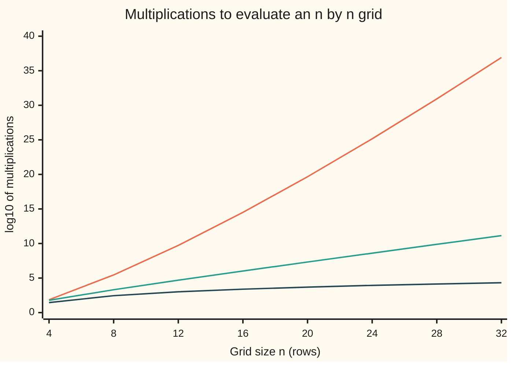

# Permanent against determinant: two near-identical formulas, wildly different cost

[Syllabus](../../../SYLLABUS.md) → [Computability and complexity](../README.md) → [Algebraic, Interactive and Quantum](../README.md#s05) → Permanent against determinant

---

## General Overview

A dance school runs a rotating class. Eight leads, numbered 1 to 8, stand in a circle facing eight follows, lettered A to H. After each song the follows move one place along. After three songs, each lead has danced with three follows: lead 1 with A, B and C, lead 2 with B, C and D, and so on round the circle, so lead 8 has danced with H, A and B.

For the end-of-term showcase, every lead must take one follow they have already practised with, and no follow can dance twice. How many ways are there to pair the whole class? The answer is **49**.

Write the class as a grid of 0s and 1s: row i is lead i, column j is follow j, and a 1 means "has practised together". Two classic formulas run over this grid. Both look at the same 40,320 ways to give each lead a different follow. The **permanent** adds up every way that works, and gives 49. The **determinant** gives each way a plus or a minus sign first, and gives 3.

That small sign changes the cost completely. The determinant of an n by n grid takes about n³ steps: 280 multiplications at n = 8. The known exact methods for the permanent take time that roughly doubles with each extra row; Ryser's classic formula takes 2,040 multiplications at n = 8, about 137 billion at n = 32. Whether that gap is real, or only our ignorance, is the algebraic version of P versus NP.

**The permanent and the determinant are the same sum over the same pairings, except the determinant signs each term; the signs let elimination cancel work, and without them nobody knows a fast method, so the gap between the two is the algebraic form of P versus NP.**

**What kind of fact this is:** the counting of pairings by the permanent, the failure of elimination and the failure of any sign pattern from size 3 up are theorems proved on this card; that counting pairings is #P-complete, and that the permanent is complete for Valiant's class VNP, are theorems stated with their source (Valiant, 1979); that the permanent truly needs exponential cost, Valiant's conjecture, is unproved as of 2026-11-11.

### The picture: counted work against grid size



Top line: the permanent or determinant by its definition, every pairing multiplied out. Middle line: the permanent by Ryser's formula, the classic exact method; no exact method much faster than $`2^n`$ steps is known. Bottom line: the determinant by elimination. A straight line on this log scale is exponential growth; the bottom line bends flat, which is polynomial growth.

---

## The formula

Notation first, in words. $`A`$ is a square grid of numbers with $`n`$ rows and $`n`$ columns, and $`a_{ij}`$ is the number in row $`i`$, column $`j`$. A **permutation** $`\sigma`$ (sigma) gives each row $`i`$ its own column $`\sigma(i)`$, with no column used twice: one way to give every lead a different follow. There are $`n!`$ of them, 40,320 at n = 8.

```math
\det A = \sum_{\sigma} \mathrm{sgn}(\sigma)\, a_{1\sigma(1)}\, a_{2\sigma(2)} \cdots a_{n\sigma(n)}
```

```math
\mathrm{perm}(A) = \sum_{\sigma} a_{1\sigma(1)}\, a_{2\sigma(2)} \cdots a_{n\sigma(n)}
```

**Read it aloud:** for every way to give each row its own column, multiply the n chosen numbers together; the permanent adds all these products, and the determinant adds them with a plus or minus sign set by the permutation.

The sign $`\mathrm{sgn}(\sigma)`$ is +1 when the permutation puts an even number of pairs out of order, and −1 when the number is odd. Lead 1 with B and lead 2 with A is one pair out of order, so that term gets a minus.

For the dance class each product is 1 when every lead in that pairing has practised with their follow, and 0 otherwise. So the permanent counts the working pairings: 49. Of these, 26 are even and 23 are odd, and the determinant is 26 − 23 = 3.

| Symbol | Plain meaning | In our example | Push it up and the answer… |
| --- | --- | --- | --- |
| $`A`$ | the grid: rows are leads, columns are follows | the 8 by 8 class grid | — |
| $`n`$ | rows, and columns, in the grid | 8 | perm cost about doubles per row; det cost grows like n³ |
| $`a_{ij}`$ | the number in row $`i`$, column $`j`$; here 1 if they have practised | $`a_{12}`$ = 1, $`a_{14}`$ = 0 | more 1s, more pairings |
| $`\sigma`$ | a permutation: each row gets its own column | lead 1 with A, 2 with B, … | — |
| $`n!`$ | how many permutations there are | 40,320 | — |
| $`\mathrm{sgn}(\sigma)`$ | +1 for an even count of out-of-order pairs, −1 for odd | +1 for 26 pairings, −1 for 23 | — |
| $`\mathrm{perm}(A)`$ | the permanent: products added with no signs | 49 | — |
| $`\det A`$ | the determinant: products added with signs | 3 | — |
| $`S`$ | a set of columns, used in Ryser's formula | any of the 255 non-empty sets | — |
| $`T`$ | the set of columns one choice actually uses, in the Ryser proof | all 8 columns, for a pairing | — |
| $`m`$ | the size of a determinant built to equal a permanent | 2 for n = 2, 7 for n = 3 | — |

### When it holds

- **The grid is square.** Both formulas need as many columns as rows; 8 leads and 9 follows need a rectangular version.
- **Entries of 0 and 1 for a count.** With other numbers the permanent is a weighted sum, still hard, but it no longer counts pairings.
- **Ordinary arithmetic, not arithmetic mod 2.** When only odd or even matters, −1 and +1 are the same, so the permanent equals the determinant and is easy: 49 and 3 are both odd.
- **Exact answers.** The hardness is for the exact value. For grids with no negative entries, a randomised method gets within any chosen percentage in polynomial time (Jerrum, Sinclair and Vigoda, 2004).

---

## Why it works

### Step 0: the sign is the whole difference

The two formulas have the same 40,320 terms. The determinant's signs make it **alternating**: swapping two rows flips its sign. That one property lets elimination throw away almost all of the work. The permanent does not change when rows swap, so the shortcut is gone, and so far nobody has found another.

### Step 1: the permanent counts perfect matchings

The class is a two-sided graph: leads on one side, follows on the other, a line for each practised pair. A **perfect matching** pairs every dot with exactly one partner along a line ([Matchings](../../04-Combinatorics%20and%20graphs/13-Matchings%20and%20Flows/01-matchings-and-augmenting-paths.md)).

A permutation $`\sigma`$ is a candidate pairing: lead $`i`$ with follow $`\sigma(i)`$. Its product $`a_{1\sigma(1)} \cdots a_{n\sigma(n)}`$ is 1 exactly when every one of those pairs has practised, and 0 as soon as one has not. So the permanent adds 1 for each perfect matching and 0 for everything else.

With four couples the arithmetic fits on a line. Lead 1 knows A, B, C; lead 2 knows B, C, D; lead 3 knows C, D, A; lead 4 knows D, A, B. Of the 24 permutations, 9 survive: the permanent is 9. Six of the 9 are even and three are odd, so the determinant is 6 − 3 = 3.

### Step 2: why the determinant is fast

The determinants card computes a determinant by elimination: add a multiple of one row to another until the grid is a staircase, then multiply the diagonal ([Determinants](../../03-Algebra/05-Solving%20Systems/04-determinants.md)). Each step costs about n² multiplications, and there are n steps, so the total is about n³.

The reason elimination is allowed: adding c times row 2 to row 1 splits the determinant into the old one plus c times a determinant whose rows 1 and 2 are equal. Swapping those two equal rows changes nothing, yet must flip the sign, so that determinant is 0. The row operation leaves the determinant unchanged.

On the 8 by 8 class grid, fraction-free elimination uses 280 multiplications and returns 3, the same value as the 40,320-term sum.

### Step 3: why elimination fails for the permanent

Run the same argument on the permanent. Swapping two equal rows still changes nothing, but the permanent has no sign to flip, so a grid with two equal rows does not have permanent 0. The row operation adds c times that non-zero number.

Take the grid `[[1, 2], [3, 4]]`. Its permanent is 1 × 4 + 2 × 3 = 10, and its determinant is 4 − 6 = −2. Subtract 3 times row 1 from row 2 to get `[[1, 2], [0, −2]]`. The determinant is still −2. The permanent is now −2 as well: it fell by 3 × perm(`[[1, 2], [1, 2]]`) = 3 × 4 = 12. Elimination reached the determinant, not the permanent.

### Step 4: can signs rescue the permanent?

Could a fixed pattern of minus signs on the entries turn every permanent into a determinant? Then the fast method would carry over. Pólya asked this in 1913.

At n = 2 it works: perm(`[[a, b], [c, d]]`) = ad + bc, which is the determinant of `[[a, −b], [c, d]]`. On `[[1, 2], [3, 4]]` both give 10.

At n = 3 it fails. Apply a sign pattern to the all-ones grid, whose permanent is 3! = 6. The pattern would need a 3 by 3 grid of +1s and −1s with determinant 6. The code tries all 2⁹ = 512 sign patterns: the largest determinant in size is 4.

<details>
<summary>Detailed proof: no 3 by 3 grid of ±1 has determinant 6</summary>

The determinant of a 3 by 3 grid is three even terms minus three odd terms, and each term is a product of three entries, so each is +1 or −1.

The three even permutations are the identity and the two cyclic shifts. Between them they use each of the nine entries exactly once. So the product of the three even terms equals the product of all nine entries. The three odd permutations also use each entry exactly once, so their product is the same number.

A determinant of 6 needs all three even terms equal to +1, with product +1, and all three odd terms equal to −1, with product −1. The two products must be equal, so this is impossible; −6 fails the same way. The determinant is a sum of six terms of ±1, so it is even, and its size is therefore at most 4.

</details>

Signs can still work for one fixed 0-and-1 grid, where only the 1s need signs. The dance class has one: make five entries negative (lead 1 with A, 2 with C, 4 with E, 6 with G, 8 with H) and every one of the 49 pairings gets the same sign. Elimination on that signed grid then returns 49. No pattern exists for every grid at once, though. The all-ones 3 by 3 grid, three leads who each know the same three follows, already has none, as the proof above shows. Every larger size fails too: put that 3 by 3 block in a corner and 1s on the rest of the diagonal, with 0s elsewhere. The permanent is still 6, while any signs give a determinant of size at most 4.

When the two-sided graph can be drawn on paper with no lines crossing (a **planar** graph), a pattern always exists: Kasteleyn found one for the chessboard in 1961 and later for every planar graph. [Counting](02-counting-solutions-and-sharp-p.md) builds it for domino tilings and gives the key steps of why it works; the code here re-checks its chessboard value, 12,988,816. Finding a pattern needs knowledge of the graph's structure, so it is a shortcut for special graphs, not a fast method for the permanent.

### Step 5: the gap in Boolean complexity

Finding one perfect matching is easy: augmenting paths find one in polynomial time ([Matchings](../../04-Combinatorics%20and%20graphs/13-Matchings%20and%20Flows/01-matchings-and-augmenting-paths.md)). Counting them is not believed to be easy.

The class #P (read "sharp P") holds counting problems: how many certificates an NP verifier accepts ([Counting](02-counting-solutions-and-sharp-p.md)). Valiant proved in 1979 that the permanent of 0-and-1 grids is **#P-complete**: every #P counting problem reduces to it. A polynomial-time method for it would count the solutions of any NP problem, so in particular it would decide them, and P would equal NP.

So for pairings, deciding is easy and counting is as hard as any count can be, while the signed count, the determinant, is easy.

### Step 6: the algebraic version of P versus NP

An **arithmetic circuit** is a circuit whose gates add or multiply two numbers, fed by the grid entries and fixed constants; its **size** is the number of gates ([Boolean circuits](01-boolean-circuits-and-formulas.md) has the same idea with AND, OR and NOT). It computes one polynomial in the entries, so the question is about polynomials, not one grid.

Valiant defined two classes of polynomial families, one polynomial for each n:

- **VP**: families whose degree and circuit size grow at most polynomially in n. The determinant is in VP: elimination can be rewritten without division at polynomial cost.
- **VNP**: families written as a sum, over exponentially many 0-and-1 choices, of a VP family. The choices play the role of an NP certificate. The permanent is in VNP: sum over all 0-and-1 grids that pick one entry per row and column.

Valiant showed the permanent is **VNP-complete** (over any number system where 1 + 1 ≠ 0): every VNP family is the permanent of a polynomially larger grid whose entries are replaced by variables or constants. **Valiant's conjecture**, VP ≠ VNP, says the permanent has no polynomial-size circuit. It is unproved as of 2026-11-11.

The sharpest form compares the two formulas directly. Let $`m`$ be the smallest size of a determinant whose entries are variables, constants or sums of them, and which equals the n by n permanent. Step 4 gives $`m`$ = 2 at n = 2. At n = 3 the answer is $`m`$ = 7, proved in 2015 by Alper, Bogart and Velasco. Known constructions use $`m = 2^n - 1`$; the best lower bounds proved are only about n² / 2. Valiant's conjecture would force $`m`$ to grow faster than every polynomial in n.

<details>
<summary>Detailed proof: Ryser's formula for the permanent</summary>

Ryser's 1963 formula is the middle line of the chart. For each set $`S`$ of columns, multiply the row sums restricted to $`S`$:

$`\displaystyle \mathrm{perm}(A) = \sum_{S} (-1)^{\,n - \lvert S\rvert} \prod_{i=1}^{n} \sum_{j \in S} a_{ij}`$

Expand the product for one $`S`$. It is a sum over all ways to give each row a column in $`S`$, repeats allowed, of the product of the chosen entries. A choice that uses exactly the column set $`T`$ appears once for each $`S`$ containing $`T`$.

Its total weight is the sum of $`(-1)^{n - \lvert S\rvert}`$ over those $`S`$. The columns outside $`T`$ can be in or out freely, and the signs cancel in pairs unless there are none, that is unless $`T`$ is all n columns. So only choices using every column survive, each with weight 1. A choice of one column per row that uses all n columns is a permutation. The sum is the permanent.

The cost is one product of n row sums for each of the $`2^n - 1`$ non-empty sets: 255 × 8 = 2,040 multiplications at n = 8.

</details>

---

## Worked numbers, by hand

The four-couple class from Step 1, then the full class.

| Step | Arithmetic | Value |
| --- | --- | --- |
| four couples, permutations to check | 4! = 4 × 3 × 2 × 1 | 24 |
| pairings where all four have practised | ABCD, CDAB, CBDA, BDCA, BCAD, ACDB, then BCDA, CBAD, ADCB | **9** |
| even and odd among them | the first six even, the last three odd | 6 and 3 |
| four-couple determinant | 6 − 3 | **3** |
| eight couples, permutations | 8! | 40,320 |
| permanent, by all pairings, Ryser and search | three roads agree | **49** |
| even and odd | 26 + 23 = 49 | 26 and 23 |
| determinant | 26 − 23, and by elimination | **3** |
| work at n = 8 | 40,320 × 7, then 255 × 8, then 2 × (1² + … + 7²) | 282,240, 2,040, 280 |
| work at n = 32 | the same three formulas | about 8.2 × 10³⁶, about 137 billion, 20,832 |

The school has 49 ways to stage the showcase. The determinant, 3, cannot tell them that: the signs cancel 46 of the 49 pairings.

### What breaks if you drop a piece

| Mistake | Comes out at | What went wrong |
| --- | --- | --- |
| Row-reduce `[[1, 2], [3, 4]]`, then take the permanent | −2, not 10 | Row operations keep the determinant, not the permanent |
| Read the determinant's size as the number of pairings | 3, not 49 | Even and odd pairings cancel |
| Pólya's sign trick at n = 3, on the all-ones grid | largest determinant 4, needed 6 | No sign pattern exists past n = 2 for general grids |

The code prints all three.

---

## Code, from first principles, and it actually runs

The script builds the class grid and finds the permanent by three independent roads: all 40,320 pairings, Ryser's formula over column sets, and a backtracking search that seats one lead at a time. It finds the determinant by two: the signed sum over all pairings, and fraction-free elimination (Bareiss's method, which keeps every number whole); a 2 by 2 grid that forces a row swap checks elimination's sign against the signed sum. A fourth road to 49 is elimination on the class grid with five entries made negative. It counts the multiplications each method actually performs at n = 8 and checks them against the cost formulas. It tests the sign trick at n = 2 and n = 3, and counts chessboard domino tilings by a signed determinant and cell by cell. Only `math.log10` is imported, for the chart.

### Python

```python
# Permanent against determinant -- the check behind the card.  Standard library
# only; math is used for log10 on the chart alone.  Eight leads face eight follows
# in a rotating class; lead i has danced with follows i, i+1 and i+2 (wrapping).
# The permanent counts the ways to pair everyone with a practised partner: three
# roads (every pairing, Ryser's inclusion-exclusion, a backtracking search).  The
# determinant takes two roads (every pairing signed, fraction-free elimination).
import math
N, F = 8, "ABCDEFGH"
def dance(n): return [[1 if (j - i) % n in (0, 1, 2) else 0 for j in range(n)] for i in range(n)]
A = dance(N)

def perms(n):                         # every way to give each row its own column
    if n == 0:
        yield []
        return
    for p in perms(n - 1):
        for k in range(n):
            yield p[:k] + [n - 1] + p[k:]

def sign(p):                          # +1 if an even count of pairs sit out of order
    inv = sum(1 for i in range(len(p)) for j in range(i + 1, len(p)) if p[i] > p[j])
    return -1 if inv % 2 else 1

def by_definition(M):                 # road 1: all n! products, plain and signed
    per = det = even = odd = mults = 0
    for p in perms(len(M)):
        prod = M[0][p[0]]
        for i in range(1, len(M)):
            prod *= M[i][p[i]]
            mults += 1
        per += prod
        det += sign(p) * prod
        if prod != 0 and sign(p) == 1: even += 1
        if prod != 0 and sign(p) == -1: odd += 1
    return per, det, even, odd, mults

def ryser(M):                         # road 2: sum over column sets, signs alternate
    n, total, mults = len(M), 0, 0
    for s in range(1, 1 << n):
        prod = 1
        for i in range(n):
            prod *= sum(M[i][j] for j in range(n) if s >> j & 1)
            mults += 1
        total += prod if (n - bin(s).count("1")) % 2 == 0 else -prod
    return total, mults

def search(M, i=0, used=0):           # road 3: give lead i a free practised follow
    if i == len(M): return 1
    return sum(search(M, i + 1, used | 1 << j) for j in range(len(M)) if M[i][j] and not used >> j & 1)

def bareiss(M):                       # the determinant by elimination, whole numbers only
    M, n, sg, prev, mults = [r[:] for r in M], len(M), 1, 1, 0
    for k in range(n - 1):
        if M[k][k] == 0:
            r = [r for r in range(k + 1, n) if M[r][k] != 0]
            if not r: return 0, mults
            M[k], M[r[0]], sg = M[r[0]], M[k], -sg
        for i in range(k + 1, n):
            for j in range(k + 1, n):
                M[i][j] = (M[i][j] * M[k][k] - M[i][k] * M[k][j]) // prev
                mults += 2
        prev = M[k][k]
    return sg * M[n - 1][n - 1], mults

def tilings(R, C):                    # chessboard road 2: fill cell by cell, one bit per column
    ways = [1] + [0] * ((1 << C) - 1)
    for cell in range(R * C):
        r, c, new = cell // C, cell % C, [0] * (1 << C)
        for m, w in enumerate(ways):
            if w == 0: continue
            if m >> c & 1: new[m & ~(1 << c)] += w; continue
            if r + 1 < R: new[m | 1 << c] += w
            if c + 1 < C and not m >> (c + 1) & 1: new[m | 1 << (c + 1)] += w
        ways = new
    return ways[0]

def fact(n): return 1 if n < 2 else n * fact(n - 1)
def cost(n): return fact(n) * (n - 1), ((1 << n) - 1) * n, 2 * sum(m * m for m in range(1, n))

small = dance(4)
p4, d4, e4, o4, _ = by_definition(small)
print("4 couples: pairings", " ".join("".join(F[j] for j in p) + ("+" if sign(p) > 0 else "-")
      for p in perms(4) if all(small[i][p[i]] for i in range(4))))
print(f"4 couples: permanent {p4}, determinant {d4}, even {e4}, odd {o4}")
for i in range(N): print(f"lead {i + 1} has danced with", ", ".join(F[j] for j in range(N) if A[i][j]))
per, det, even, odd, m_def = by_definition(A)
ry, m_ry = ryser(A)
bd, m_el = bareiss(A)
print(f"{N} couples, every pairing: permanent {per}, determinant {det}, even {even}, odd {odd}")
print(f"{N} couples, Ryser: permanent {ry}; backtracking search: {search(A)} pairings")
print(f"{N} couples, elimination: determinant {bd}")
print(f"multiplications counted at n = {N}: every pairing {m_def}, Ryser {m_ry}, elimination {m_el}")
print(f"same counts by formula: {cost(N)[0]}, {cost(N)[1]}, {cost(N)[2]}")
for n in (8, 16, 32): print(f"n = {n}: every pairing {cost(n)[0]}, Ryser {cost(n)[1]}, elimination {cost(n)[2]}")
ns = list(range(4, 33, 4))
for k, name in enumerate(("every pairing", "Ryser", "elimination")):
    print(f"chart log10 {name}:", ", ".join(f"{math.log10(cost(n)[k]):.2f}" for n in ns))
B, B2 = [[1, 2], [3, 4]], [[1, 2], [0, -2]]
print(f"2 by 2 [[1, 2], [3, 4]]: permanent {by_definition(B)[0]}, determinant {by_definition(B)[1]}")
print(f"after row 2 minus 3 x row 1: permanent {by_definition(B2)[0]}, determinant {by_definition(B2)[1]}")
print(f"sign trick at n = 2: det [[1, -2], [3, 4]] = {by_definition([[1, -2], [3, 4]])[1]}")
best = max(abs(by_definition([[1 - 2 * (s >> (3 * i + j) & 1) for j in range(3)] for i in range(3)])[1])
           for s in range(512))
print(f"sign trick at n = 3: largest |det| over all 512 sign patterns {best}, permanent of all ones {by_definition([[1] * 3] * 3)[0]}")
print(f"mistake, |determinant| read as the count: {abs(det)}, not {per}")
MINUS = ((0, 0), (1, 2), (3, 4), (5, 6), (7, 7))    # lead 1 with A, 2 with C, 4 with E, 6 with G, 8 with H
S = [[-A[i][j] if (i, j) in MINUS else A[i][j] for j in range(N)] for i in range(N)]
print(f"dance class, five entries made negative: determinant {bareiss(S)[0]}")
sq = [(r, c) for r in range(8) for c in range(8)]
blk, wht = [s for s in sq if sum(s) % 2 == 0], [s for s in sq if sum(s) % 2 == 1]
K = [[(1 if r == r2 and abs(c - c2) == 1 else (-1) ** c if c == c2 and abs(r - r2) == 1 else 0)
      for (r2, c2) in wht] for (r, c) in blk]
kd = bareiss(K)[0]
print(f"chessboard dominoes: signed 32 by 32 determinant {kd}, cell-by-cell count {tilings(8, 8)}")
assert per == ry == search(A) and p4 == search(small)          # three roads to the permanent
assert det == bd and d4 == bareiss(small)[0]                   # two roads to the determinant
assert bareiss([[0, 1], [1, 0]])[0] == by_definition([[0, 1], [1, 0]])[1]   # a row swap flips the sign
assert even + odd == per and even - odd == det                 # the signs split the same pairings
assert (m_def, m_ry, m_el) == cost(N)                          # counted work matches the formulas
assert best < by_definition([[1] * 3] * 3)[0]                  # no sign pattern works at n = 3
assert abs(bareiss(S)[0]) == per                                # a sign pattern fits this class
assert abs(kd) == tilings(8, 8)                                # planar board: the trick works
print("ALL CHECKS PASS")
```

**Ran 2026-11-19 on macOS, Python 3.14.10, standard library only. All checks passed. Output, pasted from the run:**

```
4 couples: pairings CBDA+ CBAD- BDCA+ BCDA- BCAD+ CDAB+ ADCB- ACDB+ ABCD+
4 couples: permanent 9, determinant 3, even 6, odd 3
lead 1 has danced with A, B, C
lead 2 has danced with B, C, D
lead 3 has danced with C, D, E
lead 4 has danced with D, E, F
lead 5 has danced with E, F, G
lead 6 has danced with F, G, H
lead 7 has danced with A, G, H
lead 8 has danced with A, B, H
8 couples, every pairing: permanent 49, determinant 3, even 26, odd 23
8 couples, Ryser: permanent 49; backtracking search: 49 pairings
8 couples, elimination: determinant 3
multiplications counted at n = 8: every pairing 282240, Ryser 2040, elimination 280
same counts by formula: 282240, 2040, 280
n = 8: every pairing 282240, Ryser 2040, elimination 280
n = 16: every pairing 313841848320000, Ryser 1048560, elimination 2480
n = 32: every pairing 8157055944944499435183758376960000000, Ryser 137438953440, elimination 20832
chart log10 every pairing: 1.86, 5.45, 9.72, 14.50, 19.66, 25.15, 30.92, 36.91
chart log10 Ryser: 1.78, 3.31, 4.69, 6.02, 7.32, 8.60, 9.88, 11.14
chart log10 elimination: 1.45, 2.45, 3.01, 3.39, 3.69, 3.94, 4.14, 4.32
2 by 2 [[1, 2], [3, 4]]: permanent 10, determinant -2
after row 2 minus 3 x row 1: permanent -2, determinant -2
sign trick at n = 2: det [[1, -2], [3, 4]] = 10
sign trick at n = 3: largest |det| over all 512 sign patterns 4, permanent of all ones 6
mistake, |determinant| read as the count: 3, not 49
dance class, five entries made negative: determinant 49
chessboard dominoes: signed 32 by 32 determinant 12988816, cell-by-cell count 12988816
ALL CHECKS PASS
```

### Rust

Same numbers, same labels, built with `rustc --edition 2021 -O`. Products are 128-bit integers, so 32! × 31 fits.

```rust
// Permanent against determinant -- the same check as the Python, in Rust.  No
// crates.  Eight leads face eight follows in a rotating class; lead i has danced
// with follows i, i+1 and i+2 (wrapping).  The permanent counts the ways to pair
// everyone with a practised partner: three roads (every pairing, Ryser's
// inclusion-exclusion, a backtracking search).  The determinant takes two roads
// (every pairing signed, fraction-free elimination).
type M = Vec<Vec<i128>>;
const F: [char; 8] = ['A', 'B', 'C', 'D', 'E', 'F', 'G', 'H'];

fn dance(n: usize) -> M {
    (0..n).map(|i| (0..n).map(|j| if (j + n - i) % n <= 2 { 1 } else { 0 }).collect()).collect()
}

fn perms(n: usize) -> Vec<Vec<usize>> {   // every way to give each row its own column
    if n == 0 { return vec![vec![]] }
    let mut out = Vec::new();
    for p in perms(n - 1) {
        for k in 0..n {
            let mut q = p.clone();
            q.insert(k, n - 1);
            out.push(q);
        }
    }
    out
}

fn sign(p: &[usize]) -> i128 {             // +1 if an even count of pairs sit out of order
    let mut inv = 0;
    for i in 0..p.len() { for j in i + 1..p.len() { if p[i] > p[j] { inv += 1 } } }
    if inv % 2 == 1 { -1 } else { 1 }
}

fn by_definition(m: &M) -> (i128, i128, u64, u64, u128) {  // road 1: all n! products
    let (mut per, mut det, mut even, mut odd, mut mults) = (0, 0, 0, 0, 0);
    for p in perms(m.len()) {
        let mut prod = m[0][p[0]];
        for i in 1..m.len() { prod *= m[i][p[i]]; mults += 1 }
        per += prod;
        det += sign(&p) * prod;
        if prod != 0 && sign(&p) == 1 { even += 1 }
        if prod != 0 && sign(&p) == -1 { odd += 1 }
    }
    (per, det, even, odd, mults)
}

fn ryser(m: &M) -> (i128, u128) {          // road 2: sum over column sets, signs alternate
    let n = m.len();
    let (mut total, mut mults) = (0i128, 0u128);
    for s in 1usize..(1 << n) {
        let mut prod = 1i128;
        for i in 0..n {
            prod *= (0..n).filter(|&j| s >> j & 1 == 1).map(|j| m[i][j]).sum::<i128>();
            mults += 1;
        }
        if (n - s.count_ones() as usize) % 2 == 0 { total += prod } else { total -= prod }
    }
    (total, mults)
}

fn search(m: &M, i: usize, used: usize) -> i128 {  // road 3: give lead i a free practised follow
    if i == m.len() { return 1 }
    (0..m.len()).filter(|&j| m[i][j] != 0 && used >> j & 1 == 0).map(|j| search(m, i + 1, used | 1 << j)).sum()
}

fn bareiss(a: &M) -> (i128, u128) {        // the determinant by elimination, whole numbers only
    let (mut m, n) = (a.clone(), a.len());
    let (mut sg, mut prev, mut mults) = (1i128, 1i128, 0u128);
    for k in 0..n - 1 {
        if m[k][k] == 0 {
            match (k + 1..n).find(|&r| m[r][k] != 0) {
                None => return (0, mults),
                Some(r) => { m.swap(k, r); sg = -sg }
            }
        }
        for i in k + 1..n {
            for j in k + 1..n {
                m[i][j] = (m[i][j] * m[k][k] - m[i][k] * m[k][j]) / prev;
                mults += 2;
            }
        }
        prev = m[k][k];
    }
    (sg * m[n - 1][n - 1], mults)
}

fn tilings(rows: usize, cols: usize) -> i128 {  // chessboard road 2: fill cell by cell
    let mut ways = vec![0i128; 1 << cols]; ways[0] = 1;
    for cell in 0..rows * cols {
        let (r, c) = (cell / cols, cell % cols);
        let mut new = vec![0i128; 1 << cols];
        for (m, &w) in ways.iter().enumerate() {
            if w == 0 { continue }
            if m >> c & 1 == 1 { new[m & !(1 << c)] += w; continue }
            if r + 1 < rows { new[m | 1 << c] += w }
            if c + 1 < cols && m >> (c + 1) & 1 == 0 { new[m | 1 << (c + 1)] += w }
        }
        ways = new;
    }
    ways[0]
}
fn fact(n: u128) -> u128 { if n < 2 { 1 } else { n * fact(n - 1) } }
fn cost(n: u128) -> (u128, u128, u128) {
    (fact(n) * (n - 1), ((1u128 << n) - 1) * n, 2 * (1..n).map(|m| m * m).sum::<u128>())
}
fn names(p: &[usize]) -> String { p.iter().map(|&j| F[j]).collect() }

fn main() {
    let (a, small) = (dance(8), dance(4));
    let (p4, d4, e4, o4, _) = by_definition(&small);
    let shown: Vec<String> = perms(4).iter().filter(|p| (0..4).all(|i| small[i][p[i]] != 0))
        .map(|p| format!("{}{}", names(p), if sign(p) > 0 { "+" } else { "-" })).collect();
    println!("4 couples: pairings {}", shown.join(" "));
    println!("4 couples: permanent {}, determinant {}, even {}, odd {}", p4, d4, e4, o4);
    for i in 0..8 {
        let k: Vec<String> = (0..8).filter(|&j| a[i][j] != 0).map(|j| F[j].to_string()).collect();
        println!("lead {} has danced with {}", i + 1, k.join(", "));
    }
    let (per, det, even, odd, m_def) = by_definition(&a);
    let ((ry, m_ry), (bd, m_el)) = (ryser(&a), bareiss(&a));
    println!("8 couples, every pairing: permanent {}, determinant {}, even {}, odd {}", per, det, even, odd);
    println!("8 couples, Ryser: permanent {}; backtracking search: {} pairings", ry, search(&a, 0, 0));
    println!("8 couples, elimination: determinant {}", bd);
    println!("multiplications counted at n = 8: every pairing {}, Ryser {}, elimination {}", m_def, m_ry, m_el);
    println!("same counts by formula: {}, {}, {}", cost(8).0, cost(8).1, cost(8).2);
    for n in [8u128, 16, 32] {
        let c = cost(n);
        println!("n = {}: every pairing {}, Ryser {}, elimination {}", n, c.0, c.1, c.2);
    }
    for (k, name) in ["every pairing", "Ryser", "elimination"].iter().enumerate() {
        let v: Vec<String> = (1..=8u128).map(|t| {
            let c = cost(4 * t);
            let x = [c.0, c.1, c.2][k] as f64;
            format!("{:.2}", x.log10())
        }).collect();
        println!("chart log10 {}: {}", name, v.join(", "));
    }
    let (b, b2): (M, M) = (vec![vec![1, 2], vec![3, 4]], vec![vec![1, 2], vec![0, -2]]);
    println!("2 by 2 [[1, 2], [3, 4]]: permanent {}, determinant {}", by_definition(&b).0, by_definition(&b).1);
    println!("after row 2 minus 3 x row 1: permanent {}, determinant {}", by_definition(&b2).0, by_definition(&b2).1);
    println!("sign trick at n = 2: det [[1, -2], [3, 4]] = {}", by_definition(&vec![vec![1, -2], vec![3, 4]]).1);
    let best = (0..512).map(|s: usize| {
        let sm: M = (0..3).map(|i| (0..3).map(|j| 1 - 2 * ((s >> (3 * i + j) & 1) as i128)).collect()).collect();
        by_definition(&sm).1.abs()
    }).max().unwrap();
    let ones: M = vec![vec![1; 3]; 3];
    println!("sign trick at n = 3: largest |det| over all 512 sign patterns {}, permanent of all ones {}", best, by_definition(&ones).0);
    println!("mistake, |determinant| read as the count: {}, not {}", det.abs(), per);
    let minus = [(0, 0), (1, 2), (3, 4), (5, 6), (7, 7)];  // lead 1 with A, 2 with C, 4 with E, 6 with G, 8 with H
    let s: M = (0..8).map(|i| (0..8).map(|j| if minus.contains(&(i, j)) { -a[i][j] } else { a[i][j] }).collect()).collect();
    println!("dance class, five entries made negative: determinant {}", bareiss(&s).0);
    let sq: Vec<(i64, i64)> = (0..64).map(|t| (t / 8, t % 8)).collect();
    let blk: Vec<(i64, i64)> = sq.iter().copied().filter(|s| (s.0 + s.1) % 2 == 0).collect();
    let wht: Vec<(i64, i64)> = sq.iter().copied().filter(|s| (s.0 + s.1) % 2 == 1).collect();
    let k: M = blk.iter().map(|&(r, c)| wht.iter().map(|&(r2, c2)| {
        if r == r2 && (c - c2).abs() == 1 { 1 }
        else if c == c2 && (r - r2).abs() == 1 { if c % 2 == 0 { 1 } else { -1 } }
        else { 0 }
    }).collect()).collect();
    let kd = bareiss(&k).0;
    println!("chessboard dominoes: signed 32 by 32 determinant {}, cell-by-cell count {}", kd, tilings(8, 8));
    assert!(per == ry && ry == search(&a, 0, 0) && p4 == search(&small, 0, 0)); // three roads
    assert!(det == bd && d4 == bareiss(&small).0);                              // two roads
    assert!(bareiss(&vec![vec![0, 1], vec![1, 0]]).0 == by_definition(&vec![vec![0, 1], vec![1, 0]]).1); // a row swap flips the sign
    assert!(even as i128 + odd as i128 == per && even as i128 - odd as i128 == det);
    assert!((m_def, m_ry, m_el) == cost(8));                                    // counted work
    assert!(best < by_definition(&ones).0);                                     // no pattern at n = 3
    assert!(bareiss(&s).0.abs() == per);                                        // a sign pattern fits
    assert!(kd.abs() == tilings(8, 8));                                         // planar board
    println!("ALL CHECKS PASS");
}
```

**Ran 2026-11-19 on macOS, rustc 1.98.1, no crates. All checks passed. Output, pasted from the run:**

```
4 couples: pairings CBDA+ CBAD- BDCA+ BCDA- BCAD+ CDAB+ ADCB- ACDB+ ABCD+
4 couples: permanent 9, determinant 3, even 6, odd 3
lead 1 has danced with A, B, C
lead 2 has danced with B, C, D
lead 3 has danced with C, D, E
lead 4 has danced with D, E, F
lead 5 has danced with E, F, G
lead 6 has danced with F, G, H
lead 7 has danced with A, G, H
lead 8 has danced with A, B, H
8 couples, every pairing: permanent 49, determinant 3, even 26, odd 23
8 couples, Ryser: permanent 49; backtracking search: 49 pairings
8 couples, elimination: determinant 3
multiplications counted at n = 8: every pairing 282240, Ryser 2040, elimination 280
same counts by formula: 282240, 2040, 280
n = 8: every pairing 282240, Ryser 2040, elimination 280
n = 16: every pairing 313841848320000, Ryser 1048560, elimination 2480
n = 32: every pairing 8157055944944499435183758376960000000, Ryser 137438953440, elimination 20832
chart log10 every pairing: 1.86, 5.45, 9.72, 14.50, 19.66, 25.15, 30.92, 36.91
chart log10 Ryser: 1.78, 3.31, 4.69, 6.02, 7.32, 8.60, 9.88, 11.14
chart log10 elimination: 1.45, 2.45, 3.01, 3.39, 3.69, 3.94, 4.14, 4.32
2 by 2 [[1, 2], [3, 4]]: permanent 10, determinant -2
after row 2 minus 3 x row 1: permanent -2, determinant -2
sign trick at n = 2: det [[1, -2], [3, 4]] = 10
sign trick at n = 3: largest |det| over all 512 sign patterns 4, permanent of all ones 6
mistake, |determinant| read as the count: 3, not 49
dance class, five entries made negative: determinant 49
chessboard dominoes: signed 32 by 32 determinant 12988816, cell-by-cell count 12988816
ALL CHECKS PASS
```

The two outputs match line for line.

### Lean

Lean proves the card's three theorems for square grids of every size, and checks its worked numbers.

- Take any square grid of 0s and 1s. Then, in ordinary arithmetic, the permanent counts its perfect matchings: the pairings where every lead has practised.
- Split those pairings into even and odd by their sign. Then the permanent is even plus odd, and the determinant is even minus odd.
- Take any whole numbers a, b, c and d. Then perm(`[[a, b], [c, d]]`) equals the determinant of `[[a, −b], [c, d]]`.
- Every 3 by 3 grid of +1s and −1s has determinant at most 4 in size.
- Take any size n from 3 up. Then no fixed grid of +1s and −1s turns every n by n permanent into a determinant.
- Ryser's formula gives the permanent of every square grid of whole numbers.
- The four-couple class has 9 pairings, 6 even and 3 odd, so permanent 9 and determinant 3.
- The elimination example on `[[1, 2], [3, 4]]` and the sign trick at n = 2 give the card's values.
- The work counts 282,240, 2,040 and 280 at n = 8, and 137,438,953,440 and 20,832 at n = 32, are right.

Counting the 49 pairings of eight couples, the five-sign pattern and the chessboard tilings are left to the Python and Rust checks.

```lean
-- Permanent against determinant: for a square grid of 0s and 1s the permanent counts the perfect matchings (even plus odd) while the determinant takes even minus odd, a fixed sign pattern turns permanents into determinants at size 2 but at no size from 3 up, and Ryser's formula gives the permanent as a signed sum over column sets.
import Mathlib.LinearAlgebra.Matrix.Permanent
import Mathlib.LinearAlgebra.Matrix.Determinant.Basic
import Mathlib.Tactic.NormNum
import Mathlib.Data.Nat.Choose.Sum
import Mathlib.Data.Fintype.Powerset

open Matrix Equiv Finset

namespace PermanentVersusDeterminant

/-- The card's pairings that work: permutations `σ` giving row `i` the column `σ i`, with every
chosen entry equal to 1 (every lead paired with a follow they have practised with). -/
def workingPairings {n : ℕ} (A : Matrix (Fin n) (Fin n) ℤ) : Finset (Perm (Fin n)) :=
  univ.filter fun σ => ∀ i, A i (σ i) = 1

/-- The working pairings with sign `+1` (an even count of pairs out of order). -/
def evenPairings {n : ℕ} (A : Matrix (Fin n) (Fin n) ℤ) : Finset (Perm (Fin n)) :=
  (workingPairings A).filter fun σ => Perm.sign σ = 1

/-- The working pairings with sign `-1` (an odd count of pairs out of order). -/
def oddPairings {n : ℕ} (A : Matrix (Fin n) (Fin n) ℤ) : Finset (Perm (Fin n)) :=
  (workingPairings A).filter fun σ => Perm.sign σ = -1

/-- Same sum, different signs. For a square grid `A` of 0s and 1s, with ordinary whole-number
arithmetic, the permanent counts the perfect matchings (the pairings in which every chosen entry
is 1); that count splits into even and odd pairings, the permanent is even plus odd, and the
determinant is even minus odd. -/
theorem permanent_counts_matchings_determinant_signs_them {n : ℕ}
    (A : Matrix (Fin n) (Fin n) ℤ) (h01 : ∀ i j, A i j = 0 ∨ A i j = 1) :
    A.permanent = ((workingPairings A).card : ℤ) ∧
      A.permanent = ((evenPairings A).card : ℤ) + ((oddPairings A).card : ℤ) ∧
      A.det = ((evenPairings A).card : ℤ) - ((oddPairings A).card : ℤ) := by
  have hprod : ∀ σ : Perm (Fin n),
      ∏ i, A i (σ i) = if ∀ i, A i (σ i) = 1 then 1 else 0 := by
    intro σ
    split_ifs with h
    · exact Finset.prod_eq_one (fun i _ => h i)
    · push Not at h
      obtain ⟨i, hi⟩ := h
      exact Finset.prod_eq_zero (Finset.mem_univ i) ((h01 i (σ i)).resolve_right hi)
  have hperm : A.permanent = ∑ σ : Perm (Fin n), ∏ i, A i (σ i) := by
    rw [← permanent_transpose]; rfl
  have hdet : A.det = ∑ σ : Perm (Fin n), (Perm.sign σ : ℤ) * ∏ i, A i (σ i) := by
    rw [← det_transpose, det_apply']; rfl
  have hodd : (workingPairings A).filter (fun σ => ¬ Perm.sign σ = 1) = oddPairings A := by
    unfold oddPairings
    apply Finset.filter_congr
    intro σ _
    rcases Int.units_eq_one_or (Perm.sign σ) with h | h <;> simp [h]
  have hcard : (workingPairings A).card = (evenPairings A).card + (oddPairings A).card := by
    rw [← hodd, evenPairings, Finset.card_filter_add_card_filter_not]
  have h1 : A.permanent = ((workingPairings A).card : ℤ) := by
    rw [hperm]; simp_rw [hprod]; rw [Finset.sum_boole]; rfl
  refine ⟨h1, by rw [h1, hcard]; push_cast; ring, ?_⟩
  rw [hdet]
  simp_rw [hprod, mul_ite, mul_one, mul_zero]
  rw [← Finset.sum_filter]
  change ∑ σ ∈ workingPairings A, (Perm.sign σ : ℤ) = _
  rw [← Finset.sum_filter_add_sum_filter_not (workingPairings A) (fun σ => Perm.sign σ = 1), hodd]
  have he : ∑ σ ∈ evenPairings A, (Perm.sign σ : ℤ) = (evenPairings A).card := by
    rw [Finset.sum_congr rfl (g := fun _ => (1 : ℤ))]
    · simp
    · intro σ hσ; simp [(Finset.mem_filter.1 hσ).2]
  have ho : ∑ σ ∈ oddPairings A, (Perm.sign σ : ℤ) = -(oddPairings A).card := by
    rw [Finset.sum_congr rfl (g := fun _ => (-1 : ℤ))]
    · simp
    · intro σ hσ; simp [(Finset.mem_filter.1 hσ).2]
  rw [← evenPairings, he, ho]; ring

lemma det_signed_perm_matrix {n : ℕ} (s : Matrix (Fin n) (Fin n) ℤ) (σ : Perm (Fin n)) :
    (Matrix.of fun i j => s i j *
      (Matrix.of fun i j => if i = σ j then (1 : ℤ) else 0 : Matrix (Fin n) (Fin n) ℤ) i j).det =
      (Perm.sign σ : ℤ) * ∏ i, s (σ i) i := by
  rw [det_apply', Finset.sum_eq_single σ]
  · simp
  · intro τ _ hτ
    obtain ⟨i, hi⟩ : ∃ i, τ i ≠ σ i := by
      by_contra h; push Not at h; exact hτ (Equiv.ext h)
    rw [Finset.prod_eq_zero (Finset.mem_univ i) (by simp [hi]), mul_zero]
  · intro h; exact absurd (Finset.mem_univ σ) h

lemma permanent_perm_matrix {n : ℕ} (σ : Perm (Fin n)) :
    (Matrix.of fun i j => if i = σ j then (1 : ℤ) else 0 : Matrix (Fin n) (Fin n) ℤ).permanent
      = 1 := by
  rw [permanent, Finset.sum_eq_single σ]
  · simp
  · intro τ _ hτ
    obtain ⟨i, hi⟩ : ∃ i, τ i ≠ σ i := by
      by_contra h; push Not at h; exact hτ (Equiv.ext h)
    exact Finset.prod_eq_zero (Finset.mem_univ i) (by simp [hi])
  · intro h; exact absurd (Finset.mem_univ σ) h

#print axioms det_signed_perm_matrix
#print axioms permanent_perm_matrix

/-- Pólya's sign trick. At size 2 one fixed sign pattern turns every permanent into a
determinant: perm `[[a, b], [c, d]]` = det `[[a, -b], [c, d]]`. At size 3 it fails: every
3 by 3 grid of `+1`s and `-1`s has determinant at most 4 in size, short of the all-ones
permanent 6. And at every size from 3 up, no grid `s` of `+1`s and `-1`s makes the determinant
of the signed grid (entry `s i j * A i j`) equal the permanent of `A` for every grid `A`. -/
theorem sign_pattern_works_at_two_fails_from_three :
    (∀ a b c d : ℤ, (!![a, -b; c, d] : Matrix (Fin 2) (Fin 2) ℤ).det =
        (!![a, b; c, d] : Matrix (Fin 2) (Fin 2) ℤ).permanent) ∧
      (∀ M : Matrix (Fin 3) (Fin 3) ℤ, (∀ i j, M i j = 1 ∨ M i j = -1) → |M.det| ≤ 4) ∧
      ∀ n : ℕ, 3 ≤ n → ¬ ∃ s : Matrix (Fin n) (Fin n) ℤ, (∀ i j, s i j = 1 ∨ s i j = -1) ∧
        ∀ A : Matrix (Fin n) (Fin n) ℤ, (Matrix.of fun i j => s i j * A i j).det = A.permanent := by
  refine ⟨?_, ?_, ?_⟩
  · intro a b c d
    rw [det_fin_two_of, permanent,
      show (univ : Finset (Perm (Fin 2))) = {1, swap 0 1} from by decide,
      Finset.sum_pair (by decide)]
    simp [Fin.prod_univ_two]
    ring
  · intro M hM
    rw [det_fin_three]
    rcases hM 0 0 with h00 | h00 <;> rcases hM 0 1 with h01 | h01 <;>
      rcases hM 0 2 with h02 | h02 <;> rcases hM 1 0 with h10 | h10 <;>
      rcases hM 1 1 with h11 | h11 <;> rcases hM 1 2 with h12 | h12 <;>
      rcases hM 2 0 with h20 | h20 <;> rcases hM 2 1 with h21 | h21 <;>
      rcases hM 2 2 with h22 | h22 <;>
      simp only [h00, h01, h02, h10, h11, h12, h20, h21, h22] <;> norm_num
  · rintro n hn ⟨s, hs, hA⟩
    have key : ∀ σ : Perm (Fin n), (Perm.sign σ : ℤ) * ∏ i, s (σ i) i = 1 := by
      intro σ
      have h := hA (Matrix.of fun i j => if i = σ j then (1 : ℤ) else 0)
      rw [det_signed_perm_matrix, permanent_perm_matrix] at h
      exact h
    obtain ⟨a, b, c, hab, hbc, hac⟩ : ∃ a b c : Fin n, a ≠ b ∧ b ≠ c ∧ a ≠ c :=
      ⟨⟨0, by omega⟩, ⟨1, by omega⟩, ⟨2, by omega⟩, by simp [Fin.ext_iff],
        by simp [Fin.ext_iff], by simp [Fin.ext_iff]⟩
    have heven : ∀ σ : Perm (Fin n), Perm.sign σ = 1 → ∏ i, s (σ i) i = 1 := by
      intro σ h; have := key σ; rw [h] at this; simpa using this
    have hoddp : ∀ σ : Perm (Fin n), Perm.sign σ = -1 → ∏ i, s (σ i) i = -1 := by
      intro σ h; have := key σ; rw [h] at this; simp at this; linarith
    have e1 := heven 1 (by simp)
    have e2 := heven (swap a b * swap b c) (by simp [Perm.sign_mul, Perm.sign_swap hab, Perm.sign_swap hbc])
    have e3 := heven (swap b c * swap a b) (by simp [Perm.sign_mul, Perm.sign_swap hab, Perm.sign_swap hbc])
    have o1 := hoddp (swap a b) (Perm.sign_swap hab)
    have o2 := hoddp (swap b c) (Perm.sign_swap hbc)
    have o3 := hoddp (swap a c) (Perm.sign_swap hac)
    have latin : (∏ i, s ((1 : Perm (Fin n)) i) i) * (∏ i, s ((swap a b * swap b c) i) i) *
        (∏ i, s ((swap b c * swap a b) i) i) =
        (∏ i, s (swap a b i) i) * (∏ i, s (swap b c i) i) * (∏ i, s (swap a c i) i) := by
      simp only [← Finset.prod_mul_distrib]
      apply Finset.prod_congr rfl
      intro i _
      by_cases ha : i = a
      · subst ha
        simp only [Perm.one_apply, Perm.mul_apply, swap_apply_left, swap_apply_right, swap_apply_of_ne_of_ne, ne_eq, hab, hbc, hac, hab.symm, hbc.symm, hac.symm, not_false_eq_true]
        ring
      by_cases hb : i = b
      · subst hb
        simp only [Perm.one_apply, Perm.mul_apply, swap_apply_left, swap_apply_right, swap_apply_of_ne_of_ne, ne_eq, hab, hbc, hac, hab.symm, hbc.symm, hac.symm, not_false_eq_true]
        ring
      by_cases hc : i = c
      · subst hc
        simp only [Perm.one_apply, Perm.mul_apply, swap_apply_left, swap_apply_right, swap_apply_of_ne_of_ne, ne_eq, hab, hbc, hac, hab.symm, hbc.symm, hac.symm, not_false_eq_true]
        ring
      simp only [Perm.one_apply, Perm.mul_apply, swap_apply_of_ne_of_ne, ne_eq, ha, hb, hc, not_false_eq_true]
    rw [e1, e2, e3, o1, o2, o3] at latin
    norm_num at latin

lemma superset_sign_sum (n : ℕ) (T : Finset (Fin n)) :
    ∑ S : Finset (Fin n), (if T ⊆ S then (-1 : ℤ) ^ (n - S.card) else 0) =
      if T = univ then 1 else 0 := by
  rw [(Fintype.sum_bijective compl compl_involutive.bijective
    (fun U => if T ⊆ Uᶜ then (-1 : ℤ) ^ (n - Uᶜ.card) else 0)
    (fun S => if T ⊆ S then (-1 : ℤ) ^ (n - S.card) else 0) (fun _ => rfl)).symm]
  have h : ∀ U : Finset (Fin n), (if T ⊆ Uᶜ then (-1 : ℤ) ^ (n - Uᶜ.card) else 0) =
      if U ⊆ Tᶜ then (-1 : ℤ) ^ U.card else 0 := by
    intro U
    have hc : n - Uᶜ.card = U.card := by
      rw [Finset.card_compl, Fintype.card_fin,
        Nat.sub_sub_self (by simpa using Finset.card_le_univ U)]
    simp only [Finset.subset_compl_comm, hc]
  simp_rw [h]
  rw [← Finset.sum_filter, Finset.filter_subset_univ, Finset.sum_powerset_neg_one_pow_card]
  simp only [Finset.compl_eq_empty_iff]

lemma bijective_of_image_univ {n : ℕ} {f : Fin n → Fin n}
    (hf : f ∈ (univ : Finset (Fin n → Fin n)).filter (fun f => univ.image f = univ)) :
    Function.Bijective f := by
  have hs : Function.Surjective f := by
    intro x
    have : x ∈ univ.image f := by rw [(Finset.mem_filter.1 hf).2]; exact mem_univ x
    simpa using this
  exact ⟨Finite.injective_iff_surjective.2 hs, hs⟩

lemma ryser_aux {n : ℕ} (A : Fin n → Fin n → ℤ) :
    ∑ σ : Perm (Fin n), ∏ i, A i (σ i) =
      ∑ S : Finset (Fin n), (-1) ^ (n - S.card) * ∏ i, ∑ j ∈ S, A i j := by
  have h1 : ∀ S : Finset (Fin n),
      (-1 : ℤ) ^ (n - S.card) * ∏ i, ∑ j ∈ S, A i j =
        ∑ f : Fin n → Fin n, (∏ i, A i (f i)) *
          (if univ.image f ⊆ S then (-1 : ℤ) ^ (n - S.card) else 0) := by
    intro S
    rw [← Finset.sum_prod_piFinset, Finset.mul_sum]
    simp_rw [mul_ite, mul_zero]
    rw [← Finset.sum_filter]
    apply Finset.sum_congr
    · ext f; simp [Finset.image_subset_iff]
    · intro f _; ring
  simp_rw [h1]
  rw [Finset.sum_comm]
  simp_rw [← Finset.mul_sum, superset_sign_sum, mul_ite, mul_one, mul_zero]
  rw [← Finset.sum_filter]
  symm
  apply Finset.sum_bij' (fun f hf => Equiv.ofBijective f (bijective_of_image_univ hf))
    (fun σ _ => ⇑σ)
  case hi => intro f _; exact mem_univ _
  case hj =>
    intro σ _
    simp only [Finset.mem_filter, Finset.mem_univ, true_and]
    exact Finset.image_univ_of_surjective σ.surjective
  case left_neg => intro f _; rfl
  case right_neg => intro σ _; ext x; rfl
  case h => intro f _; rfl

#print axioms superset_sign_sum
#print axioms bijective_of_image_univ
#print axioms ryser_aux

/-- Ryser's formula (1963). For each set `S` of columns, multiply the row sums restricted to `S`,
with sign `(-1)^(n - |S|)`; adding over all column sets gives the permanent. -/
theorem ryser_formula {n : ℕ} (A : Matrix (Fin n) (Fin n) ℤ) :
    A.permanent = ∑ S : Finset (Fin n), (-1) ^ (n - S.card) * ∏ i, ∑ j ∈ S, A i j := by
  rw [← permanent_transpose]
  exact ryser_aux (fun i j => A i j)

/-! The card's whole-number worked examples. -/

/-- The rotating class: lead `i` has practised with follows `i`, `i + 1` and `i + 2`,
wrapping round the circle. -/
def dance (n : ℕ) : Matrix (Fin n) (Fin n) ℤ :=
  Matrix.of fun i j => if ((j : ℕ) + n - i) % n ≤ 2 then 1 else 0

-- Four couples: 24 permutations, 9 working pairings, 6 even and 3 odd,
-- so the permanent is 9 and the determinant is 6 - 3 = 3.
example : Fintype.card (Perm (Fin 4)) = 24 := by decide
example : (workingPairings (dance 4)).card = 9 := by decide
example : (evenPairings (dance 4)).card = 6 := by decide
example : (oddPairings (dance 4)).card = 3 := by decide
example : (dance 4).permanent = 9 := by decide
example : (dance 4).det = 3 := by decide

-- Eight couples: 8! = 40,320 permutations; 26 even and 23 odd pairings give
-- permanent 26 + 23 = 49 and determinant 26 - 23 = 3. Mod 2 they agree: both odd.
example : Fintype.card (Perm (Fin 8)) = 40320 := by
  rw [Fintype.card_perm, Fintype.card_fin]; decide
example : (26 + 23 : ℤ) = 49 ∧ (26 - 23 : ℤ) = 3 := by norm_num
example : 49 % 2 = 3 % 2 := by norm_num

-- Elimination keeps the determinant but not the permanent. On [[1, 2], [3, 4]] the permanent
-- is 10 and the determinant -2; after row 2 minus 3 times row 1 both are -2. The permanent fell
-- by 3 times perm [[1, 2], [1, 2]] = 3 * 4 = 12.
example : (!![1, 2; 3, 4] : Matrix (Fin 2) (Fin 2) ℤ).permanent = 10 := by decide
example : (!![1, 2; 3, 4] : Matrix (Fin 2) (Fin 2) ℤ).det = -2 := by decide
example : (!![1, 2; 0, -2] : Matrix (Fin 2) (Fin 2) ℤ).permanent = -2 := by decide
example : (!![1, 2; 0, -2] : Matrix (Fin 2) (Fin 2) ℤ).det = -2 := by decide
example : (!![1, 2; 1, 2] : Matrix (Fin 2) (Fin 2) ℤ).permanent = 4 := by decide

-- The sign trick at n = 2: det [[1, -2], [3, 4]] = 10, the permanent of [[1, 2], [3, 4]].
example : (!![1, -2; 3, 4] : Matrix (Fin 2) (Fin 2) ℤ).det = 10 := by decide

-- At n = 3 the all-ones permanent is 3! = 6; there are 2^9 = 512 sign patterns to try.
example : (Matrix.of fun _ _ => (1 : ℤ) : Matrix (Fin 3) (Fin 3) ℤ).permanent = 6 := by decide
example : 2 ^ 9 = 512 := by norm_num

-- Ryser's formula on the four-couple class also gives 9.
example : ∑ S : Finset (Fin 4), (-1 : ℤ) ^ (4 - S.card) * ∏ i, ∑ j ∈ S, dance 4 i j = 9 := by
  decide

-- Counted work at n = 8: every pairing 8! * 7 = 282,240, Ryser (2^8 - 1) * 8 = 2,040,
-- elimination 2 * (1^2 + ... + 7^2) = 280.
example : 40320 * 7 = 282240 := by norm_num
example : (2 ^ 8 - 1) * 8 = 2040 := by norm_num
example : 2 * ∑ m ∈ range 8, m ^ 2 = 280 := by decide

-- At n = 32: Ryser (2^32 - 1) * 32 = 137,438,953,440 and elimination 20,832.
example : (2 ^ 32 - 1) * 32 = 137438953440 := by norm_num
example : 2 * ∑ m ∈ range 32, m ^ 2 = 20832 := by decide

#print axioms permanent_counts_matchings_determinant_signs_them
#print axioms sign_pattern_works_at_two_fails_from_three
#print axioms ryser_formula

end PermanentVersusDeterminant
```

**Checked 2026-11-19 on macOS, Lean 4.36.0-rc2, Mathlib v4.36.0-rc2. Every proof is complete and uses only Lean's standard axioms. Output, pasted from the run:**

```
'PermanentVersusDeterminant.det_signed_perm_matrix' depends on axioms: [propext, Classical.choice, Quot.sound]
'PermanentVersusDeterminant.permanent_perm_matrix' depends on axioms: [propext, Classical.choice, Quot.sound]
'PermanentVersusDeterminant.superset_sign_sum' depends on axioms: [propext, Classical.choice, Quot.sound]
'PermanentVersusDeterminant.bijective_of_image_univ' depends on axioms: [propext, Classical.choice, Quot.sound]
'PermanentVersusDeterminant.ryser_aux' depends on axioms: [propext, Classical.choice, Quot.sound]
'PermanentVersusDeterminant.permanent_counts_matchings_determinant_signs_them' depends on axioms: [propext, Classical.choice, Quot.sound]
'PermanentVersusDeterminant.sign_pattern_works_at_two_fails_from_three' depends on axioms: [propext, Classical.choice, Quot.sound]
'PermanentVersusDeterminant.ryser_formula' depends on axioms: [propext, Classical.choice, Quot.sound]
```

> [!TIP]
> **Try changing**
> Guess first, then run the Python.
> - **Seven couples.** Set `N, F = 7, "ABCDEFGH"`. Guess: more or fewer than 49? The run prints permanent 31 and determinant 3. The five-sign pattern built for eight couples now gives −29, and its assert stops the run: a pattern fits one graph, not every graph.
> - **Six couples.** Set `N` to 6. The permanent is 20 but the determinant is 0: 10 even and 10 odd pairings cancel exactly. Elimination stops early on a column with no pivot, so the work-count assert stops the run. A zero determinant does not mean nobody can be paired.
> - **Drop the chessboard signs.** Replace `(-1) ** c` by `1`. The signed determinant falls to 0 while the cell-by-cell count stays 12,988,816, and the last assert stops the run.
> - **A different rotation.** Change `(0, 1, 2)` to `(0, 1, 3)`: each lead skips one follow. The permanent is 33 and the determinant −27. The old sign pattern gives −1, and its assert stops the run.

---

## The usual mistake

> [!warning]
> **Thinking the permanent is "the determinant without the minus signs", so it must be as cheap.** The formulas differ only in signs, but the signs are what make row operations legal. Remove them and elimination computes the wrong number, as `[[1, 2], [3, 4]]` shows: 10 before the row operation, −2 after.
>
> - **Reading the determinant as a count.** The class has 49 pairings; the determinant is 3, because 23 odd pairings cancel 26 even ones.
> - **Taking "easy to find" for "easy to count".** Augmenting paths find one showcase pairing fast. Counting all of them is #P-complete in general.
> - **Expecting one sign pattern for every grid.** At n = 3 the best ±1 grid reaches determinant 4, short of the 6 needed. A pattern fits some graphs, such as the dance class and the chessboard, but the dance pattern gives −29, not 31, on seven couples.
> - **Reading a slow run as proof of hardness.** That Ryser's method costs 2,040 multiplications at n = 8 says nothing about whether a faster method exists. The lower bound is a conjecture, not a measurement.

---

## Where you meet it in real life

- **Physics of surfaces.** Molecules settling in pairs on a crystal grid, the dimer model, are domino tilings. Kasteleyn's signs count them on planar grids by a determinant: 12,988,816 tilings of a chessboard.
- **Chemistry.** The ways to place double bonds in a carbon ring molecule are the perfect matchings of its bond graph. Such graphs are usually planar, so a signed determinant counts them.
- **Quantum optics.** When identical photons pass through a network of beam splitters, the chance of each output is the squared size of a permanent. Boson sampling experiments rest on the belief that these permanents are hard to compute classically.

> **Say it back**
> The determinant and the permanent sum the same products over all ways to give each row its own column; the determinant signs them, and the permanent does not. For a grid of 0s and 1s the permanent counts perfect matchings: 49 ways to pair the dance class. Signs make row operations legal, so the determinant falls to elimination in about n³ steps, while the best known exact permanent methods take exponential time. The 0-and-1 permanent is #P-complete, and the permanent is complete for VNP. Valiant's conjecture, unproved, says no polynomial-size circuit and no polynomial-size determinant computes it.

---

## What this builds on

- [Counting](02-counting-solutions-and-sharp-p.md): the class #P and #P-completeness, which the permanent of 0-and-1 grids attains.
- [Determinants](../../03-Algebra/05-Solving%20Systems/04-determinants.md): the determinant, computed by cofactor expansion and by elimination to a staircase.
- [Matchings](../../04-Combinatorics%20and%20graphs/13-Matchings%20and%20Flows/01-matchings-and-augmenting-paths.md): perfect matchings in a two-sided graph, and how augmenting paths find one fast.
- [Boolean circuits](01-boolean-circuits-and-formulas.md): size counted in gates, the measure the arithmetic circuits here use with add and multiply gates; lower bounds are hard to prove there too.

## Where this goes next

- [Interactive proofs](04-interactive-proofs-ip-pspace-and-the-pcp-theorem.md): the permanent is a polynomial, so a doubtful claim about its value can be checked in a conversation at random points (sum-check); that idea led to IP = PSPACE.
- [BQP](06-quantum-computation-and-bqp.md): what quantum circuits compute, including the photon networks whose output chances are permanents.

The open question this card leaves: is there a polynomial-size circuit, or a polynomial-size determinant, that computes the permanent?

---

## Sources

Verified 2026-11-19: every link below resolves to the publisher's page.

- Valiant, Leslie G. "The complexity of computing the permanent." *Theoretical Computer Science* 8 (1979). [doi:10.1016/0304-3975(79)90044-6](https://doi.org/10.1016/0304-3975(79)90044-6). Proves the 0-and-1 permanent #P-complete.
- Valiant, Leslie G. "Completeness classes in algebra." *Proceedings of the 11th ACM Symposium on Theory of Computing* (1979). [doi:10.1145/800135.804419](https://doi.org/10.1145/800135.804419). Defines the algebraic classes and shows the permanent complete.
- Bürgisser, Peter. *Completeness and Reduction in Algebraic Complexity Theory*. Springer, 2000. [Publisher page](https://doi.org/10.1007/978-3-662-04179-6). VP, VNP, division-free determinants and Valiant's conjecture in full.
- Jerrum, Mark, Alistair Sinclair and Eric Vigoda. "A polynomial-time approximation algorithm for the permanent of a matrix with nonnegative entries." *Journal of the ACM* 51 (2004). [doi:10.1145/1008731.1008738](https://doi.org/10.1145/1008731.1008738). The approximate counting method.
- Alper, Jarod, Tristram Bogart and Mauricio Velasco. "A lower bound for the determinantal complexity of a hypersurface." *Foundations of Computational Mathematics* (2015). [doi:10.1007/s10208-015-9300-x](https://doi.org/10.1007/s10208-015-9300-x). Proves that the 3 by 3 permanent needs a 7 by 7 determinant.
