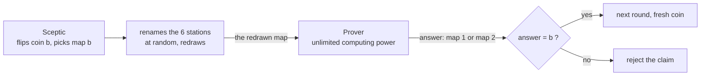
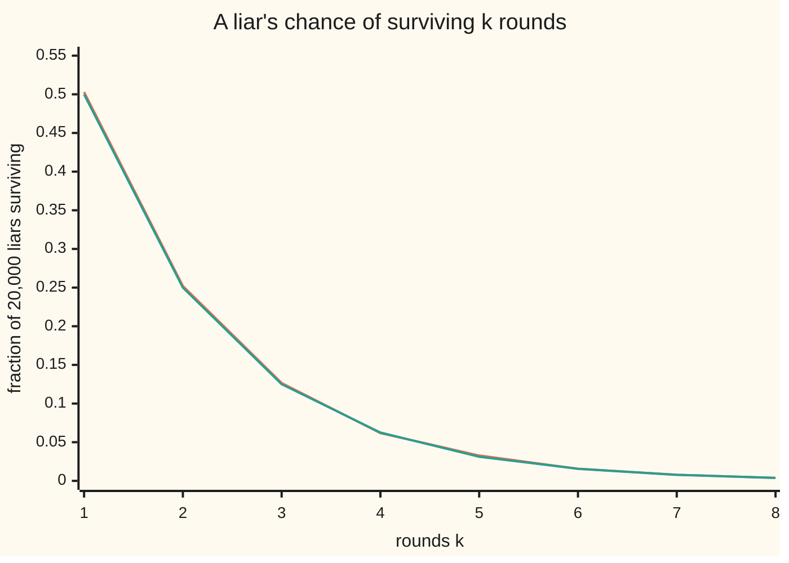

# Interactive proofs: convincing a sceptic by conversation, or by spot checks

[Syllabus](../../../SYLLABUS.md) → [Computability and complexity](../README.md) → [Algebraic, Interactive and Quantum](../README.md#s05) → Interactive proofs

---

## General Overview

Two tube maps lie on a table. Each shows six stations and eight lines. On both, two stations have two lines and four stations have three. The first is the ring map from [Graphs](../../04-Combinatorics%20and%20graphs/09-Graphs%20-%20Dots%20and%20Lines/01-graphs-vertices-and-edges.md): a loop A-B-C-D-E-F-A with crossings B-E and C-F. The second is a decoy: two triangles of stations, joined by two lines.

Someone claims: "these are **different networks**, not one network drawn twice." A sceptic wants to be convinced. "Same network" would be easy to prove: hand over the renaming of stations that turns one map into the other, and the sceptic checks it line by line. "Different" has no such receipt. It says that *none* of the 720 renamings works. For these two maps a triangle count happens to settle it, but for general pairs of maps no short receipt of difference is known.

So the sceptic runs a test instead. Out of sight, they flip a coin, pick one of the two maps, rename its stations at random and redraw it. Then they ask: "which map is this?" Someone who can really tell the two networks apart names the right map every time. If the maps were one network drawn twice, the redrawn copy would carry no trace of the coin, and any answer would be right only half the time. Twenty right answers in a row leave a liar a chance of 1 in 1,048,576.

**A proof can be a conversation: a verifier who flips secret coins asks questions that a liar cannot answer consistently; conversation lets a fast verifier check every claim that polynomial memory can decide (IP = PSPACE), and a proof rewritten in the right format can be checked by reading a few random bits of it (the PCP theorem).**

**What kind of fact this is:** three kinds, said separately.

- The map protocol's two promises, that an honest prover always passes and a liar passes half the rounds, are theorems proved on this card in Why it works.
- Sum-check, the engine of IP = PSPACE, is a theorem proved and run on this card. IP = PSPACE itself is a theorem stated with its key steps and a named source.
- The PCP theorem is a theorem stated with key steps and named sources. Its uses in hardness of approximation say "no fast algorithm does better, unless P = NP"; P ≠ NP is a conjecture, unproved as of 2026-11-11.

### The picture: one round of the conversation



Schematic. The coin and the renaming never leave the sceptic. Only the redrawn map travels.

---

## The formula

Notation first, in words. The **prover** has unlimited computing power and may lie. The **verifier** $`V`$ is the sceptic: a program that runs in polynomial time and flips coins, as on [BPP](../04-Beyond%20Worst%20Case/03-randomised-complexity-and-bpp.md). The input $`x`$ is the claim's data, here the two maps $`G_1, G_2`$, of length $`n`$ symbols. The **language** $`L`$ is the set of inputs where the claim is true: here, the pairs of maps that are different networks.

A language $`L`$ is in the class **IP** (interactive polynomial time) when some verifier, exchanging polynomially many messages with a prover, meets both promises:

```math
x \in L \;\Rightarrow\; \Pr[V \text{ accepts } x] \ge \tfrac23 \text{ for some prover}, \qquad x \notin L \;\Rightarrow\; \Pr[V \text{ accepts } x] \le \tfrac13 \text{ for every prover}
```

**Read it aloud:** if the claim is true, an honest prover convinces the verifier at least two times in three; if it is false, no prover whatever convinces it more than one time in three.

The probability is over the verifier's coins. The first promise is **completeness**, the second **soundness**. Repeating shrinks both errors, as on the BPP card.

The card's two headline results:

```math
\mathrm{IP} = \mathrm{PSPACE}, \qquad \mathrm{NP} = \mathrm{PCP}(O(\log n),\, O(1))
```

**Read it aloud:** a fast verifier in conversation can check exactly the claims that polynomial memory can decide; and every NP claim has a written proof that a verifier checks by flipping $`O(\log n)`$ coins and reading a constant number of its bits.

PSPACE, from [Above NP](../03-Time%20Complexity/08-conp-pspace-and-the-polynomial-hierarchy.md), is the problems solvable with memory polynomial in $`n`$ and unlimited time. A **PCP** (probabilistically checkable proof) is a written proof the verifier never reads in full: its coins pick a few positions, and it reads only those bits. On this wing PCP means the theorem; Post's correspondence problem is written in full.

| Symbol | Plain meaning | In our example | Push it up and the answer… |
| --- | --- | --- | --- |
| $`x`$, $`G_1, G_2`$ | the input: the two maps | ring map and decoy | — |
| $`n`$ | the input's length in symbols | two lists of 8 lines | the verifier may spend more time, polynomially more |
| $`L`$ | the inputs where the claim is true | pairs that are different networks | — |
| $`V`$ | the verifier: fast, with secret coins | the sceptic | — |
| $`\Pr[\cdot]`$ | probability over the verifier's coins | 1 for the honest prover per round | — |
| $`b`$, $`\pi`$, $`\sigma`$ | the secret coin (which map is redrawn), the random renaming, and in the proof a renaming between the maps | map 1 or 2; one of 720 | — |
| $`k`$ | number of rounds | 20 | a liar's chance $`(\tfrac12)^{k}`$ halves per round: 1 in 1,048,576 at 20 |
| IP | claims a fast verifier can check by conversation | different networks | — |
| PCP$`(O(\log n), O(1))`$ | claims whose written proof is checked by reading a few random bits | "these stations can be 2-coloured" | — |
| $`A(u, v)`$ | 1 if stations $`u`$ and $`v`$ are joined, else 0 | the decoy's 8 by 8 table | — |
| $`f`$, $`g_i(t)`$ | sum-check: the polynomial summed, and the prover's message in round $`i`$, a polynomial in one variable $`t`$ | triangle polynomial; 3 numbers a round | — |
| $`r_i`$, $`p`$ | sum-check: the verifier's random number in round $`i`$, and the field size | $`p = 2{,}147{,}483{,}647`$ | a liar's escape chance $`18/p`$ falls |

### When it holds

- **The coin and the renaming stay secret.** If the verifier sends the chosen map under its own station names, a liar compares it with the two originals and names 20 rounds out of 20.
- **The verifier flips coins at all.** Without coins the prover can predict every question and write the whole conversation down in advance as one certificate: IP without coins is exactly NP.
- **In sum-check, the field is large and the last check is done.** A liar escapes with chance at most $`18/p`$, so $`p`$ must dwarf 18. If the verifier skips its own final evaluation, a liar claiming 3 triangles passes 9 rounds out of 9.
- **Spot checks need a proof built for them.** A plain colouring of a 1,001-station loop can be wrong on just 1 line; 99% confidence then needs 4,608 spot checks, more than reading all 1,001 lines.

---

## Why it works

### Step 0: a liar must commit before the coins are seen

Every protocol here works the same way. The prover must commit to something definite. The verifier then asks about a point the prover could not predict. A true claim has a right answer at every point. A false claim forces the liar to commit to something wrong, and the random question lands on the wrong part with a known chance. Repetition turns "often caught" into "almost surely caught".

### Step 1: completeness, different maps can always be told apart

A **shuffled copy** of a map is the map redrawn under some renaming $`\pi`$. The ring map has 90 distinct shuffled copies: 720 renamings, but 8 of them leave the ring unchanged (its symmetries), so each copy is drawn 8 times. The decoy has 180 copies, since 4 renamings leave it unchanged. No copy of one is a copy of the other: they share 0.

The prover has unlimited power. Given a redrawn map, it checks which list it belongs to, and names that map. It is right on every round. The code runs 20,000 rounds: 20,000 correct.

### Step 2: soundness, one network drawn twice hides the coin

Now suppose the claim is false: the two maps are one network, like the ring map and the tourist leaflet from the Graphs card. Then both have the same 90 shuffled copies. Each copy arises from exactly 8 renamings of the ring and exactly 8 of the leaflet. Seeing the copy, the coin is equally likely to have been either side.

So *every* answering strategy, however clever, is right exactly half the time. Over all 1,440 equally likely pairs (coin, renaming), the best possible strategy wins 720. A simulated cheater who says "ring" whenever line A-B appears wins 49,996 of 100,000 rounds.

### The picture: how the doubt shrinks, round by round

A liar must win every round to survive. The code runs 20,000 liars for each number of rounds from 1 to 8, each answering "ring" whenever line A-B appears, and counts the survivors.



Orange: simulated survivors. Green: the exact $`(\tfrac12)^{k}`$. They agree within a few standard errors at every point; by 8 rounds, 0.37% survive against 0.39% exact.

<details>
<summary>Detailed proof: the copy is independent of the coin</summary>

Let $`\sigma`$ be a renaming that turns $`G_1`$ into $`G_2`$, so $`\sigma(G_1) = G_2`$.

If the coin picks $`G_2`$ and the renaming is $`\pi`$, the verifier sends $`\pi(G_2) = (\pi \circ \sigma)(G_1)`$.

As $`\pi`$ runs over all 720 renamings with equal chance, so does $`\pi \circ \sigma`$, because composing with a fixed $`\sigma`$ only reorders the list of renamings.

So the copy sent has the same distribution whichever map the coin picked. The prover's answer depends only on the copy, hence it is independent of the coin, and matches it with probability exactly $`\tfrac12`$.

Rounds use fresh coins, so a liar survives all $`k`$ rounds with probability

$`\displaystyle \Pr[\text{liar survives}] = \left(\tfrac12\right)^{k}`$

and the honest prover survives with probability 1. This protocol is from Goldreich, Micali and Wigderson (1991).

</details>

### Step 3: what the class IP holds

The map protocol puts **graph non-isomorphism**, "these two graphs are different", in IP. It is not known to be in NP: no short receipt of difference is known for every pair. How hard sameness is in general is a Frontier-wing topic.

Two inclusions are immediate:

- **NP ⊆ IP.** The prover sends the certificate in one message; the verifier checks it and flips no coins.
- **BPP ⊆ IP.** The verifier ignores the prover and runs its own coin-flipping program.

A third takes one short argument:

- **IP ⊆ PSPACE.** The best prover's chance of success is fixed by the tree of all possible conversations. A program walks that tree one branch at a time, taking the best reply at prover moves and the average at coin flips, reusing memory. The tree is only polynomially deep, so polynomial memory suffices.

The surprise, found in 1989 and 1990, is the other direction.

### Step 4: sum-check, checking a huge sum without adding it up

**Sum-check** lets a prover convince a verifier of the value of a sum with exponentially many terms. Here the sum counts triangles in the decoy map.

Write $`A(u, v) = 1`$ when stations $`u`$ and $`v`$ are joined, and 0 otherwise. Each triangle is counted 6 times, once per ordering of its corners, so

```math
6 \times (\text{triangles}) = \sum_{u, v, w} A(u, v)\, A(v, w)\, A(u, w)
```

**Read it aloud:** six times the triangle count is the number of ordered station triples whose three pairs are all joined.

Give each station a 3-bit code (A = 000, …, F = 101; the two spare codes have no lines). Now $`u`$, $`v`$ and $`w`$ are 9 bits, and the sum has $`2^{9} = 512`$ terms. Brute force gives 12, so the decoy has 2 triangles.

The trick is to let the bits be any number, not just 0 or 1. Arithmetic is modulo the prime $`p = 2{,}147{,}483{,}647`$, a **field** (numbers where all four operations work). $`A`$ extends in exactly one way to a polynomial in its 6 bits, of power at most 1 in each, that agrees with the table at every 0/1 corner. The product of the three extended factors is $`f`$: 9 variables, power at most 2 in each, since each bit sits in two of the three factors.

The conversation has 9 rounds, one per variable.

1. The prover sends $`g_1(t)`$: the sum with the first bit set to $`t`$ and the other 8 bits summed over 0 and 1. It is a polynomial in $`t`$ of power at most 2, so 3 values, at $`t = 0, 1, 2`$, describe it.
2. The verifier checks the one thing it can: $`g_1(0) + g_1(1)`$ must equal the claimed total.
3. The verifier picks a random $`r_1`$ from the field. The claim for round 2 becomes $`g_1(r_1)`$, a sum over 8 bits only.
4. Repeat with $`g_2, \dots, g_9`$, fixing one more variable each round.
5. At the end no bits are left to sum. The verifier computes $`f(r_1, \dots, r_9)`$ itself, from the 8 by 8 station table, and compares it with the last claim.

The check in every round is

```math
g_i(0) + g_i(1) = g_{i-1}(r_{i-1}), \qquad \text{with } g_0 \text{ the claimed total}
```

**Read it aloud:** the two halves of this round's message must add up to what last round's message promised at the random point.

**Why a liar is caught.** Suppose the claimed total is false. To pass round 1 the liar must send a wrong $`g_1`$, since the true one adds up to the true total. Two different polynomials of power at most 2 agree at no more than 2 points. So unless $`r_1`$ lands on one of those 2 points out of $`p`$, the round-2 claim is false too. The argument repeats each round, and at the end a false claim meets the verifier's own computation. The chance of escaping is at most

```math
\Pr[\text{liar escapes}] \le \frac{9 \times 2}{p} = \frac{18}{2{,}147{,}483{,}647}
```

**Read it aloud:** nine rounds, each with at most 2 unlucky points among $`p`$; under 1 chance in 119,304,647.

The code's liar claims 18 (3 triangles). It adds 3 to each value of the true $`g_1`$, sending 11, 7, 11, and keeps shifting to stay consistent. It passes all 9 rounds; the final evaluation exposes it.

**What it saves.** The verifier receives 27 numbers and evaluates $`f`$ once. For 1,024 stations, brute force has 1,073,741,824 terms; sum-check sends 90 numbers over 30 rounds, and the final step makes three passes over the 1,048,576-entry station table, one per factor of $`f`$.

### Step 5: from sum-check to IP = PSPACE

Stated with key steps; the proof is Shamir's, building on Lund, Fortnow, Karloff and Nisan (both 1992).

1. **Pick a hardest PSPACE problem:** TQBF, deciding whether a fully quantified formula such as "for every $`x`$ there is a $`y`$ with …" is true. Every PSPACE problem reduces to it.
2. **Turn logic into arithmetic.** On 0/1 values, "and" is multiplication, "not $`a`$" is $`1 - a`$, "for every $`x`$" is a product over $`x = 0`$ and $`x = 1`$, and "there is an $`x`$" is $`1 - (1 - \cdot)(1 - \cdot)`$ over the two values.
3. **Run sum-check-style rounds** for each quantifier, with products checked the way sums are checked above.
4. **Keep the polynomials small.** Products of products make the powers explode. Shamir's proof has a degree-reduction step of its own; in the simpler version Shen gave in 1992, extra rounds replace each $`x^{2}, x^{3}, \dots`$ by $`x`$, which changes nothing at 0 and 1.

Lund, Fortnow, Karloff and Nisan first put counting problems ([Counting](02-counting-solutions-and-sharp-p.md)) in IP this way; Shamir reached all of PSPACE weeks later. With Step 3, IP = PSPACE.

### Step 6: spot checks, and why the proof must be rewritten first

Take the claim "the stations can be coloured red and blue so that every line joins two colours". The proof is a colour per station. A spot check picks one random line and reads its two colours.

- The **ring map** can be coloured this way: no line is broken, and every spot check passes.
- The **decoy** cannot: each triangle has a broken line whatever the colours, and the best colouring breaks 2 of 8. One check catches any wrong proof with chance at least 25%, so 17 checks give 99% confidence. Simulated 10,000 times against the best wrong colouring, 17 checks are fooled 0.79% of the time, against $`0.75^{17} = 0.75\%`$.
- A **loop of 1,001 stations** cannot either: alternating colours round an odd loop returns to the start on the wrong colour. But the best colouring breaks only 1 line of 1,001, so one check catches it with chance 0.0999%, and 99% confidence needs 4,608 checks.

The loop shows the problem: a plain wrong proof can be wrong in one place only. The **PCP theorem** says every NP claim can be rewritten, at polynomial cost in length, so that every proof of a false claim is wrong in a constant fraction of places: like the decoy, never like the loop. Then $`O(\log n)`$ coins choose a constant number of positions, and a false claim is rejected with chance at least one half.

The first proof (Arora, Lund, Motwani, Sudan and Szegedy; Arora and Safra; both 1998 in journal form) encodes the proof with polynomials of small power, the same tool as sum-check, so that an error anywhere spreads everywhere. Dinur's 2007 proof instead repeats one combinatorial step, which doubles the fraction of broken checks, until it reaches a constant.

---

## Worked numbers, by hand

The map protocol on ring and decoy, the liar on ring and leaflet, sum-check on the decoy, and spot checks.

| Step | Arithmetic | Value |
| --- | --- | --- |
| ring map's shuffled copies | 720 renamings / 8 that leave it unchanged | 90 |
| decoy's shuffled copies | 720 / 4 | 180 |
| copies they share | listed and compared | 0, so the honest prover is always right |
| liar on one network drawn twice | best strategy over 1,440 (coin, renaming) pairs | 720 wins: 50% |
| liar survives 20 rounds | $`(\tfrac12)^{20}`$ | 1 in 1,048,576 |
| claimed sum | 6 orderings × 2 triangles | 12 |
| round 1, honest | $`g_1(0) + g_1(1) = 8 + 4`$ | 12: passes |
| round 1, liar claiming 18 | $`11 + 7`$ | 18: passes |
| final check on the liar | $`f(r_1, \dots, r_9)`$ against last claim | 1,580,111,184 ≠ 1,605,277,008: **reject** |
| liar's escape chance | $`18 / 2{,}147{,}483{,}647`$ | under 1 in 119,304,647 |
| spot check on the decoy | best colouring breaks 2 of 8 | 25% caught per check; 17 checks for 99% |

**The sceptic ends convinced that the two maps are different networks, having drawn coins and compared names, never searching the 720 renamings; and a liar about the triangle count is caught by 27 numbers and one evaluation.**

### What breaks if you drop a piece

| Mistake | Comes out at | What went wrong |
| --- | --- | --- |
| Verifier sends the map without renaming it | liar names 20 rounds of 20 | The coin shows through the station names |
| Verifier skips the final evaluation in sum-check | liar claiming 18 accepted after 9 of 9 rounds | Each round only checks consistency; only the last step touches the real map |
| Spot-checking a plain colouring of a 1,001-station loop | 0.0999% caught per check; 4,608 checks for 99% | A plain proof can be wrong in one place; the PCP format is what spreads the error |
| One round of the map protocol | liar passes 50.30% of the time (simulated) | Soundness per round is one half; it needs repeating |

The code prints every row.

---

## Code, from first principles, and it actually runs

Nothing is imported. The script runs the three protocols and checks each promise by more than one road:

- **Map protocol:** the shuffled copies are listed for all 720 renamings and compared; their counts are checked against 720 divided by the symmetries, a second road; the liar's best rate is counted exactly over 1,440 cases and simulated over 100,000 rounds; triangle counts give an independent fingerprint that the maps differ.
- **Sum-check:** the claimed 12 comes from brute force over 512 corners and from a direct triangle count; the protocol accepts it, rejects the liar at the final check, and rejects a false claim of 13 in round 1.
- **Spot checks:** the best colouring is found by trying all colourings, the catch rate is computed by formula and by 10,000 simulated runs.

Randomness comes from SplitMix64, written out, seed 2026 for the maps and spot checks and 7 for sum-check, so Python and Rust print the same.

### Python

```python
# Interactive proofs -- the check behind the card.  Nothing is imported.
# Stations A to F are 0 to 5.  RING and TOURIST are one network drawn twice
# (the Graphs card); DECOY has the same station and line counts and tally.
RING = [(0, 1), (1, 2), (2, 3), (3, 4), (4, 5), (5, 0), (1, 4), (2, 5)]
TOURIST = [(0, 2), (0, 4), (0, 5), (1, 4), (1, 5), (2, 3), (3, 4), (3, 5)]
DECOY = [(0, 1), (0, 2), (1, 2), (1, 4), (2, 5), (3, 4), (3, 5), (4, 5)]
M64 = (1 << 64) - 1
class Rng:                                   # SplitMix64, written out
    def __init__(s, seed): s.x = seed
    def below(s, n):
        s.x = (s.x + 0x9E3779B97F4A7C15) & M64
        z = ((s.x ^ (s.x >> 30)) * 0xBF58476D1CE4E5B9) & M64
        z = ((z ^ (z >> 27)) * 0x94D049BB133111EB) & M64
        return (z ^ (z >> 31)) % n
def perms(items):                            # all 720 renamings, generated here
    if not items: return [()]
    return [(x,) + r for i, x in enumerate(items) for r in perms(items[:i] + items[i + 1:])]
ALL, ID = perms(tuple(range(6))), tuple(range(6))
def mask(edges, pi):                         # a renamed map as a set of bits
    return sum(1 << (min(pi[a], pi[b]) * 6 + max(pi[a], pi[b])) for a, b in edges)
def tally(e): return sorted(sum(v in p for p in e) for v in range(6))
def triangles(e):
    s = {mask([p], ID) for p in e}
    return sum(1 for a in range(6) for b in range(a + 1, 6) for c in range(b + 1, 6)
               if {mask([(a, b)], ID), mask([(a, c)], ID), mask([(b, c)], ID)} <= s)
def shuffle(rng):                            # Fisher-Yates: a random renaming
    p = list(range(6))
    for i in range(5, 0, -1):
        j = rng.below(i + 1); p[i], p[j] = p[j], p[i]
    return p
def round_ok(rng, maps, answer, shuffled=True):   # True if prover names the coin
    b = rng.below(2)
    return answer(mask(maps[b], shuffle(rng) if shuffled else ID)) == b
# ---- part 1: the sceptic's protocol for "these two maps are different networks"
cR, cD, cT = ({mask(m, p) for p in ALL} for m in (RING, DECOY, TOURIST))
aR, aD = (sum(1 for p in ALL if mask(m, p) == mask(m, ID)) for m in (RING, DECOY))
print(f"tube maps: 6 stations, 8 lines each; tally ring {tally(RING)}, decoy {tally(DECOY)}")
print(f"triangles: ring {triangles(RING)}, tourist {triangles(TOURIST)}, decoy {triangles(DECOY)}")
print(f"renamings that leave a map unchanged: ring {aR}, decoy {aD}")
print(f"distinct shuffled copies: ring {len(cR)} = 720 / {aR}, decoy {len(cD)} = 720 / {aD}, shared {len(cR & cD)}")
print(f"same network (ring, tourist): copies {len(cR)} and {len(cT)}, shared {len(cR & cT)}")
count = {}
for b, m in enumerate((RING, TOURIST)):
    for p in ALL:
        h = mask(m, p); count.setdefault(h, [0, 0])[b] += 1
best = sum(max(c) for c in count.values())
print(f"best cheater over all 1440 (coin, renaming) pairs: wins {best}, rate {best / 1440:.6f}")
rng = Rng(2026)
honest = sum(round_ok(rng, (RING, DECOY), lambda h: 0 if h in cR else 1) for _ in range(20000))
print(f"honest prover, different maps: {honest} of 20000 rounds named correctly")
guess = lambda h: 0 if h & (1 << 1) else 1           # "ring if line A-B is drawn"
wins = sum(round_ok(rng, (RING, TOURIST), guess) for _ in range(100000))
print(f"cheater, same network, one round: {wins} of 100000, rate {wins / 100000:.6f} (exact 0.5)")
print("chart,rounds,simulated,exact")
sims = []
for k in range(1, 9):
    alive = sum(all(round_ok(rng, (RING, TOURIST), guess) for _ in range(k)) for _ in range(20000))
    sims.append(alive / 20000); print(f"chart,{k},{alive / 20000:.4f},{0.5 ** k:.4f}")
print(f"20 rounds: a cheater survives with chance 1 in {2 ** 20}")
blind = sum(round_ok(rng, (RING, TOURIST), lambda h: 0 if h == mask(RING, ID) else 1, False) for _ in range(20))
print(f"no shuffle (map sent under its own names): cheater names {blind} of 20")
assert len(cR) * aR == 720 and len(cD) * aD == 720 and not (cR & cD) and cR == cT
assert triangles(RING) == triangles(TOURIST) == 0 and triangles(DECOY) == 2 and tally(RING) == tally(DECOY)
assert honest == 20000 and best == 720 and blind == 20
assert abs(wins / 100000 - 0.5) < 4 * (0.25 / 100000) ** 0.5
assert all(abs(s - 0.5 ** k) < 4 * (0.5 ** k / 20000) ** 0.5 for k, s in enumerate(sims, 1))
# ---- part 2: sum-check, the engine of IP = PSPACE, on "the decoy has 2 triangles"
P, H = 2 ** 31 - 1, 2 ** 30                  # field size; H is 1/2 mod P
A = [[0] * 8 for _ in range(8)]
for a, b in DECOY: A[a][b] = A[b][a] = 1
def chi(pt):                                 # weight of each 3-bit corner at a point
    w = []
    for c in range(8):
        x = 1
        for i in range(3): x = x * (pt[i] if (c >> (2 - i)) & 1 else 1 - pt[i] + P) % P
        w.append(x)
    return w
def At(x, y):                                # the adjacency table, extended smoothly
    cx, cy = chi(x), chi(y)
    return sum(A[a][b] * cx[a] % P * cy[b] for a in range(8) for b in range(8)) % P
def f(z): return At(z[0:3], z[3:6]) * At(z[3:6], z[6:9]) % P * At(z[0:3], z[6:9]) % P
def corners(k): return [[(c >> (k - 1 - i)) & 1 for i in range(k)] for c in range(2 ** k)]
def at(g, r):                                # the degree-2 polynomial through g, at r
    return (g[0] * (r - 1) * (r - 2) * H - g[1] * r * (r - 2) + g[2] * r * (r - 1) * H) % P
def sumcheck(claim, rng, lie=0, final=True, show=0, who=""):
    fixed = []
    for i in range(9):
        g = [(sum(f(fixed + [t] + c) for c in corners(8 - i)) + lie) % P for t in range(3)]
        if (g[0] + g[1]) % P != claim: return f"rejected in round {i + 1}"
        r = rng.below(P); claim, lie = at(g, r), lie * H % P; fixed.append(r)
        if i < show: print(f"{who}round {i + 1}: g(0) = {g[0]}, g(1) = {g[1]}, g(2) = {g[2]}, r = {r}")
    if not final: return "accepted after 9 of 9 rounds"
    return f"final f = {f(fixed)}, last claim {claim}: " + ("accept" if f(fixed) == claim else "reject")
total = sum(f(c) for c in corners(9))
print(f"sum-check on the decoy, 9 variables, field size p = {P}")
print(f"brute force over 512 corners: {total} = 6 x {triangles(DECOY)} triangles")
honest_run = sumcheck(total, Rng(7), show=9)
print("honest prover, claim 12: " + honest_run)
lie_run = sumcheck(18, Rng(7), lie=3, show=1, who="lying prover, ")
print("lying prover, claim 18 (3 triangles): " + lie_run)
blind_run = sumcheck(18, Rng(7), lie=3, final=False)
print("lying prover, verifier skips the final check: " + blind_run)
print(f"escape chance at most 18 / {P}, under 1 in {P // 18}")
print("cost,stations,rounds,numbers sent,brute-force terms,table entries read")
for m in (3, 8, 10): print(f"cost,{2 ** m},{3 * m},{9 * m},{8 ** m},{4 ** m}")
assert total == 6 * triangles(DECOY) and honest_run.endswith("accept") and lie_run.endswith("reject")
assert blind_run.startswith("accepted") and sumcheck(total + 1, Rng(7)) == "rejected in round 1"
# ---- part 3: spot checks, and why a proof must be rewritten before they work
def broken(e, col): return sum(1 for a, b in e if col[a] == col[b])
def best_col(e, n): return min((broken(e, [(c >> i) & 1 for i in range(n)]), c) for c in range(2 ** n))
loop = lambda n: [(i, (i + 1) % n) for i in range(n)]
bR, bD, b9 = best_col(RING, 6)[0], best_col(DECOY, 6), best_col(loop(9), 9)[0]
b1001 = broken(loop(1001), [i % 2 for i in range(1001)])
print(f"2-colouring proofs: ring best breaks {bR} of 8; decoy best breaks {bD[0]} of 8")
print(f"odd loop of 9: best breaks {b9} of 9 (all 512 colourings); loop of 1001, alternating: breaks {b1001}")
def checks(q):
    k, x = 0, 1.0
    while x > 0.01: k, x = k + 1, x * (1 - q)
    return k
qD, qL = bD[0] / 8, b1001 / 1001
print(f"one check catches the best wrong proof: decoy {qD:.6f}, loop of 1001 {qL:.6f}")
print(f"checks for 99% confidence: decoy {checks(qD)}, loop of 1001 {checks(qL)}")
col = [(bD[1] >> i) & 1 for i in range(6)]
fooled = sum(all(col[a] != col[b] for a, b in (DECOY[rng.below(8)] for _ in range(17)))
             for _ in range(10000))
print(f"17 checks on the best decoy colouring, 10000 trials: fooled {fooled / 10000:.4f}, exact {0.75 ** 17:.6f}")
sat = sum(1 for c in range(8) if (c & 1) or (c & 2) or (c & 4))   # (x or y or z)
print(f"a 3-literal clause holds on {sat} of its 8 settings")
assert bR == 0 and bD[0] == 2 and b9 == 1 and b1001 == 1
assert checks(qD) == 17 and checks(qL) > 1001 and abs(fooled / 10000 - 0.75 ** 17) < 4 * (0.0075 / 10000) ** 0.5
print("ALL CHECKS PASS")
```

**Ran 2026-11-19 on macOS, Python 3.14.10, standard library only. All checks passed. Output, pasted from the run:**

```text
tube maps: 6 stations, 8 lines each; tally ring [2, 2, 3, 3, 3, 3], decoy [2, 2, 3, 3, 3, 3]
triangles: ring 0, tourist 0, decoy 2
renamings that leave a map unchanged: ring 8, decoy 4
distinct shuffled copies: ring 90 = 720 / 8, decoy 180 = 720 / 4, shared 0
same network (ring, tourist): copies 90 and 90, shared 90
best cheater over all 1440 (coin, renaming) pairs: wins 720, rate 0.500000
honest prover, different maps: 20000 of 20000 rounds named correctly
cheater, same network, one round: 49996 of 100000, rate 0.499960 (exact 0.5)
chart,rounds,simulated,exact
chart,1,0.5030,0.5000
chart,2,0.2522,0.2500
chart,3,0.1266,0.1250
chart,4,0.0618,0.0625
chart,5,0.0328,0.0312
chart,6,0.0157,0.0156
chart,7,0.0080,0.0078
chart,8,0.0037,0.0039
20 rounds: a cheater survives with chance 1 in 1048576
no shuffle (map sent under its own names): cheater names 20 of 20
sum-check on the decoy, 9 variables, field size p = 2147483647
brute force over 512 corners: 12 = 6 x 2 triangles
round 1: g(0) = 8, g(1) = 4, g(2) = 8, r = 550097313
round 2: g(0) = 4, g(1) = 87239703, g(2) = 666392422, r = 2094325707
round 3: g(0) = 1278532803, g(1) = 1885039340, g(2) = 119791810, r = 132229895
round 4: g(0) = 1261339465, g(1) = 205588643, g(2) = 597002440, r = 297009326
round 5: g(0) = 1545261945, g(1) = 1681153465, g(2) = 1511820356, r = 1371838632
round 6: g(0) = 510714395, g(1) = 478350581, g(2) = 101293511, r = 1265903391
round 7: g(0) = 1165237999, g(1) = 1101386182, g(2) = 568385564, r = 593123898
round 8: g(0) = 1517232357, g(1) = 892639373, g(2) = 549250679, r = 1694264225
round 9: g(0) = 1480430243, g(1) = 1528913617, g(2) = 818088309, r = 1577969750
honest prover, claim 12: final f = 1580111184, last claim 1580111184: accept
lying prover, round 1: g(0) = 11, g(1) = 7, g(2) = 11, r = 550097313
lying prover, claim 18 (3 triangles): final f = 1580111184, last claim 1605277008: reject
lying prover, verifier skips the final check: accepted after 9 of 9 rounds
escape chance at most 18 / 2147483647, under 1 in 119304647
cost,stations,rounds,numbers sent,brute-force terms,table entries read
cost,8,9,27,512,64
cost,256,24,72,16777216,65536
cost,1024,30,90,1073741824,1048576
2-colouring proofs: ring best breaks 0 of 8; decoy best breaks 2 of 8
odd loop of 9: best breaks 1 of 9 (all 512 colourings); loop of 1001, alternating: breaks 1
one check catches the best wrong proof: decoy 0.250000, loop of 1001 0.000999
checks for 99% confidence: decoy 17, loop of 1001 4608
17 checks on the best decoy colouring, 10000 trials: fooled 0.0079, exact 0.007517
a 3-literal clause holds on 7 of its 8 settings
ALL CHECKS PASS
```

### Rust

```rust
// Interactive proofs -- the same check as the Python, in Rust.  No crates.
// Stations A to F are 0 to 5.  RING and TOURIST are one network drawn twice
// (the Graphs card); DECOY has the same station and line counts and tally.
use std::collections::{HashMap, HashSet};
type Map = [(usize, usize); 8];
const RING: Map = [(0, 1), (1, 2), (2, 3), (3, 4), (4, 5), (5, 0), (1, 4), (2, 5)];
const TOURIST: Map = [(0, 2), (0, 4), (0, 5), (1, 4), (1, 5), (2, 3), (3, 4), (3, 5)];
const DECOY: Map = [(0, 1), (0, 2), (1, 2), (1, 4), (2, 5), (3, 4), (3, 5), (4, 5)];
const ID: [usize; 6] = [0, 1, 2, 3, 4, 5];
const P: u64 = (1 << 31) - 1; const H: u64 = 1 << 30; // field size; H is 1/2 mod P
struct Rng(u64); // SplitMix64, written out
impl Rng {
    fn below(&mut self, n: u64) -> u64 {
        self.0 = self.0.wrapping_add(0x9E3779B97F4A7C15);
        let mut z = (self.0 ^ (self.0 >> 30)).wrapping_mul(0xBF58476D1CE4E5B9);
        z = (z ^ (z >> 27)).wrapping_mul(0x94D049BB133111EB);
        (z ^ (z >> 31)) % n
    }
}
fn perms(items: &[usize]) -> Vec<Vec<usize>> { // all 720 renamings, generated here
    if items.is_empty() { return vec![vec![]]; }
    let mut out = vec![];
    for i in 0..items.len() {
        let mut rest = items.to_vec(); let x = rest.remove(i);
        for r in perms(&rest) { let mut v = vec![x]; v.extend(r); out.push(v); }
    }
    out
}
fn mask(e: &[(usize, usize)], pi: &[usize]) -> u64 { // a renamed map as a set of bits
    e.iter().map(|&(a, b)| 1u64 << (pi[a].min(pi[b]) * 6 + pi[a].max(pi[b]))).sum()
}
fn tally(e: &Map) -> Vec<usize> {
    let mut t: Vec<usize> = (0..6).map(|v| e.iter().filter(|p| p.0 == v || p.1 == v).count()).collect(); t.sort(); t
}
fn triangles(e: &Map) -> usize {
    let s = mask(e, &ID); let bit = |a: usize, b: usize| s & (1u64 << (a * 6 + b)) != 0;
    (0..216).filter(|&t| { let (a, b, c) = (t / 36, t / 6 % 6, t % 6); a < b && b < c && bit(a, b) && bit(a, c) && bit(b, c) }).count()
}
fn shuffle(rng: &mut Rng) -> Vec<usize> { // Fisher-Yates: a random renaming
    let mut p: Vec<usize> = (0..6).collect();
    for i in (1..6).rev() { let j = rng.below(i as u64 + 1) as usize; p.swap(i, j); } p
}
fn round_ok(rng: &mut Rng, maps: [&Map; 2], answer: &dyn Fn(u64) -> u64, shuffled: bool) -> bool {
    let b = rng.below(2);
    let pi = if shuffled { shuffle(rng) } else { ID.to_vec() };
    answer(mask(maps[b as usize], &pi)) == b
}
fn chi(pt: &[u64]) -> [u64; 8] { // weight of each 3-bit corner at a point
    let mut w = [0u64; 8];
    for c in 0..8 {
        let mut x = 1u64;
        for i in 0..3 { x = x * (if (c >> (2 - i)) & 1 == 1 { pt[i] } else { (1 + P - pt[i]) % P }) % P; }
        w[c] = x;
    }
    w
}
fn at_(a: &[[u64; 8]; 8], x: &[u64], y: &[u64]) -> u64 { // the adjacency table, extended smoothly
    let (cx, cy) = (chi(x), chi(y));
    (0..64).map(|t| a[t / 8][t % 8] * cx[t / 8] % P * cy[t % 8] % P).sum::<u64>() % P
}
fn f(a: &[[u64; 8]; 8], z: &[u64]) -> u64 {
    at_(a, &z[0..3], &z[3..6]) * at_(a, &z[3..6], &z[6..9]) % P * at_(a, &z[0..3], &z[6..9]) % P
}
fn corners(k: usize) -> Vec<Vec<u64>> { (0..1u64 << k).map(|c| (0..k).map(|i| (c >> (k - 1 - i)) & 1).collect()).collect() }
fn at(g: &[u64; 3], r: u64) -> u64 { // the degree-2 polynomial through g, at r
    let t0 = g[0] * ((r + P - 1) % P) % P * ((r + P - 2) % P) % P * H % P;
    let t1 = g[1] * r % P * ((r + P - 2) % P) % P;
    let t2 = g[2] * r % P * ((r + P - 1) % P) % P * H % P;
    (t0 + P - t1 + t2) % P
}
fn sumcheck(a: &[[u64; 8]; 8], mut claim: u64, rng: &mut Rng, mut lie: u64, fin: bool, show: usize, who: &str) -> String {
    let mut fixed: Vec<u64> = vec![];
    for i in 0..9 {
        let mut g = [0u64; 3];
        for t in 0..3u64 {
            let mut s = 0;
            for c in corners(8 - i) { let mut z = fixed.clone(); z.push(t); z.extend(c); s = (s + f(a, &z)) % P; }
            g[t as usize] = (s + lie) % P;
        }
        if (g[0] + g[1]) % P != claim { return format!("rejected in round {}", i + 1); }
        let r = rng.below(P); claim = at(&g, r); lie = lie * H % P; fixed.push(r);
        if i < show { println!("{}round {}: g(0) = {}, g(1) = {}, g(2) = {}, r = {}", who, i + 1, g[0], g[1], g[2], r); }
    }
    if !fin { return "accepted after 9 of 9 rounds".to_string(); }
    let v = f(a, &fixed);
    format!("final f = {}, last claim {}: {}", v, claim, if v == claim { "accept" } else { "reject" })
}
fn broken(e: &[(usize, usize)], col: &[usize]) -> usize { e.iter().filter(|&&(a, b)| col[a] == col[b]).count() }
fn best_col(e: &[(usize, usize)], n: usize) -> (usize, usize) {
    (0..1usize << n).map(|c| (broken(e, &(0..n).map(|i| (c >> i) & 1).collect::<Vec<_>>()), c)).min().unwrap()
}
fn lp(n: usize) -> Vec<(usize, usize)> { (0..n).map(|i| (i, (i + 1) % n)).collect() }
fn checks(q: f64) -> usize { let (mut k, mut x) = (0, 1.0f64); while x > 0.01 { k += 1; x *= 1.0 - q; } k }
fn main() {
    // ---- part 1: the sceptic's protocol for "these two maps are different networks"
    let all = perms(&ID);
    let copies = |m: &Map| -> HashSet<u64> { all.iter().map(|p| mask(m, p)).collect() };
    let (c_r, c_d, c_t) = (copies(&RING), copies(&DECOY), copies(&TOURIST));
    let autos = |m: &Map| all.iter().filter(|p| mask(m, p) == mask(m, &ID)).count();
    let (a_r, a_d) = (autos(&RING), autos(&DECOY));
    let shared = |x: &HashSet<u64>, y: &HashSet<u64>| x.intersection(y).count();
    println!("tube maps: 6 stations, 8 lines each; tally ring {:?}, decoy {:?}", tally(&RING), tally(&DECOY));
    println!("triangles: ring {}, tourist {}, decoy {}", triangles(&RING), triangles(&TOURIST), triangles(&DECOY));
    println!("renamings that leave a map unchanged: ring {}, decoy {}", a_r, a_d);
    println!("distinct shuffled copies: ring {} = 720 / {}, decoy {} = 720 / {}, shared {}", c_r.len(), a_r, c_d.len(), a_d, shared(&c_r, &c_d));
    println!("same network (ring, tourist): copies {} and {}, shared {}", c_r.len(), c_t.len(), shared(&c_r, &c_t));
    let mut count: HashMap<u64, [usize; 2]> = HashMap::new();
    for (b, m) in [&RING, &TOURIST].iter().enumerate() { for p in &all { count.entry(mask(*m, p)).or_insert([0, 0])[b] += 1; } }
    let best: usize = count.values().map(|c| c[0].max(c[1])).sum();
    println!("best cheater over all 1440 (coin, renaming) pairs: wins {}, rate {:.6}", best, best as f64 / 1440.0);
    let mut rng = Rng(2026);
    let honest_ans = |h: u64| if c_r.contains(&h) { 0 } else { 1 };
    let honest = (0..20000).filter(|_| round_ok(&mut rng, [&RING, &DECOY], &honest_ans, true)).count();
    println!("honest prover, different maps: {} of 20000 rounds named correctly", honest);
    let guess = |h: u64| if h & (1 << 1) != 0 { 0 } else { 1 }; // "ring if line A-B is drawn"
    let wins = (0..100000).filter(|_| round_ok(&mut rng, [&RING, &TOURIST], &guess, true)).count();
    println!("cheater, same network, one round: {} of 100000, rate {:.6} (exact 0.5)", wins, wins as f64 / 100000.0);
    println!("chart,rounds,simulated,exact");
    let mut sims = vec![];
    for k in 1..9 {
        let alive = (0..20000).filter(|_| (0..k).all(|_| round_ok(&mut rng, [&RING, &TOURIST], &guess, true))).count();
        let s = alive as f64 / 20000.0; sims.push(s);
        println!("chart,{},{:.4},{:.4}", k, s, 0.5f64.powi(k));
    }
    println!("20 rounds: a cheater survives with chance 1 in {}", 1u64 << 20);
    let ring_id = mask(&RING, &ID);
    let blind_ans = move |h: u64| if h == ring_id { 0 } else { 1 };
    let blind = (0..20).filter(|_| round_ok(&mut rng, [&RING, &TOURIST], &blind_ans, false)).count();
    println!("no shuffle (map sent under its own names): cheater names {} of 20", blind);
    assert!(c_r.len() * a_r == 720 && c_d.len() * a_d == 720 && shared(&c_r, &c_d) == 0 && c_r == c_t);
    assert!(triangles(&RING) == 0 && triangles(&TOURIST) == 0 && triangles(&DECOY) == 2 && tally(&RING) == tally(&DECOY));
    assert!(honest == 20000 && best == 720 && blind == 20);
    assert!((wins as f64 / 100000.0 - 0.5).abs() < 4.0 * (0.25f64 / 100000.0).sqrt());
    for (i, s) in sims.iter().enumerate() { let e = 0.5f64.powi(i as i32 + 1); assert!((s - e).abs() < 4.0 * (e / 20000.0).sqrt()); }
    // ---- part 2: sum-check, the engine of IP = PSPACE, on "the decoy has 2 triangles"
    let mut a = [[0u64; 8]; 8];
    for &(x, y) in DECOY.iter() { a[x][y] = 1; a[y][x] = 1; }
    let total = corners(9).iter().fold(0, |s, c| (s + f(&a, c)) % P);
    println!("sum-check on the decoy, 9 variables, field size p = {}", P);
    println!("brute force over 512 corners: {} = 6 x {} triangles", total, triangles(&DECOY));
    let honest_run = sumcheck(&a, total, &mut Rng(7), 0, true, 9, "");
    println!("honest prover, claim 12: {}", honest_run);
    let lie_run = sumcheck(&a, 18, &mut Rng(7), 3, true, 1, "lying prover, ");
    println!("lying prover, claim 18 (3 triangles): {}", lie_run);
    let blind_run = sumcheck(&a, 18, &mut Rng(7), 3, false, 0, "");
    println!("lying prover, verifier skips the final check: {}", blind_run);
    println!("escape chance at most 18 / {}, under 1 in {}", P, P / 18);
    println!("cost,stations,rounds,numbers sent,brute-force terms,table entries read");
    for m in [3u32, 8, 10] { println!("cost,{},{},{},{},{}", 1u64 << m, 3 * m, 9 * m, 8u64.pow(m), 4u64.pow(m)); }
    assert!(total == 6 * triangles(&DECOY) as u64 && honest_run.ends_with("accept") && lie_run.ends_with("reject"));
    assert!(blind_run.starts_with("accepted") && sumcheck(&a, total + 1, &mut Rng(7), 0, true, 0, "") == "rejected in round 1");
    // ---- part 3: spot checks, and why a proof must be rewritten before they work
    let (b_r, b_d, b9) = (best_col(&RING, 6).0, best_col(&DECOY, 6), best_col(&lp(9), 9).0);
    let b1001 = broken(&lp(1001), &(0..1001).map(|i| i % 2).collect::<Vec<_>>());
    println!("2-colouring proofs: ring best breaks {} of 8; decoy best breaks {} of 8", b_r, b_d.0);
    println!("odd loop of 9: best breaks {} of 9 (all 512 colourings); loop of 1001, alternating: breaks {}", b9, b1001);
    let (q_d, q_l) = (b_d.0 as f64 / 8.0, b1001 as f64 / 1001.0);
    println!("one check catches the best wrong proof: decoy {:.6}, loop of 1001 {:.6}", q_d, q_l);
    println!("checks for 99% confidence: decoy {}, loop of 1001 {}", checks(q_d), checks(q_l));
    let col: Vec<usize> = (0..6).map(|i| (b_d.1 >> i) & 1).collect();
    let fooled = (0..10000).filter(|_| (0..17).all(|_| { let (x, y) = DECOY[rng.below(8) as usize]; col[x] != col[y] })).count();
    println!("17 checks on the best decoy colouring, 10000 trials: fooled {:.4}, exact {:.6}", fooled as f64 / 10000.0, 0.75f64.powi(17));
    let sat = (0..8).filter(|c| c & 1 != 0 || c & 2 != 0 || c & 4 != 0).count(); // (x or y or z)
    println!("a 3-literal clause holds on {} of its 8 settings", sat);
    assert!(b_r == 0 && b_d.0 == 2 && b9 == 1 && b1001 == 1);
    assert!(checks(q_d) == 17 && checks(q_l) > 1001 && (fooled as f64 / 10000.0 - 0.75f64.powi(17)).abs() < 4.0 * (0.0075f64 / 10000.0).sqrt());
    println!("ALL CHECKS PASS");
}
```

**Ran 2026-11-19 on macOS, rustc 1.98.1, no crates. All checks passed. Output, pasted from the run:**

```text
tube maps: 6 stations, 8 lines each; tally ring [2, 2, 3, 3, 3, 3], decoy [2, 2, 3, 3, 3, 3]
triangles: ring 0, tourist 0, decoy 2
renamings that leave a map unchanged: ring 8, decoy 4
distinct shuffled copies: ring 90 = 720 / 8, decoy 180 = 720 / 4, shared 0
same network (ring, tourist): copies 90 and 90, shared 90
best cheater over all 1440 (coin, renaming) pairs: wins 720, rate 0.500000
honest prover, different maps: 20000 of 20000 rounds named correctly
cheater, same network, one round: 49996 of 100000, rate 0.499960 (exact 0.5)
chart,rounds,simulated,exact
chart,1,0.5030,0.5000
chart,2,0.2522,0.2500
chart,3,0.1266,0.1250
chart,4,0.0618,0.0625
chart,5,0.0328,0.0312
chart,6,0.0157,0.0156
chart,7,0.0080,0.0078
chart,8,0.0037,0.0039
20 rounds: a cheater survives with chance 1 in 1048576
no shuffle (map sent under its own names): cheater names 20 of 20
sum-check on the decoy, 9 variables, field size p = 2147483647
brute force over 512 corners: 12 = 6 x 2 triangles
round 1: g(0) = 8, g(1) = 4, g(2) = 8, r = 550097313
round 2: g(0) = 4, g(1) = 87239703, g(2) = 666392422, r = 2094325707
round 3: g(0) = 1278532803, g(1) = 1885039340, g(2) = 119791810, r = 132229895
round 4: g(0) = 1261339465, g(1) = 205588643, g(2) = 597002440, r = 297009326
round 5: g(0) = 1545261945, g(1) = 1681153465, g(2) = 1511820356, r = 1371838632
round 6: g(0) = 510714395, g(1) = 478350581, g(2) = 101293511, r = 1265903391
round 7: g(0) = 1165237999, g(1) = 1101386182, g(2) = 568385564, r = 593123898
round 8: g(0) = 1517232357, g(1) = 892639373, g(2) = 549250679, r = 1694264225
round 9: g(0) = 1480430243, g(1) = 1528913617, g(2) = 818088309, r = 1577969750
honest prover, claim 12: final f = 1580111184, last claim 1580111184: accept
lying prover, round 1: g(0) = 11, g(1) = 7, g(2) = 11, r = 550097313
lying prover, claim 18 (3 triangles): final f = 1580111184, last claim 1605277008: reject
lying prover, verifier skips the final check: accepted after 9 of 9 rounds
escape chance at most 18 / 2147483647, under 1 in 119304647
cost,stations,rounds,numbers sent,brute-force terms,table entries read
cost,8,9,27,512,64
cost,256,24,72,16777216,65536
cost,1024,30,90,1073741824,1048576
2-colouring proofs: ring best breaks 0 of 8; decoy best breaks 2 of 8
odd loop of 9: best breaks 1 of 9 (all 512 colourings); loop of 1001, alternating: breaks 1
one check catches the best wrong proof: decoy 0.250000, loop of 1001 0.000999
checks for 99% confidence: decoy 17, loop of 1001 4608
17 checks on the best decoy colouring, 10000 trials: fooled 0.0079, exact 0.007517
a 3-literal clause holds on 7 of its 8 settings
ALL CHECKS PASS
```

### Lean

Lean proves the map protocol's two promises for maps of any size, and the step that catches a sum-check liar for any finite field.

- Suppose the two maps are one network drawn twice. Then every answering strategy names the coin on exactly half of the (coin, renaming) pairs.
- Suppose the two maps are different networks. Then the prover has an answering strategy that names the coin for every coin and every renaming.
- Take two different polynomials over a finite field, each of power at most $`d`$. Then they agree at no more than $`d`$ points.
- It also checks the map counts: 720 renamings, 8 lines on each map, 0 triangles on the ring and 2 on the decoy.
- It checks the odds: 1 in 1,048,576 for a liar over 20 rounds, and under 1 in 119,304,647 for a sum-check liar.
- It checks that 17 spot checks on the decoy reach 99% confidence, and 16 do not.
- It checks that a 3-literal clause holds on 7 of its 8 settings.

The simulated rounds, the full sum-check run and the spot-check trials are left to the Python and Rust checks.

```lean
-- Interactive proofs: one network drawn twice hides the sceptic's coin, different networks never do, and two different low-power polynomials rarely agree at a random point.
import Mathlib.Combinatorics.SimpleGraph.Maps
import Mathlib.Combinatorics.SimpleGraph.Clique
import Mathlib.Data.Fintype.Perm
import Mathlib.Algebra.Polynomial.Roots
import Mathlib.Tactic.NormNum

open Polynomial

/-- A graph isomorphism pushes its source graph onto its target graph. -/
theorem iso_map_eq_target {V W : Type*} {G : SimpleGraph V} {G' : SimpleGraph W}
    (e : G ≃g G') : G.map e = G' := by
  ext a b
  constructor
  · rintro ⟨-, u, v, h, rfl, rfl⟩
    exact e.map_adj_iff.mpr h
  · intro h
    refine ⟨h.ne, e.symm a, e.symm b, ?_, by simp, by simp⟩
    rw [← e.map_adj_iff]; simpa using h

#print axioms iso_map_eq_target

/-- Soundness of the map protocol. If the two maps are one network drawn twice
(some renaming turns `G₁` into `G₂`), the sceptic flips a coin `b`
(`false` picks `G₁`, `true` picks `G₂`) and redraws the chosen map under a
renaming `π`. Then every answering strategy `ans`, which sees only the redrawn
map, names the coin on exactly half of the `2 × (number of renamings)` equally
likely pairs `(b, π)`: one network drawn twice hides the coin. -/
theorem renamed_copy_hides_coin {V : Type*} [Fintype V] [DecidableEq V]
    (G₁ G₂ : SimpleGraph V) (h : Nonempty (G₁ ≃g G₂)) (ans : SimpleGraph V → Bool) :
    (Finset.univ.filter (fun bπ : Bool × Equiv.Perm V =>
        ans ((if bπ.1 then G₂ else G₁).map bπ.2) = bπ.1)).card
      = Fintype.card (Equiv.Perm V) := by
  obtain ⟨e⟩ := h
  have key : ∀ π : Equiv.Perm V, G₂.map π = G₁.map (e.toEquiv.trans π) := by
    intro π
    have h1 : (G₁.map e).map π = G₁.map (e.toEquiv.trans π) := by
      rw [SimpleGraph.map_map]; rfl
    rwa [iso_map_eq_target e] at h1
  have c1 : ∀ σ : Equiv.Perm V, e.toEquiv.trans (e.toEquiv.symm.trans σ) = σ := by
    intro σ; rw [← Equiv.trans_assoc, Equiv.self_trans_symm, Equiv.refl_trans]
  have c2 : ∀ σ : Equiv.Perm V, e.toEquiv.symm.trans (e.toEquiv.trans σ) = σ := by
    intro σ; rw [← Equiv.trans_assoc, Equiv.symm_trans_self, Equiv.refl_trans]
  rw [← Finset.card_univ]
  refine Finset.card_nbij' (fun bπ => if bπ.1 then e.toEquiv.trans bπ.2 else bπ.2)
    (fun σ => if ans (G₁.map σ) then (true, e.toEquiv.symm.trans σ) else (false, σ))
    (by simp) ?_ ?_ ?_
  · intro σ _
    simp only [Finset.coe_filter, Finset.mem_univ, true_and, Set.mem_ofPred_eq]
    by_cases hs : ans (G₁.map σ) = true
    · simp only [hs, ite_true]
      rw [key, c1]; exact hs
    · simp only [hs]
      simpa using hs
  · rintro ⟨b, π⟩ hb
    simp only [Finset.coe_filter, Finset.mem_univ, true_and, Set.mem_ofPred_eq] at hb
    cases b with
    | true =>
      simp only [ite_true] at hb ⊢
      rw [key] at hb
      simp only [hb, ↓reduceIte, c2]
    | false =>
      simp only [Bool.false_eq_true, ite_false] at hb ⊢
      simp [hb]
  · intro σ _
    by_cases hs : ans (G₁.map σ) = true
    · simp only [hs, ite_true]
      exact c1 σ
    · simp [hs]

/-- Completeness of the map protocol. If the two maps are different networks
(no renaming turns `G₁` into `G₂`), an all-powerful prover has an answering
strategy that names the coin correctly for every coin and every renaming. -/
theorem different_networks_always_told_apart {V : Type*} [Fintype V] [DecidableEq V]
    (G₁ G₂ : SimpleGraph V) (h : IsEmpty (G₁ ≃g G₂)) :
    ∃ ans : SimpleGraph V → Bool, ∀ (b : Bool) (π : Equiv.Perm V),
      ans ((if b then G₂ else G₁).map π) = b := by
  classical
  refine ⟨fun H => decide (∃ σ : Equiv.Perm V, H = G₂.map σ), ?_⟩
  intro b π
  cases b with
  | true => simp only [ite_true, decide_eq_true_eq]; exact ⟨π, rfl⟩
  | false =>
    simp only [Bool.false_eq_true, ite_false, decide_eq_false_iff_not, not_exists]
    intro σ hσ
    have i1 : G₁ ≃g G₁.map (π : V ≃ V) := SimpleGraph.Iso.map π G₁
    have i2 : G₂ ≃g G₂.map (σ : V ≃ V) := SimpleGraph.Iso.map σ G₂
    exact h.false ((hσ ▸ i1).trans i2.symm)

/-- The step that catches a liar in sum-check. Over a finite field, two
different polynomials of power at most `d` agree at no more than `d` points;
so a random point exposes a wrong message except with chance at most `d / p`. -/
theorem distinct_low_degree_polys_agree_rarely {F : Type*} [Field F] [Fintype F]
    [DecidableEq F] (d : ℕ) (f g : F[X]) (hfg : f ≠ g)
    (hf : f.natDegree ≤ d) (hg : g.natDegree ≤ d) :
    (Finset.univ.filter (fun r : F => f.eval r = g.eval r)).card ≤ d := by
  have hne : f - g ≠ 0 := sub_ne_zero.mpr hfg
  calc (Finset.univ.filter (fun r : F => f.eval r = g.eval r)).card
      ≤ (f - g).roots.toFinset.card := by
        apply Finset.card_le_card
        intro r hr
        simp only [Finset.mem_filter, Finset.mem_univ, true_and] at hr
        simp [Multiset.mem_toFinset, mem_roots hne, hr]
    _ ≤ (f - g).roots.card := Multiset.toFinset_card_le _
    _ ≤ (f - g).natDegree := card_roots' _
    _ ≤ d := (natDegree_sub_le f g).trans (max_le hf hg)

/-! Worked numbers from the card. -/

/-- The ring map: loop A-B-C-D-E-F-A with crossings B-E and C-F (A to F are 0 to 5). -/
def ringMap : SimpleGraph (Fin 6) := SimpleGraph.fromRel fun a b =>
  (a, b) ∈ [((0 : Fin 6), (1 : Fin 6)), (1, 2), (2, 3), (3, 4), (4, 5), (5, 0), (1, 4), (2, 5)]

/-- The decoy: two triangles of stations, joined by two lines. -/
def decoyMap : SimpleGraph (Fin 6) := SimpleGraph.fromRel fun a b =>
  (a, b) ∈ [((0 : Fin 6), (1 : Fin 6)), (0, 2), (1, 2), (1, 4), (2, 5), (3, 4), (3, 5), (4, 5)]

instance : DecidableRel ringMap.Adj := fun a b => by unfold ringMap; infer_instance
instance : DecidableRel decoyMap.Adj := fun a b => by unfold decoyMap; infer_instance

-- 720 renamings of 6 stations.
example : Fintype.card (Equiv.Perm (Fin 6)) = 720 := by
  rw [Fintype.card_perm]; decide
-- Shuffled copies: 720 / 8 = 90 for the ring, 720 / 4 = 180 for the decoy; 1,440 (coin, renaming) pairs.
example : 720 / 8 = 90 ∧ 720 / 4 = 180 ∧ 2 * 720 = 1440 ∧ 1440 / 2 = 720 := by norm_num
-- Both maps have 8 lines; the ring has 0 triangles, the decoy 2.
example : ringMap.edgeFinset.card = 8 ∧ decoyMap.edgeFinset.card = 8 := by decide
example : (ringMap.cliqueFinset 3).card = 0 ∧ (decoyMap.cliqueFinset 3).card = 2 := by decide
-- A liar survives 20 rounds with chance 1 in 1,048,576.
example : (1 / 2 : ℚ) ^ 20 = 1 / 1048576 := by norm_num
-- Sum-check: 6 orderings × 2 triangles = 12 = 8 + 4; the liar's 18 = 11 + 7; 2^9 = 512 corners.
example : 6 * 2 = 12 ∧ 8 + 4 = 12 ∧ 11 + 7 = 18 ∧ 2 ^ 9 = 512 := by norm_num
-- Field size p = 2^31 - 1, and the escape bound 9 × 2 / p is under 1 in 119,304,647.
example : 2 ^ 31 - 1 = 2147483647 ∧ 9 * 2 = 18 ∧ 2147483647 / 18 = 119304647 := by norm_num
example : (18 : ℚ) / 2147483647 < 1 / 119304647 := by norm_num
-- Cost at 1,024 stations: 30 rounds, 90 numbers, 1,073,741,824 brute-force terms, 1,048,576 table entries.
example : 2 ^ 10 = 1024 ∧ 3 * 10 = 30 ∧ 9 * 10 = 90 ∧ 8 ^ 10 = 1073741824 ∧ 4 ^ 10 = 1048576 := by
  norm_num
-- Spot checks on the decoy: 2 broken lines of 8 is 1/4; 17 checks reach 99% and 16 do not.
example : (3 / 4 : ℚ) ^ 17 < 1 / 100 ∧ 1 / 100 < (3 / 4 : ℚ) ^ 16 := by norm_num
-- A 3-literal clause holds on 7 of its 8 settings.
example : (Finset.univ.filter (fun x : Bool × Bool × Bool => x.1 || x.2.1 || x.2.2)).card = 7 := by
  decide

#print axioms renamed_copy_hides_coin
#print axioms different_networks_always_told_apart
#print axioms distinct_low_degree_polys_agree_rarely
```

**Checked 2026-11-19 on macOS, Lean 4.36.0-rc2, Mathlib v4.36.0-rc2. Every proof is complete and uses only Lean's standard axioms. Output, pasted from the run:**

```
'iso_map_eq_target' depends on axioms: [propext, Quot.sound]
'renamed_copy_hides_coin' depends on axioms: [propext, Classical.choice, Quot.sound]
'different_networks_always_told_apart' depends on axioms: [propext, Classical.choice, Quot.sound]
'distinct_low_degree_polys_agree_rarely' depends on axioms: [propext, Classical.choice, Quot.sound]
```

> [!TIP]
> **Try changing**
> Guess first, then run it.
> - **Guess first: what does the honest prover score on one network drawn twice?** Change `(RING, DECOY)` to `(RING, TOURIST)` in the honest prover's line. It names 10,093 of 20,000 correctly, about half, and the assert fails: the claim is false, so no prover can pass.
> - **Guess first: does a lazier liar do worse?** Replace the liar's rule with `guess = lambda h: 0`, always "ring". It still wins 50,024 of 100,000. Every strategy wins exactly half, lazy or clever.
> - **Guess first: how much do fewer spot checks cost?** Change `range(17)` to `range(5)` in the spot-check line. A wrong colouring of the decoy now fools the verifier 23.09% of the time, about $`0.75^{5}`$.
> - **Guess first: what does sum-check say about the ring map?** Build the table `A` from `RING` instead of `DECOY`. Brute force now gives 0 and the honest run accepts that claim, but the assert `total == 6 * triangles(DECOY)` fails: the table no longer describes the decoy.

---

## The usual mistake

> [!warning]
> **Thinking spot checks work on any written proof.** They do not. A plain proof of a false claim can be wrong in just one place: the best colouring of the 1,001-station loop breaks 1 line of 1,001, so one check catches it 0.0999% of the time and 99% confidence takes 4,608 checks. The PCP theorem does not say ordinary proofs can be sampled. It says every NP proof can be *rewritten* into a format where errors spread to a constant fraction of the places.
>
> Four smaller traps:
> - **Letting the coin show.** Send the chosen map with its own station names and a liar names 20 rounds of 20.
> - **Skipping the verifier's own last step in sum-check.** The 9 rounds only check that the prover agrees with itself. Without the final evaluation, the liar claiming 18 is accepted after 9 of 9 rounds.
> - **Reading IP = PSPACE as "PSPACE problems are easy".** The verifier is fast; the honest prover still does PSPACE work, which may take exponential time.
> - **Counting one round as a proof.** A single round of the map protocol lets a liar through half the time: 50.30% in the simulation. Twenty rounds bring it to 1 in 1,048,576.

---

## Where you meet it in real life

- **Checking computation you did not run.** Sum-check, in the form on this card, is the core of many modern proof systems in which a server proves to a small device that a large computation was done correctly. They are used to compress batches of transactions on public ledgers.
- **Hardness of approximation.** The PCP theorem is why some optimisation problems have no good approximation. For 3-SAT, a random setting satisfies 7 of every 8 clauses on average, since a 3-literal clause holds on 7 of its 8 settings. Håstad (2001) proved that doing better is NP-hard: no polynomial-time method can promise to satisfy 7/8 plus any fixed margin of the most clauses that can be satisfied together, unless P = NP.
- **Zero-knowledge.** [Zero-knowledge](../../14-Applied%20and%20computational/04-Cryptography/10-zero-knowledge-proofs-in-outline.md) runs a prover-verifier protocol for login. The map protocol is from the same 1991 paper that showed every NP claim has a zero-knowledge proof, if one-way functions exist.
- **Sampling audits.** An auditor who checks 17 random invoices catches a widespread fraud, not a single altered line. The PCP format is a way to make every lie widespread.

> **Say it back**
> A proof can be a conversation in which a fast verifier with secret coins asks questions a liar cannot answer consistently. Two maps that are different networks can be told apart on every redrawn copy, while one network drawn twice hides the coin, so a liar survives each round with chance one half. Sum-check verifies an exponentially long sum by reducing it, one random point at a time, to a single evaluation the verifier does itself, and it is the engine of IP = PSPACE. The PCP theorem says any NP proof can be rewritten so that reading a few random bits catches a false claim. Spot checks work only on proofs built for them.

---

## What this builds on

- [BPP](../04-Beyond%20Worst%20Case/03-randomised-complexity-and-bpp.md): the verifier is a BPP machine, and repeating to shrink error comes from there.
- [Above NP](../03-Time%20Complexity/08-conp-pspace-and-the-polynomial-hierarchy.md): PSPACE and the quantified formulas that IP = PSPACE turns into arithmetic.
- [Zero-knowledge](../../14-Applied%20and%20computational/04-Cryptography/10-zero-knowledge-proofs-in-outline.md): a full prover-verifier protocol with completeness and soundness checked; this card adds the class those protocols define.
- [Graphs](../../04-Combinatorics%20and%20graphs/09-Graphs%20-%20Dots%20and%20Lines/01-graphs-vertices-and-edges.md): when two drawings are the same graph, with the ring map, the tourist leaflet and the decoy used here.
- [Counting](02-counting-solutions-and-sharp-p.md): the counting problems sum-check first verified, before PSPACE.
- [Permanent against determinant](03-algebraic-complexity-permanent-versus-determinant.md): the permanent, whose polynomial structure gave the first interactive proof for a hard counting problem.

## Where this goes next

- [Qubits](05-qubits-superposition-and-measurement.md): the next card. It builds the quantum bit, the ingredient of the shelf's last three cards.
- [BQP](06-quantum-computation-and-bqp.md): what a quantum computer decides with bounded error, the quantum version of BPP, and where it sits below PSPACE.
- [Arthur-Merlin and two provers](10-arthur-merlin-and-multi-prover-interactive-proofs.md): public coins, separate questioning, and MIP = NEXP.

The question this card leaves open: graph non-isomorphism has a short conversation, but does it have a short written receipt, that is, is it in NP?

---

## Sources

Verified 2026-11-19: every link below resolves to the publisher's page.

- Goldreich, Oded, Silvio Micali, and Avi Wigderson. "Proofs That Yield Nothing but Their Validity or All Languages in NP Have Zero-Knowledge Proof Systems." *Journal of the ACM* 38, no. 3 (1991): 690–728. [doi:10.1145/116825.116852](https://doi.org/10.1145/116825.116852). The graph non-isomorphism protocol run on this card.
- Lund, Carsten, Lance Fortnow, Howard Karloff, and Noam Nisan. "Algebraic Methods for Interactive Proof Systems." *Journal of the ACM* 39, no. 4 (1992): 859–868. [doi:10.1145/146585.146605](https://doi.org/10.1145/146585.146605). Arithmetisation and the sum-check protocol.
- Shamir, Adi. "IP = PSPACE." *Journal of the ACM* 39, no. 4 (1992): 869–877. [doi:10.1145/146585.146609](https://doi.org/10.1145/146585.146609). The extension to quantified formulas and the degree-reduction step.
- Arora, Sanjeev, Carsten Lund, Rajeev Motwani, Madhu Sudan, and Mario Szegedy. "Proof Verification and the Hardness of Approximation Problems." *Journal of the ACM* 45, no. 3 (1998): 501–555. [doi:10.1145/278298.278306](https://doi.org/10.1145/278298.278306). The PCP theorem and its link to approximation.
- Håstad, Johan. "Some Optimal Inapproximability Results." *Journal of the ACM* 48, no. 4 (2001): 798–859. [doi:10.1145/502090.502098](https://doi.org/10.1145/502090.502098). The 7/8 threshold for 3-SAT.
