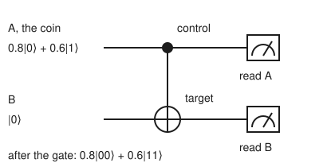

# Qubits: a unit vector of amplitudes, read once and collapsed

[Syllabus](../../../SYLLABUS.md) → [Computability and complexity](../README.md) → [Algebraic, Interactive and Quantum](../README.md#s05) → Qubits

---

## General Overview

Spin a coin on a table. While it spins it is neither heads nor tails. It lands once, shows one face, and stays that way. A weighted coin might land heads 64 times in 100.

A **qubit** (a quantum bit) behaves like that spinning coin, with one difference that drives this whole shelf. Its state is not two chances. It is two **amplitudes** (numbers whose squared sizes are the chances), here 0.8 and 0.6. Reading the qubit gives 0 with chance 0.8 squared, 64%, and 1 with chance 0.6 squared, 36%. After the reading, the qubit is whatever it showed. The spin is over.

Amplitudes can be negative or complex, so they can cancel. Chances cannot. That one fact makes a quantum circuit more than a box of coins.

This card builds the shelf's two-qubit circuit. The coin qubit A starts at 0.8 and 0.6. A second qubit B starts at a plain 0. One gate, CNOT, writes the half adder's sum bit (the XOR of two bits, from the two-bit adder in [Boolean circuits](01-boolean-circuits-and-formulas.md)) onto B. Before the gate the outcomes are 00 with 64% and 10 with 36%. After it they are 00 with 64% and 11 with 36%: the two qubits always agree, yet neither is decided until one is read.

**A qubit is a unit vector of two amplitudes, two qubits are a unit vector of four, a gate is a matrix that keeps length 1, and a reading picks one outcome with chance equal to its amplitude squared, then leaves the state at that outcome.**

**What kind of fact this is:** a model: the measurement rules of quantum mechanics for two-state systems, assumed and never contradicted by experiment. Inside the model, three results are theorems proved on this card in Why it works: gates keep the total chance at 1, a product state passes the product test, and no coin that secretly landed on 0 or 1 before the gate matches the 98% this card computes.

### The picture: the chances before and after the gate

Each `#` is 2 percentage points. Both checks print these bars.

```
before 00  ################################                   0.6400
before 01                                                     0.0000
before 10  ##################                                 0.3600
before 11                                                     0.0000
after 00   ################################                   0.6400
after 01                                                      0.0000
after 10                                                      0.0000
after 11   ##################                                 0.3600
```

Before the gate, B always reads 0, whatever A shows. After it, outcomes 01 and 10 are gone: B always reads what A reads.

---

## The formula

Notation first, in words. This card introduces it for the wing.

- $`|0\rangle`$ and $`|1\rangle`$, read "ket zero" and "ket one", are the qubit's two **basis states**: the columns (1, 0) and (0, 1). The bracket form $`|\psi\rangle`$ for a state comes from [States as vectors](../../13-Engineering%20mathematics/09-Quantum%20Mechanics%20in%20Outline/02-state-vectors-operators-and-measurement.md).
- $`\otimes`$, read "tensor", joins two qubits into one state of four amplitudes (Step 3 shows how).
- $`X`$, $`Z`$, $`H`$ and CNOT are **gates**: fixed matrices that act on the state. Here $`H`$ is the Hadamard gate, not entropy.
- $`U`$ stands for any gate. On the wing's earlier cards $`U`$ was the universal machine; here it is a unitary gate, a matrix with $`U^\dagger U = I`$. The symbol $`U^\dagger`$, read "U dagger", is the conjugate transpose: flip the matrix across its diagonal and conjugate every entry. [Complex vectors and matrices](../../07-Complex%20analysis/01-Complex%20Numbers%20and%20the%20Plane/07-complex-vectors-and-matrices.md) writes it $`U^*`$, and the code prints `U*`.

One qubit:

```math
|\psi\rangle = c_0\,|0\rangle + c_1\,|1\rangle, \qquad \lvert c_0\rvert^2 + \lvert c_1\rvert^2 = 1, \qquad \Pr[\text{read } x] = \lvert c_x\rvert^2
```

**Read it aloud:** the state is amplitude c-zero on zero plus amplitude c-one on one; the squared sizes add to 1; the chance of reading x is the squared size of its amplitude.

Two qubits, and the one gate:

```math
|\psi\rangle = c_{00}|00\rangle + c_{01}|01\rangle + c_{10}|10\rangle + c_{11}|11\rangle, \qquad \mathrm{CNOT}\,|a\,b\rangle = |a,\ a \oplus b\rangle
```

**Read it aloud:** two qubits carry one amplitude for each of the four outcomes; CNOT leaves the first bit alone and replaces the second bit with the XOR of the two.

On the coin: $`(0.8|0\rangle + 0.6|1\rangle) \otimes |0\rangle = 0.8|00\rangle + 0.6|10\rangle`$. CNOT moves the amplitude of $`|10\rangle`$ to $`|11\rangle`$, giving $`0.8|00\rangle + 0.6|11\rangle`$. The chances are 0.8 squared and 0.6 squared: 64% and 36%.

<p align="center"></p>

Schematic, not to scale. Time runs left to right along each wire. The black dot marks the control, A; the circle with a cross marks the target, B. The boxes on the right are the readings.

| Symbol | Plain meaning | In our example | Push it up and the answer… |
| --- | --- | --- | --- |
| $`\lvert 0\rangle`$, $`\lvert 1\rangle`$ | the two basis states, columns (1, 0) and (0, 1) | a coin that has landed | — |
| $`\lvert\psi\rangle`$, $`c_0`$, $`c_1`$, $`d_0`$, $`d_1`$, $`x`$, $`i`$ | a state; A's two amplitudes; B's two amplitudes; a bit, 0 or 1; $`i`$ is the square root of −1 | the coin: 0.8 and 0.6; B: 1 and 0 | raise $`c_0`$ and $`c_1`$ must fall, to keep length 1 |
| $`\lvert ab\rangle`$, $`a`$, $`b`$, $`c_{ab}`$ | the four two-qubit basis states, A's bit $`a`$ first, then B's bit $`b`$; their amplitudes | 0.8, 0, 0, 0.6 after the gate | — |
| $`\otimes`$ | the tensor product: every amplitude of one qubit times every amplitude of the other | 2 amplitudes ⊗ 2 amplitudes = 4 | more qubits double the list each time |
| $`X`$, $`Z`$ | NOT, which swaps $`\lvert 0\rangle`$ and $`\lvert 1\rangle`$; the phase flip, which negates $`c_1`$, changing its sign (its phase) | $`Z`$ turns (0.8, 0.6) into (0.8, −0.6) | — |
| $`H`$ | Hadamard: sends $`(c_0, c_1)`$ to $`((c_0 + c_1)/\sqrt2,\ (c_0 - c_1)/\sqrt2)`$ | the coin goes to (0.9899, 0.1414) | — |
| CNOT, $`\oplus`$ | controlled NOT: flips the target where the control reads 1; XOR of two bits | A controls, B is the target | — |
| $`U`$, $`U^\dagger`$, $`\psi^\dagger`$, $`I`$ | any gate; its conjugate transpose, "U dagger" (flip and conjugate; the code prints `U*`); the state as a conjugated row; the identity matrix | $`U^\dagger U = I`$ for all four gates | — |
| $`\Pr[ab]`$ | the chance a reading shows A = a and B = b | $`\Pr[00]`$ = 0.6400 | — |
| $`D`$ | the product test, $`c_{00}c_{11} - c_{01}c_{10}`$: zero exactly for a product state | 0 before, 0.4800 after | further from zero, more entangled |
| $`n`$, $`2^n`$ | the number of qubits; the number of amplitudes a classical simulation stores | 2 and 4 | 50 qubits need 1,125,899,906,842,624 |
| $`\alpha`$ | the spin tilt that prepares the coin, $`\cos^2(\alpha/2)`$ = 0.64 | 73.7398° | the chance of 0 falls |

### When it holds

- **The state is a unit vector.** A list such as (0.8, 0.8) is not a state: its "chances" add to 1.2800. Every state is scaled to length 1 first.
- **Gates are unitary.** A gate that is not unitary changes the length, so the chances stop adding to 1 and the Born rule (chance = amplitude squared) gives nonsense.
- **The qubits are isolated until they are read.** Real qubits leak information to their surroundings (decoherence), which slowly turns amplitudes into plain chances. The model is the ideal; hardware falls short of it.
- **One reading per run.** A reading gives one outcome and destroys the rest of the state. The amplitudes are never read directly; repeated runs estimate the chances, with an error that shrinks like one over the square root of the number of runs.

---

## Why it works

### Step 0: amplitudes, not chances, are what the gates act on

[States as vectors](../../13-Engineering%20mathematics/09-Quantum%20Mechanics%20in%20Outline/02-state-vectors-operators-and-measurement.md) already writes a two-state system as a unit vector and reads each outcome's chance as a squared length; a qubit is exactly that. This card adds three things: what a gate does to the amplitudes, how two qubits combine, and what a reading leaves behind.

Gates act on amplitudes, and chances are computed only at the end. Signed amplitudes on two paths to one outcome can add or cancel; chances alone cannot.

### Step 1: one qubit, prepared as the coin

The coin is $`0.8|0\rangle + 0.6|1\rangle`$. Its squared amplitudes are 0.6400 and 0.3600, which add to 1.

[Spin one-half](../../13-Engineering%20mathematics/09-Quantum%20Mechanics%20in%20Outline/06-spin-and-two-state-systems.md) shows how to make it. A spin prepared along an axis tilted by $`\alpha`$ from "up" reads up with chance $`\cos^2(\alpha/2)`$. A tilt of 73.7398° gives 0.64.

### Step 2: the Pauli matrices, read as gates

The spin card uses three Pauli matrices to measure a spin and to turn it in time. A quantum computer reads two of them as gates, plus a third gate built from them:

```math
X = \begin{pmatrix}0&1\\1&0\end{pmatrix}, \qquad Z = \begin{pmatrix}1&0\\0&-1\end{pmatrix}, \qquad H = \tfrac{1}{\sqrt2}\begin{pmatrix}1&1\\1&-1\end{pmatrix} = \tfrac{1}{\sqrt2}(X + Z)
```

**Read it aloud:** X swaps the two amplitudes, Z negates the second, and H sends the pair to their sum and their difference, each divided by root two.

- $`X`$ is the classical NOT gate: $`X|0\rangle = |1\rangle`$.
- $`Z`$ has no classical match. It changes no chance on its own: (0.8, −0.6) still reads 0 with 64%.
- $`H`$ mixes the two amplitudes. On $`|0\rangle`$ it gives (0.7071, 0.7071), an even split.

Each gate is **unitary**: its conjugate transpose undoes it ([Complex vectors and matrices](../../07-Complex%20analysis/01-Complex%20Numbers%20and%20the%20Plane/07-complex-vectors-and-matrices.md)). Unitary matrices keep length, so the chances still add to 1 after any gate. The proof is one line: the new squared length is $`\psi^\dagger U^\dagger U \psi = \psi^\dagger\psi = 1`$. The checks test $`U^\dagger U = I`$ entry by entry for all four gates.

### Step 3: two qubits are a tensor product

Two separate coins multiply their chances: Pr[A = 1 and B = 0] is Pr[A = 1] times Pr[B = 0]. Two separate qubits multiply their amplitudes the same way. Since the squared size of a product is the product of the squared sizes, the chances still multiply.

```math
(c_0, c_1) \otimes (d_0, d_1) = (c_0 d_0,\ c_0 d_1,\ c_1 d_0,\ c_1 d_1)
```

**Read it aloud:** the joint state lists every amplitude of A times every amplitude of B, in the order 00, 01, 10, 11.

For the coin and $`|0\rangle`$: (0.8, 0.6) ⊗ (1, 0) = (0.8, 0, 0.6, 0). Each new qubit doubles the list, so $`n`$ qubits need $`2^n`$ amplitudes. A gate on one qubit of two is the 4 × 4 matrix $`U \otimes I`$: it acts on A and leaves B alone.

### Step 4: CNOT is the half adder's sum bit, made reversible

The half adder from [Boolean circuits](01-boolean-circuits-and-formulas.md) turns bits a and b into a sum bit $`a \oplus b`$ and a carry bit (a AND b). An XOR gate alone throws information away: from the sum 1 you cannot tell 01 from 10. CNOT keeps a, so it can be run backwards:

| input $`ab`$ | 00 | 01 | 10 | 11 |
| --- | --- | --- | --- | --- |
| output $`a, a \oplus b`$ | 00 | 01 | 11 | 10 |

As a matrix, CNOT swaps the last two of the four amplitudes. That is a rearrangement of the basis, so it is unitary. On (0.8, 0, 0.6, 0) it gives (0.8, 0, 0, 0.6): the state $`0.8|00\rangle + 0.6|11\rangle`$.

### Step 5: entanglement is failing the product test

A two-qubit state is a **product state** when it equals some $`(c_0, c_1) \otimes (d_0, d_1)`$. Then each qubit has a state of its own. A state that is not a product is **entangled**.

The test is one number: $`D = c_{00}c_{11} - c_{01}c_{10}`$. Before the gate, $`D = 0.8 \times 0 - 0 \times 0.6 = 0`$. After it, $`D = 0.8 \times 0.6 - 0 = 0.4800`$. The gate turned a product state into an entangled one.

<details>
<summary>Detailed proof: D is zero exactly for product states</summary>

If the state is a product, its four amplitudes are $`c_0 d_0`$, $`c_0 d_1`$, $`c_1 d_0`$ and $`c_1 d_1`$. Then

$`\displaystyle D = (c_0 d_0)(c_1 d_1) - (c_0 d_1)(c_1 d_0) = 0.`$

Conversely, suppose $`D = 0`$. Arrange the amplitudes as a 2 × 2 table, rows for A and columns for B. $`D`$ is that table's determinant. A zero determinant means one row is a multiple of the other, or a row is all zero. So the table is (one column of row weights) times (one row of column weights): $`c_{ab} = c_a d_b`$, a product state.

For the state after the gate, the table has rows (0.8, 0) and (0, 0.6). Neither row is a multiple of the other, so no choice of $`c`$ and $`d`$ works.

</details>

The chances inherit the test: a product state has $`\Pr[00]\Pr[11] = \Pr[01]\Pr[10]`$. After the gate the left side is 0.2304 and the right side is 0.

### Step 6: reading collapses the state

Reading both qubits gives outcome $`ab`$ with chance $`\lvert c_{ab}\rvert^2`$. Reading only A works in two steps:

1. The chance that A shows 0 is the sum of the squared amplitudes where A's bit is 0: $`\lvert c_{00}\rvert^2 + \lvert c_{01}\rvert^2`$ = 64%.
2. After A shows 0, keep only those amplitudes and rescale them to length 1. Here (0.8, 0, 0, 0) becomes (1, 0, 0, 0): the state $`|00\rangle`$.

So reading A also settles B. If A shows 1, the chance is 36% and the state becomes $`|11\rangle`$. B alone reads 0 with chance 64%, but it agrees with A with chance 100%.

So a qubit is read once: a second reading repeats the first answer, and the amplitudes 0.8 and 0.6 are gone.

### Step 7: interference, and why the coin is not secretly decided

Apply $`H`$ to the coin. The amplitude on $`|0\rangle`$ is $`(0.8 + 0.6)/\sqrt2`$ = 0.9899, and on $`|1\rangle`$ it is $`(0.8 - 0.6)/\sqrt2`$ = 0.1414. The chances are 98% and 2%.

Now suppose the coin were secretly decided: 0 with chance 64% and 1 with 36%, before any gate. $`H`$ on $`|0\rangle`$ reads 0 with chance 50%. $`H`$ on $`|1\rangle`$ also reads 0 with chance 50%. Any mix of the two therefore reads 0 with chance 50%, not 98%. This is a theorem about every hidden-coin model of this kind, and the check computes both numbers.

The two paths to $`|0\rangle`$ added (0.8 + 0.6). The two paths to $`|1\rangle`$ nearly cancelled (0.8 − 0.6). Phase (the sign, or complex direction, of an amplitude) matters too:

| coin before $`H`$ | chances before | chances after $`H`$ |
| --- | --- | --- |
| (0.8, 0.6) | 64% and 36% | 98% and 2% |
| (0.8, −0.6), after $`Z`$ | 64% and 36% | 2% and 98% |
| (0.8, 0.6$`i`$) | 64% and 36% | 50% and 50% |

All three coins read the same when read directly. One gate later they differ completely. The amplitudes hold information the chances hide.

For entangled pairs ([Two particles](../../13-Engineering%20mathematics/09-Quantum%20Mechanics%20in%20Outline/11-two-particle-states-and-entanglement.md)) read far apart, Bell's theorem rules out every local hidden-coin model, not only this kind. It is stated here without proof (Bell, 1964, in Sources); loophole-free experiments since 2015 confirm the quantum prediction.

---

## Worked numbers, by hand

The circuit, amplitude by amplitude, in the order 00, 01, 10, 11.

| Step | Arithmetic | Value |
| --- | --- | --- |
| coin chances | 0.8 × 0.8 and 0.6 × 0.6 | 0.6400 and 0.3600 |
| join A and B | (0.8, 0.6) ⊗ (1, 0) | (0.8, 0, 0.6, 0) |
| apply CNOT | swap the amplitudes of 10 and 11 | (0.8, 0, 0, 0.6) |
| chances after | square each amplitude | 0.6400, 0, 0, 0.3600 |
| total chance | 0.6400 + 0.3600 | 1.0000 |
| product test after | 0.8 × 0.6 − 0 × 0 | 0.4800 |
| read A = 0 | keep (0.8, 0, 0, 0), divide by 0.8 | (1, 0, 0, 0) |
| answer | Pr[00] and Pr[11] | **64% and 36%; 01 and 10 never** |

The two qubits always read the same bit, and which bit is settled only when one of them is read.

A simulated lab run agrees. With 10,000 runs from seed 2026, the checks count 6,386 readings of 00 and 3,614 of 11, against 6,400 expected and a standard error of 48.

### What breaks if you drop a piece

| Mistake | Comes out at | What went wrong |
| --- | --- | --- |
| Adding amplitudes as if they were chances | total 1.4000 | Chances are amplitudes squared: 0.64 + 0.36 = 1 |
| Treating A and B as two separate coins after CNOT | Pr[01] = 0.2304, true 0 | The state is entangled; its chances do not multiply |
| Treating the coin as secretly decided, then applying $`H`$ | Pr[0] = 0.5000, true 0.9800 | Mixing chances loses the interference of amplitudes |
| Swapping CNOT's control and target | Pr[11] = 0, product test 0 | B is 0, so B as control never flips A: no entanglement |

The code prints all four.

---

## Code, from first principles, and it actually runs

This is the shelf's state-vector simulator; [BQP](06-quantum-computation-and-bqp.md) and [Shor and Grover](07-shors-and-grovers-algorithms.md) copy the parts they run. It stores the $`2^n`$ amplitudes as a list. It takes three independent roads. Road one builds each gate as a full matrix, by tensor products, and multiplies. Road two never builds a matrix: it walks the list in pairs of indices that differ in one bit. Road three samples 10,000 readings with a SplitMix64 random generator written out in both languages. The asserts also check the chances against 16/25 and 9/25 worked by hand, the 98% against $`(0.8 + 0.6)^2/2`$, unitarity, that $`H`$ applied twice gives back $`|0\rangle`$, and CNOT's truth table against the language's own XOR.

### Python

```python
# Qubits -- the check behind the card.  Standard library only.  This is the
# shelf's state-vector simulator: n qubits are 2^n complex amplitudes, a gate
# is a unitary matrix, and a reading picks one outcome with chance |amplitude|^2.
# Two qubits A and B; amplitudes are listed in the order 00, 01, 10, 11, A first.
import math

R = 1 / math.sqrt(2)
I2 = [[1, 0], [0, 1]]
X = [[0, 1], [1, 0]]                           # NOT: swaps |0> and |1>
Z = [[1, 0], [0, -1]]                          # phase flip: |1> becomes -|1>
H = [[R, R], [R, -R]]                          # Hadamard: the even split
CNOT = [[1, 0, 0, 0], [0, 1, 0, 0], [0, 0, 0, 1], [0, 0, 1, 0]]

def kron(a, b):                                # tensor product of two vectors or two matrices
    if not isinstance(a[0], list):
        return [x * y for x in a for y in b]
    return [[x * y for x in ra for y in rb] for ra in a for rb in b]

def matvec(m, v):                              # road one: multiply by the full matrix
    return [sum(m[r][c] * v[c] for c in range(len(v))) for r in range(len(m))]

def unitary(m):                                # U* U = I, entry by entry
    n = len(m)
    return all(abs(sum(complex(m[k][r]).conjugate() * m[k][c] for k in range(n)) - (r == c)) < 1e-12
               for r in range(n) for c in range(n))

def apply_1q(g, s, k, n):                      # road two: gate g on qubit k, amplitudes in pairs
    out, bit = list(s), 1 << (n - 1 - k)
    for i in range(len(s)):
        if i & bit == 0:
            a, b = s[i], s[i | bit]
            out[i], out[i | bit] = g[0][0] * a + g[0][1] * b, g[1][0] * a + g[1][1] * b
    return out

def apply_cnot(s, c, t, n):                    # road two: where the control reads 1, swap the target
    out, cb, tb = list(s), 1 << (n - 1 - c), 1 << (n - 1 - t)
    for i in range(len(s)):
        if i & cb and not i & tb:
            out[i], out[i | tb] = s[i | tb], s[i]
    return out

def chances(s): return [abs(a) ** 2 for a in s]

def read_a(s, bit):                            # read qubit A only; keep and rescale what agrees
    keep = [a if (i >> 1) == bit else 0 for i, a in enumerate(s)]
    p = sum(chances(keep))
    return p, [a / math.sqrt(p) for a in keep]

def clean(x): return 0.0 if abs(x) < 5e-13 else x

def amp(z):
    z = complex(z)
    if abs(z.imag) < 5e-13:
        return f"{clean(z.real):.4f}"
    return f"{clean(z.real):.4f}{clean(z.imag):+.4f}i"

def row(label, xs):
    print(f"{label:<34}" + " ".join(f"{amp(x):>8}" for x in xs))

def bar(label, p):
    print(f"{label:<11}{'#' * round(50 * p):<50} {p:.4f}")

M64 = (1 << 64) - 1
def splitmix64(seed):                          # SplitMix64, written out so both languages agree
    s = seed
    while True:
        s = (s + 0x9E3779B97F4A7C15) & M64
        z = ((s ^ (s >> 30)) * 0xBF58476D1CE4E5B9) & M64
        z = ((z ^ (z >> 27)) * 0x94D049BB133111EB) & M64
        yield z ^ (z >> 31)

coin, zero = [0.8, 0.6], [1, 0]                # A: the weighted coin; B: a plain |0>
tilt = 2 * math.degrees(math.acos(coin[0]))
print(f"coin qubit A = 0.8|0> + 0.6|1>: reads 0 with chance {coin[0] ** 2:.4f}, 1 with {coin[1] ** 2:.4f}")
print(f"spin tilt from up that prepares it: {tilt:.4f} degrees")
before = kron(coin, zero)
after_m = matvec(CNOT, before)
after_i = apply_cnot(before, 0, 1, 2)
print(f"{'outcome':<34}" + " ".join(f"{b:>8}" for b in ["00", "01", "10", "11"]))
row("A (x) B, before the gate", before)
row("chances before", chances(before))
row("after CNOT, by the 4 x 4 matrix", after_m)
row("after CNOT, by swapping pairs", after_i)
row("chances after", chances(after_m))
print(f"total chance before and after: {sum(chances(before)):.4f} and {sum(chances(after_m)):.4f}")
table = {(a, b): apply_cnot(kron([1 - a, a], [1 - b, b]), 0, 1, 2).index(1) for a in (0, 1) for b in (0, 1)}
print("CNOT on the four basis inputs: " + ", ".join(f"{a}{b} -> {v >> 1}{v & 1}" for (a, b), v in table.items()))
print(f"B ends as the half adder's sum bit, A xor B: {'yes' if all(v & 1 == a ^ b for (a, b), v in table.items()) else 'no'}")
test = lambda s: s[0] * s[3] - s[1] * s[2]
print(f"product test a00*a11 - a01*a10: before {test(before):.4f}, after {test(after_m):.4f}")
pa = chances(after_m)
print(f"chances test P00*P11 - P01*P10: before {test(chances(before)):.4f}, after {test(pa):.4f}")
for bit in (0, 1):
    p, s = read_a(after_m, bit)
    row(f"read A = {bit}, chance {p:.4f}; state", s)
print(f"B alone reads 0 with chance {pa[0] + pa[2]:.4f}; it agrees with A with chance {pa[0] + pa[3]:.4f}")
for when, ps in (("before", chances(before)), ("after", pa)):
    for b, p in zip(["00", "01", "10", "11"], ps): bar(f"{when} {b}", p)
SHOTS, gen = 10000, splitmix64(2026)
counts = [0, 0, 0, 0]
for _ in range(SHOTS):
    u, acc = (next(gen) >> 11) / 2.0 ** 53, 0.0
    for i, p in enumerate(pa):
        acc += p
        if u < acc or i == 3:
            counts[i] += 1
            break
se = math.sqrt(SHOTS * pa[0] * (1 - pa[0]))
print(f"{SHOTS} shots, seed 2026: 00 {counts[0]}, 01 {counts[1]}, 10 {counts[2]}, 11 {counts[3]}; "
      f"expected 00 {SHOTS * pa[0]:.0f}, standard error {se:.0f}")
bell = apply_cnot(apply_1q(H, kron(zero, zero), 0, 2), 0, 1, 2)
row("from 00: H on A, then CNOT", bell)
hi = matvec(kron(H, I2), before)
row("H on A of A (x) B, both roads", hi)
coins = {"0.8, 0.6": coin, "0.8, -0.6 (after Z)": matvec(Z, coin), "0.8, 0.6i": [0.8, 0.6j]}
for name, c in coins.items():
    print(f"coin ({name}): chances {chances(c)[0]:.4f} {chances(c)[1]:.4f}; after H {chances(matvec(H, c))[0]:.4f} {chances(matvec(H, c))[1]:.4f}")
row("H twice on |0>", matvec(H, matvec(H, zero)))
print(f"X, Z, H and CNOT each satisfy U* U = I: {'yes' if all(unitary(g) for g in (X, Z, H, CNOT)) else 'no'}")
print("amplitudes for n qubits: " + ", ".join(f"{n} -> {2 ** n}" for n in (1, 2, 10, 20, 50)))
print(f"pair updates for one gate on 50 qubits: {2 ** 49}; bytes at 16 per amplitude: {16 * 2 ** 50}")
hidden = coin[0] ** 2 * 0.5 + coin[1] ** 2 * 0.5
swapped = apply_cnot(before, 1, 0, 2)
print(f"mistake 1, amplitudes added as chances: {coin[0] + coin[1]:.4f}")
print(f"mistake 2, A and B as separate coins: P01 = {(pa[0] + pa[1]) * (pa[1] + pa[3]):.4f}, true {pa[1]:.4f}")
print(f"mistake 3, a hidden coin then H: P0 = {hidden:.4f}, true {chances(matvec(H, coin))[0]:.4f}")
print(f"mistake 4, control and target swapped: P11 = {chances(swapped)[3]:.4f}, product test {test(swapped):.4f}")
print(f"not a unit vector, (0.8, 0.8): chances add to {0.8 ** 2 + 0.8 ** 2:.4f}")
print("figure, wires y 60 and 150, gate x 210, control dot r 7, target circle r 16, meters x 330")
assert all(abs(p - q) < 1e-12 for p, q in zip(after_m, after_i))              # two roads, one state
assert all(abs(p - q) < 1e-12 for p, q in zip(hi, apply_1q(H, before, 0, 2)))
assert all(abs(p - q) < 1e-12 for p, q in zip(pa, [16 / 25, 0, 0, 9 / 25]))   # 0.8^2 and 0.6^2 by hand
assert abs(test(after_m) - 12 / 25) < 1e-12 and abs(test(before)) < 1e-12      # entangled after, not before
assert abs(chances(matvec(H, coin))[0] - 49 / 50) < 1e-12                       # (0.8 + 0.6)^2 / 2
assert abs(counts[0] - SHOTS * pa[0]) < 4 * se and counts[1] == counts[2] == 0  # sampling agrees
assert all(unitary(g) for g in (X, Z, H, CNOT)) and abs(sum(chances(after_m)) - 1) < 1e-12
assert all(v & 1 == a ^ b and v >> 1 == a for (a, b), v in table.items())       # sum bit, by xor
assert all(abs(p - q) < 1e-12 for p, q in zip(matvec(H, matvec(H, zero)), zero))  # H undoes itself
print("ALL CHECKS PASS")
```

**Ran 2026-11-19 on macOS, Python 3.14.10, standard library only. All checks passed. Output, pasted from the run:**

```
coin qubit A = 0.8|0> + 0.6|1>: reads 0 with chance 0.6400, 1 with 0.3600
spin tilt from up that prepares it: 73.7398 degrees
outcome                                 00       01       10       11
A (x) B, before the gate            0.8000   0.0000   0.6000   0.0000
chances before                      0.6400   0.0000   0.3600   0.0000
after CNOT, by the 4 x 4 matrix     0.8000   0.0000   0.0000   0.6000
after CNOT, by swapping pairs       0.8000   0.0000   0.0000   0.6000
chances after                       0.6400   0.0000   0.0000   0.3600
total chance before and after: 1.0000 and 1.0000
CNOT on the four basis inputs: 00 -> 00, 01 -> 01, 10 -> 11, 11 -> 10
B ends as the half adder's sum bit, A xor B: yes
product test a00*a11 - a01*a10: before 0.0000, after 0.4800
chances test P00*P11 - P01*P10: before 0.0000, after 0.2304
read A = 0, chance 0.6400; state    1.0000   0.0000   0.0000   0.0000
read A = 1, chance 0.3600; state    0.0000   0.0000   0.0000   1.0000
B alone reads 0 with chance 0.6400; it agrees with A with chance 1.0000
before 00  ################################                   0.6400
before 01                                                     0.0000
before 10  ##################                                 0.3600
before 11                                                     0.0000
after 00   ################################                   0.6400
after 01                                                      0.0000
after 10                                                      0.0000
after 11   ##################                                 0.3600
10000 shots, seed 2026: 00 6386, 01 0, 10 0, 11 3614; expected 00 6400, standard error 48
from 00: H on A, then CNOT          0.7071   0.0000   0.0000   0.7071
H on A of A (x) B, both roads       0.9899   0.0000   0.1414   0.0000
coin (0.8, 0.6): chances 0.6400 0.3600; after H 0.9800 0.0200
coin (0.8, -0.6 (after Z)): chances 0.6400 0.3600; after H 0.0200 0.9800
coin (0.8, 0.6i): chances 0.6400 0.3600; after H 0.5000 0.5000
H twice on |0>                      1.0000   0.0000
X, Z, H and CNOT each satisfy U* U = I: yes
amplitudes for n qubits: 1 -> 2, 2 -> 4, 10 -> 1024, 20 -> 1048576, 50 -> 1125899906842624
pair updates for one gate on 50 qubits: 562949953421312; bytes at 16 per amplitude: 18014398509481984
mistake 1, amplitudes added as chances: 1.4000
mistake 2, A and B as separate coins: P01 = 0.2304, true 0.0000
mistake 3, a hidden coin then H: P0 = 0.5000, true 0.9800
mistake 4, control and target swapped: P11 = 0.0000, product test 0.0000
not a unit vector, (0.8, 0.8): chances add to 1.2800
figure, wires y 60 and 150, gate x 210, control dot r 7, target circle r 16, meters x 330
ALL CHECKS PASS
```

### Rust

Same numbers, same labels, built with `rustc --edition 2021 -O`.

```rust
// Qubits -- the same check as the Python, in Rust.  No crates.  This is the
// shelf's state-vector simulator: n qubits are 2^n complex amplitudes, a gate
// is a unitary matrix, and a reading picks one outcome with chance |amplitude|^2.
// Two qubits A and B; amplitudes are listed in the order 00, 01, 10, 11, A first.
#[derive(Clone, Copy, PartialEq)]
struct C { re: f64, im: f64 }                  // a small complex number
impl C {
    fn mul(self, o: C) -> C { C { re: self.re * o.re - self.im * o.im, im: self.re * o.im + self.im * o.re } }
    fn add(self, o: C) -> C { C { re: self.re + o.re, im: self.im + o.im } }
    fn sub(self, o: C) -> C { C { re: self.re - o.re, im: self.im - o.im } }
    fn conj(self) -> C { C { re: self.re, im: -self.im } }
    fn norm2(self) -> f64 { self.re * self.re + self.im * self.im }
    fn scale(self, k: f64) -> C { C { re: self.re * k, im: self.im * k } }
}
fn r(x: f64) -> C { C { re: x, im: 0.0 } }
type M = Vec<Vec<C>>;
fn mat(rows: &[&[f64]]) -> M { rows.iter().map(|row| row.iter().map(|&x| r(x)).collect()).collect() }

fn kron_v(a: &[C], b: &[C]) -> Vec<C> {        // tensor product of two vectors
    a.iter().flat_map(|&x| b.iter().map(move |&y| x.mul(y))).collect()
}
fn kron_m(a: &M, b: &M) -> M {                 // tensor product of two matrices, row by row
    a.iter().flat_map(|ra| b.iter().map(move |rb| kron_v(ra, rb))).collect()
}
fn matvec(m: &M, v: &[C]) -> Vec<C> {          // road one: multiply by the full matrix
    m.iter().map(|row| row.iter().zip(v).fold(r(0.0), |s, (&a, &b)| s.add(a.mul(b)))).collect()
}
fn unitary(m: &M) -> bool {                    // U* U = I, entry by entry
    let n = m.len();
    (0..n).all(|i| (0..n).all(|j| {
        let s = (0..n).fold(r(0.0), |s, k| s.add(m[k][i].conj().mul(m[k][j])));
        s.sub(r(if i == j { 1.0 } else { 0.0 })).norm2().sqrt() < 1e-12
    }))
}
fn apply_1q(g: &M, s: &[C], k: usize, n: usize) -> Vec<C> {   // road two: gate on qubit k, in pairs
    let (mut out, bit) = (s.to_vec(), 1 << (n - 1 - k));
    for i in 0..s.len() {
        if i & bit == 0 {
            let (a, b) = (s[i], s[i | bit]);
            out[i] = g[0][0].mul(a).add(g[0][1].mul(b));
            out[i | bit] = g[1][0].mul(a).add(g[1][1].mul(b));
        }
    }
    out
}
fn apply_cnot(s: &[C], c: usize, t: usize, n: usize) -> Vec<C> { // road two: control 1, swap target
    let (mut out, cb, tb) = (s.to_vec(), 1 << (n - 1 - c), 1 << (n - 1 - t));
    for i in 0..s.len() {
        if i & cb != 0 && i & tb == 0 { out[i] = s[i | tb]; out[i | tb] = s[i]; }
    }
    out
}
fn chances(s: &[C]) -> Vec<C> { s.iter().map(|a| r(a.norm2())).collect() }
fn read_a(s: &[C], bit: usize) -> (f64, Vec<C>) {     // read qubit A only; keep and rescale what agrees
    let keep: Vec<C> = s.iter().enumerate().map(|(i, &a)| if i >> 1 == bit { a } else { r(0.0) }).collect();
    let p: f64 = keep.iter().map(|a| a.norm2()).sum();
    (p, keep.iter().map(|a| a.scale(1.0 / p.sqrt())).collect())
}
fn clean(x: f64) -> f64 { if x.abs() < 5e-13 { 0.0 } else { x } }
fn amp(z: C) -> String {
    if z.im.abs() < 5e-13 { format!("{:.4}", clean(z.re)) } else { format!("{:.4}{:+.4}i", clean(z.re), clean(z.im)) }
}
fn row(label: &str, xs: &[C]) {
    let cells: Vec<String> = xs.iter().map(|&x| format!("{:>8}", amp(x))).collect();
    println!("{:<34}{}", label, cells.join(" "));
}
fn bar(label: &str, p: f64) { println!("{:<11}{:<50} {:.4}", label, "#".repeat((50.0 * p).round() as usize), p); }
fn test(s: &[C]) -> f64 { s[0].mul(s[3]).sub(s[1].mul(s[2])).re }
struct SplitMix64 { s: u64 }                   // SplitMix64, written out so both languages agree
impl SplitMix64 {
    fn next(&mut self) -> u64 {
        self.s = self.s.wrapping_add(0x9E3779B97F4A7C15);
        let mut z = (self.s ^ (self.s >> 30)).wrapping_mul(0xBF58476D1CE4E5B9);
        z = (z ^ (z >> 27)).wrapping_mul(0x94D049BB133111EB);
        z ^ (z >> 31)
    }
}

fn main() {
    let h = std::f64::consts::FRAC_1_SQRT_2;
    let i2 = mat(&[&[1.0, 0.0], &[0.0, 1.0]]);
    let x = mat(&[&[0.0, 1.0], &[1.0, 0.0]]);                // NOT: swaps |0> and |1>
    let zg = mat(&[&[1.0, 0.0], &[0.0, -1.0]]);              // phase flip: |1> becomes -|1>
    let hg = mat(&[&[h, h], &[h, -h]]);                      // Hadamard: the even split
    let cnot = mat(&[&[1.0, 0.0, 0.0, 0.0], &[0.0, 1.0, 0.0, 0.0], &[0.0, 0.0, 0.0, 1.0], &[0.0, 0.0, 1.0, 0.0]]);
    let (coin, zero) = (vec![r(0.8), r(0.6)], vec![r(1.0), r(0.0)]);
    let tilt = 2.0 * 0.8f64.acos().to_degrees();
    println!("coin qubit A = 0.8|0> + 0.6|1>: reads 0 with chance {:.4}, 1 with {:.4}", coin[0].norm2(), coin[1].norm2());
    println!("spin tilt from up that prepares it: {:.4} degrees", tilt);
    let before = kron_v(&coin, &zero);
    let after_m = matvec(&cnot, &before);
    let after_i = apply_cnot(&before, 0, 1, 2);
    println!("{:<34}{:>8} {:>8} {:>8} {:>8}", "outcome", "00", "01", "10", "11");
    row("A (x) B, before the gate", &before);
    row("chances before", &chances(&before));
    row("after CNOT, by the 4 x 4 matrix", &after_m);
    row("after CNOT, by swapping pairs", &after_i);
    row("chances after", &chances(&after_m));
    let total = |s: &[C]| -> f64 { s.iter().map(|a| a.norm2()).sum() };
    println!("total chance before and after: {:.4} and {:.4}", total(&before), total(&after_m));
    let mut table = Vec::new();
    for a in 0..2usize { for b in 0..2usize {
        let basis = kron_v(&[r(1.0 - a as f64), r(a as f64)], &[r(1.0 - b as f64), r(b as f64)]);
        let v = apply_cnot(&basis, 0, 1, 2).iter().position(|&z| z == r(1.0)).unwrap();
        table.push((a, b, v));
    } }
    let shown: Vec<String> = table.iter().map(|&(a, b, v)| format!("{}{} -> {}{}", a, b, v >> 1, v & 1)).collect();
    println!("CNOT on the four basis inputs: {}", shown.join(", "));
    let sum_ok = table.iter().all(|&(a, b, v)| v & 1 == a ^ b);
    println!("B ends as the half adder's sum bit, A xor B: {}", if sum_ok { "yes" } else { "no" });
    println!("product test a00*a11 - a01*a10: before {:.4}, after {:.4}", test(&before), test(&after_m));
    let pa: Vec<f64> = after_m.iter().map(|a| a.norm2()).collect();
    println!("chances test P00*P11 - P01*P10: before {:.4}, after {:.4}", test(&chances(&before)), test(&chances(&after_m)));
    for bit in 0..2 {
        let (p, s) = read_a(&after_m, bit);
        row(&format!("read A = {}, chance {:.4}; state", bit, p), &s);
    }
    println!("B alone reads 0 with chance {:.4}; it agrees with A with chance {:.4}", pa[0] + pa[2], pa[0] + pa[3]);
    let pb: Vec<f64> = before.iter().map(|a| a.norm2()).collect();
    for (when, ps) in [("before", &pb), ("after", &pa)] {
        for (b, &p) in ["00", "01", "10", "11"].iter().zip(ps.iter()) { bar(&format!("{} {}", when, b), p) }
    }
    let (shots, mut gen) = (10000usize, SplitMix64 { s: 2026 });
    let mut counts = [0usize; 4];
    for _ in 0..shots {
        let (u, mut acc) = ((gen.next() >> 11) as f64 / 2f64.powi(53), 0.0);
        for i in 0..4 {
            acc += pa[i];
            if u < acc || i == 3 { counts[i] += 1; break; }
        }
    }
    let se = (shots as f64 * pa[0] * (1.0 - pa[0])).sqrt();
    println!("{} shots, seed 2026: 00 {}, 01 {}, 10 {}, 11 {}; expected 00 {:.0}, standard error {:.0}",
             shots, counts[0], counts[1], counts[2], counts[3], shots as f64 * pa[0], se);
    let bell = apply_cnot(&apply_1q(&hg, &kron_v(&zero, &zero), 0, 2), 0, 1, 2);
    row("from 00: H on A, then CNOT", &bell);
    let hi = matvec(&kron_m(&hg, &i2), &before);
    row("H on A of A (x) B, both roads", &hi);
    let coins = [("0.8, 0.6", coin.clone()), ("0.8, -0.6 (after Z)", matvec(&zg, &coin)), ("0.8, 0.6i", vec![r(0.8), C { re: 0.0, im: 0.6 }])];
    for (name, c) in coins.iter() {
        let hc = matvec(&hg, c);
        println!("coin ({}): chances {:.4} {:.4}; after H {:.4} {:.4}", name, c[0].norm2(), c[1].norm2(), hc[0].norm2(), hc[1].norm2());
    }
    row("H twice on |0>", &matvec(&hg, &matvec(&hg, &zero)));
    let all_u = [&x, &zg, &hg, &cnot].iter().all(|g| unitary(g));
    println!("X, Z, H and CNOT each satisfy U* U = I: {}", if all_u { "yes" } else { "no" });
    let sizes: Vec<String> = [1u32, 2, 10, 20, 50].iter().map(|&n| format!("{} -> {}", n, 1u64 << n)).collect();
    println!("amplitudes for n qubits: {}", sizes.join(", "));
    println!("pair updates for one gate on 50 qubits: {}; bytes at 16 per amplitude: {}", 1u64 << 49, 16u64 << 50);
    let hidden = coin[0].norm2() * 0.5 + coin[1].norm2() * 0.5;
    let swapped = apply_cnot(&before, 1, 0, 2);
    let h_coin = matvec(&hg, &coin)[0].norm2();
    println!("mistake 1, amplitudes added as chances: {:.4}", coin[0].re + coin[1].re);
    println!("mistake 2, A and B as separate coins: P01 = {:.4}, true {:.4}", (pa[0] + pa[1]) * (pa[1] + pa[3]), pa[1]);
    println!("mistake 3, a hidden coin then H: P0 = {:.4}, true {:.4}", hidden, h_coin);
    println!("mistake 4, control and target swapped: P11 = {:.4}, product test {:.4}", swapped[3].norm2(), test(&swapped));
    println!("not a unit vector, (0.8, 0.8): chances add to {:.4}", 0.8f64 * 0.8 + 0.8 * 0.8);
    println!("figure, wires y 60 and 150, gate x 210, control dot r 7, target circle r 16, meters x 330");
    let close = |a: &[C], b: &[C]| a.iter().zip(b).all(|(p, q)| p.sub(*q).norm2().sqrt() < 1e-12);
    assert!(close(&after_m, &after_i));                                       // two roads, one state
    assert!(close(&hi, &apply_1q(&hg, &before, 0, 2)));
    assert!(pa.iter().zip([16.0 / 25.0, 0.0, 0.0, 9.0 / 25.0]).all(|(p, q)| (p - q).abs() < 1e-12));
    assert!((test(&after_m) - 12.0 / 25.0).abs() < 1e-12 && test(&before).abs() < 1e-12);
    assert!((h_coin - 49.0 / 50.0).abs() < 1e-12);                            // (0.8 + 0.6)^2 / 2
    assert!(((counts[0] as f64) - shots as f64 * pa[0]).abs() < 4.0 * se && counts[1] == 0 && counts[2] == 0);
    assert!(all_u && (total(&after_m) - 1.0).abs() < 1e-12);
    assert!(table.iter().all(|&(a, b, v)| v & 1 == a ^ b && v >> 1 == a));    // sum bit, by xor
    assert!(close(&matvec(&hg, &matvec(&hg, &zero)), &zero));                 // H undoes itself
    println!("ALL CHECKS PASS");
}
```

**Ran 2026-11-19 on macOS, rustc 1.98.1, no crates. All checks passed. Output, pasted from the run:**

```
coin qubit A = 0.8|0> + 0.6|1>: reads 0 with chance 0.6400, 1 with 0.3600
spin tilt from up that prepares it: 73.7398 degrees
outcome                                 00       01       10       11
A (x) B, before the gate            0.8000   0.0000   0.6000   0.0000
chances before                      0.6400   0.0000   0.3600   0.0000
after CNOT, by the 4 x 4 matrix     0.8000   0.0000   0.0000   0.6000
after CNOT, by swapping pairs       0.8000   0.0000   0.0000   0.6000
chances after                       0.6400   0.0000   0.0000   0.3600
total chance before and after: 1.0000 and 1.0000
CNOT on the four basis inputs: 00 -> 00, 01 -> 01, 10 -> 11, 11 -> 10
B ends as the half adder's sum bit, A xor B: yes
product test a00*a11 - a01*a10: before 0.0000, after 0.4800
chances test P00*P11 - P01*P10: before 0.0000, after 0.2304
read A = 0, chance 0.6400; state    1.0000   0.0000   0.0000   0.0000
read A = 1, chance 0.3600; state    0.0000   0.0000   0.0000   1.0000
B alone reads 0 with chance 0.6400; it agrees with A with chance 1.0000
before 00  ################################                   0.6400
before 01                                                     0.0000
before 10  ##################                                 0.3600
before 11                                                     0.0000
after 00   ################################                   0.6400
after 01                                                      0.0000
after 10                                                      0.0000
after 11   ##################                                 0.3600
10000 shots, seed 2026: 00 6386, 01 0, 10 0, 11 3614; expected 00 6400, standard error 48
from 00: H on A, then CNOT          0.7071   0.0000   0.0000   0.7071
H on A of A (x) B, both roads       0.9899   0.0000   0.1414   0.0000
coin (0.8, 0.6): chances 0.6400 0.3600; after H 0.9800 0.0200
coin (0.8, -0.6 (after Z)): chances 0.6400 0.3600; after H 0.0200 0.9800
coin (0.8, 0.6i): chances 0.6400 0.3600; after H 0.5000 0.5000
H twice on |0>                      1.0000   0.0000
X, Z, H and CNOT each satisfy U* U = I: yes
amplitudes for n qubits: 1 -> 2, 2 -> 4, 10 -> 1024, 20 -> 1048576, 50 -> 1125899906842624
pair updates for one gate on 50 qubits: 562949953421312; bytes at 16 per amplitude: 18014398509481984
mistake 1, amplitudes added as chances: 1.4000
mistake 2, A and B as separate coins: P01 = 0.2304, true 0.0000
mistake 3, a hidden coin then H: P0 = 0.5000, true 0.9800
mistake 4, control and target swapped: P11 = 0.0000, product test 0.0000
not a unit vector, (0.8, 0.8): chances add to 1.2800
figure, wires y 60 and 150, gate x 210, control dot r 7, target circle r 16, meters x 330
ALL CHECKS PASS
```

The two outputs match line for line.

The last lines count the cost of the classical simulation. Two qubits need 4 amplitudes; 20 need 1,048,576; 50 need 1,125,899,906,842,624. At 16 bytes each, 50 qubits fill 18,014,398,509,481,984 bytes, about 18 million billion. One gate on 50 qubits updates 562,949,953,421,312 pairs. The list doubles with every qubit, which is the question [BQP](06-quantum-computation-and-bqp.md) takes up.

### Lean

Lean proves the card's three theorems in every case they cover, and checks the worked numbers.

- Take any unitary gate $`U`$ and any state of $`n`$ qubits. Then the new state's chances still add to 1.
- Take any four amplitudes of two qubits. Then $`D = 0`$ exactly when they form a product state.
- Take a coin secretly decided as 0 or 1, with any chance, then sent through $`H`$. Then it reads 0 with chance 50%.
- Take the coin (0.8, 0.6) and send it through $`H`$. Then it reads 0 with chance 98%.
- CNOT sends the inputs 00, 01, 10, 11 to 00, 01, 11, 10.
- Take the coin joined with B, (0.8, 0, 0.6, 0). Then CNOT gives (0.8, 0, 0, 0.6), whose chances add to 1.
- Take the same two states. Then $`D`$ is 0 before CNOT and 0.4800 after it.
- The cost counts are right: 4 amplitudes for 2 qubits, up to 1,125,899,906,842,624 for 50, plus the pair and byte counts.

Lean does not run the simulator, so readings, collapse, the lab run and the bars are left to the Python and Rust checks.

```lean
-- Qubits: a unitary gate keeps the total chance of a state of n qubits at 1, a two-qubit state passes the product test exactly when it is a product state, and no hidden coin matches the 98% that H gives on the coin.
import Mathlib.LinearAlgebra.UnitaryGroup
import Mathlib.Analysis.Real.Sqrt
import Mathlib.Basic.Complex.BigOperators
import Mathlib.Tactic.NormNum

open Matrix

theorem sum_normSq_eq_star_dotProduct {ι : Type*} [Fintype ι] (v : ι → ℂ) :
    ((∑ x, Complex.normSq (v x) : ℝ) : ℂ) = star v ⬝ᵥ v := by
  simp only [dotProduct, Pi.star_apply, Complex.ofReal_sum]
  refine Finset.sum_congr rfl fun x _ => ?_
  rw [← Complex.mul_conj, mul_comm]
  rfl

/-- A gate keeps the total chance at 1: if the state `ψ` of `n` qubits is a unit vector of
`2 ^ n` complex amplitudes (its chances `|ψ x|²` add to 1) and the gate `U` is unitary
(`U† U = I`), then the chances of the new state `U ψ` still add to 1. -/
theorem unitary_gate_keeps_total_chance {n : ℕ}
    (U : Matrix (Fin (2 ^ n)) (Fin (2 ^ n)) ℂ) (hU : U ∈ Matrix.unitaryGroup (Fin (2 ^ n)) ℂ)
    (ψ : Fin (2 ^ n) → ℂ) (hψ : ∑ x, Complex.normSq (ψ x) = 1) :
    ∑ x, Complex.normSq ((U *ᵥ ψ) x) = 1 := by
  have h1 : star U * U = 1 := (Matrix.mem_unitaryGroup_iff').mp hU
  apply Complex.ofReal_injective
  rw [sum_normSq_eq_star_dotProduct, Matrix.star_mulVec, ← Matrix.dotProduct_mulVec,
    Matrix.mulVec_mulVec, ← Matrix.star_eq_conjTranspose, h1, Matrix.one_mulVec,
    ← sum_normSq_eq_star_dotProduct, hψ]

/-- The product test: a two-qubit state with amplitudes `c a b` (A's bit `a`, B's bit `b`)
is a product state `(c₀, c₁) ⊗ (d₀, d₁)`, so that `c a b = c_a * d_b`, exactly when
`D = c₀₀ c₁₁ - c₀₁ c₁₀` is zero. -/
theorem product_test_zero_iff_product_state (c : Fin 2 → Fin 2 → ℂ) :
    c 0 0 * c 1 1 - c 0 1 * c 1 0 = 0 ↔
      ∃ u v : Fin 2 → ℂ, ∀ a b, c a b = u a * v b := by
  constructor
  · intro hD
    by_cases h00 : c 0 0 = 0
    · by_cases h01 : c 0 1 = 0
      · refine ⟨![0, 1], c 1, ?_⟩
        intro a b
        fin_cases a <;> fin_cases b <;> simp [h00, h01]
      · have h10 : c 1 0 = 0 := by
          rw [h00, zero_mul, zero_sub, neg_eq_zero] at hD
          exact (mul_eq_zero.mp hD).resolve_left h01
        refine ⟨![1, c 1 1 / c 0 1], c 0, ?_⟩
        intro a b
        fin_cases a <;> fin_cases b <;> simp [h10, h00]
        field_simp
    · refine ⟨![1, c 1 0 / c 0 0], c 0, ?_⟩
      intro a b
      fin_cases a <;> fin_cases b <;> simp
      · field_simp
      · field_simp
        rw [mul_comm (c 1 1), mul_comm (c 1 0)]
        exact sub_eq_zero.mp hD
  · rintro ⟨u, v, h⟩
    rw [h 0 0, h 1 1, h 0 1, h 1 0]
    ring

/-- No hidden coin matches the gate: a coin secretly decided as `|0⟩` with chance `p` and `|1⟩`
with chance `1 - p`, then sent through the Hadamard gate `H`, reads 0 with chance 1/2 for every
`p`; the coin qubit `(4/5)|0⟩ + (3/5)|1⟩` sent through `H` reads 0 with chance 49/50. -/
theorem hidden_coin_reads_half_but_qubit_reads_49_50 (p : ℝ) (hp0 : 0 ≤ p) (hp1 : p ≤ 1) :
    let H : Matrix (Fin 2) (Fin 2) ℂ := ((Real.sqrt 2 : ℂ)⁻¹) • !![1, 1; 1, -1]
    p * Complex.normSq ((H *ᵥ ![1, 0]) 0) + (1 - p) * Complex.normSq ((H *ᵥ ![0, 1]) 0) = 1 / 2 ∧
      Complex.normSq ((H *ᵥ ![4 / 5, 3 / 5]) 0) = 49 / 50 := by
  intro H
  have hs : Complex.normSq ((Real.sqrt 2 : ℂ)⁻¹) = 1 / 2 := by
    rw [map_inv₀, Complex.normSq_ofReal, Real.mul_self_sqrt (by norm_num)]
    norm_num
  have e1 : (H *ᵥ ![1, 0]) 0 = (Real.sqrt 2 : ℂ)⁻¹ := by
    simp [H, Matrix.mulVec, dotProduct, Fin.sum_univ_two]
  have e2 : (H *ᵥ ![0, 1]) 0 = (Real.sqrt 2 : ℂ)⁻¹ := by
    simp [H, Matrix.mulVec, dotProduct, Fin.sum_univ_two]
  have e3 : (H *ᵥ ![4 / 5, 3 / 5]) 0 = (Real.sqrt 2 : ℂ)⁻¹ * (7 / 5 : ℝ) := by
    simp [H, Matrix.mulVec, dotProduct, Fin.sum_univ_two]
    ring
  refine ⟨?_, ?_⟩
  · rw [e1, e2, hs]; ring
  · rw [e3, map_mul, hs, Complex.normSq_ofReal]; norm_num

/-- CNOT on the four basis inputs, in the order 00, 01, 10, 11: 00 -> 00, 01 -> 01, 10 -> 11,
11 -> 10. A is kept and B becomes the half adder's sum bit, A xor B. -/
example :
    let CNOT : Matrix (Fin 4) (Fin 4) ℚ := !![1, 0, 0, 0; 0, 1, 0, 0; 0, 0, 0, 1; 0, 0, 1, 0]
    CNOT *ᵥ ![1, 0, 0, 0] = ![1, 0, 0, 0] ∧ CNOT *ᵥ ![0, 1, 0, 0] = ![0, 1, 0, 0] ∧
      CNOT *ᵥ ![0, 0, 1, 0] = ![0, 0, 0, 1] ∧ CNOT *ᵥ ![0, 0, 0, 1] = ![0, 0, 1, 0] := by
  refine ⟨?_, ?_, ?_, ?_⟩ <;> ext i <;> fin_cases i <;>
    norm_num [Matrix.mulVec, dotProduct, Fin.sum_univ_four]

/-- CNOT on `(4/5, 0, 3/5, 0)`, the coin joined with `|0⟩`, gives `(4/5, 0, 0, 3/5)`. -/
example : (!![1, 0, 0, 0; 0, 1, 0, 0; 0, 0, 0, 1; 0, 0, 1, 0] : Matrix (Fin 4) (Fin 4) ℚ) *ᵥ
    ![4 / 5, 0, 3 / 5, 0] = ![4 / 5, 0, 0, 3 / 5] := by
  ext i; fin_cases i <;> norm_num [Matrix.mulVec, dotProduct, Fin.sum_univ_four]

/-- The chances after the gate, 16/25 and 9/25, add to 1. -/
example : (4 / 5 : ℚ) ^ 2 + 0 ^ 2 + 0 ^ 2 + (3 / 5) ^ 2 = 1 := by norm_num

/-- The product test after the gate is 12/25, and before it is 0. -/
example : (4 / 5 : ℚ) * (3 / 5) - 0 * 0 = 12 / 25 ∧ (4 / 5 : ℚ) * 0 - 0 * (3 / 5) = 0 := by
  norm_num

/-- The amplitude counts the card prints: 2^n amplitudes for n = 1, 2, 10, 20, 50. -/
example : 2 ^ 1 = 2 ∧ 2 ^ 2 = 4 ∧ 2 ^ 10 = 1024 ∧ 2 ^ 20 = 1048576 ∧
    2 ^ 50 = 1125899906842624 := by norm_num

/-- One gate on 50 qubits updates 2^49 pairs; 16 bytes per amplitude fill 16 * 2^50 bytes. -/
example : 2 ^ 49 = 562949953421312 ∧ 16 * 2 ^ 50 = 18014398509481984 := by norm_num

#print axioms sum_normSq_eq_star_dotProduct
#print axioms unitary_gate_keeps_total_chance
#print axioms product_test_zero_iff_product_state
#print axioms hidden_coin_reads_half_but_qubit_reads_49_50
```

**Checked 2026-11-19 on macOS, Lean 4.36.0-rc2, Mathlib v4.36.0-rc2. Every proof is complete and uses only Lean's standard axioms. Output, pasted from the run:**

```
'sum_normSq_eq_star_dotProduct' depends on axioms: [propext, Classical.choice, Quot.sound]
'unitary_gate_keeps_total_chance' depends on axioms: [propext, Classical.choice, Quot.sound]
'product_test_zero_iff_product_state' depends on axioms: [propext, Classical.choice, Quot.sound]
'hidden_coin_reads_half_but_qubit_reads_49_50' depends on axioms: [propext, Classical.choice, Quot.sound]
```

> [!TIP]
> **Try changing**
> Guess first, then run it. The asserts are pinned to the 0.8 and 0.6 coin, so expect one to stop the program.
> - **Swap the coin's weights.** Set `coin` to `[0.6, 0.8]`. Guess the chances after CNOT and after $`H`$. Answer: 0.3600 on 00 and 0.6400 on 11, but $`H`$ still gives 0.9800, because 0.6 + 0.8 is still 1.4. The third assert stops it.
> - **Make the even coin.** Set `coin` to `[R, R]`, which is $`H|0\rangle`$. Answer: 0.5000 on 00 and on 11, and $`H`$ on the coin gives 1.0000: the even split undone. The third assert stops it.
> - **Fewer runs.** Set `SHOTS` to `100`. Answer: 58 readings of 00 against 64 expected, standard error 5. All checks still pass: 58 is within four standard errors of 64.
> - **Swap control and target in road two.** In `after_i`, call `apply_cnot(before, 1, 0, 2)`. The two roads now disagree and the first assert stops it.

---

## The usual mistake

> [!warning]
> **Reading superposition as "secretly heads or tails, we just don't know which".** That picture predicts the right chances for one direct reading, so it feels right. It fails the moment a gate acts first. The coin read directly gives 64% and 36%; after $`H`$ it gives 98% and 2%. A secretly decided coin would give 50% after $`H`$, whatever its weights.
>
> - **Adding amplitudes instead of squaring them.** 0.8 + 0.6 = 1.4000, more than certainty. Chances are 0.64 and 0.36.
> - **Treating entangled qubits as two coins.** After CNOT each qubit alone reads 0 with 64%, but Pr[01] is 0, not 0.64 × 0.36 = 0.2304.
> - **Ignoring the sign.** (0.8, 0.6) and (0.8, −0.6) read the same directly, but after $`H`$ one reads 0 with 98% and the other with 2%.
> - **Hoping to read the amplitudes.** One run gives one outcome and collapses the state. Estimating 64% to within about half a percentage point takes about 10,000 runs.

---

## Where you meet it in real life

- **Quantum computer readout.** Every run of a quantum program ends in one string of bits. Programs are run thousands of times and the counts estimate the chances, exactly like the 10,000 simulated runs above.
- **Bell tests.** In 2015 a team in Delft read entangled electron spins more than a kilometre apart and found correlations no local hidden-coin model allows. The agreement after CNOT on this card is not that signal by itself: one shared coin, flipped once and copied to both sites, also gives 00 with 64% and 11 with 36%. Bell tests compare readings taken after different gates on each side, such as $`H`$ before some readings, and there entangled pairs beat every local model.
- **Entanglement-based key distribution.** Two sites that share pairs like $`0.8|00\rangle + 0.6|11\rangle`$ get matching bits. A spy who reads a qubit directly leaves $`|00\rangle`$ or $`|11\rangle`$, so direct readings still match. The sites therefore sometimes apply $`H`$ before reading and compare those results; there the spy's collapse shows up as extra errors.
- **Simulating chemistry.** A molecule's electrons are a many-qubit state, and a classical simulation stores $`2^n`$ amplitudes. That cost, 1,125,899,906,842,624 amplitudes at 50 qubits, is why it was proposed in 1982 to simulate quantum systems with quantum hardware.

> **Say it back**
> A qubit is a unit vector of two amplitudes, and reading it gives each outcome with chance equal to its amplitude squared. Two qubits are a vector of four amplitudes, built by the tensor product, and n qubits need 2^n. Gates are unitary matrices, so the chances always add to 1; CNOT is the half adder's sum bit made reversible. On the coin state, CNOT turns 0.8|00⟩ + 0.6|10⟩ into the entangled 0.8|00⟩ + 0.6|11⟩, read as 00 with 64% and 11 with 36%. Because amplitudes can cancel, a gate such as H can turn equal-looking states into very different readings.

---

## What this builds on

- [Boolean circuits](01-boolean-circuits-and-formulas.md): gates, the two-bit adder, and the XOR that CNOT writes.
- [Complex vectors and matrices](../../07-Complex%20analysis/01-Complex%20Numbers%20and%20the%20Plane/07-complex-vectors-and-matrices.md): the conjugate transpose, and why unitary matrices keep length.
- [Spin one-half](../../13-Engineering%20mathematics/09-Quantum%20Mechanics%20in%20Outline/06-spin-and-two-state-systems.md): the Pauli matrices and the tilt that prepares the coin.
- [States as vectors](../../13-Engineering%20mathematics/09-Quantum%20Mechanics%20in%20Outline/02-state-vectors-operators-and-measurement.md): a two-state system as a unit vector, and chances as squared lengths.

## Where this goes next

- [BQP](06-quantum-computation-and-bqp.md): circuits of many such gates as a model of computation, and what they can and cannot speed up.
- [Arthur-Merlin and two provers](10-arthur-merlin-and-multi-prover-interactive-proofs.md): public coins, separate questioning, and MIP = NEXP.
- [Quantum error correction](12-quantum-error-correction-and-fault-tolerance.md): protect a qubit by spreading it out, and the threshold that makes large machines possible.

The other cards on this shelf, for comparison: [Counting](02-counting-solutions-and-sharp-p.md), [Permanent against determinant](03-algebraic-complexity-permanent-versus-determinant.md), [Interactive proofs](04-interactive-proofs-ip-pspace-and-the-pcp-theorem.md) and [Shor and Grover](07-shors-and-grovers-algorithms.md).

Left open: a classical simulation stores 2^n amplitudes, but does a quantum circuit ever really solve a problem faster than every classical method?

---

## Sources

Verified 2026-11-19: every link below resolves to the publisher's page.

- Nielsen, Michael A., and Isaac L. Chuang. *Quantum Computation and Quantum Information*, 10th anniversary ed. Cambridge University Press, 2010. [doi:10.1017/CBO9780511976667](https://doi.org/10.1017/CBO9780511976667). Qubits, the tensor product, CNOT and the measurement rules.
- Mermin, N. David. *Quantum Computer Science: An Introduction*. Cambridge University Press, 2007. [doi:10.1017/CBO9780511813870](https://doi.org/10.1017/CBO9780511813870). Qubits as amplitude lists read by a computer scientist, with the reversible CNOT.
- Bell, John S. "On the Einstein Podolsky Rosen paradox." *Physics Physique Fizika* 1 (1964). [doi:10.1103/PhysicsPhysiqueFizika.1.195](https://doi.org/10.1103/PhysicsPhysiqueFizika.1.195). The theorem that no local hidden-value model matches entangled readings.
- Hensen, B., et al. "Loophole-free Bell inequality violation using electron spins separated by 1.3 kilometres." *Nature* 526 (2015). [doi:10.1038/nature15759](https://doi.org/10.1038/nature15759). The experiment behind the Bell-test bullet.
- Feynman, Richard P. "Simulating physics with computers." *International Journal of Theoretical Physics* 21 (1982). [doi:10.1007/BF02650179](https://doi.org/10.1007/BF02650179). Why a classical simulation of many quantum parts grows exponentially, and the proposal to use quantum hardware.
