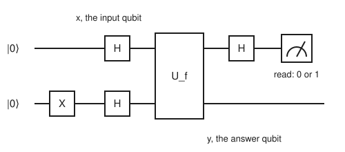
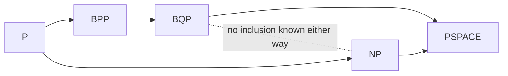

# BQP: what a quantum circuit does and does not speed up

[Syllabus](../../../SYLLABUS.md) → [Computability and complexity](../README.md) → [Algebraic, Interactive and Quantum](../README.md#s05) → BQP

---

## General Overview

A sealed box holds a one-bit function f: feed it 0 or 1 and it hands back 0 or 1. There are only four such boxes. The question is whether f is **constant** (the same answer for both inputs) or **balanced** (different answers). Each use of the box is a **query**, and queries are the cost counted here.

An ordinary computer must ask twice. The answer for input 0 says nothing about the answer for input 1. A circuit of two **qubits** (bits that hold signed amplitudes, from [Qubits](05-qubits-superposition-and-measurement.md)) asks once and is right every time. This is Deutsch's test.

The box links to the shelf's two-bit adder. A half adder's sum bit is x XOR y. The quantum version of the box maps (x, y) to (x, y XOR f(x)). When f copies its input, that is exactly the sum bit: the CNOT gate.

The trick is **interference**. Amplitudes carry signs, so two routes to a wrong answer can cancel. The circuit arranges for the wrong answer to cancel to zero.

That speed-up is real but narrow. **BQP** is the class of yes-or-no problems that a quantum circuit of polynomial size answers correctly with probability at least 2/3. It contains everything a coin-flipping classical computer can do fast. It sits inside polynomial space. Nobody knows whether it contains the NP-complete problems, and for black-box search it gains only a square root.

**A quantum circuit is a chain of reversible gates on amplitudes, where wrong answers can cancel before the one final reading; BQP is the set of yes-or-no problems where a polynomial-size chain makes the right answer win at least 2 times in 3.**

**What kind of fact this is:** BQP is a definition. Deutsch's one-query test is a theorem, proved on this card in Why it works. BPP ⊆ BQP ⊆ PSPACE is a theorem, given here with its key steps and a named source. "NP-complete problems are not in BQP" is a conjecture, unproved as of 2026-11-11.

### The picture: one query, two qubits

<p align="center"></p>

Schematic. Time runs left to right. The upper wire is the input qubit x and the lower wire is the answer qubit y. Only the upper wire is read. It reads 0 for a constant f and 1 for a balanced f.

---

## The formula

Notation first, in words.

- A **gate** acts on amplitudes as a **unitary** matrix U: one whose undo is its conjugate transpose $`U^\dagger`$ (flip the matrix across its diagonal and change the sign of every i), so $`U^\dagger U = I`$ and total probability stays 1.
- The **oracle** $`U_f`$ is the box as a gate: $`(x, y) \mapsto (x, y \oplus f(x))`$, where $`\oplus`$ is XOR (add, then keep the remainder after dividing by 2).
- $`\Pr[\cdot]`$ is a probability. P is a class here, so probability gets its own letters.

Deutsch's circuit ends with this chance of reading 0 on the input qubit:

```math
\Pr[x \text{ reads } 0] = \Big(\tfrac12\big((-1)^{f(0)} + (-1)^{f(1)}\big)\Big)^2
```

**Read it aloud:** give each input a sign, plus when f says 0 and minus when f says 1; average the two signs and square the result.

A constant f gives two equal signs, an average of ±1 and a chance of 1. A balanced f gives opposite signs, an average of 0 and a chance of 0. The same holds with n input bits, where the average runs over all $`2^n`$ inputs.

The class is defined by the same kind of reading:

```math
L \in \mathrm{BQP} \iff \Pr[C_n \text{ reads } 1 \text{ on } x] \ge \tfrac23 \text{ for } x \in L \text{ and } \le \tfrac13 \text{ for } x \notin L
```

**Read it aloud:** a language is in BQP when an ordinary program can build, for each input length n, a circuit with polynomially many gates that says "yes" at least 2 times in 3 on members and at most 1 time in 3 on non-members.

| Symbol | Plain meaning | In our example | Push it up and the answer… |
| --- | --- | --- | --- |
| $`f`$ | the sealed function | copy: $`f(0) = 0`$, $`f(1) = 1`$ | — |
| $`x`$, $`y`$ | the input qubit and the answer qubit | the upper and lower wires | — |
| $`\oplus`$ | XOR: 1 when exactly one side is 1 | $`1 \oplus 1 = 0`$ | — |
| $`U_f`$ | the oracle, f as a reversible gate | CNOT, the adder's sum bit | — |
| $`X`$, $`H`$ | the NOT gate; the Hadamard gate, a half-and-half mix with a sign | X turns the lower 0 into 1; H is used three times | — |
| $`(-1)^{f(x)}`$ | the sign a query leaves on input x | +1 then −1 for copy | — |
| $`n`$ | input bits of f; in $`C_n`$ and the BQP definition, the input length, which for a sealed f is the same count | 1 for Deutsch, 2 for Deutsch–Jozsa | classical exact queries $`2^{n-1} + 1`$ grow; quantum stays 1 |
| $`U`$, $`U^\dagger`$, $`I`$ | a gate, its undo, and the identity matrix (leaves every state alone) | the whole circuit as one 4 by 4 matrix | — |
| $`\Pr[\cdot]`$ | a probability | 1.000000 for a balanced f reading 1 | — |
| $`C_n`$ | the circuit for inputs of length n | X, H, H, $`U_f`$, H on 2 qubits | more gates, more cost |
| $`L`$, BQP | a language; the class of languages above | "f is balanced" | — |
| $`k`$, $`N`$, $`q`$ | runs in a majority vote; items in a search; qubits a simulator stores | k = 15; N items need about $`\sqrt{N}`$ queries; q = 30 needs 17 gigabytes | k: error falls; N: queries grow as $`\sqrt{N}`$; q: memory doubles per qubit |

### When it holds

- **The promise.** Deutsch–Jozsa assumes f is constant or balanced. Drop the promise and f = 0001 (its values on 00, 01, 10 and 11, one 1 in four) reads 00 with chance 0.25: neither answer.
- **Every gate is reversible.** A box that overwrites y with f(x) is not unitary. On constant 0, in Deutsch's circuit, the whole state cancels: total probability 0.
- **A fixed gap between 2/3 and 1/3.** Repeating and taking a majority vote then drives the error down. With a per-run error of 1/2 there is no gap, and a majority of 15 runs is still wrong half the time.
- **An ordinary program builds the circuits.** This is called uniformity. Without it, each input length could have its own hand-wired circuit, and such a family can even answer a version of HALT, the halting problem.

---

## Why it works

### Step 0: amplitudes can cancel, probabilities cannot

A classical coin-flipping program adds probabilities, and probabilities are never negative. Two routes to a wrong answer only make it more likely.

A qubit's amplitudes carry signs. The chance of a reading is the square of the summed amplitude, so a route of +0.5 and a route of −0.5 cancel to 0. A quantum algorithm is a way to make the wrong answers cancel.

### Step 1: the box must be reversible

Quantum gates are unitary, so they can be undone. A plain function f cannot always be undone: constant 0 sends both inputs to 0.

The fix keeps the input: $`(x, y) \mapsto (x, y \oplus f(x))`$. Applied twice it gives back (x, y), so it is its own undo. It only swaps basis states, so its matrix has one 1 in each row and column and is unitary. For f = copy it is CNOT, the half adder's sum bit written reversibly.

### Step 2: the query leaves a sign, not a bit

Put the answer qubit into the state $`|-\rangle = (|0\rangle - |1\rangle)/\sqrt{2}`$ with an X then an H. When f(x) = 0, the box leaves it alone. When f(x) = 1, XOR swaps $`|0\rangle`$ and $`|1\rangle`$, which turns $`|-\rangle`$ into its own negative.

```math
U_f\, |x\rangle |-\rangle = (-1)^{f(x)}\, |x\rangle |-\rangle
```

The answer qubit is unchanged; the sign lands on the input. This is called **phase kickback**.

### Step 3: a final H turns the signs into the answer

An H on the input qubit puts it into an equal mix of 0 and 1 first. The query then signs each half. A last H adds the two signed halves for the 0 reading and subtracts them for the 1 reading. Equal signs survive in the 0 reading; opposite signs cancel there and survive in the 1 reading. That is the formula above, and the chance is exactly 1 or 0.

<details>
<summary>Detailed proof: one query decides constant against balanced, for any number of input bits</summary>

Start with n input qubits at 0 and the answer qubit at 1. An H on every qubit gives an equal mix of all $`2^n`$ inputs, with the answer qubit in $`|-\rangle`$:

$`\displaystyle \frac{1}{\sqrt{2^n}} \sum_{x} |x\rangle |-\rangle`$

The query multiplies each term by $`(-1)^{f(x)}`$, by Step 2. An H on every input qubit sends $`|x\rangle`$ to a mix in which the all-zero string has amplitude $`1/\sqrt{2^n}`$, with a plus sign for every x. So the all-zero reading has amplitude

$`\displaystyle \frac{1}{2^n} \sum_{x} (-1)^{f(x)}`$

For a constant f every term has the same sign, and the amplitude is ±1. For a balanced f half the terms are +1 and half are −1, and the amplitude is 0. Squaring gives the chance: 1 against 0. With n = 1 this is Deutsch's test. The form that always succeeds is from Cleve, Ekert, Macchiavello and Mosca (1998); Deutsch's 1985 version succeeded half the time.

</details>

### Step 4: what it beats, and what it does not

A classical program with one query learns f at one input, either f(0) or f(1). For each answer it sees, one constant and one balanced function fit. So any one-query strategy is right on at most 2 of the 4 functions. Two queries are needed, and the quantum circuit uses one.

With n input bits, an exact classical answer needs $`2^{n-1} + 1`$ queries in the worst case. A balanced function can give the same answer on a whole half of the inputs, so one more query is needed after that half. At n = 40 that is 549,755,813,889 queries against 1.

That gap is against exact classical answers only. A coin-flipping program asks at 10 inputs chosen at random, repeats allowed, and says "constant" if all agree. A balanced function fools it with chance $`2 \times (1/2)^{10}`$, which is 0.1953%, at every n. Against BPP, the class of fast coin-flipping programs ([BPP](../04-Beyond%20Worst%20Case/03-randomised-complexity-and-bpp.md)), Deutsch–Jozsa gains almost nothing.

### Step 5: the class, and why 2/3 is not special

A circuit's reading is random, so BQP allows error. The 2/3 is a convention. Run the circuit k times and take the majority. If each run is wrong with chance 1/3, the majority is wrong at most $`e^{-k/18}`$ of the time, by the Hoeffding bound, a Chernoff-type tail bound ([Concentration](../../09-Probability%20and%20statistics/06-Limit%20Theorems%20in%20Practice/06-concentration-inequalities-hoeffding-and-chernoff.md)).

| Runs k | Exact majority error | Bound $`e^{-k/18}`$ |
| ---: | ---: | ---: |
| 1 | 33.3% | 94.6% |
| 5 | 21.0% | 75.7% |
| 15 | 8.8% | 43.5% |
| 25 | 4.2% | 24.9% |
| 51 | 0.7% | 5.9% |

Any fixed gap between the yes chance and the no chance gives the same class. With no gap, voting does nothing.

### Step 6: where BQP sits among the classes



Schematic. Each solid arrow is a proved inclusion. None of them is proved strict.

- **BPP ⊆ BQP.** An H on a fresh qubit, then a reading, is a fair coin. The Toffoli gate (a NOT on a third bit when the first two are 1) builds any classical gate reversibly. So a quantum circuit can run any coin-flipping program with little extra cost.
- **BQP ⊆ PSPACE.** A quantum circuit's final amplitude is a sum over paths: one choice of basis state after each gate. Each path's amplitude is a product of gate entries. A program can add the paths one at a time, reusing the same memory, in polynomial space but exponential time. Bernstein and Vazirani (1997) prove the sharper BQP ⊆ $`\mathrm{P}^{\#\mathrm{P}}`$ (polynomial time with a #P counter to ask, from [Counting](02-counting-solutions-and-sharp-p.md)), and $`\mathrm{P}^{\#\mathrm{P}}`$ lies inside PSPACE.

<details>
<summary>Why the path sum needs only polynomial space</summary>

Write the circuit as gates $`U_1, \dots, U_T`$ on q qubits. The amplitude of ending at basis state z, starting from s, is

$`\displaystyle \langle z | U_T \cdots U_1 | s \rangle = \sum_{b_1, \dots, b_{T-1}} \langle z | U_T | b_{T-1} \rangle \cdots \langle b_1 | U_1 | s \rangle`$

Each $`b_i`$ is a string of q bits. A program loops over all choices of $`b_1, \dots, b_{T-1}`$, one at a time. It keeps only the current choice, the running total and one product, which is about $`qT`$ bits. Each gate touches at most three qubits, so each entry is read off a small table. The chance of reading 1 is a sum of squared amplitudes over the final strings, added the same way. Comparing it with 1/2 decides the language in polynomial space.

</details>

### Step 7: what BQP is not known to do

- **NP-complete problems.** No polynomial-size quantum circuit is known for SAT. Bennett, Bernstein, Brassard and Vazirani (1997) prove that search through N unstructured items needs about $`\sqrt{N}`$ queries. So brute-force search gains a square root, not an exponential factor. That is Grover's algorithm ([Shor and Grover](07-shors-and-grovers-algorithms.md)).
- **Undecidable problems.** A classical program can simulate any circuit by storing all $`2^q`$ amplitudes for q qubits. So a quantum computer changes cost, never what can be computed. HALT stays undecidable.
- **Cheap simulation.** That simulation costs memory. At 16 bytes per amplitude, 30 qubits need 17,179,869,184 bytes, about 17 gigabytes. 50 qubits need 18,014,398,509,481,984 bytes, about 18 petabytes.

---

## Worked numbers, by hand

Deutsch's circuit on f = copy. The four amplitudes belong to the basis states 00, 01, 10 and 11, with x written first.

| Step | Arithmetic | Value |
| --- | --- | --- |
| start | both qubits at 0 | 1, 0, 0, 0 |
| X on y | 00 becomes 01 | 0, 1, 0, 0 |
| H on both | each H sends state 0 to (state 0 + state 1)/√2 and state 1 to (state 0 − state 1)/√2; √2 × √2 = 2 | 0.5, −0.5, 0.5, −0.5 |
| $`U_f`$ = CNOT | when x = 1, swap y: 10 and 11 trade amplitudes | 0.5, −0.5, −0.5, 0.5 |
| H on x, for 00 and 01 | (0.5 + (−0.5))/√2 and (−0.5 + 0.5)/√2 | 0, 0 |
| H on x, for 10 and 11 | (0.5 − (−0.5))/√2 and (−0.5 − 0.5)/√2 | 0.7071, −0.7071 |
| Pr[x reads 1] | 0.7071² + 0.7071² | **1.000000** |

One query, and the input qubit reads 1 with certainty: copy is balanced. The formula agrees: signs +1 and −1 average to 0, so the 0 reading has chance 0.

### What breaks if you drop a piece

The code runs each broken circuit on all four functions: constant 0, constant 1, copy, negate.

| Mistake | Comes out at | What went wrong |
| --- | --- | --- |
| Leave y at 0, skip the X | Pr[reads 1] = 0, 0, 0, 0 | y is not in $`\lvert -\rangle`$, so no sign kicks back; balanced reads as constant |
| Skip the final H | Pr[reads 1] = 0.5, 0.5, 0.5, 0.5 | the signs are never added, so the reading is a fair coin |
| A box that overwrites y with f(x) | total probability 0 on constant 0 | not reversible, so not unitary; the amplitudes cancel to nothing |
| Each run wrong with chance 1/2 | majority of 15 runs wrong 50% of the time | no gap, so voting cannot help |

---

## Code, from first principles, and it actually runs

The script is a state-vector simulator: a list of $`2^q`$ amplitudes for q qubits, with each gate an update of the list. It takes four roads to Deutsch's answer. They are the simulator, the sign-average formula, the whole circuit as one multiplied-out matrix with its unitarity checked, and a brute-force search over every classical one-query strategy. For two input bits it simulates all 8 promised functions. It checks the classical query counts by listing every pair and every triple of inputs. It then computes the majority-vote errors exactly and compares them with the bound.

### Python

```python
# BQP -- the check behind the card.  Standard library only: math gives sqrt and
# exp.  The state-vector simulator is the one the Qubits card explains: a list
# of 2^q amplitudes for q qubits, each gate an update of that list.  Every gate
# here has real entries, so the amplitudes stay real numbers.
import math
R = 1 / math.sqrt(2)

def h(s, k, q):                  # Hadamard on qubit k of q (qubit 0 is the leftmost bit)
    b, t = 1 << (q - 1 - k), s[:]
    for i in range(len(s)):
        if not i & b:
            t[i], t[i | b] = R * (s[i] + s[i | b]), R * (s[i] - s[i | b])
    return t
def xg(s, k, q):                 # X, the NOT gate, on qubit k
    return [s[i ^ (1 << (q - 1 - k))] for i in range(len(s))]
def oracle(s, f):                # U_f: (inputs, y) -> (inputs, y xor f(inputs)); y is the last qubit
    return [s[i ^ f[i >> 1]] for i in range(len(s))]
def bad_oracle(s, f):            # (inputs, y) -> (inputs, f(inputs)): overwrites y, not reversible
    t = [0.0] * len(s)
    for i in range(len(s)):
        t[(i >> 1 << 1) | f[i >> 1]] += s[i]
    return t
def run(f, n, flip=True, last_h=True):    # n input qubits, one answer qubit; returns Pr[inputs read 0]
    q = n + 1
    s = [0.0] * (1 << q); s[0] = 1.0
    if flip: s = xg(s, n, q)
    for k in range(q): s = h(s, k, q)
    s = oracle(s, f)
    if last_h:
        for k in range(n): s = h(s, k, q)
    return s[0] ** 2 + s[1] ** 2
def sign_sum(f):                 # the closed form: (average of (-1)^f(x)) squared
    return (sum((-1) ** v for v in f) / len(f)) ** 2

def kron(a, b): return [[x * y for x in ra for y in rb] for ra in a for rb in b]
def mul(a, b): return [[sum(a[i][k] * b[k][j] for k in range(len(b))) for j in range(len(b[0]))] for i in range(len(a))]
def perm(f): return [[1.0 if i == j ^ f[j >> 1] else 0.0 for j in range(4)] for i in range(4)]
I2, X2, H2 = [[1, 0], [0, 1]], [[0, 1], [1, 0]], [[R, R], [R, -R]]

DEUTSCH = {"constant 0": (0, 0), "constant 1": (1, 1), "copy, the adder's sum bit": (0, 1), "negate": (1, 0)}
print("Deutsch's test, one query: Pr[first qubit reads 1] for each one-bit function")
for name, f in DEUTSCH.items():
    p1, formula = 1 - run(f, 1), 1 - sign_sum(f)
    U = mul(kron(H2, I2), mul(perm(f), mul(kron(H2, H2), kron(I2, X2))))     # whole circuit as one matrix
    UtU = mul([list(r) for r in zip(*U)], U)
    unitary = all(abs(UtU[i][j] - (i == j)) < 1e-12 for i in range(4) for j in range(4))
    matrix_p1 = U[2][0] ** 2 + U[3][0] ** 2
    print(f"  f = {name:<26} {p1:.6f}  {'#' * round(20 * p1):<20}  formula {formula:.6f}  matrix {matrix_p1:.6f}  unitary {'yes' if unitary else 'no'}")
    assert abs(p1 - formula) < 1e-12 and abs(p1 - matrix_p1) < 1e-12 and unitary
    assert round(p1) == (f[0] != f[1])
s, cp = [1.0, 0.0, 0.0, 0.0], (0, 1)            # the copy function, traced step by step
print("trace for f = copy, amplitudes of 00 01 10 11:")
for label, step in [("after X on the answer qubit", lambda s: xg(s, 1, 2)), ("after H on both", lambda s: h(h(s, 0, 2), 1, 2)),
                    ("after U_f", lambda s: oracle(s, cp)), ("after H on the first", lambda s: h(s, 0, 2))]:
    s = step(s)
    print(f"  {label:<30}" + " ".join(f"{a:+.4f}" for a in s))
one_query = [sum((ans[f[b]] == (f[0] != f[1])) for f in DEUTSCH.values())
             for b in (0, 1) for ans in ((0, 0), (0, 1), (1, 0), (1, 1))]
print(f"best classical one-query strategy: right on {max(one_query)} of 4 functions")
assert max(one_query) == 2

tables = [tuple((m >> (3 - j)) & 1 for j in range(4)) for m in range(16)]
const = [t for t in tables if len(set(t)) == 1]
bal = [t for t in tables if sum(t) == 2]
dj = [run(f, 2) for f in const + bal]
print(f"Deutsch-Jozsa on two-bit inputs: {len(const)} constant, {len(bal)} balanced; Pr[inputs read 00]: "
      + " ".join(f"{p:.6f}" for p in dj))
assert all(abs(p - sign_sum(f)) < 1e-12 for p, f in zip(dj, const + bal)) and dj == sorted(dj, reverse=True)
off = run((0, 0, 0, 1), 2)                       # outside the promise: one 1 in four
print(f"no promise, f = 0001: Pr[inputs read 00] {off:.6f}")
assert abs(off - sign_sum((0, 0, 0, 1))) < 1e-12 and abs(off - 0.25) < 1e-12
pairs = [(a, b) for a in range(4) for b in range(a + 1, 4)]
fooled = sum(any(c[a] == g[a] and c[b] == g[b] for c in const for g in bal) for a, b in pairs)
triples = [(a, b, c) for a in range(4) for b in range(a + 1, 4) for c in range(b + 1, 4)]
fooled3 = sum(any(all(k[i] == g[i] for i in t) for k in const for g in bal) for t in triples)
err2 = sum(f[a] == f[b] for f in bal for a, b in pairs) / (len(bal) * len(pairs))
print(f"two classical queries: {fooled} of {len(pairs)} pairs fit a constant and a balanced function; "
      f"three queries: {fooled3} of {len(triples)} triples")
print(f"two random distinct queries call a balanced function constant with probability {err2:.6f}")
assert fooled == 6 and fooled3 == 0 and abs(err2 - 1 / 3) < 1e-12
print("exact classical queries for n input bits, against 1 quantum query:")
for n in (2, 10, 20, 40):
    print(f"  n = {n:<3} {2 ** (n - 1) + 1}")
err10 = max(sum((f.count(v) / 4) ** 10 for v in (0, 1)) for f in bal)   # all ten see one value
print(f"ten random queries with repeats call a balanced function constant with probability {err10:.6f}")
assert abs(err10 - 2 ** (1 - 10)) < 1e-15

def majority_error(p, k):        # exact chance that at least half of k runs are wrong
    return sum(math.comb(k, j) * p ** j * (1 - p) ** (k - j) for j in range((k + 1) // 2, k + 1))
print("majority of k runs, each wrong with probability 1/3: exact error, then the bound exp(-k/18)")
for k in (1, 5, 15, 25, 51):
    e, bound = majority_error(1 / 3, k), math.exp(-k / 18)
    print(f"  k = {k:<3} {e:.6f}  {bound:.6f}")
    assert e <= bound
assert majority_error(1 / 3, 15) < majority_error(1 / 3, 5) < 1 / 3
print("amplitudes a classical simulator stores, 16 bytes each:")
for q in (10, 20, 30, 40, 50):
    print(f"  {q} qubits  {2 ** q} amplitudes  {16 * 2 ** q} bytes")
print("what breaks, for constant 0, constant 1, copy, negate:")
print("  answer qubit left at 0: Pr[reads 1] " + " ".join(f"{1 - run(f, 1, flip=False):.6f}" for f in DEUTSCH.values()))
print("  no final H: Pr[reads 1] " + " ".join(f"{1 - run(f, 1, last_h=False):.6f}" for f in DEUTSCH.values()))
lost = sum(a * a for a in bad_oracle(h(h([0.0, 1.0, 0.0, 0.0], 0, 2), 1, 2), (0, 0)))
print(f"  oracle that overwrites y, f = constant 0: total probability {lost:.6f}")
print(f"  each run wrong with probability 1/2: majority of 15 runs wrong with probability {majority_error(0.5, 15):.6f}")
assert lost < 1e-12 and abs(majority_error(0.5, 15) - 0.5) < 1e-12
print("figure, wires y=70,150; X x=90; H x=170; U_f x=260; H x=350; meter x=430")
print("ALL CHECKS PASS")
```

**Ran 2026-11-19 on macOS, Python 3.14.10, standard library only. All checks passed. Output, pasted from the run:**

```
Deutsch's test, one query: Pr[first qubit reads 1] for each one-bit function
  f = constant 0                 0.000000                        formula 0.000000  matrix 0.000000  unitary yes
  f = constant 1                 0.000000                        formula 0.000000  matrix 0.000000  unitary yes
  f = copy, the adder's sum bit  1.000000  ####################  formula 1.000000  matrix 1.000000  unitary yes
  f = negate                     1.000000  ####################  formula 1.000000  matrix 1.000000  unitary yes
trace for f = copy, amplitudes of 00 01 10 11:
  after X on the answer qubit   +0.0000 +1.0000 +0.0000 +0.0000
  after H on both               +0.5000 -0.5000 +0.5000 -0.5000
  after U_f                     +0.5000 -0.5000 -0.5000 +0.5000
  after H on the first          +0.0000 +0.0000 +0.7071 -0.7071
best classical one-query strategy: right on 2 of 4 functions
Deutsch-Jozsa on two-bit inputs: 2 constant, 6 balanced; Pr[inputs read 00]: 1.000000 1.000000 0.000000 0.000000 0.000000 0.000000 0.000000 0.000000
no promise, f = 0001: Pr[inputs read 00] 0.250000
two classical queries: 6 of 6 pairs fit a constant and a balanced function; three queries: 0 of 4 triples
two random distinct queries call a balanced function constant with probability 0.333333
exact classical queries for n input bits, against 1 quantum query:
  n = 2   3
  n = 10  513
  n = 20  524289
  n = 40  549755813889
ten random queries with repeats call a balanced function constant with probability 0.001953
majority of k runs, each wrong with probability 1/3: exact error, then the bound exp(-k/18)
  k = 1   0.333333  0.945959
  k = 5   0.209877  0.757465
  k = 15  0.088232  0.434598
  k = 25  0.041514  0.249352
  k = 51  0.006888  0.058816
amplitudes a classical simulator stores, 16 bytes each:
  10 qubits  1024 amplitudes  16384 bytes
  20 qubits  1048576 amplitudes  16777216 bytes
  30 qubits  1073741824 amplitudes  17179869184 bytes
  40 qubits  1099511627776 amplitudes  17592186044416 bytes
  50 qubits  1125899906842624 amplitudes  18014398509481984 bytes
what breaks, for constant 0, constant 1, copy, negate:
  answer qubit left at 0: Pr[reads 1] 0.000000 0.000000 0.000000 0.000000
  no final H: Pr[reads 1] 0.500000 0.500000 0.500000 0.500000
  oracle that overwrites y, f = constant 0: total probability 0.000000
  each run wrong with probability 1/2: majority of 15 runs wrong with probability 0.500000
figure, wires y=70,150; X x=90; H x=170; U_f x=260; H x=350; meter x=430
ALL CHECKS PASS
```

### Rust

The same check, with the same labels, built with `rustc --edition 2021 -O`.

```rust
// BQP -- the same check as the Python, in Rust.  No crates.  The state-vector
// simulator is the one the Qubits card explains: a list of 2^q amplitudes for
// q qubits, each gate an update of that list.  Every gate here has real
// entries, so the amplitudes stay real numbers.
type M = Vec<Vec<f64>>;
fn r() -> f64 { 1.0 / 2f64.sqrt() }
fn h(s: &[f64], k: usize, q: usize) -> Vec<f64> {    // Hadamard on qubit k of q (qubit 0 leftmost)
    let (b, mut t) = (1usize << (q - 1 - k), s.to_vec());
    for i in 0..s.len() {
        if i & b == 0 { t[i] = r() * (s[i] + s[i | b]); t[i | b] = r() * (s[i] - s[i | b]); }
    }
    t
}
fn xg(s: &[f64], k: usize, q: usize) -> Vec<f64> {   // X, the NOT gate, on qubit k
    (0..s.len()).map(|i| s[i ^ (1 << (q - 1 - k))]).collect()
}
fn oracle(s: &[f64], f: &[usize]) -> Vec<f64> {      // U_f: (inputs, y) -> (inputs, y xor f(inputs))
    (0..s.len()).map(|i| s[i ^ f[i >> 1]]).collect()
}
fn bad_oracle(s: &[f64], f: &[usize]) -> Vec<f64> {  // (inputs, y) -> (inputs, f(inputs)): not reversible
    let mut t = vec![0.0; s.len()];
    for i in 0..s.len() { t[(i >> 1 << 1) | f[i >> 1]] += s[i]; }
    t
}
fn run(f: &[usize], n: usize, flip: bool, last_h: bool) -> f64 {   // returns Pr[inputs read 0]
    let q = n + 1;
    let mut s = vec![0.0; 1 << q];
    s[0] = 1.0;
    if flip { s = xg(&s, n, q); }
    for k in 0..q { s = h(&s, k, q); }
    s = oracle(&s, f);
    if last_h { for k in 0..n { s = h(&s, k, q); } }
    s[0].powi(2) + s[1].powi(2)
}
fn sign_sum(f: &[usize]) -> f64 {                    // (average of (-1)^f(x)) squared
    (f.iter().map(|&v| if v == 0 { 1.0 } else { -1.0 }).sum::<f64>() / f.len() as f64).powi(2)
}
fn kron(a: &M, b: &M) -> M {
    let mut out = Vec::new();
    for ra in a { for rb in b { out.push(ra.iter().flat_map(|x| rb.iter().map(move |y| x * y)).collect()); } }
    out
}
fn mul(a: &M, b: &M) -> M {
    (0..a.len()).map(|i| (0..b[0].len()).map(|j| (0..b.len()).map(|k| a[i][k] * b[k][j]).sum()).collect()).collect()
}
fn perm(f: &[usize]) -> M {
    (0..4).map(|i| (0..4).map(|j| if i == j ^ f[j >> 1] { 1.0 } else { 0.0 }).collect()).collect()
}
fn comb(k: u64, j: u64) -> f64 { (0..j).fold(1.0, |acc, i| acc * (k - i) as f64 / (i + 1) as f64) }
fn majority_error(p: f64, k: u64) -> f64 {           // exact chance that at least half of k runs are wrong
    ((k + 1) / 2..=k).map(|j| comb(k, j) * p.powi(j as i32) * (1.0 - p).powi((k - j) as i32)).sum()
}
fn row(v: &[f64]) -> String { v.iter().map(|p| format!("{:.6}", p)).collect::<Vec<_>>().join(" ") }

fn main() {
    let (i2, x2, h2): (M, M, M) = (vec![vec![1.0, 0.0], vec![0.0, 1.0]], vec![vec![0.0, 1.0], vec![1.0, 0.0]],
                                   vec![vec![r(), r()], vec![r(), -r()]]);
    let deutsch: [(&str, [usize; 2]); 4] = [("constant 0", [0, 0]), ("constant 1", [1, 1]),
                                             ("copy, the adder's sum bit", [0, 1]), ("negate", [1, 0])];
    println!("Deutsch's test, one query: Pr[first qubit reads 1] for each one-bit function");
    for (name, f) in deutsch.iter() {
        let (p1, formula) = (1.0 - run(f, 1, true, true), 1.0 - sign_sum(f));
        let u = mul(&kron(&h2, &i2), &mul(&perm(f), &mul(&kron(&h2, &h2), &kron(&i2, &x2))));
        let ut: M = (0..4).map(|i| (0..4).map(|j| u[j][i]).collect()).collect();
        let utu = mul(&ut, &u);
        let unitary = (0..4).all(|i| (0..4).all(|j| (utu[i][j] - if i == j { 1.0 } else { 0.0 }).abs() < 1e-12));
        let matrix_p1 = u[2][0].powi(2) + u[3][0].powi(2);
        println!("  f = {:<26} {:.6}  {:<20}  formula {:.6}  matrix {:.6}  unitary {}", name, p1,
                 "#".repeat((20.0 * p1).round() as usize), formula, matrix_p1, if unitary { "yes" } else { "no" });
        assert!((p1 - formula).abs() < 1e-12 && (p1 - matrix_p1).abs() < 1e-12 && unitary);
        assert!((p1.round() == 1.0) == (f[0] != f[1]));
    }
    let mut s = vec![1.0, 0.0, 0.0, 0.0];             // the copy function, traced step by step
    println!("trace for f = copy, amplitudes of 00 01 10 11:");
    for label in ["after X on the answer qubit", "after H on both", "after U_f", "after H on the first"] {
        s = match label {
            "after X on the answer qubit" => xg(&s, 1, 2),
            "after H on both" => h(&h(&s, 0, 2), 1, 2),
            "after U_f" => oracle(&s, &[0, 1]),
            _ => h(&s, 0, 2),
        };
        println!("  {:<30}{}", label, s.iter().map(|a| format!("{:+.4}", a)).collect::<Vec<_>>().join(" "));
    }
    let mut one_query = Vec::new();
    for b in 0..2 { for ans in [[0, 0], [0, 1], [1, 0], [1, 1]] {
        one_query.push(deutsch.iter().filter(|(_, f)| (ans[f[b]] == 1) == (f[0] != f[1])).count());
    } }
    let best = *one_query.iter().max().unwrap();
    println!("best classical one-query strategy: right on {} of 4 functions", best);
    assert!(best == 2);

    let tables: Vec<Vec<usize>> = (0..16).map(|m| (0..4).map(|j| (m >> (3 - j)) & 1).collect()).collect();
    let cons: Vec<Vec<usize>> = tables.iter().filter(|t| t.iter().all(|&v| v == t[0])).cloned().collect();
    let bal: Vec<Vec<usize>> = tables.iter().filter(|t| t.iter().sum::<usize>() == 2).cloned().collect();
    let both: Vec<Vec<usize>> = cons.iter().chain(bal.iter()).cloned().collect();
    let dj: Vec<f64> = both.iter().map(|f| run(f, 2, true, true)).collect();
    println!("Deutsch-Jozsa on two-bit inputs: {} constant, {} balanced; Pr[inputs read 00]: {}", cons.len(), bal.len(), row(&dj));
    assert!(dj.iter().zip(both.iter()).all(|(p, f)| (p - sign_sum(f)).abs() < 1e-12) && dj.windows(2).all(|w| w[0] >= w[1]));
    let off = run(&[0, 0, 0, 1], 2, true, true);      // outside the promise: one 1 in four
    println!("no promise, f = 0001: Pr[inputs read 00] {:.6}", off);
    assert!((off - sign_sum(&[0, 0, 0, 1])).abs() < 1e-12 && (off - 0.25).abs() < 1e-12);
    let pairs: Vec<(usize, usize)> = (0..4).flat_map(|a| (a + 1..4).map(move |b| (a, b))).collect();
    let fooled = pairs.iter().filter(|&&(a, b)| cons.iter().any(|c| bal.iter().any(|g| c[a] == g[a] && c[b] == g[b]))).count();
    let mut triples = Vec::new();
    for a in 0..4 { for b in a + 1..4 { for c in b + 1..4 { triples.push([a, b, c]); } } }
    let fooled3 = triples.iter().filter(|t| cons.iter().any(|k| bal.iter().any(|g| t.iter().all(|&i| k[i] == g[i])))).count();
    let same = bal.iter().map(|f| pairs.iter().filter(|&&(a, b)| f[a] == f[b]).count()).sum::<usize>();
    let err2 = same as f64 / (bal.len() * pairs.len()) as f64;
    println!("two classical queries: {} of {} pairs fit a constant and a balanced function; three queries: {} of {} triples",
             fooled, pairs.len(), fooled3, triples.len());
    println!("two random distinct queries call a balanced function constant with probability {:.6}", err2);
    assert!(fooled == 6 && fooled3 == 0 && (err2 - 1.0 / 3.0).abs() < 1e-12);
    println!("exact classical queries for n input bits, against 1 quantum query:");
    for n in [2u32, 10, 20, 40] { println!("  n = {:<3} {}", n, 2u64.pow(n - 1) + 1); }
    let err10 = bal.iter().map(|f| (0..2).map(|v| (f.iter().filter(|&&x| x == v).count() as f64 / 4.0).powi(10)).sum::<f64>())
        .fold(0.0, f64::max);                         // all ten see one value
    println!("ten random queries with repeats call a balanced function constant with probability {:.6}", err10);
    assert!((err10 - 2f64.powi(1 - 10)).abs() < 1e-15);

    println!("majority of k runs, each wrong with probability 1/3: exact error, then the bound exp(-k/18)");
    for k in [1u64, 5, 15, 25, 51] {
        let (e, bound) = (majority_error(1.0 / 3.0, k), (-(k as f64) / 18.0).exp());
        println!("  k = {:<3} {:.6}  {:.6}", k, e, bound);
        assert!(e <= bound);
    }
    assert!(majority_error(1.0 / 3.0, 15) < majority_error(1.0 / 3.0, 5) && majority_error(1.0 / 3.0, 5) < 1.0 / 3.0);
    println!("amplitudes a classical simulator stores, 16 bytes each:");
    for q in [10u32, 20, 30, 40, 50] { println!("  {} qubits  {} amplitudes  {} bytes", q, 1u64 << q, 16u64 << q); }
    println!("what breaks, for constant 0, constant 1, copy, negate:");
    let no_flip: Vec<f64> = deutsch.iter().map(|(_, f)| 1.0 - run(f, 1, false, true)).collect();
    let no_h: Vec<f64> = deutsch.iter().map(|(_, f)| 1.0 - run(f, 1, true, false)).collect();
    println!("  answer qubit left at 0: Pr[reads 1] {}", row(&no_flip));
    println!("  no final H: Pr[reads 1] {}", row(&no_h));
    let lost: f64 = bad_oracle(&h(&h(&[0.0, 1.0, 0.0, 0.0], 0, 2), 1, 2), &[0, 0]).iter().map(|a| a * a).sum();
    println!("  oracle that overwrites y, f = constant 0: total probability {:.6}", lost);
    println!("  each run wrong with probability 1/2: majority of 15 runs wrong with probability {:.6}", majority_error(0.5, 15));
    assert!(lost < 1e-12 && (majority_error(0.5, 15) - 0.5).abs() < 1e-12);
    println!("figure, wires y=70,150; X x=90; H x=170; U_f x=260; H x=350; meter x=430");
    println!("ALL CHECKS PASS");
}
```

**Ran 2026-11-19 on macOS, rustc 1.98.1, no crates. All checks passed. Output, pasted from the run:**

```
Deutsch's test, one query: Pr[first qubit reads 1] for each one-bit function
  f = constant 0                 0.000000                        formula 0.000000  matrix 0.000000  unitary yes
  f = constant 1                 0.000000                        formula 0.000000  matrix 0.000000  unitary yes
  f = copy, the adder's sum bit  1.000000  ####################  formula 1.000000  matrix 1.000000  unitary yes
  f = negate                     1.000000  ####################  formula 1.000000  matrix 1.000000  unitary yes
trace for f = copy, amplitudes of 00 01 10 11:
  after X on the answer qubit   +0.0000 +1.0000 +0.0000 +0.0000
  after H on both               +0.5000 -0.5000 +0.5000 -0.5000
  after U_f                     +0.5000 -0.5000 -0.5000 +0.5000
  after H on the first          +0.0000 +0.0000 +0.7071 -0.7071
best classical one-query strategy: right on 2 of 4 functions
Deutsch-Jozsa on two-bit inputs: 2 constant, 6 balanced; Pr[inputs read 00]: 1.000000 1.000000 0.000000 0.000000 0.000000 0.000000 0.000000 0.000000
no promise, f = 0001: Pr[inputs read 00] 0.250000
two classical queries: 6 of 6 pairs fit a constant and a balanced function; three queries: 0 of 4 triples
two random distinct queries call a balanced function constant with probability 0.333333
exact classical queries for n input bits, against 1 quantum query:
  n = 2   3
  n = 10  513
  n = 20  524289
  n = 40  549755813889
ten random queries with repeats call a balanced function constant with probability 0.001953
majority of k runs, each wrong with probability 1/3: exact error, then the bound exp(-k/18)
  k = 1   0.333333  0.945959
  k = 5   0.209877  0.757465
  k = 15  0.088232  0.434598
  k = 25  0.041514  0.249352
  k = 51  0.006888  0.058816
amplitudes a classical simulator stores, 16 bytes each:
  10 qubits  1024 amplitudes  16384 bytes
  20 qubits  1048576 amplitudes  16777216 bytes
  30 qubits  1073741824 amplitudes  17179869184 bytes
  40 qubits  1099511627776 amplitudes  17592186044416 bytes
  50 qubits  1125899906842624 amplitudes  18014398509481984 bytes
what breaks, for constant 0, constant 1, copy, negate:
  answer qubit left at 0: Pr[reads 1] 0.000000 0.000000 0.000000 0.000000
  no final H: Pr[reads 1] 0.500000 0.500000 0.500000 0.500000
  oracle that overwrites y, f = constant 0: total probability 0.000000
  each run wrong with probability 1/2: majority of 15 runs wrong with probability 0.500000
figure, wires y=70,150; X x=90; H x=170; U_f x=260; H x=350; meter x=430
ALL CHECKS PASS
```

The two outputs match line for line.

### Lean

Lean proves Deutsch–Jozsa's formula, its one-query answer and the classical count for any number n of input bits.

- Take any function f on n input bits. Then the inputs all read 0 with chance equal to the average of the signs $`(-1)^{f(x)}`$, squared.
- Suppose f is promised to be constant or balanced. Then, after one query, the inputs all read 0 with chance 1 when f is constant, and 0 when balanced.
- Take n of at least 1 and any set of query inputs. Then a constant and a balanced function agree on the whole set exactly when it has at most $`2^{n-1}`$ inputs.
- Any classical one-query strategy for Deutsch's test is right on at most 2 of the 4 one-bit functions.
- Of the 16 functions on two input bits, 2 are constant and 6 are balanced.
- The exact classical query counts 3, 513, 524,289 and 549,755,813,889 for n = 2, 10, 20 and 40 are right.
- The 0.1953% coin-flip error and the byte counts for 30 and 50 qubits are right too.

The step-by-step traces, the broken circuits and the majority-vote errors are left to the Python and Rust checks.

```lean
-- BQP: Deutsch-Jozsa's circuit asks the box once and reads all zeros with chance (average of the signs (-1)^f(x)) squared, so it tells a constant f from a balanced one with certainty, where an exact classical test needs 2^(n-1) + 1 queries.
import Mathlib.LinearAlgebra.Matrix.Kronecker
import Mathlib.Analysis.Real.Sqrt
import Mathlib.Basic.Complex.BigOperators
import Mathlib.Tactic.NormNum

open Matrix Kronecker

namespace QuantumBQP

/-- A function `f` on `n` input bits is constant: the same answer for every input. -/
def IsConstant {n : ℕ} (f : (Fin n → Bool) → Bool) : Prop :=
  ∀ x x', f x = f x'

/-- A function `f` on `n` input bits is balanced: it answers 1 on exactly half of the
`2 ^ n` inputs. -/
def IsBalanced {n : ℕ} (f : (Fin n → Bool) → Bool) : Prop :=
  2 * (Finset.univ.filter (fun x => f x = true)).card = 2 ^ n

instance {n : ℕ} : DecidablePred (IsConstant (n := n)) :=
  fun f => by unfold IsConstant; infer_instance

instance {n : ℕ} : DecidablePred (IsBalanced (n := n)) :=
  fun f => by unfold IsBalanced; infer_instance

/-- The Hadamard gate `H` on one qubit, rows and columns indexed by the bit values 0 and 1:
entries `1/√2`, except `-1/√2` in the 1, 1 corner. -/
noncomputable def hadamard : Matrix Bool Bool ℂ :=
  Matrix.of fun a b => ((Real.sqrt 2 : ℂ)⁻¹) * (if a && b then -1 else 1)

/-- The NOT gate `X` on one qubit: it swaps 0 and 1. -/
def pauliX : Matrix Bool Bool ℂ :=
  Matrix.of fun a b => if a = !b then 1 else 0

/-- `H` on every one of `n` input qubits: the `n`-fold Kronecker (tensor) power of `H`, whose
entry in row `z`, column `x` is the product over the qubits `i` of `H (z i) (x i)`. -/
noncomputable def hadamardAll (n : ℕ) : Matrix (Fin n → Bool) (Fin n → Bool) ℂ :=
  Matrix.of fun z x => ∏ i, hadamard (z i) (x i)

/-- The oracle `U_f`, the box as a reversible gate on `n` input qubits and one answer qubit:
`(x, y) ↦ (x, y xor f x)`. Column `(x, y)` has its single 1 in row `(x, y xor f x)`. -/
def oracle {n : ℕ} (f : (Fin n → Bool) → Bool) :
    Matrix ((Fin n → Bool) × Bool) ((Fin n → Bool) × Bool) ℂ :=
  Matrix.of fun p q => if p = (q.1, xor q.2 (f q.1)) then 1 else 0

/-- The Deutsch-Jozsa circuit as one matrix, gates applied right to left: `X` on the answer
qubit, `H` on every qubit, the one query `U_f`, then `H` on every input qubit. -/
noncomputable def circuit {n : ℕ} (f : (Fin n → Bool) → Bool) :
    Matrix ((Fin n → Bool) × Bool) ((Fin n → Bool) × Bool) ℂ :=
  (hadamardAll n ⊗ₖ (1 : Matrix Bool Bool ℂ)) * oracle f * (hadamardAll n ⊗ₖ hadamard) *
    ((1 : Matrix (Fin n → Bool) (Fin n → Bool) ℂ) ⊗ₖ pauliX)

/-- The state the circuit leaves when every qubit starts at 0. -/
noncomputable def finalState {n : ℕ} (f : (Fin n → Bool) → Bool) :
    (Fin n → Bool) × Bool → ℂ :=
  circuit f *ᵥ Pi.single ((fun _ => false), false) 1

/-- The chance that the `n` input qubits all read 0: the squared sizes of the two amplitudes
with every input bit 0, one for each value of the answer qubit. -/
noncomputable def probAllZero {n : ℕ} (f : (Fin n → Bool) → Bool) : ℝ :=
  ∑ y : Bool, Complex.normSq (finalState f ((fun _ => false), y))

lemma step1 (n : ℕ) :
    ((1 : Matrix (Fin n → Bool) (Fin n → Bool) ℂ) ⊗ₖ pauliX) *ᵥ
      Pi.single ((fun _ => false), false) 1 = Pi.single ((fun _ => false), true) 1 := by
  ext ⟨x, y⟩
  simp [Matrix.mulVec, dotProduct, Pi.single_apply, kroneckerMap_apply, pauliX, Matrix.one_apply]
  split_ifs <;> simp_all

#print axioms step1

lemma step2 (n : ℕ) :
    (hadamardAll n ⊗ₖ hadamard) *ᵥ Pi.single ((fun _ => false), true) 1 =
      fun p => ((Real.sqrt 2 : ℂ)⁻¹) ^ (n + 1) * (if p.2 then -1 else 1) := by
  ext ⟨x, y⟩
  simp [Matrix.mulVec, dotProduct, Pi.single_apply, kroneckerMap_apply, hadamardAll, hadamard]
  cases y <;> simp [pow_succ, mul_comm]

#print axioms step2

lemma step3 {n : ℕ} (f : (Fin n → Bool) → Bool) (v : (Fin n → Bool) × Bool → ℂ) :
    oracle f *ᵥ v = fun p => v (p.1, xor p.2 (f p.1)) := by
  ext ⟨x, y⟩
  simp only [Matrix.mulVec, dotProduct, oracle, Matrix.of_apply]
  have h : ∀ i : (Fin n → Bool) × Bool,
      ((x, y) = (i.1, xor i.2 (f i.1))) ↔ (x, xor y (f x)) = i := by
    rintro ⟨a, b⟩
    constructor
    · rintro h
      simp only [Prod.mk.injEq] at h ⊢
      obtain ⟨rfl, rfl⟩ := h
      simp
    · rintro h
      simp only [Prod.mk.injEq] at h ⊢
      obtain ⟨rfl, rfl⟩ := h
      simp
  simp_rw [h, ite_mul, one_mul, zero_mul]
  simp

#print axioms step3

lemma finalState_zero {n : ℕ} (f : (Fin n → Bool) → Bool) (y : Bool) :
    finalState f ((fun _ => false), y) =
      (((Real.sqrt 2)⁻¹ ^ (2 * n + 1) * (if y then -1 else 1) *
        ∑ x, (-1 : ℝ) ^ (f x).toNat : ℝ) : ℂ) := by
  unfold finalState circuit
  rw [← Matrix.mulVec_mulVec, ← Matrix.mulVec_mulVec, ← Matrix.mulVec_mulVec, step1, step2,
    step3]
  simp [Matrix.mulVec, dotProduct, kroneckerMap_apply, hadamardAll, hadamard,
    Fintype.sum_prod_type, Matrix.one_apply]
  cases y
  · push_cast
    rw [Finset.mul_sum]
    refine Finset.sum_congr rfl fun x _ => ?_
    cases f x <;> simp <;> ring
  · simp only [ite_true]
    push_cast
    rw [Finset.mul_sum, ← Finset.sum_neg_distrib]
    refine Finset.sum_congr rfl fun x _ => ?_
    cases f x <;> simp <;> ring

#print axioms finalState_zero

lemma card_inputs (n : ℕ) : Fintype.card (Fin n → Bool) = 2 ^ n := by
  simp

#print axioms card_inputs

/-- Helper: the card's formula. -/
lemma prob_formula {n : ℕ} (f : (Fin n → Bool) → Bool) :
    probAllZero f = ((∑ x, (-1 : ℝ) ^ (f x).toNat) / 2 ^ n) ^ 2 := by
  simp only [probAllZero, finalState_zero, Complex.normSq_ofReal, Fintype.sum_bool, ite_true]
  simp only [Bool.false_eq_true, ite_false]
  set S := ∑ x, (-1 : ℝ) ^ (f x).toNat
  have h : ((Real.sqrt 2)⁻¹ ^ (2 * n + 1)) ^ 2 = (1 / 2) ^ (2 * n + 1) := by
    rw [← pow_mul, mul_comm, pow_mul, inv_pow, Real.sq_sqrt (by norm_num : (0:ℝ) ≤ 2)]
    norm_num
  have e : ((Real.sqrt 2)⁻¹ ^ (2 * n + 1) * -1 * S) * ((Real.sqrt 2)⁻¹ ^ (2 * n + 1) * -1 * S) +
      ((Real.sqrt 2)⁻¹ ^ (2 * n + 1) * 1 * S) * ((Real.sqrt 2)⁻¹ ^ (2 * n + 1) * 1 * S) =
      2 * ((Real.sqrt 2)⁻¹ ^ (2 * n + 1)) ^ 2 * S ^ 2 := by ring
  rw [e, h]
  field_simp
  ring_nf
  rw [mul_assoc, ← mul_pow]
  norm_num

#print axioms prob_formula

lemma sign_sum_balanced {n : ℕ} (f : (Fin n → Bool) → Bool) (hb : IsBalanced f) :
    ∑ x, (-1 : ℝ) ^ (f x).toNat = 0 := by
  have h1 : ∀ x, (-1 : ℝ) ^ (f x).toNat = 1 - 2 * (if f x = true then 1 else 0) := by
    intro x; cases f x <;> norm_num
  simp_rw [h1]
  rw [Finset.sum_sub_distrib, ← Finset.mul_sum, Finset.sum_boole]
  have hb' : (2 : ℝ) * ((Finset.univ.filter (fun x => f x = true)).card : ℝ) = 2 ^ n := by
    exact_mod_cast hb
  simp only [Finset.sum_const, Finset.card_univ, card_inputs, nsmul_eq_mul, mul_one]
  rw [hb']
  push_cast
  ring

#print axioms sign_sum_balanced

lemma sign_sum_constant {n : ℕ} (f : (Fin n → Bool) → Bool) (hc : IsConstant f) :
    ((∑ x, (-1 : ℝ) ^ (f x).toNat) / 2 ^ n) ^ 2 = 1 := by
  have h : ∀ x, (-1 : ℝ) ^ (f x).toNat = (-1 : ℝ) ^ (f (fun _ => false)).toNat :=
    fun x => by rw [hc x (fun _ => false)]
  simp_rw [h]
  simp only [Finset.sum_const, Finset.card_univ, card_inputs, nsmul_eq_mul]
  push_cast
  rw [mul_div_cancel_left₀ _ (by positivity)]
  rw [← pow_mul, mul_comm, pow_mul]
  norm_num

#print axioms sign_sum_constant

/-- Deutsch-Jozsa, one query decides: if the box `f` on `n` input bits is promised to be
constant or balanced, then the circuit's input qubits read all zeros with chance exactly 0 or
1: chance 1 when `f` is constant and chance 0 when `f` is balanced. With `n = 1` this is
Deutsch's test. -/
theorem deutsch_jozsa_one_query_decides {n : ℕ} (f : (Fin n → Bool) → Bool)
    (hpromise : IsConstant f ∨ IsBalanced f) :
    (probAllZero f = 0 ∨ probAllZero f = 1) ∧
      (IsConstant f → probAllZero f = 1) ∧ (IsBalanced f → probAllZero f = 0) := by
  have hC : IsConstant f → probAllZero f = 1 := fun hc => by
    rw [prob_formula]; exact sign_sum_constant f hc
  have hB : IsBalanced f → probAllZero f = 0 := fun hb => by
    rw [prob_formula, sign_sum_balanced f hb]; simp
  refine ⟨?_, hC, hB⟩
  rcases hpromise with hc | hb
  · exact Or.inr (hC hc)
  · exact Or.inl (hB hb)

/-- The card's formula: the chance that the input qubits all read 0 is the average of the
signs `(-1)^f(x)` over all `2 ^ n` inputs, squared. -/
theorem prob_all_zero_eq_sign_average_sq {n : ℕ} (f : (Fin n → Bool) → Bool) :
    probAllZero f = ((∑ x, (-1 : ℝ) ^ (f x).toNat) / 2 ^ n) ^ 2 := by
  exact prob_formula f

/-- The classical count: with `n ≥ 1` input bits, a set `S` of query points fits both a
constant and a balanced function (so the answers seen there cannot tell them apart) exactly
when `S` has at most `2 ^ (n - 1)` points. So an exact classical test needs `2 ^ (n - 1) + 1`
queries in the worst case: an adversary answering 0 every time keeps both possible until then. -/
theorem classical_fooled_iff_at_most_half {n : ℕ} (hn : 1 ≤ n) (S : Finset (Fin n → Bool)) :
    (∃ c g : (Fin n → Bool) → Bool, IsConstant c ∧ IsBalanced g ∧ ∀ x ∈ S, c x = g x) ↔
      S.card ≤ 2 ^ (n - 1) := by
  have hpow : 2 ^ n = 2 * 2 ^ (n - 1) := by
    rw [← pow_succ']; congr 1; omega
  constructor
  · rintro ⟨c, g, hc, hg, hS⟩
    set v := c (fun _ => false)
    have hsub : S ⊆ Finset.univ.filter (fun x => g x = v) := by
      intro x hx
      simp only [Finset.mem_filter, Finset.mem_univ, true_and]
      rw [← hS x hx]; exact hc x _
    have hsplit := Finset.card_filter_add_card_filter_not
      (s := (Finset.univ : Finset (Fin n → Bool))) (fun x => g x = true)
    rw [Finset.card_univ, card_inputs] at hsplit
    unfold IsBalanced at hg
    have hcard : (Finset.univ.filter (fun x => g x = v)).card = 2 ^ (n - 1) := by
      cases hv : v
      · have : (Finset.univ.filter (fun x => g x = false)) =
            Finset.univ.filter (fun x => ¬ (g x = true)) := by
          ext x; simp
        rw [this]; omega
      · omega
    exact hcard ▸ Finset.card_le_card hsub
  · intro hS
    have hc : 2 ^ (n - 1) ≤ Sᶜ.card := by
      rw [Finset.card_compl, card_inputs]; omega
    obtain ⟨T, hT, hTc⟩ := Finset.exists_subset_card_eq hc
    refine ⟨fun _ => false, fun x => decide (x ∈ T), fun _ _ => rfl, ?_, ?_⟩
    · unfold IsBalanced
      have : Finset.univ.filter (fun x => decide (x ∈ T) = true) = T := by
        ext x; simp
      rw [this, hTc, hpow]
    · intro x hx
      have : x ∉ T := fun h => Finset.mem_compl.1 (hT h) hx
      simp [this]

/-- Every classical one-query strategy for Deutsch's problem (ask at input `b`, then answer
"balanced" or "constant" by a rule `ans` on the bit seen) is right on at most 2 of the 4
one-bit functions. -/
example : ∀ b : Bool, ∀ ans : Bool → Bool,
    (Finset.univ.filter (fun f : Bool → Bool => ans (f b) = (f false != f true))).card ≤ 2 := by
  decide

/-- Two input bits: of the 16 functions, 2 are constant and 6 are balanced. -/
example : (Finset.univ.filter (fun f : (Fin 2 → Bool) → Bool => IsConstant f)).card = 2 ∧
    (Finset.univ.filter (fun f : (Fin 2 → Bool) → Bool => IsBalanced f)).card = 6 := by
  decide

/-- Exact classical queries `2 ^ (n - 1) + 1` for n = 2, 10, 20, 40, against 1 quantum query. -/
example : 2 ^ (2 - 1) + 1 = 3 ∧ 2 ^ (10 - 1) + 1 = 513 ∧ 2 ^ (20 - 1) + 1 = 524289 ∧
    2 ^ (40 - 1) + 1 = 549755813889 := by norm_num

/-- Ten random queries with repeats call a balanced function constant with chance
`2 * (1/2)^10 = 1/512`, the card's 0.1953%. -/
example : (2 : ℚ) * (1 / 2) ^ 10 = 1 / 512 := by norm_num

/-- The memory a classical simulator needs at 16 bytes per amplitude: 30 qubits and 50 qubits. -/
example : 16 * 2 ^ 30 = 17179869184 ∧ 16 * 2 ^ 50 = 18014398509481984 := by norm_num

#print axioms deutsch_jozsa_one_query_decides
#print axioms prob_all_zero_eq_sign_average_sq
#print axioms classical_fooled_iff_at_most_half

end QuantumBQP
```

**Checked 2026-11-19 on macOS, Lean 4.36.0-rc2, Mathlib v4.36.0-rc2. Every proof is complete and uses only Lean's standard axioms. Output, pasted from the run:**

```
'QuantumBQP.step1' depends on axioms: [propext, Classical.choice, Quot.sound]
'QuantumBQP.step2' depends on axioms: [propext, Classical.choice, Quot.sound]
'QuantumBQP.step3' depends on axioms: [propext, Classical.choice, Quot.sound]
'QuantumBQP.finalState_zero' depends on axioms: [propext, Classical.choice, Quot.sound]
'QuantumBQP.card_inputs' depends on axioms: [propext, Classical.choice, Quot.sound]
'QuantumBQP.prob_formula' depends on axioms: [propext, Classical.choice, Quot.sound]
'QuantumBQP.sign_sum_balanced' depends on axioms: [propext, Classical.choice, Quot.sound]
'QuantumBQP.sign_sum_constant' depends on axioms: [propext, Classical.choice, Quot.sound]
'QuantumBQP.deutsch_jozsa_one_query_decides' depends on axioms: [propext, Classical.choice, Quot.sound]
'QuantumBQP.prob_all_zero_eq_sign_average_sq' depends on axioms: [propext, Classical.choice, Quot.sound]
'QuantumBQP.classical_fooled_iff_at_most_half' depends on axioms: [propext, Classical.choice, Quot.sound]
```

> [!TIP]
> **Try changing**
> Guess first, then run it. The asserts are pinned to the card's numbers, so expect one to stop the program.
> - **Bend the Hadamard.** Set `R = 0.7` instead of `1 / math.sqrt(2)`. Guess first: does constant 0 still read 0 every time? The gate is no longer unitary, so total probability falls to about 0.94. The code's reading-1 figure, 1 minus the chance of reading 0, comes out at about 5.9%, the matrix road reports "unitary no", and the first assert stops the program.
> - **Turn the last H into an X.** In `run`, change the final loop's `h(s, k, q)` to `xg(s, k, q)`. Guess first: what does constant 0 read? It reads 1 with chance 0.5, a coin flip, and the first assert stops the program.
> - **Lower the gap.** In the majority loop, change `majority_error(1 / 3, k)` to `majority_error(0.45, k)`. Guess first: do 25 runs still help? Only a little: the error falls from 45% to about 30.6%. That is above the bound of 24.9%, which assumes an error of 1/3, so the bound's assert stops the program at k = 25.

---

## The usual mistake

> [!warning]
> **"A quantum computer tries every answer at once and picks the right one."** It does put every input into one state. But a reading returns one outcome, with chance equal to its squared amplitude. Read an equal mix of $`2^n`$ answers and you get a random one, no better than a guess. A speed-up needs structure that makes the wrong answers cancel, as the signs do in Deutsch's test.
>
> - **One query against two is not an exponential win over all classical computers.** Ten random classical queries already err only 0.1953% of the time.
> - **"BQP contains NP" is unproved, and believed false.** Unstructured search gains only a square root: about $`\sqrt{N}`$ queries, not $`\log_2 N`$.
> - **"Classical computers cannot simulate quantum circuits."** They can. The cost is memory: 50 qubits take about 18 petabytes, 18,014,398,509,481,984 bytes.
> - **"An error of 1/3 makes the answer useless."** A majority of 15 runs is wrong 8.8% of the time, and 51 runs 0.7%.

---

## Where you meet it in real life

- **Early quantum hardware.** Deutsch's and Deutsch–Jozsa's tests were among the first algorithms run on small devices, because they need few qubits and give a certain answer to check against.
- **Cryptography planning.** Factoring is in BQP by Shor's algorithm, which breaks RSA at scale. In August 2024 the United States standards body NIST published its first post-quantum encryption standards in response.
- **Chemistry and materials.** Simulating molecules is the problem quantum computers were first proposed for, and it is a natural BQP problem.
- **Classical simulators.** Software that checks quantum programs stores the amplitude list. The memory table above is why it stops near 50 qubits.

> **Say it back**
> A quantum circuit runs reversible gates on signed amplitudes and reads once at the end. Signs let wrong answers cancel, so Deutsch's test decides constant against balanced in one query, where an exact classical test needs two. BQP is the class of yes-or-no problems a polynomial-size quantum circuit answers correctly at least 2 times in 3; repeating and voting makes the error as small as wanted. It contains BPP and sits inside PSPACE. Whether it contains NP is open, black-box search gains only a square root, and nothing undecidable becomes decidable.

---

## What this builds on

- [Qubits](05-qubits-superposition-and-measurement.md): the qubit as a unit vector of amplitudes, the gates X, Z, H and CNOT, the ⊗ product of two qubits, and the state-vector simulator this card's code reuses.
- [Matrices](../../03-Algebra/04-Matrices/01-matrices-and-the-matrix-zoo.md): gates as matrices, the transpose behind $`U^\dagger`$, and the identity matrix in $`U^\dagger U = I`$.
- [BPP](../04-Beyond%20Worst%20Case/03-randomised-complexity-and-bpp.md): the classical coin-flipping class BQP contains, and the bounded-error idea it copies.
- [Boolean circuits](01-boolean-circuits-and-formulas.md): size and depth, the cost measures a quantum circuit inherits.

## Where this goes next

- [Shor and Grover](07-shors-and-grovers-algorithms.md): the two algorithms that make BQP matter, period finding that factors and search that gains a square root.
- [Quantum advantage](../../25-Frontier/07-Physics%2C%20Finance%20and%20Machines/01-quantum-supremacy-and-bqp.md): which tasks a real device has done that classical machines cannot match, and how such claims are checked.
- [Quantum limits](11-quantum-lower-bounds-and-qma.md): why Grover cannot be beaten, and QMA, the quantum NP.
- [Quantum error correction](12-quantum-error-correction-and-fault-tolerance.md): protect a qubit by spreading it out, and the threshold that makes large machines possible.

Left open: does BQP contain a problem outside BPP? Factoring is the best candidate, but no one has proved it hard for classical machines.

---

## Sources

Verified 2026-11-19: every link below resolves to the publisher's page.

- Deutsch, David. "Quantum theory, the Church–Turing principle and the universal quantum computer." *Proceedings of the Royal Society of London A* 400 (1985). [doi:10.1098/rspa.1985.0070](https://doi.org/10.1098/rspa.1985.0070). The universal quantum computer and the first form of Deutsch's test.
- Deutsch, David, and Richard Jozsa. "Rapid solution of problems by quantum computation." *Proceedings of the Royal Society of London A* 439 (1992). [doi:10.1098/rspa.1992.0167](https://doi.org/10.1098/rspa.1992.0167). The constant-or-balanced problem for n input bits.
- Cleve, Richard, Artur Ekert, Chiara Macchiavello and Michele Mosca. "Quantum algorithms revisited." *Proceedings of the Royal Society of London A* 454 (1998). [doi:10.1098/rspa.1998.0164](https://doi.org/10.1098/rspa.1998.0164). The phase-kickback form of the circuit that always succeeds.
- Bernstein, Ethan, and Umesh Vazirani. "Quantum complexity theory." *SIAM Journal on Computing* 26 (1997). [doi:10.1137/S0097539796300921](https://doi.org/10.1137/S0097539796300921). Defines BQP and proves BPP ⊆ BQP ⊆ $`\mathrm{P}^{\#\mathrm{P}}`$, a class inside PSPACE.
- Bennett, Charles H., Ethan Bernstein, Gilles Brassard and Umesh Vazirani. "Strengths and weaknesses of quantum computing." *SIAM Journal on Computing* 26 (1997). [doi:10.1137/S0097539796300933](https://doi.org/10.1137/S0097539796300933). The square-root lower bound for black-box search.
