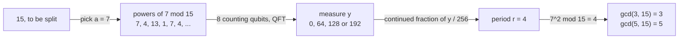
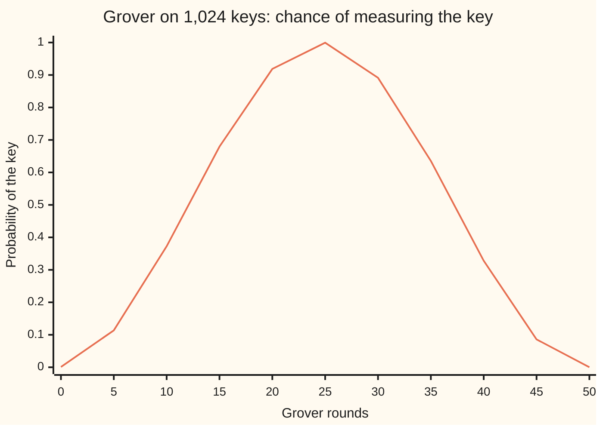

# Shor and Grover: period finding breaks RSA, search gains a square root

[Syllabus](../../../SYLLABUS.md) → [Computability and complexity](../README.md) → [Algebraic, Interactive and Quantum](../README.md#s05) → Shor and Grover

---

## General Overview

Take the number 15 and pretend it is hard to split. Pick any number that shares no factor with it, say 7, and list its powers on the 15-clock: 7, 4, 13, 1, then 7, 4, 13, 1 again. The list repeats every 4 steps. That repeat length is the **period**.

The period gives the factors away. Half of 4 is 2, and 7 squared on the 15-clock is 4. One less is 3 and one more is 5, and 15 = 3 × 5. Finding a period is slow for an ordinary computer when the number has hundreds of digits. Peter Shor showed in 1994 that a quantum computer finds it fast. RSA, the public-key code whose secret is the two prime factors of a public number, then falls.

Lov Grover's 1996 method does a different job. A lock has 1,024 possible keys and exactly one opens it. An ordinary search tries keys one by one and needs 512.5 tries on average. Grover's method needs **25 rounds**, each one use of the lock, and then succeeds 99.95% of the time. The gain is a square root: 1,024 becomes about 32, and the exact best count is 25.

Both run on qubits (quantum bits; see [Qubits](05-qubits-superposition-and-measurement.md)). Neither tries every answer at once and reads off the right one: a measurement returns one random answer. Instead, both make wrong answers cancel and right ones add up, so the random answer is probably useful.

**Shor writes every power of a at once, and a quantum Fourier transform turns their repeat length into sharp peaks that a continued fraction reads; Grover turns the state a fixed angle toward the key on every round, so about the square root of the list size in rounds brings it within reach.**

**What kind of fact this is:** theorems. The step from a period to a factor, the peaks for 15 and Grover's angle law are proved in Why it works. Shor's general running time and the optimality of Grover's search are stated with key steps and named sources. That factoring is hard for ordinary computers is a conjecture, unproved as of 2026-11-11, so Shor's speedup is over the best known ordinary method only.

### The picture: Shor on 15, end to end



Only box B, where every power is written at once, and the QFT arrow out of it need a quantum computer; every other step is ordinary arithmetic.

---

## The formula

Notation first, in words. N is the number to split and a is the base whose powers repeat, a whole number sharing no factor with N. The period r is the smallest count of multiplications by a that returns to 1 on the N-clock ([The order of a number and primitive roots](../../02-Number%20theory/04-Powers%20on%20the%20Clock/05-order-and-primitive-roots.md) calls it the order). The **greatest common divisor** gcd(u, N) is the largest whole number dividing both u and N, found by Euclid's algorithm.

```math
a^r \bmod N = 1,\ r \text{ even},\ a^{r/2} \bmod N \ne N - 1 \;\Longrightarrow\; \gcd(a^{r/2} - 1,\ N) \text{ and } \gcd(a^{r/2} + 1,\ N) \text{ are factors of } N \text{ other than } 1 \text{ and } N
```

**Read it aloud:** if the powers of a return to 1 after an even number of steps r, and the halfway power is not N − 1, then one below and one above the halfway power each share a proper factor with N.

The quantum part finds r. It uses a **counting register** of qubits holding a whole number x from 0 to Q − 1, where Q is a power of 2 at least N², here Q = 256 = 2⁸. The **quantum Fourier transform**, QFT, is the step that turns a repeat length into peaks:

```math
\mathrm{QFT}\, \lvert x \rangle = \frac{1}{\sqrt{Q}} \sum_{y=0}^{Q-1} e^{2 \pi i\, x y / Q}\, \lvert y \rangle
```

**Read it aloud:** the transform sends the basis state x to an even spread over every y, each turned by the angle 2π times x times y over Q (i is the square root of −1).

It is the discrete Fourier transform on Q points, applied to amplitudes, with two changes: a plus sign in the exponent where [The discrete Fourier transform](../../07-Complex%20analysis/08-Transforms%20in%20Outline/02-discrete-fourier-transform.md) has a minus, and the factor 1/√Q. So it is the inverse of that card's scaled transform, which that card proves unitary (length-keeping). The amplitudes here are real, so the sign changes no probability. A measured y sits near a multiple of Q/r, so y/Q is near a fraction with bottom number r.

For Grover, the list has M items and one key, and the angle θ is set by sin θ = 1/√M. After k rounds the chance of measuring the key is

```math
P_k = \sin^2\bigl((2k + 1)\,\theta\bigr), \qquad \sin \theta = \frac{1}{\sqrt{M}}, \qquad k_{\mathrm{best}} = \Bigl\lfloor \frac{\pi}{4 \theta} \Bigr\rfloor
```

**Read it aloud:** the success chance after k rounds is the squared sine of 2k + 1 times the starting angle, and the best round count is the whole part of π over 4θ.

For M = 1,024: θ = 0.031255, the best k is 25, and P₂₅ = 0.9995.

| Symbol | Plain meaning | In our example | Push it up and the answer… |
| --- | --- | --- | --- |
| $`N`$ | the number to split | 15, then 21 | more qubits and gates, polynomial in its digits |
| $`a`$ | the base whose powers repeat | 7 (and 2 for 21) | another base, maybe another period |
| $`r`$ | the period: steps until the powers of a return to 1 | 4 (and 6 for 21) | more peaks, each smaller |
| $`Q`$ | the counting register's size, a power of 2 at least N² | 256 = 2⁸ (512 for 21) | sharper peaks |
| $`t`$ | the number of counting qubits, so Q = 2^t | 8 (9 for 21) | Q doubles per qubit |
| $`x`$, $`y`$ | x: a whole number held in the counting register; y: the number measured after the QFT | x from 0 to 255; y = 0, 64, 128 or 192 | — |
| QFT, $`m`$ | the quantum Fourier transform on Q points; m: how many places apart the two qubits of one phase gate sit | 8 Hadamards and 28 phase gates | gates grow with the square of the qubits |
| $`\gcd(u, N)`$ | the greatest common divisor of u and N | gcd(3, 15) = 3 | — |
| $`M`$ | the size of the list Grover searches | 1,024 keys | rounds grow as √M |
| $`\theta`$ | the starting angle, sin θ = 1/√M | 0.031255 | fewer rounds needed |
| $`k`$ | the number of Grover rounds | 25 | success rises, then falls |
| $`P_k`$ | the chance of measuring the key after k rounds | 0.9995 at k = 25 | — |

### When it holds

- **The period must be even and the halfway power not N − 1.** Otherwise the two greatest common divisors are 1 and N. On 15, a = 14 has period 2, but 14 is 15 − 1, so it gives only 1 and 15.
- **The counting register must be big enough.** Q of at least N² keeps the peaks sharp enough for a continued fraction to read. With Q = 64 for N = 21 the chance of reading the period falls from 0.3282 to 0.2858.
- **A reading must be checked.** A measured y can give a divisor of r instead of r. On 15, y = 128 gives 1/2, but 7² mod 15 = 4, not 1, so the run is repeated.
- **Grover needs the round count fixed in advance.** Rounds past the best one turn the state away from the key again. At 32 rounds the success chance is 0.8023, not 0.9995.
- **Grover's formula assumes exactly one key.** With more keys the angle is larger, so 25 rounds overshoot.

---

## Why it works

### Step 0: cancel the wrong answers instead of trying every answer

A quantum state on t qubits is a list of 2^t complex numbers called **amplitudes**, one per basis state. Measuring gives a basis state with probability equal to its amplitude's squared size ([Qubits](05-qubits-superposition-and-measurement.md)). A gate rewrites the whole list at once, but a measurement returns one entry.

So both algorithms steer amplitudes. Shor uses a Fourier transform, which turns a repeating pattern into a few sharp peaks. Grover uses two reflections, which turn the state by a fixed angle.

### Step 1: a period splits the number

On the 15-clock, 7⁴ mod 15 = 1. So 15 divides 7⁴ − 1, which factors as (7² − 1)(7² + 1). On the clock 7² is 4, so the two brackets are 3 and 5 on the clock. Fifteen divides their product. It divides neither alone, so each bracket shares part of 15: gcd(3, 15) = 3 and gcd(5, 15) = 5.

<details>
<summary>Detailed proof: an even period with a halfway power other than N − 1 gives a proper factor</summary>

Write h for the halfway power a^(r/2) mod N. Since a^r mod N = 1, N divides h² − 1 = (h − 1)(h + 1).

N does not divide h − 1: otherwise h = 1, so a^(r/2) mod N = 1 and r would not be the smallest period. N does not divide h + 1 either: that is the condition h ≠ N − 1.

So N divides the product but neither bracket. Then gcd(h − 1, N) is neither N (it does not divide h − 1) nor 1 (if it were, N would have to divide h + 1, by Euclid's lemma applied factor by factor). It is a proper factor, and so is gcd(h + 1, N) by the same argument.

How often a random base works is a separate count. When N is odd and not a prime power, at least half the bases sharing no factor with N work (Shor 1997, in Sources). On 15, 6 of the 7 bases from 2 to 14 work.

</details>

### Step 2: write every power at once

The circuit starts with 8 counting qubits and 4 work qubits, all 0. A **Hadamard** gate on each counting qubit (the gate sending 0 to an even mix of 0 and 1) spreads the counting register over all 256 values of x. Then one oracle gate writes a^x mod N into the work register ([BQP](06-quantum-computation-and-bqp.md) defines oracles). The state is

```math
\frac{1}{\sqrt{256}} \sum_{x=0}^{255} \lvert x \rangle\, \lvert 7^x \bmod 15 \rangle
```

**Read it aloud:** every x from 0 to 255 sits beside the power 7 to the x on the 15-clock, all with equal weight.

The work register holds only 4 values: 1, 4, 7 and 13. Group the terms by that value. The x beside 7 are 1, 5, 9, 13 and so on: a **comb** of x values spaced 4 apart, one comb per work value. The spacing of every comb is the period.

The oracle is repeated squaring built from reversible gates, polynomial in the digits of N ([Boolean circuits](01-boolean-circuits-and-formulas.md) counts gates). The code writes its result straight down.

### Step 3: the QFT turns spacing into peaks

A comb spaced 4 apart in 256 slots holds 64 teeth. Its Fourier transform is again a comb, now spaced 256/4 = 64 apart: peaks at y = 0, 64, 128 and 192, each with probability 0.25. Every other y has probability 0, because the 64 turns cancel exactly round the circle.

<details>
<summary>Detailed proof: a comb spaced r apart has peaks at multiples of Q/r, each of probability 1/r</summary>

Suppose r divides Q and write L = Q/r, the number of teeth. One comb is x = x₀ + j r for j from 0 to L − 1, each with amplitude $`1/\sqrt{Q}`$ inside the full state. After the QFT, the amplitude at y is

$`\displaystyle \frac{1}{\sqrt{Q}} \cdot \frac{1}{\sqrt{Q}} \sum_{j=0}^{L-1} e^{2\pi i (x_0 + j r) y / Q} = \frac{e^{2\pi i x_0 y / Q}}{Q} \sum_{j=0}^{L-1} e^{2\pi i\, j y / L}`$

The sum is a sum of L points spaced evenly round the unit circle. It is 0 unless y is a multiple of L, when every term is 1 and the sum is L. So the amplitude is L/Q in size at y = 0, L, 2L and so on, and 0 elsewhere.

There are r combs, one per work value, and they never mix, because their work registers differ. Each contributes (L/Q)² at every peak. So each of the r peaks has probability r × L²/Q² = 1/r. On 15: r = 4, L = 64, peaks at 0, 64, 128, 192, each 0.25.

When r does not divide Q, as with 21, the peaks spread over neighbouring y but keep most of the weight (Shor 1997).

</details>

The QFT on t qubits needs no Q-by-Q table. It is t Hadamards and t(t − 1)/2 **controlled phase gates**, each turning the amplitude by π/2^m when two chosen qubits are both 1, where m is how many places apart the two qubits sit, then a reversal of the qubit order. For 8 qubits that is 8 Hadamards and 28 phase gates. The code builds that circuit and checks it against the direct sum.

### Step 4: a continued fraction reads the period

A measured y gives the fraction y/Q, which is close to j/r for some whole j. [Continued fractions](../../02-Number%20theory/07-For%20the%20Curious/05-continued-fractions-and-leap-years.md) list the best cheap approximations of a fraction, cheapest first. So run Euclid's algorithm on y/Q and keep each convergent's bottom number d. The first d below N with a^d mod N = 1 is the period.

| y measured | y/Q | convergent bottoms | period read |
| ---: | --- | --- | --- |
| 0 | 0/256 | 1 | none |
| 64 | 1/4 | 1, 4 | 4 |
| 128 | 1/2 | 1, 2 | none: 7² mod 15 = 4 |
| 192 | 3/4 | 1, 1, 4 | 4 |

Two of the four peaks read the period, so one run succeeds with probability 0.5; on failure the circuit runs again.

On 15 the fractions are exact, since 4 divides 256. The number 21 shows the continued fraction's real work. With a = 2 the powers on the 21-clock are 2, 4, 8, 16, 11, 1, so r = 6, which does not divide Q = 512. The peaks blur. Measurement chances after the QFT, N = 21, a = 2, Q = 512; one block = 0.01. Both checks print these bars; on each peak's line the convergent bottoms follow, cut here:

```
  y =   0    █████████████████         0.1667
  y =  85    ███████████               0.1140
  y = 171    ███████████               0.1140
  y = 256    █████████████████         0.1667
  y = 341    ███████████               0.1140
  y = 427    ███████████               0.1140
  other 506  █████████████████████     0.2107
```

The fraction 85/512 has convergent bottoms 1, 6, 253 and 512. The first that works is 6: 2⁶ mod 21 = 1. The peak 427 reads 6 too. The peaks 171 and 341 sit near 1/3 and 2/3, so they give 3, a divisor of the period, and fail the check. Counting every y, one run reads the period with probability 0.3282. Then 2³ mod 21 = 8, and gcd(7, 21) = 7 and gcd(9, 21) = 3.

### Step 5: Grover turns the state by a fixed angle

Grover's state lives in a flat plane with two directions: "the key" and "an even mix of the other 1,023 items". It starts as an even mix of all 1,024, which sits at angle θ from "the rest", with sin θ = 1/32. So θ = 0.031255 radians.

One round is two reflections:

1. **The oracle** flips the sign of the key's amplitude. That reflects the state across "the rest".
2. **Diffusion** replaces every amplitude by twice the mean minus itself. That reflects the state across the starting mix.

Two reflections across two lines that meet at angle θ make a turn by 2θ. After k rounds the state sits at angle (2k + 1)θ, and the key's amplitude is sin((2k + 1)θ). The best k brings that angle nearest a right angle, π/2: k = 25 gives 51θ, just past it.

<details>
<summary>Detailed proof: each round turns the state by 2θ</summary>

Write the start as $`\lvert s \rangle = \sin\theta\, \lvert \mathrm{key} \rangle + \cos\theta\, \lvert \mathrm{rest} \rangle`$, where rest is the even mix of the other M − 1 items. Every later state is a mix of these two directions, so the plane is all that matters.

The oracle changes the sign of the key part: a state at angle φ from rest goes to angle −φ. Diffusion is the map v ↦ 2⟨s|v⟩|s⟩ − v. Its effect on one entry is

$`\displaystyle \bigl(2 \langle s \vert v \rangle \lvert s \rangle\bigr)_i = 2 \cdot \frac{1}{\sqrt{M}} \sum_j v_j \cdot \frac{1}{\sqrt{M}} = 2 \cdot \mathrm{mean}(v)`$

so it is the code's "twice the mean minus itself". It keeps the part along s and flips the rest: a reflection across s, which sits at angle θ. A state at angle −φ goes to angle 2θ + φ. So one round sends φ to φ + 2θ. Starting from φ = θ, k rounds give (2k + 1)θ, and the key's amplitude is the sine of that angle.

</details>

The simulation tracks all 1,024 amplitudes, one gate at a time, and matches the formula at every round:



Orange: the chance of the key after each count of rounds, simulated and by formula (they agree to every printed digit). It peaks at 25 rounds and falls back to 0.0002 by 50.

### Step 6: what each speedup is worth

Grover's gain is a square root, and it is proved best possible. Bennett, Bernstein, Brassard and Vazirani showed in 1997 that any quantum method needs on the order of √M oracle uses to find one marked item in M. Each oracle use can move only a little amplitude toward the key, and the total move must reach a constant.

| List size M | Grover rounds | Ordinary average tries |
| --- | ---: | ---: |
| 2^10 | 25 | 512.5 |
| 2^20 | 804 | 524,288.5 |
| 2^30 | 25,735 | 536,870,912.5 |
| 2^40 | 823,549 | 549,755,813,888.5 |

So a SAT instance on 40 variables, with 2^40 settings to search blind, drops from about 550 billion tries to 823,549 rounds. The cost is still exponential in the number of variables: Grover does not put NP-complete problems in polynomial time.

Shor's gain looks larger. Its gate count is polynomial in the digits of N, which puts factoring in BQP (polynomial time on a quantum computer with bounded error; see [BQP](06-quantum-computation-and-bqp.md)). The best known ordinary method, the general number field sieve, grows faster than any polynomial in the digits. But nobody has proved that no fast ordinary method exists, and factoring is not believed to be NP-complete.

---

## Worked numbers, by hand

| Step | Arithmetic | Value |
| --- | --- | --- |
| powers of 7 on the 15-clock | multiply by 7, take off 15s | 7, 4, 13, 1 |
| period | steps back to 1 | r = 4 |
| QFT peaks | multiples of 256/4 | 0, 64, 128, 192, each 0.25 |
| reading y = 64 | 64/256 = 1/4 | r = 4 |
| halfway power | 7² mod 15 | 4 |
| factors | gcd(3, 15) and gcd(5, 15) | **3 and 5** |
| Grover angle | sin θ = 1/32 | θ = 0.031255 |
| best rounds | whole part of π/(4θ) | 25 |
| success at 25 rounds | sin²(51θ) | **0.9995** |
| two qubits, M = 4 | sin θ = 1/2, so θ = 30°; one round reaches 90° | success 1.0000 after 1 round |

Half the period of 7 splits 15 into 3 × 5, and 25 rounds find one key in 1,024 with 99.95% certainty. The last row is the shelf's two-qubit circuit: on 4 items one round always finds the key.

### What breaks if you drop a piece

| Mistake | Comes out at | What went wrong |
| --- | --- | --- |
| Base a = 14 on 15 | period 2, gcds 1 and 15 | the halfway power is 14 = 15 − 1 |
| Trusting y = 128 without the check | "period" 2, but 7² mod 15 = 4 | the reading gave a divisor of r |
| Grover with 32 rounds, √1024 | 0.8023, not 0.9995 | the state turned past the key |
| The oracle alone, 25 times, no diffusion | 0.000977, the same as a blind guess | a sign flip changes no probability |

The code prints all four.

---

## Code, from first principles, and it actually runs

The code simulates the quantum states classically, as lists of up to 1,024 complex numbers. It takes four independent roads. The period comes from repeated multiplication and, separately, from the simulated measurement read by continued fractions. The QFT is built as a circuit of gates and checked against the direct Fourier sum. Grover's 1,024 amplitudes are simulated gate by gate and checked against sin²((2k + 1)θ) at every round. Finally the factors must multiply back to 15. Nothing imported does the work: Euclid's algorithm, powers on the clock and continued fractions are all written out.

### Python

```python
# Shor and Grover -- the check behind the card.  Standard library only: math
# supplies sin, cos, asin, sqrt and pi.  The state-vector idea (a list of
# complex amplitudes, one per basis state, rewritten by each gate) is the one
# the Qubits card explains.  Toy sizes: 15 and 21 are insecure on purpose.
from math import asin, cos, pi, sin, sqrt

def gcd(a, b):                            # Euclid's algorithm, written out
    while b:
        a, b = b, a % b
    return a

def powmod(a, e, n):                      # a multiplied in e times, wrapped at n
    out = 1
    for _ in range(e):
        out = out * a % n
    return out

def order(a, n):                          # road one: multiply until the powers return to 1
    r, p = 1, a % n
    while p != 1:
        p, r = p * a % n, r + 1
    return r

def qft(v, t):                            # road two: the QFT as a circuit of gates
    q = 1 << t
    for j in range(t - 1, -1, -1):        # top qubit first
        for x in range(q):                # Hadamard on qubit j
            if not x >> j & 1:
                a0, a1 = v[x], v[x | 1 << j]
                v[x], v[x | 1 << j] = (a0 + a1) / sqrt(2), (a0 - a1) / sqrt(2)
        for k in range(j - 1, -1, -1):    # controlled phase: angle pi / 2^(j-k)
            ang = pi / (1 << (j - k))
            ph = complex(cos(ang), sin(ang))
            for x in range(q):
                if x >> j & 1 and x >> k & 1:
                    v[x] *= ph
    out = [0j] * q                        # swap the qubit order end for end
    for x in range(q):
        rev = 0
        for b in range(t):
            rev |= (x >> b & 1) << (t - 1 - b)
        out[rev] = v[x]
    return out

def dft(v, q):                            # the same transform as the direct sum over x
    roots = [complex(cos(2 * pi * m / q), sin(2 * pi * m / q)) for m in range(q)]
    return [sum(v[x] * roots[x * y % q] for x in range(q)) / sqrt(q) for y in range(q)]

def shor_probs(n, a, t):                  # counting register after Hadamards, U_f and QFT
    q, rows, p = 1 << t, {}, 1
    for x in range(q):                    # the state x, a^x mod n, written straight down
        rows.setdefault(p, [0j] * q)[x] = 1 / sqrt(q)
        p = p * a % n
    probs = [0.0] * q
    for w in rows:
        f = qft(rows[w][:], t)
        for y in range(q):
            probs[y] += abs(f[y]) ** 2
    return probs, rows

def convergents(y, q):                    # Euclid on y/q: each convergent's denominator
    dens, d0, d1 = [], 1, 0
    while q:
        c = y // q
        y, q = q, y - c * q
        d0, d1 = d1, c * d1 + d0
        dens.append(d1)
    return dens

def read_period(y, q, a, n):              # first small denominator d with a^d = 1 mod n
    for d in convergents(y, q):
        if d < n and powmod(a, d, n) == 1:
            return d
    return 0

def shor(n, a, t):
    q, r = 1 << t, order(a, n)
    probs, rows = shor_probs(n, a, t)
    print(f"Shor, N = {n}, a = {a}: powers {[powmod(a, e, n) for e in range(1, r + 1)]}, period by multiplying {r}")
    print(f"counting register {t} qubits, Q = {q}; work values {sorted(rows)}; total probability {sum(probs):.4f}")
    peaks = sorted(sorted(range(q), key=lambda y: -probs[y])[:r])
    for y in peaks:
        print(f"  y = {y:3}    {'█' * round(100 * probs[y]):<25} {probs[y]:.4f}  denominators {convergents(y, q)}  period read {read_period(y, q, a, n) or 'none'}")
    out = 1 - sum(probs[y] for y in peaks)          # every other y, as one more bar; one block = 0.01
    print(f"  other {q - r:3}  {'█' * round(100 * out):<25} {out:.4f}")
    win, h = sum(probs[y] for y in range(q) if read_period(y, q, a, n) == r), powmod(a, r // 2, n)
    print(f"chance one run reads the period: {win:.4f}; outside the {r} peaks: {out:.4f}")
    print(f"{a}^{r // 2} mod {n} = {h}; gcd({h - 1}, {n}) = {gcd(h - 1, n)}; gcd({h + 1}, {n}) = {gcd(h + 1, n)}")
    return probs, rows, r, win, h

p15, rows15, r15, win15, h15 = shor(15, 7, 8)
direct, circuit = dft(rows15[7], 256), qft(rows15[7][:], 8)
gap = max(abs(direct[y] - circuit[y]) for y in range(256))
print(f"QFT circuit, {8} Hadamards and {8 * 7 // 2} phase gates, against the direct sum, gap below 1e-9: {'yes' if gap < 1e-9 else 'no'}")
good = 0
for a in range(2, 15):
    if gcd(a, 15) == 1:
        r = order(a, 15)
        h = powmod(a, r // 2, 15)
        f1, f2 = gcd(h - 1, 15), gcd(h + 1, 15)
        ok = r % 2 == 0 and h != 14
        good += ok
        print(f"  a = {a:2}: period {r}, a^(r/2) mod 15 = {h:2}, gcds {f1} and {f2}{'' if ok else '  (fails)'}")
print(f"bases that split 15: {good} of 7")
p21, rows21, r21, win21, h21 = shor(21, 2, 9)
w64 = sum(pr for y, pr in enumerate(shor_probs(21, 2, 6)[0]) if read_period(y, 64, 2, 21) == 6)
print(f"register too small, N = 21, Q = 64: chance one run reads the period {w64:.4f}")

M, KEY = 1024, 700
theta = asin(1 / sqrt(M))
best = int(pi / (4 * theta))
v, sim = [1 / sqrt(M)] * M, []
for k in range(51):
    sim.append(v[KEY] ** 2)
    v[KEY] = -v[KEY]                      # oracle U_f: flip the key's sign
    mean = sum(v) / M
    v = [2 * mean - x for x in v]         # diffusion: reflect every amplitude about the mean
form = [sin((2 * k + 1) * theta) ** 2 for k in range(51)]
u = [1 / sqrt(M)] * M
for k in range(25):
    u[KEY] = -u[KEY]                      # mistake 4: the oracle alone, no diffusion
print(f"Grover, M = {M}, key {KEY}: theta = asin(1/32) = {theta:.6f}, best rounds floor(pi/(4 theta)) = {best}")
for k in range(0, 51, 5):
    print(f"  rounds {k:2}: simulated {sim[k]:.4f}  formula {form[k]:.4f}")
print(f"rounds 25: {sim[25]:.4f}; rounds 32: {sim[32]:.4f}; oracle only, 25 rounds: {u[KEY] ** 2:.6f}")
print(f"classical, one look at a time: average {(M + 1) / 2:.1f} looks; looks for 0.9995: {-(-0.9995 * M // 1):.0f}")
print(f"two qubits, M = 4: best rounds {int(pi / (4 * asin(0.5)))}, success {sin(3 * asin(0.5)) ** 2:.4f}")
for s in (10, 20, 30, 40):
    th = asin(2.0 ** (-s / 2))
    print(f"  M = 2^{s}: Grover rounds {int(pi / (4 * th))}, classical average {((1 << s) + 1) / 2:.1f}")
print(f"mistake 1, a = 14: 14^1 mod 15 = 14 = 15 - 1, gcds {gcd(13, 15)} and {gcd(15, 15)}")
print(f"mistake 2, y = 128 read as 1/2: 7^2 mod 15 = {powmod(7, 2, 15)}, not 1")
print(f"mistake 3, {32} rounds instead of {best}: success {sim[32]:.4f}")
assert all(abs(sim[k] - form[k]) < 1e-9 for k in range(51))        # simulation against closed form
assert gap < 1e-9                                                  # circuit against direct sum
assert read_period(64, 256, 7, 15) == order(7, 15) == 4            # quantum road against multiplying
assert gcd(h15 - 1, 15) * gcd(h15 + 1, 15) == 15 and gcd(h15 - 1, 15) not in (1, 15)
assert abs(win15 - 0.5) < 1e-9 and best == 25 and good == 6
assert read_period(85, 512, 2, 21) == r21 == 6 and win21 > 0.3 > w64 and abs(sum(p21) - 1) < 1e-9
print("ALL CHECKS PASS")
```

**Ran 2026-11-19 on macOS, Python 3.14.10, standard library only. All checks passed. Output, pasted from the run:**

```
Shor, N = 15, a = 7: powers [7, 4, 13, 1], period by multiplying 4
counting register 8 qubits, Q = 256; work values [1, 4, 7, 13]; total probability 1.0000
  y =   0    █████████████████████████ 0.2500  denominators [1]  period read none
  y =  64    █████████████████████████ 0.2500  denominators [1, 4]  period read 4
  y = 128    █████████████████████████ 0.2500  denominators [1, 2]  period read none
  y = 192    █████████████████████████ 0.2500  denominators [1, 1, 4]  period read 4
  other 252                            0.0000
chance one run reads the period: 0.5000; outside the 4 peaks: 0.0000
7^2 mod 15 = 4; gcd(3, 15) = 3; gcd(5, 15) = 5
QFT circuit, 8 Hadamards and 28 phase gates, against the direct sum, gap below 1e-9: yes
  a =  2: period 4, a^(r/2) mod 15 =  4, gcds 3 and 5
  a =  4: period 2, a^(r/2) mod 15 =  4, gcds 3 and 5
  a =  7: period 4, a^(r/2) mod 15 =  4, gcds 3 and 5
  a =  8: period 4, a^(r/2) mod 15 =  4, gcds 3 and 5
  a = 11: period 2, a^(r/2) mod 15 = 11, gcds 5 and 3
  a = 13: period 4, a^(r/2) mod 15 =  4, gcds 3 and 5
  a = 14: period 2, a^(r/2) mod 15 = 14, gcds 1 and 15  (fails)
bases that split 15: 6 of 7
Shor, N = 21, a = 2: powers [2, 4, 8, 16, 11, 1], period by multiplying 6
counting register 9 qubits, Q = 512; work values [1, 2, 4, 8, 11, 16]; total probability 1.0000
  y =   0    █████████████████         0.1667  denominators [1]  period read none
  y =  85    ███████████               0.1140  denominators [1, 6, 253, 512]  period read 6
  y = 171    ███████████               0.1140  denominators [1, 2, 3, 512]  period read none
  y = 256    █████████████████         0.1667  denominators [1, 2]  period read none
  y = 341    ███████████               0.1140  denominators [1, 1, 2, 3, 512]  period read none
  y = 427    ███████████               0.1140  denominators [1, 1, 6, 253, 512]  period read 6
  other 506  █████████████████████     0.2107
chance one run reads the period: 0.3282; outside the 6 peaks: 0.2107
2^3 mod 21 = 8; gcd(7, 21) = 7; gcd(9, 21) = 3
register too small, N = 21, Q = 64: chance one run reads the period 0.2858
Grover, M = 1024, key 700: theta = asin(1/32) = 0.031255, best rounds floor(pi/(4 theta)) = 25
  rounds  0: simulated 0.0010  formula 0.0010
  rounds  5: simulated 0.1136  formula 0.1136
  rounds 10: simulated 0.3724  formula 0.3724
  rounds 15: simulated 0.6794  formula 0.6794
  rounds 20: simulated 0.9186  formula 0.9186
  rounds 25: simulated 0.9995  formula 0.9995
  rounds 30: simulated 0.8914  formula 0.8914
  rounds 35: simulated 0.6354  formula 0.6354
  rounds 40: simulated 0.3281  formula 0.3281
  rounds 45: simulated 0.0859  formula 0.0859
  rounds 50: simulated 0.0002  formula 0.0002
rounds 25: 0.9995; rounds 32: 0.8023; oracle only, 25 rounds: 0.000977
classical, one look at a time: average 512.5 looks; looks for 0.9995: 1024
two qubits, M = 4: best rounds 1, success 1.0000
  M = 2^10: Grover rounds 25, classical average 512.5
  M = 2^20: Grover rounds 804, classical average 524288.5
  M = 2^30: Grover rounds 25735, classical average 536870912.5
  M = 2^40: Grover rounds 823549, classical average 549755813888.5
mistake 1, a = 14: 14^1 mod 15 = 14 = 15 - 1, gcds 1 and 15
mistake 2, y = 128 read as 1/2: 7^2 mod 15 = 4, not 1
mistake 3, 32 rounds instead of 25: success 0.8023
ALL CHECKS PASS
```

### Rust

Same numbers, same labels, built with `rustc --edition 2021 -O`. It carries its own small complex-number type.

```rust
// Shor and Grover -- the same check as the Python, in Rust.  No crates.  The
// state-vector idea (a list of complex amplitudes, one per basis state,
// rewritten by each gate) is the one the Qubits card explains.  Toy sizes:
// 15 and 21 are insecure on purpose.
use std::f64::consts::PI;

#[derive(Clone, Copy)]
struct C { re: f64, im: f64 }                       // a small complex number
impl C {
    fn add(self, o: C) -> C { C { re: self.re + o.re, im: self.im + o.im } }
    fn sub(self, o: C) -> C { C { re: self.re - o.re, im: self.im - o.im } }
    fn mul(self, o: C) -> C { C { re: self.re * o.re - self.im * o.im, im: self.re * o.im + self.im * o.re } }
    fn scale(self, s: f64) -> C { C { re: self.re * s, im: self.im * s } }
    fn norm2(self) -> f64 { self.re * self.re + self.im * self.im }
}
const ZERO: C = C { re: 0.0, im: 0.0 };

fn gcd(mut a: i64, mut b: i64) -> i64 {             // Euclid's algorithm, written out
    while b != 0 { (a, b) = (b, a % b) } a
}

fn powmod(a: i64, e: i64, n: i64) -> i64 {          // a multiplied in e times, wrapped at n
    let mut out = 1;
    for _ in 0..e { out = out * a % n } out
}

fn order(a: i64, n: i64) -> i64 {                   // road one: multiply until the powers return to 1
    let (mut r, mut p) = (1, a % n);
    while p != 1 { p = p * a % n; r += 1 } r
}

fn qft(v: &mut Vec<C>, t: usize) -> Vec<C> {        // road two: the QFT as a circuit of gates
    let q = 1usize << t;
    let s = 1.0 / 2f64.sqrt();
    for j in (0..t).rev() {                         // top qubit first
        for x in 0..q {                             // Hadamard on qubit j
            if x >> j & 1 == 0 {
                let (a0, a1) = (v[x], v[x | 1 << j]);
                (v[x], v[x | 1 << j]) = (a0.add(a1).scale(s), a0.sub(a1).scale(s));
            }
        }
        for k in (0..j).rev() {                     // controlled phase: angle pi / 2^(j-k)
            let ang = PI / (1u64 << (j - k)) as f64;
            let ph = C { re: ang.cos(), im: ang.sin() };
            for x in 0..q {
                if x >> j & 1 == 1 && x >> k & 1 == 1 { v[x] = v[x].mul(ph) }
            }
        }
    }
    let mut out = vec![ZERO; q];                    // swap the qubit order end for end
    for x in 0..q {
        let rev = (0..t).map(|b| (x >> b & 1) << (t - 1 - b)).sum::<usize>();
        out[rev] = v[x];
    }
    out
}

fn dft(v: &[C], q: usize) -> Vec<C> {               // the same transform as the direct sum over x
    let roots: Vec<C> = (0..q).map(|m| { let a = 2.0 * PI * m as f64 / q as f64; C { re: a.cos(), im: a.sin() } }).collect();
    (0..q).map(|y| (0..q).fold(ZERO, |acc, x| acc.add(v[x].mul(roots[x * y % q]))).scale(1.0 / (q as f64).sqrt())).collect()
}

fn shor_probs(n: i64, a: i64, t: usize) -> (Vec<f64>, Vec<(i64, Vec<C>)>) {
    let q = 1usize << t;
    let mut rows: Vec<(i64, Vec<C>)> = Vec::new();  // work-register value, counting amplitudes
    let mut p = 1;
    for x in 0..q {                                 // the state x, a^x mod n, written straight down
        let i = match rows.iter().position(|r| r.0 == p) { Some(i) => i, None => { rows.push((p, vec![ZERO; q])); rows.len() - 1 } };
        rows[i].1[x] = C { re: 1.0 / (q as f64).sqrt(), im: 0.0 };
        p = p * a % n;
    }
    let mut probs = vec![0.0; q];
    for r in &rows { let f = qft(&mut r.1.clone(), t); for y in 0..q { probs[y] += f[y].norm2() } }
    (probs, rows)
}

fn convergents(mut y: i64, mut q: i64) -> Vec<i64> { // Euclid on y/q: each convergent's denominator
    let (mut dens, mut d0, mut d1) = (Vec::new(), 1, 0);
    while q != 0 {
        let c = y / q;
        (y, q, d0, d1) = (q, y - c * q, d1, c * d1 + d0);
        dens.push(d1);
    }
    dens
}

fn read_period(y: i64, q: i64, a: i64, n: i64) -> i64 { // first small denominator d with a^d = 1 mod n
    convergents(y, q).into_iter().find(|&d| d < n && powmod(a, d, n) == 1).unwrap_or(0)
}

fn shor(n: i64, a: i64, t: usize) -> (Vec<f64>, Vec<(i64, Vec<C>)>, i64, f64, i64) {
    let (q, r) = (1usize << t, order(a, n));
    let (probs, rows) = shor_probs(n, a, t);
    let pw: Vec<i64> = (1..=r).map(|e| powmod(a, e, n)).collect();
    let mut ws: Vec<i64> = rows.iter().map(|r| r.0).collect(); ws.sort();
    println!("Shor, N = {}, a = {}: powers {:?}, period by multiplying {}", n, a, pw, r);
    println!("counting register {} qubits, Q = {}; work values {:?}; total probability {:.4}", t, q, ws, probs.iter().sum::<f64>());
    let mut idx: Vec<usize> = (0..q).collect();
    idx.sort_by(|&u, &w| probs[w].partial_cmp(&probs[u]).unwrap());
    let mut peaks: Vec<usize> = idx[..r as usize].to_vec(); peaks.sort();
    for &y in &peaks {
        let rs = match read_period(y as i64, q as i64, a, n) { 0 => "none".to_string(), d => d.to_string() };
        println!("  y = {:3}    {:<25} {:.4}  denominators {:?}  period read {}", y, "█".repeat((100.0 * probs[y]).round() as usize), probs[y], convergents(y as i64, q as i64), rs);
    }
    let inside: f64 = peaks.iter().map(|&y| probs[y]).sum(); // every other y, as one more bar; one block = 0.01
    println!("  other {:3}  {:<25} {:.4}", q - r as usize, "█".repeat((100.0 * (1.0 - inside)).round() as usize), 1.0 - inside);
    let win: f64 = (0..q).filter(|&y| read_period(y as i64, q as i64, a, n) == r).map(|y| probs[y]).sum();
    let h = powmod(a, r / 2, n);
    println!("chance one run reads the period: {:.4}; outside the {} peaks: {:.4}", win, r, 1.0 - inside);
    println!("{}^{} mod {} = {}; gcd({}, {}) = {}; gcd({}, {}) = {}", a, r / 2, n, h, h - 1, n, gcd(h - 1, n), h + 1, n, gcd(h + 1, n));
    (probs, rows, r, win, h)
}

fn main() {
    let (_p15, rows15, _r15, win15, h15) = shor(15, 7, 8);
    let row7 = &rows15.iter().find(|r| r.0 == 7).unwrap().1;
    let (direct, circuit) = (dft(row7, 256), qft(&mut row7.clone(), 8));
    let gap = (0..256).map(|y| direct[y].sub(circuit[y]).norm2().sqrt()).fold(0.0, f64::max);
    println!("QFT circuit, {} Hadamards and {} phase gates, against the direct sum, gap below 1e-9: {}", 8, 8 * 7 / 2, if gap < 1e-9 { "yes" } else { "no" });
    let mut good = 0;
    for a in 2..15 {
        if gcd(a, 15) == 1 {
            let r = order(a, 15);
            let h = powmod(a, r / 2, 15);
            let ok = r % 2 == 0 && h != 14;
            good += ok as i64;
            println!("  a = {:2}: period {}, a^(r/2) mod 15 = {:2}, gcds {} and {}{}", a, r, h, gcd(h - 1, 15), gcd(h + 1, 15), if ok { "" } else { "  (fails)" });
        }
    }
    println!("bases that split 15: {} of 7", good);
    let (p21, _rows21, r21, win21, _h21) = shor(21, 2, 9);
    let p64 = shor_probs(21, 2, 6).0;
    let w64: f64 = (0..64).filter(|&y| read_period(y, 64, 2, 21) == 6).map(|y| p64[y as usize]).sum();
    println!("register too small, N = 21, Q = 64: chance one run reads the period {:.4}", w64);

    let (m, key) = (1024usize, 700usize);
    let theta = (1.0 / (m as f64).sqrt()).asin();
    let best = (PI / (4.0 * theta)) as i64;
    let mut v = vec![1.0 / (m as f64).sqrt(); m];
    let mut sim = Vec::new();                       // road one: the 1024 amplitudes, gate by gate
    for _ in 0..51 {
        sim.push(v[key] * v[key]);
        v[key] = -v[key];                           // oracle U_f: flip the key's sign
        let mean = v.iter().sum::<f64>() / m as f64;
        v = v.iter().map(|x| 2.0 * mean - x).collect(); // diffusion: reflect every amplitude about the mean
    }
    let form: Vec<f64> = (0..51).map(|k| ((2 * k + 1) as f64 * theta).sin().powi(2)).collect();
    let mut u = vec![1.0 / (m as f64).sqrt(); m];
    for _ in 0..25 { u[key] = -u[key] }             // mistake 4: the oracle alone, no diffusion
    println!("Grover, M = {}, key {}: theta = asin(1/32) = {:.6}, best rounds floor(pi/(4 theta)) = {}", m, key, theta, best);
    for k in (0..51).step_by(5) { println!("  rounds {:2}: simulated {:.4}  formula {:.4}", k, sim[k], form[k]) }
    println!("rounds 25: {:.4}; rounds 32: {:.4}; oracle only, 25 rounds: {:.6}", sim[25], sim[32], u[key] * u[key]);
    println!("classical, one look at a time: average {:.1} looks; looks for 0.9995: {:.0}", (m as f64 + 1.0) / 2.0, (0.9995 * m as f64).ceil());
    let th4 = 0.5f64.asin();
    println!("two qubits, M = 4: best rounds {}, success {:.4}", (PI / (4.0 * th4)) as i64, (3.0 * th4).sin().powi(2));
    for s in [10, 20, 30, 40] {
        let th = 2f64.powf(-(s as f64) / 2.0).asin();
        println!("  M = 2^{}: Grover rounds {}, classical average {:.1}", s, (PI / (4.0 * th)) as i64, ((1u64 << s) as f64 + 1.0) / 2.0);
    }
    println!("mistake 1, a = 14: 14^1 mod 15 = 14 = 15 - 1, gcds {} and {}", gcd(13, 15), gcd(15, 15));
    println!("mistake 2, y = 128 read as 1/2: 7^2 mod 15 = {}, not 1", powmod(7, 2, 15));
    println!("mistake 3, {} rounds instead of {}: success {:.4}", 32, best, sim[32]);
    assert!((0..51).all(|k| (sim[k] - form[k]).abs() < 1e-9));        // simulation against closed form
    assert!(gap < 1e-9);                                               // circuit against direct sum
    assert!(read_period(64, 256, 7, 15) == order(7, 15) && order(7, 15) == 4);
    assert!(gcd(h15 - 1, 15) * gcd(h15 + 1, 15) == 15 && gcd(h15 - 1, 15) != 1 && gcd(h15 - 1, 15) != 15);
    assert!((win15 - 0.5).abs() < 1e-9 && best == 25 && good == 6);
    assert!(read_period(85, 512, 2, 21) == r21 && r21 == 6 && win21 > 0.3 && w64 < 0.3 && (p21.iter().sum::<f64>() - 1.0).abs() < 1e-9);
    println!("ALL CHECKS PASS");
}
```

**Ran 2026-11-19 on macOS, rustc 1.98.1, no crates. All checks passed. Output, pasted from the run:**

```
Shor, N = 15, a = 7: powers [7, 4, 13, 1], period by multiplying 4
counting register 8 qubits, Q = 256; work values [1, 4, 7, 13]; total probability 1.0000
  y =   0    █████████████████████████ 0.2500  denominators [1]  period read none
  y =  64    █████████████████████████ 0.2500  denominators [1, 4]  period read 4
  y = 128    █████████████████████████ 0.2500  denominators [1, 2]  period read none
  y = 192    █████████████████████████ 0.2500  denominators [1, 1, 4]  period read 4
  other 252                            0.0000
chance one run reads the period: 0.5000; outside the 4 peaks: 0.0000
7^2 mod 15 = 4; gcd(3, 15) = 3; gcd(5, 15) = 5
QFT circuit, 8 Hadamards and 28 phase gates, against the direct sum, gap below 1e-9: yes
  a =  2: period 4, a^(r/2) mod 15 =  4, gcds 3 and 5
  a =  4: period 2, a^(r/2) mod 15 =  4, gcds 3 and 5
  a =  7: period 4, a^(r/2) mod 15 =  4, gcds 3 and 5
  a =  8: period 4, a^(r/2) mod 15 =  4, gcds 3 and 5
  a = 11: period 2, a^(r/2) mod 15 = 11, gcds 5 and 3
  a = 13: period 4, a^(r/2) mod 15 =  4, gcds 3 and 5
  a = 14: period 2, a^(r/2) mod 15 = 14, gcds 1 and 15  (fails)
bases that split 15: 6 of 7
Shor, N = 21, a = 2: powers [2, 4, 8, 16, 11, 1], period by multiplying 6
counting register 9 qubits, Q = 512; work values [1, 2, 4, 8, 11, 16]; total probability 1.0000
  y =   0    █████████████████         0.1667  denominators [1]  period read none
  y =  85    ███████████               0.1140  denominators [1, 6, 253, 512]  period read 6
  y = 171    ███████████               0.1140  denominators [1, 2, 3, 512]  period read none
  y = 256    █████████████████         0.1667  denominators [1, 2]  period read none
  y = 341    ███████████               0.1140  denominators [1, 1, 2, 3, 512]  period read none
  y = 427    ███████████               0.1140  denominators [1, 1, 6, 253, 512]  period read 6
  other 506  █████████████████████     0.2107
chance one run reads the period: 0.3282; outside the 6 peaks: 0.2107
2^3 mod 21 = 8; gcd(7, 21) = 7; gcd(9, 21) = 3
register too small, N = 21, Q = 64: chance one run reads the period 0.2858
Grover, M = 1024, key 700: theta = asin(1/32) = 0.031255, best rounds floor(pi/(4 theta)) = 25
  rounds  0: simulated 0.0010  formula 0.0010
  rounds  5: simulated 0.1136  formula 0.1136
  rounds 10: simulated 0.3724  formula 0.3724
  rounds 15: simulated 0.6794  formula 0.6794
  rounds 20: simulated 0.9186  formula 0.9186
  rounds 25: simulated 0.9995  formula 0.9995
  rounds 30: simulated 0.8914  formula 0.8914
  rounds 35: simulated 0.6354  formula 0.6354
  rounds 40: simulated 0.3281  formula 0.3281
  rounds 45: simulated 0.0859  formula 0.0859
  rounds 50: simulated 0.0002  formula 0.0002
rounds 25: 0.9995; rounds 32: 0.8023; oracle only, 25 rounds: 0.000977
classical, one look at a time: average 512.5 looks; looks for 0.9995: 1024
two qubits, M = 4: best rounds 1, success 1.0000
  M = 2^10: Grover rounds 25, classical average 512.5
  M = 2^20: Grover rounds 804, classical average 524288.5
  M = 2^30: Grover rounds 25735, classical average 536870912.5
  M = 2^40: Grover rounds 823549, classical average 549755813888.5
mistake 1, a = 14: 14^1 mod 15 = 14 = 15 - 1, gcds 1 and 15
mistake 2, y = 128 read as 1/2: 7^2 mod 15 = 4, not 1
mistake 3, 32 rounds instead of 25: success 0.8023
ALL CHECKS PASS
```

The two outputs match line for line.

### Lean

Lean proves the period step and Grover's angle law in general, and the QFT peaks whenever r divides Q.

- Take a base a sharing no factor with N, with an even period r and a halfway power other than N − 1. Then one below and one above the halfway power each share a proper factor with N.
- Take a counting register of Q = 2^t values and a period r dividing Q, each tooth of amplitude 1/√Q. Then after the QFT the r combs give each multiple of Q/r probability 1/r, and every other y probability 0.
- Take M items with one key, every amplitude starting at 1/√M. Then after k rounds of oracle and diffusion, the key's amplitude is sin((2k + 1)θ), where sin θ = 1/√M.
- The worked numbers also check: the powers of 7 on 15 and of 2 on 21, and their gcds. So do a = 14 and a = 5 failing, the y = 128 check and the 28 phase gates.

The blurred peaks for 21, the continued fractions, the simulations and the round counts are left to the Python and Rust checks.

```lean
-- Shor and Grover: an even period whose halfway power is not N - 1 splits N, a comb of period r gives r equal QFT peaks, and each Grover round turns the key's amplitude by a fixed angle.
import Mathlib.Data.ZMod.Basic
import Mathlib.GroupTheory.OrderOfElement
import Mathlib.Analysis.SpecialFunctions.Trigonometric.Inverse
import Mathlib.Analysis.SpecialFunctions.Complex.Circle
import Mathlib.Analysis.SpecialFunctions.Sqrt
import Mathlib.RingTheory.RootsOfUnity.Complex

open Finset

/-- If 2 ≤ h ≤ N - 2 and N divides (h - 1)(h + 1), then gcd(h - 1, N) and gcd(h + 1, N) are
proper factors of N. -/
lemma split_of_sq_one (N h : ℕ) (h2 : 2 ≤ h) (hN : h + 2 ≤ N)
    (hdvd : N ∣ (h - 1) * (h + 1)) :
    1 < Nat.gcd (h - 1) N ∧ Nat.gcd (h - 1) N < N ∧
      1 < Nat.gcd (h + 1) N ∧ Nat.gcd (h + 1) N < N := by
  have hN0 : 0 < N := by omega
  refine ⟨?_, ?_, ?_, ?_⟩
  · have hpos : 0 < Nat.gcd (h - 1) N := Nat.gcd_pos_of_pos_right _ hN0
    by_contra hc
    have h1 : Nat.Coprime (h - 1) N := by unfold Nat.Coprime; omega
    have : N ∣ h + 1 := h1.symm.dvd_of_dvd_mul_left hdvd
    have := Nat.le_of_dvd (by omega) this
    omega
  · exact lt_of_le_of_lt (Nat.gcd_le_left _ (by omega)) (by omega)
  · have hpos : 0 < Nat.gcd (h + 1) N := Nat.gcd_pos_of_pos_right _ hN0
    by_contra hc
    have h1 : Nat.Coprime (h + 1) N := by unfold Nat.Coprime; omega
    have : N ∣ h - 1 := h1.symm.dvd_of_dvd_mul_right hdvd
    have := Nat.le_of_dvd (by omega) this
    omega
  · exact lt_of_le_of_lt (Nat.gcd_le_left _ (by omega)) (by omega)

#print axioms split_of_sq_one

/-- Shor's classical step. Let a share no factor with N and let r be the period of a on the
N-clock (Mathlib's `orderOf` of a in `ZMod N`). If r is even and the halfway power
a^(r/2) mod N is not N - 1, then with h = a^(r/2) mod N both gcd(h - 1, N) and gcd(h + 1, N)
are factors of N other than 1 and N. -/
theorem even_period_splits_number (N a r : ℕ) (hcop : Nat.Coprime a N)
    (hr : orderOf (a : ZMod N) = r) (heven : Even r) (hhalf : a ^ (r / 2) % N ≠ N - 1) :
    1 < Nat.gcd (a ^ (r / 2) % N - 1) N ∧ Nat.gcd (a ^ (r / 2) % N - 1) N < N ∧
      1 < Nat.gcd (a ^ (r / 2) % N + 1) N ∧ Nat.gcd (a ^ (r / 2) % N + 1) N < N := by
  rcases Nat.lt_or_ge N 2 with hN | hN
  · exfalso
    obtain rfl | rfl : N = 0 ∨ N = 1 := by omega
    · have ha : a = 1 := Nat.coprime_zero_right _ |>.mp hcop
      subst ha
      simp at hr
      subst hr
      exact (Nat.not_even_one) heven
    · have : orderOf (a : ZMod 1) = 1 := orderOf_eq_one_iff.mpr (Subsingleton.elim _ _)
      rw [this] at hr
      subst hr
      exact (Nat.not_even_one) heven
  have : NeZero N := ⟨by omega⟩
  have hunit : orderOf (a : ZMod N) = orderOf (ZMod.unitOfCoprime a hcop) := by
    rw [← orderOf_units, ZMod.coe_unitOfCoprime]
  have hrpos : 0 < r := by rw [← hr, hunit]; exact orderOf_pos _
  obtain ⟨m, hm⟩ := heven
  have hr2 : r / 2 = m := by omega
  rw [hr2] at hhalf ⊢
  have hm0 : m ≠ 0 := by omega
  have hmr : m < orderOf (a : ZMod N) := by omega
  have hne : (a : ZMod N) ^ m ≠ 1 := pow_ne_one_of_lt_orderOf hm0 hmr
  have hsq : ((a : ZMod N) ^ m) ^ 2 = 1 := by
    rw [← pow_mul, show m * 2 = r by omega, ← hr]; exact pow_orderOf_eq_one _
  generalize hh : a ^ m % N = h at hhalf ⊢
  have hcast : (h : ZMod N) = (a : ZMod N) ^ m := by
    rw [← hh, ZMod.natCast_mod]; push_cast; rfl
  have hlt : h < N := by rw [← hh]; exact Nat.mod_lt _ (by omega)
  have hsqN : ((h ^ 2 : ℕ) : ZMod N) = ((1 : ℕ) : ZMod N) := by
    push_cast; rw [hcast]; exact hsq
  rw [ZMod.natCast_eq_natCast_iff', Nat.one_mod_eq_one.mpr (by omega)] at hsqN
  have h0 : h ≠ 0 := by
    rintro rfl; simp at hsqN
  have h1 : h ≠ 1 := by
    rintro rfl; apply hne; rw [← hcast, Nat.cast_one]
  have hdvd : N ∣ (h - 1) * (h + 1) := by
    have : (h - 1) * (h + 1) = h ^ 2 - 1 := by
      obtain ⟨g, rfl⟩ : ∃ g, h = g + 1 := ⟨h - 1, by omega⟩
      simp only [Nat.add_sub_cancel]; ring_nf; omega
    rw [this]
    exact (Nat.modEq_iff_dvd' (Nat.one_le_pow _ _ (by omega))).mp (by
      unfold Nat.ModEq; rw [hsqN, Nat.one_mod_eq_one.mpr (by omega)])
  exact split_of_sq_one N h (by omega) (by omega) hdvd

/-- The QFT peaks. Take a counting register of Q = 2^t values and a period r dividing Q, so each
comb x₀, x₀ + r, x₀ + 2r, ... holds L = Q/r teeth, each of amplitude 1/√Q. After the QFT, the
r combs together give the outcome y probability 1/r when y is a multiple of Q/r, and 0
otherwise. -/
theorem comb_qft_peaks (t r y : ℕ) (hr : 0 < r) (hdiv : r ∣ 2 ^ t) :
    ∑ x₀ ∈ range r,
        ‖(1 / (2 ^ t : ℂ)) * ∑ j ∈ range (2 ^ t / r),
            Complex.exp (2 * Real.pi * Complex.I * (((x₀ + j * r : ℕ) : ℂ) * y) / 2 ^ t)‖ ^ 2 =
      if 2 ^ t / r ∣ y then 1 / (r : ℝ) else 0 := by
  generalize hL : 2 ^ t / r = L
  have hQ : 2 ^ t = r * L := by rw [← hL]; exact (Nat.mul_div_cancel' hdiv).symm
  have hLpos : 0 < L := by
    rcases Nat.eq_zero_or_pos L with h | h
    · rw [h, mul_zero] at hQ; exact absurd hQ (by positivity)
    · exact h
  have hQC : (2 : ℂ) ^ t = (r : ℂ) * (L : ℂ) := by exact_mod_cast hQ
  have hrC : (r : ℂ) ≠ 0 := by exact_mod_cast hr.ne'
  have hLC : (L : ℂ) ≠ 0 := by exact_mod_cast hLpos.ne'
  set ζ := Complex.exp (2 * Real.pi * Complex.I / L) with hζ
  have hprim : IsPrimitiveRoot ζ L := Complex.isPrimitiveRoot_exp L hLpos.ne'
  have hterm : ∀ x₀ j : ℕ,
      Complex.exp (2 * Real.pi * Complex.I * (((x₀ + j * r : ℕ) : ℂ) * y) / 2 ^ t) =
        Complex.exp (2 * Real.pi * Complex.I * ((x₀ : ℂ) * y) / 2 ^ t) * (ζ ^ y) ^ j := by
    intro x₀ j
    rw [← pow_mul, hζ, ← Complex.exp_nat_mul, ← Complex.exp_add]
    congr 1
    rw [hQC]
    push_cast
    field_simp
  have hnorm : ∀ x₀ : ℕ, ‖Complex.exp (2 * Real.pi * Complex.I * ((x₀ : ℂ) * y) / 2 ^ t)‖ = 1 := by
    intro x₀
    have : 2 * Real.pi * Complex.I * ((x₀ : ℂ) * y) / 2 ^ t =
        ((2 * Real.pi * x₀ * y / 2 ^ t : ℝ) : ℂ) * Complex.I := by
      push_cast; ring
    rw [this, Complex.norm_exp_ofReal_mul_I]
  have hinner : ∀ x₀ : ℕ,
      ‖(1 / (2 ^ t : ℂ)) * ∑ j ∈ range L,
          Complex.exp (2 * Real.pi * Complex.I * (((x₀ + j * r : ℕ) : ℂ) * y) / 2 ^ t)‖ =
        ‖∑ j ∈ range L, (ζ ^ y) ^ j‖ / 2 ^ t := by
    intro x₀
    simp_rw [hterm]
    rw [← mul_sum, norm_mul, norm_mul, hnorm, norm_div, norm_one, norm_pow]
    simp
    ring
  simp_rw [hinner]
  have hQR : (2 : ℝ) ^ t = (r : ℝ) * (L : ℝ) := by exact_mod_cast hQ
  have hrR : (r : ℝ) ≠ 0 := by exact_mod_cast hr.ne'
  have hLR : (L : ℝ) ≠ 0 := by exact_mod_cast hLpos.ne'
  split_ifs with hy
  · have h1 : ζ ^ y = 1 := (hprim.pow_eq_one_iff_dvd y).mpr hy
    rw [h1]
    simp only [one_pow, sum_const, card_range, nsmul_eq_mul, mul_one, Complex.norm_natCast]
    rw [hQR]
    field_simp
  · have h1 : ζ ^ y ≠ 1 := fun h => hy ((hprim.pow_eq_one_iff_dvd y).mp h)
    have h2 : (ζ ^ y) ^ L = 1 := by
      rw [← pow_mul, mul_comm, pow_mul, hprim.pow_eq_one, one_pow]
    rw [geom_sum_eq h1, h2]
    simp

lemma grover_sum_update {M : ℕ} (v : Fin M → ℝ) (key : Fin M) :
    ∑ j, Function.update v key (-v key) j = ∑ j, v j - 2 * v key := by
  rw [Finset.sum_update_of_mem (Finset.mem_univ _), Finset.sdiff_singleton_eq_erase,
    ← Finset.add_sum_erase _ _ (Finset.mem_univ key)]
  ring

#print axioms grover_sum_update

lemma grover_step_key {M : ℕ} (v : Fin M → ℝ) (key : Fin M) :
    (fun i => 2 * (∑ j, Function.update v key (-v key) j) / M - Function.update v key (-v key) i)
      key = 2 * (∑ j, v j - 2 * v key) / M + v key := by
  simp only [grover_sum_update, Function.update_self]
  ring

#print axioms grover_step_key

lemma grover_step_sum {M : ℕ} (v : Fin M → ℝ) (key : Fin M) :
    ∑ i, (fun i => 2 * (∑ j, Function.update v key (-v key) j) / M
      - Function.update v key (-v key) i) i = ∑ j, v j - 2 * v key := by
  have hM : (M : ℝ) ≠ 0 := by
    have : 0 < M := Fin.pos key
    exact_mod_cast this.ne'
  simp only
  rw [Finset.sum_sub_distrib, grover_sum_update, Finset.sum_const, Finset.card_univ,
    Fintype.card_fin, nsmul_eq_mul]
  field_simp
  ring

#print axioms grover_step_sum

/-- Grover's angle law. Search M items with exactly one key. Start every amplitude at 1/√M; one
round flips the sign of the key's amplitude (the oracle), then replaces every amplitude by twice
the mean minus itself (diffusion). After k rounds the key's amplitude is sin((2k + 1)θ), where
sin θ = 1/√M, so the chance of measuring the key is sin²((2k + 1)θ). -/
theorem grover_key_amplitude (M : ℕ) (key : Fin M) (k : ℕ) :
    ((fun v : Fin M → ℝ => fun i =>
        2 * (∑ j, Function.update v key (-v key) j) / M - Function.update v key (-v key) i)^[k]
      (fun _ => 1 / Real.sqrt M)) key =
      Real.sin ((2 * k + 1) * Real.arcsin (1 / Real.sqrt M)) := by
  set G := (fun v : Fin M → ℝ => fun i =>
        2 * (∑ j, Function.update v key (-v key) j) / M - Function.update v key (-v key) i)
  have hMpos : 0 < M := Fin.pos key
  have hM1 : (1 : ℝ) ≤ M := by exact_mod_cast hMpos
  set m := Real.sqrt M with hm
  have hm0 : 0 < m := Real.sqrt_pos.mpr (by linarith)
  have hmm : m ^ 2 = M := Real.sq_sqrt (by linarith)
  set θ := Real.arcsin (1 / m)
  have hle : 1 / m ≤ 1 := by
    rw [div_le_one hm0]; rw [hm]; exact Real.one_le_sqrt.mpr hM1
  have hs : Real.sin θ = 1 / m := Real.sin_arcsin (by
    have : 0 ≤ 1 / m := by positivity
    linarith) hle
  set co := Real.cos θ
  have hco : Real.sin θ ^ 2 + co ^ 2 = 1 := Real.sin_sq_add_cos_sq θ
  rw [hs] at hco
  have key_claim : ∀ k : ℕ, (G^[k] (fun _ => 1 / m)) key = Real.sin ((2 * k + 1) * θ) ∧
      ∑ j, (G^[k] (fun _ => 1 / m)) j - (G^[k] (fun _ => 1 / m)) key =
        m * co * Real.cos ((2 * k + 1) * θ) := by
    intro k
    induction k with
    | zero =>
      simp only [Function.iterate_zero, id, Nat.cast_zero, mul_zero, zero_add, one_mul]
      refine ⟨hs.symm, ?_⟩
      rw [Finset.sum_const, Finset.card_univ, Fintype.card_fin, nsmul_eq_mul]
      rw [← hmm]
      field_simp
      field_simp at hco
      nlinarith [hco]
    | succ n ih =>
      obtain ⟨h1, h2⟩ := ih
      rw [Function.iterate_succ_apply']
      generalize G^[n] (fun _ => 1 / m) = w at *
      have hk : G w key = 2 * (∑ j, w j - 2 * w key) / M + w key := grover_step_key w key
      have hsum : ∑ i, G w i = ∑ j, w j - 2 * w key := grover_step_sum w key
      have e1 : (2 * ((n + 1 : ℕ) : ℝ) + 1) * θ = (2 * n + 1) * θ + 2 * θ := by push_cast; ring
      rw [e1, Real.sin_add, Real.cos_add, Real.sin_two_mul, Real.cos_two_mul, hs]
      have hR : ∑ j, w j = m * co * Real.cos ((2 * n + 1) * θ) + Real.sin ((2 * n + 1) * θ) := by
        linarith
      have hco' : co ^ 2 * m ^ 2 = m ^ 2 - 1 := by
        field_simp at hco; linarith
      refine ⟨?_, ?_⟩
      · rw [hk, hR, h1, ← hmm]
        field_simp
        linear_combination (-2 * Real.sin ((2 * n + 1) * θ)) * hco'
      · rw [hsum, hk, hR, h1, ← hmm]
        field_simp
        linear_combination (2 * Real.sin ((2 * n + 1) * θ) - 2 * m * co * Real.cos ((2 * n + 1) * θ)) * hco'
  simpa using (key_claim k).1

-- Powers of 7 on the 15-clock: 7, 4, 13, 1, so the period is 4.
example : (List.range 4).map (fun e => 7 ^ (e + 1) % 15) = [7, 4, 13, 1] := by decide
example : ∀ s ∈ [1, 2, 3], 7 ^ s % 15 ≠ 1 := by decide
-- Half the period: 7^2 mod 15 = 4, and gcd(3, 15) = 3, gcd(5, 15) = 5, with 3 × 5 = 15.
example : 7 ^ 2 % 15 = 4 := by norm_num
example : Nat.gcd 3 15 = 3 ∧ Nat.gcd 5 15 = 5 ∧ 3 * 5 = 15 := by decide
-- What breaks: a = 14 has period 2, its halfway power is 14 = 15 - 1, and the gcds are 1 and 15.
example : 14 ^ 2 % 15 = 1 ∧ 14 ^ 1 % 15 = 15 - 1 ∧ Nat.gcd 13 15 = 1 ∧ Nat.gcd 15 15 = 15 := by
  decide
-- Reading y = 128 as 1/2 fails the check: 7^2 mod 15 = 4, not 1.
example : 7 ^ 2 % 15 ≠ 1 := by decide
-- QFT peaks for 15: multiples of 256/4 = 64.
example : 256 / 4 = 64 ∧ [0, 64, 128, 192] = (List.range 4).map (· * 64) := by decide
-- N = 21, a = 2: powers 2, 4, 8, 16, 11, 1, so the period is 6; 2^3 mod 21 = 8,
-- gcd(7, 21) = 7 and gcd(9, 21) = 3.
example : (List.range 6).map (fun e => 2 ^ (e + 1) % 21) = [2, 4, 8, 16, 11, 1] := by decide
example : 2 ^ 3 % 21 = 8 ∧ Nat.gcd 7 21 = 7 ∧ Nat.gcd 9 21 = 3 := by decide
-- Try changing: a = 5 on 21 has 5^3 mod 21 = 20 = 21 - 1.
example : 5 ^ 6 % 21 = 1 ∧ 5 ^ 3 % 21 = 21 - 1 := by decide
-- The QFT on 8 qubits: 8 Hadamards and 8 × 7 / 2 = 28 phase gates.
example : 8 * 7 / 2 = 28 := by norm_num

#print axioms even_period_splits_number
#print axioms comb_qft_peaks
#print axioms grover_key_amplitude
```

**Checked 2026-11-19 on macOS, Lean 4.36.0-rc2, Mathlib v4.36.0-rc2. Every proof is complete and uses only Lean's standard axioms. Output, pasted from the run:**

```
'split_of_sq_one' depends on axioms: [propext, Quot.sound]
'grover_sum_update' depends on axioms: [propext, Classical.choice, Quot.sound]
'grover_step_key' depends on axioms: [propext, Classical.choice, Quot.sound]
'grover_step_sum' depends on axioms: [propext, Classical.choice, Quot.sound]
'even_period_splits_number' depends on axioms: [propext, Classical.choice, Quot.sound]
'comb_qft_peaks' depends on axioms: [propext, Classical.choice, Quot.sound]
'grover_key_amplitude' depends on axioms: [propext, Classical.choice, Quot.sound]
```

> [!TIP]
> **Try changing**
> - Guess first: does a = 5 split 21? Change `shor(21, 2, 9)` to `shor(21, 5, 9)`. The period is still 6, but 5³ mod 21 = 20 = 21 − 1, so the gcds are 1 and 21.
> - Guess first: what does a smaller register cost? Change it to `shor(21, 2, 6)`, so Q = 64. The chance of reading the period falls from 0.3282 to 0.2858, the run's "register too small" line, and the assert `win21 > 0.3` stops the run.
> - Guess first: does the key's position matter? Set `KEY` to 3. No probability changes.
> - Guess first: how many rounds for 4,096 keys? Set `M` to 4096. The best count doubles to 50, success 0.9999, and the assert pinned to 25 stops the run.

---

## The usual mistake

> [!warning]
> **More Grover rounds are not better.** Each round turns the state by the same angle, so after the best count it turns away from the key again. On 1,024 keys, 25 rounds give 0.9995, 32 rounds (the square root of 1,024) give 0.8023, and 50 rounds give 0.0002. The square root says how the count grows, not what the count is.
>
> - **Trusting any convergent.** On 15, y = 128 gives the fraction 1/2 and the guess r = 2. But 7² mod 15 = 4, not 1. Always check that a^d mod N = 1.
> - **Expecting every base to work.** On 15, a = 14 gives the gcds 1 and 15. Six of the 7 bases from 2 to 14 work.
> - **Reading Shor's speedup as proved.** It beats the best known ordinary method. Nobody has proved that factoring is hard for ordinary computers.
> - **Reading Grover as a fix for NP-complete problems.** A 40-variable search still takes 823,549 rounds, and the count doubles with every two more variables.

---

## Where you meet it in real life

- **RSA keys.** RSA's public number is a product of two primes ([RSA in outline](../../02-Number%20theory/06-Codes%20and%20Secrets/03-rsa-in-outline.md)). Period finding splits it, which hands over the private key. Real RSA numbers have hundreds of digits, so this needs a large quantum computer that corrects its own errors, which no one had built as of 2026-11-11.
- **Elliptic-curve keys and their replacement.** Shor's paper also solves discrete logarithms (finding the power that gives a known result on the clock) by period finding. The same method carries over to elliptic curves and breaks their key exchange. That is why new standards hide secrets in lattice problems ([Lattices](../../14-Applied%20and%20computational/04-Cryptography/09-lattices-and-post-quantum-cryptography.md)).
- **Symmetric keys and passwords.** Grover square-roots a blind key search: a key with 2^128 possibilities falls in about 2^64 rounds. That is why long-term data uses 256-bit keys, which leave about 2^128 rounds.
- **Laboratory demonstrations.** In 2001 a team factored 15 by running a simplified version of this circuit on the nuclear spins of one molecule (Vandersypen and others, in Sources). The simplification used knowledge of the answer, so it showed the steps, not a speedup.

> **Say it back**
> Shor splits N by finding the period r of the powers of a on the N-clock: half the period gives a power whose neighbours share factors with N. The quantum circuit writes every power at once, and the QFT turns their spacing into peaks near multiples of Q/r, which a continued fraction reads. On 15 with a = 7, r = 4 and the factors are 3 and 5. Grover turns the state by a fixed angle each round, so 25 rounds find one key in 1,024 with probability 0.9995, and more rounds overshoot. Grover's square-root gain is proved best possible; Shor's gain is over the best known ordinary method only.

---

## What this builds on

- [BQP](06-quantum-computation-and-bqp.md): the class of problems a quantum computer solves in polynomial time, and the oracle gate.
- [The order of a number and primitive roots](../../02-Number%20theory/04-Powers%20on%20the%20Clock/05-order-and-primitive-roots.md): the order of a on the N-clock, which this card calls the period r.
- [The discrete Fourier transform](../../07-Complex%20analysis/08-Transforms%20in%20Outline/02-discrete-fourier-transform.md): the matrix of roots of unity and its proof of unitarity, which the QFT applies to amplitudes.
- [Lattices](../../14-Applied%20and%20computational/04-Cryptography/09-lattices-and-post-quantum-cryptography.md): why Shor breaks today's elliptic-curve key exchange (X25519), and the lattice-based replacement.
- [RSA in outline](../../02-Number%20theory/06-Codes%20and%20Secrets/03-rsa-in-outline.md): why knowing the two primes gives the private key.
- [Continued fractions](../../02-Number%20theory/07-For%20the%20Curious/05-continued-fractions-and-leap-years.md): convergents as the best cheap approximations, used here to read r off y/Q.

## Where this goes next

- [Quantum advantage](../../25-Frontier/07-Physics%2C%20Finance%20and%20Machines/01-quantum-supremacy-and-bqp.md): where quantum machines have outrun ordinary ones in practice, and what the claims rest on.
- [Quantum limits](11-quantum-lower-bounds-and-qma.md): why Grover cannot be beaten, and QMA, the quantum NP.
- [Quantum error correction](12-quantum-error-correction-and-fault-tolerance.md): protect a qubit by spreading it out, and the threshold that makes large machines possible.

This card leaves open whether factoring is hard for ordinary computers at all: if a fast ordinary method exists, Shor's speedup disappears while Grover's remains.

---

## Sources

Verified 2026-11-19: every link below resolves to the publisher's page.

- Shor, Peter W. "Polynomial-Time Algorithms for Prime Factorization and Discrete Logarithms on a Quantum Computer." *SIAM Journal on Computing* 26 (5), 1997. [doi:10.1137/S0097539795293172](https://doi.org/10.1137/S0097539795293172). The algorithm, the peak analysis when r does not divide Q, and the share of bases that work.
- Grover, Lov K. "A fast quantum mechanical algorithm for database search." *Proceedings of the 28th ACM Symposium on Theory of Computing*, 1996. [doi:10.1145/237814.237866](https://doi.org/10.1145/237814.237866). The search in about √M rounds.
- Bennett, Charles H., Ethan Bernstein, Gilles Brassard and Umesh Vazirani. "Strengths and Weaknesses of Quantum Computing." *SIAM Journal on Computing* 26 (5), 1997. [doi:10.1137/S0097539796300933](https://doi.org/10.1137/S0097539796300933). The proof that no quantum search beats √M oracle uses by more than a constant factor.
- Nielsen, Michael A., and Isaac L. Chuang. *Quantum Computation and Quantum Information*, 10th anniversary ed. Cambridge University Press, 2010. [doi:10.1017/CBO9780511976667](https://doi.org/10.1017/CBO9780511976667). The QFT circuit, order finding with continued fractions, and Grover as a rotation.
- Vandersypen, Lieven M. K., and others. "Experimental realization of Shor's quantum factoring algorithm using nuclear magnetic resonance." *Nature* 414, 2001. [doi:10.1038/414883a](https://doi.org/10.1038/414883a). The first laboratory factoring of 15.
