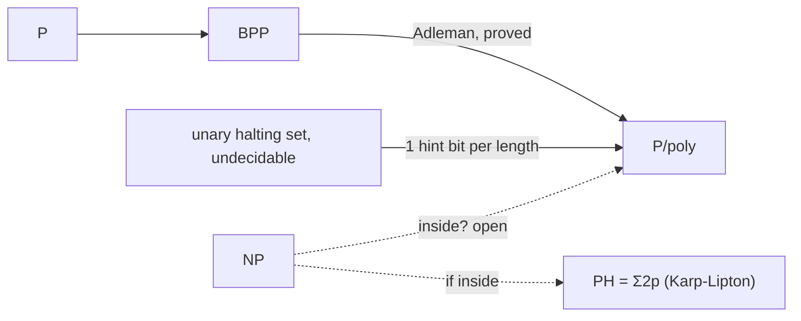

# P/poly: circuits with advice, why randomness fits inside, and Karp-Lipton

[Syllabus](../../../SYLLABUS.md) → [Computability and complexity](../README.md) → [Algebraic, Interactive and Quantum](../README.md#s05) → P/poly

---

## General Overview

A chip maker builds one adder for pairs of 2-bit numbers, another for 3-bit numbers, another for 4-bit numbers. The 4-bit adder reads 8 input bits and has 31 gates. No single circuit serves every width. There is one fixed circuit per input length, and the list of them is called a **circuit family**.

A program handles every length with one set of instructions: it is **uniform**. A circuit family is **non-uniform**: each circuit may be different, and no program has to produce it. It only has to exist and be small.

That freedom is real. Take the strings $`1^n`$ ($`n`$ copies of the symbol 1, not a power) and keep exactly those where program number $`n`$ halts. No program decides that set, but one bit per length does: the circuit for length $`n`$ is "all inputs are 1" if program $`n`$ halts, and "reject" if not. The circuit exists either way, even though nobody can compute which one it is.

The same freedom swallows coin flips. A coin-flipping test for "is $`AB = C`$?" on 2 by 2 tables of bits has 4,096 possible inputs. Run it 13 times and each input is fooled with chance at most $`2^{-13}`$. Adding up the bad chances over all 4,096 inputs gives at most $`4096 \times 2^{-13} = 0.5`$, which is less than 1. So some single coin string fools no input at all. Wire it in, and the test is exact on every input with no coins.

**P/poly is the set of problems solved by circuits of polynomial size, one circuit per input length, or equally by a fast program with a short hint that depends only on the length; it holds some undecidable sets, it holds everything coin flips can do fast (Adleman), and if it held NP, the polynomial hierarchy would collapse to its second rung (Karp-Lipton).**

**What kind of fact this is:** P/poly is a definition. Two theorems are proved on this card in Why it works: circuits and hints define the same class, and BPP (problems a fast coin-flipping program solves, wrong with chance at most 1/3 on each input) is inside P/poly (Adleman 1978 for one-sided error; the same count gives BPP). Karp-Lipton (1980) is a theorem proved in outline, in a fold. Meyer's theorem is stated with a source. That NP is not inside P/poly is a conjecture, unproved as of 2026-11-11.

### The picture: where P/poly sits



Schematic, not to scale. Solid arrows are proved inclusions. Dashed arrows are open questions. P and BPP are both strictly inside P/poly, because the unary halting set is in P/poly and in neither of them. Whether P equals BPP is open.

---

## The formula

A **language** $`L`$ is the set of yes-inputs, an input is a string $`x`$ of bits, and $`n = \lvert x\rvert`$ is its length. $`C_n(x)`$ is the bit that circuit $`C_n`$ outputs on $`x`$, and $`\mathrm{size}(C_n)`$ is its number of gates ([Boolean circuits](01-boolean-circuits-and-formulas.md)). The circuit form of the definition:

```math
L \in \mathrm{P/poly} \iff \text{some circuits } C_0, C_1, C_2, \dots \text{ have } \mathrm{size}(C_n) \le n^c + c \text{ and } C_n(x) = 1 \Leftrightarrow x \in L \text{ for every } x \text{ of length } n
```

**Read it aloud:** a language is in P/poly when each input length has its own circuit, the circuits grow no faster than a fixed power of the length, and each one answers correctly on every input of its length.

The **advice** form gives a fast machine $`M`$ a hint string $`a_n`$ that depends only on the length:

```math
L \in \mathrm{P/poly} \iff x \in L \Leftrightarrow M(x, a_{\lvert x\rvert}) = 1, \text{ for a polynomial-time } M \text{ and hints with } \lvert a_n\rvert \le n^c + c
```

**Read it aloud:** a language is in P/poly when a fast program, handed one short hint per input length, answers every input correctly.

Adleman's counting step, for a coin-flipping machine $`M`$ that reads a random string $`r`$ and errs with chance at most $`2^{-(n+1)}`$ on each input:

```math
\Pr_r\bigl[\text{some } x \text{ of length } n \text{ gets a wrong answer}\bigr] \le \sum_{x} \Pr_r[M(x, r) \text{ wrong}] \le 2^n \cdot 2^{-(n+1)} = \tfrac12 < 1
```

**Read it aloud:** the chance that a coin string fools at least one input is at most the sum of the chances for each input, which is one half, so at least half of all coin strings fool nobody.

At $`n = 12`$: $`4096 \times 2^{-13} = 0.5`$.

Karp-Lipton, and Meyer's theorem beside it:

```math
\mathrm{NP} \subseteq \mathrm{P/poly} \Rightarrow \mathrm{PH} = \Sigma_2^{\mathrm{p}}, \qquad \mathrm{EXP} \subseteq \mathrm{P/poly} \Rightarrow \mathrm{EXP} = \Sigma_2^{\mathrm{p}}
```

**Read it aloud:** if every NP problem had small circuits, the whole polynomial hierarchy would fit on its second rung; if every exponential-time problem had small circuits, all of exponential time would fit there too.

| Symbol | Plain meaning | In our example | Push it up and the answer… |
| --- | --- | --- | --- |
| $`L`$, $`x`$, $`n`$, $`1^n`$ | the language, an input, its length in bits, and $`n`$ copies of 1 | "is $`AB = C`$?" on 12-bit inputs | — |
| $`C_n`$, $`\mathrm{size}`$ | the circuit for length $`n`$, and its gate count | the adder for 8 input bits: 31 gates | — |
| $`c`$ | the fixed exponent in the size bound | adders grow in step with $`n`$, so a small $`c`$ works | a looser class bound, still polynomial |
| $`a_n`$ | the advice: one hint string per length | 1 bit (unary set); 26 bits (table test) | more than polynomial length lets in every language |
| $`M`$, $`t`$, $`n^d`$ | a fast program that reads the input and the hint; its number of steps; a polynomial bound on that number | the table test with its coin columns | — |
| $`r`$, $`r_1, \dots, r_k`$, $`r^*`$, $`m`$, $`\mathrm{Bad}_x`$ | a coin string, the 0/1 columns it is cut into, a string right on every input, the string's length, and the strings wrong on input $`x`$ | $`r_1 = 11`$, $`r_2 = 00`$, …; $`m = 26`$ | — |
| $`k`$ | runs of the test | 13 $`= n + 1`$ | error per input falls like $`2^{-k}`$ |
| $`A`$, $`B`$, $`C`$, $`E`$ | 2 by 2 tables of bits, arithmetic mod 2; $`E = AB - C`$ is the error table | $`A`$ = 10/00, $`B`$ = 11/00, $`C`$ = 00/00 | — |
| $`\Pr_r[\cdot]`$ | probability over the coins only, the input fixed | 0.5 for one run on the worst input | — |
| $`\Sigma_2^{\mathrm{p}}`$, $`\Pi_2^{\mathrm{p}}`$, PH | rung 2 of the polynomial hierarchy: there-exists then for-all, and for-all then there-exists; PH is every rung | — | — |
| $`V`$, $`y`$, $`z`$ | a polynomial-time referee, and the strings the quantifiers range over | $`V`$: "does the adder give $`a + b = 4`$?" | — |
| $`D`$, $`\varphi_{x,y}`$, $`S_D`$ | a small circuit claimed to decide SAT, the box in Karp-Lipton; the formula asking "is there a $`z`$?"; the answer self-reduction with $`D`$ builds | the honest box and the liar box in the code | — |

A table is written row 1 / row 2, so 10/00 has a single 1 in the top-left corner. A column $`r = 11`$ has both entries 1.

### When it holds

- **The hint depends only on the length.** A hint chosen per input could simply be the answer. That needs one bit for each of the 4,096 inputs at $`n = 12`$, not 26, and it makes every language trivial.
- **The circuits are of polynomial size.** Every function of $`n`$ bits has some circuit of about $`2^n`$ gates, a lookup table. Without the size bound the class would hold every language, so the bound is the whole content.
- **For Adleman, the error is bounded on every input and pushed below $`2^{-n}`$.** With one run instead of 13, none of the 4 coin strings is right on all 4,096 inputs.
- **Adleman proves the coin string exists; it does not find it.** Finding a good one fast, for every length, would be derandomisation, the subject of [Pseudorandomness](../04-Beyond%20Worst%20Case/04-derandomisation-and-pseudorandomness.md).
- **Karp-Lipton is an implication.** It assumes NP has small circuits, which is believed false. Its use is the reverse: a collapse of the hierarchy is believed false, so NP probably needs large circuits.

---

## Why it works

### Step 0: a fixed fact about each length can be built in

A circuit is built once for each length. Anything that depends only on the length can be stored in it as wires fixed to 0 or 1. Nobody has to compute those wires; they only have to exist.

A coin string that works for every input of length $`n`$ is such a fact. So is "does program $`n`$ halt?". Each proof below finds a fact that depends only on $`n`$ and builds it in.

### Step 1: circuits and hints give the same class

**From circuits to hints.** Write circuit $`C_n`$ out as a list of gates. That list is the hint $`a_n`$. The machine $`M`$ reads the list and evaluates it gate by gate, as the code on [Boolean circuits](01-boolean-circuits-and-formulas.md) does. The time is about the number of gates, a polynomial.

**From hints to circuits.** [Cook-Levin](../03-Time%20Complexity/04-cook-levin-theorem.md) lays out the run of a machine for $`t`$ steps as a grid, which becomes a circuit of about $`t^2`$ gates. Do that for $`M`$ on inputs of length $`n`$. Then fix the hint wires to the bits of $`a_n`$. What is left is a circuit $`C_n`$ of polynomial size.

So the two definitions in The formula pick out the same languages. This card uses whichever is easier.

### Step 2: an undecidable set with one hint bit per length

Number every program, as on [Universal machines](../01-Models%20of%20Computation/09-universal-machines-and-the-halting-problem.md). Let $`L`$ hold $`1^n`$ exactly when program $`n`$ halts when started on an empty input. A program deciding $`L`$ would decide halting for those runs. The diagonal proof on that card rules out deciding whether program $`x`$ stops on input $`x`$. That question reduces to this one: write $`x`$ into the program's first lines, so the new program stops on an empty input exactly when program $`x`$ stops on input $`x`$.

Yet $`L`$ is in P/poly. The hint $`a_n`$ is 1 bit: 1 if program $`n`$ halts, 0 if not. The circuit is the AND of all $`n`$ inputs ($`n - 1`$ gates) when the bit is 1. When the bit is 0, it is the gate pair $`x_1 \land \lnot x_1`$, which rejects everything.

The code shows this on a toy language of four instructions on one counter. Of its programs 0 to 63, 21 halt and 31 repeat a configuration, which proves they loop. The other 12 are still running after 1,000 steps. Program 12, INC JMP, counts up for ever: its bit is 0, but no capped run can show it. The circuit for length 12 is one of the two either way. (This toy's halting could be settled with more work; the undecidable set uses every program of a full language.)

A unary language is one yes-or-no bit per length, an infinite 0/1 sequence. [Cantor's diagonal](../../01-Foundations/09-Sizes%20of%20Infinity/03-cantors-diagonal-argument.md) shows these sequences cannot be listed, while programs can. So almost every unary language is undecidable, and every one is in P/poly.

### Step 3: still, most languages are outside

P/poly is not everything. [Circuit lower bounds](../04-Beyond%20Worst%20Case/07-circuit-complexity-and-lower-bounds.md) counts circuits against functions, as Shannon did in 1949. There are $`2^{2^n}`$ functions of $`n`$ bits. Circuits of polynomial size are far fewer, so most functions need about $`2^n / n`$ gates. A language that is that hard at every length is outside P/poly.

The count names no hard function. No language in NP is known to be outside P/poly.

### Step 4: Adleman, one coin string for all inputs

Take a language in [BPP](../04-Beyond%20Worst%20Case/03-randomised-complexity-and-bpp.md): a fast machine with coins, right with chance at least 2/3 on every input. Three moves put it in P/poly.

1. **Amplify.** Repeat and take the majority. A number of runs growing in step with $`n`$ pushes the error on each input to at most $`2^{-(n+1)}`$, in polynomial time (BPP card).
2. **Count.** Call a coin string bad for $`x`$ if it makes the answer wrong. Even if the bad strings of the $`2^n`$ inputs never overlap, they cover at most a $`\frac12`$ share. This is the **union bound**: the chance that at least one of several events happens is at most the sum of their chances.
3. **Build it in.** Pick one string $`r^*`$ that is bad for no input, and make it the hint $`a_n`$. With $`r^*`$ fixed the machine is right on every input of length $`n`$, and by Step 1 it is a circuit of polynomial size.

<details>
<summary>Detailed proof: BPP is inside P/poly</summary>

Let $`M`$ decide $`L`$ with error at most $`\frac13`$ in time $`n^d`$. By amplification, a machine $`M'`$ runs $`M`$ some $`k(n)`$ times, with $`k(n)`$ at most a polynomial, and takes the majority. Its error on every input $`x`$ of length $`n`$ is at most $`2^{-(n+1)}`$. It reads coin strings $`r`$ of length $`m(n) = k(n) \cdot n^d`$.

For each input $`x`$ let $`\mathrm{Bad}_x`$ be the set of strings $`r`$ on which $`M'(x, r)`$ is wrong. By the error bound, $`\lvert \mathrm{Bad}_x\rvert \le 2^{-(n+1)} \cdot 2^{m}`$. The union over all $`2^n`$ inputs has size:

$`\displaystyle \Bigl\lvert \bigcup_{x} \mathrm{Bad}_x \Bigr\rvert \le \sum_{x} \lvert \mathrm{Bad}_x\rvert \le 2^n \cdot 2^{-(n+1)} \cdot 2^m = \tfrac12 \cdot 2^m < 2^m.`$

So some $`r^*`$ lies in no $`\mathrm{Bad}_x`$. Set $`a_n = r^*`$. Then $`M'(x, a_n)`$ is right for every $`x`$ of length $`n`$, and $`\lvert a_n\rvert = m(n)`$ is a polynomial. By Step 1, $`L \in \mathrm{P/poly}`$.

</details>

### Step 5: Adleman on a real test

The test is Freivalds' check from the BPP card, shrunk to 2 by 2 tables of bits with arithmetic mod 2 (so 1 + 1 = 0). The input is three tables $`A`$, $`B`$ and $`C`$, 4 bits each, so $`n = 12`$. The question is whether $`AB = C`$.

One run picks a random 0/1 column $`r`$ and checks whether $`A(Br) = Cr`$, which never multiplies two tables. A right $`C`$ always passes. A wrong $`C`$ has a nonzero error table $`E = AB - C`$ and passes only when $`Er = 0`$.

- Of the 3,840 wrong inputs, 2,304 pass one run with chance 0.5. Their error tables have rank 1: every nonzero row is the same row. So 2 of the 4 columns, 00 and one other, miss the error.
- The other 1,536 pass with chance 0.25: only $`r = 00`$ misses them.

The test is one-sided: it accepts only if every run passes. So $`k`$ runs fool a wrong input with chance at most $`2^{-k}`$, and $`k = 13`$ meets Adleman's target $`2^{-(n+1)}`$.

The code counts exactly. A coin string of 13 columns is right on every input exactly when its columns include two different nonzero columns. Then no nonzero $`E`$ can send them all to zero. The share of bad strings is $`(3 \cdot 2^{13} - 2) / 4^{13} = 0.000366`$, far below the union bound's 0.5. The bound is loose because the bad sets overlap heavily: one blind column fools many inputs at once.

The first string drawn by the code's generator works on all 4,096 inputs. Its 26 bits are the hint for length 12. For 2 by 2 tables a good string is also easy to name, 10 and 01, but checking those amounts to redoing the product. For large tables nobody knows how to name one fast.

### Step 6: Karp-Lipton, a small circuit for SAT would flatten the ladder

The rungs of the polynomial hierarchy count blocks of there-exists and for-all ([Above NP](../03-Time%20Complexity/08-conp-pspace-and-the-polynomial-hierarchy.md)). Suppose SAT, the satisfiability question, had circuits of polynomial size. Three moves follow.

1. **A yes-or-no box finds answers.** Given a box $`D`$ that says whether a formula can be satisfied, set the first variable to 1 and ask $`D`$ whether the rest can still be satisfied. Keep the 1 if yes, else use 0, and go on. This is **self-reduction**: one question per variable.
2. **A lying box is caught.** The answer $`D`$ leads to is checked directly. A wrong $`D`$ can only produce an answer that fails the check, never a false "yes".
3. **Swap the quantifiers.** "For every $`y`$ there is a $`z`$" becomes "there is a small box $`D`$ such that for every $`y`$, the answer $`D`$ leads to works": there-exists then for-all.

The code runs the first two moves on the house adder: find 2-bit $`a`$ and $`b`$ with $`a + b = 4`$. The honest box asks 5 questions and finds $`a = 3`$, $`b = 1`$. For $`a + b = 7`$ it says no after 1 question. A liar box that always says yes leads to $`a = 3`$, $`b = 3`$; the adder gives 6, and the check catches it.

<details>
<summary>Detailed proof, in outline: NP inside P/poly makes the hierarchy collapse</summary>

Assume SAT has circuits $`D_n`$ of size at most $`n^c`$. Take $`L \in \Pi_2^{\mathrm{p}}`$, so for a polynomial-time referee $`V`$ and polynomial-length strings:

$`\displaystyle x \in L \iff \forall y\; \exists z\; V(x, y, z) = 1.`$

For fixed $`x`$ and $`y`$, the inner question "is there a $`z`$?" is in NP. By Cook-Levin it becomes a formula $`\varphi_{x,y}`$ of polynomial size. Let $`S_D(\varphi)`$ be the string that self-reduction with box $`D`$ produces from $`\varphi`$. Claim:

$`\displaystyle x \in L \iff \exists D\; \forall y\; V\bigl(x, y, S_D(\varphi_{x,y})\bigr) = 1,`$

with $`D`$ ranging over circuits of size at most a fixed polynomial.

If $`x \in L`$, take $`D`$ to be the true SAT circuit. For every $`y`$ a $`z`$ exists, self-reduction finds one, and $`V`$ accepts. If $`x \notin L`$, some $`y`$ has no $`z`$ at all. Whatever $`D`$ is, the string it produces fails $`V`$ for that $`y`$.

The right side is there-exists then for-all with a polynomial-time check: it is in $`\Sigma_2^{\mathrm{p}}`$. So $`\Pi_2^{\mathrm{p}} \subseteq \Sigma_2^{\mathrm{p}}`$. Taking complements gives $`\Sigma_2^{\mathrm{p}} \subseteq \Pi_2^{\mathrm{p}}`$, so the two halves of rung 2 are equal. By Stockmeyer's collapse result, stated on Above NP, every higher rung equals rung 2: $`\mathrm{PH} = \Sigma_2^{\mathrm{p}}`$. Karp and Lipton's paper gives the full argument.

</details>

### Step 7: Meyer's theorem, the same idea one level up

Albert Meyer's theorem appears in the Karp-Lipton paper. If every problem solvable in exponential time had circuits of polynomial size, then EXP would equal $`\Sigma_2^{\mathrm{p}}`$. It is stated here with that source, not proved.

Its use is the same as Karp-Lipton's. P is strictly smaller than EXP ([Hierarchy and Ladner](../03-Time%20Complexity/09-time-hierarchy-and-ladners-theorem.md)). If $`\Sigma_2^{\mathrm{p}}`$ were proved strictly smaller than EXP too, Meyer's theorem would show that some exponential-time problem needs large circuits.

---

## Worked numbers, by hand

Adleman's step for the table test at $`n = 12`$, and one input traced by hand.

| Step | Arithmetic | Value |
| --- | --- | --- |
| inputs of length 12 | $`2^{12}`$ | 4,096 |
| right inputs, where $`AB = C`$ | one $`C`$ for each of $`2^8`$ pairs $`A, B`$ | 256 |
| worst chance one run passes a wrong $`C`$ | half the 4 columns are blind | 0.5 |
| runs needed | $`k = n + 1`$ | 13 |
| chance each wrong input survives 13 runs | $`0.5^{13}`$ | at most $`2^{-13}`$ |
| union bound over all inputs | $`4096 \times 2^{-13}`$ | 0.5 |
| exact share of bad coin strings | $`24{,}574 / 67{,}108{,}864`$ | 0.000366 |
| trace: $`A`$ = 10/00, $`B`$ = 11/00, $`C`$ = 00/00, column $`r = 10`$ | $`Br = 10`$, $`A(Br) = 10`$, $`Cr = 00`$ | caught |
| the same input, column $`r = 11`$ | $`Br`$ adds $`B`$'s two columns: 1 + 1 = 0 on top, 0 below, so $`Br = 00`$; $`A(Br) = 00`$, $`Cr = 00`$ | passes |
| the drawn coin string, 13 columns | right on 4,096 of 4,096 inputs | **a 26-bit hint that makes the test exact** |

The 26 bits do the work of the coins for every input of length 12. A hint per input would need 4,096 bits.

### What breaks if you drop a piece

| Mistake | Comes out at | What went wrong |
| --- | --- | --- |
| one run instead of 13 | 0 of 4 coin strings right on all inputs | each single column is blind to some wrong table |
| two runs, union bound applied anyway | $`4096 \times 2^{-2}`$ = 1,024, no proof; yet 6 of 16 strings work | the bound can show a good string exists, but when it fails it shows nothing either way |
| 12 runs | union bound $`4096 \times 2^{-12}`$ = 1.0, not below 1 | the bound must fall below 1; the exact bad share is still only 0.000732 |
| a coin string whose columns are all 11 | passes $`A`$ = 10/00, $`B`$ = 11/00, $`C`$ = 00/00, though $`AB`$ = 11/00 | a hint must work for every input; this one is blind to one error table |
| trusting a liar box in Karp-Lipton | it claims $`a + b = 7`$ has an answer; the adder gives 6 | the box's answer must be checked, which is why a lie costs nothing |

---

## Code, from first principles, and it actually runs

The scripts import nothing that holds an answer. They take four independent roads.

1. **Circuit family against arithmetic.** Adders for 1 to 4 bits run gate by gate on every pair of numbers; sizes meet $`9k - 5`$.
2. **Capped runs, never a halting decider.** 64 toy programs run for at most 1,000 steps. A hint bit is set only by a halt or a repeated configuration; the rest print "still running". The two unary circuits run on every string up to length 12. The bits are printed with ? where a run proved nothing.
3. **Exhaustive search against a closed form.** For 1, 2 and 3 runs, every coin string meets all 4,096 inputs, and the good ones number $`(2^k - 1)(2^k - 2)`$.
4. **Sampling against exact counts.** 2,000 strings of 13 columns from a SplitMix64 generator, seed 2026, each meet every input. Only 1 fails. The self-reduction's answers are checked against a brute-force search over all 16 pairs.

### Python

```python
# P/poly -- the check behind the card.  Standard library only.  Four constructions: a circuit
# family (one adder per input length), a unary set given by one advice bit per length, Adleman's
# step on a real coin-flipping test (one coin string right on every input), and the
# self-reduction inside Karp-Lipton.  Nothing here decides halting; capped runs say so.

def adder(k):                         # ripple-carry adder, as built on the Boolean circuits card
    gates = []                        # (op, x, y); wires 0..k-1 are a, wires k..2k-1 are b
    def g(op, x, y=0): gates.append((op, x, y)); return 2 * k + len(gates) - 1
    def xor(x, y): both = g("AND", x, y); return g("AND", g("OR", x, y), g("NOT", both)), both
    s, c = xor(0, k); out = [s]
    for i in range(1, k):
        t, h = xor(i, k + i); s, u = xor(t, c); out.append(s); c = g("OR", h, u)
    return gates, out + [c]
def run(gates, outs, bits):
    v = list(bits)
    for op, x, y in gates: v.append(1 - v[x] if op == "NOT" else v[x] & v[y] if op == "AND" else v[x] | v[y])
    return sum(v[o] << i for i, o in enumerate(outs))
def bits(a, b, k): return [a >> i & 1 for i in range(k)] + [b >> i & 1 for i in range(k)]
for k in (1, 2, 3, 4):
    gates, outs = adder(k)
    right = sum(run(gates, outs, bits(a, b, k)) == a + b for a in range(2 ** k) for b in range(2 ** k))
    print(f"adder family: n={2 * k} input bits, {len(gates)} gates, right on {right} of {4 ** k} inputs")
    assert right == 4 ** k and len(gates) == (4 if k == 1 else 9 * k - 5)

def program(n):                       # program number n: its base-4 digits, lowest first
    p = []
    while n: p.append(n % 4); n //= 4
    return p
NAME = ["INC", "DEC", "JNZ", "JMP"]   # c+1; c-1 (not below 0); if c > 0 go back one; go to start
CAP = 1000                            # step cap for the runs below
def status(p, cap):                   # "1" halted, "0" a configuration repeated (proof of a loop),
    pc, c, seen = 0, 0, set()         # "?" still running after cap steps: no claim either way
    for step in range(cap):
        if pc == len(p): return "1", step, c
        if (pc, c) in seen: return "0", step, c
        seen.add((pc, c)); op = p[pc]
        if op == 0: c += 1; pc += 1
        elif op == 1: c = max(c - 1, 0); pc += 1
        elif op == 2: pc = max(pc - 1, 0) if c > 0 else pc + 1
        else: pc = 0
    return "?", cap, c
advice = "".join(status(program(n), CAP)[0] for n in range(64))
print(f"advice bits a_0..a_63: {advice}")
print(f"  {advice.count('1')} halt, {advice.count('0')} loop (a configuration repeats), "
      f"{advice.count('?')} still running after {CAP} steps")
for n in (3, 12, 36):
    s, t, c = status(program(n), CAP)
    print(f"  program {n} = {' '.join(NAME[d] for d in program(n))}: "
          + {"1": f"halts after {t} steps", "0": f"repeats a configuration at step {t}",
             "?": f"still running after {t} steps, counter {c}"}[s])
checked = 0
for n in range(1, 13):                # both circuits for length n: AND of all inputs, or constant 0
    for bit in (0, 1):
        acc = []
        for x in range(2 ** n):       # input bit i is x >> i & 1; run the circuit gate by gate
            v = x & 1
            for i in range(1, n): v &= x >> i & 1
            if (v if bit else (x & 1) & (1 - (x & 1))): acc.append(x)
        assert acc == ([2 ** n - 1] if bit else []); checked += 2 ** n
print(f"unary circuits, n=1..12: AND of the n inputs accepts only 1^n, the 0-circuit accepts nothing; "
      f"{checked} runs checked; gates n-1 = 11 at n=12")
assert (advice.count("1"), advice.count("0"), advice.count("?")) == (21, 31, 12) and advice[:4] == "1110"
assert [status(program(n), 1000) for n in (3, 12, 36)] == [("0", 1, 0), ("?", 1000, 500), ("1", 3, 0)]   # traced by hand

def mv(m, r):                         # 2x2 table mod 2 (bits e00 e01 e10 e11) times a 0/1 column r
    return (bin(m & 3 & r).count("1") & 1) | (bin(m >> 2 & r).count("1") & 1) << 1
def mm(a, b):                         # product of two tables mod 2, column by column
    cols = [mv(a, (b >> j & 1) | (b >> (2 + j) & 1) << 1) for j in (0, 1)]
    return (cols[0] & 1) | (cols[1] & 1) << 1 | (cols[0] >> 1) << 2 | (cols[1] >> 1) << 3
N = 12                                # input: A, B, C, 4 bits each; the question is "is AB = C?"
truth = [mm(x & 15, x >> 4 & 15) == x >> 8 for x in range(2 ** N)]
passes = [sum(1 << r for r in range(4) if mv(x & 15, mv(x >> 4 & 15, r)) == mv(x >> 8, r)) for x in range(2 ** N)]
no = [x for x in range(2 ** N) if not truth[x]]
worst = max(bin(passes[x]).count("1") for x in no) / 4
half = sum(bin(passes[x]).count("1") == 2 for x in no)
print(f"Freivalds test mod 2: {2 ** N} inputs, {2 ** N - len(no)} with AB = C, {len(no)} without; one run wrongly passes "
      f"a wrong C with chance at most {worst:.2f}; {half} wrong inputs reach it, {len(no) - half} sit at 0.25")
def good(seed, k):                    # right on every input? a wrong C escapes only if every r_i passes it
    used = sum(1 << v for v in {seed >> 2 * i & 3 for i in range(k)})
    return all(used & ~passes[x] for x in no)
for k in (1, 2, 3):
    g = sum(good(s, k) for s in range(4 ** k))
    print(f"k={k} runs: {g} of {4 ** k} coin strings right on all {2 ** N} inputs; formula (2^k-1)(2^k-2) = {(2 ** k - 1) * (2 ** k - 2)}")
    assert g == (2 ** k - 1) * (2 ** k - 2)
for k in (2, 12, 13):
    bad, err = 3 * 2 ** k - 2, sum(bin(passes[x]).count("1") ** k for x in no) / 4 ** k
    print(f"k={k}: union bound {2 ** N} x 2^-{k} = {2 ** N / 2 ** k:.1f}; sum of per-input errors "
          f"{err:.6f}; exact bad share {bad}/{4 ** k} = {bad / 4 ** k:.6f}")
    assert bad / 4 ** k <= err <= 2 ** N * worst ** k   # exact bad share <= summed errors <= union bound
assert worst == 0.5 and half == 2304

state = 2026                          # SplitMix64, seed 2026: 26-bit coin strings for k = 13
def splitmix():
    global state
    M = (1 << 64) - 1; state = (state + 0x9E3779B97F4A7C15) & M; z = state
    z = ((z ^ (z >> 30)) * 0xBF58476D1CE4E5B9) & M; z = ((z ^ (z >> 27)) * 0x94D049BB133111EB) & M
    return z ^ (z >> 31)
draws = [splitmix() & (2 ** 26 - 1) for _ in range(2000)]
first = draws[0]
right = sum((all(passes[x] >> (first >> 2 * i & 3) & 1 for i in range(13))) == truth[x] for x in range(2 ** N))
cols = " ".join(f"{first >> 2 * i & 1}{first >> 2 * i + 1 & 1}" for i in range(13))
print(f"advice for n=12: first drawn coin string, columns r_1..r_13 = {cols}")
print(f"  {2 * 13} advice bits, right on {right} of {2 ** N} inputs; one bit per input would need {2 ** N}")
print(f"  {sum(not good(s, 13) for s in draws)} of {len(draws)} drawn coin strings fail some input")
lame = 2 ** 26 - 1                    # every r_i = 11: a bad coin string, built on purpose
x = next(x for x in no if not good(lame, 13) and passes[x] >> 3 & 1)
def tab(m): return f"{m & 1}{m >> 1 & 1}/{m >> 2 & 1}{m >> 3 & 1}"   # row 1 / row 2
print(f"mistake, every column r = 11: passes A={tab(x & 15)} B={tab(x >> 4 & 15)} C={tab(x >> 8)}, "
      f"though AB = {tab(mm(x & 15, x >> 4 & 15))}")
def vec(v): return f"{v & 1}{v >> 1 & 1}"                          # top entry, bottom entry
print("hand trace: " + "; ".join(f"r={vec(r)}: Br={vec(mv(x >> 4 & 15, r))} A(Br)={vec(mv(x & 15, mv(x >> 4 & 15, r)))} "
      f"Cr={vec(mv(x >> 8, r))} " + ("passes" if passes[x] >> r & 1 else "caught") for r in (1, 3)))
assert right == 2 ** N and not good(lame, 13) and good(first, 13) and passes[x] == 0b1001

g2, o2 = adder(2)                     # Karp-Lipton's inner step: a yes/no box for SAT gives the answer
def honest(fixed, target):            # is there a completion of the fixed bits with a + b = target?
    free = 4 - len(fixed)
    return any(run(g2, o2, fixed + [r >> i & 1 for i in range(free)]) == target for r in range(2 ** free))
def liar(fixed, target): return True
def self_reduce(box, target):
    calls = 1
    if not box([], target): return None, calls
    fixed = []
    for _ in range(4): calls += 1; fixed.append(1 if box(fixed + [1], target) else 0)
    return fixed, calls
for name, box, target in (("honest box", honest, 4), ("honest box", honest, 7), ("liar box", liar, 7)):
    w, calls = self_reduce(box, target)
    got = None if w is None else (w[0] + 2 * w[1], w[2] + 2 * w[3], run(g2, o2, w))
    print(f"self-reduction, {name}, a + b = {target}: questions asked {calls}; "
          + ("says no" if w is None else f"a={got[0]} b={got[1]}, adder gives {got[2]}: "
             + ("checks" if got[2] == target else "caught, the answer fails the check")))
sols = {t: [(a, b) for a in range(4) for b in range(4) if a + b == t] for t in (4, 7)}
print(f"brute force: {len(sols[4])} of 16 pairs give 4, none gives 7")
w = self_reduce(honest, 4)[0]         # the answers must agree with the brute force
assert (w[0] + 2 * w[1], w[2] + 2 * w[3]) in sols[4] and len(sols[4]) == 3 and (self_reduce(honest, 7)[0] is None) == (not sols[7])
print("ALL CHECKS PASS")
```

**Ran 2026-11-24 on macOS, Python 3.14.10, standard library only. All checks passed. Output, pasted from the run:**

```
adder family: n=2 input bits, 4 gates, right on 4 of 4 inputs
adder family: n=4 input bits, 13 gates, right on 16 of 16 inputs
adder family: n=6 input bits, 22 gates, right on 64 of 64 inputs
adder family: n=8 input bits, 31 gates, right on 256 of 256 inputs
advice bits a_0..a_63: 11101110?110?00011101110?110?000???01110?110?000?0000000?000?000
  21 halt, 31 loop (a configuration repeats), 12 still running after 1000 steps
  program 3 = JMP: repeats a configuration at step 1
  program 12 = INC JMP: still running after 1000 steps, counter 500
  program 36 = INC DEC JNZ: halts after 3 steps
unary circuits, n=1..12: AND of the n inputs accepts only 1^n, the 0-circuit accepts nothing; 16380 runs checked; gates n-1 = 11 at n=12
Freivalds test mod 2: 4096 inputs, 256 with AB = C, 3840 without; one run wrongly passes a wrong C with chance at most 0.50; 2304 wrong inputs reach it, 1536 sit at 0.25
k=1 runs: 0 of 4 coin strings right on all 4096 inputs; formula (2^k-1)(2^k-2) = 0
k=2 runs: 6 of 16 coin strings right on all 4096 inputs; formula (2^k-1)(2^k-2) = 6
k=3 runs: 42 of 64 coin strings right on all 4096 inputs; formula (2^k-1)(2^k-2) = 42
k=2: union bound 4096 x 2^-2 = 1024.0; sum of per-input errors 672.000000; exact bad share 10/16 = 0.625000
k=12: union bound 4096 x 2^-12 = 1.0; sum of per-input errors 0.562592; exact bad share 12286/16777216 = 0.000732
k=13: union bound 4096 x 2^-13 = 0.5; sum of per-input errors 0.281273; exact bad share 24574/67108864 = 0.000366
advice for n=12: first drawn coin string, columns r_1..r_13 = 11 00 01 00 10 11 00 01 00 10 10 01 10
  26 advice bits, right on 4096 of 4096 inputs; one bit per input would need 4096
  1 of 2000 drawn coin strings fail some input
mistake, every column r = 11: passes A=10/00 B=11/00 C=00/00, though AB = 11/00
hand trace: r=10: Br=10 A(Br)=10 Cr=00 caught; r=11: Br=00 A(Br)=00 Cr=00 passes
self-reduction, honest box, a + b = 4: questions asked 5; a=3 b=1, adder gives 4: checks
self-reduction, honest box, a + b = 7: questions asked 1; says no
self-reduction, liar box, a + b = 7: questions asked 5; a=3 b=3, adder gives 6: caught, the answer fails the check
brute force: 3 of 16 pairs give 4, none gives 7
ALL CHECKS PASS
```

### Rust

Same numbers, same labels, built with `rustc --edition 2021 -O`. The coin strings are 64-bit words, and the boxes in the self-reduction are closures passed by reference.

```rust
// P/poly -- the same check as the Python, in Rust.  No crates.  Four constructions: a circuit
// family (one adder per input length), a unary set given by one advice bit per length, Adleman's
// step on a real coin-flipping test (one coin string right on every input), and the
// self-reduction inside Karp-Lipton.  Nothing here decides halting; capped runs say so.
use std::collections::HashSet;

// ripple-carry adder, as built on the Boolean circuits card; op 0 NOT, 1 AND, 2 OR
fn adder(k: usize) -> (Vec<(u8, usize, usize)>, Vec<usize>) {
    let mut gates: Vec<(u8, usize, usize)> = Vec::new();
    fn g(gates: &mut Vec<(u8, usize, usize)>, k: usize, op: u8, x: usize, y: usize) -> usize {
        gates.push((op, x, y)); 2 * k + gates.len() - 1 }
    fn xor(gates: &mut Vec<(u8, usize, usize)>, k: usize, x: usize, y: usize) -> (usize, usize) {
        let both = g(gates, k, 1, x, y); let o = g(gates, k, 2, x, y); let nb = g(gates, k, 0, both, 0);
        (g(gates, k, 1, o, nb), both) }
    let (s, mut c) = xor(&mut gates, k, 0, k);
    let mut out = vec![s];
    for i in 1..k {
        let (t, h) = xor(&mut gates, k, i, k + i); let (s, u) = xor(&mut gates, k, t, c);
        out.push(s); c = g(&mut gates, k, 2, h, u);
    }
    out.push(c); (gates, out)
}
fn run(gates: &[(u8, usize, usize)], outs: &[usize], bits: &[u32]) -> u32 {
    let mut v: Vec<u32> = bits.to_vec();
    for &(op, x, y) in gates { let w = match op { 0 => 1 - v[x], 1 => v[x] & v[y], _ => v[x] | v[y] }; v.push(w); }
    outs.iter().enumerate().map(|(i, &o)| v[o] << i).sum()
}
fn bits(a: u32, b: u32, k: usize) -> Vec<u32> { (0..k).map(|i| a >> i & 1).chain((0..k).map(|i| b >> i & 1)).collect() }

fn program(mut n: u32) -> Vec<u32> { let mut p = Vec::new(); while n > 0 { p.push(n % 4); n /= 4; } p }
const NAME: [&str; 4] = ["INC", "DEC", "JNZ", "JMP"];
const CAP: usize = 1000;                                   // step cap for the runs below
fn status(p: &[u32], cap: usize) -> (char, usize, u64) {   // '1' halted, '0' a configuration repeated, '?' still running
    let (mut pc, mut c, mut seen) = (0usize, 0u64, HashSet::new());
    for step in 0..cap {
        if pc == p.len() { return ('1', step, c); }
        if !seen.insert((pc, c)) { return ('0', step, c); }
        match p[pc] { 0 => { c += 1; pc += 1 } 1 => { c = c.saturating_sub(1); pc += 1 }
                      2 => { pc = if c > 0 { pc.saturating_sub(1) } else { pc + 1 } } _ => { pc = 0 } }
    }
    ('?', cap, c)
}

fn ones(x: u32) -> u32 { x.count_ones() }
fn mv(m: u32, r: u32) -> u32 { (ones(m & 3 & r) & 1) | (ones(m >> 2 & r) & 1) << 1 }   // 2x2 table mod 2 times column r
fn mm(a: u32, b: u32) -> u32 {
    let c0 = mv(a, (b & 1) | (b >> 2 & 1) << 1); let c1 = mv(a, (b >> 1 & 1) | (b >> 3 & 1) << 1);
    (c0 & 1) | (c1 & 1) << 1 | (c0 >> 1) << 2 | (c1 >> 1) << 3
}
fn tab(m: u32) -> String { format!("{}{}/{}{}", m & 1, m >> 1 & 1, m >> 2 & 1, m >> 3 & 1) }
fn good(seed: u64, k: usize, passes: &[u32], no: &[usize]) -> bool {   // a wrong C escapes only if every r_i passes it
    let mut used = 0u32; for i in 0..k { used |= 1 << (seed >> (2 * i) & 3); }
    no.iter().all(|&x| used & !passes[x] != 0)
}

fn main() {
    for k in 1..=4usize {
        let (gates, outs) = adder(k);
        let mut right = 0;
        for a in 0..1u32 << k { for b in 0..1u32 << k { if run(&gates, &outs, &bits(a, b, k)) == a + b { right += 1; } } }
        println!("adder family: n={} input bits, {} gates, right on {} of {} inputs", 2 * k, gates.len(), right, 1 << (2 * k));
        assert!(right == 1 << (2 * k) && gates.len() == if k == 1 { 4 } else { 9 * k - 5 });
    }

    let advice: String = (0..64).map(|n| status(&program(n), CAP).0).collect();
    let cnt = |ch: char| advice.chars().filter(|&c| c == ch).count();
    println!("advice bits a_0..a_63: {}", advice);
    println!("  {} halt, {} loop (a configuration repeats), {} still running after {} steps", cnt('1'), cnt('0'), cnt('?'), CAP);
    for n in [3u32, 12, 36] {
        let (s, t, c) = status(&program(n), CAP);
        let names: Vec<&str> = program(n).iter().map(|&d| NAME[d as usize]).collect();
        let what = match s { '1' => format!("halts after {} steps", t), '0' => format!("repeats a configuration at step {}", t),
                             _ => format!("still running after {} steps, counter {}", t, c) };
        println!("  program {} = {}: {}", n, names.join(" "), what);
    }
    let mut checked = 0u64;
    for n in 1..=12u32 {                                    // both circuits for length n
        for bit in [0u32, 1] {
            let mut acc: Vec<u32> = Vec::new();
            for x in 0..1u32 << n {
                let mut v = x & 1; for i in 1..n { v &= x >> i & 1; }
                if (if bit == 1 { v } else { (x & 1) & (1 - (x & 1)) }) == 1 { acc.push(x); }
            }
            assert!(acc == if bit == 1 { vec![(1u32 << n) - 1] } else { vec![] }); checked += 1 << n;
        }
    }
    println!("unary circuits, n=1..12: AND of the n inputs accepts only 1^n, the 0-circuit accepts nothing; {} runs checked; gates n-1 = 11 at n=12", checked);
    assert!((cnt('1'), cnt('0'), cnt('?')) == (21, 31, 12) && &advice[..4] == "1110");
    assert!([3u32, 12, 36].map(|n| status(&program(n), 1000)) == [('0', 1, 0), ('?', 1000, 500), ('1', 3, 0)]);   // traced by hand

    const N: usize = 12;                                    // input: A, B, C, 4 bits each; is AB = C?
    let truth: Vec<bool> = (0..1u32 << N).map(|x| mm(x & 15, x >> 4 & 15) == x >> 8).collect();
    let passes: Vec<u32> = (0..1u32 << N).map(|x| (0..4u32).filter(|&r| mv(x & 15, mv(x >> 4 & 15, r)) == mv(x >> 8, r)).map(|r| 1 << r).sum()).collect();
    let no: Vec<usize> = (0..1usize << N).filter(|&x| !truth[x]).collect();
    let worst = no.iter().map(|&x| ones(passes[x])).max().unwrap() as f64 / 4.0;
    let half = no.iter().filter(|&&x| ones(passes[x]) == 2).count();
    println!("Freivalds test mod 2: {} inputs, {} with AB = C, {} without; one run wrongly passes a wrong C with chance at most {:.2}; {} wrong inputs reach it, {} sit at 0.25",
             1 << N, (1 << N) - no.len(), no.len(), worst, half, no.len() - half);
    for k in 1..=3usize {
        let g = (0..1u64 << (2 * k)).filter(|&s| good(s, k, &passes, &no)).count();
        let f = ((1usize << k) - 1) * ((1usize << k) - 2);
        println!("k={} runs: {} of {} coin strings right on all {} inputs; formula (2^k-1)(2^k-2) = {}", k, g, 1 << (2 * k), 1 << N, f);
        assert!(g == f);
    }
    for k in [2i32, 12, 13] {
        let bad = 3 * (1u64 << k) - 2; let all = 1u64 << (2 * k);
        let sum: f64 = no.iter().map(|&x| (ones(passes[x]) as f64).powi(k)).sum::<f64>() / (all as f64);
        println!("k={}: union bound {} x 2^-{} = {:.1}; sum of per-input errors {:.6}; exact bad share {}/{} = {:.6}",
                 k, 1 << N, k, (1u64 << N) as f64 / (1u64 << k) as f64, sum, bad, all, bad as f64 / all as f64);
        assert!(bad as f64 / all as f64 <= sum && sum <= (1u64 << N) as f64 * worst.powi(k));   // exact share <= summed errors <= union bound
    }
    assert!(worst == 0.5 && half == 2304);

    let mut state: u64 = 2026;                              // SplitMix64, seed 2026: 26-bit coin strings
    let mut splitmix = || -> u64 { state = state.wrapping_add(0x9E3779B97F4A7C15); let mut z = state;
        z = (z ^ (z >> 30)).wrapping_mul(0xBF58476D1CE4E5B9); z = (z ^ (z >> 27)).wrapping_mul(0x94D049BB133111EB); z ^ (z >> 31) };
    let draws: Vec<u64> = (0..2000).map(|_| splitmix() & ((1 << 26) - 1)).collect();
    let first = draws[0];
    let right = (0..1usize << N).filter(|&x| (0..13).all(|i| passes[x] >> (first >> (2 * i) & 3) & 1 == 1) == truth[x]).count();
    let cols: Vec<String> = (0..13).map(|i| format!("{}{}", first >> (2 * i) & 1, first >> (2 * i + 1) & 1)).collect();
    println!("advice for n=12: first drawn coin string, columns r_1..r_13 = {}", cols.join(" "));
    println!("  {} advice bits, right on {} of {} inputs; one bit per input would need {}", 2 * 13, right, 1 << N, 1 << N);
    println!("  {} of {} drawn coin strings fail some input", draws.iter().filter(|&&s| !good(s, 13, &passes, &no)).count(), draws.len());
    let lame: u64 = (1 << 26) - 1;                          // every r_i = 11: a bad coin string, built on purpose
    let x = *no.iter().find(|&&x| passes[x] >> 3 & 1 == 1).unwrap() as u32;
    println!("mistake, every column r = 11: passes A={} B={} C={}, though AB = {}", tab(x & 15), tab(x >> 4 & 15), tab(x >> 8), tab(mm(x & 15, x >> 4 & 15)));
    let vec = |v: u32| format!("{}{}", v & 1, v >> 1 & 1);    // top entry, bottom entry
    let tr: Vec<String> = [1u32, 3].iter().map(|&r| format!("r={}: Br={} A(Br)={} Cr={} {}", vec(r), vec(mv(x >> 4 & 15, r)),
        vec(mv(x & 15, mv(x >> 4 & 15, r))), vec(mv(x >> 8, r)), if passes[x as usize] >> r & 1 == 1 { "passes" } else { "caught" })).collect();
    println!("hand trace: {}", tr.join("; "));
    assert!(right == 1 << N && !good(lame, 13, &passes, &no) && good(first, 13, &passes, &no) && passes[x as usize] == 0b1001);

    let (g2, o2) = adder(2);                                // Karp-Lipton's inner step: a yes/no box for SAT gives the answer
    let honest = |fixed: &[u32], target: u32| -> bool {
        let free = 4 - fixed.len();
        (0..1u32 << free).any(|r| { let mut b = fixed.to_vec(); b.extend((0..free).map(|i| r >> i & 1)); run(&g2, &o2, &b) == target })
    };
    let liar = |_: &[u32], _: u32| -> bool { true };
    let self_reduce = |boxf: &dyn Fn(&[u32], u32) -> bool, target: u32| -> (Option<Vec<u32>>, usize) {
        let mut calls = 1;
        if !boxf(&[], target) { return (None, calls); }
        let mut fixed: Vec<u32> = Vec::new();
        for _ in 0..4 { calls += 1; let mut t = fixed.clone(); t.push(1); fixed.push(if boxf(&t, target) { 1 } else { 0 }); }
        (Some(fixed), calls)
    };
    let cases: [(&str, &dyn Fn(&[u32], u32) -> bool, u32); 3] = [("honest box", &honest, 4), ("honest box", &honest, 7), ("liar box", &liar, 7)];
    for (name, boxf, target) in cases {
        let (w, calls) = self_reduce(boxf, target);
        let tail = match w { None => "says no".to_string(), Some(w) => { let got = run(&g2, &o2, &w);
            format!("a={} b={}, adder gives {}: {}", w[0] + 2 * w[1], w[2] + 2 * w[3], got,
                    if got == target { "checks" } else { "caught, the answer fails the check" }) } };
        println!("self-reduction, {}, a + b = {}: questions asked {}; {}", name, target, calls, tail);
    }
    let sols: Vec<(u32, u32)> = (0..16u32).map(|i| (i / 4, i % 4)).filter(|&(a, b)| a + b == 4).collect();
    let none7 = (0..16u32).all(|i| i / 4 + i % 4 != 7);
    println!("brute force: {} of 16 pairs give 4, none gives 7", sols.len());
    let w = self_reduce(&honest, 4).0.unwrap();             // the answers must agree with the brute force
    assert!(sols.contains(&(w[0] + 2 * w[1], w[2] + 2 * w[3])) && sols.len() == 3 && self_reduce(&honest, 7).0.is_none() == none7);
    println!("ALL CHECKS PASS");
}
```

**Ran 2026-11-24 on macOS, rustc 1.98.1, no crates. All checks passed. Output, pasted from the run:**

```
adder family: n=2 input bits, 4 gates, right on 4 of 4 inputs
adder family: n=4 input bits, 13 gates, right on 16 of 16 inputs
adder family: n=6 input bits, 22 gates, right on 64 of 64 inputs
adder family: n=8 input bits, 31 gates, right on 256 of 256 inputs
advice bits a_0..a_63: 11101110?110?00011101110?110?000???01110?110?000?0000000?000?000
  21 halt, 31 loop (a configuration repeats), 12 still running after 1000 steps
  program 3 = JMP: repeats a configuration at step 1
  program 12 = INC JMP: still running after 1000 steps, counter 500
  program 36 = INC DEC JNZ: halts after 3 steps
unary circuits, n=1..12: AND of the n inputs accepts only 1^n, the 0-circuit accepts nothing; 16380 runs checked; gates n-1 = 11 at n=12
Freivalds test mod 2: 4096 inputs, 256 with AB = C, 3840 without; one run wrongly passes a wrong C with chance at most 0.50; 2304 wrong inputs reach it, 1536 sit at 0.25
k=1 runs: 0 of 4 coin strings right on all 4096 inputs; formula (2^k-1)(2^k-2) = 0
k=2 runs: 6 of 16 coin strings right on all 4096 inputs; formula (2^k-1)(2^k-2) = 6
k=3 runs: 42 of 64 coin strings right on all 4096 inputs; formula (2^k-1)(2^k-2) = 42
k=2: union bound 4096 x 2^-2 = 1024.0; sum of per-input errors 672.000000; exact bad share 10/16 = 0.625000
k=12: union bound 4096 x 2^-12 = 1.0; sum of per-input errors 0.562592; exact bad share 12286/16777216 = 0.000732
k=13: union bound 4096 x 2^-13 = 0.5; sum of per-input errors 0.281273; exact bad share 24574/67108864 = 0.000366
advice for n=12: first drawn coin string, columns r_1..r_13 = 11 00 01 00 10 11 00 01 00 10 10 01 10
  26 advice bits, right on 4096 of 4096 inputs; one bit per input would need 4096
  1 of 2000 drawn coin strings fail some input
mistake, every column r = 11: passes A=10/00 B=11/00 C=00/00, though AB = 11/00
hand trace: r=10: Br=10 A(Br)=10 Cr=00 caught; r=11: Br=00 A(Br)=00 Cr=00 passes
self-reduction, honest box, a + b = 4: questions asked 5; a=3 b=1, adder gives 4: checks
self-reduction, honest box, a + b = 7: questions asked 1; says no
self-reduction, liar box, a + b = 7: questions asked 5; a=3 b=3, adder gives 6: caught, the answer fails the check
brute force: 3 of 16 pairs give 4, none gives 7
ALL CHECKS PASS
```

### Lean

Lean proves Adleman's counting step for every length, and counts the table test's good coin strings for every number of runs $`k`$.

- Suppose each input of length $`n`$ is answered wrongly by fewer than a $`2^{-n}`$ share of the coin strings. Then one coin string $`r^*`$ is right on every input.
- Suppose instead each input is answered wrongly by at most a $`2^{-(n+1)}`$ share. Then at least half of all coin strings are right on every input.
- Call a coin string of $`k`$ columns good when no nonzero error table $`E`$ sends all its columns to zero. Then exactly $`(2^k - 1)(2^k - 2)`$ of the $`4^k`$ strings are good.
- The adders have 13, 22 and 31 gates. There are 4,096 inputs, 256 of them right, and the unary circuits make 16,380 runs.
- The union bound is 0.5 at 13 runs, 1 at 12 runs and 1,024 at 2 runs.
- The good strings number 0, 6 and 42 for 1, 2 and 3 runs. The bad ones are 10 of 16, 12,286 of 16,777,216 and 24,574 of 67,108,864.
- Column 11 passes $`A`$ = 10/00, $`B`$ = 11/00, $`C`$ = 00/00, though $`AB`$ = 11/00. Column 10 catches it.
- Brute force finds 3 of the 16 pairs of 2-bit numbers with $`a + b = 4`$. None gives $`a + b = 7`$.

The circuit runs, the halting bits, the drawn 26-bit hint and the self-reduction boxes are left to the Python and Rust checks.

```lean
-- P/poly: if a coin-flipping test errs on each n-bit input with chance below 2^-n, then one coin string is right on every input (Adleman's counting step), and the card's mod 2 table test has exactly (2^k - 1)(2^k - 2) such coin strings of k columns.
import Mathlib.Data.Fintype.BigOperators
import Mathlib.Data.Matrix.Mul
import Mathlib.LinearAlgebra.Matrix.Notation
import Mathlib.Data.ZMod.Defs
import Mathlib.Tactic.NormNum
import Mathlib.Tactic.FinCases

theorem helper_bad_sum_bound (n m : ℕ)
    (L : (Fin n → Bool) → Bool) (M : (Fin n → Bool) → (Fin m → Bool) → Bool) :
    (Finset.univ.filter (fun r => ¬ ∀ x, M x r = L x)).card ≤
      ∑ x, (Finset.univ.filter (fun r => M x r ≠ L x)).card := by
  classical
  refine le_trans (Finset.card_le_card ?_) Finset.card_biUnion_le
  intro r hr
  simp only [Finset.mem_filter, Finset.mem_univ, true_and, not_forall] at hr
  obtain ⟨x, hx⟩ := hr
  simp only [Finset.mem_biUnion, Finset.mem_univ, Finset.mem_filter, true_and]
  exact ⟨x, hx⟩

#print axioms helper_bad_sum_bound

theorem helper_mulVec_kernel_line :
    ∀ E : Matrix (Fin 2) (Fin 2) (ZMod 2), E ≠ 0 →
      (∀ u : Fin 2 → ZMod 2, E.mulVec u = 0 → u 0 = 0) ∨
      (∀ u : Fin 2 → ZMod 2, E.mulVec u = 0 → u 1 = 0) ∨
      (∀ u : Fin 2 → ZMod 2, E.mulVec u = 0 → u 0 = u 1) := by
  decide

#print axioms helper_mulVec_kernel_line

theorem helper_mulVec_witnesses :
    (∀ u : Fin 2 → ZMod 2, u 0 = 0 → (!![1, 0; 0, 0] : Matrix (Fin 2) (Fin 2) (ZMod 2)).mulVec u = 0) ∧
    (∀ u : Fin 2 → ZMod 2, u 1 = 0 → (!![0, 1; 0, 0] : Matrix (Fin 2) (Fin 2) (ZMod 2)).mulVec u = 0) ∧
    (∀ u : Fin 2 → ZMod 2, u 0 = u 1 → (!![1, 1; 0, 0] : Matrix (Fin 2) (Fin 2) (ZMod 2)).mulVec u = 0) ∧
    (!![1, 0; 0, 0] : Matrix (Fin 2) (Fin 2) (ZMod 2)) ≠ 0 ∧
    (!![0, 1; 0, 0] : Matrix (Fin 2) (Fin 2) (ZMod 2)) ≠ 0 ∧
    (!![1, 1; 0, 0] : Matrix (Fin 2) (Fin 2) (ZMod 2)) ≠ 0 := by
  decide

#print axioms helper_mulVec_witnesses

theorem helper_good_iff (k : ℕ) (r : Fin k → Fin 2 → ZMod 2) :
    (∀ E : Matrix (Fin 2) (Fin 2) (ZMod 2), E ≠ 0 → ∃ i, E.mulVec (r i) ≠ 0) ↔
      ((fun i => r i 0) ≠ 0 ∧ (fun i => r i 1) ≠ 0 ∧ (fun i => r i 0) ≠ (fun i => r i 1)) := by
  obtain ⟨w0, w1, w2, n0, n1, n2⟩ := helper_mulVec_witnesses
  constructor
  · intro h
    refine ⟨fun ha => ?_, fun hb => ?_, fun hab => ?_⟩
    · obtain ⟨i, hi⟩ := h _ n0
      exact hi (w0 _ (congrFun ha i))
    · obtain ⟨i, hi⟩ := h _ n1
      exact hi (w1 _ (congrFun hb i))
    · obtain ⟨i, hi⟩ := h _ n2
      exact hi (w2 _ (congrFun hab i))
  · rintro ⟨ha, hb, hab⟩ E hE
    by_contra hcon
    simp only [not_exists, not_not] at hcon
    rcases helper_mulVec_kernel_line E hE with h | h | h
    · exact ha (funext fun i => h _ (hcon i))
    · exact hb (funext fun i => h _ (hcon i))
    · exact hab (funext fun i => h _ (hcon i))

#print axioms helper_good_iff

theorem helper_card_pairs (k : ℕ) :
    (Finset.univ.filter (fun p : (Fin k → ZMod 2) × (Fin k → ZMod 2) =>
      p.1 ≠ 0 ∧ p.2 ≠ 0 ∧ p.1 ≠ p.2)).card = (2 ^ k - 1) * (2 ^ k - 2) := by
  classical
  have hcard : Fintype.card (Fin k → ZMod 2) = 2 ^ k := by
    simp [ZMod.card]
  rw [Finset.card_filter, Fintype.sum_prod_type]
  have inner : ∀ a : Fin k → ZMod 2,
      (∑ b : Fin k → ZMod 2, if a ≠ 0 ∧ b ≠ 0 ∧ a ≠ b then 1 else 0)
        = if a ≠ 0 then 2 ^ k - 2 else 0 := by
    intro a
    by_cases ha : a = 0
    · simp [ha]
    · rw [← Finset.card_filter]
      have : (Finset.univ.filter (fun b : Fin k → ZMod 2 => a ≠ 0 ∧ b ≠ 0 ∧ a ≠ b))
          = (Finset.univ.erase 0).erase a := by
        ext b
        simp only [Finset.mem_filter, Finset.mem_univ, true_and, Finset.mem_erase]
        constructor
        · rintro ⟨_, hb, hab⟩; exact ⟨Ne.symm hab, hb, trivial⟩
        · rintro ⟨hab, hb, -⟩; exact ⟨ha, hb, Ne.symm hab⟩
      rw [this, Finset.card_erase_of_mem (by simp [ha]), Finset.card_erase_of_mem (by simp),
        Finset.card_univ, hcard]
      simp only [ne_eq, ha, not_false_eq_true, ↓reduceIte]
      omega
  simp only [inner]
  rw [← Finset.sum_filter, Finset.sum_const, smul_eq_mul]
  congr 1
  have : (Finset.univ.filter (fun a : Fin k → ZMod 2 => a ≠ 0)) = Finset.univ.erase 0 := by
    ext a; simp
  rw [this, Finset.card_erase_of_mem (by simp), Finset.card_univ, hcard]

#print axioms helper_card_pairs

/-- Adleman's step (BPP is inside P/poly). Inputs are the bit strings x of length n, coin
strings r are the bit strings of length m, L x is the right answer and M x r is the coin-flipping
test's answer. If on every input the share of coin strings giving a wrong answer is below 2^-n
(here: the number of wrong coin strings times 2^n is less than 2^m), then some single coin string
r* is right on every input of length n, so it can be built in as the hint. -/
theorem adleman_one_coin_string_right_on_every_input (n m : ℕ)
    (L : (Fin n → Bool) → Bool) (M : (Fin n → Bool) → (Fin m → Bool) → Bool)
    (herr : ∀ x, (Finset.univ.filter (fun r => M x r ≠ L x)).card * 2 ^ n < 2 ^ m) :
    ∃ r : Fin m → Bool, ∀ x, M x r = L x := by
  by_contra h
  simp only [not_exists, not_forall] at h
  have hsum : (∑ x, (Finset.univ.filter (fun r => M x r ≠ L x)).card) * 2 ^ n
      < 2 ^ m * 2 ^ n := by
    rw [Finset.sum_mul]
    calc ∑ x, (Finset.univ.filter (fun r => M x r ≠ L x)).card * 2 ^ n
        < ∑ _x : Fin n → Bool, 2 ^ m :=
          Finset.sum_lt_sum_of_nonempty Finset.univ_nonempty (fun x _ => herr x)
      _ = 2 ^ m * 2 ^ n := by simp [Finset.sum_const, Finset.card_univ, mul_comm]
  have hlt := lt_of_mul_lt_mul_right hsum (Nat.zero_le _)
  have hbad := helper_bad_sum_bound n m L M
  have hall : (Finset.univ.filter (fun r => ¬ ∀ x, M x r = L x)) = Finset.univ := by
    apply Finset.filter_true_of_mem
    intro r _ hr
    obtain ⟨x, hx⟩ := h r
    exact hx (hr x)
  rw [hall, Finset.card_univ] at hbad
  simp only [Fintype.card_fun, Fintype.card_bool, Fintype.card_fin] at hbad
  omega

/-- The union bound in Adleman's step: if every input of length n is answered wrongly with chance
at most 2^-(n+1), then the coin strings that fool some input are at most half of all 2^m coin
strings, so at least half of them are right on every input. -/
theorem adleman_at_least_half_of_coin_strings_fool_nobody (n m : ℕ)
    (L : (Fin n → Bool) → Bool) (M : (Fin n → Bool) → (Fin m → Bool) → Bool)
    (herr : ∀ x, (Finset.univ.filter (fun r => M x r ≠ L x)).card * 2 ^ (n + 1) ≤ 2 ^ m) :
    2 ^ m ≤ 2 * (Finset.univ.filter (fun r => ∀ x, M x r = L x)).card := by
  have hsum : (2 * ∑ x, (Finset.univ.filter (fun r => M x r ≠ L x)).card) * 2 ^ n
      ≤ 2 ^ m * 2 ^ n := by
    rw [Finset.mul_sum, Finset.sum_mul]
    calc ∑ x, 2 * (Finset.univ.filter (fun r => M x r ≠ L x)).card * 2 ^ n
        ≤ ∑ _x : Fin n → Bool, 2 ^ m :=
          Finset.sum_le_sum (fun x _ => by
            have := herr x
            rw [pow_succ] at this
            have e : 2 * (Finset.univ.filter (fun r => M x r ≠ L x)).card * 2 ^ n
                = (Finset.univ.filter (fun r => M x r ≠ L x)).card * (2 ^ n * 2) := by ac_rfl
            rw [e]; exact this)
      _ = 2 ^ m * 2 ^ n := by simp [Finset.sum_const, Finset.card_univ, mul_comm]
  have hle := le_of_mul_le_mul_right hsum (Nat.two_pow_pos n)
  have hbad := helper_bad_sum_bound n m L M
  have hsplit := Finset.card_filter_add_card_filter_not
    (s := (Finset.univ : Finset (Fin m → Bool))) (fun r => ∀ x, M x r = L x)
  rw [Finset.card_univ] at hsplit
  simp only [Fintype.card_fun, Fintype.card_bool, Fintype.card_fin] at hsplit
  omega

open Classical in
/-- The table test mod 2: a run with column r passes a wrong C exactly when the error table
E = AB - C sends r to zero, and E ranges over every nonzero 2 by 2 table of bits. A coin string of
k columns is right on every input when no nonzero E sends all its columns to zero, and the number
of such coin strings, out of 4^k, is (2^k - 1)(2^k - 2). -/
theorem freivalds_mod_two_good_coin_strings (k : ℕ) :
    (Finset.univ.filter (fun r : Fin k → Fin 2 → ZMod 2 =>
      ∀ E : Matrix (Fin 2) (Fin 2) (ZMod 2), E ≠ 0 → ∃ i, E.mulVec (r i) ≠ 0)).card
      = (2 ^ k - 1) * (2 ^ k - 2) := by
  rw [← helper_card_pairs k]
  let e : (Fin k → Fin 2 → ZMod 2) ≃ (Fin k → ZMod 2) × (Fin k → ZMod 2) :=
    { toFun := fun r => (fun i => r i 0, fun i => r i 1)
      invFun := fun p i => ![p.1 i, p.2 i]
      left_inv := fun r => by
        funext i j
        fin_cases j <;> rfl
      right_inv := fun p => rfl }
  apply Finset.card_equiv e
  intro r
  simp only [Finset.mem_filter, Finset.mem_univ, true_and]
  exact helper_good_iff k r

-- The adder family: 9k - 5 gates for k-bit numbers, so 13, 22 and 31 gates at 2, 3 and 4 bits.
example : (9 * 2 - 5, 9 * 3 - 5, 9 * 4 - 5) = (13, 22, 31) := by norm_num
-- Inputs of length 12: 4,096 in all, 256 with AB = C, 3,840 without (2,304 + 1,536).
example : 2 ^ 12 = 4096 ∧ 2 ^ 8 = 256 ∧ 4096 - 256 = 3840 ∧ 2304 + 1536 = 3840 := by norm_num
-- The unary circuits: both circuits on every string of lengths 1 to 12 make 16,380 runs.
example : (Finset.range 12).sum (fun i => 2 * 2 ^ (i + 1)) = 16380 := by decide
-- The union bound at n = 12: 4096 × 2^-13 = 1/2 < 1; at 12 runs it is exactly 1; at 2 runs, 1,024.
example : (4096 : ℚ) / 2 ^ 13 = 1 / 2 ∧ (4096 : ℚ) / 2 ^ 12 = 1 ∧ (4096 : ℚ) / 2 ^ 2 = 1024 := by
  norm_num
-- Good coin strings: 0 of 4 at k = 1, 6 of 16 at k = 2, 42 of 64 at k = 3.
example : ((2 ^ 1 - 1) * (2 ^ 1 - 2), (2 ^ 2 - 1) * (2 ^ 2 - 2), (2 ^ 3 - 1) * (2 ^ 3 - 2))
    = (0, 6, 42) := by norm_num
-- Bad coin strings 3·2^k - 2 out of 4^k: 10 of 16, 12,286 of 16,777,216, 24,574 of 67,108,864.
example : 4 ^ 2 - (2 ^ 2 - 1) * (2 ^ 2 - 2) = 3 * 2 ^ 2 - 2 ∧ 3 * 2 ^ 2 - 2 = 10 ∧
    4 ^ 12 - (2 ^ 12 - 1) * (2 ^ 12 - 2) = 12286 ∧ 4 ^ 12 = 16777216 ∧
    4 ^ 13 - (2 ^ 13 - 1) * (2 ^ 13 - 2) = 24574 ∧ 4 ^ 13 = 67108864 := by norm_num
-- The mistake: A = 10/00, B = 11/00, C = 00/00 has AB = 11/00 ≠ C, yet column r = 11 passes it,
-- while column r = 10 catches it.
example : (!![1, 0; 0, 0] * !![1, 1; 0, 0] : Matrix (Fin 2) (Fin 2) (ZMod 2)) = !![1, 1; 0, 0] ∧
    (!![1, 0; 0, 0] : Matrix (Fin 2) (Fin 2) (ZMod 2)).mulVec
      ((!![1, 1; 0, 0] : Matrix (Fin 2) (Fin 2) (ZMod 2)).mulVec ![1, 1]) = 0 ∧
    (!![1, 0; 0, 0] : Matrix (Fin 2) (Fin 2) (ZMod 2)).mulVec
      ((!![1, 1; 0, 0] : Matrix (Fin 2) (Fin 2) (ZMod 2)).mulVec ![1, 0]) = ![1, 0] := by
  decide
-- Brute force for the self-reduction: 3 of the 16 pairs of 2-bit numbers give a + b = 4, none 7.
example : ((Finset.range 4 ×ˢ Finset.range 4).filter (fun p => p.1 + p.2 = 4)).card = 3 ∧
    ((Finset.range 4 ×ˢ Finset.range 4).filter (fun p => p.1 + p.2 = 7)).card = 0 := by decide

#print axioms adleman_one_coin_string_right_on_every_input
#print axioms adleman_at_least_half_of_coin_strings_fool_nobody
#print axioms freivalds_mod_two_good_coin_strings
```

**Checked 2026-11-24 on macOS, Lean 4.36.0-rc2, Mathlib v4.36.0-rc2. Every proof is complete and uses only Lean's standard axioms. Output, pasted from the run:**

```
'helper_bad_sum_bound' depends on axioms: [propext, Classical.choice, Quot.sound]
'helper_mulVec_kernel_line' depends on axioms: [propext, Classical.choice, Quot.sound]
'helper_mulVec_witnesses' depends on axioms: [propext, Classical.choice, Quot.sound]
'helper_good_iff' depends on axioms: [propext, Classical.choice, Quot.sound]
'helper_card_pairs' depends on axioms: [propext, Classical.choice, Quot.sound]
'adleman_one_coin_string_right_on_every_input' depends on axioms: [propext, Classical.choice, Quot.sound]
'adleman_at_least_half_of_coin_strings_fool_nobody' depends on axioms: [propext, Classical.choice, Quot.sound]
'freivalds_mod_two_good_coin_strings' depends on axioms: [propext, Classical.choice, Quot.sound]
```

> [!TIP]
> **Try changing**
> Guess first, then run the Python. An assert stops the program when a number no longer matches.
> - **Fewer runs for the hint.** Change `range(13)` to `range(2)` in the line that sets `right`. Guess: is the first drawn string still right on all 4,096 inputs? Its first two columns are 11 and 00, both blind to some wrong table, so the line reads 3,328 of 4,096 and the assert stops the run.
> - **A liar box that always says no.** Change `return True` in `liar` to `return False`. Guess: can it fake a "yes"? No. It says "no" to $`a + b = 7`$, which is true, after 1 question. A box that only says no can never produce a false answer, only miss real ones.
> - **A longer cap.** Change `CAP = 1000` to `CAP = 100000`. Guess: do the 12 "still running" programs settle? No. They count up for ever, so their counters never repeat. The count stays at 12, and program 12's counter reaches 50,000.

---

## The usual mistake

> [!warning]
> **Reading "in P/poly" as "solvable in practice".** P/poly holds a set no program can decide: the unary halting set, with one hint bit per length. A circuit family only has to exist. For program 12 in the code, INC JMP, the right bit is 0, yet no capped run can show it. Small circuits that nobody can construct solve nothing.
>
> - **Letting the hint depend on the input.** Then it can be the answer itself: 4,096 bits at $`n = 12`$ instead of 26, and every language becomes trivial.
> - **Taking the union bound as the true error.** It says at most 0.5 of the 13-column strings are bad. The true share is 0.000366. The bound proves existence; it does not measure.
> - **Too few runs.** With 12 runs the bound is exactly 1.0 and proves nothing; with 1 run no coin string works at all, 0 of 4.
> - **Reading Karp-Lipton as a collapse.** It is an implication from a hypothesis believed false. Nothing has collapsed; NP outside P/poly is unproved as of 2026-11-11.

---

## Where you meet it in real life

- **Fixed-width hardware.** A processor's adder and multiplier are one circuit per word width, each designed once by any means: the non-uniform model.
- **Fixed test seeds.** Primality tests for machine-word numbers often use a short list of bases checked once for every number in range. That is Adleman's step done by hand.
- **Attackers with precomputed tables.** Cryptographers measure an attacker by circuit size, because a real attacker may precompute a table for one key length. A proof against circuits covers that table too.
- **Why NP is believed hard for circuits.** Karp-Lipton turns a belief about the hierarchy into one about circuits, a reason circuit lower bounds are pursued as a route to P ≠ NP ([P versus NP](../04-Beyond%20Worst%20Case/08-p-versus-np-what-is-known.md)).

> **Say it back**
> P/poly is the set of problems solved by circuits of polynomial size, one for each input length, or by a fast program with one short hint per length. Because the circuits only have to exist, P/poly even holds an undecidable set of unary strings, with one hint bit per length. Adleman showed that randomness fits inside: amplify the error below $`2^{-(n+1)}`$, and the union bound over $`2^n`$ inputs leaves at least half of all coin strings right on every input, so one of them becomes the hint. On 2 by 2 tables at $`n = 12`$ that hint is 26 bits. Karp-Lipton says that if NP had small circuits, the polynomial hierarchy would collapse to its second rung, which is why NP is believed to need large circuits.

---

## What this builds on

- [Boolean circuits](01-boolean-circuits-and-formulas.md): gates, size, depth and the adder; this card turns one circuit into a family.
- [BPP](../04-Beyond%20Worst%20Case/03-randomised-complexity-and-bpp.md): coin-flipping machines, Freivalds' check and amplification, the inputs to Adleman's step.
- [Above NP](../03-Time%20Complexity/08-conp-pspace-and-the-polynomial-hierarchy.md): the rungs $`\Sigma_k^{\mathrm{p}}`$ and $`\Pi_k^{\mathrm{p}}`$ and Stockmeyer's collapse, which Karp-Lipton triggers.
- [Circuit lower bounds](../04-Beyond%20Worst%20Case/07-circuit-complexity-and-lower-bounds.md): Shannon's count, which shows most languages lie outside P/poly.
- [Universal machines](../01-Models%20of%20Computation/09-universal-machines-and-the-halting-problem.md): numbered programs and the halting problem, behind the undecidable unary set.

## Where this goes next

- [NC and P-completeness](09-parallel-complexity-nc-and-p-completeness.md): circuit families again, now of small depth, as a model of fast parallel computing.
- [Arthur-Merlin and two provers](10-arthur-merlin-and-multi-prover-interactive-proofs.md): coin-flipping verifiers that talk to a prover in public, the classes AM and MA, and where they sit among the rungs.

This card leaves open whether any problem in NP needs circuits of more than polynomial size, unproved as of 2026-11-11.

---

## Sources

Verified 2026-11-24: every link below resolves to the publisher's page.

- Adleman, Leonard. "Two Theorems on Random Polynomial Time." *19th Annual Symposium on Foundations of Computer Science* (1978): 75–83. [doi:10.1109/SFCS.1978.37](https://doi.org/10.1109/SFCS.1978.37). Introduces the coin-string counting argument that puts randomised polynomial time inside polynomial-size circuits.
- Karp, Richard M., and Richard J. Lipton. "Some Connections between Nonuniform and Uniform Complexity Classes." *Proceedings of the 12th Annual ACM Symposium on Theory of Computing* (1980): 302–309. [doi:10.1145/800141.804678](https://doi.org/10.1145/800141.804678). Defines advice classes such as P/poly, proves the collapse if NP has small circuits, and records Meyer's theorem for EXP.
- Stockmeyer, Larry J. "The Polynomial-Time Hierarchy." *Theoretical Computer Science* 3, no. 1 (1976): 1–22. [doi:10.1016/0304-3975(76)90061-X](https://doi.org/10.1016/0304-3975%2876%2990061-X). The collapse result: if two halves of one rung are equal, every higher rung equals it.
- Arora, Sanjeev, and Boaz Barak. *Computational Complexity: A Modern Approach*. Cambridge University Press, 2009. [doi:10.1017/CBO9780511804090](https://doi.org/10.1017/CBO9780511804090). Textbook treatment of circuit families, P/poly, advice, Karp-Lipton and BPP inside P/poly.
